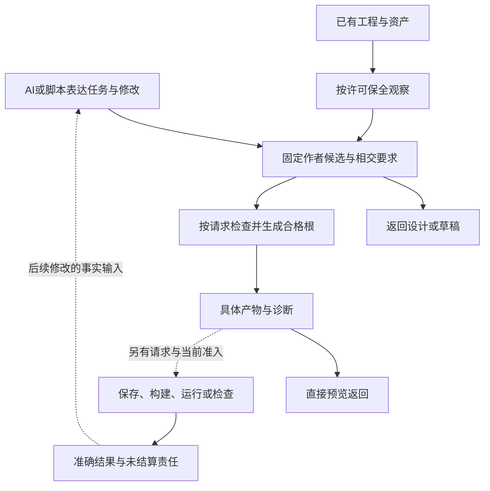

# 全体系能力与边界

**全工程主线：** 从[全部产品要求](产品要求与工作约束.md)、[成品总架构](../../70-工程系统与演进/实现与装配/模块与运行实例-成品装配-实际对象作用域与入口闭合.md#whole-system-assembly)、[真实装配与作用域](../../70-工程系统与演进/实现与装配/模块与运行实例-最终逻辑模块与公开接口.md#runtime-assembly-scopes)、[工程解析与编译闭包](../../30-实现解析/内核/语义方法与整体根.md#whole-project-compilation)进入；[连续开发](../../80-开发者与接口/用途与任务范围.md#whole-project-development)说明开发者实际改什么，源、目标、运行和恢复分别在哪里结束。按当前任务读取相交拥有者，不把一个范本当成全产品范围。

Code-OSS 跨文件搜索、替换预览与应用保留为大型原生 TS 工程校准：它具体检验源编辑、目标服务、模型/磁盘、取消及分项保存；其专有接入前沿不能代替全工程尚未闭合的设计、实现与采用义务。

Gift为AI、脚本及人类客户端提供与目标语言解耦的工程定义、组合和编译机制。工具、文件与媒体处理、交互、自动化及复杂算法可以通过同一公共合同组织，但是否能够实际实现取决于合格的领域Definition、Method、Target和运行能力。游戏、金融、医疗、制造等行业对象与政策由作者工程、库或Provider拥有，Core不内置默认业务。当前优先闭合完整工具开发链；中间件细部延后，但已采用的接口责任不得静默丢失。

当前包范围由根README与各专业正文说明，具体交付由ZIP成员和字节摘要识别；本包不要求读者寻找未运输的manifest或旧工具元数据。包外旧baseline只在其原Revision内有效，不能替代当前输入。本页仅描述产品当前覆盖能力，不将历史制作过程或早期实测作为现行能力依据。

## 无业务核心、标准语义、正式保证与研究边界

Gift 的产品能力是“**让任意工程的独特定义能够被组织、编译、选择实现、生成、受控运行、验证和演进**”，不是“替用户预制所有业务”，也不是“把所有跨行业常见模式都塞进 Core”。当前边界分为五层：

1. **Core Kernel**：只拥有所有工程都必须共享或所有扩展都必须服从的系统级区别——稳定身份/修订、Semantic Contract、Requirement、authority/provenance、组合与引用、实现 Binding、Target/Artifact 身份、Operation/Attempt、Claim/Evidence 接合、受控变更、恢复与演进。Kernel 不拥有行业对象，也不因为某个高层应用模式很常见就提供它的现成 DSL/runtime。
2. **Standard Semantic Modules**：拥有可跨业务独立复用的计算语义，例如类型与函数、对象/控制、状态模型、关系、流与时间、数值和自动微分。它们可以按需加载、单独演进，并由 Kernel 的同一扩展合同治理；**不得组合成一个开箱即用的行业产品或完整业务框架**。未使用模块不进入作者负担、运行时、Provider 或目标闭包。
3. **作者工程与库**：拥有具体业务模型、规则、工作流、算法、资产、产品策略和私有配方；跨行业但已经形成完整应用形态的复合框架也默认属于这一层，而不是因为“通用”就晋升 Kernel。
4. **Implementation / Provider / Target**：提供具体库、框架、求解器、引擎、设备、服务、SDK 与目标工具；Gift 记录真实能力、版本、前提、成本、效果和资格，不把供给者模型反向定义成公共语义。
5. **Assurance**：拥有 Claim、Proof Obligation、Verification Method、Evidence、Coverage 与 Verdict 等正式保证机制，只针对准确主体、实现、Target、环境与用途判断资格；它不拥有行业业务，也不把研究材料自动转成支持状态。

**领域研究与组合研究不属于上述产品能力层。** 它们是同包[依据区](../../../research/README.md)的非权威设计知识输入，用来扩展问题空间、寻找反例和发现区别；只有提炼成准确 Requirement、公共语义、Claim 或区别见证后，才由相应产品 owner 消费。

新增需求的默认晋级路径是：**普通作者定义 → 可复用作者库 → 必要时的 Standard Semantic Module → 只有系统级共同不变量确实缺失时才修改 Core Kernel**。复杂度、行业数量、代码量、商业价值或“很多项目都需要”都不能跳级。公共晋级必须给出当前层无法保持的可观察区别，及为什么更窄的作者库、Provider、Target lowering 或 Assurance 方法不足。

因此游戏、仿真等当然可以被深入研究，但研究结果首先用于反证和组合验证。若一个场景揭示“事件时间”“资源寿命”“随机重放”“模型/现实区分”等真正跨场景机制，只有最小机制进入相应公共 owner；游戏循环、求解器套装、金融账务、医疗流程本身仍由作者组合。

完整行业研究与产品组合研究随包在依据区保留；它们的存在只证明“该问题被研究过”，不证明 Gift 已实现、验证、发行或支持对应业务能力。可复用的公共反例必须另行提炼为[跨域区别见证](../../60-保证与证据/验收/跨域区别见证.md)。

## 产品定位、工程任务与作者决策边界

### Gift 项目定位与系统范围

#### 项目身份与软件目标

Gift 是通用工程编译器。首个实现闭环以 AI/脚本作为 headless 客户端组织工程意图、规则、逻辑、数据、约束、责任和实现选择；人类主客户端的目标拓扑已选择 Code-OSS / VS Code Extension-first，并在实际实施里程碑复用同一语义协议，而不阻塞首个 headless 闭环。可检查的工程模型保存已采纳含义；编译器把能够确定推导的部分展开为实际目标工程。存量工程的精确接入、渐进重建和受控演进，与新工程创作共用这条主链。

Gift 是项目与软件系统的稳定名称。意图表达、原生源码、图形编辑、知识模型、验证与治理分别服务于下列目标；任何单项优化都需要评估对其他已接受能力的影响。

| 目标 | 可观察结果 | 不足以证明达成 |
|---|---|---|
| 高层工程创作 | AI能够表达任务语义、计算结构或事务规则，并控制真实实现条件；不重复维护可推导内容 | 自然语言完整、函数数量或持久服务数量不能单独证明任务完成 |
| 确定性工程实现 | 固定可解释的候选或已采纳模型、规则、绑定和目标可重建实际制品 | 输出接口空壳；每次构建仍临时猜关键行为 |
| 存量工程连续性 | 源字节、依赖和未知边界可保全；已支持区域可重建和演进 | 只收集文件名；拷贝 ZIP 就声称理解 |
| 多目标与往返 | 输出分别说明原生/混合依赖模式与完整/部分/阻塞完成程度；修改有来源对应与差分验证 | 生成新语言包装器却依赖隐藏旧运行时 |
| 工程安全与正确性 | 权限、并发、事务、资源、失败、恢复和验证按实际风险闭合 | 命令退出零；一次正向测试 |
| 可扩展与局部修改 | 新领域/后端/Provider主要通过稳定合同进入；改变相关依赖才失效 | 没有真实消费者的万能插件接口 |
| 生命周期收益 | 相同需求下减少重复决定、重复实现、重复验证和返工 | 代码行、文档数、模型调用数单独优化 |
| 设计积累 | 重要选择可追到依据、替代关系、保留约束与反例；修改有明确处置 | 文件备份或目录映射被当作语义综合 |

#### 输入与产物

输入包括已采纳的工程模型、设计候选、现有工程观察、目标画像、可用能力和质量约束。输入方式包括 AI 工具调用、结构化 API、图形编辑、显式原生语言前端、中立语义文本和有权决定。没有一种序列化或作者界面天然拥有产品中心。

产物由本次输出决定：可以是一个计算函数、完整计算库、设备程序、编译器或应用。源码、配置、依赖、接口、数据模式、检查义务和可恢复变更只在有消费者时生成，不要求每份产物都带数据模式、发布或持久变更。解释、建议、诊断和证据是重要产物，但不能替代用户请求的实际工程制品。

#### 明确不等同的状态

设计候选不等于已采纳定义；定义不等于已有实现；成功编译不等于写回完成；写回完成不等于通过验证；验证通过不等于在所有环境受到支持。每个状态必须以其实际对象、revision和证明范围表达。

不完整工程允许存在。仅当缺口进入所选输出或请求的保证闭包时才阻断该输出；无关模块不因为另一模块尚未设计就失去编译能力。完整输出不得以空函数、默认许可、空迁移或假测试填补必需缺口。

#### 任务语义、业务规则与技术实现

“业务”在事务示例中特指审批、工单、账户与持久领域规则，不作为所有软件的泛称。本文通用表述使用**任务语义**：图像变换、压缩格式、编译器诊断、物理仿真和用户交互都有任务语义，但不因此需要业务实体、租户、Outbox或服务。

大程序不是按函数数划成无数业务。分解依据是独立变化、共享约束、数据结构、计算阶段、资源寿命与接口消费者；一次矩阵乘法和一个审批请求不是同一种Operation。计算本身的正确性、数值、复杂度、存储布局与调度，都是一级工程设计问题，不是补在“业务代码”后面的实现杂项。

三种状态必须分开：Gift管理候选与产物的开发状态、目标算法的缓冲/图/迭代状态、事务应用的持久领域状态。第一种不应被复制进每个目标元素，第二种不自动生成数据库，第三种才按相应事务合同处理。详细计算机制在[计算结构与算法实现设计](../../20-语义与组合/基础语义/计算基础/计算结构与算法.md)。

Gift 开发仓库与用户目标工程是不同的工作区。用于开发 Gift 的 GitHub、CI、测试运行器和工作包是自托管画像，不定义用户工程的业务语义。为目标生成的数据库、框架、运行库也不进入 Gift 通用核心的默认加载图。

首个实现可以是单机工程工具；团队、远程执行、多租户和隔离网按对应用户与风险启用，但其兼容和扩展边界必须预先表达。未来义务必须有来源、触发条件、接受标准和退出条件；它保留设计选择权，不强迫今天部署全部设施。

#### 中立全作者路径与分维度优劣

在已声明支持的语义、库与目标范围内，允许整个应用由中立源创作，目标代码由工具生成；不要求固定比例的原生区域，也不以“成熟库内部是原生代码”将任务转交给作者。已有原生接入是迁移和互操作能力，不是中立表达完整性不足的永久补丁。

Gift的内部复杂度、作者必须作出的决定、模型实际上下文、编译时间、目标运行成本、生态维护和不可逆风险是不同维度。内部更多检查有可能减少错误，也可能只是增加负担；字符更短有可能减少输入，也可能增加含糊与搜索。比较应使用同等正确性、同样成熟库、同样后续变更及真实所需保证；不与刻意徒手展开的程序比较。

全工程“最优”没有脱离目标、支持范围、数据、负载与偏好的统一标量。当前以先满足硬语义与权利条件、再比较相关成本和可替换性作裁决。这个判断不免除继续寻找更好设计，也不将所有内部假设永久冻结。

#### 产品目标与候选设计不能同时被优化器改写

设计比较先固定任务接受域、可观察结果、禁止项和已委派的自由，再比较方案。一个候选能够编译、具有完整文档或更多静态保证，不自动说明它解决了用户原问题。把所有输入拒绝、只支持一个例子、删除错误难例、悄悄增加人工步骤，都可能改善局部指标，却未满足原目标。

质量排序不是无条件逐项最大化的全局字典序。语义与真实权利等硬条件是相应任务的底线；在底线之上，不要求先取得所有可能的证明、隔离和恢复设施，才开始优化当前任务的等待、易用性或成本。硬实时任务把截止期作为硬条件；离线纯函数没有因此引入数据库可用性指标。需要更强保证时明确接受其成本，而不是把当前“正确”暗改为“所有理论都要先证明”。

采用默认为：满足当前不可补偿要求，复用已有合法边界和成熟工具，选择具有明确失败出口的较小实现；只有当前任务有收益依据或必要性时才分层、特化或新增基础设施。决定的有效范围与反转条件保留。新需求或硬反例触及根边界时可以重构；仅出现一个局部更快候选不自动迁移全部工程。

比较覆盖创建定义、第一次生成、再次修改、错误定位、采用/运行与退出。完整费用按[组合预算](../../30-实现解析/增量与性能/性能预算与复杂度.md#端到端预算的组合规则)计算，相同输出接口下仍检查格式转换、共享资源和后续成本。没有相关数据时报告条件选择，不制造“综合分最高即最优”。

#### 作者负担不能以规范完备抵消

中立语义、多目标和开发者自由是产品目标；词法、纯函数式表面、显式字段和具体语法是实现手段。细网格函数可以说明可表达与可检查，但不能证明比采用同等类型、边界、数值与库的成熟语言更省工作。不得从“新语言已有文法”推导“作者应该迁移”，也不得从“由个人或小团队设计”推导“任何局部优势都不可能”。举证责任在新增机制一方。

结构有三种用途：内部结构帮助工具分析，源码结构帮助维护，任务结构帮助开发者只决定当前需要的事。模块、语法树或关系图存在，只能说明前两种有相应表示，不能自动证明第三种已成立。若作者仍需同时处理原算法、额外类型转换、画像选择、重复合同和后端约束，则系统可能比对照增加负担。

对所选任务，先区分作者必须给出的独特含义、已有源能推导的内容、已委派的实现自由、真正未决定的产品选择。工具承担后两类中的合法解析与选择，但不得伪造缺失的事实或隐式改变风险。已有字段、签名、效果与关系不重复录入；真正独立的需求不会因实现可观察而被删除。需要审查的细节可展开，不要求常规任务重新决定所有内部策略。

正式采用一种作者形式，必须同时展示相同任务和保证的成熟语言/库基线，及Gift的首次创作、下一次参数改变、一次非预装结构变化和故障修复。分别记录需要的新决定、需维护的独立事实、实际修改位置、必须读取的合同、诊断成本、构建/运行和迁移成本。定义制作、库开发和后端成本不能从总成本里消失，冷启动不能与已熟悉基线或暖缓存混比。没有真实数据时，只能裁决明显的重复与强制前置，不能给出总收益数字。

采用门槛不是每个示例都必须字符更少：更强保证可能合理增加说明；收益要绑定用户确实要求的保证。若满足相同要求时一种方案仅多了包装、同步点和新概念，又没有其他实质收益，它不应成为强制路径。若有多维权衡，明确当前任务选择而不是造任意总分。这个门槛不撤销零原生作者目标；对应中立作者面不合格时应修抽象和交互，不能把问题默认退给开发者写另一语言。

#### 范式、表达规模和抽象收益分别验收

面向过程、函数式、面向对象和声明式是不同组织机制，不能按名字判高低。程序通过函数封装本来就可以获得抽象；函数式递归也可能暴露过多实现；一个声明式调用只在真实合同把实现自由留给工具时才减少作者决定。支持while不意味着所有任务都应当写循环；支持maxByKey也不意味着独特算法再不用代码。

完整语言、库词汇、目标描述符、项目公开接口和当前任务上下文分别记录。关键词数量有限不证明学习容易；库名不计为关键字也不使其含义零成本。不能通过把特殊机制改成普通函数或JSON键，在统计上得到“语法没增加”，却隐瞒新增的使用、错误和维护责任。

判断一个抽象是否达标，固定完整任务和同等成熟工具，比较作者必须作出的独立决定、需要持续维护的独立事实、一次变化涉及的位置、所需概念和交互，及新库/编译方法的成本。行为、资源、目标生成与诊断也必须满足；不把不同量纲编成任意总分。

| 检查 | 合格方向 | 不合格反例 |
|---|---|---|
| 结果关系 | 已覆盖任务主要表达所需关系与独特参数 | 每次“每组取最大”都编写相交的嵌套扫描 |
| 实现自由 | 合同外的算法、缓冲和容器由工具合法选择 | 所谓高层表单仍要求填全部循环和临时结构 |
| 独立控制 | 真正影响结果的筛选、平局、范围显式或准确继承 | 用“智能选择”隐藏未决定行为 |
| 变化局部性 | 参数/组合变化只维护一个作者位置和真实消费者 | 参数在源、意图JSON、生成策略中同步三份 |
| 总体负担 | 计算库创建与维护、模型读取、失败修复和目标成本 | 只统计暖会话短句柄或第一次生成 |
| 反例与退出 | 普通算法仍可直接写，低效表面可以修正 | 为维护词数拒绝循环，或为维护DSL而禁用成熟库 |

在相同任务/保证下，若方案只是给原程序增加语法、描述符和同步，没有独立收益，就不应强制采用。多目标、资产联动可以构成额外价值，但必须作为单独维度证明；不能由它们自动抵消作者面明显多余的成本。高层主体与过程基线并存时明确谁是推荐调用面、谁是实施或自由定义见证，不能以基线可表达就关闭作者简化问题。

[SICP过程抽象](https://sicp.sourceacademy.org/chapters/1.1.8.html)说明函数本身可以隐藏实现；[数据抽象](https://sicp.sourceacademy.org/chapters/2.1.html)强调使用方只依赖所需数据性质。这些是对范式标签和表示泄漏的机制参照，不是本系统采用收益的证明。

#### 设计取舍与反证

固定模板最便宜，但难覆盖独特业务与存量工程。纯 AI 直接改代码灵活，却难稳定保存已接受的工程关系。强制新 DSL 有可分析优势，也有生态和作者成本。本设计采用共享语义、多个入口与分层生成，代价是模型协议、映射和目标适配需要长期维护。

若真实任务证明建模成本长期超过避免的重复工作，相关领域应允许直接原生实现或更轻模板；若新目标必须修改全部核心算法，则扩展协议应被重设计。任何这些局部裁决都不自动改变 Gift 的完整产品追求。

### 工程目标、使用场景与成果类型

#### Gift解决的工程问题

Gift把原本散落在需求、源码、配置、依赖、测试、运行事实和人员判断中的工程含义组织起来，支持AI与人设计、存量重建、确定性推导、目标生成、受控修改、验证、恢复和长期演进。源码是重要产物，但不是全部成果；档案、实验或模型表也不是产品目的。

#### 不同“模型”不可混称

| 名称 | 谁产生 | 用途 | 不代表 |
|---|---|---|---|
| AI基础模型 | 模型提供方 | 理解、候选推理、编写、反例搜索 | Gift的规范、事实根或权限根 |
| 工程设计候选 | AI、人、规则或导入器 | 表达意图、行为、责任、数据、约束与待决选择 | 已经被项目接受或可以执行 |
| 已采纳工程模型 | 通过采纳协议的设计事务 | 成为解释、生成、变更和验证的确定输入 | 每个目标都已有实现；全部现实已知 |
| 编译中间表示 | 编译器按固定规则推导 | 服务特定分析、降低和制品生成 | 作者必须手工填写的全部表格 |
| 运行状态模型 | 目标系统观察/状态owner | 描述订单、任务、资源等实际状态 | 工程设计自动被运行事件重定义 |
| 手写试验模型 | 参考实验作者 | 检验某个接口/生成规则/事务机制 | AI已经能自主组织完整工程 |

能力报告分别说明设计候选生成、模型采纳、IR 推导和目标制品生成。手工试验输入的执行结果只能支持其已覆盖的机制，不能用作 AI 设计质量证据。

#### 交付给设计者的内容

交付应首先使读者可以判断当前方案如何工作、为何如此选择、什么场景会失效、怎样扩展及何时改变决定。图、接口、状态机、算法、失败、性能、恢复和权衡服务于这件事。

研发实验用于检验方案，原文用于追溯。它们不能挤占当前设计，更不能通过样例数量、归档容量或测试总数替代工程综合。另一方面，不能因为一个样例对用户没有直接使用价值，就取消Gift原本的代码生成能力或所有验证实践。

#### 工程创作、存量演进与验证反馈

本图表示产品用例可选分支，不是用户必须完成的流水线。首个 headless 闭环客户端为 AI/脚本；已选定的人类主客户端在其实施阶段复用同一候选、权限和效果合同。候选无需先正式采纳即可在其合法范围生成，实际运行不由预览自动触发。
已有工程不能被迫重写后才接入；已明确模型不重新调用AI猜实现；需要设计的缺口不能由模板隐藏默认值填充。可复用库优先于重复生成大量实现；独特算法可在明确自由包络内创作并固定，然后进入相同验证与构建链。

#### 工程综合的验收

每项重要选择都能回答：旧问题是什么、哪种机制解决、较简单替代为何不足、采用了哪些假设、代价由谁承担、最强反例是什么、需要哪种证据、什么条件导致局部修订或根迁移。没有这些信息的术语和目录不计作设计完成。

#### 控制协议的术语和图示记号

以下术语用于阅读现行协议，具体数据联合和转换规则仍由原规范拥有；不新增公共API或运行时字段。图中的短符号只在该图声明的对象域内有效，不视为另一套全局标识。

| 术语 | 在本规范中的具体含义 | 必须区分的对象 |
|---|---|---|
| 状态所有者（state owner） | 有权串行化某个对象状态转换的实现责任方，可以是对象、模块或受信服务 | 组织负责人、资料作者、物理机器以及只有读取权的观察者 |
| 实例代（generation） | 同一逻辑键下的一次实际对象实例；比较时使用不可混淆的身份 | 内容修订、协议版本、重试编号、权限及外部操作身份 |
| 线性化点 | 一个并发操作对同一协调域呈现生效的确定点；图中由critical片段或明确比较更新标出 | 网络发出时刻、回调到达时刻、磁盘耐久点及跨服务全局事务 |
| 使用保护（pin） | 对已固定实例及其实际依赖持有的存活责任，直到最后相关使用结束 | 对旧代码执行效果的授权；安全撤销仍单独检查 |
| 排空（drain） | 关闭指定的新准入后，完成、取消或移交已经接纳的工作 | 无条件等待所有未来输入，或者立即释放所有对象 |
| 结算（settlement） | 将结果、资源、外部接受状态及后续恢复责任核实并分别归属 | 函数返回、请求超时、进程退出或只得到成功状态码 |
| 观察切面 | 明确对象、成员、版本或位置范围内取得的一次观察基础 | 任意来源的同时快照，以及其后一直有效的当前状态 |
| 依赖闭包 | 对指定边类型和起点按其传递规则求得的依赖集合 | 工作区全部文件、组织清单或无边类型的一张总图 |
| 支持判定 | 当前证据在其前提和覆盖范围内能否支持某项具体义务 | 命题必定真／假；依据不足不等于已找到反例 |
| 受影响范围 | 因准确输入、规则或支持变化而需要重新检查的消费者集合或健全上界 | 仅按同名、同目录或最近修改时间推测的范围 |

“已记录、已设计、已实现、已检查、已采用”必须带实际对象与范围；任何一项都不能直接替代后一项的证据。规范中的要求强度不由形容词决定：必须项说明承担主体、触发条件、动作和禁止后果；建议项说明取舍与允许偏离的条件。表示行为的箭头标明是数据传递、调用、状态转换还是静态依赖，不能以一条未说明的边兼指全部关系。

## 作者表达、目标与交付边界

### 作者源、产品规格与候选的准确含义

本规范把口语中的“设计源码”收敛为**作者源**：开发者用Gift定义自己目标程序或工程的文本、结构化定义及其明确原生资产。当前产品意图主面选择结构化AuthorModule语义；具体区域通过SourceProfile承载，严格JSON是可选结构profile，`.gift`是可选计算/实现文本前端；表示选择不替代用户的简洁与开放目标。它是产品交付以后AI实际创建、读取和修改的内容，不是Gift实现者维护的这套Markdown设计书，也不是后端已生成的TS/Java文件。

同一份作者源可以只给类型和要求、尚无行为实现，也可以给出足以生成的函数或工程声明。这是内容的完成状态，不能因此说作者语言本身还没有选。设计书中的`.gift`围栏是可选计算作者前端的规范样例；只有真实工具处理过具体输入，才有对应候选、制品或运行证据。

| 对象 | 谁使用、保存什么 | 怎样改变 | 不由它证明什么 |
|---|---|---|---|
| Gift产品设计规范 | 本包保存语言、编译、工具和宿主的当前选定设计 | 规范修订、理由和相交消费者一起改变 | 存在软件实现或当前账户授权 |
| 作者源 | AI保存目标工程的独特定义、规则、算法和接受的选择 | 编辑实际源或有前像的差异 | 所需库/后端已实现、全部要求已满足 |
| 作者候选快照 | 一次具体编辑的不可变内容；一个候选也合法 | 新编辑产生新快照；选择关系可以指向它 | 需要另造多套程序比较、必须先审批才能预览 |
| 编译表示和计划 | 从源、任务和固定绑定派生 | 输入变化后重算或合格复用 | 第二份需要作者手工维护的源码 |
| 目标产物 | 精确生成出的代码、配置、映射和相应引用 | 从相应源重建；接管编辑权要显式处理 | 已检查、已写回、已运行或已部署 |
| 实现备选 | 在同一任务约束下比较的算法、提供者和目标安排 | 有范围的设计/绑定选择 | 普通每次编译都必须全局重新选择 |

“候选”必须带对象说话：**产品方案备选、作者内容快照、实现路线备选、待采用产物**不是同一个状态机。当前产品采用的结构化AuthorModule语义是实施基线；具体SourceProfile可按区域选择，可选`.gift`只在相应计算或实现任务中适用。两者的成本与使用效果未验证，不等于每次任务都重新选择作者形式。后续改结构合同或可选文法必须明确解释、范围、理由和迁移，不能靠把所有东西永久称为候选来规避决策。

这里也不将作者源等同自然语言承诺。可以保存未形式化需求作为原始要求；确定构建消费已给出明确解释的部分。需求尚未确定时，服务指出相交选择；已明确时，服务执行解析和生成，不让模型每轮重新猜测。

### AuthorSourceProfile：表示选择不等于语义身份

**作者源**是某个作者区域当前唯一可写、可持续演进的真实内容；`AuthorSourceProfile`说明该内容怎样解析、保全未知、产生SourceMap、完成最小编辑及迁移。结构化模块是逻辑作者合同，不等于必须把内部SemanticModel序列化成JSON供人维护。

当前可用的Profile可以包括严格JSON结构模块、`.gift`计算文本、实际原生语言和其他经符合性验证的结构/文本前端；同一语义体系允许不同区域选不同Profile。工具和AI优先操作语义动作，再经SourceMap写回真实owner；内部AST、类型树、hash、QueryIndex row和目标IR都不是作者必须填写的第二源码。

### 完整工程能力与最小作用范围

产品的“工程简化”至少要让一个**由作者实际组合的能力**贯穿定义、规则、真实提供者、目标、作用、失败与连续变更；一个纯函数或一个 Schema 通过不能代替完整出口。Gift 不用预制业务画像证明这一点：事务型应用组合研究只是把多个公共机制拼在一起攻击闭环，小函数仍保持独立，也不要求所有工程变成分布式系统。

整体最优以具体目标和约束裁决。优先取消重复作者源、隐藏业务决定和无消费者设施；保留真正的权限、数据一致性和恢复责任。原生＋成熟框架同样可用，性能与维护比较采用同等正确性；代码更短、关键词更少或文件更多都不是单独的产品成功判据。

作者定义中的应用操作、运行层 `Operation` 与开发工具的工程修改操作是三个不同语义域；它们只能通过类型化引用接合，不能因名字都像“operation”就共享裸身份。组合研究里使用的 `aggregate/decision/subscription` 只是局部示例词，不是 Gift 全局 kind，也不能反向规定业务架构。

### 意图、确定含义与自动实现不是三个强制作者层

**意图是开发者希望成立的结果、关系和限制；语义是相应表达在固定解释下允许哪些行为。**同一份精确意图可以直接承担语义定义。生态成熟所要减少的是作者反复书写可共享的含义、低层实现和重复决定，不是让系统没有语义，或把尚未决定的行为隐藏到生成器中。

下面三种开发均为正常路径，不按贡献者永久分工：使用已有定义时只写实例差异；现有定义不够时用同一作者语言定义局部行为与组合；确有新基本含义时完成相应扩展的规则与后端。一个开发AI可以在同一任务中承担前两种；第三种只有在该任务确实授权扩展产品时进入。普通新业务不必修改Gift核心，库作者也不必把小函数命名为“大意图”。

#### 成熟生态里还需要作者提供什么

| 情况 | 作者实际需要给的内容 | 系统负责的内容 | 不能从中推出什么 |
|---|---|---|---|
| 定义与项目约定已覆盖要求 | 调用对象、实例参数和本次真实差异 | 解析已绑定定义、继承缺省、类型/效果分析、选定实现与生成 | 每次必须重读库全部实现或手填派生关系 |
| 行为已有明确合同，但多个实现合格 | 可以完全不点名目标轮子；需要时增加硬要求或偏好 | 在授权候选内选择并固定实际Binding | 多个实现等于意图有歧义 |
| 新的业务差别尚未决定 | 写明或接受这一差别；允许委派时由AI作有依据的明确选择 | 展示最小区别、推荐、影响与缺项 | 一个未定输入自动等于false、零或任意最佳实践 |
| 存在独特算法或可复用结构 | 在该区域已选作者表示中建立函数、类型或组合：结构化语义体、可选`.gift`计算文本或明确原生源均按各自合同使用；必要时局部具体化 | 保持绑定、检查与后端责任；独特行为成为新的可复用定义 | 自由表达只能通过原生补洞，或每个新算法都须新增关键字 |
| 实际状态、权限、数据或设备未知 | 给可获得的真实来源，或接受明确条件设计 | 有权观察并按当前阶段使用 | 文本说“安全”“最快”“已授权”就得到现实事实 |

**精确不要求唯一机器程序。**固定观察范围的稳定排序可以由多个算法实现；这只是实现自由。反之，“让结果更好”而没有误差、排序、约束或已授权目标时，仍可能有会改变任务的含义未定。允许的行为集合可以有意保留选择，但需要由合同或委派明确谁有权选择。

单一作者源也不要求删除独立需求。用户请求、已有接口或接受的政策确实独立约束实现时，保留其实际来源与版本；若函数源本身已是唯一要求，则直接引用它，不复制一份Requirement文本。原始自然语言可以作为解释来历保留，确认后的具体语义由对应作者区域拥有；后续编辑不得让原始摘录和语义源各自成为竞争规则。

输出区分目标程序、配置、资源与实际执行。短源码只要求程序内容；完整发行才闭合所有必需成员；代码已生成不表示文件已采用，文件已采用不表示目标业务已执行。完整处理由[完成与缺省算法](../../20-语义与组合/组合/跨软件需求合同.md#意图进入同一作者源的完成与缺省算法)和[作者闭环](../../80-开发者与接口/需求到交付主链.md#意图优先开发的实际闭环)规定。

#### 生态成熟的判据不是模板数量

成熟生态至少要有可复用的精确定义、可扩展的组合与局部下探、实际目标实现、固定解释与版本、可用诊断及升级路径。新增未引用库不应扩大当前任务的模型输入或重建范围。用共享定义少写重复内容是收益；将工作移给另一个AI每次临时猜程序不是确定重建。对照须允许成熟语言使用相同等级的库与工具，比较完整冷暖任务和连续变化。当前未执行这种收益实验。

### 复用减少新增责任，短视图减少重复交互

当前质量目标分两项判定。**实现复用**衡量哪些成熟能力原样采用、Adapter承担什么差额、哪些既有证据真正覆盖而无需重做。**操作减负**衡量作者维护、冷启动、每次必要阅读、输入输出、修错和恢复的总成本。复用库多不等于产品已正确；工具参数短也不等于作者源已简洁。

“真实完成”应说明完成的是设计修改、工具实际运行还是目标工程实际采用。本设计包的修订可以是真实文档工作，但没有运行Gift就没有实际产品运行结论。条件已足够的设计应立即裁决，不以一切都待测试拖延；真正的耗时、可用性或已发生效果要由对应事实取得。

### 合同代号与作者动作的明确区别

`gift.object/1`表示对象语义合同的第1兼容代，不是.object文件、对象版本或独立服务。`gift/object`表示导入模块，`gift.object-body/1`表示结构编码；规则内容和方法实现另有精确修订。它们的[完整解释与默认组合](../../20-语义与组合/基础语义/计算基础/紧凑表示与程序范式.md#合同标识默认语言组合与按需能力)由语言章唯一维护。

统一的判据是作者源、模块/类型/效果、当前解释、变更和目标接合使用同一套规则；不是将所有状态改成一个容器。收束的判据是当前范围可从入口落实到数据、算法、错误、目标与验收设计；不是要求所有未来库完成，也不是给每个新词追加一个引擎。编码准入、本地可用、生产采用分别判断。

## 成品从哪里读

[成品总体架构](../../70-工程系统与演进/实现与装配/模块与运行实例-成品装配-实际对象作用域与入口闭合.md#supply-product-shape)先区分作者工程、成熟实现、Gift自身和目标产物；[物理接口与数据](../../70-工程系统与演进/实现与装配/源绑定与解释映像.md#supply-physical-layout)给出实际文件职责、联合类型、调用与状态所有者；[编译主链](../../30-实现解析/内核/编译值服务.md#supply-aware-compile)把它们接成可实施步骤。

当前采用一套作者/导入链接和多目标生成路径：产品以意图/Block定义、参数、管脚和要求表达；选定SourceProfile经前端直接进入共同SemanticModel，严格JSON只是可用profile之一；普通使用不展开已封装实现。所选计算文本、原生源和供给保留，缺新算法不强制创建镜像库或全局Host容器。自然语言用于创作并形成准确候选，固定构建不重新猜；图形画布可不实现，类型化连接的含义仍保留。

六工具和既定十个逻辑模块保持。普通本地任务不先建设数据库、消息、独立VM、人类编辑器或公共包市场；中间件细节暂缓不删除已有作用的恢复责任。当前有限语言与成熟工具怎样选择的完整理由见[D02](../../90-治理与参考/决策/设计理由-产品作者与语义.md#d02-中立语义与可替换作者表示)。

## 产品主线与独立维护路径

新产品主线是准确表达工程目标和独特选择、组合可复用定义、取得合格实现并生成完整产物；见[跨软件需求关系及开发修改](../../20-语义与组合/组合/跨软件需求合同.md#cross-software-intent-contract)。[简洁计算写法与补全](../../20-语义与组合/基础语义/计算基础/紧凑表示与程序范式.md#compact-author-contract)、TS/JS原文维护及生成后的受管回源是独立有效路径，不是新产品必须先完成的前置；该路径仍应保持简短来源和准确行为。用户目标语言与Gift自身实现语言分开裁决：TypeScript与Rust已纳入通用目标计划；C/C++、Rust原生供给及其他语言接合仍按真实任务和角色选择，Java不自动成为当前前置；[目标语言路线](../../70-工程系统与演进/演进与实施/实施/主线前沿-作者主线与实现责任.md#language-roadmap)只决定用户成品能力，不改变公共语义。Gift自身compiler kernel的物理实现由[实现语言与机制演进](../../70-工程系统与演进/演进与实施/实现语言与机制演进.md#compiler-kernel-rust-substrate)独立拥有，不能再从目标语言名单推断其实现语言。

完整开发范本展示直接源编辑、完整文件批次和受管目标回源；[操作协议](../../80-开发者与接口/工具协议/六工具与请求-工具边界-任务与作者输入.md#proposedraft与普通文本编辑的准确分工)是机器交接，不要求每次手填draft。[写回机制](../../40-目标与制品/表示/编辑与受管回源.md#managed-edit-roundtrip)定义数据和算法；[工具入口](../../80-开发者与接口/工具协议/六工具与请求-工具边界-任务与作者输入.md#generated-edit-request)定义准确输入与返回。Java条件例和已有源资料保留，但不代表当前必须交付Java。

Markdown与其中的图源是唯一规范；浏览器图册只在确有阅读用途时按[同源规则](../../90-治理与参考/维护/图表与阅读派生.md#derived-reading-view)生成，可以是节选。没有新HTML不影响本包完整性，旧版HTML不随本包自动升级。

跨软件完整范本覆盖名称映射、当前结果发布和逆关系维护，给出共同结构、领域算法与再次修改；短源范本单独检验类型和表示补全；[签名与阶段算法](../../30-实现解析/内核/编译值服务.md#concise-author-elaboration)说明未写的信息怎样真实取得。已有函数值和普通fn共用编译器，不再要求作者手写推导类型、满注解转发和同义配置。

## 当前实现接合：需求关系、简洁作者与完整结果

[需求到具体计划](../../30-实现解析/实现选择/实现要求与正常绑定.md#executable-intent-plan)给出真实作者差异、方法前提和供给；[整批物化与重基](../../20-语义与组合/组合/结构编辑/作者权切换并发与往返.md#whole-change-materialization)保留并发的无关工作；[类型与效果封存](../../30-实现解析/内核/编译值服务.md#callable-effect-closure)使省略签名的作者源获得正确调用资格；[按根义务](../../60-保证与证据/保证/要求证据-要求主体与声明范围.md#intent-root-obligation-closure)防止局部成功冒充完整需求。

整体范本把正反关系、当前结果发布、源码/资产修改和运行版本放在同一个工具内。原短源、函数值、精确编辑、成熟供给和TS回源继续成立，不要求新增文本语言、全图画布、需求数据库或第二语言排程。

## 分层图解与具体能力

图解直接放在机制拥有者处：先看[系统边界与模块](../../70-工程系统与演进/实现与装配/模块与运行实例-成品装配-实际对象作用域与入口闭合.md#fig-product-context)，再看[静态依赖与装配](../../70-工程系统与演进/实现与装配/源绑定与解释映像.md#fig-package-dependencies)、[编译阶段](../../30-实现解析/内核/输入与阶段总览-阅读入口与实现身份.md#fig-compiler-data)、[作者与管脚](../../20-语义与组合/组合/结构编辑/结构模型与绑定读取.md#fig-pins-detail)、[完整计算与连续修改](../../20-语义与组合/基础语义/计算基础/计算结构-程序与实现布局.md#fig-computation-types)。各图给出目的、边和省略范围，不只画一个总览。

[对象构造与分派](../../20-语义与组合/基础语义/对象与控制/对象构造与分派.md)、[本地流与事件时间](../../20-语义与组合/基础语义/状态关系与流/背压与事件时间.md)、[自动微分与数值线性化](../../20-语义与组合/基础语义/数值/自动微分与线性化.md)拥有对应有限完整设计。它们与已有状态、关系共享成品模块，不产生另一套开发平台。

## 开始一项任务

首次进入或恢复时，读取[AGENTS](../../90-治理与参考/维护/设计任务规则.md)，实际取得[全部已知要求](产品要求与工作约束.md)及[根原则](原则总纲与归属.md)，按[装载与动作检查](../../80-开发者与接口/AI协作/规则装载与任务恢复.md#任务启动的原则装载与动作检查)筛查范围。随后读取本任务的机制拥有者、接口与消费者；不是逐章顺序读完整包，也不是只读短入口就假设全部规则已加载。

当前采用与未采用方案由[作者基线](../../10-作者与输入/作者源/可替换表示与适用范围-语言定位与作者基线.md#当前作者面实施基线与决策状态)及[D02](../../90-治理与参考/决策/设计理由-产品作者与语义.md#d02-中立语义与可替换作者表示)唯一维护。用户目标不因技术提醒而改变；当前选择有新反例才重新裁决，不在每次编译重选整个产品方向。

## 按实际工作进入

| 本次要完成什么 | 从哪里取得完整规则 |
|---|---|
| 核查范围、约束冲突或恢复任务 | [要求正文](产品要求与工作约束.md) → [冲突裁决](原则总纲与归属.md#约束冲突的裁决顺序) → [装载协议](../../80-开发者与接口/AI协作/规则装载与任务恢复.md#任务启动的原则装载与动作检查) |
| 理解成品怎样工作 | [总架构](../../70-工程系统与演进/协作与状态边界.md) → [模块与装配](../../70-工程系统与演进/实现与装配/模块与运行实例.md) |
| 写定义、库与局部变化 | [语言](../../10-作者与输入/作者源/可替换表示与适用范围.md) → [结构编辑](../../20-语义与组合/组合/结构编辑/README.md) → [封装与库](../../20-语义与组合/组合/模块封装与复用库.md) |
| 变量、循环、资源与局部运行 | [控制与寿命](../../20-语义与组合/基础语义/对象与控制/控制流与存储寿命.md) → [即时运行](../../80-开发者与接口/工具协议/构建运行接口.md#从候选直接运行的有限扩展) → [最小工程](../../10-作者与输入/作者源/工程源/作者工程与输入边界.md#实际工作区及其默认所有权) |
| 设计完整的小工具或计算应用 | [计算工程](../../20-语义与组合/基础语义/计算基础/计算结构与算法.md) → [开发操作](../../80-开发者与接口/用途与任务范围.md) → 连续示例 |
| 编译、选择目标及稳定输出 | [编译实现](../../30-实现解析/内核/输入与阶段总览-编译责任-阶段与目标.md) → [目标组织](../../40-目标与制品/目标/成员布局-完整装配与布局.md) → [公共接口](../../80-开发者与接口/工具协议/六工具与请求.md) |
| 查询诊断、构建运行或写入 | [工具合同](../../80-开发者与接口/工具协议/六工具与请求.md) → [实际准入](../../50-执行运行与观测/权限与资源/README.md) → [恢复](../../50-执行运行与观测/持久化与恢复/README.md) |
| 查当前欠账与下一份交付 | [未决前沿](../../90-治理与参考/状态/README.md) → [实施闭包](../../90-治理与参考/状态/实施闭包.md) → [优先前沿](../../70-工程系统与演进/演进与实施/实施/主线前沿-工作组织与成熟度准入.md#问题优先级与当前可推进前沿)；未闭合设计回准确 canonical owner |
| 修改规范并交付 | [文档规则](../../90-治理与参考/维护/规格写作与完整性.md) → [交付检查](../../90-治理与参考/维护/组织修改与来源保全.md#交付前的约束与正文检查) |

箭头是阅读的责任接合，不是自动执行链。选择预览不授权运行，写出计划不表示已实施。按实际输入补读其他相关章节；无关能力不变成全局前置。

## 完整责任目录

产品范围不再维护另一份所有规范的目录。完整领域/接口/研究/实施责任以[全责任目录](../导航/主题导航.md#完整责任目录与全责任领域入口)为唯一阅读入口；真实设计仍由对应正文维护。

## 支持与未完成状态

正文中的当前设计、接口、语法和算法具有确定的范围；实现、运行符合性、实际采用与收益须有相应依据。有限对象、流和AD已有具体设计；更广动态对象、分布式时间、硬实时目标及其他微分数学的剩余由相应语义 owner 维护；已定范围的实现/证据缺口见[当前实施闭包](../../90-治理与参考/状态/实施闭包.md)，当前不采用的SDK不变成待清零的实施任务。

规则已写入不等于所有客户端自动读取；读取完成不等于所有语义已证明；检查结果只支持实际对象与方法。设计任务能够直接改文档与复核，不能以“要验证”为由自行扩成产品实现。需要真实执行的任务另按授权处理。

## 全体系信息的责任入口

[总体结构](../../70-工程系统与演进/信息与生命周期/全体系信息结构.md)区分作者真源、身份选择、查询投影与目的性保留；[类别路由](../../70-工程系统与演进/信息与生命周期/信息类别与生命周期路由.md)承接源码、规范、来源、决定、证据、数据、运行、协作与退出。[对象/配置](../../70-工程系统与演进/信息与生命周期/对象关系与配置基线.md)、[接入/检索](../../70-工程系统与演进/信息与生命周期/接入检索与派生.md)、[保留/恢复](../../70-工程系统与演进/信息与生命周期/存储保留与恢复.md)分别拥有具体协议；[文档重组](../../90-治理与参考/维护/文档身份与重组协议.md)负责实际可核移动。这些规范不替换本篇已保留的产品路线、核心模块或公共语义设计。

## 最终完整系统范围：中立Core、作者业务、外部供给与专业工程交付

**正式范围判断**：Gift 提供可计算且开放组合的软件表达、源/绑定/目标/作用/证据与长期演进机制，不向所有用户提供已存在的 Editor、Order、Payment、仿真或设备业务实现。一个用户独有算法可由其本人定义，一个成熟库/Provider可以被精确复用；Gift 不必因为某种业务尚无专用库便不允许作者创建。程序计算普适不等于“任何一句自然语言都能自动实现世界上的所有软件”，公共Port也不是现实资源、许可或硬件已可用。

对专业目标工程，“完整”至少可能意指四种不同产出：**规范与需求**、**可交实现工程蓝图**、**真实生成并可构建的源码项目**、**有运行/部署/维护证据的合格系统**。仅设计型任务交付前两类规范及蓝图；源码生成、构建、运行与部署属于各自独立的实施和取证工作，只在任务明确要求、具备合格实现方法及必要授权时执行与验收。模型、类型和布局设计可用静态推演、反例检查和原文保全审阅；不存在目标产物时不能跑目标语言typecheck，更不能把无关业务样例的test PASS说成Gift的能力。

完整蓝图不固定某种文件夹模板：普通单函数可以只有一个导出；VS Code级系统会有文本模型、Workbench、扩展宿主、语言/调试协议、远程服务、终端/SCM、不同运行时及发行/升级。所有这些经作者定义、逻辑组合、真实实施供给和Target/环境要求组织；具体文件/进程/包按目标生态和被请求边界决定，而不是照搬Gift自身代码层。实现不足以覆盖某个部分时，局部已有设计仍保留，完整性与Needs精确按请求根判定。

## 完整通用机制与当前有限可验证部分

通用计算能力、开放Requirement定义空间和任意领域可组合，不推出系统已自动拥有该领域的可执行方法。当前受限的call-bound Rule正文仅描述一个**可观察调用**，不能默认为状态机、持续服务、实时设备、交互流、物理测量或分布式协议提供完整观察语义。后者必须绑定各自的标准/第三方语义Provider，并保留正常、失败、帧、进展与环境约束。

可递归定义任何新业务规则，仍然不改变 Core 的八项RequirementTerm或Target种类目录。普通业务作者可只使用复用的Rule/Profile；Rule库维护者提供准确字段、观察域与谓词接口；Method维护者证明覆盖域与残余；Target供应商证明目标保持条件；部署者另有真实Grant和实际运行输入。单靠用户JSON与样例Schema，不能为这些不同主体颁发合格资格。
