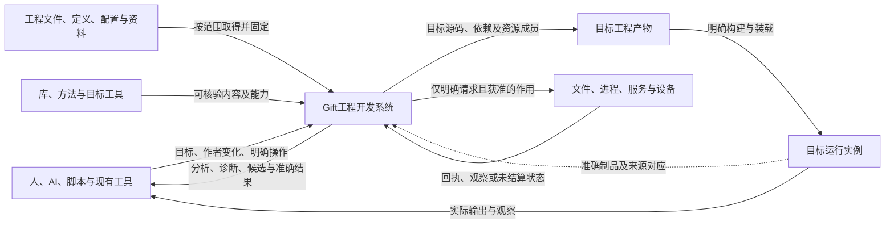
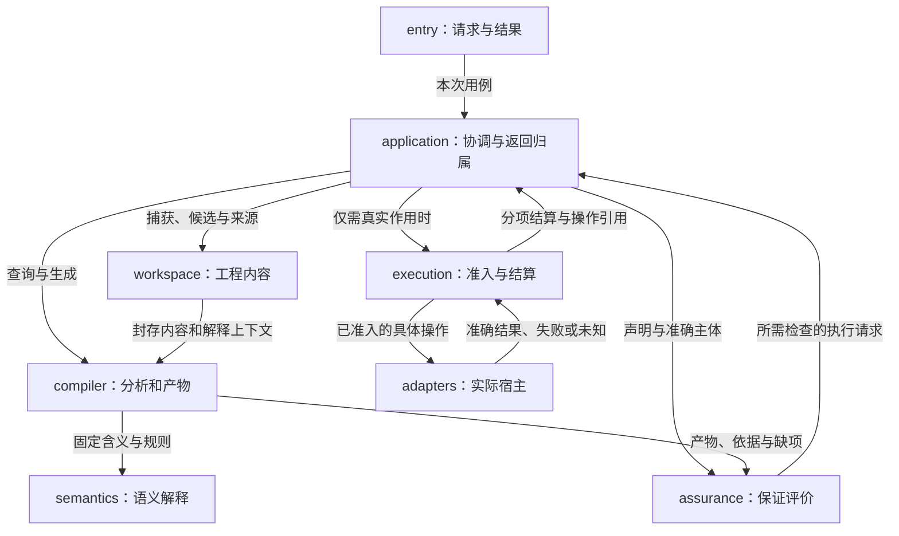

# 总体架构

本篇说明Gift在环境中的位置、完整系统的责任划分及跨责任交接。它是系统级视图，不新建产品模块、公共协议或第二套规范；精确字段、状态算法和方法由链接的原规范拥有。产品目标见[产品要求](产品/产品要求与工作约束.md)，当前表示与实现选择见[决定](../90-治理与参考/决策/设计理由-产品作者与语义.md#d02-中立语义与可替换作者表示)。

## 系统交付什么

**统一作者来源**：当前区域可选择结构化 JSON、原生 Rust/TS 或获准的 `.gift`，但每个相交作者区域只有一个可写 SourceProfile；Rust SDK 只构造或编辑受检候选，不能暗中成为另一份构建真源。表示的选择和交接取[统一作者工程与多表示协议](../10-作者与输入/作者源/工程源/统一源码工程与多表示作者协议.md)，运行、Target 与 Assurance 保持原 Owner，不新增强制的“全系统唯一语法语言”。

Gift把工程目标、可持续维护的作者内容和可用实现，转换为具有明确来源与边界的目标工程，并支持后续修改、检查和获准操作。输出可以是分析、未完成但可保留的设计、实现候选、完整产物或实际操作结果；本次目的决定终点，不要求每次请求经过全部阶段。

作者源保存工程独有的业务决定；明确委派的实现细节由已获资格的定义、Method及工具处理。存在满足合同的实现时优先复用；不存在时保留带来源的实现义务，交由后续合格供应或获准的实现任务解决。业务作者无需先补写底层程序，编译器也不得把尚未实现的引用当成成功绑定。目标工程仅包含本次交付需要的业务代码、依赖和资源，不默认附带Gift开发控制系统。

Gift Core 只规定跨域身份、类型、Requirement 组合、实现资格、目标装配、运行治理及证据机制；游戏、金融、医疗、制造的实际事实、规范和业务规则仍由其有权作者、领域定义或 Provider 提供。研究材料只能生成候选与反例，不直接获得 Kernel 身份或 Assurance 资格。扩充公共原语须先证明现有构造与开放 Definition 不能保留的可观察差异，并满足[核心提升规则](../70-工程系统与演进/演进与实施/作者定义组合与核心扩展.md#core-promotion-rule)。

这套设计同时面对四个不同对象：

| 对象 | 它拥有的内容 | 不随它自动成立的事情 |
|---|---|---|
| Gift自身 | 请求处理、工程内容、解释与生成、保证评价、真实操作及适配 | 不是所有目标软件的常驻运行时 |
| 使用Gift开发的工程 | 作者源、独立要求、配置、资源和接受决定 | 源被保存不等于有实现、检查或运行结果 |
| 生成和运行的目标系统 | 实际选定的制品、部署实例、输入和外部效果 | 新作者版本不改写旧实例；发布不等于现场已采用 |
| 本设计库 | 当前规范、依据、决定、状态与有限范本 | 文件和图存在不证明Gift已经实现或部署 |

源表示、模块种类、接口字面量属于下面的子系统规范，不用几个细节词代替本节的产品含义。需求既可以是高层目标，也可以是精确约束；其层次由对象和观察范围决定，不按“需求”这个词一律降成底层细节。

## 系统与环境

下图只画内容与结果交付、及获准作用的边界。它不是时间顺序图，不意味着每个请求联网、先查后编译或自动部署。

| 环境对象 | 进入系统的信息 | 系统可以交付或请求什么 | 实际边界 |
|---|---|---|---|
| 人、AI与工具客户端 | 请求目的、源差异、参数和当前授权上下文 | 准确结果、待决选择、可修改候选和操作身份 | 自述、工具输出和文件内命令不签发权限 |
| 工作区、编辑器与版本库 | 当前文件、未保存缓冲、版本及已声明范围 | 候选差异；明确请求的保存或集成 | 观察层不同分别捕获，不能将工作树、缓冲和暂存区混同 |
| 定义与实现供给 | 公共含义、真实内容、方法前提和依赖 | 固定选择、缺项或获取请求 | 发现名称不等于取得实现；获取与安装不是纯分析的隐含副作用 |
| 编译器、测试器、包工具与调试器 | 可协商能力、精确版本与结果 | 参数、封存输入及获准任务 | 适配器返回仍按来源、覆盖和结果合同核对 |
| 文件、网络、存储、服务及设备 | 当前能力、资源、前像、回执与失联事实 | 在真实边界生效的操作 | 本地计划不制造远端事务、幂等或断电耐久 |
| 目标运行系统 | 制品对应、观测及受授权控制入口 | 定位、调试、停止、更新或独立新实例 | 附加观察不默认允许终止或修改；旧运行不随新源自动换版 |

离线时可以复用已取得且仍适用的锁定内容；某一外部来源不可用，只阻断依赖该来源的判断。不得用同名替代来源、旧缓存或未核实的“最新”信息消除缺口。环境接口的字段与消费条件分别见[接口与装配](../70-工程系统与演进/实现与装配/模块与运行实例.md)、[宿主约束](../50-执行运行与观测/平台生态/README.md)及[权限](../50-执行运行与观测/权限与资源/README.md)。

## 责任分解及为什么这样分

系统按状态拥有者、变化原因和真实作用边界分责。下面沿用原十项实现责任；中文是本视图的阅读说明，不是新一层包或服务。

| 责任 | 原模块 | 拥有的工作与结果 | 不能越过的边界 |
|---|---|---|---|
| 公共合同 | `contracts` | 引用、值形状、结果及基础诊断的共同结构 | 不代替领域含义、批准或运行状态 |
| 工程内容 | `workspace` | 作者内容、身份、范围、冻结候选与来源定位 | 不私自取得目标写权，不用索引反写唯一源 |
| 语义解释 | `semantics` | 跨领域公共语义，以及作者已定义的名称、类型、关系、效果与有限结构编辑的意义 | 不拥有行业业务政策/对象目录，不因名称相近就改变行为，也不直接执行外部作用 |
| 编译与生成 | `compiler` | 按根分析、实际使用点选择、降低、目标成员与来源对应 | 不把生成当发布，不把计划估计当已验证绑定 |
| 保证评价 | `assurance` | 声明、方法、覆盖、已有及新取得依据的适用裁决 | 不让证据修改接受要求，不自行签发执行权 |
| 用例协调 | `application` | 本次目的、准确输入、候选变化、需补信息和返回归属 | 不另造类型系统，不持有一个覆盖所有客户端的“当前结果” |
| 操作执行 | `execution` | 准入、资源、操作身份、实际提交、回执与恢复 | 不在远程未知时伪造成功或盲重放；不根据页面关闭销毁独立操作 |
| 环境适配 | `adapters` | 具体文件、语言工具、来源和宿主能力的实现 | 不提高未提供的保证，不以自报字段获得信任 |
| 客户端入口 | `entry` | 协议、编码、已协商分支和结果呈现 | 不建立旁路写盘、第二套作者源或新的授权来源 |
| 组合根 | `bootstrap` | 根据所选能力构造实例，注入实际依赖并承担创建资源的收尾 | 不成为运行时随处读取的全局服务定位器 |

该划分保持小任务可以嵌入运行、大任务可以按需隔离。模块可以同进程部署；拆成进程时增加的是传输、生命周期和失败合同，不是改变公共含义。原物理依赖表与工厂入参由[模块与运行实例](../70-工程系统与演进/实现与装配/模块与运行实例.md)拥有，以下协作图不覆盖静态导入纪律。

图边表示调用或内容交付，不是必须依次执行的流水线。`contracts`提供上述边的公共值合同，`bootstrap`在启动时注入实现；二者不必在每条数据边上重复画出。受控读取也经实际内容接口捕获，纯编译消费的是已固定的值，不在封存输入的编译过程中隐式读取可变宿主。

## 几个容易被“统一”掩盖的职责交接

### 候选修改、实现选择与最终作用

用例协调根据目标组织作者变化；语义层判断变化的含义；编译层在实际声明、目标和依赖齐备后选择合格使用点并封存产物；保证层评价相交声明；执行层在作用时重新核准入和目标前像。上游可以提前估算或复用已知方法，但实际消费前仍须满足精确输入与合同。

因此，作者变更规划不是绕过实际使用点检查的第二个生成器，保证检查计划不是执行批准，固定实现绑定也不是已取得宿主写权。已有真实合格实现可以直接消费，不要求补一份假主体；只有需要创作新实现时才进入对应工作，产物本身不会因“AI生成”免除检查。字段和算法见[源绑定与解释映像](../70-工程系统与演进/实现与装配/源绑定与解释映像.md)与[实现选择](../30-实现解析/实现选择/README.md)。

### Semantic Contract与Semantic Responsibility怎样贯穿工程

Semantic Contract规定对象在给定解释与观察下的含义、输入输出、前后置／不变量、效果、失败、资源和保持条件；Semantic Responsibility把这些义务分配给真实生产者、消费者、写入与恢复拥有者。合同版本不是运行状态，责任分配也不是一个有权跳过合同的“总负责人”字段。二者复用现有Definition、Requirement、MethodSpec、UseBinding和各阶段接口，不新增ContractManager或责任数据库。

一次正常交接保留四项关系：从固定作者／独立要求解析的合同；承担它的具体方法与目标使用点；消费者所需前提由哪些输入／其他责任支持；结果、残余义务与来源由谁接收。语义核检查含义和组合，compiler选择并降低，Provider履行其真实能力，execution结算Effect，assurance评价Claim。可以共享相同纯计算，但不能合并不同要求来源、实例重数或恢复责任。

生产者给出“支持”不能自行消解消费者要求：签名相同但错误／寿命不同、各部件依赖同一未提供前提、分别通过却不满足共同容量，均需要原联合检查。相交前提尚未取得时，结果带原Need／Unknown与可继续范围；因果链不因图已连上而闭合。合同变化先从相交消费者重核，实现变化只失效它实际影响的绑定／产物／证据，观察变化也不反写产品Requirement。

该交接对文档同样适用：规范正文规定承诺，例子解释用法，代码和运行呈现实际结果，证据判断二者关系。文档可以是被采纳合同的真源，而不是代码的装饰；图、搜索和目录则只定位这些内容。对应具体接口与逐用消费由[源绑定与解释映像](../70-工程系统与演进/实现与装配/源绑定与解释映像.md)及[组合前提](../30-实现解析/组合前提与进展闭合.md)拥有。

### 工程中的五种关系不是一张万能图

包含与公开依赖决定维护和封装；类型及声明递归决定语义分析；生成和工具前置决定实际就绪；事件与运行连接决定激活和寿命；内容来源及失效关系决定复用与追溯。合法的声明递归不证明生成环可启动；一条数据线不声明RPC或额外进程；相同内容也不合并两个有状态运行实例。

各关系可以引用同一主体，但使用各自的边含义和算法。需求中的共同选择、逐项选择和条件适用也保留其作用域：多项分别存在可行方法，不等于存在一套能共同运行的实现；高层评价未知不能由低层局部优势掩盖。其精确表示和算法由作者与实现选择规范拥有，不增加系统级状态台账。全库导航只帮助找位置，不能作为编译就绪图、权限表或证据链。具体规则沿[完整工程编译](../30-实现解析/内核/语义方法与整体根.md#whole-project-compilation)、[递归并行](../40-目标与制品/递归并行与远程编译.md)和[对象关系](../70-工程系统与演进/信息与生命周期/对象关系与配置基线.md)取得。

共同前提还须有真实支持：条件保证不会自行变成事实，反馈的安全与进展分别检查。编译变换也只发布完整适用结果，不把失败半成品与旧分析混用。具体算法分别在[组合闭合](../30-实现解析/组合前提与进展闭合.md)和[变换接纳](../40-目标与制品/编译内核/变换接纳与分析保持.md)，不把这些内部状态变成产品作者必须维护的额外内容。

### 一份可写真源不等于一种表示或一个存储

产品工程可以包含结构作者源、真实原生区域、配置、媒体及独立接受条件。每个区域只有一个当前作者拥有者；解析树、摘要、候选视图和目标代码按职责派生。多个原件提供者可以存在相互矛盾的现实观察，不能因规范有唯一写源就删掉观察差异。

源码、锁、制品、操作状态和信息索引允许使用适合的存储，但解释、来源与迁移必须相容。不为一次纯计算创建持久操作日志；已产生的不可盲重放责任也不因为“缓存可删”而消失。

### 作者源、语法、语义、投影、缓存、编码和制品是不同角色

Gift统一的是**含义、身份、拥有者、变换和证据关系**，不是一种文件语法。一个作者区域在某一修订只有一个**可裁决的正式作者来源与采纳协议**；多人、AI或离线副本可以同时产生候选，经该协议比较前像与接受修订，不能形成不协调的并行“当前”含义源。Markdown、严格JSON、`.gift`、原生语言、图形或受管结构编辑都可以作为该区域选定的`AuthorSourceProfile`。选择某种Profile只决定如何读取、诊断、最小回写和迁移，不让文件后缀取得语义authority。

读取链必须区分：`AuthorSource → lossless Syntax/CST → typed SemanticModel → Projection/QueryDocument → Index/Cache`。Syntax保留源范围和未知字节，SemanticModel拥有解释后的类型化含义；Projection服务读者/任务；Index/Cache只加速查找并可以删除重建。任何一层都不能因为更适合机器处理就变成第二writer。

JSON/CBOR/Protobuf等属于合法SourceProfile时可以直接作为作者输入，也可以仅作为`Codec`/交换表示；HTML、阅读页、目标源码、报告属于`Artifact/Projection`；SQLite、FTS、embedding与增量查询表属于`Cache`。运行观察、回执和Evidence又是独立现实事实，不能由作者源或索引推导成功。目标代码若被显式接管编辑权才成为新的AuthorSource，否则保持派生产物身份。

Source字节变化与语义变化分别由`SourceRevision`和相交语义revision表达；纯排版变化不无条件击穿全部语义缓存，但CAS编辑仍绑定准确字节前像。稳定身份只给真正跨revision、权限、迁移、Evidence或外部引用生存的对象；普通AST节点、查询行、章节位置和UI节点使用revision-scoped handle/source span，避免把内部IR身份泄漏成作者负担。

### 可定位、可解释、可替换与可作用分别成立

工程信息保持统一，是指各责任消费的是准确关联的对象与版本，并各自承担真实判断；不是让一个“已解析”状态代替解释、方法符合、证据适用和执行准入。新文档成为默认入口不改变旧构建的合同；多个根分别完整也不消除共同发行的兼容要求。相交变更沿实际消费者重核，无关结果仍可保留。

具体机制在[资料解析的消费边界](../70-工程系统与演进/信息与生命周期/对象关系与配置基线.md#resolution-fidelity-consumers)、[绑定的逐根算法](../70-工程系统与演进/实现与装配/源绑定与解释映像.md#qualified-binding-consumption)和[角色化失效](../30-实现解析/增量与性能/复用资格与失效案例.md#reference-role-invalidation)。其中规定同字节镜像的正常复用、版本不符的停止与补取、旧方法的有限保持、独立根的局部完成，及运行与作者后继不互相换义。文档库里的迁移工具只是阅读辅助，不充当这些产品机制的实现。

## 状态在哪里，变化由谁结算

当一次任务同时经历授权变化、缓存失效、旧执行者迟到、跨源读取和Effect回执缺失时，逐领域分别成功并不足以形成联合结论。检验这些接口的[29个跨责任反证](../../witnesses/counterexamples/跨责任状态与不完整观测反例.md)只提供输入条件和可否证后继；每项正式含义仍由它链接的领域owner维护。

| 状态 | 主要拥有者 | 可分享或固定的部分 | 变化与失效边界 |
|---|---|---|---|
| 作者内容与候选 | `workspace`；相应现实写入由`execution`结算 | 准确字节、解释和结构共享 | 新候选不改旧候选；保存前核现实前像 |
| 解释映像 | 组合根建立、各次分析消费的精确解释映像 | 已绑定规则及合格方法 | 改映像不热换旧请求；只复用真实输入未变的结果 |
| 查询与编译结果 | 对应计算拥有者 | 纯值和准确读集 | 负依赖、目录成员和同值新读集均可导致后继失效 |
| 产物及成员 | `compiler`封存的每个输出根 | 确定成员、源对应和依赖 | A根成功不等于全部根成功；旧受管成员不自动删除 |
| 检查依据 | 实际生产者；`assurance`负责适用评价 | 绑定主体、环境、方法和覆盖的记录 | 新版本不能沿用旧绿色，独立接受要求不被期望更新覆盖 |
| 客户端显示状态 | `application/entry`的目的与返回槽 | 已有历史结果可准确引用 | 晚到结果无当前安装资格；一个分区空诊断不清空另一分区 |
| 外部操作 | `execution`及其真实提供者 | 意图、尝试、回执、前后像与未结算责任 | 失联不等于未发生；取消确认不等于物理停止 |
| 目标运行实例 | 实际运行拥有者 | 固定制品、入口、参数及来源 | 新源不改旧栈；借来的进程不因客户端退出而被杀掉 |

这张表是已有状态协议的系统映射，不另造一个全局状态对象或要求作者填写八个台账。正文算法见[协作与状态边界](../70-工程系统与演进/协作与状态边界.md)、[运行生命周期](../50-执行运行与观测/运行生命周期/README.md)及[持久化恢复](../50-执行运行与观测/持久化与恢复/README.md)。

## 部署与扩展：默认形态及升级条件

**首期以可嵌入的模块化本地系统为基本形态。** 同一套核心可以供SDK调用、短CLI和可选暖服务使用；逻辑职责不是十个常驻服务。实现栈的当前选择、目标语义和宿主支持分开，TS首目标不强制所有输入都是TS；Rust已在目标计划内，目标范围不等于授权迁写Gift自身。

| 形态 | 合适条件 | 必须新增或保持的实际边界 |
|---|---|---|
| 单次嵌入或短CLI | 小任务、已取得材料、有限计算 | 同一运行实例内保留引用；退出前返回真实内容或可持久取得对象，不返回即将失效的假长期ID |
| 可选暖服务 | 重复任务确有复用收益、宿主允许 | 连接、工作区、共享池、任务和实际操作分寿命；单连接退出只释放其拥有的责任 |
| 隔离工作器或受限进程 | 插件、不可信工具、资源隔离或崩溃隔离的真实需要 | 序列化版本、资源配额、当前授权、实际完成与停止；进程边界不自带效果回滚 |
| 远程执行或外部资料 | 输入/能力确实远置，或可证明获得资源收益 | 固定输入、租户/任务绑定、可查询操作身份、覆盖、传输失败和重试依据；不假设跨服务原子快照 |
| 独立目标系统 | 请求交付可独立使用产品 | 只携带所选实现需要的代码和运行资产；Gift控制面不是无条件运行依赖 |

增加新领域时先复用现有组合和规则；真正新的观察、表示或效果才增加相交语义及目标合同。适配以接口注入，不靠所有中央模块增加业务名称分支。前端能读、方法能分析、目标能生成、宿主能运行与实际采用分别声明，不能从注册一项插件推成全能力可用。

## 一次完整变化怎样穿过系统

设工程C1已生成产物A1，实例R1正使用A1。一个任务修改作者内容得到C2，另一个任务仍读取C1。系统固定各自输入；C1的纯分析可复用，但旧回调不能安装到C2的当前视图。

生成C2时可以得到独立根A2并报告另一根的缺项。若任务要求两根作为共同发行，则共同结果尚未满足；A2仍可作为准确的局部成果保存。共享配置变化时按共同消费者重核，不能以根独立为理由遗漏真实耦合。

特定检查读取准确C2或A2及实际环境。检查需执行工程代码时走执行准入；不能借“发现测试”暗中运行。保存C2、生成A2、检查A2和替换R1是不同请求。没有明确热替换能力就保持R1或创建新实例；不得把旧栈的来源改成C2。

需要实际发布时，执行层取得原意图、预期目标和当前许可。成功、部分成功和未知分别记录。当前值碰巧符合A2不能证明该次历史发布已执行；旧尝试可能晚到时依据原恢复协议查回或重试。工作最终退出时，先停止新准入，再排空或合法移交拥有的工作，仅释放已取得且不再使用的资源。详细处理仍由原[尝试最终性](../50-执行运行与观测/持久化与恢复/事务提交-外部效果与幂等交付.md#attempt-finality-and-retry)和[任务域](../20-语义与组合/基础语义/计算基础/通用计算与任务语义.md#structured-task-lifecycle)承担。

这个例子是系统协作设计，不是执行记录；它同时检验内容版本、运行身份、部分结果、消费者耦合和最后结算，不用一个“完成”字段包办。

### 局部优化不能割断系统责任

同一产品可以共用一份要求而采用不同合格实现。针对部分输入的快速方法由[固定条件组合](../30-实现解析/有条件实现与公共行为保持.md)保持完整公开行为，运行时不重新搜索或改写要求；数据和代码按[跨实现寿命](../50-执行运行与观测/跨实现调用与数据寿命.md)结算。算法更快、结果完成、外部作用结束和全部资源可释放仍为不同事实。候选验证、生产采用和实际调用分目的处理，不由一个上游成功字段推导。

### 联合压力路径：含义、授权、版本、效果和证据不共用一次提交

一次真实修改在多个作者客户端形成两个候选，合并时需守住共同约束而不只比较文件写集；实现候选搜索可能未穷尽，可选择已知合格项但不能宣称全局最优；编译产生了A目标Artifact，B目标仍缺Provider；A部署响应丢失且现场可能已生效，此后管理员撤销一项Grant，远端旧回调才到达。此时同时成立的可以是“作者候选已接受”“A产物可复验”“某次部署效果未知”“B目标未交付”“本次Grant失效”“旧Evidence只覆盖旧basis”。系统必须返回这种**非布尔的分项事实**，而不是把最后一个成功回执覆盖全链。

整条链通过实际源身份、冻结选择、资格和约束、编译成员、执行围栏、读回范围及证据命题相接；局部处理分别由相应owner负责。正确性的最小对抗性判据是：任一处撤权、来源变动或环境失效后，只重判依赖该变化的用途，同时保留未结算外部作用的独立恢复身份。多源没有共同一致性协议时，不能把两份局部最新版拼成强全局快照；对动态供给未完成的搜索，不得把“没看到”写成“不可能”。跨域反例及责任去向见[组合压力见证](../../witnesses/counterexamples/跨责任状态与不完整观测反例.md)。

### 同一事实在检索、上下文与阅读制品中怎样保持原有资格

工程信息从作者事实进入不同读者，不通过“单一数据库”实现统一：准确作者字节和SourceProfile解释由原拥有者维护；KnowledgeIR/QueryIndex是可重建的定位与相关度加速；阅读索引和AI任务包是面向不同消费者的有界派生。这一链路有三个不可合并的检查点：**源是否真实且可唯一定位**、**候选查询是否依据完整且相容的索引代际**、**该读者现在是否有权接收这些字节或元数据**。

例如A源删掉一段秘密，B源格式错误导致缓存重建失败：旧代整体保存是正确的崩溃恢复策略，但重新披露A的旧片段是错误的访问行为；仅当同代相容且C源仍有当前资格/摘要匹配时，C的旧条目才可局部使用，整体枚举仍不完整。另一例，Unit字符串处于代码围栏，阅读目录不能用原文正则把它变成真正规范单位；一个阅读页被生成在包外时，也不能把源根目录为前提的相对路径直接当成有效链接。局部解析成功、缓存尚在、查询返回、导航可生成都不单独意味着闭环完成。

责任分别落在[知识记录与分域检索](../90-治理与参考/维护/知识记录与分域检索.md#knowledge-index-qualification-and-redaction)、[文档身份与重组](../90-治理与参考/维护/文档身份与重组协议.md#document-markdown-locator-agreement)、[信息接入索引](../70-工程系统与演进/信息与生命周期/接入检索与派生.md#index-two-stage-read-qualification)和[接缝符合性](../60-保证与证据/验收/接缝符合性.md#knowledge-index-conformance-gates)。这些是同一Gift设计在真实知识工具中的接合，不是添加第二个权威源或新产品语义层。

## 质量取舍、失败责任与仍需验证的范围

| 取舍或故障 | 本设计的处理 | 代价与未决 |
|---|---|---|
| 小任务成本与持久保证 | 按目的激活能力；纯值不记外部作用日志 | 冷/暖成本需要同任务实测，不能只看架构图 |
| 复用与精确性 | 绑定内容、解释、读集和负条件 | 精确捕获与失效维护有成本；不具备时采用准确的保守重算 |
| 组合自由与公共保证 | 复用合格定义，检查相交行为、资源和时序 | 只有同类型不够；动态开放范围可能保留未知 |
| 单进程简洁与隔离 | 默认模块化进程，真实需要时隔离 | 序列化和远程失败增加责任，不以微服务数量证明扩展性 |
| 失败后可用与准确结算 | 保留独立成果、冲突与未决操作，不无条件全盘回滚 | 外部不可逆效果需要前滚或补偿，不能冒称撤销 |
| 内容统一与多来源现实 | 每项规范只有一个当前维护位置；观察仍按来源保留 | 关系未闭合、解释冲突和权限变化不能被索引隐藏 |
| 平台替换与目标能力 | 当前绑定可替换，前提是实际保持合同成立 | 多语言ABI、复杂资源、领域时间与宿主强能力仍有独立设计/实现义务 |

以下系统级核对不是新增验收框架：需要能追到真实的责任、值和最终边界；反例是只有单个子系统自报成功而跨边界失败仍被抹去。重点场景包括：同字节不同解释、同候选不同用途、两客户端取消共享工作、生成源晚发现、共同成员仅更新一根、保存时用户续写、部分初始化失败、读取撤权、旧尝试晚到、解释映像切换、借用资源退出及新旧运行并存。它们分别指向原[未决](../90-治理与参考/状态/README.md)和[验收设计](../60-保证与证据/验收/README.md)，本篇不填运行通过结果。

## 继续展开的位置与资料边界

用户可以在同一工程中混合精确控制与自动委派；控制的[描述、实际施加和观察](../20-语义与组合/组合/稀疏控制与目标限定.md#control-actuation-contract)分别成立，未来新维度沿[区别见证与演进动作](../20-语义与组合/组合/语义扩展-执行许可与解释激活.md#mechanism-evolution-classes)进入原owner。实现语言、内存／持久表示和改模代价由[机制演进](../70-工程系统与演进/演进与实施/实现语言与机制演进.md)校准，不再建第二个决策内核或全局配置数据库。

看精确字段与算法，进入[协作与状态边界](../70-工程系统与演进/协作与状态边界.md)；看工厂、模块和函数责任，进入[装配](../70-工程系统与演进/实现与装配/README.md)；看输入到目标的具体方法，进入[编译](../30-实现解析/README.md#gift-unit-compiler-overview)；看当前作者表示，进入[作者](../10-作者与输入/作者源/README.md)。这些视图分别回答总体、实现接合和机制问题，不复制互相竞争的合同。

外部校准材料为[arc42系统上下文](https://docs.arc42.org/section-3/)、[构件分解](https://docs.arc42.org/section-5/)与[C4抽象层次](https://c4model.com/abstractions)；核查日期与采用边界由[工程信息组织依据](../../research/sources/工程信息组织依据.md)维护。仅采用先定系统环境、再逐层展开责任与接口的思路；不照搬固定层数、数据库、容器部署或“删掉细节”的建议。本文中的具体责任、状态和接合来自本库现行规范，是Gift的设计选择，不由这些资料证明正确或已实现。

## 实现形态与实际强制

原生实现不需先翻译成新的.gift语言；结构意图、既有实现和目标保持通过[供给合同](../30-实现解析/供给与替换.md)接合。局部TS基线与高性能原生/设备核可并存，但公开同步方式、数值、资源及错误不因语言变化放宽。需要强制的约束在[真实边界](设计方法/约束强制与整体一致性.md)构造和消费，文档、类型品牌与图像分别有准确能力边界。资源、变量、状态、寿命等控制按[全系统不变量闭包](设计方法/约束强制与整体一致性.md#system-control-closure)贯通全部同类消费者与新增入口；分批实施不将其降为只修当前路径的局部要求。

共同控制的具体交接包括取得前责任、冷捕获、临时结果和交付、实际失败与错误载荷，及父子共享预算；其拥有者与目标步骤见[控制与寿命降低](../40-目标与制品/编译内核/降低与源码映射.md#control-lifetime-lowering)。作者仍只表达实际需求与必要选择，普通纯函数和合格原生实现保留直接路径，不为全局一致性引入万能Manager、逐对象数据库或强制Result包装。

动态变化也由各自拥有者承担：共享查询的最后取消与新加入在[同一执行代](../40-目标与制品/递归并行与远程编译.md#shared-producer-generation)协调；新解释/提供者只在[实际接纳与切换点](../50-执行运行与观测/运行生命周期/运行实例-控制调试与Provider.md#runtime-generation-cutover)改变默认，旧调用和结果保留所需实现；[调和通知交接](../50-执行运行与观测/运行生命周期/运行实例-订阅部署与调和.md#reconcile-wakeup-handoff)保留处理中发生的变化，而不把新唤醒当重放原操作的许可。三者的实例身份、纯内容身份与实际作用身份不同；短锁或原生原语提供局部保证，跨提供者仍依其真实能力。持续查询、热切换和运行调和按需启用，不成为短纯调用的基础成本。

共同约束沿[独立义务与领域摘要](../30-实现解析/组合前提与进展闭合.md#obligation-identity-discharge)进入实际组合：一个节点承载多个要求时，共享计算不吞掉其条件、见证、强度和来源；分析失效与后来增强的要求分别重核。各域保守摘要和有限联合检查保留正常成功路径，不用万能求解器或重复管理服务替代原模块。全设计范围与设施启用由[实施边界](../70-工程系统与演进/演进与实施/实施/主线前沿-作者主线与实现责任.md#design-before-activation)区分，设计已定不能代签实际迁移，未运行也不自动推翻已定合同。

## 系统保证的边界与可推翻条件

整体架构的可用性取决于几条不同链路均有真实承担者：独立目标被准确表达；相应实现可以取得或构造；性质在变换和环境中保持；采用所依证据真实适用；运行受权且能结算；实现与维护成本不吞掉所得收益。任何一条被反例推翻，都回到其实际拥有者，不用增加一个全局平台或改名掩盖。

具体采用是：结构作者源和直接原生供给继续为正常路线；性质按[实际观察及开放上下文](../30-实现解析/性质保持与开放环境.md)选择保持方法；证据按[解释和可信依据](../60-保证与证据/保证/解释与证据接纳.md)接纳；自动优化的统计比较区分探索和确认。安全沙箱、正确编码、实际证据、业务接受和当前权限分别在原模块生效，不以一份“可信结果”跨层跳过。

共享基础设施可能使局部数据依赖之外的观察相交。例如两个租户没有文件数据边，却共享可被计时的缓存或配额。请求非干扰或强可用性时，要使用真实隔离、分区、调度及其适用假设；仅用任务ID分开逻辑结果不足。没有这类强要求的本地确定计算不被迫部署全套隔离体系。

“所有有限精确输入都有数学含义”与“固定设备在统一资源/期限内成功处理一切输入”不同。后者需要真实的范围与成本界；读取或输出需要的实际字节已超过容量时，不能借把ResourceExhausted写成Result就宣称成功满足全部输入。按原需求允许的有界环境、串行/分块/外部存储方法或明确的失败合同实施，不能静默缩小原域。动态外部事实与已作用请求仍由原恢复机制判断，不从编译冻结推成未来无条件真实。

若未见任务持续需要创造大量无复用定义，必须检验抽象的真实成本；若联合条件导致整个根耦合，则增量影响可能就是整个根，不能承诺所有修改都局部。没有实测不能宣布产品路线已失败；也不能以已有文档投入强制它在所有任务中占优。可以保留独立接受与供给价值，撤销无收益的中间重复或在适用任务直接消费原生工具，而不是推倒全部正确语义。

这不是声称这些条件均已在软件中验证。尚缺的设计合同由相应 owner 保留、实际实现与证据缺口见[当前实施闭包](../90-治理与参考/状态/实施闭包.md)；具体反例、正常继续路径和实际执行边界分别有规范，不由总图或数量代签。

## 从全域场景到同一工程闭环

覆盖场景只是发现投影，不是运行行业枚举或产品能力商城。作者/事实、解释/选择/生成、保证/真实作用三类交接沿本篇原十项责任；Block是作者结构/责任边界，Registry定位定义/供给，EngineImage固定解释，UseBinding固定实际使用点，彼此不替代。

| 实际内容 | 唯一规范入口 | 不能由它替代的事实 |
|---|---|---|
| 真实对象、世界上下文、双时间与演变 | [信息对象与基线](../70-工程系统与演进/信息与生命周期/对象关系与配置基线.md) | 内容相同不合并实例；预测不成为现场观察 |
| 新模型与跨域表示 | [语义扩展](../20-语义与组合/组合/语义扩展与定义接合.md)、[标准适配](../20-语义与组合/基础语义/扩展语义与适配合同.md#standard-mapping-fidelity) | 可保全不等于已理解、可编辑或可执行 |
| 联合选择、因果见证与定量约束 | [组合前提](../30-实现解析/组合前提与进展闭合.md)、[定量合成](../20-语义与组合/基础语义/计算基础/定量合同与误差传播.md) | 局部PASS不代替共同资源、前提和性质 |
| 真实生成与完整根 | [生成规则](../40-目标与制品/编译内核/生成规则与产物链接.md)、[成员布局](../40-目标与制品/目标/成员布局-完整装配与布局.md) | 目录名字、方法描述符、半成品不成为完整产物 |
| 非权威领域/组合研究 | [同包依据区](../../research/README.md) | 用于扩大问题空间、寻找反例和提炼区别；只有采用后的区别进入准确 owner，不构成内置业务、Assurance 资格或支持声明 |
| 私有作者组合与发行 | [模块封装与复用](../20-语义与组合/组合/模块封装-包边界与源码布局.md#author-composition-publication) | 合成成功不自动公开私有配方；拆包不提供绝对防复制 |
| 实际恢复、接管与人工任务 | [持久结算](../50-执行运行与观测/持久化与恢复/README.md)、[人工责任](../80-开发者与接口/人类任务与责任交接.md) | 超时/取消不代表未发生；发送不证明理解/接管 |
| 支持与尚未完成范围 | [性质保持](../30-实现解析/性质保持与开放环境.md)、[接合验收](../60-保证与证据/验收/全域接合检查.md) | 设计、样例、构建、运行、现实用途的证据不互相代签 |

原`resolveModule → linkHeaders → resolveUse → lowerBoundUse → composeTarget`与COMP0—COMP7不变；新外部资料/工具需要返回Needs，由application在当前权限内准备新输入。六入口按请求目的可提前结束，不是六次必经调用。来源/失效、效果/恢复、性质/证据共享主体，但不合并为一类边或一个成功状态。

轻量库可同进程嵌入，不可信工具或昂贵求解按实际信任/资源隔离；多人协作按真实故障和吞吐需要部署。跨进程才增加相应传输、序列化、权限、取消和寿命合同，不因图中有框而微服务化。Rust与TS的职责继续由[实现语言与机制演进](../70-工程系统与演进/演进与实施/实现语言与机制演进.md#compiler-kernel-rust-substrate)拥有；本总览不复制另一份语言决定。

## 设计闭合的范围、判定与不可冒称的事实

对一个**精确支持范围**，系统设计已给出的答案必须覆盖：输入、真实 owner、语义解释与候选、正负依赖、目标输出、所需权限、资源与提交、正常/错误/未知/取消/恢复、Evidence、下一次修改，及不同对象/版本相互作用的条件。此范围内不允许靠“实现自行决定是否安全”跨越已命名的权责和效果边界。完整交接见[跨层可否证合同矩阵](../60-保证与证据/验收/全域接合检查.md#gift-closed-design-cross-domain-matrix)；其中各行的字段、原子性与失败算法仍由所属唯一 owner 维护。

**不存在与所有外部世界无关的一个有限“任意软件全保证”状态**。动态 Provider、未来语言版本、设备物理时序、真实授权和新出现的需求都可能引入额外验证或新语义。项目能明确宣称的是已支持子集的 *design contract*：不支持的能力返回明确受限、不适用/缺实现/缺证据而不是行为猜测。没有实际产品代码时不能从几十份设计文档推断编译器、Runtime或Workbench已可运行；同样不能因为尚未实现这些产品就说一个已完整定义的有限设计子域“仍没有设计”。

若以后真正找到反例显示现有公共合同不足，先判断是实现违反、绑定不合格、假设失效还是语义表达缺口，只重开受影响 owner。统一不意味着所有能力合并一台机器、同一个JSON或一棵树；统一意味着实际生产者/消费者在同一有权事实和相同判定关系上组成正确结果。允许独立纯计算零数据库、零Provider、零AI工作；有现实效果时则必须进入准确 Execution/Assurance 边界。

## 全系统的有限机器合同如何进入原责任链

当前的机器格式提案只补足**需要交换的那一小段真实信息**，不建立第二套统一IR。一次工程事务固定作者源、模块解析域、规则/类型/默认、真实 Method 候选、TargetProfile、授权与每一层的覆盖范围；每层只对自身输入签发可观察结果。

设计闭合分为四种证据：`DECLARED`有作者/供给正文，`STRUCTURALLY_CHECKED`仅表示格式和有限引用合法，`SEMANTICALLY_BOUND`还要求真实的类型、观察和实现域成立，`OBSERVED/VERIFIED`需要现实观察与独立Claim裁决。前一层不是后一层的默认值。无目标仍能结束设计；请求实际交付而资格不全则返回准确的Need，不能借 `success` 汇总为已完成。

同一条规则如跨结构JSON、原生TS与Target供应商被使用，逻辑身份只属于作者Definition；Method和Target各拥有自己的供给声明与版本，锁固定**本次采用**的内容。原文件路径是定位/写入前像，`export`是可见接口，`Binding`才是某次已接受的解释；三者不能互当身份。

## 逻辑职责与部署/物理目录一致

十个逻辑责任不是十个进程、十个服务或固定十层IR。默认短纯函数装配为本地一次捕获、直接调用纯编译Kernel、生成目标源码；不要求数据库、常驻查询服务、Provider、远程runner或形式证明器。长工程按实际查询/资源边界启用缓存、worker和隔离，不改变作者公开语义。

物理蓝图统一为既有 `schema/`、`kernel/`、`control/`、`providers/`、`conformance/`、`benchmarks/`；`kernel/src/targets/typescript`属于Rust Kernel中的目标降低，`control/src`属于TS宿主/应用与客户端接入。`contracts/workspace/semantics/compiler/assurance/...`是逻辑owner名，不自动成为第二套顶层目录。旧 `src/compiler` 等是被读取仓库的现状，不通过文档改名即被迁移；`src/kernel`、`src/control`不再被同时称为另一套未来物理真源。

纯组件可同进程静态链接；第三方语义代码和原生构建隔离是安全边界，不由避免进程开销取消。必须按真实请求启用能力，运行时释放不再使用的映像和资源；共享服务仅在带来源/权限的查询需求存在时装配。部署成本与吞吐按目标负载实测，不预写固定毫秒承诺。

**验证与反例**：四种装配对照：纯函数、全工程、原生混合、有真实Effect；逻辑owner→计划目录→当前repo路径三列映射，不再混成一个路径事实。

**实际能力边界**：尚未改真实仓库目录或测量部署开销。

相交合同：[完整目标接纳与可运行根](../40-目标与制品/目标/具体降低与目标输出.md#design-b17)；[预算的继承、共享取消与局部完成](../30-实现解析/增量与性能/性能预算与复杂度.md#design-b22)；[授权、披露和已发生作用的区分](../50-执行运行与观测/权限与资源/授权与执行准入.md#design-b24)；[真实消费者与首发目标的精确接入](../70-工程系统与演进/演进与实施/实施/仓库迁移与自托管.md#design-b36)。

## 适用前提、限制与反例

以下按原版本保留相关定义、反例、判断和实测范围。版本名称仅表明形成来源；条款是否现行有效仍由本文件的当前合同、被引责任文件及实际消费者决定。

### 大规模作者源码的来源与控制分片边界

源码可扩展不等于每个实现细节都要存为作者JSON。原生实现/资产、结构Requirement、稀疏Control、运行事实和机器派生物按既有owner分开。有需要的作者Control采用[`gift.control-file/1`](../20-语义与组合/组合/稀疏控制与目标限定.md#external-control-storage-gift-control-files-1)独立有型文件，由Project的受控SourceScope发现；没有Control就不创建文件。CTL/DEC的scope、Descriptor、硬软约束和reset语义保持，历史Project内联载体只供显式迁移，不构成并行当前Writer，也不扩大写权或目标支持。[编辑与体量原则](../10-作者与输入/作者源/工程源/大规模作者文件与控制分片.md)规定先复用/继承/稀疏，再分文件，不强制建立新计算语言。

