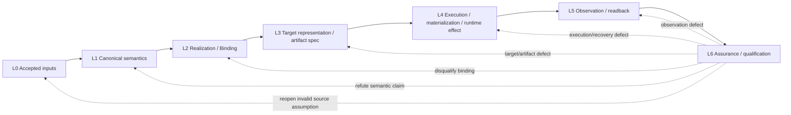

# Gift 统一多层工程模型与架构图谱

<a id="one-business-author-system-taxonomy"></a>
## 一套现行设计，多个正交观察轴（不产生平行规范）

唯一新写源设计：`gift.project/1 → gift.author-module/2 → Definition/Occurrence`；旧 `gift.author-module/1`只读兼容。语义采用 K1–K9 所定义的共同解释职责，V1–V5是**同一系统的抽象复用视图**，V0是正交实现供应；它们不是源码文件层，也不创造另外的Definition枚举。当前候选 `/2` 同时容纳 **24类业务/系统Definition与3类计算/查询Definition**；计算仅在作者实际需要时使用，属于同一作者语义，不是永久排除的历史接口。其Body仍须取得相应计算解释和目标Lowering资格，不能把Schema中存在三个Kind误称为已有可执行后端。正式Schema是唯一可写构造形状来源；其他分类必须从Schema、语义Owner和覆盖资料派生，不能手工维护另一个独立成员表。

L0–L6、CAP、COMP、stage:S、implementation:S、D0–D7与R01–R12分别表示因果职责、输入消费、编译步骤、跨阶段接合、实施计划、资格及未闭合工作；禁止把它们串成九层作者JSON或按数字同名关联。45家族135侧面是反例/覆盖发现，不是作者可写关键字；对象若涉及多个家族，就为其挂多条有类型覆盖边，不复制多份规范。所有跨文件关系须说明`defines`、`uses`、`qualifies`、`includes`、`invalidates`等真实语义，阅读链接不能代签业务精化。

<a id="gift138-author-language-views"></a>
## 开发者语言、业务语义与 IR 的三个正交坐标（Gift138）

统一读取[开发者源码分层与构造归属图](开发者源码分层与构造归属图.md#gift-author-source-layer-taxonomy)。Project→Module→Definition是**文件及声明嵌套**；V1–V5是同一业务在不同抽象高度的**解释视图**；从冻结源码、绑定定义、义务联合到TargetProgramIR是编译器内部**阶段产物**。三者的数量、节点及方向都不构成一条固定的“语言五层→IR五层”的树。K1–K9为60项跨域语义/工程职责；45家族135侧面是覆盖检查，27个`/2`候选Kind（含旧四类Body来源，24非计算/3可选计算）与旧只读`/1`属于不同源Profile，互不相加。

任何从多个视图指向同一业务要求的关系必须保存唯一源身份、消费位置、版本、适用范围和资格，不能用名称/编号对齐来替代语义关系。原语义判定和字段格式仍由各自Owner保持唯一来源；本页不重定义协议字段。图形位于[作者源到目标图](图/Gift开发者源码-IR与目标归属.svg)和[不同集合分类图](图/Gift集合与编号的正交分类.svg)。


> **阅读范围**：本页统一导航Gift的工程对象、组成、因果过程、时间演进和设计完整性。L0—L6与ASMRVE是对同一工程事实的定位与核对方式，不是已证明不可再约简的公理、强制流水线或每个对象必填的运行坐标。具体字段、算法和状态机仍由对应canonical owner维护；真实组织与代码/文档落位共同消费[多维组织合同](../70-工程系统与演进/信息与生命周期/多维组织与树形落位.md)。
> 当前物理文档如何按这一模型组织，见[文档信息架构](文档信息架构.md)。

<a id="gift130-whole-system-developer-source-axis"></a>
## “完整Gift系统”与“开发者实际业务源码”在一个统一关系中的位置

全系统不能压成单一流水线或“9组+12组+10模块”的相加数字。**产品业务轴**是AuthorSource → QualifiedMeaning → DerivedObligation → JointRequirement → QualifiedMethod → CompleteTargetProject → 可选Grant/Operation/Readback → 分范围Evidence；**产品Owner轴**是contracts/workspace/semantics/compiler/assurance/application/execution/adapters/entry/bootstrap；**作者可写面**是Project、Module、原生源、Control、真实资源及有权变化；**知识/编号轴**的K/V/L/G/CAP/COMP/S/D/R等只按真实关系观察，不引入新作者强制阶段。每个节点只能通过语义签发的`defines/consumes/refines/lowers/qualifies/observes/invalidates`关系取得产品义务；纯Markdown链接只证明阅读引用。

完整源码设计已由[逐文件开发源码具体规格](../10-作者与输入/作者源/工程源/逐文件开发源码具体规格与完整实例.md#gift130-source-tree-authoritative)统一提供可写文件集合，并由[第28章实施接口](../70-工程系统与演进/工程构造手册/28-抽象到业务系统-统一实施闭包.md#gift130-actual-author-to-source-compiler)规定机器消费者。45家族、135侧面和36领域用于**遗漏发现与条件扩展**，不能生成同名空模块；规范表格、阶段编号和fixtures按其原主责定位而不成为第二套事实。只有结构合法时应报告结构资格，未得到真实Meaning/Method/Target时必须暴露产品缺口，不得用架构图完整宣称软件已经完整。

## 一份工程事实，按责任、关系与用途组织

Gift的统一工程对象由各权威文件中的事实和合同通过有类型引用连接。组成合同说明对象及边界；语义合同规定合法行为；实现绑定说明履行者；作者源、目标制品、运行实例和证据分别保存其应有的内容。来源与修订关系记录事实如何产生、演进或失效，而不要求把同一内容复制到统一矩阵中。

实际定位先使用所属合同的原生引用。已有[信息引用与配置](../70-工程系统与演进/信息与生命周期/对象关系与配置基线.md)负责跨域对应，本页不发布新的`EngineeringDesignAddress`编码：

```text
实际引用：命名域 / 主体 + 所需修订或内容 + 必要片段与解释上下文
责任定位：该语义侧面由谁定义、写入、消费、验证与恢复
物理定位：文件 / 区域 / 模块 / 符号 / Provider地址（不是身份或权限）
阅读查询：按组成、因果角色、ASMRVE、任务、领域、时间等筛选同一事实
```

同一对象可出现在多个视图；视图分组改变不改变身份、作者权或合同。同名对象未必相同；同内容的独立实例也不因此合并。必要的全局不变量、联合约束和非树关系保留在其真实owner，不为目录整齐拆成无关条目。

已有组织方法在这里承担不同用途，不竞争事实源：

- **Concern / owner**定位稳定工程责任及其合同，不等同团队姓名或文件夹。
- **Layer（L0—L6）**解释从来源、语义、选择、目标到作用、观察、评价的因果角色；不是所有对象的唯一类别。
- **ASMRVE**提供架构、语义、机制、落实、验证、演进的检查问题；适用项可以在一篇正文或明确引用中回答。
- **Canonical Forms**概括现有实体、陈述、配置、变化、证据和投影，不替换领域类型。
- **Qualifiers**保留authority、来源、适用上下文、修订与时间；只附着真实需要的限定。
- **Typed Relation / Transition**连接事实；关系、纯计算依赖和有副作用状态变迁不能混同。
- **Projection**提供Workbench、CLI、目录与图等派生视图；**Representation**只是“某份语义/状态由什么编码或载体表达”的关系，作者源码、正式IR、目标程序和Artifact都可能是representation，但不能因此统称可丢投影。

可以把Layer和ASMRVE画成交叉索引，但这些标签既非独立笛卡尔坐标，也不要求每格有对象：

```text
阅读矩阵（可选）        Architecture / Semantics / Mechanism /
                       Realization / Verification / Evolution
L0 来源与固定输入
L1 工程语义与合同
L2 实现解析与绑定
L3 目标表示与制品规格
L4 实际执行与物化
L5 观察与读回
L6 保证与资格评价
```

矩阵中的条目最终链接到原责任正文或准确对象；不能再让正文反向依赖一个矩阵坐标才能被识别。已明确不适用的问题不强建结构，尚未检查的问题也不标作完成。

<a id="gift-unified-system-axes-and-relations"></a>
## 同一个系统：分类、编号、列表、表格与证据怎样互相接合

<a id="gift140-one-writer-typed-occurrence-architecture"></a>
### 唯一业务作者Writer到产品实例的严格归属链
新业务静态值只归 `ComponentUse.argumentBindings` 的有类型非计算发生点；实际对象角色归`contextBindings`；UI/事件/API/状态/时间触发到工作流的因果边归`product:component.activationRoutes`。这三种来源不可混作一个万能Binding。它们由[作者语义唯一Owner](../20-语义与组合/作者语义/开发者通用定义Profile-类型计算业务与系统构造.md#business-kind-consumer-coverage)解释，Method/Target不得再补第二套同名业务行为。当前Schema仍是设计提案，R01–R12实用资格保持未闭合。


**输入与归属**：`gift.project/1`的选定OutputRoot(含有类型上下文) → 唯一候选`gift.author-module/2`的Product Definition → Component Definition的产品实例化 → 有类型业务成员Occurrence → 内部提供/需要端口及显式外部需求 → 实例绑定的公共出口与DeploymentNode → JointObligation/QualifiedMethod/Target。实体定义同一不意味着Occurrence相同；成员引入不同义务不归并；Deployment与代码复用不能抹掉各实例的Effect/Grant和来源差别。旧`/1`、旧Product字段、可选文本语法及历史研究不构成第二现行Writer。准确字段与拒绝责任见[作者输入Owner](../10-作者与输入/作者源/工程源/工程清单模块与绑定锁协议.md#gift140-root-context-selection)及[语义Owner](../20-语义与组合/作者语义/开发者通用定义Profile-类型计算业务与系统构造.md#gift140-typed-product-closure)。

**抽象最小化原则**：复用 `Definition + typed formal role + DefinitionUse + occurrence identity` 而不复制语言Kind，业务关系只在它们确实不同的参与字段上具体化（读写、发布/订阅、客户/服务、资源、UI、观测及状态等）。不存在一个附带任意`role`就自动拥有所有业务含义、时序、权能和实现的万能Relation，开放专业领域通过固定身份和合格供应进入。逻辑成员关系的静态链接与实际满足约束的能力分离，代码构建成功不能逆推出作者接受的所有业务目标都被正确选中。

<a id="unified-responsibility-and-verdict"></a>
### 统一设计的三种真实对象：规范、交接、证据

本系统并不新增一张“全能设计实体”表。需要互相区分的对象是：**权威规范单元**（由原有 `gift-unit-*` 或原 Owner 合同定位）、**有类型的交接/状态变化**（各产品 Owner 按原协议持有）和**对精确主张的证据与资格**（由保证 Owner 决定证据能支持的范围）。目录、编号、列表、表格和统一图谱只是上述对象的不同定位/表达；不能因为一份表格同时包含目标、实现和验收三列，便让该表格取得三个 Owner 的写权。

| 必须分开的维度 | 权威来源 | 交叉关系 | 不能通过本维度推出 |
|---|---|---|---|
| 规范内容/适用范围 | 唯一 Contract Unit、领域或协议 Owner | `defines`、`refines`、`constrains` | 编译器已实现、现实已生效 |
| 工程实例/因果交接 | AuthorSource、Meaning、Requirement、Binding、Artifact、Operation 等各自 Owner | `consumes`、`qualifies`、`lowers`、`performs`、`observes` | 仅凭文件超链接推定调用或履约 |
| 修订与现时选择 | SourceRevision、SemanticRevision、Configuration、Selection、时间限定 | `selects`、`supersedes`、`invalidates` | 版本号最大即当前有权、兼容或有效 |
| 可复核主张/依据 | Claim、Evidence、Verdict及各自实际签发者 | `supports`、`contradicts`、`dependsOnProof` | 文档通过、示例通过即世界事实通过 |
| 文档位置/阅读图 | SourceProfile、标题、表格、列表、编号/锚点 | `contains`、`mentions`、`navigates` | 自动升级为任何业务语义关系 |

一次业务根的最小有型路径为 `AcceptedSource → ResolvedMeaning → DerivedObligations → JointRequirement → QualifiedMethodBinding → TargetArtifactSet → [AuthorizedOperation → Settlement/Readback] → ScopedClaim/Verdict`。方括号后的现实运行仅在实际任务要求时存在；`Claim` 与 `Evidence` 可在各前继阶段发生，不能简单画成只能运行结束后才验证。每一步保留实际输入锁、定义使用点、消费者、未解义务和证据范围；无消费者的导航索引只供查询，不进入编译求值依赖。

**统一性的验收**不是表格、文件或编号全部有了同一 ID，而是可从任一作者根或验收主张追溯到其必要上游、Owner和版本；沿真正语义关系可以计算变更影响；沿阅读关系只能找到资料；同一独立规则不存在两个可竞争的现行写源。查询视图不能反向写入原始语义。此判定与后续各Owner的具体Schema/状态机共同成立，不能由本页替他们发行新协议。


现有各编号不是一棵任意增长的层级树，而是同一份工程事实的**正交查询视图与局部程序**；构造、阶段、资格、剩余工作必须以`体系范围 + 实际Owner + 局部编号`联合定位。未限定范围的 `S0` 等短名不能当跨文档的唯一机器身份。当前合同保留旧正文编号以保护历史锚点和引用；读者与新派生索引应使用 `stage:S0`（跨语义到效果S0–S8）及 `implementation:S0`（实际施工切片S0–S9），而不是以裸 `S0` 做数据库主键。名称限定仅是文档定位方式，不发行新`gift.*`协议。

| 分类轴 | 数量和基本成员 | 它回答什么；与其它轴的接合 |
|---|---|---|
| V语义/业务视图 | V0–V5，6个，其中V0正交供应 | 业务抽象和领域Meaning从哪里来；对同一L层可有多个V视图 |
| K公共语义 | K1–K9共60项职责 | **什么含义/判断需要解释**；真正语义仍见[唯一K合同](../20-语义与组合/共同语义/工程通用语义全域与闭合合同.md#stable-finite-general-semantic-core) |
| L因果职责 | L0–L6，7种 | 来源→意义→选择→制品→实际作用→观察→保证的不同资格；不是七个进程 |
| ASMRVE | A/S/M/R/V/E，6种相交检查面 | 责任是否说明架构、语义、机制、落实、验证、演进；不是六个物理目录 |
| Canonical Forms / Qualifiers | 6种概括角色 / 4类必要限定信息 | 同一对象的组织与身份、权威、上下文、谱系和时间；不是统一大字段表 |
| G工程生命周期 | G0–G7，8类工程活动 | 从问题定义到演进的工作阶段；不能当编译器运行步骤 |
| CAP来源消费 | CAP0–CAP7，8步 | 用户源码、原生源和各输入画像如何取得有资格的消费；不是作者必须写的字段 |
| COMP纯编译 | COMP0–COMP7，8种求值责任 | 纯计算侧如何解析、检查、降低；不能直接Grant运行 |
| `stage`施工接合 | S0–S8，9个阶段 | 冻结/读取、意义、联合、Method、Target、保证与可选作用的[真实端口](../70-工程系统与演进/工程构造手册/28-抽象到业务系统-统一实施闭包.md#gift121-stable-end-to-end-compiler-contract) |
| `implementation`施工切片 | S0–S9，10个切片 | 将产品从最小真实消费者逐步做出来的[实施依赖](../70-工程系统与演进/实现与装配/源码分区与机器合同.md#developer-implementation-slice-and-layer-closure)；S3≠`stage:S3` |
| D资格、R闭合 | D0–D7，8种资格；R01–R12，12个缺口组 | 证据**能支持什么**与还有哪些正式消费者/证明缺失；不把设计文档PASS升级成产品PASS |
| Owner / Doc family | 10个逻辑代码责任 / 10个文档责任族 | 谁拥有类型、状态、写入和消费者；两组“10”不是同构映射 |
| 领域与审查清单 | 45家族/135侧面、36条件领域、75历史组件、102历史任务 | 发现遗漏与保存决策历史；索引覆盖不等于新语言原语或已实施能力 |
| 局部字母编号与算法表 | INT、EVID、MR、DEC、DOCORG等具体文件内系列 | 仅在其**唯一局部算法/验证Owner**中有步骤意义；大写前缀出现次数不自动生成一级子系统 |

### 一条设计主张怎样贯通全包

1. **定义位置**：具体Meaning、Requirement、Method、Target、运行或保证条款由对应`docs/`唯一Owner维护；其表达方式可为句子、公式、枚举、表格或有型Schema，形式并不决定权威。主张独立身份优先使用原Owner的显式稳定Contract Unit；没有稳定ID时只能保留当次准确`文件+锚点/范围+源修订`定位，不能凭标题或Hash发明永久身份。
2. **有型联系**：相交主体以现有语义合同声明`定义/引用、约束、实现精化、生成、证据支持或反驳、失效、迁移、授权/效果`等关系；这些**关系是语义层约束**，须到原Owner核对实际规则。普通Markdown超链接只是`阅读引用`，不能凭链接自动推定依赖、类型继承或逻辑证明。
3. **消费者与资格**：Schema描述结构，fixture保留已选输入下的研究案例，witness给出区别/负例，research提供候选依据；本设计包不运输历史工具及其运行证据。只有真实编译器、Method、Provider和独立Assurance分别满足各自的签发条件，状态才可升级。成功、失败、未知和部分覆盖必须绑定实际来源、版本、输入域和时刻。
4. **视图与总表**：目录、列表、阶段索引、跨轴矩阵、数量统计与图在给定当前SourceSnapshot后可**在包外**重建。正文表格本身若规定必要条件、变体、错误或算法仍是规范，应留在主Owner；仅当表格重复同一规则且只作跨文件导航时，才改为准确链接。保留历史材料，但历史步骤不自动取得当前实施资格。
5. **变更与失效**：主责变更后追踪真实读集、负依赖、证据和目标消费者，再生成新版投影；不把所有旁观引用当必须重编的代码依赖，也不允许一个缓存或总结反向修改原作者主张。

**一个可用的例子**：作者给出`achieve(请求已确认)`、`maintain(占用≤容量)`；前者作为K6语义位于V3/L1，使用V2领域谓词和L0受权事实；共享资源通过Requirement联合进入L2，合格Method进入L3完整TS工程；如发生真实执行，L4取得Grant并保存Operation，L5读回；L6针对具体Scope判定Evidence。这些是同一业务约束的有型相交，不是七份可独立修改的作者事实。

直接使用[主题导航](导航/主题导航.md)、各目录README及Markdown标题定位正文。文件夹、编号、标题、表格和引用清单可以按固定源在包外派生；派生统计不表示术语已取得语义资格，更不能替代正式的K/Schema/Method合同。

## 七个因果角色及其不可混同的义务

下表的七类入口用于区分输入解释、实现选择、制品生成、实际作用与证据评价；不是七份强制存储，也不是每次任务必须顺次执行的阶段。阶段先后取决于本次对象的有类型依赖及操作前提：静态检查可在部署前进行；已合格的Artifact可直接进入经授权的部署；一次读回既是当前观察结果，也可成为下一次编译的输入。任何入口不得代签另一入口的资格。

| 层 | 核心问题 | 典型内容 | 与相邻层不可合并的见证 |
|---|---|---|---|
| **L0 Origin / Accepted Inputs** | 哪些作者内容、外部事实、观察与请求有资格成为这次工程推导的输入？ | author source、accepted request、external authority statement、workspace/source observation、policy input、provenance | “来源说了什么/观察到什么”不能等同“产品语义是什么”；后续 compiler 也不能反写原来源来制造正确性 |
| **L1 Canonical Engineering Semantics** | 产品/工程究竟是什么意思、必须保持什么？ | Entity、Definition、Type、Requirement、Contract、Responsibility、state/relation/effect semantics | 语义不能由某个当前库、target、代码布局或运行状态决定；否则换实现会修改产品含义 |
| **L2 Realization / Resolution** | 在 L1 不变时，具体用什么方法、供给、Provider、target 实现？ | ImplementationRequirement、MethodSpec、Candidate、Eligibility、Decision、Binding、RealizationPlan、TargetProfile | 实现选择不是作者 Meaning；backend 也不能重新做第二次选择 |
| **L3 Target Representation / Artifact Specification** | 已选 Binding 应产生什么目标程序、源码、依赖、配置、资源、构建与制品成员？ | TargetProgram、source/module graph、dependency/toolchain lock、config/assets、build plan、package/artifact manifest | “应该生成什么”必须与“真实执行了什么”分开；纯 compiler 输出不能拥有 filesystem/process/deploy effect |
| **L4 Execution / Materialization / Runtime Effects** | 在当前 authority/resource/preimage 下，哪些真实物理动作被执行和结算？ | Operation、Grant、Admission、Attempt、write/build/install/deploy/run、Deployment、Instance、resource、effect、recovery | 计划/源码/ArtifactSpec 不等于现实效果；副作用需要独立准入、attempt identity、最终性与恢复 |
| **L5 Observation / Readback** | L4 之后真实世界现在是什么状态，或其他外部对象实际呈现什么？ | readback、settlement receipt、runtime snapshot、process/device state、measurement sample、physical observation | Action 成功返回不等于真实状态已确认；Observation 由现实/observer 产生，也不能自行升级成 PASS |
| **L6 Assurance / Qualification** | 对 L0—L5 的准确对象、版本和环境，我们能够证明什么、不能证明什么？ | Claim、Evidence、Coverage、Freshness、Verdict、qualification、release/support evidence | 生产者声明不自动构成独立证明；自检可支持其准确范围，需独立性时由Claim/风险与方法合同规定评价者和证据边界 |

### 为什么不继续拆更多顶层层

以下区别真实存在，但在当前证据下作为 layer 内 concern、typed state、relation 或 qualifier 已足够：

- Author 与 External 来源：都在 L0，但 authority/provenance 不同；无需两条平行输入流水线；
- Requirement、Type、State、Relation、Effect：都属于 L1 的不同 semantic owner，无需各成一层；
- Candidate、Eligibility、Binding、TargetProfile：属于 L2 resolution 的不同对象/状态；
- source/config/dependency/build/package：都属于 L3 “目标物理表示应该是什么”的 specification 子图；
- file write、build、deploy、run、publish：都是 L4 有副作用 operation 的不同 kind；
- runtime state、device state、artifact readback：都是 L5 observation kind；
- static analysis、tests、formal proof、measurement：都是 L6 Evidence method，无需各自成为顶层层。

若未来某一类取得了真正独立的 writer、state machine、failure/recovery、permission、consumer 与替换责任，使现层无法无损表达，再通过 ASMRVE.A 重新论证分层。

### Evolution 为什么不是第八层

Evolution 不是工程在某一时刻“落到的最后一站”，而是**所有层随 revision/time 的变化规则**。因此它作为 ASMRVE 的 `E` 列横穿 L0—L6：

- L0：source/authority 的更新、撤销、重新接纳；
- L1：Meaning/Requirement/Schema 的版本、兼容与迁移；
- L2：Provider/Method/Binding 的替换与重新解析；
- L3：源码格式、依赖、toolchain、ArtifactSpec 的升级与退役；
- L4：旧 Deployment/Instance 的 rollout、drain、rollback、recovery；
- L5：Observation/readback 的保留、失效、重取、格式迁移；
- L6：Evidence 新鲜度、失效、重新验证、资格迁移与历史保留。

这样时间/演进完整存在，但不会与因果层混成一个“第八阶段”。

## 所有层共享一套 Canonical Forms

以下六类是理解现有工程合同的概括，不是封闭的万能基类或替代现有Entity/Fact/Assertion/Relation类型的迁移命令。领域对象沿其真实合同存在，摘要分类不吞掉其独立信息：

```text
Entity          有稳定身份、可有 revision 的工程对象
Statement       关于 Entity 的有类型陈述
Configuration   一次准确选择了哪些 revision、target、environment 与上下文
Transition      从准确输入/前态到后态的有前提语义/状态变化；现实作用由Operation/Attempt承接
Evidence        对准确 Claim/Statement/Transition 的支持、反驳或未知依据
Projection      从上述现实确定派生的阅读/操作视图；默认无独立事实写权
```

`Statement` 是开放 typed union，而不是万能 property bag：

```text
Fact
Relation
Constraint / Requirement / Invariant
Claim
Decision
Observation statement
Compatibility obligation
...
```

这里的 `Fact` 是 Statement 的语义角色；`Assertion` 不是第七种 canonical form，而是“某来源在某上下文断言某 Statement”的带 provenance 关系/记录。一个 Assertion 可以待决、冲突或失效；一个 Fact 只有在对应 authority/解析/有效期下才可被当前消费者依赖。`Verdict` 则是 L6 对精确 Claim 的裁决，不是把任意 Assertion 升成普遍真理的入口。

这六种形式不是六张数据库表、六个 IR 或六个服务。作者文件、原生源码、锁、Git、runtime store、Evidence store、对象存储继续由真实 owner 保存；统一的是身份、含义和连接方式。

### Representation、Projection、IR 与 Artifact 不是同义词

`Representation`表示含义与载体/编码之间的关系：被采纳的含义可以由结构化作者源、原生源码、IR、目标源码、二进制或协议载荷表达，其中某种表示也可能正是其Owner的权威源。`Projection`则是在已确定的来源、版本和选择条件下产生的派生只读视图；视图删除后应可由保留的权威输入重建，不能默认取得独立写权。

`IR` 是 14.7 规定的正式中间表示合同：它通常由上游事实/表示确定性产生，可以拥有独立 schema、content identity、revision 与跨阶段消费者，因此**不能仅因“可重新计算”就按普通 UI/cache Projection 任意丢弃其交换、恢复或审计责任**；但它也不取得上游 canonical fact 的写权。`Artifact` 是 L3 按 TargetProgram/Binding/toolchain 等输入实际生成并封存的目标成员/集合，属于可交付结果而不是“某个 view”。

因此可丢性、权威性和持久化由真实 owner/lifetime/recovery 合同决定，而不是由“它是一种 representation”推导。一个对象可以同时是 representation 和 derived result，但只有明确声明为 Projection/cache 且存在完整重建闭包时，删除它才只损失性能或显示能力。

## 四类跨层限定信息

任一层中的 Entity/Statement/Transition/Evidence 按真实需要附着：

| Qualifier | 回答什么 | 例子 |
|---|---|---|
| **Authority / Provenance** | 谁能声明/写/观察/签发，它来自哪里 | Author、External、Compiler/Resolver、Runtime、Assurance、Client；source lineage |
| **Applicability Context** | 在什么 scope/configuration/target/environment 下成立 | Product/Module/Use、Target、Deployment/Operation、platform/toolchain |
| **Revision / Lineage** | 是哪一版、谁的后继、Configuration 实际选中了哪一版 | semantic revision、binding revision、artifact lineage、configuration lineage |
| **Time** | 什么时候有效、发生、观察、记录 | valid/effective time、event/observed time、recorded time |

不是每个对象都需要所有 qualifier；禁止为了“统一”机械填 `null`。

## ASMRVE检查相交设计问题，不定义对象地址

对一项真实concern，使用以下问题检查相交责任；具体判据由[设计综合与必要性](设计方法/设计综合与必要性.md)拥有。无运行、持久化或迁移义务时不为凑列创建它们；存在义务而资料不足时保留缺口。

| 检查面 | 相交时需要回答 |
|---|---|
| **A — Architecture** | 为什么该 concern 必须存在；真实 consumer/problem；identity、owner、边界、依赖、scope；为什么不能删除、合并或交给已有 owner |
| **S — Semantics** | 它准确表示什么；输入输出、状态、关系、约束、正常/错误含义；哪些是 source of truth，哪些是 derived/unknown |
| **M — Mechanism** | 算法、状态机、顺序、并发、资源、缓存/失效、取消、失败、恢复、终止/进展怎样工作 |
| **R — Realization** | 具体代码/数据/crate/package/module/file/symbol/Provider/target/build/runtime 怎样落位；物理成本和生命周期是什么 |
| **V — Verification** | 哪个 Claim 在什么 subject/revision/environment 下由什么 Evidence 支持；什么反例会推翻 A/S/M/R |
| **E — Evolution** | revision、兼容、迁移、替换、rollback、保全、retirement、重新决策条件是什么 |

设计引用仍指向准确主体、修订、片段和责任正文；`Layer / Concern / ASMRVE`只是查找这些内容的组合条件。一个段落可以同时说明机制、资源和恢复，不拆成三份竞争规范。

例如 `L2 / Implementation Resolution`：

- A：为什么需要唯一 resolver owner；
- S：Candidate / Eligibility / Binding 的精确含义；
- M：发现、硬资格、偏好、tie-break、joint closure 算法；
- R：Rust compiler-kernel / provider catalog / ecosystem resolver 的代码落位；
- V：确定性、非法候选排除、exact-binding conformance；
- E：provider 升级、re-resolution、旧 binding 退役。

这些信息共同闭合一项实现解析责任，无需再建“Reality文档”和“ASMRVE文档”两份真源。

## 全工程顶层矩阵

下表只做总索引，不复制 owner 正文：

| Layer | A/S 主要 owner | M 主要 owner | R 主要落位 | V 主要证据 | E 主要演进责任 |
|---|---|---|---|---|---|
| **L0 Origin** | 作者源、外部事实、输入接受、workspace/source observation | capture、acceptance、source parsing、coverage | workspace/adapters/author readers | 来源完整性、前像、authority/freshness | source revision、撤销、重新接纳、来源迁移 |
| **L1 Semantics** | Definition/Requirement/Contract/Responsibility/domain dialect | 类型、约束、关系、效果、组合算法 | semantics/contracts/domain modules | semantic conformance、property/formal claims | schema/semantic revision、compatibility、meaning migration |
| **L2 Resolution** | implementation requirement / target/control semantics | candidate discovery、eligibility、ranking、binding | compiler-kernel/resolver/provider catalog | resolver determinism、eligibility、binding correctness | provider/method upgrade、re-resolution、binding retirement |
| **L3 Target Spec** | target program、artifact membership、dependency/config/build contracts | lowering、layout、dependency resolution、build/package planning | target backends、Cargo/npm/toolchain plans、source/config/assets | target typecheck schema、plan completeness、reproducibility preconditions | source/format/toolchain/artifact-spec migration |
| **L4 Execution** | operation/effect/resource/permission contracts | admission、transaction、attempt finality、recovery | execution/runtime/providers/filesystem/build/deploy hosts | effect/readback requirements、recovery properties | rollout、drain、restart、rollback、runtime retirement |
| **L5 Observation** | observation/readback/settlement semantics | capture、normalization、settlement、freshness | runtime/provider observers、readback adapters | 对物理状态/结果的可重复观察与来源完整性 | observation retention、re-read、format/provider migration |
| **L6 Assurance** | Claim/Evidence/coverage/verdict semantics | selection、reuse、invalidation、aggregation | assurance/test/formal/measurement providers | Evidence independence、coverage、freshness、verdict correctness | evidence invalidation、requalification、support/retirement |

任何新文档、IR、service、registry、workflow或状态机都须说明真实问题、owner、相交合同、实现差额、验证和演进；L0—L6/ASMRVE帮助定位这些信息。已有owner已完整承担时不新增。不能仅因未贴某个层标签否定合法设计，也不能因格子填满就认证它。

## 端到端交接由准确依赖与有权状态变迁连接

主因果链：



图中的箭头是依赖／交接概览，不自动创建持久Transition。纯查询和降低返回不可变值及实际读集；真实采用、写入、部署等才使用所属owner的状态变迁与恢复协议。跨owner接口说明输入、输出、前提、失败和来源；能由原上下文恢复的信息不重复包装成每条边的巨型记录。静态或形式评价可直接消费源码、语义与计划，不强制先执行部署再观察。

不是每个请求都走满：

- query 可读取任一 layer 的 Projection；
- 纯作者/设计任务可停在 L0/L1；
- implementation resolution 可停在 L2；
- 生成源码/构建计划可停在 L3；
- 获准写文件、build、deploy、run 才进入 L4；
- 真实 readback 在 L5；
- 正式 PASS/qualification 在 L6。

反馈也不能直接反写上层：L6 只使准确 Claim/assumption/binding/implementation qualification 失效或触发新的 authorized Transition；它不能修改 Requirement 来让系统变绿。

## 时间、revision、candidate/current/history：沿所有层纵向组织

每层都有自己的 revision lineage；`Configuration` 把某次工程现实选择成准确切片：

```text
Configuration C
├─ L0 source/input revisions
├─ L1 semantic/requirement revisions
├─ L2 binding/target revisions
├─ L3 target-source/dependency/artifact-spec revisions
├─ L4 operation/deployment/runtime revisions（若适用）
├─ L5 observation/readback revisions
└─ L6 evidence/qualification revisions（若适用）
```

状态必须绑定所问主体和用途，不给整个工程一个覆盖一切的`current`标志：

| 说法 | 准确含义 | 不能由此推出 |
|---|---|---|
| candidate | 对某个采用动作仍可供选择的准确内容；可能已经在另一任务被选中 | 已合入main、已部署或已获得运行权限 |
| selected / adopted | 某个有权配置或接受关系确实指向该修订 | 外部事实仍有效、当前Grant存在、运行已切换或Evidence仍新鲜 |
| current for a claim/action | 当前权威选择及该命题／动作所需的有效期、撤销、上下文、读回与输入一致性条件均已取得 | 任意其他用途都可以沿用同一资格 |
| historical | 对过去状态或谱系的准确记载；仍可能被旧实例、审计、兼容或恢复使用 | 无用、可删或已不再运行 |
| retired for a responsibility | 指定生产／写入／运行职责已按原协议结束，不再接受该类新工作 | 所有源码、格式解码、证据和恢复材料都可以删除 |

实际删除还要满足保留、兼容、访问、在途和恢复消费者的条件，由原生命周期owner结算。无需现实新鲜度的离线固定快照分析可以继续；需要当前权限或服务状态的动作单独补取，不能一处陈旧就停掉整个设计工程。详情与选择向量由[对象关系与配置基线](../70-工程系统与演进/信息与生命周期/对象关系与配置基线.md)拥有。

还必须区分：

```text
valid/effective time    现实/规则何时生效
observed/event time     现实何时发生或被观察
recorded time           Gift何时记录
```

新 Requirement 已采用，不代表旧 Deployment 已切换；L3 已生成新程序，也不代表 L4 发生任何作用；L5 已观察到现象，也不代表 L6 已得到足够 Evidence。

## Gift 自身与生成目标工程：同一七层模型的不同 System Entity

`Subject=Gift` 与 `Subject=Product P` 都使用同一 L0—L6：

```text
L0  各自作者源 / 外部输入
L1  各自工程语义 / Requirement
L2  各自 implementation Binding
L3  各自目标源码 / 依赖 / config / artifact specification
L4  各自 build / write / deploy / runtime effect（若存在）
L5  各自 observation / readback
L6  各自 Claim / Evidence / qualification
```

Gift compiler-kernel 可以是 Product P 的 L2→L3 producer；在自举 Configuration 中，它也可以参与 Gift 自己的 L2→L3。二者仍保持不同 identity、Configuration、Runtime 与 Evidence。

交付出口由用户所请求的结果决定，不由“函数／库／应用”名字猜测。各出口的资格范围如下：

| 所请求结果 | 应闭合什么 | 不自动执行什么 |
|---|---|---|
| 表达式、函数或上下文补丁预览 | 准确输入、所需解释与对应范围的目标生成；自由引用或保持不足明确报告 | 不写磁盘、不建项目、不发布 |

## 开发者视图、规范表示与导航各自的写权

以下都不再争夺顶层“层级”身份：

- Understand / Author / Change / Verify / Operate / Deliver；
- Developer Decision 的 Meaning / Requirement / Realization Control / Runtime Input / Presentation；
- owner-defined DecisionDescriptor、可选 semantic/domain/mechanism facets 与客户端 saved views；
- Semantic / Authority / Static Code / State / Runtime / Verification / Delivery 等概念分域；
- Markdown 目录、Workbench panel、CLI view、AI context；
- current/candidate/history 阅读方式；
- 旧八 view family、G0—G11。

其中任务入口、目录导航、facet筛选和 saved view 是 query/operation projection；结构作者、原生源及独立规范正文可以是真源。Meaning、Requirement、Runtime Input等也保留实际语义合同，不能仅称“视图”后删除。需要修改时回到所编辑事实的原owner；编辑生成摘要不会直接改规范，编辑规范也不自动改已运行实例。

顶级 Atlas 只保留四类导航投影：

| Atlas | 主要覆盖 |
|---|---|
| **G0 Structure / Responsibility** | L0/L1 的对象、owner、scope，以及各层 static structure |
| **G1 Realization / Causal Flow** | L1→L3 的 semantics、resolution、target representation/artifact spec |
| **G2 Runtime / Assurance** | L4→L6 的 operation/effect、recovery、observation/readback、Claim/Evidence |
| **G3 Revision / Evolution** | 所有层的 revision/configuration/migration/retirement |

### 意图辅助、物理实现与领域扩展的归属

[意图目录/Occurrence](../20-语义与组合/作者语义/意图描述与作者投影.md)是原作者、供给、产物和Evidence关系的派生投影，不新增意图数据库或中间层；[机制配方](../20-语义与组合/组合/机制组合与作者配方.md)展开回原Definition/Requirement。可选交互/学习/因果/安全合同沿原扩展准入，其领域实例与Gift自身权限/工作台/调度/观测分开。物理源码和跨语言接合由[源码蓝图](../70-工程系统与演进/实现与装配/源码分区与机器合同.md)与[worker合同](../70-工程系统与演进/实现与装配/内核工作进程与交换协议.md)拥有；原RealizationBinding/UseBinding、COMP/RES、局部结果代数和在途恢复继续是唯一真源。

## 旧模型的有效内容只保留一份映射

历史 Engineering Truth、S/A/C/P/T、A/S/M/R、N0—N11、九类概念分域与旧 view/G0—G11 的完整 crosswalk 由[设计综合与必要性](设计方法/设计综合与必要性.md#historical-six-dimension-mapping)唯一维护；本篇只使用映射后的现行角色，不复制第二份历史到现行对照。旧模型中的独立区别没有因此删除，找不到现行 owner 的区别也不能因旧编号退役而消失。

特别地，旧 `Phase` 表达的是具体领域的生命周期/状态语义，应落到相应 owner 的 `state/Transition/Statement`；**L0—L6 是因果落地层，不是通用 Phase 轴**。某个状态事实当然可以位于某个 L 层，但“状态处于什么阶段”和“事实位于哪一落地层”是两个正交问题。

旧 A/S/M/R 与 N0—N11 的信息由同一设计方法映射进 ASMRVE；旧九类分域、view family 与 G0—G11 只作为 typed graph/query projection 保留。它们不再成为与当前 `Entity / Statement / Configuration / Transition / Evidence / Projection`、L0—L6、ASMRVE 竞争的并列总模型。

## 文档和代码按同一责任关系落位

物理文档目录不机械创建 7×6=42 个目录。否则同一 owner 会被按 ASMRVE 重复六份，反而制造第二事实源。

当前规则：

```text
概念定位      准确主体 / 语义侧面 / 使用上下文；因果角色与ASMRVE按需查询
事实身份      原合同的stable ref + 所需revision / content / fragment
物理文档      按 responsibility 聚合的一份或少量正文
代码落位      concern → contract → module/crate/file/symbol
验证落位      concern → Claim → Evidence
阅读组合      Atlas / task route / Workbench / generated matrix projection
```

一个 canonical 文档可以同时覆盖同一 concern 的多个 ASMRVE 列；一个 concern 跨相邻 layers 时必须明确各层 owner/接口，而不是复制正文。

## 最优性与最小性判据

目标不是“层越少越好”，而是：

> **完整保留独立信息和硬义务；在合法方案中，按真实工作负载、认知、开发、验证、运行、迁移和退役成本比较，消除无价值的重复组织。数量更少不是独立最优目标；必要的分解可以增加文件或模块，却降低总体成本与风险。**

新增独立 layer/object/protocol 前必须证明现有结构不能无损承担至少一项：

- 独立 identity/revision；
- 独立 writer/authority；
- 独立 causal role；
- 独立 lifecycle/failure/recovery；
- 独立 permission/disclosure；
- 独立 Evidence/coverage；
- 独立 consumer/replacement responsibility；
- 与现层合并会造成反向 authority、循环因果或不可区分的错误状态。

反方向，发现两个结构没有这些独立差异，就优先合并成字段、typed relation、facet、owner-specific state 或 Projection。

## 全体系闭合判据

任一正式concern都应能从其责任正文和准确输入追出相交关系；矩阵仅是入口之一：

```text
Subject / semantic aspect + Concern(owner)
→ 原生identity + 所需exact revision / context
→ authoritative Statements / Constraints
→ Configuration / applicability context
→ ASMRVE A/S/M/R design
→ typed Transition / realization
→ actual target/runtime/readback facts（若适用）
→ ASMRVE.V Claim / L6 Evidence
→ ASMRVE.E successor / migration / retirement
```

若任何连接仍只能靠 `latest`、目录猜测、无类型 link、聊天、第二 writer 或另一个平行“总模型”解释，则全体系仍未闭合。

### 系统闭包不变量：所有子系统必须服从同一组规则

下面是不再由某个局部模块自行重定义的系统级不变量。它们只规定跨 owner 必须保持的关系；字段、算法和失败处理仍由各 canonical owner 维护。

| 不变量 | 全系统约束 | 违反时的真实问题 |
|---|---|---|
| **受控权威提交** | 同一 subject / semantic aspect / scope 的正式接受有唯一可辨认的权威协议与版本裁决；多个协作写者可以提交候选，声明了交换律和合并不变量的状态也可有多源贡献，但不能以最后到达、读取顺序或多份原样“current”绕过该协议 | 物理 writer 数量被误当安全性、未验证的 CRDT/last-write-wins 破坏业务不变量、界面状态反向成为规范 |
| **身份正交** | semantic identity、revision/lineage、content identity、physical location、occurrence 必须可分别表达 | 同名重建复活旧权限；移动文件被误判为新语义；相同字节合并不同实例 |
| **因果角色不折叠** | Meaning/Requirement → realization → target representation → effect → observation → Evidence 可以有回边和部分结果，但不能把相邻成功状态互相代签 | emit=verified、write=deployed、readback=correct、test passed=task satisfied |
| **派生只读** | Projection/cache/index/summary 可以重建、缓存、失效；要改变事实必须回到其 source owner 形成 typed Transition | UI/索引/缓存成为第二 writer；删除缓存丢失唯一事实 |
| **依赖健全** | 可复用结果绑定其实际 read set、negative dependency、qualification 和 basis；同值不自动继承资格 | 新依赖漏失效、缺失结果无限缓存、旧 Evidence 贴给新 revision |
| **变化有操作身份** | 任何可能产生持久或外部效果的 transition 绑定 base/preimage、authority、operation/attempt、terminal/unknown 状态和恢复责任 | 超时即重发、未知完成被写成失败或成功、补偿与撤销混同 |
| **权限与资源有寿命** | capability、secret、borrow、budget、retention、disclosure 与实际 scope/lifetime/transfer/revocation 绑定；发现能力不等于执行能力 | 工具存在即获准运行；取消即提前释放；Evidence 反向延长原数据保留 |
| **证据不能自证** | Claim 绑定精确 subject revision、context/environment、method 与 coverage；生产者输出不自动成为其正确性的独立 Evidence | compiler 自报成功即证明语义保持；文档案例冒充运行结果 |
| **扩展不另开真相通道** | 新 capability/Profile/dialect/provider/target 必须经现有 Entity/Statement/Configuration/Transition/Evidence 及相应 owner 接合；只有出现无法表达的新可观察区别才扩核心 | 插件私有状态成为系统事实；每个领域另造配置/权限/证据体系 |
| **演进可退出** | 协议/实现/表示替换必须说明兼容、迁移、共存窗口、恢复、consumer-zero 和 retirement；旧历史不可原地改写成新事实 | 永久双实现、桥接层无法退役、版本切换抹掉恢复责任 |
| **部分结果不升级整体** | AND/OR/conditional root、模块、目标、Claim 各按真实组合关系结算；独立成功可保留但不能提升为更大范围成功 | 一个库根成功被报告成发行成功；一个测试通过覆盖未运行目标 |
| **确定性边界显式** | 固定输入和纯方法的 compiler/query 结果应确定；真实时间、远端、工具、随机/硬件观察等非确定性必须作为显式输入、Observation 或 Effect 处理 | 当前机器状态偷偷进入缓存键外；重跑漂移却声称同一编译 |

任何新设计若需要违反其中一条，不得以“特殊场景”静默绕开；必须指出新的可观察区别、现有不变量为什么不足，并修改相交 owner 与验收。

## 对象身份、命名与查找投影

具体类型、命名限制、例外、失败与保持条件由[对象身份、命名与查找投影原合同](../70-工程系统与演进/信息与生命周期/对象关系与配置基线.md#对象身份命名与查找投影)定义；本总模型只处理这些对象在L0—L6间的因果角色和关系，不在此修改字段或状态。

## 作者目标、约束与实现选择

### 从目标到有权采用：只保留因果交接，不在总模型维护领域词典

Goal、自然语言和导入材料在 L0 可以产生多个 `IntentIR` 解释；它们可包含来源、歧义、候选假设及未获得的权限，但不能替代正式作者 Revision。由[意图接受和缺省算法](../20-语义与组合/组合/跨软件需求合同.md#跨软件意图行为与开发动作的共同合同)解释输入、由[需求定义](../20-语义与组合/作者语义/需求规则与供给合同.md)拥有 Requirement 意义、由[开发者决策](../20-语义与组合/作者语义/开发者决策模型与设定面.md)分配可写设定、由[作者采纳](../10-作者与输入/作者源/工程源/身份断言与采纳.md)形成正式修订。`Need` 是消费者在某个 basis 下未取得的具体输入/能力/决定；它不是另一个能自行修改 Requirement 的作者源。[局部结果](../20-语义与组合/共同语义/规范元模型与结果语义.md)负责 `MethodOutcome.Needs` 如何引用它。

```text
请求/资料 ──解释──> 可并存的候选意图
              ├─ 不可判定/待取得输入 ──> scoped Need（保留可继续部分）
              └─ 有权采纳/前像成立 ──> 原 owner 的 Definition / Requirement / Control 后继
                                            └─ compiler 与 execution 只消费已冻结的选择
```

这里应坚持的系统不变量是**解释不授写权、Need 不改写要求、采用不会直接推出实现/作用成功**。某种实现或新观察迫使改变需求时，必须经新的有权作者变更，而不是在失败路径里偷偷调低要求。具体字段、默认、失败和正常算法只在上述 owner 改动。

### 规范限制、实现控制、权限与冻结选择分别生效

Requirement/Invariant 的意义由[原需求合同](../20-语义与组合/作者语义/需求规则与供给合同.md)给出；作者可调的 Control 由[稀疏控制](../20-语义与组合/组合/稀疏控制与目标限定.md)保持在需求实际留出的自由度；Policy 与实际 Grant 的检查属于[执行准入](../50-执行运行与观测/权限与资源/授权与执行准入.md)；被选中的版本由[信息选择](../70-工程系统与演进/信息与生命周期/对象关系与配置基线.md#baseline-selection)固定。需要独立寻址/交换的 `ContractDefinition` 和普通语义责任不应因此产生两份规范；其载体选择仍归[合同与元模型](../20-语义与组合/共同语义/规范元模型与结果语义.md)与[定义和接口](../20-语义与组合/组合/定义与接口.md)。

四条不能连错的交接：硬要求不因便宜的实现而弱化；作者 Control 不获得 Runtime 输入或执行许可；冻结 Configuration 证明“这次读了哪个版本”，不证明“现在仍有授权”；当前 Grant 不倒写历史已采用的含义。实际需要判断哪个约束更强时，应按 scope、时间、主体、效力和冲突协议分别计算，不按字段同名或 UI 显示层级覆盖。

### 从发现到目标消费：有权选择一次，使用点只读

实现解析的共同序列保留为架构关系：`Provider / Supply → Candidate / Provision / MethodSpec → Eligibility → Decision → RealizationBinding → UseBinding（按实际 use occurrence）→ Target`。其中供给声明不证明资格，资格通过不等于有权选择，绑定不会签发运行 Grant；`UseBinding` 只能消费已封存选择，不能在另一个目标或失败时暗选替代 Provider。相交字段、资格、候选发现、方法、求解、失效和替换由[供给合同](../30-实现解析/供给与替换.md)与[实现要求/绑定](../30-实现解析/实现选择/实现要求与正常绑定.md)唯一维护；执行资源由[准入](../50-执行运行与观测/权限与资源/授权与执行准入.md)另行核验。

由源、候选或 DesignCandidate 产生可持续可写的定义，仍要回作者 owner 形成有前像的采纳修订；Plan、Binding、Target IR、生成源码和显示投影均不能在“自动化”名义下成为另一套 accepted design。新增目标条件使旧候选不合格时只局部重开 Eligibility/Decision 与相交产物，不修补旧 Artifact 内容来伪造原选择。

## 表示、工作与交付的生命周期

- [IR 资格：准确合同与失败边界](../40-目标与制品/表示/表示族与跨层保持.md#ir-资格正式中间表示分析视图和一次性结果必须分开)。

- [状态、时间与现实作用：准确合同与失败边界](../70-工程系统与演进/信息与生命周期/对象关系与配置基线.md#状态时间与现实作用statesnapshotcontextcurrenttransitionoperationattemptevent-不得互相代替)。

- [不同工作生命周期：准确合同与失败边界](../80-开发者与接口/需求到交付主链.md#requestpreparedjobevaluationactionplanoperation-与-runtimetask-分属不同工作生命周期)。

- [Artifact 至部署的生命链：准确合同与失败边界](../40-目标与制品/目标/交付消费合同与发射.md#从目标表示到发行部署artifactartifactsetdeliveryprogramreleasesnapshot-与-deployment-不得互相代签)。

- [各因果角色的局部结果代数：准确合同与失败边界](../20-语义与组合/共同语义/规范元模型与结果语义.md#outcome-不是一个万能状态各因果角色拥有局部结果代数)。

## 保证命题、证据与命名资格

具体类型、命名限制、例外、失败与保持条件由[保证命题、证据与命名资格原合同](../60-保证与证据/保证/要求证据-要求主体与声明范围.md#保证命题证据与命名资格)定义；本总模型只处理这些对象在L0—L6间的因果角色和关系，不在此修改字段或状态。

## 共享求值与扩展闭包

- [共享求值闭包：准确合同与失败边界](../30-实现解析/增量与性能/查询固定点与缓存.md#统一求值内核共享的是-basis依赖与发布协议不是一个万能-pipeline-服务)。

- [扩展闭包：准确合同与失败边界](../20-语义与组合/组合/语义扩展-声明投影与系统编译.md#extension-closure开放扩展只能增加局部语义不得增加第二套系统)。

## 实际统一点：组成、合同、表示与变化

完整结构不是再加一个“组织层”。以准确系统/配置为根，按组成和责任展开；用有类型引用保留非树关系；沿来源、实现、产物、操作、观察和评价追踪因果；用版本/有效时间/记录时间解释变化。每项独立责任使用ASMRVE检查实际相交问题，普通临时节点不因此承担六份完整设计记录。**同一工程，多个有明确语义的关系，没有第二份竞争事实。**

源码、文档、包和导航的共同组织算法由[多维组织与树形落位](../70-工程系统与演进/信息与生命周期/多维组织与树形落位.md)拥有；目标发射仍由SourceLayoutPlan与ArtifactSet承担，文档由原规范/维护者承担，真实改写仍走execution。该共同合同复用原有计划和引用，不要求新增全局TreeProjection服务、数据库或固定树kind枚举。

<a id="universal-software-system-composition-atlas"></a>
## 从通用表达集合到专业工程成品的全系统映射

本页仅是跨 owner 的**阅读投影**，不维护第二份规范、第二套schema、第二个固定流程。为用户所问的“能否用一个集合描述一切”，在现有含义下对应如下责任网：

```text
                   作者独有要求 / 算法 / 资产 / 原生工程 / 库供给
                                      │
        ┌─────────────────────────────▼─────────────────────────────┐
        │ 计算:值/类型/函数/控制/资源     系统:状态/事件/端口/效果     │
        │ 组合:模块/接口/约束/并发/协议   工程:版本/目标/交付/证据     │
        └───────────────┬───────────────────────────────────────────┘
                        │有权采纳的作者事实＋精确绑定
                        ▼
               语义、约束和接口一致性
                        ▼
            Realization / Target / SourceLayout 纯规划
                        ▼
       [专业工程蓝图：源码/依赖/构建/运行/部署/演进/验证]
                        │   只做设计的请求在此结束
                        ▼
              后续真正生成源码与 ArtifactSet
                        ▼
          授权写入/真实构建/运行/发布/恢复和读回
                        ▼
                对准确Claim取得有限Evidence
```

这里没有一个万能持久 `UniversalObject`；第一框是相交 canonical 语义owner的组合。计算普适说明可以编码任意可计算算法；系统可表示要求保存开放交互、效果与环境；工程可维护要求局部命名、类型、接口、版本、资源和原生保全；外部供给与现实证明是另外的条件。新行业首先定义自己的领域语义，不因 `Payment`、`Editor` 或游戏对象出现就修改核心；新目标无法保持的真实可观察区别按正式扩展门处理。

用户可看到的 **Gift 作者工程**（谁定义意图和算法）与 **目标专业工程**（后续要交付给运行环境的项目）是两个不同角色。用户既能使用Gift组织一个 VS Code 级IDE，也可将 Gift 作为扩展装在 VS Code/Code-OSS 中：两个 VS Code 指代不同主体，不能因为名称相同而互相代签功能实现。具体作者载体见[工程清单与唯一作者源](../10-作者与输入/作者源/工程源/工程清单模块与绑定锁协议.md#whole-system-author-workspace-and-ownership)，目标蓝图见[专业工程完整装配](../40-目标与制品/目标/成员布局-完整装配与布局.md#complete-target-project-design-blueprint)，开发者交互见[设计专用操作链](../80-开发者与接口/需求到交付主链.md#design-only-professional-project-journey)。

## 全域语义与七层因果角色的接合

[工程通用语义全域与闭合合同](../20-语义与组合/共同语义/工程通用语义全域与闭合合同.md)把计算、状态、权限、社会义务、物理、安全、证据等同一产品的不同含义映射到准确的语义 owner；L0—L6 仍按**输入/意义/解析/目标/现实/观察/保证**区分因果责任，不能把新增语义家族误升级成第八层或新万能写入源。

---

<a id="gift-semantic-views-and-causal-roles"></a>
## 业务语义抽象视图与工程因果角色的精确交叉关系

Gift 不新建一条“源码语义→基础语义→领域→意图→业务→系统”的强制六阶段编译流水线。正确理解是**六个可从任意已有 Definition 进入的业务描述视图**、一组正交的实现供给，及现有 L0—L6 七种工程因果责任：

| 业务视图（教学/阅读，不是持久层ID） | 主要问题 | 典型持续拥有者 | 输入/产出接合 | 对下一个视图的非强制关系 |
|---|---|---|---|---|
| V0 计算与可执行能力 | 如何求值/执行某算法或组件 | `MethodSpec`/原生实现/Target/Runtime owner | 输入/错误/效果/资源与 ABI；不定义真实世界“支付” | 供业务 Meaning 或能力实现引用，不是 Meaning 的语义来源 |
| V1 公共语义构造 | 用什么基础概念描述任意关系/事件/时间/义务 | 公共类型/逻辑/规范/时序等 semantic owner | 类型、量词、作用域、观察和组合规则 | 可定义 V2 的领域概念，允许按需增加独立 SemanticModule |
| V2 领域定义 | 具体对象、性质、关系和事实代表什么 | 有权领域 `Definition`/Meaning Library owner | 名义身份、时域、来源与领域专用限制 | V3 可引用已有领域定义，无需复制 |
| V3 意图/要求 | 什么结果应达成、保持、避免，何时谁负责 | 接受的 `intent:goal` 和 Requirement owner | 已绑定角色、硬要求、偏好、观察义务、允许假设 | 原子目标可直接成为完整能力，不必强制 V4 |
| V4 业务能力/协作 | 多项意图、决策、流程、参与者怎样协作 | 已接受 Capability 定义及 typed composition | 子要求、共享资源、顺序/并发/事务、对外接口与失败行为 | 可独立交付或供多个系统复用 |
| V5 整体系统目标 | 产品的能力、交互、部署、恢复和跨域保证 | SystemIntent/已选交付根 | 多业务公共不变量、外部接口、可见效果、目标平台与验收 | 交给联合实现与发行；不推得已部署或效果已发生 |

V0 在图中处于“实现供给”方向，不是所有语义在数学意义上的最低一层。真实业务概念可通过模型、规则及领域事实直接解释，不必把它的意义还原成 TS/Rust 函数；反过来 V2 的具体谓词需要计算时，可以直接调用成熟实现，不用重新编写一份通用计算语言。一个系统可以从完整商业能力引用入手，也可以从全新领域定义入手，最终都共享唯一作者身份与因果追踪。

原 L0—L6 仍按已有定义维护**来源→语义→实现解析→目标制品→执行→观察→保证**的因果职责；V0—V5 是“读者此刻从何种抽象看业务”的视图。例：V3意图的作者源在 L0，解释语义在 L1，Method 对应 L2，TS 业务逻辑/依赖对应 L3，交易效果在 L4，结算观察在 L5，安全与进展评价在 L6。不能因为“V3=第三层”就把它塞到 L3 的物理目录或让用户填写七张表。研究与自举/迁移按其实际拥有者横跨角色，不是第八因果层。

另有三种**交叉的抽象方向**（不是三个新服务）：领域抽象把多个具体对象/关系映射到公共类型化模式；目标抽象从步骤或工作流中提取公开结果、禁令、进展与义务；实现抽象用统一 Method 能力合同封装不同 SQL/规则/流程/原生实现。三者在被接受的 Requirement 与有资格的 Method 使用点相遇。它们不彼此包含：实现可替换但业务 Meaning 不变；同一业务 Meaning 可能有多个互不等价的目标；相同结果目标也可能涉及不同的规范责任主体。

**设计对象只有一个真正的权威定义**。视图、矩阵、编译 IR、Explain/All Decisions、知识检索和图册均通过 `DefinitionRef/RequirementRef/MethodBinding/ArtifactRef/OperationRef/ClaimRef` 等已有有型边读取；物理文件继续按当前 owner 维护。源码的字节/Revision、Meaning 的内容/版本、已选实现的 digest、外部事实时间和实际授权的有效期分别绑定，不用一个版本号覆盖所有关系。

反例：两个订单状态相同但付款来源不同，V2 区分“用户宣称付款”和“支付机构已结算”；V3 可要求后者，V4 协调扣库存与发货，V5 要求支付、隐私、交付和恢复完整；V0 的字段读取函数不可能自行赋予支付机构的权威。所谓“六层全部生成”若漏掉签发/读回，只是模拟，不是完整系统。
