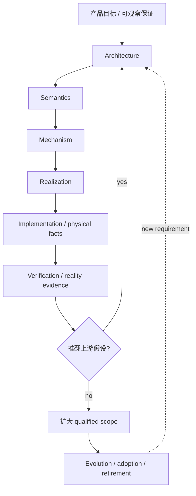

# 设计综合、必要性与结构保全

> **阅读范围**：本篇拥有 Gift 的设计方法：怎样判断设计信息是否完整、怎样证明结构有必要、怎样把旧设计综合进更小的模型而不丢信息、怎样让抽象、代码、验证和演进闭环。具体领域协议、编译算法和运行状态仍由各 canonical owner 维护。

## 设计优化的目标与约束

Gift 同时面对两种失败：

- **混叠**：不同 identity、authority、failure/recovery、Evidence 或生命周期被塞进一个万能对象；
- **过拆**：每发现一个名字、页面、实现细节就增加 IR、Registry、Manager、状态机、服务或文档 owner。

目标不是“概念越少越好”或“文档越多越完整”，而是：

> **先保全全部独立信息和硬义务，再按真实任务比较总认知、开发、验证、运行、演进与退役成本，去掉没有独立价值的重复。实体、文件和模块数量不是单独的优化目标；需要的分解必须保留，合并也必须有保持依据。**

任何统一/简化都须证明没有删除仍有效的信息；任何新增都须比较不新增、复用、合并、派生或成熟机制，不以“将来可能”或模型对称代替必要性。小机制可能缺隔离或增加调用方重复，大机制也可能制造隐藏耦合；结论取决于明确合同和真实成本。

<a id="asmrve-design-closure"></a>
## ASMRVE：按真实责任检查六类设计问题

本设计用**ASMRVE**命名Architecture、Semantics、Mechanism、Realization、Verification、Evolution六类检查问题。它是当前采用的方法记号，不声明恢复了某个历史缩写的原始全称；读取现行设计无需先还原旧聊天。六类信息的实际含义如下：

| 段 | 必须回答 | 其中同时承担的“必要性问题” |
|---|---|---|
| **A — Architecture** | 为什么存在这个 concern；真实 consumer/problem；identity、owner/authority、边界、依赖、scope、与相邻责任怎样分开 | 没有它会丢什么区别；现有 owner 为什么不能承担；不新增/合并/成熟机制替代为什么不足 |
| **S — Semantics** | 它准确表示什么；输入输出、状态、关系、约束、invariant、正常与错误的可观察含义 | 哪些区别不可混同；哪些值/关系是 source of truth；哪些只是派生/unknown |
| **M — Mechanism** | 算法、状态机、数据流、顺序、并发、资源、缓存、失效、取消、失败、恢复、终止/进展怎样工作 | happy path 之外怎样保持语义；重复计算/authority 如何避免；机制为什么足够而不超建 |
| **R — Realization** | 具体落到什么代码、数据、crate/package/module/file/symbol、Provider、target、build/runtime；物理 cost 和生命周期是什么 | 实现成本是否超过收益；哪些实现自由不应反写上层；真实 consumer 怎样接上 |
| **V — Verification** | 哪个 Claim 在什么 subject/revision/environment 下由什么 Evidence 支持/反驳/保持未知；哪些反例可推翻 A/S/M/R | 设计、实现和现实资格分别怎么证；什么证据不足；何时必须重开上游 |
| **E — Evolution** | revision、兼容、迁移、rollback、replacement、preservation、retirement 和重新决策条件 | 旧设计信息去哪里；什么时候能删；什么新事实会反转选择 |

ASMRVE不是与Engineering Reality并列的第二顶层模型，而是[统一多层工程模型](../统一多层工程模型.md)中按实际责任使用的检查问题。它不是六个运行阶段、六个数据库、六个服务或六个作者步骤。已有父合同可以闭合子项；不适用的问题说明其不适用前提，不伪造运行、状态或迁移字段。真正影响正确性的未知不得以“显然”或“不适用”掩盖。

### 旧 A/S/M/R 与 N0—N11 怎样保留

旧 A/S/M/R 没有被否定：它正好成为 ASMRVE 的前四段；此前分散的 Verification 和 Evolution 被恢复到同一级，从而形成完整六段。

旧 N0—N11 的信息也全部保留，但不再要求读者记 12 个并列编号：

```text
N0 Problem / Consumer            → A
N1 Distinction Witness           → A + S
N2 Identity / Authority          → A
N3 Scope / Composition           → A + S
N4 Semantics                     → S
N5 Mechanism                     → M
N6 Failure / Recovery            → M
N7 Realization Cost              → R
N8 Alternatives / reversal       → A + E
N9 Verification / Refutation     → V
N10 Evolution / Retirement       → E
N11 Preservation / Supersession  → E
```

因此“所有设计的必要性必须写全”仍然成立，只是必要性已融入 ASMRVE，而不是再叠一份平行检查表。已有设计族完整回答过某段时，子项只引用父合同并写自己的差额，禁止复制模板制造文档膨胀。

## 同一个多层结构中，现实对象、设计列和资格事实不能混成同一种东西

[统一多层工程模型](../统一多层工程模型.md)用 L0—L6 表示因果落地层，用 `Entity / Statement / Configuration / Transition / Evidence / Projection` 概括已有合同的共同角色，而非替换领域类型的强制工程语法；ASMRVE按真实concern检查相交设计问题，不是每层必填六列。它们已属于同一个模型，但数学角色不同，不能互相代替。

因此不再维护全局“六个成熟度维度”或万能 `proposed→accepted→specified→implemented→verified→...` 状态轴：

- 实现是否存在 = 当前源码/Artifact 的 Statement/Observation；
- 实现是否被采用 = Configuration + Transition；
- 是否符合合同 = V 中的 Claim/Evidence；
- 是否真实生产合格 = 特定 production Claim/Evidence；
- 生命周期 = 具体 Entity/Statement 自己的 typed state machine；
- 设计哪一段未闭合 = ASMRVE 中相应段 open。

这样不会再出现“成熟度、生命周期、资格、设计深度”四套表同时描述同一件事。

## 结构综合：先保信息，再重算最小模型

任何旧层、旧面、旧 IR、旧图或旧文档组织被重构时执行：

```text
Preserve → Decompose → Classify → Recompose → Minimize → Verify → Retire
```

### ORG0 Preserve

取得旧结构中所有仍有意义的信息：identity/authority、invariant、正常/失败/恢复、算法、consumer、runtime/build/evidence、alternatives、revision/migration/retirement。目录名和编号可以丢，独立工程信息不能丢。

### ORG1 Decompose

把旧“大概念”拆到最小独立义务，不预设旧分组继续存在，也不预设它必须删除。

### ORG2 Classify

每项信息优先归入：

1. 先定位真实对象、责任和仍有效的义务；L0—L6及`Entity / Statement / Configuration / Transition / Evidence`帮助解释角色，不是信息纳入资格；
2. 对这些对象的 authority/provenance、applicability context、revision/lineage、time 限定；
3. 现有 typed relation / graph family；
4. ASMRVE 六段中的设计解释；
5. `Projection`；
6. 只有以上都无法无损表达时，才新增独立协议/Entity/owner。

### ORG3 Recompose

围绕真实 concern 和 consumer 重新组合，不按旧文件顺序拼装：

```text
Entity + exact Configuration
→ authoritative Statements / Constraints
→ Transition / Realization
→ source/artifact/runtime facts
→ Claim/Evidence
→ Evolution / retirement responsibility
```

### ORG4 Minimize

主动比较：不新增、合并、字段/facet、typed relation、派生 Projection、复用成熟机制、原生 owner、独立新机制。只有出现独立 identity/writer/lifecycle/failure/recovery/permission/evidence/consumer/replacement 责任时，才保留独立结构。

### ORG5 Verify

用 ASMRVE.V 明确验证这次重组是否真的保持旧不变量、失败/恢复、consumer 和关键区别；“新文档链接都能打开”不是 semantic preservation。

### ORG6 Retire

只有新 owner 已语义承接、真实 consumer 已迁移、兼容/恢复/审计责任已结算，旧结构才可以退役。

## 历史模型全部保留为可解释映射，不再竞争 current authority

<a id="historical-six-dimension-mapping"></a>
### 历史六维 Engineering Truth

```text
Object × Lifecycle × Invariant × Environment × Authority × Evidence/Maturity
```

映射到现行模型：Object→Entity；Lifecycle→Transition/E；Invariant→Statement/S；Environment→Configuration/context；Authority→authority/provenance；Evidence/Maturity→Evidence/V，maturity 被拆成实际 implementation/adoption/qualification facts。

### 历史 S/A/C/P/T

- Subject → Entity；
- Authority → authority/provenance qualifier；
- Configuration/Scope → Configuration + applicability context；
- Phase → 具体领域的 Statement/Transition/state，不是全局轴；
- Revision/Time → revision/lineage + valid/observed/recorded time。

其表达能力保留，但不再作为 active 顶层坐标体系。

### 历史九类概念分域

Semantic、Authority、Implementation、Static Code、State/Data/Effect、Physical/Runtime、Temporal/Evolution、Verification/Trust、Delivery/Development/Operations 全部保留为 typed graph/query facets，用于检索、Atlas 和 Workbench，不物化成九个万能 IR。

### 旧“大视图”与 G0—G11

开发者面、Canonical Semantics、编译、目标系统、Gift 实现、Runtime、Assurance、演进等问题全部仍有 owner；它们按真实owner保留，在有用时标出L0—L6相交角色并用ASMRVE核相应义务。旧图中的独立边没有新 owner 时，不能因编号退役而删除。

## 每个独立设计的最小正文格式

长期保留一个独立 architecture boundary、protocol、IR、state machine、service、persistent record、public control 或特殊 workflow 时，正文必须能定位下面六部分；不要求机械写六个标题，但信息必须存在：

```text
A  必要性、边界、owner、identity、依赖、替代方案
S  精确语义、不变量、状态/错误/关系
M  算法、并发、资源、失败、恢复、失效
R  代码/数据/Provider/target/build/runtime 物理落位与成本
V  Claim、证据、反例、符合性与仍未验证范围
E  revision、兼容、迁移、保全、反转、退役
```

纯 schema 字段、私有 helper、机械 projection 不重复制造一份 ASMRVE；它们由父 concern 的闭包覆盖。

## 全工程主要设计族的必要性索引

下表不复制完整协议，只回答“为什么存在、最小替代是什么”。各行具体算法回链接的 canonical owner。新的独立设计若不属于现有行，先说明必要性/替代、精确语义与机制、物理落位、反例和演进中真正相交的义务，再决定是否增加类别；ASMRVE辅助查漏而非必须另填六列表。没有独立差额就复用既有owner，不能靠增加目录行数证明扩展完成。

| 设计族 | 统一模型位置 | 必要性见证：没有它会发生什么 | 更小/替代方案为何不足或何时可用 | canonical owner |
|---|---|---|---|---|
| 稳定 Entity / Revision identity | 跨 L0—L6（identity/lineage） | 路径、名字、内容相同/变化无法区分对象延续、复制、删除重建和历史引用 | 临时局部值可不用全局身份；长期引用边界必须稳定 | [作者工程源](../../10-作者与输入/作者源/工程源/README.md)、[信息基线](../../70-工程系统与演进/信息与生命周期/对象关系与配置基线.md) |
| Typed Statement / Relation | 跨 L0—L6（canonical forms/relations） | `requires/generates/authorizes/observes` 被压成无类型边后方向、生命周期和失效语义丢失；Fact/Constraint/Claim/Decision也会被万能属性表混同 | 纯目录关系可用树；跨责任关系和有独立语义的Statement必须有类型 | [信息结构](../../70-工程系统与演进/信息与生命周期/全体系信息结构.md) |
| Authority / writer 分离 | 跨 L0—L6（authority qualifier） | Requirement、Binding、Runtime、Evidence 可互相反写，形成第二事实源 | 同一 authority 内部可共用物理存储；写权语义不能合并 | [原则](../产品/原则总纲与归属.md)、[开发者模型](../../20-语义与组合/作者语义/开发者决策模型与设定面.md#developer-mental-model) |
| Configuration / baseline | 跨 L0—L6（configuration/time slice） | “最新”无法表达某产品/目标/部署实际采用哪组 revision | 一次性闭合函数可用固定调用输入；跨对象重建必须有准确选择 | [对象关系与配置基线](../../70-工程系统与演进/信息与生命周期/对象关系与配置基线.md) |
| Author source + acceptance | L0 → L1 | 候选源码、已接受要求和生成物会竞争成为“真正意图” | 没有独立要求的小片段可只用当前 source；持久产品必须区分来源与采纳 | [结构化源码](../../10-作者与输入/作者源/结构化源码.md)、[需求责任](../../20-语义与组合/作者语义/需求含义与实现责任.md) |
| Structured author-module / Definition | L0 → L1 | 高层业务/工程关系若只能靠目标代码反推，会把实现偶然细节当产品含义 | 独特算法可直接原生；已有 Definition 能表达时不复制低层代码 | [结构化源码](../../10-作者与输入/作者源/结构化源码.md) |
| 可选 `.gift` 计算文本 | L0 → L1（必要时进入 L3 source） | 需要中立、可移植、可直接编辑的独特计算时不能只靠 JSON 组合或某一目标语言 | 普通产品作者不需要；原生专有算法可保留原生 | [作者表示](../../10-作者与输入/作者源/可替换表示与适用范围.md)、[计算语言](../../20-语义与组合/基础语义/计算基础/文法类型与求值.md) |
| Requirement / Profile / Control 分责 | L1 → L2 | 产品必须满足什么、复用什么政策、实现空间如何收窄会混成一张配置表 | 简单项目可以只有少量 Requirement；没有实现差异时不产生 Control | [需求边界](../../20-语义与组合/作者语义/README.md)、[稀疏控制](../../20-语义与组合/组合/稀疏控制与目标限定.md) |
| Developer Decision / All Decisions projection | Projection：跨 L0—L6 | 强控制被分散在作者、native config、target、runtime、client后无法统一理解来源与影响 | 只是投影，不建立 UniversalConfig；简单任务不必展开 | [开发者设定面](../../20-语义与组合/作者语义/开发者决策模型与设定面.md#developer-decision-surface) |
| Exact workspace observation | L0 | 编译/编辑会从 cwd、缓存或陈旧磁盘猜输入，无法解释未保存缓冲与并发变化 | 纯内存独立输入可直接传值；接入现有工程必须固定观察范围 | [工程源](../../10-作者与输入/作者源/工程源/工程准备视图与编译输入.md#project-prepared-view) |
| Semantic Contract / Responsibility | L1 | 模块只有类型形状，没有谁保证行为、失败和保持范围，组合时无法判断责任是否闭合 | 纯私有 helper 可由父合同覆盖；跨边界必须显式 | [共同语义](../../20-语义与组合/共同语义/README.md) |
| Pure compiler/query kernel | L1 → L2 → L3 | 生成语义若直接读写现实世界，结果无法确定重建、缓存和并行验证 | effectful工具可由 adapter 执行，但不能成为 pure query 的暗输入 | [编译内核](../../30-实现解析/内核/输入与阶段总览-编译责任-阶段与目标.md) |
| Realization resolver / exact Binding | L2 | 同一 Requirement 可有多个库/算法/Provider，后端若自行选会形成第二决策点 | 唯一固定实现可直接绑定；存在选择时必须先资格再冻结 | [实现选择](../../30-实现解析/实现选择/README.md) |
| TargetProgram / lowering | L2 → L3 | 共同语义与目标语言语法/ABI/布局不是一回事；直接字符串模板无法保持目标特性 | 极小目标片段可由一个 method 直接产出；仍须绑定目标合同 | [目标](../../40-目标与制品/目标/README.md) |
| 生态 resolver + lock | L2 → L3 | Cargo/npm/Maven等真实版本/features/条件解析若由Gift自造第二套semver会漂移或冲突 | 没有外部依赖时不需要；有依赖时复用生态真 resolver并冻结结果 | [工程源锁](../../10-作者与输入/作者源/工程源/README.md)、[实现搜索](../../30-实现解析/实现选择/README.md) |
| Artifact membership / build/package closure | L3 | “有源码”无法证明配置、资源、生成成员、依赖、包和安装内容完整 | 只请求源码预览时可停在源码；交付可运行/分发产品必须闭合 | [完整产物](../../40-目标与制品/目标/成员布局-完整装配与布局.md) |
| Execution admission | L4 | 有实现能力不等于当前有权对真实目标产生效果 | 纯分析不经过执行准入；任何外部写/运行/发布必须重新取得当前权力 | [权限资源](../../50-执行运行与观测/权限与资源/README.md) |
| Operation / Attempt / settlement / recovery | L4 | 超时、断线、部分成功后无法知道是否安全重试，可能重复外部效果 | 真正纯操作无需 journal；不可逆/未知结果操作必须保留恢复事实 | [持久化恢复](../../50-执行运行与观测/持久化与恢复/README.md) |
| Resource/deadline ownership | L4 | 并行任务会无限抢占CPU/内存/连接，取消后资源泄漏 | 无资源占用的纯小查询可省略显式 envelope；现实任务不能 | [权限与资源](../../50-执行运行与观测/权限与资源/README.md)、[分配域](../../50-执行运行与观测/分配域与退出责任.md) |
| Claim / Evidence / Coverage | L6 | “测试绿了”无法说明证明了什么对象、版本、环境和范围 | 无需保证的探索可以只有诊断；正式结论必须绑定 Claim | [要求证据与裁决](../../60-保证与证据/保证/要求证据与裁决.md) |
| Incremental invalidation / causal locality | 跨 L0—L6（Transition/dependency closure） | 任意变化都全量重算，或缓存漏依赖后返回错误旧结果 | 小工程可退化为全量 clean；增量只能是已证明依赖上的优化 | [查询增量](../../30-实现解析/增量与性能/README.md) |
| Provider / Adapter boundary | Realization seam：主要 L2—L6 | 外部工具品牌、权限、版本和失败语义会侵入核心并取得不该有的 authority | 纯库调用可很薄；外部机制仍必须经过窄合同 | [实现供给](../../30-实现解析/供给与替换.md)、[宿主生态](../../50-执行运行与观测/平台生态/README.md) |
| Native source round-trip / ownership | L0 ↔ L3 | 生成区手改、原生资产和结构作者源会形成双写或覆盖用户修改 | 不需要回源的只读生成可省略逆向；可持续编辑必须有唯一 owner/映射 | [编辑与受管回源](../../40-目标与制品/表示/编辑与受管回源.md) |
| Workbench / CLI / AI projection | Projection：跨 L0—L6 | 不同交互面若各自解释语义和权限会产生多套产品 | headless任务可只用工具协议；客户端只投影同一事实 | [开发客户端](../../80-开发者与接口/客户端/README.md) |
| AI governance boundary | 跨 L0 / L4 / L6 | 模型可以创作文本但不能因此拥有确定构建、授权或Evidence签发权 | 无AI路径完全可工作；AI接入时必须限制披露和effect | [AI协作](../../80-开发者与接口/AI协作/规则装载与任务恢复.md) |
| Compatibility / migration / retirement | ASMRVE.E：跨 L0—L6 | 新 revision 会同时存在旧消费者、旧数据、旧运行和恢复义务；直接删除会破坏现实 | 未发布且无消费者的内部对象可直接替换 | [兼容迁移与退役](../../70-工程系统与演进/演进与实施/兼容迁移/README.md) |
| Self-host / bootstrap separation | Subject=Gift：覆盖 L0—L6 | “Gift能生成自己”“能构建自己”“语义固定点成立”是不同主张，混成一个自举布尔值会制造假完成 | 非自举发行可只依赖外部种子；宣称自举时必须分层取证 | [仓库迁移与自托管](../../70-工程系统与演进/演进与实施/实施/仓库迁移与自托管.md) |
| Domain extension / dialect | L1（并由 L2/L3 realization 消费） | 状态、关系、流、数值、仿真等有独立可观察语义，不能全压成普通函数或万能JSON | 能由既有Definition/计算表达的业务不新建dialect | [领域入口](../../20-语义与组合/基础语义/README.md)、[扩展语义](../../20-语义与组合/基础语义/扩展语义与适配合同.md) |
| 规范作者源与阅读投影 | 各自责任；跨L0—L6按需查找 | 规范可能是语言无关合同的真源，导航与生成API参考才是派生；依赖聊天才能理解或双写同一合同都会失去稳定维护依据 | 规范与实现分别拥有预期和实际行为；二者冲突先核合同与证据，不能因实现存在就让规范退为投影 | [文档架构](../../90-治理与参考/维护/文档架构.md) |
| Repository/CI governance | 工程操作：主要L0 / L4 / L6 | main拥有正式产品内容；PR/Review、Actions与Gate分别提供候选、审查、执行和资格的原生事实，不能相互代签；临时验证结构不能因存在而取得产品采用权 | 小型单人实验可简单；正式集成仍读取各命题的真实authority，按精确输入追踪准入／退役 | [工程行为路由](../../80-开发者与接口/原生维护/仓库开发准入与恢复.md#engineering-behavior-routing) |

## 上层设计与实现事实怎样互相约束

因果方向仍是：



上层必须消费会改变可观察语义、确定性、权限、资源寿命、失败/恢复、兼容、可复现性或承诺成本边界的实现事实；私有容器、函数拆分和等价写法保持实现自由。

## 极致综合优化算法

以后“继续优化全部设计”统一执行以下十步，不再另造与这套责任检查竞争的平行总框架：

1. **固定concern与本次用途的准确输入。** 正式作用读取当前authority；离线候选和旧版复现固定所选源与解释，历史内容在复现任务中可以是实际输入，不一律降为旁证。
2. **读取真实owner的canonical facts。** 取得相交对象、Statement/Configuration/Transition/Evidence/Projection及其限定信息；不以先贴layer为准入。
3. **在同一责任及相交消费者上检查ASMRVE问题。** 补齐真实缺口，避免把 implementation 未完成误报为 Semantics 未设计。
4. **建立 typed graphs。** 找第二 writer、重复 resolver/state machine、无类型 link、隐藏 authority、错误依赖方向。
5. **串主因果与时间。** 从作者/外部输入到 artifact/runtime/evidence，同时核 revision/valid/observed time。
6. **比较更小机制。** 删除/派生/字段/facet/relation/成熟工具/原生 owner 与新增结构一起竞争。
7. **对齐代码与 Evidence。** concern → contract → module/crate/file/symbol → consumer → Claim/Evidence。
8. **做 preservation/supersession。** 旧有效信息逐项承接；未承接不得删。
9. **双向检验结构成本。** 比较不改、合并、分解和复用。删除若不丢义务但增加消费方重复、性能或恢复成本，也不自动采用；分解若有真实独立责任与净收益则保留。不能仅靠少一个名字证明更优。
10. **记录 reversal trigger。** 新事实何时要求重开 A/S/M/R/V/E 中哪一段。

完成条件不是“想不到新名词”，而是当前范围内：L0—L6 层间 authority/因果不混叠、相交concern的实际设计义务闭合、跨域关系有类型、流程和时间可追、物理落位可对账、Evidence 边界明确、任何被删结构都有保全/退役证明。

## 历史信息保全等级

组织重构的证据固定分四级：

1. **Address coverage**：旧 section 能定位到当前 owner 候选；
2. **Semantic coverage**：旧不变量、状态、失败/恢复、consumer、反例和条件由当前设计等价或更强承接；
3. **Consumer closure**：代码、测试、文档和迁移 consumer 已使用新 owner；
4. **Retirement closure**：兼容、恢复、审计和历史解释责任已结算。

历史输入的包数、文档数、章节数及地址映射在对应准确审查制品记录，不作为稳定规范中的当前完成数。**地址覆盖不是semantic coverage**；保留了全部旧字节或可逆差异，也只证明可恢复，不足以删除尚未语义承接的有效信息。消费者与退役闭合还须各自真实证据。

## 最小总则

1. 一份由真实owner联接的工程事实；L0—L6可作因果阅读索引，不建立EverythingIR或强制矩阵地址。
2. 同一语义侧面、修订与作用域使用一个合法写入协议；多作者经该协议并发协作，不合并不同来源的观察。Entity/Statement等只概括现有角色，不强制同一存储／类型。
3. ASMRVE按责任检查真实设计问题；流程用相应Transition，时间用revision/time限定，生命周期和资格回真实对象/Evidence，不要求全层矩阵。
4. 任何新增结构必须赢过不新增、合并、派生和成熟机制复用。
5. 任何组织重构必须先保全语义，再删除重复结构。
6. 任何设计都允许被实现和现实 Evidence 推翻，并必须说明演进与退役。

## 组织统一的具体采用

多维信息、源码组织、目标包和文档目录不各自发明治理平台；它们共同采用[组织与落位合同](../../70-工程系统与演进/信息与生命周期/多维组织与树形落位.md)。共同问题包括成员与出处、类型化关系、用途、约束、局部划分、稳定性、变化和验证；语言/文档/部署的独立语义继续由原owner承担。采用的不是“所有东西都必须树化”，也不是“树比图更基础”。

当前七角色和六类设计问题可帮助读者定位，但不能仅以反例证明几个边界有用，就推成七层/六列的唯一最小性定理。新增实例、角色、查询facet或不同作用域通常无需扩展顶层分类；真有不能保持的独立信息，再重开相交合同。优化保留的判断可能是继续使用旧结构，而不是每轮必须产出一次目录或模型改名。

<a id="design-choice-evidence-and-reopening"></a>
## 已选方案怎样成为可核对的当前选择

“已定”说明实现可以遵循一套明确合同；“优于另一方案”说明在指定条件下完成了比较；“最优”还要求候选域、目标与排除依据足以支持它。三种命题分别评价，不把设计章节齐全、类型安全语言、代码较短或一次基准最快当作整个工程已最优。

维护者作选择时，先固定本次可观察目标、不可补偿硬条件和真实资源／交付边界，保留现有可用方案作为基线；再比较不修改、删并、复用成熟机制、只补差额和新结构。每个方案说明正常路径、相交消费者、失败与恢复、迁移／退出，及认知、开发反馈、验证、运行、存储和维护成本。已有规范已给出这些信息时直接引用，不能要求每轮再造一份六栏表。

裁决写回原D／责任正文，包含实际被比较的方案、采用理由、适用条件、被排除理由、未决定信息和会反转结论的证据。采用无需等待所有成本都能化成一个数；不相同单位和未知成本保持原量纲。一个已有决定无需因再次询问而重开，只有新反例、条件变化或缺失的独立比较具有实际影响时才改。

结果表述使用其真实强度，而不是新建运行状态枚举：

| 可以作出的判断 | 必要依据 | 下一步 |
|---|---|---|
| 当前合同下不可行 | 真实冲突、缺少不可替代能力或支持该排除的证明 | 排除相应域；只缺资料时不得归入此项 |
| 现有可行并继续保留 | 声明范围的资格仍成立，未出现足以改选的新证据 | 继续工作；保留优化前沿，不为显示进度重构 |
| 当前采用的条件性较优方案 | 被比较方案、共同基线、具体优势与完整代价有依据 | 按其条件实施／验证；条件失效重开原决定 |
| 存在取舍或尚不能排序 | 不可补偿目标冲突、非支配、区间重叠或缺决定性资料 | 按已委派政策选择可行者或保留待决；不得伪造综合分数 |
| 声明域内最优 | 完整有限域或健全搜索／界／证书覆盖所有相关替代，并满足同一目标与约束 | 只对该域和条件声明；新候选／输入变化重核相交证明 |

例如内核采用模块化单进程，保留不可信Provider的隔离出口。若尚无独立故障／权限／规模边界，拆成多个服务只会额外引入序列化、部署和恢复职责，没有采用依据；若真实不可信原生代码可能破坏内存，单进程模块封装又不构成隔离保证，就在该Provider边界选择有相应保证的宿主机制。不能先把“单进程最小”或“微服务可扩展”设为跨场景答案；也不能为了一个不可信工具把全部纯查询远程化。

Rust内核方向、目标后端、作者表示、布局、持久化和求解器可以有不同证据成熟度。语言方向已选不证明性能收益；恢复协议已写不证明宿主原子性；候选查询快不证明端到端开发便宜。验证计划必须落到会区分这些竞争解释的实际观察，不靠重复同一自评形成独立支持。

文档优化同样受此规则约束：只增加导航或封装不能报告规范已改；摘要更清楚不能替代完整正文；保留原字节不证明语义承接。成果清单从最终文件差异和真实动作回读，正文仍正确的部分不为凑修改量而改动。
