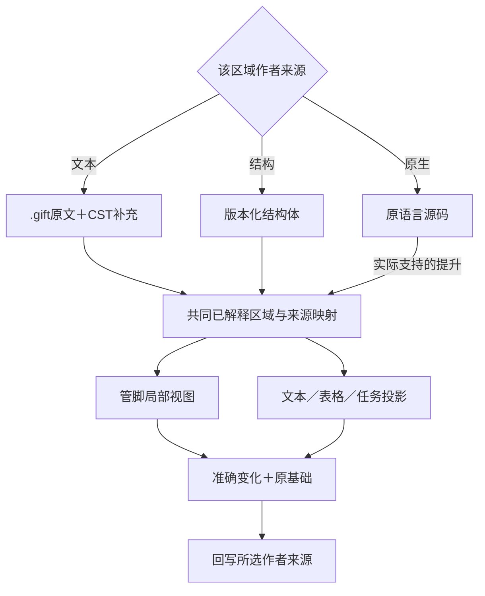
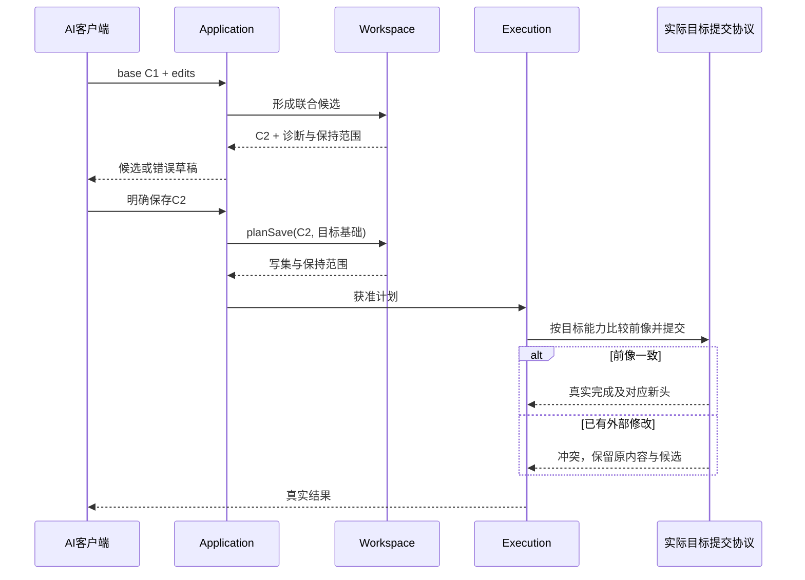

# 作者编辑保存与迁出

### 源捕获与未保存编辑缓冲：不允许偷偷改变作者真源

**编辑缓冲、受信保存基线、目标输出与远端采纳是不同修订。** `save` 在开始时冻结要提交的缓冲修订和已知目标前像；保存期间继续输入产生更高缓冲代，回执成功只推进相应旧代的磁盘基线，当前编辑仍应标为未保存。`save all` 以选中资源集合为作用范围，每项保存可成功、冲突、未知或失败，不能由其中一项成功替全部文件清除 dirty。编辑器关闭、窗口退出或程序中止只影响客户端寿命，不能取消已经提交给资源 Provider 的不可撤回写入；恢复时从原操作身份读回，而不是无条件重放写入。重叠的目标成员/受管生成区与手写源码的写权必须先分流。

编辑器中的未保存文本、磁盘文件、Git 索引、提交树、远端仓库是五个不同视图；项目当前 `SourceRevision` 必须指明来自哪一个冻结视图。编辑器可以给用户显示缓冲层的实时诊断，但不能把未保存缓冲的结果宣称为对磁盘文件的已发布编译；保存也不能因浏览器会话退出而假定已成功。跨文件编辑以共同基线、可定位发生点、预期源前像及作者写权提交，同一变更若只保存部分文件须给出可恢复状态，而不能通过重新扫描磁盘自行补齐另外一半。

项目 `sourceScopes` 是收集输入的权限边界，不是粗暴 `**/*` 的自动提权。读入采用严格 UTF-8/编码策略、路径规范化、符号链接归属、大小写/Unicode 名称冲突和明确的排除规则；一个可写逻辑模块只由单个来源拥有。Reader 记录输入是否来自源本体、工具推导或外部 Provider，不能把 LLM 提议、AI 生成的表单草稿和导出的图表悄悄变成第二份业务事实。作者可以选择迁入原生程序/资产，但迁入是取得写权和来源身份的显式动作，不意味着历史意义已被准确恢复。

### 单一作者权与大型JSON的真实编辑策略

作者通过IDE树形、表格、图和语法视图编辑同一JSON源。工作台所有辅助视图都必须能定位到原File/Definition/成员Use/字段并以有条件写回修改。需要携带源Revision、目标稳定逻辑键、当前拥有权与冲突策略，不能用数组索引在并发修改后定位错误对象。对于全文件重排、格式化、语义重命名，保留等价映射和人类注释的正确归属。不能把“展示写起来方便”转化为新增长效Markdown作者副本。

可分模块、导入、模式复用，公共模式的变化依真实Version/Scope决定是否传播；多个实例复用同模板不需复制Definition Body。性能索引、搜索视图和大型文件拆分是在作者唯一写权之上**派生**，不是需要人工同步的第二数据库。

## 作者来源、表示与身份

### 多种作者界面如何编辑同一工程

#### 图解：多表示围绕一个作者拥有者

同一作者区域选择一种可写来源；投影箭头不是第二份写权。转换拥有者时需完成保全和显式切换。

**作者语义以有权 AuthorRegion 中已接受的内容及其锁定解释为准，文件后缀只确定表示方式。** 新非计算业务结构作者统一使用候选 `gift.author-module/2` 和相应领域体合同，旧 `/1` 来源只读；两者不可对同一语义双写；意图体由结构化意图规范解释，明确采用计算文本的区域可使用紧凑 `.gift`。JSON、文本、图形和表格可作为不同区域的作者面或只读投影：依据区域所有权与可解释性选择，不要求整个项目统一转成一种格式。

| 区域的作者方式 | 实际保存 | 另一种入口怎样修改 |
|---|---|---|
| 文本拥有作者权 | 原字节、编码和必要声明身份；CST/语义视图派生 | 结构编辑基于精确源与位置/身份映射，产生保全原文的源增量 |
| 结构模型拥有作者权 | 版本化声明、连接、参数、紧凑算法节点及必要注释 | 图和表改同一模型；文本投影只在相应构造有可靠逆向时允许修改 |
| 原生文本拥有作者权 | 对应原语言的原文与实际解释 | 原生CST适配修改；中立观察保留不能提升的未知 |
| 不完整或未知内容 | 原字节或原结构载荷及已知诊断 | 可保存、比较；只改适配器能定位且不会破坏未知的区域 |

区域合同需要 `authorRole`、精确内容、解释绑定及当前修订，但这些属于区域/模块级元数据，普通函数无需逐项重复保存。JSON负责字节表示与交换，节点、参数和连接含义由选定语言 Profile 定义；受支持的结构源与 `.gift` 文本源可直接进入统一类型化模型。解析成功的未知结构只获得保存或诊断资格，尚无执行资格。

#### 通过结构修改文本的正常路径

固定base与当前作者区域后，应用层把已解析的结构变化交给[局部CST回写算法](../../../20-语义与组合/组合/结构编辑/编辑重构与确定回写.md#从语义改动到文本字节的确定回写)。输入是原字节、精确语言/CST版本、绑定映射与本批变化；输出是新作者字节、实际映射和诊断。由此复用同一解析、类型、效果与契约规则，不创建图形版宽松检查器。

字面量和名字优先只替换对应token；复杂表达式修改在可保全的最小语法容器一次合成，再重解析和比较实际绑定。无操作返回原字节；不同语句可能都类型正确，仍需检查引用、激活和求值次数。只读图布局默认不参与程序行为；业务空间坐标有自己的领域解释。

编辑前验证请求格式、句柄、写权和所属修订；不合法请求保持原作者字节不变。定位成功但语法/类型尚不成立的新文本可保留为**未采纳草稿**，原始字节与诊断并存，不以旧 AST 冒充新解释。CST 适配能力不足时返回 `AUTHOR_EDIT_UNSUPPORTED` 及相交范围；开发者仍可改原生文本或提交有前像的整区域候选。

混合区域、写权转移与真实磁盘前像继续由本章后续合同负责。CST提供位置和原文保全机制，不自动提供业务等价证明或整个工作区的物理事务。

#### 作者方式切换是一次明确的迁移

1. 固定原作者修订、语言与所有未保存内容，保留回退对象。
2. 取得目标表示的覆盖合同，转换受支持对象，并保留注释、未知扩展、原始片段和声明谱系。
3. 在相同语言/观察下检查转换后的含义及所有引用。检查不了的区域保持旧拥有者或报告缺项，不假装全域等价。
4. 在一个候选中改变相交区域的唯一作者位置，并更新消费者定位；旧表示成为只读投影或按已接受规则移除。
5. 采用时比较原修订和当前写权。并发变化则重基或冲突，不能让文本、数据库和图各自提交为同一区域的新真相。

一份JSON导出只是交换快照，除非完成上述转移，不取得原文本作者权。相同语义可以采用不同字节表示；是否产生相同目标字节，还取决于布局、命名、注解等真实输入。这里承诺的是有支持范围的解释和编辑，不宣称任意图、任意源码和任意JSON都可以无损互换。

首个 headless 闭环中 AI 可以使用结构增量，无需等待人类拖线界面；已选的人类 Workbench 实际启用时也必须遵守同一候选与写回合同。布局坐标等编辑元数据按实际消费者保存，不复制整套算法作为另一份作者源。

#### 文本没有手填ID时如何维持身份

首次接入为真正需要独立引用的声明分配身份；普通局部AST节点只在当前解析域定位。后续propose绑定精确base，按编辑记录和无歧义的结构对应延续身份；重命名/移动会更新定位与公开绑定，不自动换实体ID。文本相同不表示对象同一，相似名字也不是合并身份的证据。

声明身份映射只记录“源中的具体声明 → 稳定身份及对应依据”，并随作者谱系保存；类型、函数体和生成图仍归各自原始来源。一次性局部分析可将映射留在会话；跨会话引用、迁移或身份比较需要时才持久化。可移植工程导出必须携带实际依赖的身份谱系或等效稳定标识。

若外部编辑删除并重建、交换同名声明，或复制代码使对应不唯一，保全全部文本并返回映射候选/冲突；仅相交的身份依赖与写回受限制，纯文本解析不必全局停止。丢失映射后可以重新分析内容，但不能声称恢复了旧权限、旧编辑谱系和旧证明对象；需要显式重新绑定。保留全部历史文本也不能代替身份发行合同。

公开导出名属于接口而非创建身份；重命名仍会影响按名称消费的外部工程。规则升级、格式化或目标切换不得重分配所有源声明身份。更小替代是在无长期引用任务中完全不持久化这张映射；不得为每个表达式建立全局账本。

### 文本作者的角色与构建入口

当前新产品意图作者使用结构化模块；选择[中立计算合同](../../../20-语义与组合/基础语义/计算基础/文法类型与求值.md#语言无关的作者合同与当前规格)的区域可以使用`.gift`文件约定；已有`.ts/.java/.py/...`属于各自原生语言，仍可直接观察、编辑和原生构建。`.gift.ts`不是全工程管理方式，只能在显式启用的TS生成器适配中存在。

输入绑定分别保存sourceLanguage、semanticProfile、targetProfile与实施工具身份。没有上下文的新工具协议使用公开固定的中立源默认；原生后缀只能在已定义映射中选择原生前端，冲突须诊断，不根据代码外观或模型猜测改变解释。旧工具版本不静默重新解释裸source。

一个完整函数可以只以内联source存在，不造projectId、文件清单、构建脚本和控制库。保存成工程后，中立定义与原生资产按责任分片；同一含义不同时手工维护两份源码。当前工程清单及锁保持其既有结构合同，目标选择和实现绑定不写入每个函数体。

目标选择产生自己的Binding与制品身份，不反向修改作者修订。任务另行明确选择TS与Java双目标时，同一定义保持同一语义身份不等于输出字节相同，也不等于所有后端都合格。外部原生库、运行库与生成器的实际依赖进入各自绑定，缺项准确报告。

从其他作者前端迁入不是改后缀：只对已具备保持依据的静态数据和受支持表达式形成中立候选。原生特征和代码片段保留原语言身份，不能自动变为可移植函数。旧源与新候选通过准确基础和所有权转移保持单一作者来源；没有真实采用事实的备选提案，不触发用户源码迁移或删除。

### 工程声明的源权威与画像保存

作者定义的高层操作、规则、订阅或其他复合结构按其所选 SemanticModule/普通库的真实编码保存，不由 Gift 预置任何事务、游戏、仿真等完整应用语言。多个定义可在同一作者模块组织；只有具体模块真的声明额外语法时才固定其 module identity/revision 和解释器。事务型完整写法仅作为组合研究检验可组合性，不能成为作者默认。基础表达式小输入仍无需工程目录。

项目或会话必须固定实际组合语言画像、所用定义与目标绑定。`sourceLanguage`是输入解释，target是输出选择；仅把后缀改成.gift不改变当前解释合同。规则标签、事件槽和聚合字段拥有需要时的稳定子引用，显示位置和格式不是其身份；移动或升级中的不明确对应走原身份协议，不猜测继承。

生成模式、SQL迁移候选、处理器、Outbox编码和部署连接引用同一声明与布局计划。它们是派生物，不成为第二作者源。真实运行数据库保存业务值、版本、请求结果与待办；它与Gift开发工作区中的候选/操作库是不同的权威域，即使使用相同数据库软件也不互相读写私有表。

删除或变更作者定义不意味着立即删除运行数据、历史解码或未结算事件。作者变更先形成新的候选和所需迁移；运行采用与保留按明确目标决定。缓存目录不能承担活动业务意图的唯一存储。

### 计算数据与长期作者身份

图像尺寸、迭代初值、算法规则和目标布局可以是作者定义或输入参数；具体像素、工作队列元素和目标临时内存通常是运行数据，不逐项建立持久作者对象。要检查某条索引/依赖时可以生成临时分析节点，结束后按消费者释放，不成为AI的必填模型。

用户的库定义可以存在而没有实例；不属于本次输出的定义不删除，只是不物化。可重建的缓存、尚未启动的可选实现、持久恢复资产按不同保留规则处理，不因它们都在同一工程路径下就共同清理。源画像、输出选择、运行激活与当前授权不共用一个开关。

### 完整作者资产与局部任务投影

每个区域保持每区域唯一作者来源：文本、结构模型或原生资产由其原合同管理。AI任务视图不是第四种作者持久格式，不要求保存一份精简.gift和一份展开.gift。对已共享的库，源只记录真实引用和实例差异，展开按需派生；不能以后台文件不可见为由重复维护全部含义。

局部编辑所需S/M保存在现有候选和来源映射，写回使用原作者补充而不从摘要重建。空编辑保留原字节。复制短视图到其他项目不携带原权限或有效绑定；迁出必须按用途携带真实源、依赖及必要身份，不仅导出界面看到的几行。视图全部丢失不影响有实际源和锁时重建；原源丢失则不能用一个旧editRef冒称完整恢复。

### 作者前端与源归属

当前新建产品意图区域直接使用已声明的AuthorModule/Requirement语义模型，实际作者字节由区域选中的SourceProfile承担；需要结构profile时可选择严格JSON，计算源也可明确选择`.gift`，日常默认由[作者基线](../可替换表示与适用范围-语言定位与作者基线.md#当前作者面实施基线与决策状态)确定。原生作者区域继续绑定自己的实际语言，不因扩展名相似、安装一个包或任务提及SDK而变成构造程序。未选SDK不进入项目默认、锁或能力列表。

同一区域只保存一个可写作者来源。前端切换属于显式迁移，须固定旧解释、源补充、未知内容和真实映射，再转移写权；现有区域不随产品默认自动迁移。工具任务投影、基础语义体、目标源码均保留其派生身份，不为新增前端再建立一份同步作者源。

### 工程信息的选择与持久表示边界

项目源成员仍由本章工作区/模块/锁合同拥有，发行成员由ArtifactSet拥有。研究、讨论、数据窗口、检查报告和旧运行可以与其关联，但不能因进入[信息目录](../../../70-工程系统与演进/信息与生命周期/信息类别与生命周期路由.md)而自动成为项目编译输入、安装包成员或可编辑作者区域。

跨域复验/移交需要独立清单时，application按[配置基线步骤](../../../70-工程系统与演进/信息与生命周期/对象关系与配置基线.md#baseline-selection)从原ProjectView、Binding、证据和运行引用形成只含真实选择的视图。纯本地源编辑可不持久化这份视图；要求可离线恢复时才取得准确成员和保留责任。没有取得的外部输入明确缺项，不用空文件或自造URL填齐。

### 产品需求定义作为作者资产与输出根

同一ModuleRevision现在可含公开design。其原始文本是唯一产品作者源，绑定后的RequirementTerm、主体代换和方法选择是派生分析，不另存一份可竞争修改的requirements.json。outputRoots沿原moduleId/export选取该公开定义；生成时要求相应产品根方法，不能将它登记为CallableIndex或直接compute-eval。

实现供给可以是已存在的包，也可以是按原委派创作并采用的DefinitionRevision。后者及其真实输入/方法由原Binding与保留责任维持；不要求每次把全部算法粘回产品源。只修改生成代码不能自动改变硬需求；受管改动需要说明是实现等价变更还是需求变更，再回各自唯一拥有者。完整示例见工作台意图源。

## 候选、保存与未知内容

**解释非仅格式。（消费条件）：** 未知字段后来获得已知含义必须经过作者变化采纳；成功往返原字节不表示新执行语义被旧Revision接受。 合同归属：[老源解释升级与隐式新效果的采纳资格](../../../70-工程系统与演进/实现与装配/源绑定与解释映像.md#gift-source-interpretation-upgrade)。

### 草稿、未知扩展与局部工作

语法不完整的文本先作为原始草稿保全，保留解析错误和位置。最后一个有效模型可以辅助显示，但必须标为旧视图，不能在保存时替换当前原始字节。结构合法但定义不全时，用语言规定的空洞、未决引用或冲突对象表达，不填充可运行空实现以获得绿色。

读取器遇到未知根版本，保全原文件并停止相应解释；遇到已知外壳中的未知定义或扩展，按已绑定语言的影响与保全合同裁剪能力。可以读取、显示和复制，不意味着可以优化、改写或生成。扩展自身声明“可忽略”不具有可信性；可信的解释合同还必须说明忽略对哪类输出没有影响，及往返时如何保存原载荷。

局部工作需明确边界已闭合。未知对象可能引入全局注册、默认规则或跨模块依赖时，不能仅因当前调用图没有边就宣布无关；扩大受影响范围或阻止依赖该解释的输出。确有封闭模块边界的其他输出仍可继续。客户端分别显示解析覆盖、可操作范围和未观察范围，不用一个总体最低分替代这些区别。

### 作者资产进入候选与保存的具体事务边界

#### 图解：候选编辑和真实保存时序

建立候选不改变工作树；真实保存重新核目标前像。图中的提交服从实际原子域或可恢复文件组，不承诺多文件瞬间原子；部分失败进入原恢复协议。用户并发变化不是自动重试时可被覆盖的旧内容。

作者资产的主数据是所选区域的文本或结构源。身份索引、展开树、类型和目标布局是派生；规则锁保存实际选择，不镜像函数体。当前文件画像与数据库作者画像各自只有一个写源，迁换时转移写权，不同时编辑两份事实。

#### 创建与修改

内存新建接收原文、语言/角色和合法路径，分配候选身份及需要的声明对应；路径只是定位，声明身份不由显示名拼成。多文件先收齐一个批次再建立互相导入关系。语法错误可保存为草稿，非法编码/路径或未授权的范围不进入候选。

基于候选C修改时，输入至少能取得C的精确源、编辑目的与变更。服务在临时副本依次应用编辑，保留原文件中的无关字节；完成后形成C'和实际差异。来源对应明确的重命名/移动可延续声明身份，删除重建或模糊外部编辑不能仅凭相似内容认作同一对象。

独特需求、独特算法、共享关系和被接受的选择可以同文件保存，不要求四份对象。可以从源码准确推导的签名、调用和实际类型进入观察或派生；独立的业务要求保留为要求，不能因当前代码做错了而反向修改。

#### 外部工具已经写过作者文件时

有权编辑器或AI工具直接写作者文件后，Gift做的是按[工作集合同](../../../80-开发者与接口/原生维护/语言前端与直接编辑.md#text-workspace-capture)观察和捕获，不是再次执行同一个写入。语法错误、检查失败或取消不得触发把文件恢复成上一个候选；当前字节就是要保全的作者工作。需要应用另一候选时再比较当前实际前像。

直接编辑不是取消长期精确绑定：语言/依赖变化仍要更新相应清单或锁候选，普通函数变化不重写锁；外部移动只能按实际映射延续身份。缓冲未保存与磁盘未变可以同时成立，任何报告均标明本次读取哪个层。没有共同文件系统事务时，多文件已逐个写入不能称为原子发布，但可以把取得的有限版本组作为一个不可变分析输入。

#### 保存到持久作者源

save-source指定实际目标、目标前像与候选内容。计划只含明确作者写集和必要规则/身份映射；比较前像与当前许可后，用所选目标的发布/恢复协议提交。一个纯函数的内存预览不走此步骤。持久保存含错误的草稿允许存在，但不把它采纳为合格行为。

作者源、规则锁与必要的身份映射有共同更新条件时，使用一个合格组处理；只是排版变化不要求重选工具锁。引用对应记录既不能丢掉声明谱系，也不能成为第二个手工AST。新保存成功的候选不能顺带宣称目标程序已重新生成、检查或部署。

#### 后续导出与退出

导出按四个层次给内容：原始作者资产；解释这些资产所需的版本/库绑定；可重建的产物与映射；确有未结算责任时的恢复资料。只要求导出源码时，不强制携带全部历史日志。迁出以后生成程序能够独立运行的条件由真实运行依赖决定，不要求Gift后台常驻。

删除源定义前先计算真实引用和当前根，公共消费者存在就形成相应迁移或明确缺项。未被某次输出使用的用户定义不是自动垃圾。删除可重建缓存与删除活动恢复资料使用不同协议，不能以一次清理命令通杀。

恢复一份较旧作者快照只恢复那份内容和谱系，不恢复旧授权或让未提交操作自动重新执行。当前权威与已发生作用另行确认。

### 全工程资产、控制差异与交换编码的关系

作者内容包括结构化定义、明确选择的`.gift`计算定义、原生源，及真实需要的配置、资源、文档与其他文件。其完整生命周期由[全工程资产与非源码管理](资产与非源码.md)拥有。sourceScopes仍然是有权发现的范围，不强迫对全部文件手填分类；targets只是本次输出选择，不改写每份文件的作者所有权。

任务要求和显式目标控制是作者决定；有效默认、能力映射、实际Binding和文件清单由工具生成。当前稀疏作者 Control 只使用由同一 Project.sourceScopes 发现的 `gift.control-file/1`；旧内联仅作满足前像与等价条件的只读迁移输入。其唯一字段合同、作用域、reset和迁移由[控制持久编码](../../../20-语义与组合/组合/稀疏控制与目标限定.md#control-storage-contract)维护，不在此再复制一套记录。该记录的target是已声明的生成目标键，不是apply的物理targetRef。没有独立覆盖无需创建文件；reset 最后一条保留同 fileId 的 records:[] 并执行文件前像 CAS，源码实参、函数体与require/ensure不再抄成控制记录。

控制改变与源改变属于同一个作者候选，但可以只影响其中一方。第一次长期保存具有控制的临时源时，一并保存模块定位、实际需要的稳定声明/出现映射、稀疏覆盖及锁中相应解释/描述符选择。下一会话从这些真实内容恢复，不从聊天或同名字段重猜；若现有适配无法保存某个细粒度映射，则明示保存缺项或按有权选择扩大为私有定义。不得创建随行号漂移的伪身份。工作区落盘仍使用共同保存计划和前像，不因元数据体积小就免除并发处理。

JSON是当前若干外壳的编码选择，不是所有作者表达、输入或内部对象都要转成JSON。Schema是结构/取值规则的一种实现；语义、授权、默认计算和执行状态必须由其规范与实际处理器承担。跨边界协议在首次提供相应消费者时就需要准确版本，不等第二个消费者才补；纯内部结构无需先建立独立公共Schema。

结构编码按其真实版本解释。不同格式不能仅更换标签就宣称兼容；存在旧消费者时，继续绑定旧合同或执行明确迁移。例子的长期留存不证明读取器存在，也不能认证新协议。

### 原始字节、语义修订与精确补丁的非同一性

源码读取至少有两个可以不同的身份：物理载体字节与解码结果，和经过所选 `SourceProfile` 解释的语义修订。换行、BOM、注释、空白、编码和顺序可能对某种语言/工具有影响，也可能只是表示变化；不能一概按“等价语义”删去原字节，也不能只因字节变了就宣布所有业务类型失效。导入第三方原生资产时保留适用的原字节范围、编码证据和仍未知的片段，格式转换必须声明保持义务。

受管结构编辑产生的候选补丁引用精确作者前像、需要的局部稳定定位和目标修改范围；准备时的 `SourceMap` 定位不能在另一写者插入同形文本后重新按第一个匹配处执行。写入前以实际文件/Provider提供的条件写机制比较前像，并按当前读取与写授权校验。目标文件系统没有原子条件更新时，应采用真实受协调的写入端口、隔离保存并再核对，或保留不确定的写后竞争；`rename()`原子替换单文件不能被扩大解释为跨多文件作者事务。

一个格式化器可被允许只修改纯表现，但其真实脚本/插件会运行时仍按工具准入；未知扩展经往返丢失时不能以主AST一致宣布完成。保存后的实际读回是 SourceRevision 与预期变更的一致性检查，随后再由语义解析形成合法的新SemanticRevision；只有前者相同不保证含义未变，只有后者相同也不证明未知内容没有损坏。

### 并发作者编辑的含义重基、来源保全与冲突切分

**同一参数默认值与显式实参是不同作者决定。** 模板参数从默认值 `3` 改为 `4`，未绑定实参的使用者在采纳新 Definition 后可能随之变化，显式绑定 `3` 的使用者不跟随；虽然某一时刻最终值都等于 `3`，来源依赖、修改传播和编辑责任不同。SDK、图形编辑器或 AI 提议只能针对原 Module 的确切基线生成一次候选更改，不应同步保存隐藏的等价 `.gift`、TS AST 或第二份 JSON 影子。原生 TS/Rust 区域始终由该语言对应唯一拥有者编辑；重构原生函数不要求另造镜像核心函数。

合并并发作者变化不能只比较“文本行无重叠”。对结构源、原生源码和资源共同形成的候选，先固定双方各自的 `(baseRevision, sourceIdentity, semanticOwner, operation, expectedPreimage, touchedRelations)`；按真实语义冲突域判断是否可交换：改不同文件仍可能共同修改公开接口、依赖锁或跨成员不变量，改同一文件不同函数也可能安全合并。文本三方合并只是一项候选，语义和生成后的目标保持另需确认。

未知扩展字段、注释、文件编码、符号链接和未受管资产在没有修改意图时默认保全。结构化编辑器不能通过重写全文件、丢弃未知字段或改变导入顺序来制造“同义修改”。两个不同客户端离线保存冲突时保留两份有来源的候选；要么由适格合并方法给出明确共享约束证明并CAS接受，要么报告受影响的准确关系与可选修复，不以最后写入时间覆盖。保存成功只意味着作者层采用，不能自动代表已编译、发布或已验证行为。

## 原生编辑、复用与共同变化

### 原生编辑、差异和合并

原生源码保持其语言语义；Gift可以使用成熟工具解析与补丁，但不宣称从任意源码恢复全部需求。生成区域手改只经已支持的逆向映射回源，或显式接管为作者源。源位置变更需要核查公开导入路径、资源寻址及其他实际路径消费者；身份稳定不保证行为不变。

Git文本合并是通用退路，文本无冲突不代表语义约束成立。语义合并基于原基础、两侧变化和当前联合约束；删除与引用、重命名与外部导出、默认值与旧调用、不同对象的共同预算都可能冲突。不能仅按文件、字段或两两兼容决定整批采纳。

无关修改可以重新校验后自动重基；依赖读取、定义解释或批准基础改变时重新解析相交内容。证据与批准是否保留，按它们实际绑定的主张和前提决定，不全部复制，也不一律清零。撤销是从当前状态提出逆向候选；已发生外部效果另由恢复与补偿合同处理。

#### 局部具体化的作者资产

高层实例可以保存精确定义引用、参数，及本实例确实需要的局部定义/实现选择；细节由[渐进具体化](../../../20-语义与组合/组合/抽象与开放定义.md#通用表达与渐进具体化)解释，仍使用原模块与Definition身份，不新增必备目录或外壳版本。只查看展开不产生新的源文件。结构差异必须指向明确基础和稳定子身份，不按易变行号或数组下标长期重放。

重复模式只有一份定义；各实例的例外仍是作者内容。差异表示不断膨胀时可以选定独立局部定义，明确其不再自动继承相应上游实现；不能把所有旧展开和每次修订都当新源永久保留。撤回未发布的具体化可恢复旧引用，已被其他对象依赖或产生外部作用的变化仍按共同撤销协议处理。

作者文本、语义摘要、已选实现与展开视图不必物理存成四份。能可靠派生的只存来源和必要绑定；无法由高层定义重建的原生实现及独特政策必须保留。迁出可以保全完整实现，但不能由此证明它仍能唯一映射回原高层意图。

### 副本分支与权威重建

版本库克隆/分支默认是同一作者谱系的另一工作副本：既有定义ID保留，新建定义分配新身份；分支和基础修订区分候选，不为了复制文件重写整个引用图。把某业务对象复制为另一个独立对象时才分配新对象ID，并按明确映射处理内部与外部引用。新工程fork可以保留导入来源与追踪映射，但必须明确哪些身份仍共享、哪些成为新域；不能按文件夹名猜测。

作者内容身份与运行控制实例分开。复制目录、虚拟机或备份，不复制当前工作区的写租约、活动能力、授权会话、外部部署所有权或可再次发送的出站权限。恢复程序先进入隔离模式，按[备份恢复与权威重新加入](../../../50-执行运行与观测/持久化与恢复/迁移备份与权威恢复.md#备份恢复与权威重新加入)处理拒旧与外部协调；普通源代码克隆仍可立即用于无作用设计和分析。

丢失身份元数据时保留可读源码和内容证据，重新建立明确映射或视为新导入，不按同名自动签发旧身份。团队迁移采用写权转移和冲突协议，不要求所有人停止阅读；业务编辑身份与宿主控制域各自演进，避免修一次路径就让全部类型改变。

### 库包沿现有工程与锁保存

选择`.gift`计算画像的库模块可继续以普通`.gift`为作者源；结构化作者模块和原生库模块分别保持自己的作者来源。包的公开路径、发布标签、必要的依赖要求与显式变体由`gift.project/1.library`中的严格`schema:"gift.library/1"`描述表示，完整字段由[封装与库](../../../20-语义与组合/组合/模块封装-包边界与源码布局.md#包描述公开导出和版本绑定)拥有。该具名字段不恢复万能扩展，也不是另一份函数体/类型树；项目源、发布选择及必要锁变化按共同前像保存，保存不自动发包。旧 extensions 载体只能经包 owner 的显式迁移进入当前字段。语言/库/生成器/运行目标的具体内容沿现有锁节点绑定。

本地模块共享可以只用相对导入，无需package字段和发布动作。跨包访问先经过导出表再取得模块公开接口；已知内部路径、模块ID或构造器名不能绕过封装。opaque私有表示与公开语义身份分别保存；内容相同的两个独立实例不自动合并，私有字段更换也不自动重写所有使用者的类型名。

库的语义、源API、运行ABI、持久编码与真实权限分别演进。接口稳定不证明旧数据可由新表示读取；恢复旧包不恢复旧权限。构建缓存可以复用界面分析，实际目标仍依赖实现字节。

## 迁出、替换与检验

### 迁出、备份与替换条件

迁出分别报告四种交付：作者资产保全；可解释并解析的工程；绑定依赖与环境后的可重建工程；仍有未结算操作时的恢复责任转移。取得第一种不能自动声称后三种完成。锁能定位依赖但内容可能受许可、访问权或不可用镜像限制；应给清单和缺项，不伪造可独立重建。

正常作者导出不携带秘密、全部聊天、工具日志和派生缓存。受保护资产按披露政策处理；被省略内容会影响复建时说明相应能力损失。存在未结算效果时，安全结算或明确接收方的恢复义务后再迁移控制，不删除恢复根来让包显得更小。

编码或存储替换采用固定源快照、候选转换、身份与语义比较、反例、准入、切换写源、读回与旧消费者退役。不能同时开启文件和数据库的独立作者写权。旧格式仍有合法消费者或恢复职责时保留所需解释；没有对应责任就不强制永久双写。

| 替代 | 适合条件 | 代价与重新裁决依据 |
|---|---|---|
| 单一原生文本 | 算法编辑、生态与现有流程主导 | 若工程含义可由少量外部约束表达，不强制全面模型化 |
| 新文本DSL | 某领域专家输入显著更自然 | 承担完整语言服务；不能为统一形式迫使所有资产翻译 |
| 投影式数据库 | 容量、协作、查询和事务需求成立 | 必须设计可导出快照、离线、版本管理与退出，不维持竞争写源 |
| 当前分片混合默认 | 本地可移植、原生复用与多入口编辑 | 文件过碎、合并冲突或往返成本过高时按责任调整；不以文件数越少越好裁决 |

### 本合同的反例与后续验证

设计应拒绝：模块头与清单ID不符；相同身份在两个活动文件中出现；绑定锁来自另一项目；一个依赖发生位置误用同名的另一版本；语言变更后沿用旧解析；模块互相引用却要求循环哈希；未知扩展被格式化器删除；未完成缓冲被旧有效树覆盖；JSON数值静默舍入；生成文件被自动当成作者源；没有旧消费者证明就删除迁移解释器。

应允许：没有目标的设计工程；纯原生项目；冻结候选生成而不采纳；工作区普通正文变化不重做无关依赖选择；合法递归声明成组绑定；人或AI不用GUI查询与编辑；不联网保全缺依赖工程；独立封闭模块继续生成；完整作者资产可离开Gift继续使用。

这些是协议、客户端、存储和编译实现的验收设计，不是本次已执行的软件验证。完整领域节点语义仍由相应语言定义拥有；新领域可以扩展，不由本外壳列举尽世界。默认协议已作设计决定，是否满足大规模使用和迁移性能需要真实实现与工作负载证据。

### 机制依据及其边界

[RFC 8259](https://www.rfc-editor.org/rfc/rfc8259)用于数据编码与互操作边界；[RFC 8785](https://www.rfc-editor.org/rfc/rfc8785)用于明确选用JCS时的结构规范化。[MPS基本概念](https://www.jetbrains.com/help/mps/basic-notions.html)提供存储与编辑投影分离的机制参照；[MLIR方言定义](https://mlir.llvm.org/docs/DefiningDialects/)说明可定义类型与操作的扩展方式，不构成本设计必须采用这些软件的决定。[Git条件更新引用](https://git-scm.com/docs/git-update-ref)支持单一快照引用的前像更新机制；多个引用即使联合提交，也不能由此断言并发读者不会看到部分更新。来源的核查日期与证据边界由[依据/来源](../../../../research/sources/README.md)维护；这些来源只证明其自身机制，不认证本章组合或未执行的实现。

### 作者源改动如何传递到读、索引和派生发布

一次字段保存或SourceProfile变更的提交点只属于AuthorSource owner。它应发布新的`SourceRevision`并令依赖旧字节/解释的派生结果失去相应的**当前读取资格**；不能要求源事务和SQLite索引重建成为一个跨存储大事务。查询器取得原文快照后构建候选，解析失败时源仍保持已提交的新事实；旧代索引可供有条件的精确历史诊断，但不得继续泄露被删除或无权披露的旧文本。

并发地编辑源A、更新根配置、编译索引的工具分别锁自己的写事务。使用同一受控本地协调门闩的作者写者能互斥高扇出配置迁移；不参与锁的外部编辑、网络FS及硬件断电原子性不是此实现的承诺。要签发强SourceSnapshot的消费者应由宿主提供受控单写入入口或事务性存储；普通扫描只能报告实际读到的成员和两端检查，不得声称一个可能从未同时存在的跨文件版本集合。

删除与撤权不能只靠清空某个缓存文件实现：source仍可通过其他reader、IDE或导出访问时，执行相同读资格政策；已外传的字节由实际保留与披露治理结算。反过来，单纯缓存损坏不允许恢复旧作者源或撤销成功编辑；重建失败返回部分/未知，并保留下一次修复重建能力。

## 并行作者编辑与共同不变量

### 独立写集不代替共同不变量的并发保持

文件不相交、owner不同、逐行CAS成功和单项预算合格，不充分证明两个动作可以独立提交。它们可能读取同一谓词、候选集合、公开名称唯一性、共享额度或资源占用。要求A/B至少一个活动时，两项任务都读到两者活动、随后各自CAS关闭一个，单行更新均合法而共同结果违反要求。

从实际被读取的共同条件确定冲突域，复用所属提供者的事务、谓词/版本前提、原子联合提交，或有依据的预分配权利；不要求全平台总锁。计划若只记录写位置而漏掉决定合法性的集合/负读，不能签发并行独立资格。重试必须在当前输入重判，并受原效果重放与累计预算约束。

通知合并、纯计算single-flight与业务意图去重分开。失效通知可按key合并，但执行期间新到的变化要保留dirty，当前processing结束后再处理；不能因“已在跑”直接丢弃。两次独立被接受的业务请求不因载荷相同而折叠。关闭准入后忽略新的通知与结算已受理工作不是同一语义，后者必须完成、合法移交或准确保留未决。

## 多写者作者源提交：从候选字节到真实可验证的写入

源修订检查、候选语义检查和写文件三件事不能用顺序调用冒充原子 compare-and-swap。作者编辑的可提交单位是 `AuthorWriteProposal{workspaceRef, regionRef, sourceProfileRef, sourceRevisionBefore, semanticBasis, patch, expectedAfter, intendedWriter}`；其中 `regionRef` 必须由当前 SourceProfile 映射到唯一实体源文件或受管存储单元，`expectedAfter` 只是候选摘要，不是实际成功回执。SourceMap 只能绑定 `sourceRevisionBefore`，不能沿用同一行号/JSON路径去写另一个修订。

1. **准备、无作用校验**：在精确旧字节上完成源跨度定位、CST/未知节点保留、受影响合同检查，并用候选字节预演解析与目标字段读回；输出 `PreparedWrite` 的内容摘要、写集、正负依赖和证据基础。无效候选不触碰真实作者源；干净候选不能借机删掉与补丁无关的未知字段或用户未保存编辑缓冲。
2. **协调真实写入**：对 `workspaceRef+regionRef` 的原 owner 取得写入租约/宿主排他条件，锁内核对实际文件身份和 revision。满足单存储原子条件写时直接 compare-and-publish；文件系统仅有无条件 rename 时，必须要求所有**受该工具治理的写者**参与同一锁，并明确“不与外部任意编辑者构成严格 OS CAS”。目标目录权限、符号链接、重解析/重新绑定和重定向边界属于同一检查。
3. **提交和读回**：只发布已经校验的冻结字节，提交结果记录实际 revision、写入所处原子域和读回资格。发布后读回失败或不可判定，不可以直接写回保存的旧字节——那可能覆盖另一成功写者；应保留 Attempt 与当前真实源，报告 `COMMIT_READBACK_UNKNOWN`，要求按当前修订重试或有条件恢复。
4. **冲突继续**：前像不相等返回 `SOURCE_CONFLICT(currentRevision, changedScope)`；定位仍有效且改动互不相交时可以生成新候选并重新检查共同不变量；无法判定语义独立时停放为 `NEEDS_REBASE`。不可把冲突静默解释成“用户要的新值优先”，也不能把一次 preview 的旧语义检查作为未来发布凭据。

同一次“更新公开 API 并迁移三个使用者”存在跨区域共同不变量。若同一个可靠事务存储支持多实体 compare-and-commit，则联合发布所有新接口/使用者和版本标记；若只有多个普通文件，则先建立不可见的可单独验证候选，读写者继续看旧代，生成受保护的提交计划；只有宿主确实能保证共同可见性才显示 `ATOMIC`。跨 VCS、文件系统、数据库与外部部署不能凭公共 OperationId 假称物理原子，应分别显示已生效、仍未决、可补偿与仍需读回的对象。无须对无关模块引入全仓大锁。

四个可区分的审查例：候选解析后文件被其他写者改动→拒绝提交；提交后另一个写者已更新又触发本次读回错误→禁止盲回滚；同名字段经过移动但无合法稳定身份→不能靠相同行号重写；正在迁移 SourceProfile 时旧字段工具企图写入已换画像的区域→须重新解释与检查。对于协作式文件锁无法覆盖的外部写者，宿主需要统一编辑入口、平台真正提供的原子条件更新或持久事务存储。

## 多作者、跨文件与不合作写者的真实提交协议

每份 `PreparedAuthorChange` 固定 `(regionOwner, sourcePath, sourceBytesBeforeHash, semanticBasis, minimalPatch, unknownBytesPolicy, requiredReadSet, sharedPredicateSet, grantBasis, newBytesHash)`。`minimalPatch` 的文本坐标只在相应的 `SourceRevision` 中有效；映射漂移不能通过搜索同名字面值蒙混过去。编辑者先重读本次前像、逐项验证未知字段和源格式往返，再在包含共享谓词的提交域核授权、正/负依赖和不变量。相互独立的文件可以并发提交，但两份文件共同决定一个需原子改变的发布或约束时，不可只靠各自独立 CAS 宣称联合完成。

同一原子持久库可在真实数据库事务内提交多个作者区域与采纳关系；同一文件系统只能在已验证的同卷单文件 rename 保证下提交**单个**成员。多文件落位可先建立 staging 与带摘要的提交日志/候选 manifest，分别安装后以唯一 `publishedHead` 指向整组已就绪成员；消费者只通过该 Head 选择合格成员，不能偷读物理目录的半完成状态。未提供这种间接选择能力的原生编译器、脚本或编辑器只能获得 `PARTIALLY_INSTALLED` / `RECOVERY_REQUIRED` 和精确成员清单，不能谎称整体原子。Head 提交必须在文件/数据已达到宿主承诺的持久性之后；涉及断电生存性时验证文件、目录持久化及 Windows/Linux 句柄行为。

锁只对**遵守协议的写者**提供协调：另一个编辑器绕过锁或宿主不提供原子条件写入时，重新读回可能发现冲突，但不能宣称理论上消除 TOCTOU。恢复者检查已安装 member hash、事务 journal 和当前 Head：尚未发布且没有现实消费者时可安全弃置 staging；已部分可见但外部消费者可能已使用时必须保留影响与修复/回退分支；不得自动用旧内容覆盖第三方后续合法编辑。每一次提交都返回 `COMMITTED`、`CONFLICT`、`PARTIAL_NEEDS_RECOVERY`、`UNKNOWN_AFTER_IO` 或 `REJECTED` 中准确状态及可复核来源。

双编辑者同时重命名同一身份、一个编辑者增加共享约束而另一编辑者改独立文件、未授权修改已生成区、崩溃发生于成员安装与 Head 切换之间，及超时后重试，分别构成必须复现的验收路径。安全回退是**保留作者事实和未决作用**，不等于任意字节“还原”。

## 联合作者变更的精确承诺：磁盘改动不是天然事务

对于一次同时改 `gift.project.json`、模块定义、原生绑定选择与 `.ts` 的作者操作，先保存 `baseRevision`、每个源的字节摘要/语言画像、被读取的存在与不存在事实、共享不变量、授权来源、所需新字节和语义差异。候选阶段不修改工作树。改动集经 SourceProfile 验证以后，针对同一逻辑 identity 的所有读取前像及否定依赖进行重读；另一写者更改公开导出、控制作用域、源路径或 Target 选择时，即使目标行未动也必须拒绝旧候选或进行显式重基。

若要求**跨 N 个文件的同时可见发布**，必须使用一个对所有受管读写者生效的原子版本头：先在不可变 generation 中写全体新成员，逐个校验并持久化，随后通过已保证原子比较交换的权威头提交一次 `oldGeneration→newGeneration`。读者在整个请求中只读固定 generation；垃圾回收不能提前删除其所引用的旧 generation。单文件 `os.replace`/rename 不能自动实现 N 文件原子提交，逐个文件替换期间外部编辑器可能观察混合版本。存储没有事务性条件头时只能报告 `MULTI_FILE_ATOMICITY_UNAVAILABLE`，不得用“已加锁”代替跨不合作写者的一致性证明。

若受管作者源必须保留普通工作树路径，则区分**内部权威 generation 已提交**与**磁盘工作副本已物化且逐项读回**两种完成状态；外部未合作写者存在时，物化只有受限的协调保证。发生断电、晚到写入、文件置换或读回不一致，带同一发布 identity 恢复和核对前像，不盲写回所谓旧版本。无权控制原始外部文件时采用候选补丁交付和明确冲突，而不替用户覆盖。

`Reset` 仅在真正作者源中删除被选逻辑键，不重建其他默认；移动文件保留可证明的 Definition/Occurrence 身份，删除再新建同名对象必须视作新身份。上述规则只描述当前设计的 Workspace Writer 责任：随附有限样本只生成只读结果与隔离样本，不具备生产跨文件写入资格。

## 并行源编辑与未知源的无损保存

结构补丁锚定源revision、AuthorRegion、原字节span及目标发生项身份；JSON Pointer仅为该revision内定位，不作为跨修订稳定ID。A、B从同一前像编辑互不相交区域时，服务器可在重新解析、核写权和不相交证明后形成合并候选；重叠或移动数组导致归属不明则返回Conflict，带两份原Diff，不静默last-writer-wins。

重复键须在普通JSON对象构建前拒绝；非法Unicode标量/数字词法保留原字节与错误位置，不先修正再宣称忠实读源。未知Profile/未知语义字段允许按不透明草稿保存到有权区域，但不允许解释、默认填值或生成可执行目标；格式化器也不能删除不认识的字段。canonical字节编码用于指定身份时，不覆盖作者原始排版。

大型文件采取有界解析和局部CST重用，受影响位置重建语义，未变块仍引用准确前像；失败回退全解析同一快照，而非读取正在变化的新文件混入旧CST。根、分片及原生绑定共同变化要走同一SourceTransaction；不能保证时拒绝跨源原子保存，让作者保留一个未发布候选。保存失败不回滚别人的新写入，恢复必须再核CAS。

**验证与反例**：并发插数组头后修改旧索引、两个不相交字段、重叠区域、未知字段format、重复键、非合作写者和跨分片搬移均给出明确合并/拒绝边界。

**实际能力边界**：真实编辑器CST增量与文件系统故障注入未实现。

相交合同：[控制分片与项目第二版的设计定案](../../../20-语义与组合/组合/稀疏控制与目标限定.md#design-a02)；[Requirement 八构造编码与解释冻结](../结构化源码.md#design-a07)；[身份与变更事件的精确传播](工程清单模块与绑定锁协议.md#design-b03)；[工作区发布和非合作写者](../../../50-执行运行与观测/持久化与恢复/版本库与文件系统提交.md#design-b26)。

**关联规范：**[渐进采纳与可退出的原生工程](../../../80-开发者与接口/原生维护/存量工程重建与采纳.md#design-b31)。
