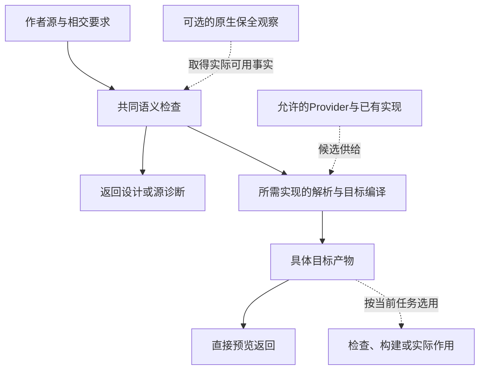

# 对象必要性与能力依赖

## 对象存在必要性与删减演算

### 目的：对象存在必要性与删减演算

工程系统会不断积累类型、服务、接口、字段、缓存、文档、兼容层和控制状态。Gift 应为对象给出可检验的必要性依据并安全删除不再必要的对象；没有全局最简形式证明时，不把工程裁决称为“已证明不可压缩”。

### Disposition

```text
ObjectDisposition =
  required
  | derivable
  | duplicate-owner
  | dominated
  | migration-only
  | historical-only
  | orphan
  | conditional
  | optional
  | unknown
```

### 删除反事实

必要性必须相对于已接受的结果、保证范围、资源预算与替代方案判断。逐项询问：删除或用更简单机制替换后，哪条已接受义务会失败？失败能否给出可复核见证？是否可由已有 owner 派生或承担？

`required` 绑定当前承诺、画像及已比较的可行替代：删除且不替换会破坏必需义务，才可以在这个范围标为必要。它不要求证明世界上不存在更简单实现，也不把当前必要固化为永久唯一。缓存带来一点速度优势、抽象对一种未来变化有利、或删除会使某个局部指标稍差，都不足以把对象提升为不可压缩核心。优化在已接受性能/资源约束确实需要时才是条件必要；未知负载下标为待测，不虚构 Pareto 证明。

相同事实/规则的竞争 owner 必须合并；相同主题的模型定义、执行协议、失败恢复和独立验证可以保留，因为其输入输出与失效条件不同。可由唯一源生成的索引和视图不得成为第二规则拥有者。

各项选择的成立条件、删除后果、更小替代与重新裁决条件融合在《设计理由》中，不另存一套要求用户维护的必要性账本。

### 不允许的判断

- 零静态 import 就当 dead；
- 文件很旧、很大或位于 `.tmp` 就删除；
- 新实现存在就删除旧实现；
- 相似代码自动抽成 universal helper；
- 没有当前调用就删除低频恢复路径；
- Issue 关闭就删除证据；
- 无法解释就归入 orphan。

### FutureObligation

未来能力只有在存在 owner、触发条件、必要性证据、验收、反转、预算和退役时才影响当前设计。未激活义务保留语义关系，不物化空运行结构。

### 净删除

删除与替换先分类。纯派生缓存可以在确认可重建、无额外恢复责任后移除；同义文档移除后保留规则拥有者；未使用的空层可在核对真实消费者后直接删，不要求先制造新机制。

真正退役一项活跃实现时，检查本次范围内的旧消费者、旧写入口、兼容支持和恢复残留，并迁移其必要规范与验收。只有确实由新机制承担旧义务，才把新机制采纳作为前提。仍受支持的旧版本不要求全球清零；其责任必须由所选保留或兼容方案承担。增加facade后仍有双重规则、双写和旧负担，不算消除原复杂度。

删除低频恢复、合规或维护路径前仍需对应的保留判断，不能以静态import为零代替。细化条件见[文档编写与维护](../../90-治理与参考/维护/组织修改与来源保全.md#修改删并与来源保全)及[兼容迁移与退役](../../70-工程系统与演进/演进与实施/兼容迁移/README.md)。

## 能力依赖图与局部插入

### 目的：能力依赖图与局部插入

通用工程编译器需要持续接入新语言、新后端、新 Provider、新验证器、新优化遍和新目标平台。扩展若依赖无类型的 `dependencies: string[]`，会把“需要”“供给”“校准”“验证”“交付顺序”混成一条边，最终形成假依赖、错误环和全局失效。

本文定义能力图的关系类型、解析规则和局部插入条件。

### 能力对象

```ts
interface CapabilityDefinition {
  readonly capabilityId: CapabilityId;
  readonly kind: CapabilityKind;
  readonly semanticContract: ContractRef;
  readonly inputKinds: readonly TypeRef[];
  readonly outputKinds: readonly TypeRef[];
  readonly effectProfile: EffectSet;
  readonly resourceProfile: ResourceProfileRef;
  readonly compatibilityRange: CompatibilityRange;
  readonly owner: SemanticModuleRef;
}
```

能力定义说明“可以提供什么语义”。具体实现、当前健康、授权、资源可用量和成熟度证据不进入该定义。签名中的 effectProfile/resourceProfile 描述语义需求，不是实时授权或资源余额。成熟度绑定具体 Provision、实现 revision、目标范围、评估政策和证据引用；只改变证据不必改变 CapabilityDefinition。

### 关系类型

```ts
type CapabilityRelation =
  | RequiresSemantic
  | RequiresAdmission
  | SuppliesCandidate
  | ConsumesOutput
  | Validates
  | CalibratedBy
  | ConflictsWith
  | Supersedes
  | CompatibleWith
  | DeliveryAfter
  | OptionalEnhancement;
```

| 关系 | 含义 | 是否要求无环 | 是否传播失效 |
| --- | --- | --- | --- |
| `RequiresSemantic` | 解释本能力需要另一语义定义或已完成前提，边另标角色 | 严格完成前置须无环；声明互引可成组链接 | 按实际依赖 |
| `RequiresAdmission` | 执行时需要权限、资源或环境能力 | 声明可互相引用；实际等待必须另检占有、先后与进展 | 准入结果失效 |
| `SuppliesCandidate` | 为实现需求提供一个候选 | 否 | 仅影响候选闭包 |
| `ConsumesOutput` | 使用另一能力的产物 | 视产物图而定 | 按实际输入传播 |
| `Validates` | 为目标能力提供证据 | 可双向引用但不可相互自证 | 证据失效 |
| `CalibratedBy` | 用另一能力的结果校准参数或质量 | 可成反馈环 | 需固定点或分代 |
| `ConflictsWith` | 两能力在同一作用域不能同时活动 | 无方向 | 触发选择冲突 |
| `Supersedes` | 新能力替代旧能力 | 要求有向无环 | 迁移传播 |
| `CompatibleWith` | 给定生产者输出/写模式能被指定消费者读取或调用；方向和模式显式 | 有方向；共同部署不等于双向兼容 | 范围变化时重评 |
| `DeliveryAfter` | 工程排期建议 | 不进入语义依赖 | 不传播语义失效 |
| `OptionalEnhancement` | 提升质量但非硬前置 | 否 | 只影响相关优化 |

兼容记录绑定 producer、consumer、合同版本范围、方向、运行/读取模式和证据。A 能读取 B 不推出 B 能读取 A；两方共同部署需要另外证明共享资源和状态约束。不可把同一个无向“兼容”边用于滚动升级与数据回滚。

### 能力图投影

系统不维护一张“所有边都相同”的 DAG，而是从同一类型化图生成不同投影：

```text
SemanticDeclarationGraph + StrictCompletionDAG
AdmissionRequirementGraph
CandidateSupplyGraph
VerificationGraph
MigrationGraph
DeliveryPlan
```

`RequiresSemantic` 边必须声明是可先收集签名的引用，还是必须先完成解释/初始化的严格前置。声明图先登记名字、显式签名与待补全头；按相交语言规则完成类型、主体/效果和公开接口后才发布可调用结果，递归需要的签名显式给出；实际初始化是否允许循环由语言合同决定。严格完成前置在压缩合法声明组后构成DAG；不能用“有环”直接拒绝互递归类型或函数。

单调分析环按固定点语义求值，非单调规则需另一明确求解合同。`Supersedes` 对特定版本替换方向保持无环；验证边可双向引用，却不能拿双方各自未获证的结论构成无种子自证。循环分类的共同条件见[能力解析](../../70-工程系统与演进/演进与实施/适用性与能力协商.md#有限闭包与能力解析算法)。

### 局部插入

普通扩展若能由现有公共语义表达，新增能力 `C` 的预期修改范围是：

- `C` 自身定义；
- `C` 声明的关系；
- 直接消费或选择 `C` 的注册边；
- `C` 的符合性、权限、资源和迁移材料；
- 因新候选出现而真正需要重评的解析结果。

普通扩展不得要求修改所有既有能力的枚举、中央 `switch` 或手写总表。若新语义确实无法由公共接口保留，记录反例并演进核心及真实受影响消费者；局部插入是有前提的目标，不是禁止修正错误核心的铁律。

```text
Add(C)
→ Validate(C)
→ Compile typed edges
→ Check affected graph projections
→ Re-evaluate reverse-reachable bindings
→ Existing unrelated capabilities unchanged
```

### 注册和发现

能力发现产生 `CapabilityObservation`，不能直接产生已采纳能力：

```text
Discovery
→ Observation
→ Contract parsing
→ Eligibility
→ Conformance evidence
→ Adoption decision
→ Provision
```

目录扫描、环境变量或 Provider 自报只证明“发现了候选”。它们不能绕过签名、兼容、权限、许可证、沙箱和验证。

### 候选供给与目标画像

语言前端、编译后端、存量实现和 Provider 都可以供给候选，但不能反向拥有目标语义：

```text
TargetProfile + ImplementationRequirement
→ CandidateClosure
← Built-in / Existing / Brownfield / Provider / Synthesized
```

目标画像可以在没有某个 Provider 的情况下定义；Provider 的符合性则需要相应目标契约。这避免“先有 Provider 才能定义目标”和“先有目标才能验证 Provider”的假循环。

### 能力成熟度

能力定义不承载统一成熟度阶梯。针对精确 Provision/实现 revision/画像，分别记录合同是否已知、符合性与影子/现场证据、适用资格；运行健康、信任撤销和生命周期另作正交状态。

一次健康降级不删除历史符合性证据；撤销可以直接发生而不先“降级”；某 revision 退役不代表同一能力的新 revision 退役。采用 [系统成熟度与现实边界](../../90-治理与参考/状态/README.md) 的证据轴与降级规则，只物化真实消费者需要的视图。

### 能力选择

选择过程：

1. 根据需求和目标画像计算可达候选闭包；
2. 应用 `RequiresSemantic` 和兼容关系；
3. 应用硬资格、权限和环境限制；
4. 排除冲突组合；
5. 对剩余组合比较成本向量；
6. 生成带解释的解析决定；
7. 记录未选择候选及淘汰原因。

排期关系和流行度不能使不合格候选获胜。

### 能力组合

复合能力使用现有members、inputWiring、boundaryContracts、combinedEffects、combinedResources和compositionClaims关联成员、连接与派生结果。字段是内部关系视图，不是作者必须再填写的同义模型。成员保证只有经过下文的[边界闭合](边界摘要与跨域组合.md#组合边界摘要与义务闭合算法)才可能成为组合保证。

类型/协议、错误和取消、重试幂等、权限、共享资源、隐私及恢复在实际相交处逐项验证。一个纯函数不建立空恢复合同，一个持久变更也不能只用函数形状替代原子义务。未使用的成员不会进入当前输出；实际初始化、动态发现与共享状态继续属于真实依赖。

### 反向失效

| 变化 | 应失效对象 |
| --- | --- |
| 能力语义契约变化 | 语义依赖者、相关候选和绑定 |
| Provider 实现 revision 变化 | 使用该实现的绑定、执行和证据 |
| 成熟度降级 | 超出新适用范围的绑定 |
| 新增候选 | 仅在策略要求重新择优时重评相关需求 |
| 删除候选 | 使用者和需要它的候选闭包 |
| 排期变化 | 不使语义或验证结果陈旧 |
| 验证器变化 | 其签发的证据与资格 |
| 兼容范围变化 | 受影响的组合 |

新增候选是否使既有合法绑定陈旧由解析策略决定。`stable-until-invalid` 策略不因更优候选出现自动切换；`continuously-optimize` 策略可重评，但必须受迁移成本和风险约束。

### 能力关系投影



箭头有明确角色：实线为本例的内容产生/消费，虚线标注可选来源或按需动作。它不是所有请求都先观测、再生成、再发布的阶段链，也不把提供者供给关系当成授权关系。
实际活动集合由本次输出根和条件选择；领域义务、作用准入、候选供给与执行先后不能从这幅投影互相推导。

### 图算法

按本次问题选择实际算法，不建立每个请求必须执行的图分析清单：

| 当前问题 | 具体算法与结束结果 |
|---|---|
| 连接或解释一条已使用关系 | 核端点、方向、基数、条件与可见性；拒绝具体非法连接 |
| 有模块互引或严格前置 | 分别对该投影求SCC；签名互引按分阶段规则解，严格等待有环按实际协议处理 |
| 实现尚有选择 | 沿真实候选与版本约束形成有限问题，执行本章和实现搜索章的合格选择 |
| 取得固定点分析 | 使用该域的偏序、传播函数和预算；未收敛准确保留范围 |
| 输入或规则改变 | 只按各关系失效方向和实际条件传播，不遍历所有种类的边 |
| 真实迁移或退役 | 对相交消费者求迁移可达与残余责任；普通编译不执行迁移分析 |
| 解释缺能力 | 给实际缺口与依赖；只有完成对应最小化才称最小缺失集 |

先有正确全量算法。真实规模与变化负载需要时增加分片索引、增量SCC或其他策略；对照只证明实际比较的输入和范围，不用抽样通过宣称全域一致。

### 故障场景

- 两个能力互相声明 `RequiresSemantic`；
- 旧能力与新能力相互 `Supersedes`；
- Provider 自报支持但符合性证据只覆盖子集；
- 适配器吞掉取消，导致组合后孤儿进程；
- 一个新候选使全系统所有绑定无条件陈旧；
- 排期边误入语义 DAG；
- 验证器同时依赖并验证同一实现而无独立性；
- 能力被撤销但缓存注册表仍返回可用。

### 验收条件

- 每种关系有独立语义、成环和失效规则；
- 既有扩展语义可以承载的能力可局部注册；新根语义须通过版本化核心演进；
- 无中央枚举要求修改所有消费者；
- 候选供给不拥有目标语义；
- 组合具有边界声明和组合证据；
- 增量图结果与全量图一致；
- 新增无关能力不改变既有结果；
- 撤销在真实端点生效，退役在明确范围内处理消费者、历史解释和恢复义务；
- 所有解析决定都能解释使用了哪些关系和证据。

### 候选实现与资格接入

能力定义和实现资格仍分开：解析器输出所选Provider、依赖解释、资格Claim引用及未解缺口，不因名字/Schema匹配直接授予执行。[工程情境组合与能力协商](../../70-工程系统与演进/演进与实施/适用性与能力协商.md#工程情境组合与能力协商)规定精确版本和效果集合协商；[证据缺口驱动的设计与取证闭环](../../60-保证与证据/保证/要求证据-追踪取证与裁决.md#证据缺口驱动的设计与取证闭环)规定资格证据如何生产和失效。

有限参考解析器按显式绑定或唯一最高策略rank选择一个候选，再闭合依赖；依赖失败时返回未解决并允许重编候选计划，不证明所有替代均失败。生产选择器可在预算内对替代候选回溯，保留访问集、已证实冲突和未搜索集合；不能用注册顺序消除多解。
