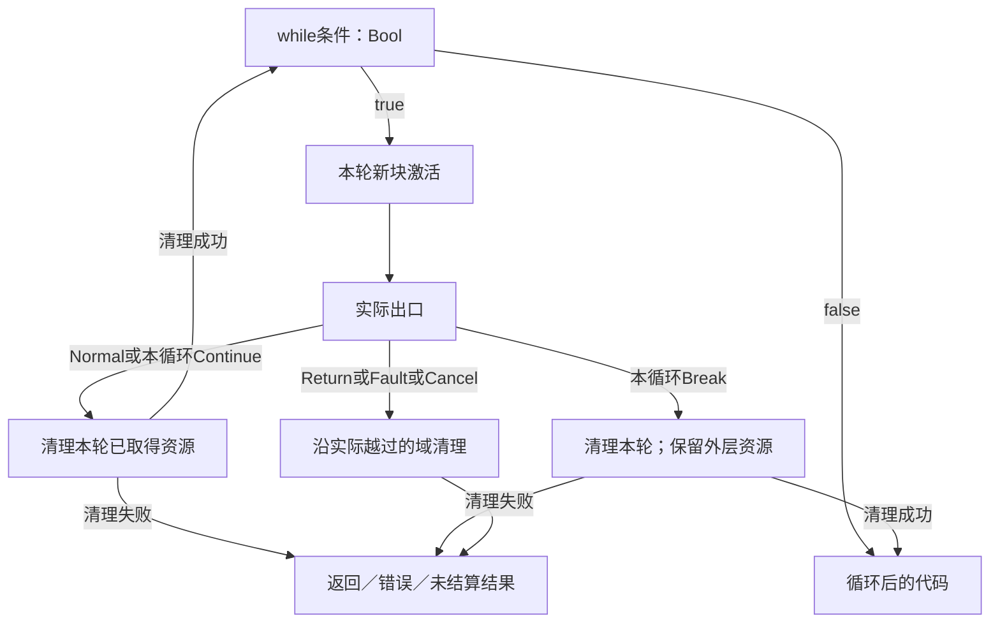
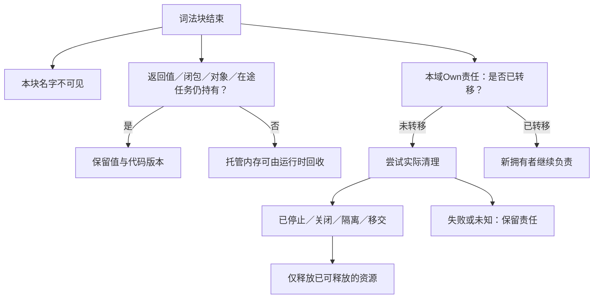

# 控制流与存储寿命


### 业务规则与状态转换

规则使用指向已锁定Meaning的`conditionUse`，并绑定本次发生点需要的角色。可选择的条件真、条件假、未充分知道和证据冲突要保留区别。多个分支只有在被证明互斥时才能随机顺序无关；显式优先必须属于允许优先的规则和作用域，不能以JSON数组自然顺序代替Policy。触发前后、多个条件共同作用和跨事件历史要求不能只建一个静态谓词就完成。


### 从“配置了Workflow”到“确定的业务执行意义”

旧范本将UI、Workflow和Effect放在同一组件，最多证明成员存在；**能启动什么、传哪些值、结果如何更新**不能凭成员关系推断。当前采用一条确定的局部行为模型：

`Typed ActivationCause → ActivationRoute(inputBindings) → WorkflowUse → WorkflowStep → OperationUse(portRef,operation,inputs) → Result/State/Event/Observation → UI/API反馈`。

这是一条作者语义及Method/Target接力，不意味着作者必须填写每段派生中间标识。已有可唯一推导的局部发生点由解析器产生；只有真正被其他声明引用的UseId/StepId需要稳定作者名。


### 输入值有类型来源，不创造第二计算语言

每个运行时实参是一个特定签名形参到`ValueSource`的绑定；来源严格区分：

| `source` | 实际地址及资格 | 典型失败 |
|---|---|---|
| `literal` | 固定`typeRef+value`，十进制/单位按声明编码 | 精度不合、类型/单位不符、null和缺席混淆 |
| `input` | 当前触发源的入站载荷JSON Pointer | 字段缺失、变体不匹配、触发源不同、未经验证 |
| `context` | 当前Root/组件绑定的角色 | 范围错、对象过期、来自另一实例的上下文 |
| `state` | 对本组件已host/observe的状态useId和字段路径 | 读写权限不足、快照不一致、读取Revision不匹配 |
| `result` | 当前控制令牌关联的准确成功StepActivation输出 | 循环轮次错、未完成步骤、分支未执行 |
| `step-outcome` | 同一WorkflowExecution中准确失败/取消/超时/未决激活的错误或原因载荷 | outcome不符、兄弟分支或旧轮次、把未知结算当确定错误 |
| `resource` | 已声明的资源/能力参数槽 | 无有效供应、过期Grant、借用/独占冲突 |

JSON Pointer定位字段，不做字符串表达式求值。字段名与签名的实际参数名必须唯一匹配；枚举/variant需要明确tag；可缺、null、未知和错误不可自动转成某个默认。若确实需要计算、复杂格式变换、解析器或映射算法，使用具有准确callable签名的显式compute步骤或包装workflow；ActivationRoute只以`inputBindings`作有型投影。业务Meaning的解释资格不等于函数调用资格。

一个绑定属于一个明确发生点，作用域从入口输入、业务Context、当前状态或已完成步骤决定；不能凭`result:stepId`越过分支引用未来值。跨子流程、跨组件的参数必须经过公开接口与签名，不得直接读他人的私有临时变量。


### Workflow同时存在“控制流”和“数据就绪”两种不同边

每步`id`局部唯一；`entry`明确，结束通过`completion`规则定义。`needs`只表示必须已有的前驱完成依赖，不能凭`needs`自动解释为“收到命令就执行”；控制执行必须由明确激活、`onSuccessStep`、条件`routes/otherwise`、`onErrorStep`、`onCancelStep`、`onTimeoutStep`、`onUnresolvedStep`等有名边决定。数组顺序只是文本序，不带业务调用顺序；没有后继的步骤只有在Completion合同允许时结束，绝不静默吞掉未完成的义务。

非条件步骤要求每个显式边目标存在、可进入、无无故丢失的异常通道。分支只有在条件获得当前作用域的合格解释后才能选择；多条为真时需要互斥证明或有权的优先合同，所有为假/未知/冲突走不同明确出口。无期限等待不是自动成功；人工步骤需要Actor/操作/结束/取消的签名；子流程以`subflowUse:DefinitionUse`显式绑定角色、以inputs绑定独立输入，返回完整类型值，并满足可达终止或进展条件。`terminal`标记本次流程调用的具体完成/失败/取消/仍未解决结果，不用虚构一个`human`步骤充当完成哨兵；流程返回成功也不代签整个业务Goal或外部结算。循环若无界，必须保留取消/资源与进展责任，不能把自己指回自己就当作合法业务规则。


### 按 Step Kind 限定必要属性

**步骤是判别联合，不是所有属性都可附着的记录。** `compute` 只能经 `functionRef` 和有类型输入调用纯/有界效果函数；`effect` 只经 `operationUse{portRef,operation,inputs?}` 指向一个精确外部操作，不再同时另写一步顶层 `inputs`；`wait` 对一个有身份的恢复事件及可选条件做受限观察；`decision` 保留显式候选、否则去向和冲突仲裁；`human` 有明确角色和审批结果；`subflow` 以subflowUse显式调用受限流程签名；`parallel`只有限分支、独立子流程和all-join；`terminal` 结束本次流程实例而不代表业务Goal或外部效果已经完成。各字段仅能用于所属步骤，不能在计算步里附一个 `operationUse` 以偷渡执行，或在terminal里添加 `functionRef` 隐含副作用。

步骤顺序由实际控制边决定，而非 `steps[]` 文件顺序。`needs` 仅表示步骤结果可用性前提，缺省为空；一个步骤若从多个互斥错误/正常分支到达，不能被要求先等待从未运行的另一路步骤。成功步骤保留其完整输出；terminal通过单个ValueSource返回完整result或error，取消/超时/未决返回独立reason。旧`resultBindings`只按[工作流迁移合同](../../交付语义/工作流执行关系与激活.md#旧载荷的只读迁移与拒绝条件)读入，不继续作为当前结果映射。引用未来步骤、未执行分支、其它实例或错误循环轮次是非法来源。`decision` 两条以上路线需要显式仲裁；单一路线可采用互斥的保守默认，但无匹配分支须有明示 `otherwise` 或待决结果，未知证据不允许归入 false 分支。

结果语义区分正常完成、业务拒绝、超时、取消、未决与外部效果已受理但结算未知；出站效果经过权限和幂等阶段，其返回值不代签现实终态。工作流局部补偿可提出恢复动作，但只有真实 Provider 支持并授权后才能产生外部后果。


- **`effect`**：必须有`operationUse`，明确端口Ref、端口内**唯一操作名**、具名实参，必要时幂等键；结果类型、错误和外部结算合同由Port/Method确定。旧单个`portRef`不能在多操作端口上推断操作。
- **`compute`**：引用已有统一作者语言的`core:function`或经准确接口绑定的原生callable；保持既有计算类型、效果及目标合同，普通业务作者仍优先引用已有能力。此处不扩张Expr研究或实施求值器；没有真实Method不能生成空处理器。
- **`decision`**：必须提供分支列表和合法仲裁规则，未知/冲突不是`otherwise=false`；返回某条路径不等于目标满足。
- **`wait`**：必须指向真实恢复键或合格信号、时钟及超时/取消结果；宿主重启后仍需恢复对应等待状态。
- **`human`**：必须有真实ActorRole/任务Meaning、允许的决定与权限；一个“人工检查”字符串不能代替工作流入口。
- **`subflow`**：`subflowUse`必须指向workflow定义并显式满足其contextRoles；同名角色不继承。输入、返回、失败和取消经公开签名传播，不读子步骤帧。
- **`parallel`**：branches各复用独立子流程，join仅all；兄弟结果隔离，成功按branchId形成有型记录，失败停止派发并取消/结算其他分支；未停止/结算为unresolved。完整失败聚合及资源释放条件由[工作流Owner](../../交付语义/工作流执行关系与激活.md#有限parallel独立子流程与all-join)定义。
- **`terminal`**：成功返回完整result且符合workflow.output，仅Unit可省略，never没有可达成功；failed返回完整error且符合errors；cancelled/timed-out/unresolved使用独立reason。它不是业务Goal达成或现实Settlement证据。

同一模板实例化多次后，所有StepID均纳入其组件实例+WorkflowUse的词法作用域，不能跨实例引用重名Step。并行仅通过有限parallel步骤进入独立子流程；共享资源和状态的冲突在并发Owner联合处理，不靠拓扑或maxConcurrency推断安全。准确激活、循环轮次、异常载荷、all-join与迁移的唯一规则见[工作流执行关系](../../交付语义/工作流执行关系与激活.md)。


### `effect:port` 与 `core:interface` 的操作

端口拥有操作名、输入、输出、错误类型、效果类别、幂等、超时和可读回能力。`OperationUse`选定**端口 + 具体操作**并映射每个形参的ValueSource；其操作名必须真实存在，输入名/数量/类型满足合同，效果被允许且实际Provider/Method匹配。调用后的输出以实际StepResult身份供后续Step绑定；实际外部Effect的结果与纯函数返回值不同，可能需要Settlement确认和时延处理。

通信/保存/付款等不可逆外部操作的用户意图、Method执行尝试及现实结算是三个对象。Timeout不是失败确认；若可重试，逻辑OperationId必须稳定且幂等或有读回协议；补偿是新动作，不能直接声称将现实恢复到原状。权限缺失不可触发“最佳努力试一下”。


### 状态与事件之间不能隐式双向同步

`state:machine`定义状态集合、初始态、可接受事件、每条转移及缺失转移处理，状态修改的Frame和不变量有作用域。某个状态转移生成事件必须有明确的因果声明/已资格的Method；订阅事件也必须通过激活路由触发对应Flow或状态机处理，不因名称相同而自动调用。事件投递可至少一次、至多一次、具有重放或乱序；事件ID、发生时与处理时、重复、迟到和最终一致性各按事件合同，而不是统一`event=true`。

数据模型的数据行状态、状态机逻辑态、缓存副本和UI临时编辑状态属于不同Owner。类型可共用、转移可关联，但不同存储版本和事务边界不能直接视为同一状态。读改写要说明原子性、乐观版本或串行化/冲突规则，数据保存失败不得悄悄让UI显示为已持久化。

### 层级状态反应、活动和现实效果的三个提交点

一个分层 `state:machine` 先把固定模型、外部输入与稳定前态作为反应输入。一次宏步可包含多次微步：在同一微步前态选择启用转换、按状态树退出集和明示优先关系选择兼容转换、由内向外退出、按确定顺序执行纯状态动作、由外向内进入、消费内部事件直至新的稳定配置或已完成。预算耗尽或语义错误时不得暴露“运行到一半”的配置为已采用稳定态；生成的外部计划只有在稳定采用后才交给宿主执行。没有指明算法顺序的多个正交区写同一上下文字段时，不能仅因它们属于 parallel state 就并行求值。

状态历史快照仅描述活跃状态配置和有权延续的局部数据，不自动恢复计时器、网络连接、权限、旧协程或设备实际活动。`shallow` history 只恢复到复合状态的直接子层，`deep` 恢复更深层已记录配置；二者是业务可观察差异。活动每次重新进入需有代际身份；迟到成功事件只可用于仍匹配的 activation，对已取消的旧活动应结算真实资源和 Operation，而不能改变新配置。`cancel` 先被接受和 `complete` 先被接受具有不同结果；若用户要求物理时间意义上的优先性，必须引入可信时钟与仲裁，不能拿单线程队列顺序冒充。

Workflow 的步骤依赖分为数据就绪、控制先后和资源允许三个独立条件；步骤存在、被成员引用与实际已被触发也不同。触发在 UI/API/Event/State 的具体 Use 和事件发生点之间建立。`effect` 步骤需指明目标端口的精确 operation、各入参来源、错误/取消/超时的处理和重试资格；同一端口包含多种操作时不能省略选择。条件分支的谓词有自己的 Meaning/Scope 签发，未知谓词不得按 `false` 静默分流。步骤ID必须在流程内唯一，所有显式后继必须指向存在的步骤；循环需指定可观测的进展或资源预算，不能因 JSON 中能形成环就承诺终止。

同时保留 `result` 三类不同意义：逻辑状态配置已稳定、业务过程已报告完成、现实副作用已获权威结算。前者不能自动代签后二者。对纯数据变换，可无 OperationLedger；对支付、文件、发布和远端调用，不得删除这一现实身份边界。


### 设计级错误与恢复语义（不是现在编写测试程序）

静态未知Step/操作/Role是明确非法；域Meaning缺失是待供应；观察未知和规则冲突是可保留的未定；实际效果未知时等待有权读回或明确人工处理。错误结果携带Owner、发生点和影响范围，后继应由业务合同决定：拒绝、等待、重试、补偿、人工或继续有限功能；不得由统一异常处理器无条件吞掉重要业务错误。


### 状态宏步的判定、工作流激活和可观察副作用顺序

状态模型、当前实例、历史快照、活动/计时器和真实外部操作分属不同生命周期。一个事件到达后，先在冻结的当前配置与事件上下文中寻找可触发转移，按受权仲裁处理互斥/冲突，再确定本次宏步的退出/进入顺序与状态结果；退出旧活动和启动新活动必须携带代际，迟到的旧回调不能写入新状态。状态提交不是现实效果已发生；若进入动作发送外部命令，仍需经过独立 Effect/Grant/Attempt 及最终结算。

UI Action、协议请求、业务事件、定时器和状态事件可以触发 Workflow，但其来源、身份和可信程度各不相同。`activationRoutes` 应绑定具体成员使用发生点及 Workflow 使用发生点；同一输入同一流程不能意外重复派发，输入扇出多个流程则应明确顺序、并发、冲突策略或证明相互独立。一个 Workflow 步骤只能产生有类型后继：成功、业务失败、取消、超时、授权未获、结果未知等不可简化为 `true/false`。`effect:port` 操作必须指定精确 operation 与输入来源；空 handler 不构成业务实现。

既有有限局部控制继续按本页解释；额外地址敏感构造与转移见[位置初始化](位置初始化与转移.md)，有确切需求的帧/恢复/目标分支结构见[协程与控制流降低](协程帧与控制流降低.md)。普通循环无需这些扩展，也不因标题中出现它们而获得新关键词。

本章维护命令式局部控制、绑定与存储寿命、资源作用域和必要底层访问；基础类型/模块归[语言规格](../../../10-作者与输入/作者源/可替换表示与适用范围.md)，类与动态分派归[对象规范](对象构造与分派.md)，宿主异步活动与真实取消归[资源执行](../../../50-执行运行与观测/权限与资源/README.md)。各自消费同一类型和效果体系，不产生第二作者语言或全局内存服务。

## 当前采用与兼容范围

局部命令式扩展保留 `var/set`，增加 `while/break/continue/return` 以表示循环、状态累积及提前退出。未使用该扩展的函数沿基础表达式解析；新增语法必须与本次语言/结构 Profile 和相应目标消费能力绑定，既有 `/1` 不自动升级，也不对数据结构或业务名称新增关键字。

局部控制属于共同函数执行，不要求创建类；现有`gift.object/1`作为通用组合入口的定位角色不变。组合解析器可以直接包含有限规则，不要求动态插件。作者不逐函数选择控制版本。四个新增词的解析、作用域和目标责任必须共同实现，不能仅因关键词少就称语言完整。

## 局部控制的确定文本

下列文法扩展已选通用组合中的块；沿用基础`Expr/Type/Ident`和对象`FieldWrite/SuperInit`。基础专用文法保持。`LocalBinding`的原含义不变。`ExprStatement`允许执行表达式并丢弃普通结果；未消费的Result给出可定位诊断建议，不能自动改其业务处理。

```ebnf
LocalVariable = "var" Ident [ ":" Type ] "=" Expr ";" ;
LocalWrite    = "set" Ident "=" Expr ";" ;
WhileStmt     = "while" Expr ExecutionBlock ;
BreakStmt     = "break" ";" ;
ContinueStmt  = "continue" ";" ;
ReturnStmt    = "return" [ Expr ] ";" ;
ExprStatement = Expr ";" ;
Statement     = LocalBinding | LocalVariable | LocalWrite | FieldWrite
              | SuperInit | WhileStmt | BreakStmt | ContinueStmt
              | ReturnStmt | ExprStatement ;
ExecutionBlock = "{" { Statement } [ Expr ] "}" ;
```

`{}`继续只表示空记录，不能因新增块把旧表达式改成Unit。非空块最后有未带分号的表达式时以它为正常结果；只有语句的块正常结果是Unit。块内先解析一项Expr，后见分号则为ExprStatement，否则必须是该块最后的Expr。`Ident :`仍区分记录起始；块和记录的原消歧继续适用。`while`条件结束于同层级的主体`{`，若条件内部需要块或记录表达式则显式括号化，不靠类型反推语法。

`return`结束最近的词法函数、方法或lambda；不穿越回调边界。省略值等于返回Unit，须符合返回类型。`break/continue`只指向同一函数内最近的词法while，不从lambda跳出外层循环；顶层、无循环处或初始化器的非法位置均诊断。while体的正常结果必须为Unit；非Unit结果显式丢弃或作为外部累积，不能隐式成为循环返回值。return/break/continue路径不产生正常体结果。当前无标签跳转、任意goto、生成器yield或非局部continuation，不冒领这些能力；它们需要自己的控制与资源展开合同。`SuperInit`仍只在派生初始化器的首个允许位置，不因Statement联合而在其他块合法。

```gift
export fn gcd(a: Int, b: Int) -> Int
  require a >= 0 && b >= 0
= {
  var x = a;
  var y = b;
  while y != 0 {
    let remainder = x % y;
    set x = y;
    set y = remainder;
  }
  x
};
```

对`gcd(48,18)`，状态依次为`(48,18)→(18,12)→(12,6)→(6,0)`，返回6；`gcd(0,0)`返回0。`let remainder`每轮新建，两个外层var是本次调用的局部存储；不是模块全局、对象字段或持久工作任务。这是依据规定步骤的书面预期，不是运行记录。

## FLOW0—FLOW6：检查与执行

### Workflow局部与运行对象

| 集合或对象 | 必须保留的区别 | 所属Owner |
|---|---|---|
| `Workflow.steps` | 每步`StepId`、Kind、输入、就绪依赖、控制后继、异常后继；不按数组序执行 | Workflow |
| `Workflow.routes` | 已绑定PredicateUse、目标Step、可授权仲裁；不是任意可执行表达式 | Decision/Meaning |
| `OperationUse.inputs` | 方法签名形参名→特定ValueSource | Effect/Interface |
| `State.transitions` | (from,event,condition,scope)→to及Frame/Effect | State |
| `EventStream` | 事件发生身份、序列域、投递/重放、时间语义 | Event |
| `Resource` | 分配、租约、占用、容量、拥有权 | Resource |
| Runtime `Operations` | LogicOperationId；可多Attempt，Settlement可延迟/未知 | Host/Runtime |
| Assurance `Claim/Evidence` | 按来源/适用域承载结果；不能反写作者源 | Assurance |


**FLOW0 绑定。**先收模块声明，再建立函数参数和块作用域。每个局部声明的初始化在旧环境求值，成功后才引入名字；同块重名拒绝，嵌套块可遮蔽。`let`绑定不可重赋值；`var`绑定可重赋值但类型固定；函数参数默认不可重赋值。初次声明须提供初始化，不以隐式零、null或未初始化槽满足类型。公开顶层仍只有纯静态`let`，不开放隐式共享的顶层var。

**FLOW1 类型与效果。**var从注解或初始化取得一个单态类型，不无条件泛化共享可变单元。`set x=e`先计算e，成功后更新x；e失败则原x不变，但e已产生的外部作用不撤销。字段写仍先求接收者，再求右值。条件为Bool；每个正常return满足函数返回类型。静态类型检查包括不可达代码，但已证明无正常后继的路径不参与正常赋值合流。对象初始化中的循环不能证明必然执行一次；循环后MustInit使用入口与各正常出口的可靠交集，MayInit保留可能写入，沿用对象字段恰初始化一次的要求。

**FLOW2 控制目标。**建立函数出口栈与本函数的循环目标栈。检查lambda时建立新控制边界，不继承外层break/return目标。中间表示的出口是`Normal(value)`、`Return(value,function)`、`Break(loop)`、`Continue(loop)`、`Fault(error)`或`Cancel(reason)`，不是把所有出口编码成普通Result。用户Result.Err仍是正常返回的数据。

**FLOW3 求值。**while先检查条件，false返回Unit；true执行新的循环体激活。体Normal或指向本循环的Continue重新检查条件；Break离开本循环；Return、Fault和Cancel继续向所属边界传播。不可把先执行体一次的do-while当成本循环。每轮体内的局部存储新建，循环外var继续保留当前值。编译过程检查有限循环体，不执行未来迭代。

**FLOW4 收尾。**出口跨过资源作用域时先形成待完成出口值，再执行该域要求的清理；返回值保持有效引用。本域内的continue不清理仍属外层的资源；离开本轮体则清理本轮资源。正常返回在相交作用域已完成收尾后，进入原函数后置检查；清理失败时不伪报正常完成。方法状态已更新后出现错误，不因return或ensure存在就自动回滚。

**FLOW5 降低。**目标有合法循环、局部变量和退出时直接生成；无同类指令时使用控制块和出口值。返回、跳转、分支、捕获和清理的绑定关系保留。循环回边是取消/预算检查位置之一，不承诺每个普通算术操作都触发调度。不能将图形节点拓扑排序当目标执行次序。

**FLOW6 继续修改。**绑定与出现保持准确身份；修改循环条件只影响真实依赖。抽取含return/break/continue的区域不能直接包成另一个函数。原有限私有函数抽取只接受没有外向控制出口的完整表达式；复杂抽取需显式出口代数与回填规则，未定义时返回该重构缺项而允许正常直接改源。

<a id="fig-local-control-exits"></a>

### 图解：退出先到所属边界，不等于立即释放一切

实线是目标程序的控制传播；资源清理仅发生在真正越过的作用域。图省略循环体中不改变出口的普通表达式。



## 名字、存储与资源的寿命不是同一条线

| 内容 | 可见范围 | 取得与保留 | 结束条件 |
|---|---|---|---|
| 顶层函数、类型及模块私有名 | 本模块；只有export可经公开入口引用 | 模块编译/实例保存代码与类型，不执行函数体 | 对应代码或运行实例没有使用者后可卸载；活跃闭包仍固定原版本 |
| 顶层let静态值（含合法函数值） | 本模块或公开导出；不是所有模块的全局变量 | 纯常量按有限规则求值；lambda仅建立静态捕获描述，不执行主体；内联/共享由后端按合同决定 | 不承诺退出模块便逐个析构；可回收时机由实际代码/运行引用决定 |
| 参数、局部let | 词法函数／块；初始化后可见 | 普通不可变值或句柄绑定 | 名字出作用域，值可能因返回、闭包或其他引用继续存活 |
| 局部var | 所属词法块 | 每次激活一份可变槽；默认只在本逻辑执行者中访问 | 不再有合法引用后可回收；并不要求放在机器栈上 |
| 闭包捕获的let | 闭包可达期间 | 保存值；对象值保存的是对象引用，不自动深复制 | 所有持有者结束后可回收 |
| 闭包捕获的var | 绑定对应的共享位置，而非构造时数值快照 | 逃逸时可将局部槽提升到托管环境；非逃逸可栈化 | 闭包仍活着，位置仍需有效；捕获作用域退出不等于释放该槽 |
| 对象字段 | 由对象可见性与实际引用决定 | 实例及其字段图由运行时持有 | 不可达后按目标管理机制回收；循环引用也要有合格处理 |
| Own资源 | 精确所有者与许可操作 | 获取成功建立唯一释放／转移责任 | 关闭已确认或责任已合法转移，而非只看变量是否仍可见 |
| Borrow视图 | 所属借用域与原所有者许可 | 不延长资源生命，不能伪造拥有者 | 域结束或所有者失效即不可再访问 |
| 异步输入和设备缓冲 | 任务及相应借用者 | 挂起帧、工作者、观察器仍使用时保留 | 确认最后使用、停止、隔离或移交后才能释放 |
| 源文件和资源文件 | 工程拥有者与实际请求 | 内容身份、保存与发行规则 | 文件删除不是内存析构；缓存回收不是删作者资产 |

`let c = new Counter(0)`禁止将c重新绑定到另一对象，但不禁止`c.add(1)`按其合同修改对象。要取得不可变快照，调用真实复制/投影操作，不能把let或readonly当深度不可变证明。

局部var闭包按引用捕获，必须保留共享位置。需要快照时先`let snapshot = x`，闭包只捕获snapshot。循环体内声明的var每轮是新位置；循环外var被所有相关闭包共享。可变捕获的读写采用既有`obj.Read/Write`效果符号作为托管可变存储的公开效果上界；对象规范与本章共同解释该符号，不再另造state效果系统。局部状态的公开效果隐藏必须满足下节的位置与捕获算法；它不删除内部读写依赖，也不能把逃逸计数器闭包标成纯函数。

跨任务传送这类共享位置不自动安全。默认拒绝未经同步的可变共享；可用显式状态实例、所有权转移或合格同步容器。Own/Borrow不是普通可复制捕获：在普通可多次调用闭包中捕获它们时，按已有移动/借用与调用次数规则检查；当前无法表达或证明的捕获准确拒绝，不靠自动装箱延长外部资源权限。

## 闭包存储依赖与外部效果投影

可变位置的三项信息分别维护：**位置在本次激活中何时创建；哪个表达式/闭包会读写它；它是否可能被当前调用之外观察。**前两项由绑定与效果分析取得，第三项由具体逃逸和调用关系判定。公开效果行可以隐藏已封闭的内部状态，内部数据/效果依赖却不能因此消失。

### LOC0—LOC5：位置与捕获的有限算法

**LOC0 分配分析身份。**每个局部var在语义上属于声明及其运行激活；分析使用有限的分配位置和上下文摘要，不为每次运行创建开发平台ID。循环内声明会在运行中产生不同位置，循环外的位置则跨本次循环保持。

**LOC1 建立依赖。**对读取、写入、别名、记录字段、容器、闭包捕获及方法调用记录所引用的位置集合。函数创建的立即行为和其函数值的潜在行为分开。不能因为闭包被一个let绑定，就把它的捕获位置变为不可变值。

**LOC2 标记外逸。**返回闭包、存入外部可达对象/全局、传给会保留参数或无法确定捕获行为的调用、启动跨域任务、交给原生回调，均保守保留相交位置的可观察性。递归函数摘要通过有限工作表闭合；超出能力时保持“可能外逸”，不猜成安全。已声明且有适用依据的noescape合同可用于缩小范围。

**LOC3 检查单态与区域。**var位置保持一个固定类型，不作隐式全称泛化；普通let值不因绑定不可重赋值而自动得到多态可变存储。显式`fn<T>`继续沿基础规则实例化；转为普通函数值时以实际预期类型和调用域确定实例。Own/Borrow的可消费性与区域不因装入闭包而被抹掉。公共类型中没有足够信息时返回对应缺项，不输出Any。

**LOC4 在正确边界隐藏效果。**只有某位置在本次调用中新建、没有来自调用方的别名，且所有访问与捕获均在本次调用内完成、没有外部可观察的重入/任务/回调路径时，才可从这个调用的**公开效果**中消去该位置的Read/Write。其他外部效果、失败、非终止、已要求的资源边界和被返回值中的潜在效果都保持。摘要隐藏不是程序重写，也不赋予内部两个状态操作交换、删除或合并的资格。

**LOC5 给每个变换自己的前提。**CSE/缓存比较必须包含实际可观察存储和调用次数；重排检查读写冲突；提升还检查定义域、失败和终止；复制检查资源与结果身份。不能从“公开效果为空”直接取得这些资格。只有独立的保持证明可以消掉内部位置或将全部计算折叠成常量。

### 不逃逸的计数器仍不能合并两次调用

```gift
export fn localCount() -> Int = {
  var n = 0;
  let next = () => {
    set n = n + 1;
    n
  };
  next() + next()
};
```

第一次调用next返回1，第二次返回2，原结果为3。n及next不离开本次调用，整个localCount可以在上述前提下没有外部可观察状态效果；但next仍读写n，不能把它的两次调用做成一次并得到2，也不能把第二次的结果用于两处而得到4。该数值是语义推导，不是执行记录。

若改为返回next，则每次调用该返回闭包都使用同一捕获位置，返回函数类型必须保留潜在Read/Write；localCount的旧无外逸分析不再适用。另一个函数每次重新创建自己的位置，可以产生相互独立的计数器，不能仅因源码相同就共用一份全局槽。

闭包类别取决于真实捕获使用而非单个关键词。Rust把捕获方式与Fn/FnMut/FnOnce调用能力分别规定；OCaml的值限制也处理函数返回值背后可能存在的可变状态。Gift借此核对组合风险，当前不照搬隐式HM泛化或新增一套闭包关键字。[Rust闭包](https://doc.rust-lang.org/reference/types/closure.html) [OCaml 5.3多态限制](https://ocaml.org/manual/5.3/polymorphism.html)

MLIR将内存效果与可推测执行所需的定义域、终止等性质分开。Gift的公开空效果同样不是“可任意提前执行”的许可证。[Effects and Speculation](https://mlir.llvm.org/docs/Rationale/SideEffectsAndSpeculation/) 这也约束SQL下推、AD重算、流并行和目标内联，不只约束普通函数。

## 内存管理：默认托管，确定资源作用域，受限底层区域

**普通不可变值与一般对象默认托管。**TS/JVM后端使用实际运行时的垃圾回收；不自研另一套全堆GC。不将引用计数直接作为循环对象的完整答案。无GC目标只有在分区、所有权、循环处理或实际运行库能保持所需程序时才支持该输出。最后一次合法使用后允许回收；一般语言不承诺某个固定时刻调用用户可观察的析构器。

**外部资源采用确定拥有责任。**文件、映射、设备内存、流游标和微分记录不能只依赖GC finalizer。已有Own/Borrow规则继续作为类型责任；默认局部var只存普通值和托管引用，Own只能通过明确的移动与作用域操作更新，不让覆盖旧值悄悄丢掉释放责任。

**性能或系统任务可选择受限区域和ABI。**region/arena、对齐缓冲、固定地址、原子或volatile具有不同合同。这里规定边界与默认，不假称所有机器后端已实现。原生C/Rust/汇编等保留精确输入和ABI；新中立底层操作按[能力映射](../../作者语义/能力映射与表达边界.md#底层能力的具体落位与支持边界)进入，不因未知就默填普通Int行为。

作用域、寿命与析构的分离有成熟机制依据：[Rust析构与drop scopes](https://doc.rust-lang.org/reference/destructors.html)明确不同控制出口的drop范围；[Lua 5.4 §3.3.8](https://www.lua.org/manual/5.4/manual.html#3.3.8)区分词法关闭与GC。它们不替Gift的新组合和宿主可靠性担保，Gift也不要求照搬Rust全部标注或Lua动态类型。

### 资源作用域的有限库合同

沿既有Own/Borrow模型定义库内在操作`resource.scoped(acquire, body)`，不增加using/defer语法或全局资源管理平台。接口记法是签名规格：`acquire: () → Result<Own<R>, E>`；`body: Borrow<R, region> → Result<T, E>`；结果为`Result<T, ScopeFailure<E>>`。释放方法和其错误来自Own绑定的真实Provider，region由检查器引入而不要求作者手写。T不得直接或经容器/闭包包含这个region的Borrow。此规则由已绑定类型与调用方法实现，普通同名函数不取得线性保证。有限检查器为本次借用引入新region，沿返回值、记录/容器、闭包捕获、字段写入和外部调用传播region依赖；返回含该region的值、写入外部可达字段、或交给未声明noescape的调用均拒绝。当前有限noescape判断沿实际类型、捕获与调用效果传播；遇到可隐藏引用的未知外部对象或无合格声明的回调，拒绝该借用传递而不是假定无逃逸。局部借用可在域内组合，不靠运行GC延长region；复杂借用无法在本范围证明时返回具体缺项。

`ScopeFailure<E>`区分Acquire(E)、Body(E)、Cleanup(有序清理失败集合)和BodyAndCleanup(E,集合)。不归业务E通道的计算Fault或控制取消沿运行错误通道传播，但附带清理失败；不强行转换成任意用户E。本同步scoped只向body提供Borrow，不允许由此制造Own转移。需要向外转移时在外层使用具有移动合同的Own操作，成功后原责任进入Moved；不能从scoped返回一个借用值当转移成功。

**S0**按原顺序求acquire表达式与参数；实际调用取得方法前，先由本域或合格提供者接住本次取得的责任。此时登记的是“取得尚在进行”的责任，不是一个已存在的资源；确认没有取得资源时不调用该资源的close。表达式求值自身取得的资源仍归其原激活，不因后续acquire未运行而消失。

**S1**成功后把已有取得责任转成准确Own与当前有效借用域，再调用body；使用前检查尚Open、拥有者和访问范围。取得成功、登记转换与使用者接收之间不能出现无人负责的间隙；具体转换、部分取得和晚到结果遵守下述共同合同。

**S2**body正常、返回业务Err、Fault或协作取消时，按嵌套取得逆序执行每项真实清理；仅已取得且未Moved的资源参加。有限同步close须具有结束或隔离合同；无此能力的阻塞close使用宿主异步清理记录，不能让调用栈无限等待并声称已释放。

**S3**清理成功才得到Closed；close失败保留准确Failed或Unknown及尚未结算责任。不能使用新请求身份盲重试可能已关闭的外部句柄。安全重试、读回和隔离由该Provider的合同选择。

**S4**先保存body待返回值，完成清理后返回对应联合；body与清理都失败时两者均保留，主失败不被后来的close覆盖。尚Open的资源不因函数已返回一个错误就被假称释放。

**S5**非响应任务或设备仍在用资源时，不进入释放；宿主保留占用并隔离/移交。强杀进程、abort或断电不保证语言清理执行，耐久外部作用沿既有恢复合同处理。

scoped的body是词法回调；其中return只返回该回调的Result，然后执行scoped清理；其中break不能跳出调用方的while。需要结束外层控制时，先返回明确数据，再由外层处理，不能让内联优化改变词法目标。

同步scoped不是跨await借用许可证。异步使用走已有任务域：域停止新工作、等待子任务实际结束或转交，再清理域资源；流取消与AD残余采用相同拥有关系，但各自保留结果语义。scoped失败与目标运行请求的operation状态不共用一个字段。 登记、单次领取、未采用Own和合法监督移交按[有限任务域](../计算基础/通用计算与任务语义.md#structured-task-lifecycle)执行；移交不能使父栈Borrow在父帧退出后继续有效。相交任务已完成但结果尚未领取时，完成槽仍是该资源拥有者；清理前先判所有权转移，不按handle引用数猜结果是否可销毁。

<a id="acquisition-custody"></a>
### 取得期间的责任与成功交接

同步scoped、异步资源工厂、模块初始化与原生回调共用这一不变量：资源实际存在后，始终有一个有效的释放责任归属；暂时不能取得使用资格，不等于资源没有产生。这里的“取得责任”可以是普通栈中的受保护局部位置、语言原生所有者、提供者的临时槽或已存在的操作记录，不要求每次调用新建持久票据。

| 转换 | 拥有者、条件与失败去向 |
|---|---|
| 准备 → Pending | 在调用可能取得资源的方法前，固定接收位置、实际释放方法的取得规则、预算和退出责任；准备失败不调用该方法 |
| Pending → NotAcquired | 只有提供者确认未取得且不会再交付时成立；局部获取异常本身不证明远端未创建 |
| Pending → Owned | 提供者先持有真实资源，再把其身份、代际、释放依据与责任移交到已准备位置；转换完成后才让body或结果消费者取得访问 |
| Pending → Uncertain | 是否取得或是否仍会交付未知；保留原操作身份、接收入口所需寿命与有界查回/监督责任，不伪造Own，也不释放未知地址 |
| Owned → Transferred / Closing | 合法接收者在唯一移交点接管，或原拥有者按真实最后使用开始清理；失败/未知不伪造Closed |

**取得函数内部的部分成功由取得方负责。** 例如A已打开，B打开失败，整体没有返回成功：工厂须关闭或保留并报告A的未结算责任，不能只返回Acquire(E)便让A失踪。同步函数已创建资源却在构造返回包装、查找释放方法或分配接收记录时抛错，外层catch无法凭空找回句柄；因此工厂必须先有原生拥有者或受保护临时位置，包装失败仍归它收尾。方法/接收者的捕获时点遵守实际接口；若取得释放方法本身可能执行外部代码或失败，就由仍持有资源的边界处理，不把getter藏进无作用登记。 部分取得已全部结算且没有其他未决时，可以正常返回所声明的Acquire(E)。若同时发生清理失败，工厂按其已声明的错误类型保留主失败和清理结果；该E没有这种表达能力时，沿原运行Fault通道保留主因、清理诊断与结算责任，而不把新增情况强塞进任意E或返回假成功。外层scoped不得为了匹配Acquire(E)再把该Fault吞掉。

**关闭与晚到成功在同一拥有者协调。** 关闭先停止新取得，已接纳的Pending仍参加排空。成功晚于取消、等待者离开或域关闭时，不再进入body或复活成功发布资格；原接收位置接住资源后清理，或按已取得的监督接受结果移交。接收回调自身调用栈、输入借用和释放代码尚活时仍受保护。确认不再交付才可退休Pending；只删等待者或超时计时器不能完成这一步。

**同一资源只有一个有效移交点。** 在短协调段固定谁负责，不在持锁时调用取得、释放、用户回调或诊断转换。移交前取消由原拥有者处理；移交后取消属于新拥有者，不能再把同一Own退给旧方。跨进程沿原操作的接受/查回协议，不用本地赋值冒充远端原子交接。外部提供者无法保证临时资源回收、查回或安全隔离时，应明确该能力缺口并拒绝依赖它的无泄漏/有界关闭承诺；不因此阻断无关的纯调用。

调用者仍只提供原来的acquire、body及独特政策；共同检查与适配由已绑定资源方法承担。这一规则不是在各调用点再手写一套try/catch/finally。

<a id="fig-lifetime-three-boundaries"></a>

### 图解：名字消失、内存可回收、资源已关闭分离

边表示保留或释放的实际条件；普通值可由返回值继续持有，外部资源关闭必须有其真实完成条件。



## 控制出口与清理结果的确定合并

本节只细化既有出口和资源合同，不新增try/finally/defer语法。`Result.Err`是正常数据，`Fault`和`Cancel`是执行通道，`Return/Break/Continue`包含词法目标；清理产生自己的完成结果。四种信息不能覆盖成同一个异常字符串。

每个需要收尾的激活临时保存一个待完成出口和有序清理诊断；只有真实可恢复作用才另有持久记录。返回的普通值保持其合法引用，不在清理结束前销毁。返回表达式只求值一次；保存对象引用不是复制其整个堆，清理对该对象的合法改变仍可被随后观察。

**语义消费校核：** **异常退出后的外部寿命：** 异常、取消或提前return能够确定局部栈的清理顺序，却不能证明异步回调不再引用旧内存，也不能抹除此前派发的外部效果。FFI跨越资源和线程所有权时必须保留实际borrow/pin/取消后交接合同，不能因为局部destructor已执行就公布资源可复用。 实现或验证此用例时分别消费[失败返回的阶段、可继续性与非对称状态](../../共同语义/规范元模型与结果语义.md#gift-failure-state-no-bool)、[跨ABI、异步调用与资源释放的共同协议](../../../50-执行运行与观测/跨实现调用与数据寿命.md#gift-abi-lifetime-contract)的权威交接，当前机制只拥有本地行为含义。

### EXIT0—EXIT5：收尾与出口合并

**EXIT0 确定离开范围。**依实际控制目标列出被越过的激活，不按“遇到break就清理全部”处理。资源scoped的body是独立函数边界，body中的return先在该回调完成；不能被提升成调用方return。

**EXIT1 固定待完成出口。**记录已取得的值、错误或取消原因及其所属目标。目标语言的finally/defer返回值不能替换它。此处尚未把“即将Return”当成调用已成功。

**EXIT2 逆序收尾。**仅对本范围实际成功取得且仍拥有的资源，按获取的逆序调用相应清理方法。每个结果独立记录Closed、Failed、Unknown或责任转交。一个清理失败后继续处理其余可安全独立处理的项，不能无条件停止而泄漏外层资源；存在真实依赖时尊重它，不释放仍被失败子任务使用的父缓冲。

**EXIT3 合并而不掩盖。**若全部应完成清理已确认成功，保留原出口；有清理失败时，原Fault/Cancel仍为主原因并附加按发生顺序的诊断。原出口是Normal/Return/Break/Continue而清理失败时，转为明确的Cleanup故障，不执行原来的成功返回或跳转。清理未能确认停止时，把实际资源义务移交到具有结束合同的运行拥有者；等待者可以得到未结算结果，但不得标记资源已释放。

**EXIT4 完成函数边界。**正常Return的值只有在本函数应完成的收尾成功后，才进入已有ensure；ensure正常才发布正常返回。ensure失败沿其错误通道返回，已关闭的资源不会再次关闭。运行中已发生的字段或外部修改不会被这套收尾机制伪装成回滚。非正常Fault/Cancel不执行只针对正常结果的后置条件。EXIT3的Cleanup是内部合并结果：scoped在自己的边界先按EXIT5将可表示的清理失败映射为Result，然后返回调用方；调用方可以正常返回该业务Err并检查其自身ensure。不能把内部Cleanup标记穿透所有调用方，也不能在scoped尚未完成映射时提前检查调用方结果。

**EXIT5 回到现有scoped结果。**acquire失败映射Acquire；body正常返回的Result.Err映射Body；仅清理错误映射Cleanup；body业务Err与清理错误一起映射BodyAndCleanup。body的Fault/Cancel保持执行通道并附清理结果，不伪造用户E。不得把当前同步库扩成跨await任意借用。

| 待完成出口 | 清理结果 | 对外或后继 |
|---|---|---|
| Return(7) | 全部已关闭 | 对固定值7执行函数后置，随后返回 |
| Return(7) | 关闭失败 | Cleanup故障；不返回成功7 |
| Fault(F) | 关闭C失败 | F保持主原因，保留C；不把F覆盖成C |
| Cancel(K) | 工作未停止 | 保持取消请求与未结算责任，不直接释放 |
| Break/Continue | 全部成功 | 只到原词法循环目标 |
| 业务Result.Err(E) | 关闭C失败 | scoped返回BodyAndCleanup(E,C)，不丢任一原因 |

例如先取得A再取得B，主体失败F，B关闭失败C而A仍能安全关闭：处理顺序为关闭B、记录C、关闭A，最后返回F并附C；B剩余责任另由实际拥有者保留。若B仍引用A的缓冲，不能继续释放该缓冲，而应把相交责任共同移交。该依赖来自资源合同，不由句柄先后猜测。

<a id="provisional-result-ownership"></a>
### 尚未交付的返回值也有拥有者

“先保存待返回值”不仅是保存一个出口标签。若值携带独立Own、任务捕获或原生输出，它在成功交付前属于本激活的临时结果位置；它不能包含已禁止逃逸的本域Borrow。原来属于调用者的借用/共享值不因暂存而变成当前激活可以析构的对象。

返回表达式求值一次，先把真实拥有责任放入临时结果位置，再执行EXIT2—EXIT4。该位置保护结果本身及其合法依赖；不与本轮应关闭的局部资源混为一项。若结果依赖即将关闭的资源，必须先按类型/方法合同合法转移或延长其实际寿命，否则拒绝该返回，不能仅因保存了引用就认为安全。ensure只观察待发布结果及其获准效果，不能暗中消费、转移或关闭返回Own；需要这种变换的是有明确移动和失败责任的结果构造步骤，不是后置断言。

收尾和ensure成功后，接收方在真实交付点接管，临时位置进入Moved。交付前发生Cleanup、ensure故障、取消或序列化/通道拒绝时，成功值不会返回：对临时位置仍拥有的资源执行弃置清理，并把清理失败附到原退出原因；它们不被错误算成已交给调用者。弃置同样等待真实最后使用、保留失败/未知责任，不递归调用自己直到“清理成功”，也不重复关闭EXIT2已结算的资源。业务Err若按方法合同携带Own，也遵守同一规则；错误载荷并不自动允许析构任意外部对象。

拥有形状来自已检查的类型、捕获和提供者合同，不遍历未知JavaScript对象猜测谁该free，也不为普通Int或托管共享值生成逐对象登记。包含多个不可复制结果的组合采用[任务结果联合领取](../计算基础/通用计算与任务语义.md#task-result-transfer)；目标ABI有返回优化或原生移动时可直接承担这个临时位置，前提是交付失败分支仍保留相同责任。

### 跨目标不能直接借用宿主的错误优先级

Python的finally中return可以压过正在传播的异常；Go的defer在登记时保存调用参数，并可能修改具名结果。这些都是相应语言的真实规则，不是Gift需要同时采用的默认。[Python finally](https://docs.python.org/3.14/reference/compound_stmts.html#finally-clause) [Go defer](https://go.dev/ref/spec#Defer_statements)

目标生成器可以利用成熟的异常/清理机制实现本节，但必须显式保存待完成出口和清理结果：不在目标finally中无条件return，不让后来清理失败覆盖原Fault，也不把Go具名结果的延迟改写套到Gift已确定的返回值。原生输入仍按其原语言解释；“映射到中立操作”和“保全原生函数”是不同能力。

## 模块实例、全局配置与应用状态

模块顶层函数/类型是代码定义，顶层let是已允许的静态纯值或[被动函数值](../计算基础/紧凑表示与程序范式.md#compact-author-contract)，不执行函数体；`export`只是可见性，不表示所有模块都共享一份运行中可变状态。不允许隐式顶层var、任意I/O初始化或导入时读取全局环境。工具需要配置时，将配置作为实际入口参数或明确的不可变实例依赖。需要进程级缓存、会话或计数器时，由应用构造一个有明确寿命的状态对象，再传给真实消费者；同一实例可共享，不因模块导入而偷偷再造一份。

所谓“全局”必须指出边界：一次调用、一份运行实例、一个会话、一个进程或一个设备。当前通用作者默认前两种明确值传递；更长共享由实际实例拥有者管理。热更新固定旧闭包的代码和环境，新调用采用新版本；不能在同一闭包内只换代码不换布局。

正常结束运行实例时，停止新调用，等待或转交在途活动，关闭实例拥有的外部资源，再释放对托管值和代码的根引用。退出模块词法范围不启动一轮任意全局析构；系统exit、abort、崩溃和掉电不保证语言清理。共享存储要求的持久结果按其自身提交与恢复协议，不由“全局变量”提供。

## 底层区域的边界，而非整个语言一起变成不安全

内存区的有效访问至少依赖：所属分配与代际、地址范围、长度、对齐、可读写权限、元素表示、初始化范围和活跃借用。地址数字相同不等于同一分配；地址回收后重新分配不能复活旧视图。

默认不向普通作者暴露随意free、任意整数转指针或绕过所有权的指针算术。确有系统任务时使用已固定目标ABI和受限能力：公开带范围的Borrow、明确的读写操作、布局和线程合同；原始指针只能在持有所需能力的边界内使用。越界、未初始化和失效代际准确拒绝或由目标明确的不安全承诺承担，不能获得安全核心的全部保证。

例如设备借用缓冲后，UI取消不使这份分配可复用；长度乘积溢出不能产生一个小分配后继续大范围写入；volatile访问也不代替原子同步。这些不是管理层可以略过的实现细节，而是编译保持的实际条件。

## 设计关闭范围与反例

本章闭合有限局部控制、普通值/槽/闭包的寿命、同步资源作用域及底层边界选择。原基本语义和对象构造之外的标签goto、栈切换、信号处理、任意内联汇编、弱内存细节及无GC目标的完整实现，仍由相交能力声明负责，不能因一个接口形状而标成已支持。

设计与后续符合性至少核：while零次和多次；break/continue的最近目标；lambda中的return不逃外函数；右值失败不覆盖旧槽；每轮捕获与外层共享；逃逸闭包不悬空；let对象仍可有合法可变字段；var不泛化成两个类型；返回值引用不得借用已关资源；获取失败不close；主体失败不被清理失败覆盖；异步取消不提前回收；无GC目标不能对循环对象只计引用；编译和直接运行的错误与资源含义一致。

## 原生、Wasm和设备边界的访问计划

本章Own/Borrow规则在跨实现时由[数据访问与CALL0—CALL8](../../../50-执行运行与观测/跨实现调用与数据寿命.md)落实。保持对象不被GC与防止别名写入是不同条件；转移的是实际分配及其别名资格，不是包装对象名称。可复制值可选独立快照；暴露可变别名的接口不能通过各自复制悄悄改变关系。

借用清理必须等真实帧、回调和设备最后访问。结果若继续拥有原生分配，其释放函数所在代码同时存活；结束一次调用不意味着可以卸载该代码。句柄检查与增加占用要和退休互斥，不能在旧地址已释放后补引用计数。较小同步无保留调用仍可在原栈帧中直接结算，不要求新持久日志。
