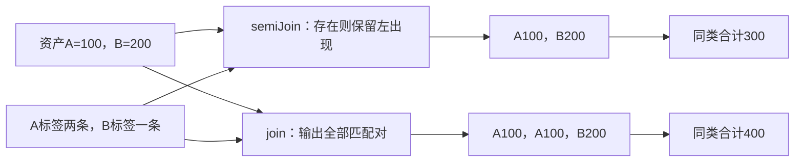

# 基线算法与优化映射

## 当前选定的正确基线算法

### 图解：存在匹配与重复配对是两种行为

固定A有两条release标签；半连接保留左出现一次，内连接输出两次。排序与聚合随后执行，不能在错误总和后补distinct修复。

### 表示与索引

输入关系保存规范值/非负重数、ValueOps版本和必要来源。计算实例的数据与索引由目标运行拥有，不进入Gift作者候选库。初次实现可以使用普通目标语言的表、数组与有序索引，不先实现分布式数据流引擎。

哈希索引只加速定位，保留真实键值比较；没有哈希可用但有全序时用排序/树；两者均不能可靠取得则给具体能力缺项，而不是按打印字符串猜相等。键和行可以共享只读内容，但相同内容不使不同资源实例合并。中间重数可能很大，使用精确计数并在输出展开前核数量与字节预算，不溢出成负值。

### 各算子的正常算法

| 算子 | 当前基线 | 可选优化与所需前提 |
|---|---|---|
| filter/map | 按规范逻辑出现遍历，调用回调，按结果汇总 | 相同实参的纯成功结果可共享；改调用顺序/删除失败需要独立条件 |
| join | 左右双循环，谓词按左后右出现顺序调用，匹配输出 | 可安全取得等值键时建立桶，仍核残余谓词；预取右键不能触发原来在空左输入下不发生的失败 |
| leftJoin | 每个左出现记matched，遍历结束仍未匹配才输出None | 桶索引可用但必须保持每个匹配及无匹配行，不能只取首项 |
| semi/anti | 每个左出现扫描右域，到首个真即可结束该左检查 | 可信等值索引支持存在判断；谓词错误不能被当无匹配 |
| union/intersection/difference/distinct | 以相同ValueOps核键与重数，按精确定义计算 | 分区可并行，但编码/比较和结果故障保持 |
| groupBy | 计算每行键，形成非空组，再按键序执行reduce | 已知聚合族可使用局部状态；任意reduce保留组值并完整重算 |
| sum/count/min/max/meanRatio | 依公开规则处理重数，空集和Option明确 | 总和/计数可分块结合；整数表示必须覆盖实际中间范围 |
| orderBy | 先按规范关系顺序计算键，排序时只比较已得键；检查同键不同值 | 可利用同合同的已排序源；没有相应比较证据时不能免排或免查 |
| take/toList | 先完成上游，随后截取/展开所需完整结果 | top-k在保持上游定义性、顺序完整性和源读取条件时采用 |

若N、M按重数计，双循环最多检查N×M个配对；输出自身也可能有N×M个出现，不能保证所有join线性。等值哈希实现的期望工作可分为读取、建桶与实际匹配输出，但最坏碰撞、长键、任意精度运算、序列化和源传输另计。排序比较规模为O(N log N)不代表每次比较常数成本。压缩重数减少物理存储，不消除实际要求完整输出时的展开成本。

### 结果与资源的归属

每次求值私有地构建新结果；只有相应输出根完成后发布。已发布Bag不可修改。中间内存可在所有消费者和实际外部使用结束后释放；重复引用相同值不强制深复制。

内存不足时先选择原任务允许的更小并发、合格迭代/重算或外排。外排写文件必须在目标运行许可、目录与保留合同内；不能因为查询是逻辑只读，就暗中获得落盘和上传权限。无合格路线则返回ResourceLimit，保持旧结果；不静默截断、降精度、采样或丢重复。

数据库取消后还要关闭/确认游标和会话；超时只停止调用方等待不是服务端已停止。运行结果可以在条件允许时缓存，但不保存凭证原文；更新权限后先重新判断披露资格，再决定是否复用内容。

### 实现者直接消费的接口与结果

沿既有MethodSpec提供下列逻辑接口，不新增顶层运行服务。类型名仅表示本域内部责任，未来代码可按成品目录落位。

| 方法 | 固定输入 | 具体输出与失败 |
|---|---|---|
| `checkRelation` | 已绑定模块、库调用、捕获、ValueOps与源模式 | `RelPlan`及重数/缺失/顺序/定义性摘要，或准确语义诊断；缺真实输入返回原Needs |
| `qualifyPlan` | RelPlan、要求、可用目标方法与源能力 | 合格物理路线、必须保留的求值/安全屏障、codec和读集；没有方法返回对应根缺项 |
| `lowerRelation` | 合格路线、固定布局和目标 | 按原Contribution合同输出目标区域、依赖、必要辅助及来源；新区域重新接受相交检查 |
| `evaluateBatch` | 固定Bag输入、参数、Plan与资源 | 完整结果/准确错误/预算或取消，不更改旧结果；不在纯函数中取得数据库凭证 |
| `prepareDelta` | 旧ViewState、闭合DeltaBatch、Plan/codec | 私有新状态、结果差量、将要提交的输入边界，或保持旧代的错误；自己不更新公开头 |
| `publishView` | 合格新代与准确旧代、实际宿主 | 在原提交机制中切换结果/状态/边界，或冲突/未结算；不重做作者解释 |

HashJoinState至少包含两侧值/重数、合格键到值桶和版本；Semi/Anti另记右支持；Outer记录匹配与None支持；GroupState保存键到成员/聚合状态；OrderedState保存已得排序键、同键计数和需要的后继。未启用增量时不创建这些持久状态。同一内存池中的共享值只计实际分配一次，生成结果/索引引用尚活跃时不提前释放。

### 主例真正生成什么

对`releaseTotals`，字段读取、精确Text相等和Int相加在已校验有限值域内没有业务异常。取得这些条件后，可将关系组合降低为：建立release标签的assetId集合；遍历资产，每个已有输入出现只在id存在时加入kind的精确整数和；将不同kind及和组成结果；按明确的Text比较排序并输出。重复的标签只影响集合支持，不重复计费；重复资产按其输入重数继续计入。

TS目标可以使用普通Set/Map和BigInt，ValueOps中必要的Unicode标量比较由已绑定辅助实现；不能用UTF-16字符串比较暗换顺序。Java目标用相应集合与BigInteger及合格比较。公开`releaseTotals`、Asset/Tag/Total映射和布局保持；辅助代码同模块或已选库按实际需要安排，不强制生成一套查询服务、SQL连接或运行时JSON计划解释器。

数据库目标可生成参数化的EXISTS/分组查询，但只在Text、整数和聚合域映射合格时下推；不能为凑SQL而改变完整源值域。需要在本地排序时，只传合法可披露结果。文件输出属于另一个明确的资产动作，纯函数只返回值。

## 优化与源到SQL映射必须保持哪几个区别

### 重写的具体条件

| 常见变换 | 可以采用的条件 | 会改变结果的反例 |
|---|---|---|
| filter下推 | 字段作用域正确、谓词在新求值域内定义且保持安全屏障 | 右侧过滤移过leftJoin会丢左侧无匹配行 |
| map/filter融合 | 保持调用次序或已知相交回调总且无观察差别 | 先filter掉x=0，再map 10/x，不等于先map |
| join重排 | 内连接的重数与类型保持；回调、错误、快照与资源条件合格 | 换顺序改变异常或引入未许可源读取 |
| join改semiJoin | 消费者只观察左行是否有匹配，不观察匹配次数或右值 | 标签重复导致sum从300变400 |
| 消除join | 真实唯一性、全存在性、空值、可见范围和副作用均满足 | 物理外键存在但权限过滤隐藏右行，不能删除可见性筛选 |
| 先聚合后连接 | 分组、键与重复倍数在整个连接中保持 | 连接多对多使计数/总和被倍增，不能只比字段类型 |
| top-k/limit下推 | 排序、并列处理、上游全部相关校验与外连接语义保持 | 严格`take(orderBy(map(...)),0)`仍要求先算上游；不能直接LIMIT 0吞掉原失败 |
| 共用中间结果 | 同源快照、参数、捕获、方法和读取/披露域合格 | 两个用户分别能读一半输入不是联合读取许可 |

估计基数、选择率和成本用来排序候选，不当成公理。真正硬资源上限只用可靠界或实际准入。合法计划保存空值、值域、顺序、输出位置、快照与已有索引等未来边界，不根据单算子更快删除全路线更优方案。

### SQL布尔与源表达式的错误顺序

Gift的`x != 0 && 10 / x > 1`有左到右短路。SQL的布尔表达式可能由规划器重排，不能直接以字符串相同认为等价。`CASE`在某些表达式可保留分支，但常量折叠、聚合预计算及原生函数仍可能提前失败；不能宣布“全部包CASE就安全”。

当前SQL下推优先采用可证在当前输入域内总定义的受限表达式：字段、参数、合格数值运算、明确比较及总模式分支。不能证明或不支持的回调保留在本地有序阶段；源读取本身必须在原任务的数据和隐私约束内。没有可行本地回退时，报告该目标能力缺项，不能要求用户缩小原合法输入以迎合优化器。

### Option、外连接与SQL NULL

普通SQL `=`遇NULL不是中立Option的值相等。对明确的单层`Option<NonNullScalar>`编码，本库的None相等需要适当的null-safe比较，例如已选PostgreSQL方言的`IS NOT DISTINCT FROM`；嵌套Option或记录缺失要按层保留tag/存在位，不能一律压成一个NULL。

leftJoin结果中的“无右行”必须有独立的右行presence标记。生成右子查询时添加受控TRUE标记；外连接后只有标记缺失才构造None。不能用一个可空业务字段判断是否匹配，否则真实右行所有字段为空时会被误认为不存在。优化器不得删除这个标记又失去区分。

`count(leftJoin(...))`对每个无匹配左出现也计1；统计右匹配次数需要显式选择右存在项后count。`NOT IN`含NULL的语义不等于本库antiJoin；降到`NOT EXISTS`或合法等价形式，并使用选定的相等规则。缺字段、无权和源失败继续不编码为NULL。

### 重复、空集与数值

`unionAll`生成UNION ALL；`distinct`才引入DISTINCT；intersection/difference的ALL版本对应重数min/截断减法，方言没有正确支持时采用本地或合格改写。不能全体使用UNION/EXCEPT默认去重。

PostgreSQL的sum无输入返回NULL，而本库sumInt返回0；相应生成必须按本合同处理空集。min/max仍返回Option；sumInt/count的投影不能原样使用会忽略NULL的SQL列聚合，需先保持源字段合法性和Option映射。均值保留精确分子/分母或在显式数值画像下转为近似。不能把目标AVG的自动精度和空值处理冒充中立契约。

数学Int不自动落成数据库bigint。PG numeric同样存在实际位数和资源限制，不以“任意精度”名称抹掉这些范围。若本次值域与中间和在合格目标域内，可下推；否则选择本地精确实现，或在真正无法满足任务时报告目标缺项，不把数值截断当结果。

### 文本、相等与排序

本库Text可含U+0000，PostgreSQL字符类型不能存该字符。源域确实排除此值时可以使用相应text映射；完整Text需要字节编码或其他合格表示，不能把NUL删掉。数据库编码、排序规则与其版本、字符尾空格行为都进入实际映射；`char(n)`、不确定排序规则和普通text不能互相假冒。

本库默认按Unicode标量而非自然语言规则排序。可在已验证UTF-8/二进制比较映射中实现；否则本地排序。用户要求语言学排序时，显式绑定该排序合同，并考虑升级的可观察变化。不能把当前进程locale隐式加入结果。

`orderBy`先计算完整键并检查不同记录同键；同键不同值拒绝欠指定输出，用户可扩充键为含tie-breaker的记录。键相同且整行相等的多份出现仍按重数保留。后端有可信唯一性证据可以避免重复检查，数据库扫描的偶然顺序不能当证据。已有需求只要求若干合法顺序之一时，可选择另一个显式画像，不放宽本画像的确定结果。当前拒绝不完整键而不默认补内部行ID，是为了让可观察次序不依赖隐藏物理身份；直接用完整行补平局虽可确定，却会让新增无关字段改变输出，故只在作者明确使用canonicalRows或把字段纳入键时采用。代价是某些orderBy需要作者补一个真实平局键；不要求对已唯一的分组键重复声明。

### SQL与本地混合计划

只将合法子树下推，保留其输入参数、输出编码、残留计算、快照和数据披露范围。值用绑定参数，标识符来自已解析并引用的模式/列与目标引用器；不能用AI字符串直接拼接SQL标识符或命令。任意原生SQL函数的IMMUTABLE/LEAKPROOF等标签是需核范围的提供者声明，不是Gift凭空产生的证明。

存在合格的现有数据库时复用其规划、索引与查询执行；引入Calcite一类框架须计入JVM/桥接与部署成本，普通TS库不为复用而启动不必要平台。没有数据库时，目标生成普通循环、表或排序代码。生成SQL不等于执行SQL，仍由当前运行Driver取得数据许可与资源。
