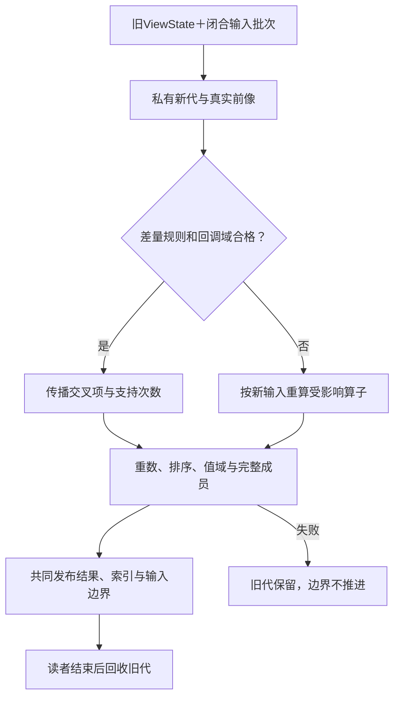

# 增量维护与有限递归

## 增删维护：先定义状态差量，再选择增量算法

**语义消费校核：** **删除与否定的正确重算：** 仅追踪已返回的正结果可能遗漏“没有边”的依据；新增事实可能推翻负前提，删除事实也可能释放互斥并新增结果。递归固定点的增量正确性须由完整关系域、层化条件及实际负依赖证明，没有资格时回退到允许的范围内重算。 实现或验证此用例时分别消费[负结果、开放供给与增量重用的证明范围](../../../30-实现解析/增量与性能/查询固定点与缓存.md#gift-negative-dependency-proof)、[变动影响的有型闭包与非局部反转](../../../70-工程系统与演进/信息与生命周期/对象关系与配置基线.md#gift-relation-invalidation-closure)的权威交接，当前机制只拥有本地行为含义。

### 图解：增量新代、回调安全与发布边界

公式成立不授权执行原新查询不会调用的危险配对；不满足差量回调域时对相交新输入完整重算。

### 当前较小方案与启用条件

默认先采用正确全量计算。确有重复查询、数据变化和相应资源收益时，才维护中间结果。成熟增量系统可承担维护，适配必须核其支持的输入更新、外连接、非单调算子与重建语义，不以“支持materialized view”代签全部规则。

**数据差量、编译缓存失效与源代码修改是三件事。**数据差量保持查询、ValueOps、默认和方法固定；修改谓词、排序、权限或源编码时，不能继续把旧维护状态当作同一算法的输入差量。可取得保持依据时转换状态，否则从新定义重建，旧结果留在自己的版本下。

### 状态与批次

`ViewState`由目标程序或所选数据提供者拥有，包含固定查询/值操作/源模式身份、上一个已发布输入边界、必要关系与索引、当前结果、仍在使用的资源。它不是Gift的作者HeadStore。

`DeltaBatch`包含实际来源和连续位置、基于哪个已发布边界、到哪个闭合边界，及按值计数的正负变化。更高层upsert必须先在该源自己的键空间读取旧值，再转换为撤销旧值与加入新值；一张未知旧表不能凭新的upsert值恢复完整差量。

当前基线是**有限、已封闭的批次**。同批各源的变化完整后一起计算，避免一半新一半旧。批内可合并同值正负项；中间计数可临时为负，最终各源及物化关系必须非负。重复批次按真实来源位置与批次身份判定，不能对相同payload的两次合法插入一概去重。断档、乱序、跨代际、删除数量超过已存在数量或源重置均有明确缺项/错误，不能夹零继续。

### 连接必须包含同时更新的交叉项

在同一匹配与映射不变、闭合批次和线性多重集内连接下：

\[
\Delta J=(\Delta A\Join B)+(A\Join\Delta B)+(\Delta A\Join\Delta B)
\]

也可用避免双算的顺序形式：

\[
\Delta J=(\Delta A\Join B)+(A'\Join\Delta B),\quad A'=A+\Delta A
\]

若初态A/B都空，同一批次各加入一条同键记录，正确输出新增一对。只计算前两项会错误得到空；把两项都和新侧连接又会重复计数。自连接同样把两个使用点当成两个逻辑别名；一条输入增量须进入两个位置，不能因为它们物理共用源就漏掉一条边。

这条代数只适用于相应内连接及固定函数，且涉及的回调必须在实际delta计算域内总定义，或已采用能保持完整求值错误和进展的有限方案。固定且无外部效果并不够。left/anti/distinct/group不是同一线性算子，不能统一套用。

**反例：**旧A只有x=0，旧B为空；同一批次删除A的x=0并在B增加一行。新完整join仍为空，谓词根本不执行。若差量实现直接计算A⋈ΔB，谓词含`10/x`就会产生源程序没有的错误，虽然另一差量项最终会抵消该配对。不得先执行这些错误再宣称计数和为零。当前无法证明delta调用域安全时，对受影响算子从新输入完整重算；旧成功缓存可以复用，但不能用代数抵消错误或非终止。

### 非线性算子的当前维护算法

| 算子 | 保存什么 | 批次更新怎么计算 |
|---|---|---|
| filter/map | 原值重数，必要的纯函数成功结果 | 固定回调下对变化值计算有符号贡献；相同输出合并；若旧依赖/方法变化则重建 |
| distinct | 每个输出值的支持重数 | 只在0→正数发+1，正数→0发-1；2→1不删除结果 |
| semiJoin | 每个受影响左值对应的右匹配支持计数 | 批次前后比较是否大于0，乘左侧实际重数；右侧重复不倍增左输出 |
| antiJoin | 同上 | 只有支持数为0时保留左值；从0→正数撤销左值，从正数→0恢复 |
| leftJoin | 左重数、实际匹配及支持计数 | 按受影响键/左值分别重算旧和新输出，再取差；第一匹配出现时撤销None，最后匹配消失时加入None |
| intersect/except | 两边值重数 | 对变化值重算min与截断减法，新旧差作为输出，不把一次删除变成删除所有重复 |
| count/sumInt | 分组支持数、精确计数/和 | 按变化贡献维护；组支持数归零时删除组输出；全局空输入的0另按全局聚合合同 |
| min/max | 相应值频次有序索引，或可重取的完整组 | 删掉唯一最值后取下一个；只有旧min和count无法决定新min，不能猜 |
| 自定义group reduce/fold | 受影响完整组或可重取来源 | 当前默认重算该组并取新旧差；只有用户提供并验证的合并/撤销法才采用更强增量 |
| order/take | 完整候选排序索引或可重查的固定输入 | 修正受影响值和排序资格，删除首项时补真实后继；只缓存旧top-k不足以支持任意删除 |

同一批次同时删左行、删右匹配，只发布新状态真正存在的结果，不能临时新增一条属于已删左行的None。受影响范围由真实条件和索引决定；任意不等连接可能需要扫描较大集合，不能普遍承诺单键局部更新。

### RQ0—RQ6 原子推进

**RQ0 核输入。**验证本批来源、连续边界、查询/codec/权限条件和预算。只收到某来源半份变化时等待、限界或返回未完整，不发布“最新”。

**RQ1 私有准备。**固定旧ViewState，建立新代工作区。可以使用持久结构/写时复制；无须深复制全部数据，不能原地破坏唯一可用旧结果。

**RQ2 源变化。**规范化同值差量及upsert前像，检查最终重数和来源不变量。删除不存在行是错误，不表示零变化。

**RQ3 算子传播。**按固定计划更新，每个算子使用自己的delta规则；两输入节点核同批旧/新边界，处理交叉项。先核回调在delta扩展域上的定义性与错误保持，无法满足的节点按新输入完整重算。规范完整求值的首个语义错误由相应方法保持；内部探测失败不能直接变成用户程序失败。自定义或暂不支持增量的节点在相交区域全量重算。

**RQ4 输出检查。**核新关系非负重数、排序/唯一键条件、结果范围与资源。诊断或取消时丢私有代，不提交源offset。

**RQ5 发布。**维护状态、结果可见引用与输入边界共同切换。内存指针可以原子替换；耐久场景使用所选提交域。跨系统offset不能共提交时，按原消费恢复协议保留接收/回放关系，不假称全局原子。

**RQ6 后续。**旧引用仍合法的读者可读原结果；新读者看到新代。完成回收需要实际读者/资源结束。响应丢失按原批次和边界读回；状态丢失但源还在时，从固定快照重建并建立新纪元，不能将部分旧delta续在空状态上。

不具备可信连续变化源时，不启用准确增量承诺；完整重查可成为正常实现。持续流的frontier、水位、时间窗口与乱序恢复以[背压与事件时间](背压与事件时间.md)为准，跨节点实际一致性还须取得所选 Provider 的保证；有限 batch 协议不能直接推广成这些能力声明。

## 有限递归与删除：一个可实施子域

本次给出一项独立的有限递归合同：固定有限节点域及边集合的可达性。它使用现有图/函数能力，不新增关系核心的任意递归语法。

输入节点与边按明确身份和范围检查。默认非自反可达关系只包含路径长度至少1的结果，图中确有环时会产生相应自达；需要自反闭包时显式加入所有节点的零长度对，不能只为观测到的边端点加入。

正向算法从直接边开始，以delta frontier连接边并去掉已见的对，直到没有新对。节点域有限、纯关系不产生域外新节点时至多有|V|²个不同对；这是关系终止依据，不是对任意用户递归程序的停机保证。

若来源保存重复边，先以支持数大于零得到有效边集合；支持2→1不改变图，1→0才是删边。只新增有效边ΔE时，设旧可达集R与新边集E′：初始前沿取`(ΔE ∪ (R∘ΔE)) \ R`；每轮将前沿加入R，再取`(前沿∘E′) \ R`，去重后继续，直到为空。这里∘是路径连接，初始式保留了“旧路径之后接新边”，不能只从新边的起点传播。删除边或改变规则时，当前默认对受影响闭合子域从底状态重建；不能用“A支持B、B支持A”永久保留已失去基边的可达结论。有效支持计数/删除重推可作为后续优化，但必须保留不同推导共享、循环和真正最后支持的规则。带否定、聚合或无界生成的递归另有范围，不当成普通最小不动点。

原生SQL递归查询要核UNION与UNION ALL、终止域及输出排序。执行器探索次序不成为作者承诺；要求有序结果仍明确排序。数据库递归方法不可用时可生成有限本地算法，不新建完整Datalog运行平台。

## 递归、撤回、流式更新和跨源一致性的分段支持

关系结果除逻辑值外必须保留 `RelationBasis{semantics:bag|set|ordered,nullRules,sourceRevisions,coverage,consistency,witnesses}`。重复计数、排序与分页位置是请求的可观察部分；只输出一组去重行无法解释原 Bag 查询。递归查询按**已选择**的单调/分层程序计算至固定点；递归否定、动态负依赖或非单调聚合要求定义稳定全集与分层终止条件，否则返回 `STRATIFICATION_UNSUPPORTED`，不能把未发现当成不存在。

增量变化传入 `delta{adds,removes,priorEpoch,newEpoch,completeness}`，支持删除的策略要维护真实贡献/计数或按受影响强连通分量重算固定点。仅按旧正向值等于新正向值判定无需更新是不充分的：一个新证明路径能改变后来撤回时的失效边。对带顺序或聚合的结果，需要指出维护是否保留规范排序、并列稳定键、溢出/数值变化及聚合取消时的精确错误表现。

跨 Provider 查询不能用每个源各自的 `snapshot=valid` 断言拥有联合原子快照。输入注明 `ConsistencyNeed`：`BEST_EFFORT_OBSERVATION` 返回各源版本/缺失覆盖；`REPEATABLE_PER_SOURCE` 约束每个源不漂移但不保证跨源；`JOINED_SNAPSHOT` 必须通过真实共同 MVCC、时间戳/水位协调或带验证的重试取得一致切面。某源不支持共同 cut 时拒绝更强声称而可输出明确的部分投影。持续流另携带事件时间、水位、late-data 政策、retraction、可重放 cursor 和 consumer checkpoint；处理完成不等于事件源已终结。

验收至少包含：删除递归祖先事实、两个同值不同证明路径、无穷流中的迟到撤回、某 Provider 中途失联、分页期间成员变更及来自不同时间点的两个数据库 snapshot。原始 SQL Provider 可以完整承担其成熟子域；Gift 只负责相交抽象与组装边界，不重新声称支持所有 SQL 方言。

## 递归关系及可删除增量

关系固定点实例选择有类型tuple域、去重/多重性、偏序、迭代算子、否定与聚合规则。首个可判定执行画像为有限域上的单调递归及分层否定；依赖图出现负边循环则拒绝此画像，不能取任意迭代结果。其它well-founded/stable等语义必须由另一个精确Profile和相应求解器供给，不借同一标签兼容。

插入可沿差分增量传播；删除需要支持计数、重推导或重算相交SCC，存在另一条推导路径的tuple不能因删除一条支持就误删。bag递归的重数可能不收敛，不能直接当set固定点。聚合/外连接/否定产生非单调更新时记录完整正负依赖。状态checkpoint包含输入cut、规则版本、推导支持与未完成delta，不只保存最终行。

预算耗尽保留partial固定点及未处理范围，不能声明无更多结果。恢复在同cut/同规则重放去重delta或完整重算；改变规则/数据schema时旧物化视图必须重新资格。越界退化到全量计算允许，但仍满足硬资源/新鲜度要求，否则明确未完成。

**验证与反例**：递归可达性删除一条双路径、负环、bag重复自增、checkpoint半批重启、规则变更后的full/incremental对照。

**实际能力边界**：目标增量数据库/物化视图引擎及性能证据未绑定。

相交合同：[关系查询的行、多重性和快照合同](关系查询-查询语义与作者方式.md#design-c01)；[声明环、初始化环和动态入口](../计算基础/名称导入与契约.md#design-b05)；[量词与求解状态的可组合解释](../../共同语义/关系约束与固定点.md#design-b09)；[增量失效与精确负依赖](../../../30-实现解析/增量与性能/依赖与失效模型.md#design-b21)。
