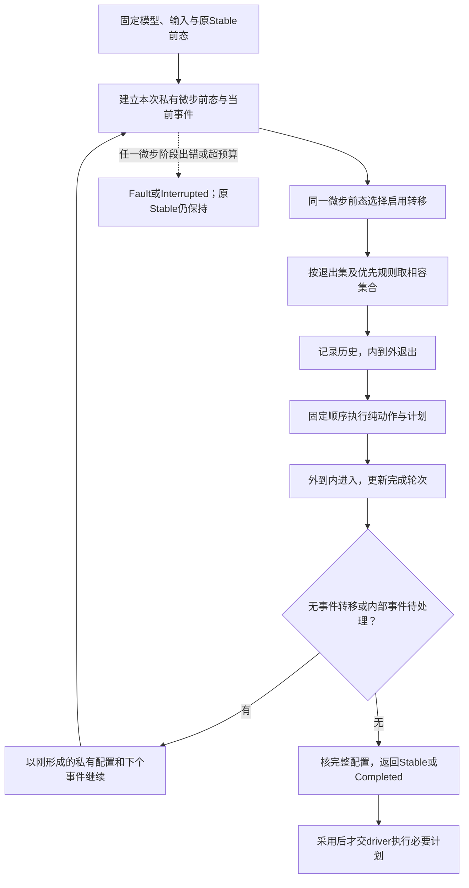

# 执行算法、回调与作者变化

## 从输入事件到稳定结果的可实现算法

**语义消费校核：** **状态转换与现实副作用不一起回滚：** 父状态退出、子状态取消可以是确定的模型事件，但已交给设备或支付Provider的Effect仍需原Operation身份结算。迟到回调只允许作用于仍有效的实例generation；UI显示新状态不能替旧尝试签发“没有发生”。 实现或验证此用例时分别消费[外部未知效果、资金/资源结算与去重窗口](../../../50-执行运行与观测/持久化与恢复/事务提交-外部效果与幂等交付.md#gift-external-outcome-ledger)、[失败返回的阶段、可继续性与非对称状态](../../共同语义/规范元模型与结果语义.md#gift-failure-state-no-bool)的权威交接，当前机制只拥有本地行为含义。

### 图解：事件反应从稳定前态到稳定后态

循环是宏步内部反应；预算中断保留原稳定前态，不把工作中间态发布为稳定。实际活动在稳定采用后启动。

运行库公开边界是`start(model, initialContext, limits)`和`advance(model, stableSnapshot, ingress, limits)`；输入输出是上述固定值，均不执行目标I/O。`start`建立初态并稳定化；`advance`一次最多处理一个外部或系统输入。`limits`由目标运行合同提供，不在每个作者函数中强制填写。运行API不是第七个Gift开发工具。

**STATE0 模型检查。**在有限工作栈中检查树/所有权、ID、初态、目标可达与正交性、history fallback、无目标/内部转移、回调签名和effect、生成事件匹配与资源槽。预计算祖先、模型顺序和候选索引，保持图表而非展开全部组合状态。可疑无事件循环产生具体诊断；无法证明终止并不禁止一切图。

**STATE1 固定反应基础。**验证modelRef/instance/修订及稳定输入；接收方先校验事件类型、来源和相关性。形成私有ReactionWork，旧快照不变。普通未匹配事件返回Consumed-Unhandled与相同逻辑值，不默加错误转移。

**STATE2 选择外部触发。**按[结构、转移与历史的有限解释](层级状态-模型实例与历史.md#结构转移与历史的有限解释)选择候选、比较冲突、确定微步，不允许第二输入插入其中。开始时必须已是稳定配置；否则只能继续原私有反应，不能在中途接新外部事件。

**STATE3 原子构造一个微步。**固定退出域和选中转移的模型次序；捕获需要的history；按退出、转移、进入顺序调用纯动作并更新工作副本；维护activation、完成标志、内部事件和命令。一次回调的上下文输出成为下一动作输入，不能并行求完后最后写入者胜。每一阶段都检查预算、值类型和当前读写/激活合法性。退出到进入之间的工作配置可能暂时缺少compound子状态，这是合法中间态；完整配置不变量在微步结束和对外Stable边界核对，不能将它误作每条exit动作之前都成立。

**STATE4 稳定化。**若根已完成直接进入STATE5，不再执行根的eventless循环；否则先尝试无事件转移；有就作下一个微步。没有无事件转移才从内部FIFO取一项，按当前配置处理；内部空且无无事件转移时到达稳定切面。内部事件产生的内部事件仍按FIFO，不用宿主消息时序抢先。动作中的raise只追加，不递归重入同一实例。

**STATE5 完成或有限结束。**到达稳定配置或根终止后，返回对应新快照、完整命令计划、消费身份和摘要。出现纯守卫/动作错误、契约错误或结构错误，返回失败和原稳定快照；未发布的命令全部丢弃。预算耗尽/取消不是语义错误：返回Interrupted与原快照、输入未结算及可选私有续体，不能把中途配置标成Stable。

**STATE6 交接。**由driver决定内存发布或持久比较提交。提交成功后才向真正执行边界释放命令；失败时旧状态和原命令身份保持，重算仍消费同一个外部输入。独立诊断trace不声称目标命令已执行。

只要所选守卫/动作结束、稳定化步数有限且预算与存储能力满足，路径能够返回稳定结果。无事件循环或持续内部事件可以使宏步永不自然稳定；配置预算和中断给出可结束的处理，不宣称任意作者图都有自动终止证明。

### 宏步无穷时，外部取消不能假装已被图处理

普通`cancel`是输入事件，要等当前宏步结束。若当前出现无事件自循环，它可能永远排不到。目标driver提供**计算控制取消**以终止/隔离本次工作，保留旧稳定状态与失败输入；这不是向图伪造一次已处理的cancel。

默认同实例因非结束反应进入Parked，阻止后来事件越过未处置输入；其他实例可继续。允许丢弃毒性输入、回滚到旧模型或强制结束实例，必须由已接受的宿主策略作出可见决定。不能无限自动重试同一错误。第三方同步回调不能被Promise超时真正停止时，沿[执行资源](../../../50-执行运行与观测/权限与资源/README.md)使用能终止或隔离的运行器。

## 回调和作用的正向合同

`Guard<C,E>`是`(C, Frame<E>) -> Bool !{}`。`Action<C,E,O>`是`(C, Frame<E>) -> ActionResult<C,E,O> !{}`；该公开记录恰有`context:C`、有序`raised:List<NamedEvent<E>>`、有序`emitted:List<O>`。零变化明确返回原context和两个空列表，无需未定义的identity助手。

Frame按实际类型区分External、Raised、Done、ActivityMapped、Timer与Initialization；外部提交接口只构造External，其余由相应引擎/已授权适配器构造。包含当前事件的可用负载、动作发生点和只读配置视图：guard看微步选择前配置；exit回调执行时该状态仍在配置中，回调后移除；transition看退出完成后的配置；entry在加入该状态之后执行。不是全部工程的可变Context。没有该类负载就必须模式分支，不能把Done的payload强转成E。内部事件名称匹配精确相等，错误不是一个偷偷吞掉的普通字符串。

C是不可变的中立值；外部资源只通过明确标识和运行ledger关联，不能直接藏进C后用history复制。动作纯性表示它现在只构造值和计划；emitted中的某项将来需要文件、网络或设备能力时，目标摘要和driver仍要体现那个需求。**计划函数是纯的，不代表计划中的未来作用无需权限或预算。**

多个正交区可以在一个微步中按确定次序更新同一个C。若A动作执行`x+1`，B动作执行`2*x`，输入x=1，A后B得4，B后A得3；不能因为模型包含parallel就并行计算两个动作。只有取得读写独立或交换、错误/终止保持与资源条件后，才允许优化真实并行。否则顺序实现已完整支持正交语义。

本画像将外部动作计划推迟到稳定结果被采用之后。SCXML直接执行内容的异常、脚本、send/invoke与这一行为不是无条件等价；导入或复用必须限定到公共子域，或保留原引擎画像。本章选择这个边界是为了保留取消、重算与事务接合，而不是宣称它是唯一正确的状态机语义。

### 运行边界的有限类型与输入验收

公开运行库使用`Snapshot<C>`、`NamedEvent<E>`、`Ingress<E>`、`Reaction<C,E,O>`和`Limits`，不是把内部Map暴露给作者。`Limits`由调用目标的既定运行政策绑定：模型节点/转移、回调工作量、微步、内部队列、输出大小与总内存各自有非负有限预算；不同量纲不相加成一个任意分数。小模型可采用发行画像已规定的预算，真实值未被规范/配置确定时返回配置缺项，不假造无限资源。

`start`成功返回Stable或Completed；`advance`额外接受绑定此实例的Ingress。二者失败返回`Fault`（模型/guard/action/合同）或`Interrupted`（预算/控制取消），附原稳定基础、阶段与可定位诊断；Interrupted可含有权不透明续体，但不是可公开业务状态。输入消费、逻辑状态、所发计划和外部结算分别返回。结构/模型版本不符的快照首先拒绝，不试着按相同状态文字执行。

Ingress先验证解码类型和可信来源，再检查实例/逻辑请求身份、activation及终止状态。无权事件不给出受保护的状态是否存在；旧活动返回仍可进入原ResourceLedger结算，但不能成为当前图输入。普通外部同名事件是否允许由实际入口合同决定；Done、Timer、ActivityMapped不能由普通external构造器签发。输入队列满时采用已选背压或明确拒绝，不能无声丢弃取消、完成或普通数据；若某业务允许丢弃/合并，必须是那个事件类型的明示合同。

## 一次完整作者变化与准确结果

用[完整中立库源中的模型](层级状态-范围复用与作者方式.md#一条完整的中立库源)，忽略父祖先只列活跃叶：

| 输入/动作 | 活跃叶 | 必须同时成立 |
|---|---|---|
| start初始化 | `idle` | 不执行渲染和网络 |
| 应用事件`start` | `rendering, checking` | 两个区域都进入；不是创建两套作者候选 |
| `render.done` | `rendered, checking` | inspect没完成；不能产生work完成 |
| `pause` | `paused` | deep记录`rendered, checking` |
| `resume` | `rendered, checking` | entry是新激活；旧C/权限/活动不被恢复 |
| `inspect.done` | `ready` | 两区完成，内部Done(work)使active退出；根逻辑完成 |

把history的`"deep"`改成`"shallow"`后，同一路径resume会进入`work`的默认配置`rendering, checking`，已完成的render也重新从初态开始。它是行为变化，不是排版或性能选项。开发AI只改该字面量或已定位字段，分析器更新行为影响，图布局和无关图标保持。

将叶节点`rendering`改名且更新引用，模型顺序不变时优先级不因名字字典序变化。迁移中的旧运行激活仍使用稳定语义ID/映射；不是仅全局替换字符串。

定义和运行边界分开：此纯范本只规定收到事件后的反应，真实渲染任务由[activity绑定](层级状态-活动资源与目标实现.md#活动计时器暂停与实际释放)或外围运行应用提供。渲染结果的可信来源、输入摘要与activation要由入口验证；使用本例的纯`on("render.done",...)`并不声称所有外部调用者都有权报告完成。

### 同时发生的取消和成功，不按“最新事件”重写事实

默认以已接收的序列逐次处理。cancel先被提交，则随后旧activation的完成只进入资源结算，不改变新配置；成功先被提交并进入ready，则稍后cancel得到已逻辑完成的状态，不倒写成功。原任务必须规定“某个真实时间之前取消一定优先”时，需要那个时间、接收和提供者的共同合同，不能由普通FIFO伪造。
