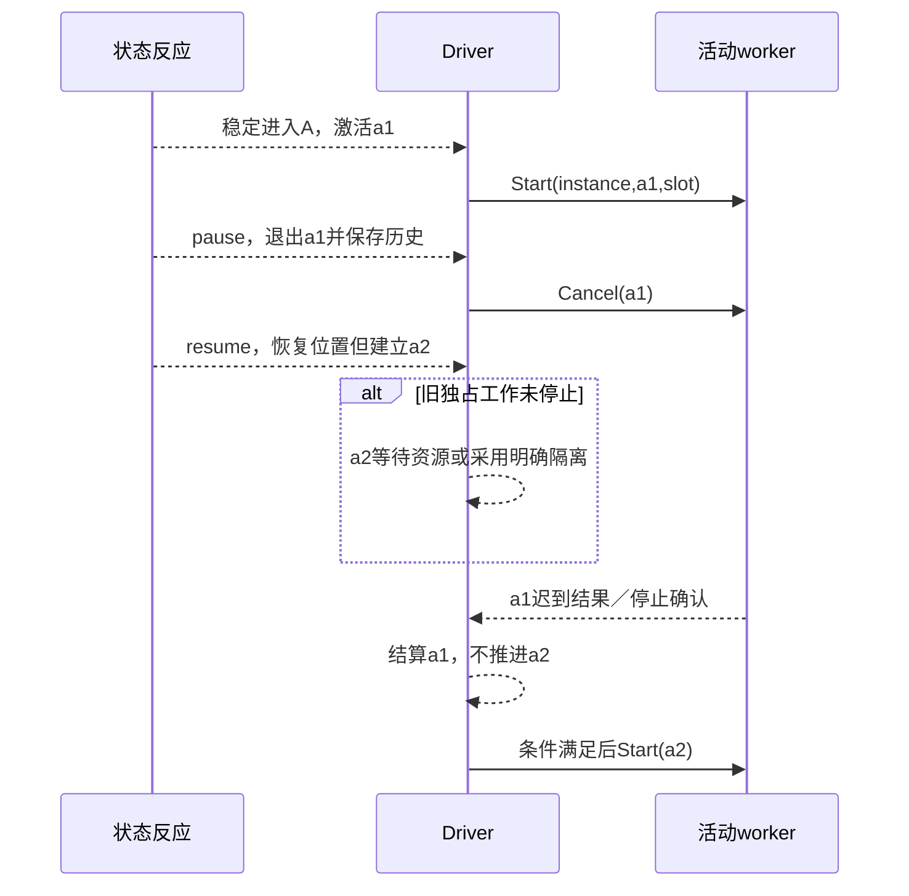

# 活动、资源与目标实现

## 活动、计时器、暂停与实际释放

### 图解：暂停、历史恢复与旧活动的相关性

深历史恢复结构位置，不复活旧worker、权限或内存；迟到结果仍可结算原活动但不推进新激活。

### 状态拥有的是激活，不是永久状态名

`Provider<I,R>`是既有提供者合同的类型化引用，不是实际运行句柄或凭证。`bindActivity`取得请求构造`(C,Frame<E>)->I !{}`与回调映射`ActivitySignal<R> -> Option<NamedEvent<E>> !{}`，将I/R封装在`ActivityBinding<C,E>`中。运行适配器始终沿绑定保留I/R解码和检查，不能因为公共容器隐藏类型而退成Any。O只承担普通动作输出，与活动请求I、结果R相互独立。

`ActivitySignal<R>`的有限分支是`Started()`、`Succeeded(R)`、`Failed(ActivityFailure)`、`Stopped(StopReason)`。后两种数据携带已声明类别和有限诊断，不直接含未经约束的异常对象或秘密。映射返回None表示不产生图内通知；返回named(name,payload)时，driver附加真实owner/activation/slot，形成ActivityMapped，而不是普通External。`activityEvent`只匹配这个标签；模型静态检查owner真实拥有slot，框架检查当前相关性，用户字符串不能伪造它。

开始、失败、取消确认的映射是正常领域代码，可通过现有match表达。实际Provider返回先按原活动记录校验并结算：迟到且已不相关的结果不再调用图映射；相关结果才运行纯映射，映射错误保留收到的真实结果并停放图输入，不能撤销已发生的外部事实或重跑Provider来修映射。没有为Failed配置转移时，该已验证通知被记为未处理，并保留活动失败；不擅自选择ready或重新开始。提供者Started只表示约定接受/启动层次，不证明任务完成。需要从实际Started计时的模型先停留等待态，收到受信Started后进入带after的工作态；不把稳定入态计时擅自改成真实执行起点。
活动身份包含实例、状态activation、slot、输入身份；每次物理尝试再有attempt，重试不换逻辑活动。静态初始化版本也在绑定中，输入相同不能复用另一激活的资源。进入并在同一宏步离开的状态，不启动新的外部活动；只根据最终活跃且实例未终止的激活集合发Start。终止时所有状态拥有的活动都取消，不因保留终态路径继续运行。此前已启动而本次退出的活动产生Cancel义务，不能因最终没有该状态就直接删除ledger。

输入构造在STATE5发布/提交之前对最终稳定C执行并检查；失败按宏步Fault处理，不能先发布状态再发现无法启动其活动。输入以该激活的决定固定；同一激活内C后来改变不自动重启活动。确需重算输入并重启，明确reenter或新的操作。重入同一ID产生新activation，不能把旧worker的迟到结果交给新worker的消费者。

### 历史与资源是两条生命周期

从active到paused时，历史可以保存叶位置，活动仍可能正在取消。恢复deep不会把旧进程、网络流或GPU缓冲“复活”；需要运行的叶建立新的活动身份。已执行的纯entry/exit动作所产生的普通emitted输出仍按原动作次序保留；仅状态拥有的活动Start/计时Set按最终激活对账。不能把所有输出计划都按最终状态删除。

默认每个相交独占槽采用 **停止确认后再启动后继**：旧提供者确认停止、隔离完成或责任有权转移之前，新活动排队，旧内存继续计费。不独占且预算允许的任务可以重叠，但输出、临时文件和回调都隔离到不同activation。没有等待确认的能力，不能宣称已暂停、已释放或已取消完成。

`logic=Completed`、`settlement=Pending`是合法组合。需要完整完成的调用方必须等其要求的活动/交付义务结算；纯反应调用方可以只取逻辑结果。相关表示消费[结果分层](../../../60-保证与证据/保证/要求证据与裁决.md)，不另创总成功标志。

### 计时器有单位、起点和恢复政策

`Duration`含非负整数ticks和已绑定单位/时钟域，禁止隐式把秒当毫秒。after默认从该激活的**稳定发布所记录的约定时间戳**开始相对计时；计时不是纯宏步内读取Date.now。内存画像在发布边界取得时钟值；耐久画像在同一事务中保存时间戳及deadline，承认读取到实际发布的间隔，不声称取得不可观测的零误差物理提交瞬间。提供者把同一计时身份与该deadline固定，响应丢失可以读回或同键重试，不能每重试一次就续期。

Timer携带实例、ownerState、activation、slot、deadline与提供者来源；timer(owner,slot,target)只匹配对应记录，internal(name)只匹配纯动作raise的事件；状态退出后迟到事件不触发新激活。零时长也作为后续输入，不在entry内同步递归重入。timer到期与普通输入的先后由当前接收序列决定；对同一时钟下同时到期的多个timer，选定提供者按deadline和固定slot顺序登记，不能从线程先后暗推确定性。

深历史恢复默认重新启动尚未完成叶的相对计时器；要保留剩余时长或绝对deadline，使用单独的明确计时策略，不借deep这个词暗示。持久宿主恢复不能跨boot比较单调时钟数字；需要可恢复时钟基准或已接受的壁钟误差/追赶政策。休眠后过期事件按实际队列预算分批取得，不触发无界补发。硬期限、跨节点时序与迟到水位分别消费[设备与实时交付](../../交付语义/设备与实时交付.md)和[背压与事件时间](背压与事件时间.md)的准确保证范围；本层级状态合同没有因此取得这些能力。

## 内存、持久与实际动作的实现边界

**默认内存。**纯start/advance返回新值；应用通过一个实例事件循环或等价同步协议切换snapshot指针。无外部作用、跨故障恢复或持久交付要求时，不建数据库、Outbox和持久命令图。有限调试trace按预算保留或丢弃，不影响模型含义。

**有外部活动的内存应用。**driver验证、发布稳定状态后才发对应命令，并持有在途责任。进程崩溃后的恢复没有因此自动保证；需要耐久责任时选择下一画像，不把内存模式宣传成持久工作流。

**需要耐久。**同一提交域共同保存旧/新修订比较、输入消费结果、stable snapshot和待作用计划，复用[现有提交与恢复](../../../50-执行运行与观测/持久化与恢复/README.md)。单个宏步的纯计算可以在锁外按固定前像进行；冲突时重新取得实际状态计算，但逻辑输入身份保持。外部调用不跨数据库锁等待。

每个实际命令的逻辑身份由已提交输入/反应、产生位置与局部序号确定；物理重试另有attempt。提交冲突前的私有计划未被派发，可以按新前像重算；已提交的计划不能重新分配一组身份。显式emitted外部作用不是状态数据的一部分，也不因后续进入终态被删除。

**断点与恢复。**提交前退出：原快照仍为准，未授权/未提交命令不发送。提交后响应丢失：读同一输入结果。命令已发但结果未知：查提供者或按其真实幂等条件重试，不能重放整个图的entry。宏步中断：只有私有续体仍有效且绑定同一模型/输入时恢复计算；否则从旧稳定快照重新计算，未提交动作没有外部效果可重复。

接收同一事件两次是否去重由当前输入合同决定。鼠标点击两次可以是两个合法事件；重试同一远程请求则应使用已有逻辑输入身份。不能因为负载相同就去重，也不能每个像素处理都建持久输入表。

## 目标生成、性能与调试

编译实现依次产生：规范树和转移表；必要的祖先/顺序索引；候选选择及完成规则；已检查回调；纯反应代码；请求需要时的目标driver与提供者配置。数据仍由原Definition/Region/MethodSpec与ArtifactSet承载，不建立第二状态机工程管理器。

默认实现保留层级与正交配置，通过有限位集/数组和有序队列运行。k个区域各有n_i个局部状态时，平面组合数可能是乘积∏n_i；运行表示不先枚举全部乘积状态。需要模型检查且范围合格时再按需探索可达状态；图节点数少不构成运行状态空间小的证明。

未预计算祖先和退出集合时，一个参考选择步骤可扫描活跃叶a、深度h、候选转移t及状态n；朴素上界可按`O(a·h·t + t²·n)`保守计量，回调成本、队列、输出和任意精度值另计。预计算位集与索引可降低重复扫描，但它们改变的是算法成本，不能改变候选顺序。没有输出数据支持不宣称比其他引擎快。

TS目标可以生成只读表、回调函数、实例快照和step函数；Java目标可以用表/类封装相同含义；Qt目标若采用合格现成引擎，声明数据模型、运行依赖和差异适配。单个状态不必生成一个文件或服务；稳定名称来源于模型身份和明确布局，不来自回调到达次序。

发生状态/条件错误时，诊断回到实际状态、转移、guard或action及对应源/图位置；显示本次输入、旧配置、竞争候选和实际采用规则的必要部分。完整trace仅在需要时取得，不能每次向AI发送所有潜在配置。修改局部守卫使相交语义/目标失效；只移动画布不重编；改转移顺序是语义变化而非格式化。

**关联规范：**[层级状态与历史的确定解释](层级状态与事件.md#design-c03)。
