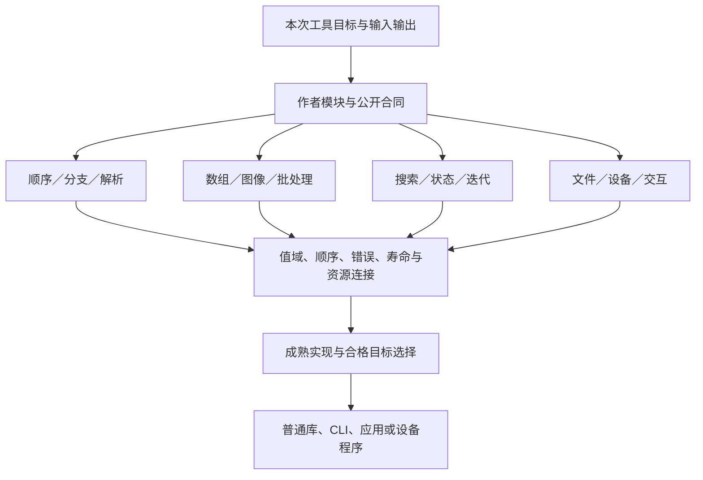

# 完整计算程序与实现布局

## 完整计算程序与实现布局

### 计算计划怎样从多个模块形成一个真实程序

<a id="fig-computation-types"></a>

#### 图解：小工具与大型计算共享接合，不共享一种算法

边表示组合接口；顺序控制、规则数据并行、反馈和I/O各自保留含义，数据库不是共同前置。



本节给共同编译器的计算接合算法。所称边界摘要、目标计划、执行范围和观察记录，分别复用已有`BoundaryView`、`ImplementationBinding/TargetProgramIR`、宿主资源协议和来源/结果对象；**不新增必须持久化的四套表**。

#### CALC0—CALC7：输入、关系、实现和产物

**CALC0 固定产品结果。**取得实际模块/源/资产、接受的行为与当前目标。分别列出库导出、CLI/应用入口、必要配置资源和检查要求；只选择本次需要的根。未指定数据库、消息或网络不创建它们。编译器需要固定代码与规则，无需先读取所有未来运行输入。

**CALC1 连接计算边界。**链接公开类型、值域、形状、顺序、相等、立即/潜在效果、错误和资源寿命。单值、批值、连续流、持有资源的句柄分开；缺省由既有合同补入。一个转换必须说明输入前提、输出、成本和失败，不能靠图中一条线消掉编码、设备拷贝或数值误差。

**CALC2 保留不同计算区域。**顺序/分支区域保留激活；可证明独立的数据并行区域保存索引和读写关系；迭代区域保存初态、下一步和停止；外部I/O/设备区域形成真实作用边界。函数递归检查有限函数体，动态分支保留到运行；不因未知运行次数要求无限编译。区域是分析结果或已有领域构造，不要求作者手建另一张执行DAG。

**CALC3 选择完整实现。**先沿现有合格绑定；需要新选择时，使用目标可用实现和成熟库，保持硬要求，比较转换/工作集/编译/运行/冷启动等真正相关成本。没有实测先采用正确、可逆的一般策略。数据依赖输出长度、动态秩或不支持的设备核，可以使用同语义的普通目标程序；不能为某种JIT限制公共语言。没有任何合格目标时保留明确缺项，不假称原生逃生口已实现。

**CALC4 安排表示与寿命。**为每条实际值边确定逻辑语义、物理位置、布局、拥有/借用、只读或写区、最后使用和完成栅栏。条件允许才复用缓冲。分支和循环之间的寿命取真实上界，不将两个同时活跃分支的空间简单取最大值。设备句柄、异步消费者与观察借读都参与最后使用；普通私有局部数据无需全局资源登记。

**CALC5 形成执行安排。**只在数据/控制/效果条件允许时并行，设置有限队列和资源份额；独立计算可同时推进，依赖未就绪的任务挂起。迭代内修改共享状态采用明确同步或分区；不因源是不可变值，就无限复制所有历史状态。编译器自己的并行调度与目标程序运行调度不共用时序假设。

**CALC6 贡献并封存制品。**各模块贡献代码、公开符号、真实依赖和需要的资源；公共组合器处理名称、成员、初始化、布局及输出形态。完整包根要求全部必要成员；独立库根可以单独返回。生成物不携带Gift开发头、当前未决义务和完整证据图。

**CALC7 连接检查、运行和再次变化。**静态预览到产物即结束。实际构建、运行、观察需要相应请求和宿主；结果绑定真实代码与输入。下一次源或数据变化分别重算相交部分；运行中的旧代可结束或取消，但不得覆盖新代。支持的局部性由真实依赖决定，不许以“只能小改”掩盖全局算法影响。

#### 动态数据不是必须先解决的编译输入

能够确定类型但不能确定长度的列表仍然可编译。静态尺寸优化可以另作受限特化，其守卫至少检查该优化真正依赖的形状、类型、布局、数值策略和工具/方法版本。守卫不成立时进入合格的一般目标路径，或返回该明确目标策略不支持；不得读取未初始化结果、裁剪数据或用之前某个尺寸的缓存。

特化集合有真实预算和淘汰策略。新输入不断产生新尺寸时，默认回到可用一般实现，不每次无限生成新代码；硬目标若只支持有限尺寸，就公开该限制。首次运行样本的取值不能成为编译事实，除非用户把它作为静态输入明确绑定。

JAX的官方资料说明特定JIT需要静态形状，且追踪不包含任意Python副作用。这是一个成熟工具的实际适用边界，不是所有计算编译器必须作出的选择。采用相应工具时核其约束，不把它的限制反向变成Gift全部程序的规定。[JAX边界](https://docs.jax.dev/en/latest/notebooks/thinking_in_jax.html) [追踪与作用](https://docs.jax.dev/en/latest/jit-compilation.html)。

#### 五条正向实现默认

1. 普通短函数和不规则控制先保留普通目标函数、循环或明确递归；高层优化不强制展开全部调用。
2. 规则数组计算保留索引/形状到足以选择表示的阶段；能用成熟库就绑定它，不先降为数千无关联标量节点。
3. 需要可变内部工作区时由后端在明确拥有范围内使用可变缓冲；公开不可变值与源显式状态更新分别保持。
4. CPU/设备选择不改变公开精度、错误、边界、随机映射或必需的顺序。无法同时满足时报告冲突，不把近似藏进优化。
5. 运行库只带当前程序真正需要的函数/内存/格式/设备能力。一个普通CLI不启动Gift后台，不附带业务身份、分布式租约或数据库。

这些默认与Halide的算法/调度分离、MLIR的不同区域语义有机制上的联系，但不是复制它们全部实现，也不要求用户逐个选用这些项目。[Halide](https://halide-lang.org/) [MLIR区域](https://mlir.llvm.org/docs/LangRef/)。

### 一个完整目标工程：本地图分析、布局与导出

该工程用于检验整个产品，不把它升格为所有软件模板。它比一个算子完整，同时无需任何中间件：读取图文件，检查结构，分析强连通分量，生成布局，渲染/导出，按输入变化更新；可作为库、批处理工具或带本地展示的应用。

#### 输入、输出和当前选定行为

输入是有限的有向多重图：每个顶点有非空唯一Text ID；边的两端必须存在；自环和重复边合法并保留。ID按中立Text的精确相等判断，不从显示名猜同一顶点。标签和渲染样式不参与图连通性。输入超大、格式不完整、重复ID与悬空边分别返回准确错误；不会自动删除坏边换取成功。

输出有三种可独立请求的根：分析库结果、图形场景/SVG和包含规定资源的完整工具包。分析结果包含原顶点/边数量、连通分组和明确的节点到组映射。布局的基线不是“最美观”：分量按其最小顶点ID排序，分量内部按顶点ID排序；Text排序按Unicode标量码值逐项比较，真前缀中较短者在前，不用locale或隐式大小写/Unicode归一化。顶点放在组内列/组间行上，间距为正Int。其承诺是确定、无同坐标顶点和可解释的分组；不承诺无交叉、最短边或高质量力导向布局。

#### 模块结构与公共合同

```text
project/
  model/         图、分析结果、布局、场景与输入问题的公开类型
  graph/         校验、邻接索引、强连通分量和图统计
  layout/        确定基线布局；以后可替换的迭代布局
  scene/         图形原语、样式、拾取和视口变换
  app/           组合入口、交互模型与最新结果发布
  io/            真实文件格式、导出与宿主入口
  assets/        字体/图标/样式及实际许可
  checks/        独立小输入、错误样本和准确预期
```

这是目标源码/作者责任结构，不要求每行一个包；小模块可合并。图形展示是用户目标软件的能力，**不是要求Gift首期开发人类图形编辑器**。这棵树不复制Gift自身的workspace/compiler/execution等模块。

| 模块入口 | 输入与产出 | 实现设计及保持 |
|---|---|---|
| model.validate | 原Graph与选项 → Result<ValidInput, InputError> | 在拥有ValidInput表示的模块内检查唯一ID、端点、参数后构造；允许空图；保留原输入和原行位置 |
| index | 合法图 → 顶点索引和邻接 | 用固定Text顺序建立顶点索引；保留边出现和反向访问；可使用CSR/列表，表不向外泄露可变别名 |
| components | 图索引 → 分量划分与成员 | 有限图的深度优先/SCC算法，显式栈避免把目标语言栈上限当图大小上限；计算结果再按明确公共顺序规范化 |
| place | 分量及spacing → 位置表 | 以组内/组间整数坐标生成；原始SCC弹栈号不直接成为稳定用户编号；spacing>0 |
| assemble | 图、位置与样式 → 场景值 | 一顶点一图元、一边出现一条连接；自环有明确SelfLoop原语，其他边用Straight原语；基线允许平行边几何重叠但保留各次出现，需视觉区分再选明确路由策略 |
| export | 场景/分析 → 目标字节 | 用成熟编码/序列化器，检查目标格式的坐标范围与转义；中立Int不无条件转换为有损Number |
| app.update | 当前应用输入及事件 → 新输入和相关计算请求 | 图变化、间距变化、样式变化各有依赖；最新代结果发布，不混用不同代的图和布局 |

核心作者组合可以保持为普通模块调用，不必手写完整计划树。下例调用的是**本项目自行定义、由上表规定合同的模块**，不是已发行的神奇库；这些模块仍有实际算法和目标实现义务：

```gift
import "../model/types.gift" as model;
import "../graph/analysis.gift" as graph;
import "../layout/rows.gift" as layout;
import "../scene/build.gift" as scene;

export fn compose(input: model.Input)
  -> Result<model.Scene, model.InputError> =
  match model.validate(input) {
    case Result.Err(problem) => Result.Err(problem);
    case Result.Ok(valid) => {
      let indexed = graph.index(model.graphOf(valid));
      let groups = graph.components(indexed);
      let positions = layout.place(groups, model.spacingOf(valid));
      Result.Ok(scene.assemble(indexed, positions, model.styleOf(valid)))
    };
  };
```

`Input`是公开的未验证输入结构；`ValidInput`在model模块内隐藏表示，由`model.validate`检查后构造，失败返回具体InputError。graphOf/spacingOf/styleOf是该模块的已定义只读访问操作，不从别的模块直接读取opaque字段。它们分别返回具有已检查不变量的图视图、正间距与合法样式；index通过公开顶点/边访问操作取得数据。运行资源耗尽仍按计算错误处理，不伪装成正常输入错误。不能仅因名字带Valid就跳过真实入口校验。

#### 整个程序怎样运行与修改

1. 取得明确输入文件及选项，先解码与校验；输入字节不因语义读取而改写。
2. 建立图索引并求分量。对V个顶点、E条边，索引和SCC主体可线性处理；公共Text排序另计比较次数和文本长度成本，不把所有总成本写成无条件O(V+E)。
3. 按确定分量和spacing产生位置，生成场景，再由请求选择展示、SVG或分析输出。数据结构转换、字体和输出编码都是实际消费者，不会在“核已算完”时自动完成。
4. 用户只改样式：复用仍有效的图索引、分量与位置，重生成场景/显示；不得悄悄重排顶点。
5. 用户改spacing：复用图和分量，更新位置与场景。改变算法为力导向时则采用独立的初值、随机、步进/停止和质量合同，不拿一次参数差异暗改算法。
6. 用户改图：重算真实受影响分析；一次边变化也可能使全部分量合并。允许全量正确路径，不保证所有图编辑都局部。
7. 在途旧计算取消或保留历史结果，但当前展示必须同时匹配图版本、布局请求及公开结果代际。GPU/worker迟到完成不覆盖新输入；资源仍要到实际停止后归还。
8. 请求导出时固定本次输入与已选结果。失败保留已有合法结果，未完成文件不标作完成导出。发布到磁盘采用既有文件协议，不为此建设一个应用数据库。

可独立核对的输入：顶点a、b、c、d；边a→b、b→a、b→c两条、c→d一条。分量为{a,b}、{c}、{d}；边数5。spacing=10时布局是a(0,0)、b(10,0)、c(0,10)、d(0,20)。spacing=20时仅位置和消费者改变。新增d→b后四个顶点都强连通，旧三分量不能继续当当前结果；重复b→c仍然作为两条边保留。上述为书面算法期望，未运行图算法或渲染程序。

场景中的SelfLoop由选定样式提供固定正半径与锚点，Straight读取两端坐标；坐标与半径满足SVG编码器实际值域后才输出。没有选定样式/编码器时保留相应缺项，不由实现者任意猜几何。基线只保证坐标不同和记录保全，不保证图元/标签不重叠；视觉质量要求另由布局/路由合同承担。SVG标签包含`<`或`&`时按内容转义，不能作为标签执行。需要字体、图标或目标格式不支持的坐标时，完整包根记录实际缺项；分析库根可以独立完整。输出图形可以先采用无交互CLI导出，交互入口不决定算法是否正确，也不成为纯库的必经条件。

#### 用另外两类程序反查，而不是让图工具定义整个核心

**语言工具。**输入源文本，阶段是词法、语法、名称、类型、改写、代码输出和诊断；大量分支、树与递归必须以普通控制和作用域存在。它检验核心不能要求所有程序都有固定维数张量或静态数据DAG；错误恢复的进展和源位置是实际输出。

**数值迭代应用。**输入模型、初态、尺度与停止政策，执行一步计算、误差判断与迭代。它检验显式状态、动态停止、资源和观察；到达预算的近似可以仅在任务允许时返回，并标明状态。数值类型、算法稳定性和误差条件未闭合时，不声称当前基础Int语言已完成全部仿真。

三个工程形态共同检验已有合同的适用性；不要求当前设计写出三套产品实现，更不要求先建微服务、远程缓存和工作流来“证明可扩展”。

### 从单个计算核到完整消费者的契约接合

单核返回正确值，只关闭这一核的局部承诺。连接解码、计算、编码或显示时，按[组合边界](../../共同语义/边界摘要与跨域组合.md#组合边界摘要与义务闭合算法)检查每段实际值域、形状、单位、错误与生命周期。像素范围、行优先布局和色彩含义是不同维度；`两个Grid<Int>`并不因此采用相同的颜色或坐标解释。

对于明确要求“旧输入不变、增加亮度并饱和后编码8位”的任务，上游结果必须进入编码器0至255的接受域。提供者检查发现x+16能到271时，可选择任务已规定的饱和实现，或指出必须补齐的源行为；不能悄悄改成8位环绕、删除非法像素或收紧外部输入。任务未决定饱和/报错时，先保留那项选择，不通过短操作名猜测。

正确性闭合后才比较表示与设备组合。独立核最快不等于整条链最快：设备驻留、格式转换、已存在缓冲、同步和共享初始化都构成下游可观察边界。内存与误差按[端到端预算](../../../30-实现解析/增量与性能/性能预算与复杂度.md#端到端预算的组合规则)传播；局部区间证明与公共ABI保持分开，不能因内部缩窄更快而改变公开合同。

换合法的块布局或目标策略，源语义不变，但相交的资源、成本、转换和目标证据需要更新；改变算子、边界或允许误差则是任务/算法层的差异。当前Grid和grid-linear只承担已声明整数域，不用新章节伪造已存在的浮点、图像编解码或设备库。
