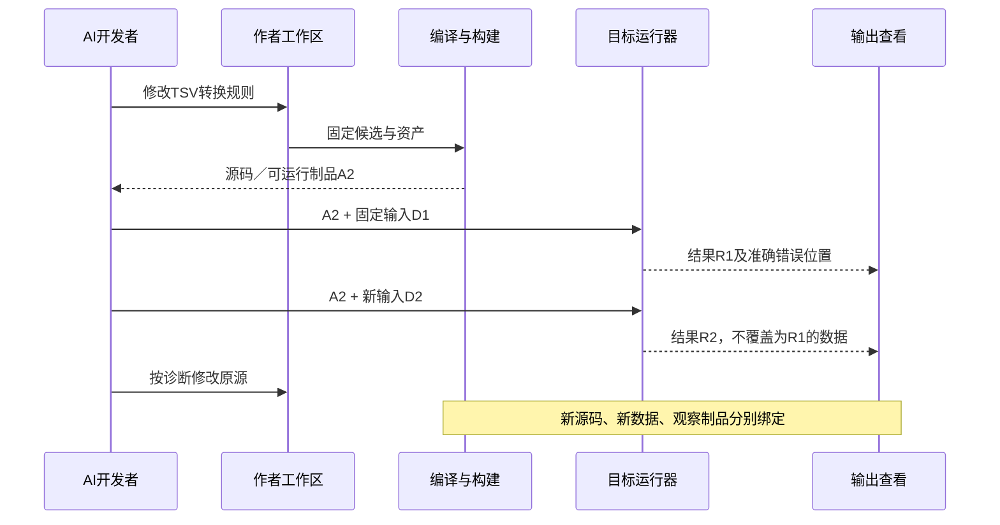

# 运行、资源、演进与检验

## 运行、资源、演进与检验

### 可观察、可调试、可交付也是计算成品的基础

#### 图解：同一小工具的程序、输入与运行代际

示例是文件格式工具；数据输入变化不等于源码修改，观察值只能指向产生它的实际运行。

只把源码编译成另一个文件，不能完成持续开发。当前最小可用能力应当同时覆盖：读取入口合同，查看相关计算结构，构建并运行精确产物，取得本次需要的输出或边界值，定位失败/耗时，再修改原作者源并重建。

#### 观察按目的选择，不默认记录全部运行图

| 目的 | 默认取得什么 | 不取得/不得冒称什么 |
|---|---|---|
| 解释源 | 定义、有效参数、类型/形状/效果、已选实现及来源 | 不启动目标程序，不虚构运行值 |
| 查看计划 | 真正选中的区域、转换、工作集与未知成本 | 估计不是实测；无关领域不进入上下文 |
| 一次运行 | 选定输入、目标和正常/失败结果 | 进程exit=0不是所有任务要求通过 |
| 定点观察 | 选定边界或可定位值、顺序和有限样本 | 缺失值不重新执行getter或含作用函数来伪造 |
| 剖析 | 当前工具能实际取得的时间、计数、分配与设备范围 | 带探针结果不自动当作无探针程序性能 |
| 继续调试 | 固定运行与暂停代际的实际状态 | 不以旧停点句柄读取新栈，不默认开放修改内存或任意表达式执行 |

调试输出采用既有来源映射：精确作者修订和定义/出现，必要的变换路径，目标位置及对应运行。优化可融合或删除中间量；不存在或不可恢复的量返回`Unavailable/OptimizedOut`，不能用上一次观察补值。需要额外可观测性时，明确派生另一个观测制品并再次运行，保留与原制品关系，不改原作者算法。

LLVM调试规范指出，优化后的值位置不再可靠时应停止提供该值，避免组合出源程序中从未同时发生的状态。Gift复用这一责任区别，不承诺所有优化中间量都可见。[LLVM调试](https://llvm.org/docs/SourceLevelDebugging.html)。

#### 观察方法与预算的具体字段责任

`ObservationPlan`沿已有检查/工具方法保存以下**按需**信息：精确产物与入口，允许的观测种类，源/边界选择器，实际值操作或采样方法，数量/字节/时间上限，敏感数据规则及失败政策。查询或控制服务由上下文补入现有内容；用户只指定要观察的差异，不手填设备内存表。

默认不因观察预算结束改变目标算法结果：停止收集并标记范围。若观察被任务规定为必需条件，则在启动前确认能力与空间；运行中未取得足够观察只使该声明未满足。资源不足可能实际影响运行，要如实归类，不宣称探针绝对无扰动。观察异常不自动吞掉目标异常，也不重新执行目标作用。

大数组默认返回形状、类型和已有摘要；需要统计时把扫描作为真实额外计算计量。少量样本不能证明整个数组范围或没有NaN。展开值必须能安全读取：隐藏字段、私有资源、原生访问器与设备缓冲按实际能力取得，不能只凭属性名调用未知代码。

#### 从实际结果回到正确修复位置

结果包含有效的源映射时，错误定位到作者表达、公开要求或具体目标转换；只能定位模块时就停在模块范围。API/ABI不匹配归目标或绑定；非法输入归解码/入口；正确运行但结果违反任务归任务与实现关系；观察工具失效归观察方法。

一次修复形成新的作者候选或实现控制，重新生成相交产物。没有权威要求改变时，工具不能改输入域/验收答案让错误消失。普通开发只需该处的合同、反例和源码，不要求AI读取整个当前未决义务。

### 当前不考虑的部分怎样存放而不污染计算主线

数据库、SQL后端、消息投递、耐久工作流、多租户服务、远程集群和分布式编译本次均不作为开发前置。其已有规范保留为条件能力，不继续为了补完它们而阻挡计算工程总装。普通关系库仍可处理内存数据；有限状态仍可用于本地应用，不因剥离持久服务就删除这些计算用途。

文件读取/写出、依赖获取、目标构建、设备使用和数据披露仍有实际条件，采用已设计的最小本地宿主；“先不做中间件”不解释为关闭这些保护。没有真实作用的设计和预览，不加载它们。已发生的外部责任不因当前转移工作重心而删除。

本章负责计算工程的**总体结构、组合实现、完整例和观察入口责任**。对象、数值、时间流、微分等专有语义仍按准确支持范围推进；不能再把所有尚缺高层设计降为“以后实现就行”，也不能借未完成全部专有库把整个共同架构继续悬置。

### 资源与故障的端到端控制

当前成本模型至少分为：作者与模型上下文，编译与特化，目标构建，输入转换，传输，计算，同步，输出转换，峰值内存和长期维护。加速核很快不证明包含上传/同步/下载的任务更快；共享一个helper很小也不证明内联全部实例的目标代码更小。

默认采用完整正确的顺序或现有成熟库实现，随后在相同正确性和资源要求下比较候选。内存不足时，可选择已获准的分块/重算/流化；偷偷写临时磁盘会改变I/O、隐私和性能合同，不是无作用的自动优化。分块不能满足输入随机访问或输出承诺时，返回相交资源缺项。强制设备不可用则不擅自回退，未强制时可选已接受的等价目标。

分配前检查形状、尺寸乘法、容量和目标可寻址范围；释放依据真实最后使用与异步完成，取消请求不证明设备已停止读写。重用缓冲前确认此前使用者已结束；设备故障后不将未知写入的内存标成有效结果。没有持久作用的计算可以重新算，但固定随机性、非确定读取和外部效果仍须先分类。

算法诊断、崩溃栈、设备错误、输入缺失和数值失败分别记录到相应阶段。只在需要时生成细粒度性能数据，不能每样本写完整证明日志。运行日志/采样本身需要预算和数据披露条件；未启用观测不能被当成实际测过。

### 按需启用与不需要部分的真实消除

具体处置以[按请求裁剪与生命周期](../../../70-工程系统与演进/演进与实施/适用性与能力协商.md#不需要部分的处置与退出协议)为唯一规范。对本章纯计算核：事务库、身份平台、消息服务、审计表、备份流程、部署和全局调度默认不实例化、不导入目标、不生成空配置，也不为它们填成功状态。

目标机器实际执行仍消耗资源，编译服务读取文件或运行外部工具仍受当前任务权限；省掉的是无关的目标设施，不是取消真实安全与资源边界。GPU未启用、矩阵导数未请求、缓存未采用，也不意味着相关草案或库定义必须从用户工程删除。反之，已运行的订阅、持久状态和恢复意图不能因这次输出是纯函数就被清空。

### 连续开发与有限验收

AI使用已有六工具和固定候选。预览读取本次`source/context`与选定target，返回代码或相应目标缺项；检查绑定具体artifact；改变算法回源，改变被允许的实现策略修改目标绑定，二者有不同差异。无需每次搜索全部算法库，标准名字已绑定就直接解析；第一次使用陌生边界合同才按需查询。

本章的计算出口检查：空尺寸、单点、边界、最大输入、非法增益、原生解码、全部输出与下次修改；顺序与分块等价，合法并行不重复写，旧值不被原地覆盖，数值与错误条件不变。正确参考来自独立规格/小域手算/差分关系，不能由同一个错误生成器同时创造期望并自证。

纯计算程序已可以满足完整工程的结果、实现、资源与变化要求，不必再增加跨制品数量或外部事务来“升级成工程”。后续要求读写文件、设备、服务或发布时，把相交模块加入同一次真实任务；仍不加载全世界的控制机制。

### 取舍与重新裁决

本章选择可组合的计算结构、明确算法语义和独立的目标计划，不造按应用名称列举的算子目录，也不预建万能最优调度器。简单标量函数保持简单；高性能程序保留其形状、访问、局部性和数值信息，不能提前压成丢失这些关系的普通调用黑箱。

其代价是需要真实库合同、分析接口与目标映射；有数据依赖的算法不一定能自由重排，有隐藏原生作用时必须保守。把全部计算藏在一个预编译原生函数虽然可互操作，但不证明Gift作者能自由定义算法。零原生作者仍是所支持计算域的合法目标，缺后端属于实施缺项，不是计算天然只能留在原生区域。

若新的程序无法表达其不可绕过的含义，返回相交语言/库设计；若已能表达但生成低效，定位算法/数据结构/布局/代码生成/目标工具或宿主；若已合格但总任务不划算，缩小建模范围或采用更小实现。不要将所有问题统称“业务还没定义”，也不从一例正确推导全域最优。
