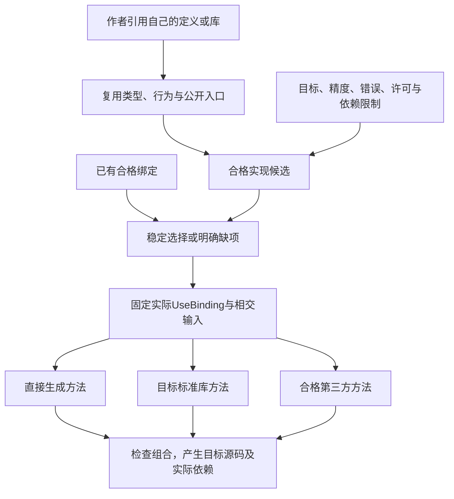

# 包、公开边界与源码布局

## 包、公开边界与源码布局

### 库内重构与公共名字的具体操作

库维护者有权改私有源，不意味着可以只对名字作全文替换。`rename`按[绑定保持算法](结构编辑/编辑重构与确定回写.md#名称重构的正向算法)更新真实引用，检查内层捕获、导入别名、公开门面与具名实参；类型相同不是引用相同。换私有表示也仍受opaque与公共合同限制，结构编辑不提供绕过表示权限的通道。

私有重命名若不影响任何公开观察，可以只使相关源码映射、诊断和生成布局变化；已发布的公开名改变需要消费者或兼容门面处理。创建兼容别名是独立方案，不因rename请求自动增加额外公共入口。库中的函数值参数本身没有形参名字合同，间接调用不能因为库里存在一个同名函数就被当成具名调用。

包外隐藏消费者只返回可披露的影响/兼容缺项。持有某个结构ID既不授予读取库私有源码的权限，也不证明它已在当前候选中存在。

### 包描述、公开导出和版本绑定

<a id="fig-package-role"></a>

#### 图解：语义库与目标实现库的绑定关系

开发者可以指定实现，也可以委派自动选择；版本锁保存实际选择，不让每次调用重新搜索生态。



不新增与gift.project并行的工程真相。本章采用`gift.project/1`的可选具名`library`字段保存库发行附加信息；它是严格的`gift.library/1`描述，不恢复任意extensions。没有对外分发的本地模块不必填写library。包源成员仍由现有sourceScopes及其实际发现的模块身份取得，不增加第二份moduleId到文件路径表；源码本身仍是唯一作者内容。

| 字段 | 类型、必需性与解释 |
|---|---|
| schema | 必需，固定为`gift.library/1`；拒绝未知或不支持的解释版本 |
| package | 必需的非空稳定名称，作为查找名而非密码学身份 |
| version | 必需的明确发布标签；相同标签绑定不同内容属于冲突，不按获取顺序覆盖 |
| exports | 必需的对象；键为`.`或`./`相对公开子路径，值含现有moduleId及可选export；省略export选择该模块公开集，私有成员不能在这里被转公开 |
| requests | 可选、默认空；依赖别名到Request记录，准确字段见下文；同一导入只保留版本/来源/角色等源中不能唯一推导的决定 |
| variants | 可选、默认空；命名变体到Variant记录，准确字段见下文；引用现有目标与参数Schema，不自造无类型配置宇宙 |

`Request`恰含`package: Text`、`role: author | generator | check`，及二者之一：`revision: Text`或`constraint: {scheme: Text, expression: Text}`。名称非空；revision是所选提供者可解析的精确内容引用，不将任意发布标签当成内容摘要；scheme解释expression，未知scheme返回对应缺项。别名是本包解析作用域内的非空查找名，不替代下游模块的真实身份。角色不同可有不同别名；同一别名重复定义拒绝。硬约束先过滤再选择，当前锁仍精确绑定最终内容。

`Variant`恰含可选`targetRef: Text`和可选`parameters: {schemaRef: Text, value: Value}`，至少存在一项；每个value按照所引用的已绑定参数Schema检查，未知字段与互斥选项按该Schema处理。targetRef选择现有目标画像，并不改变源解析语言；value不能自造权限、覆盖需求或替换私有编译器对象。库源码已要求的语言/语义由原language要求负责，不由Variant反向改变。新的未声明字段在本版本拒绝，未来须显式版本演进。

一个局部库发布描述可以是如下**工程清单字段片段**；`m-range`应是该清单中真实存在的模块ID，不能从文件名伪造：

```json
{
  "library": {
    "schema": "gift.library/1",
    "package": "example/range",
    "version": "1.0.0",
    "exports": { ".": { "moduleId": "m-range" } }
  }
}
```

它位于原工程清单，不是第二个根清单。未指定requests或variants采用空对象；无依赖的小库不因此多出依赖配置。当前结构由[Project设计Schema](../../../schema/source/project-1.schema.json)限定；模块身份、公开出口、参数Schema与锁仍需相交语义核对。机器读取器未因此实现，Schema可接受不证明发布能力。

role固定为`author`（当前目标程序会使用的源依赖）、`generator`（编译期提供者）、`check`（明确检查才使用）。同一包承担多个角色时列出多个发生位置，不能因为检查工具用过它，就默许目标运行依赖。编译器已能从源确定的模块引用不另抄入requests；requests仅承担版本约束、来源与显式别名选择。

公开子路径不含绝对路径、`..`、NUL或模糊通配符；exports只重定向公开门面。新字段由该描述版本解释，未知语义不能默忽略。清单中的声明不授予下载、安装、网络或执行权限，也不取消目标依赖的真实许可义务。

包路径的匹配在规范化前拒绝NUL、绝对路径和上跳段，不用消除`..`后再命中公开门面。同包相对导入不能越过包根，外包入口必须先命中exports。含`export`选择的出口只提供那个原公开名称，使用者仍通过导入别名限定该名称；它不自动创建default、不重命名，也不重新开放被选定义使用的私有辅助。包内模块列表变化会影响相应枚举根，未引用模块不变成全部任务的运行依赖。

检查结果保留可区分原因：格式/画像不支持、模块或包入口不存在、私有访问、私有表示构造或匹配、公共签名未闭合、名义实例错配、版本/选项冲突、缺目标能力和检查未完成。这些作为现有诊断的类型化原因，含源位置与实际引用；不新增作者需要选择的一组控制动作。相交诊断不泄漏当前主体无权读取的内容。

版本范围只是选型输入。采用后由既有绑定锁固定每个发生位置对应的精确内容、解释、目标和变体。已锁普通重建不重新查询最新包。多个同名版本可以在不交换名义类型、实例或全局资源且目标允许时共存；跨边界需要同一种类型或唯一提供者，就要求统一或显式转换，不能按显示名字强合并。

本画像不把互斥后端、安全检查和数值行为合成可任意求并集的feature flags。单调附加功能只有在API与行为相容且无权利扩大时才可合并；否则选定一个变体、分离实例或报告冲突。Cargo的feature组合采用加法式惯例，恰好说明“启用选项直接取并集”依赖前提；不能对Gift所有选择照搬。

### 库使用、抽取、包装和发布的正向过程

**本地使用。** AI创建普通模块，export需要共享的定义；其他模块显式import。前端构造签名，消费者检查公开合同，目标链接实际实现。此时零注册中心、零发布审批、零额外运行服务。

**提取。** 确定实际消费者和需要稳定的API；将可变实现藏入私有模块或opaque表示；保留公开类型和行为；建立稳定包出口；在同一候选中更新真实导入。不存在消费者就不为假想复用先拆包。

**包装。** 固定作者内容、公开子路径、实际依赖和目标声明；检查公开类型闭包、路径、引用与源角色；形成不可变包候选及对应说明。只请求包装时不上传、不执行安装脚本，不把私有凭证或恢复状态装进包。

**发布。** 只有实际请求并具备发布权限时，调用已绑定分发提供者。现有六工具的save-source/write-output只保存或输出明确内容；注册中心发布属于真实支持的提供者操作，不能暗加一个工具模式。没有该提供者时可以交付本地包，不冒称已公开发行。

**采用升级。** 固定旧新公开合同和实际使用点；分类源兼容、行为、ABI/表示、数据、目标环境和权限变化；选择升级或保持；重新绑定并检查真实受影响消费者；通过后明确切换。允许同一候选比较，不让目标运行时随意取latest。

**退出。** 停止新绑定、处理在用值和历史数据、保留所需解码/迁移能力，再回收无消费者内容。危险版本可先限制新执行；旧包存在不意味着继续有执行权。纯库也无需为了退役执行数据库补偿。

<a id="author-composition-publication"></a>
### 项目组合与公开发行的内容边界

官方提供语义、机制合同、合格实现、生成和验证；项目独特模型、业务规则、素材、数据、配置与采用决定属于作者工程。作者可以提供或明确采纳这些决定，并委派机械选型与连接；不要求手写成熟引擎、协议或数据库，也不以包名、领域名、代码量或人工操作次数判定原创性。完整机制可复用，作者也可以有权发布自己的组合。

组合成功不自动执行Registry发布。发布请求只包含明确获准成员和合法必要依赖，并分别核作者源、生成方法、实际嵌入的模板片段、生成源码、运行库、资产、权重、数据、配置、源码映射、日志和诊断。生成期使用不代表依赖必进运行包，也不代表其嵌入输出代码没有权利条件；必要运行成员不能为隐藏实现故意遗漏。

公开源码、本地控制与任意导出下，拆包、混淆或“必须组合”按钮不能绝对阻止再次组合。私有供给/服务可作为有明确延迟、费用、泄漏和退出成本的路线，不强制所有目标在线。MPL 2.0不是非商业许可，实际覆盖文件/修改/较大作品及模板输出义务按具体内容判断，见[许可依据及范围](../../../research/sources/全域组合与仿真依据.md#mozilla-public-license-20-faq)。许可分析不自发重授许可，也不代替个案法律判断。

验收分别检查内部分析、源码交付、二进制发行和服务客户端的实际成员；禁止将私有配方、样本、密钥、调试信息因成功编译自动公开。库的公开接口和项目私有组合可以同时存在，不借防复制破坏成熟复用。

### 封装不决定全部文件形态和关键词集合

opaque是既有草案的一种表示封装入口，保留当前含义；它不意味着每种新库性质都要增加一个新关键词。公开行为、可推导私有表示和目标结构控制分别设计。包可以带数据、模板、图像、样式、文档、许可证和代码；输出与发布按[全工程资产](../../10-作者与输入/作者源/工程源/资产与非源码.md)的实际角色取成员，不强迫每个文件装入语义节点或被降成源码。

若某个封装方案需要调用方反复填写实现类型、构造布局或现有签名，它没有减少依赖，必须重新拆分默认与显式约束。若修复的是库内部功能，就直接修改该库源；若变化是目标生成形式，就修改目标规则；若是外部使用者提出新公开行为，则演进公共合同。三种问题不能一律让调用方去手修目标源码。

<a id="author-module-boundaries"></a>
### 产品源码的模块边界与记录更新

[作者结果](../基础语义/计算基础/作者表示与实现分工.md)按实际变化秘密和契约拆模块，不将所有数据集中为一个永远增长的全局Model仓库。范本在单实例纯事件循环内采用一个根状态，是明确应用策略；共享库只依赖它需要的记录/回调，设备驱动、数据库和编译器不因此必须改为同一种reducer。

模块提供可见性与解释/名字范围；包负责发布与版本选择；运行实例负责活动身份和资源；进程负责相应隔离和物理生存。它们没有固定一一对应。抽象用户只需引用实际公开定义，功能维护者仍能下钻其真实主体；没有源码的外部库须保留准确合同、版本、许可和能力，不能编造可下钻内容。

`with`只更新具有可见表示且符合资源规则的记录。opaque消费者即使从某处知道字段名也不能更新；应调用类型拥有者的公开方法。公开透明记录添加必需字段可能影响构造者；已有局部更新保存未修改字段并不自动使所有消费者兼容，也不保持尚无证据的不变量。保留型别身份、序列化、实际ABI与版本迁移分别处理。

<a id="physical-boundary-and-public-consumption"></a>
### 物理封装、公开消费与独立边界的成立条件

模块形成应对应真实的独立约束：可复用消费者、公开合同、权限或外部效果、状态与释放责任、宿主/隔离条件、版本迁移、失败恢复，或昂贵可选依赖的装配边界。真实复用可以支持抽取公共组件，但“至少两个消费者”不是全部模块的统一前置；只有一个调用者的独占资源或授权边界仍可必须独立。文件大、名字不同、未来也许复用或描述符数量均不单独证明应拆或应合。

同一功能在共同核心、特定宿主接合和产品装配中分别实现是合法组织方式；功能标签不要求所有代码同目录。拆分先保存状态、不变量及它们的直接消费者，再选择物理位置，不按固定行数切成 utils/helper 碎片。来源观察、原则文字、静态依赖通过与实际隔离是不同证据。

公开表面由实际公开声明及其合同拥有，可以直接位于声明文件，并由编译器/宿主已有 exports 或可见性机制投影；不强制增加 barrel、无体转发或第二份手填符号清单。跨边界消费者不能因为实现文件可定位就获得私有使用资格；内部重排只在实际消费路径、初始化、公开名字或语义发生变化时影响相应消费者。重导出是否合适按实际 API、依赖和求值合同判断，而不是仅凭文件语法形状裁决。

作者模块逻辑身份、当前仓库物理归属、公开能力身份和运行实例各自保持原合同。路径导出的仓库 placement identity 可以随搬移改变；长期操作义务、消费角色与迁移关系不得因此被默认为已完成或消失。需要跨搬移连续性时，把原语义引用在准确修订上绑定到新位置，不能让目录自己签发语义连续性，也不要求所有局部文件获得永久全球身份。

## `gift.library/1` 的可机读准入、变体选择与兼容迁移

当前设计Schema以既有**工程清单**的`library`为唯一作者入口，不单独创建`library.json`或影子依赖文件。一个可接受描述的解析结果恰包含`{schema:"gift.library/1", package, version, exports, requests?, variants?}`；字段语义与现有 `Request/Variant` 原型一致。schema reader 必须同时使用以下局部约束，不能将未知字段忽略、把类型转换失败当空对象或把重复 JSON key 的最后一次出现默认为作者意图。

| 子结构 | 精确合法条件 | 典型拒绝 |
|---|---|---|
| `package/version` | 非空字符串；版本按所选择 PackageSource 的既定 scheme 解析并规范化；保留原输入用于诊断 | 空名称、无版本解析规则、隐式选最新 |
| `exports` | 公开子路径键唯一；`moduleId` 指向项目中真实模块身份；规范化后必须仍在包/公开出口边界内 | 重复出口、绝对/上跳路径、私有模块伪装公开 |
| `requests` | 对象中每个非空依赖别名对应一个Request；必需package、role，revision与constraint严格择一；role 仅 `author/generator/check`，并固定 Source/Target/用途 | 空角色、同项两个版本源、不可解范围静默当 latest |
| `variants` | 对象中每个非空变体名对应一个Variant；每项至少有 `targetRef` 或 `parameters`；参数须绑定实际参数 schema；同一竞争域只选合法相容组合 | 未知参数、互斥变体并集、未检验证据的跨目标复用 |

读入动作是纯解析与语义验证；解析后生成 `LibraryDescription` 的**派生**投影，逐项检查模块引用、导出可见性、版本约束、请求角色与已固定锁。实际网络查找/安装、执行 generator/check、license 取得、发包与删除旧版本都由对应有权 Effect 另行执行。`generator` 不因此成为目标运行依赖；`check` 不得被默认插入每次生成；目标程序使用 `author` 依赖也不自动取得编译器插件代码执行权。

保存与迁移：library随所属Project的SourceRegion、前像和CAS共同保存；更改导出、依赖或变体使相交解析及绑定失效，删除library只撤回后续发布配置，不自动撤回已发行包、运行依赖或许可责任。旧`extensions["gift.library/1"]`仅由其准确旧Reader只读接收；先核全部字段、请求别名和引用身份可等价，形成添加版本标签并移入library的单一候选，再按同一Project前像切换。旧requests若为数组且没有可证明的别名来源，不靠数组下标造别名，保全原文并报`NEEDS_LIBRARY_MIGRATION`。其他旧扩展字节保全在旧来源，未解释之前不得静默丢弃或复制进当前Project。未知library版本返回`UNSUPPORTED_LIBRARY_SCHEMA`并保全原文，不降级解释。升级引入新的公共签名、ABI、运行资源或导出收窄时，先固定旧/新使用点再重算相交消费者；只符合语法不能断言语义兼容。机器 reader 尚属**待实现的产品接口**，这里完成的是设计和可检验的接受合同，不声明已存在可发布二进制。

## 实际作者源码工程与新文本 Profile 的定位

实际工程的结构化 JSON、原生源码、SDK 草稿和可选 `.gift` 之间的作者权、持久文件与操作选择，首先见[统一源码工程与多表示作者协议](../../10-作者与输入/作者源/工程源/统一源码工程与多表示作者协议.md)。本篇拥有模块封装、导出和包边界；各SourceProfile的作者权、采用与持久化由所引作者源合同负责。
