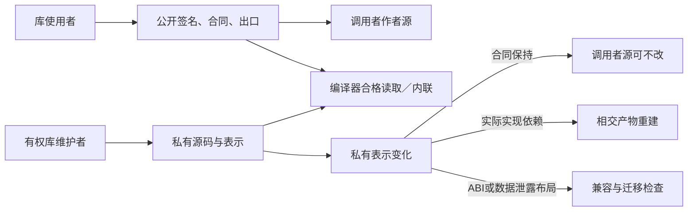

# 封装、可见性与类型

## 封装、可见性与类型

**语义消费校核：** **类型信息的披露：** 正式接口可以将内部实现类型投影为公开签名，但对外Error、反射、源映射与生成调试包不能因“它不是源码文件”泄露私有模块绝对路径、隐私标识或隐藏成员数。内部调试资格与发布信息披露是不同决策。 实现或验证此用例时分别消费[外部材料、作者私有源码与可复现定位的隔离](../../10-作者与输入/作者源/工程源/资产与非源码.md#gift-source-scope-privacy)、[派生数据、索引和差分结果的披露资格](../../50-执行运行与观测/权限与资源/工具秘密身份与披露.md#gift-confidential-derived)的权威交接，当前机制只拥有本地行为含义。

### 为何封装是基础，而不是最后加上的方便功能

封装保护的是一组允许客户端依赖的含义，并隐藏可独立改变的选择。只把代码放进文件或将函数名标为export，还不足以取得这种效果。若调用方仍依赖字段布局、私有函数、初始化副作用、偶然遍历顺序或未承诺的异常，它就会随内部变化受影响。

一个真实边界需要共同给出：公开名称及类型、合法输入、正常与错误结果、效果和寿命、实例关系、明确的性能或顺序承诺、版本与表示要求。没有相交条件的纯函数可以只有签名和行为，不能机械填满所有维度。公共合同的内容来自真实源、独立要求和已选定义；签名视图由工具派生，不维护第二份完整手写源码。

本章区分五种单位：函数/类型定义是语义单位；模块是可见性与解释单位；包是版本与分发单位；组件是合同及生命周期单位；进程/服务是隔离和部署单位。它们可以多对多映射。一个库可以只含一个模块，一个应用也可以有很多模块而仍是单进程。类库是可复用API集合，不要求每个库都以class声明。

### 模块可见性与稳定公开门面

默认未export的声明仅本模块可见；export使名称可沿合法模块引用访问。公开类型与公开构造器不是一个开关：普通记录/和类型可以公开其表示，opaque类型只公开名义身份和参数。对普通显式导入，先解析当前模块快照与路径，再取得公开签名，再检查使用点；知道私有身份或源路径不会绕过访问规则。

包的公开子路径由[包描述、公开导出与版本绑定](模块封装-包边界与源码布局.md#包描述公开导出和版本绑定)中的exports表决定。跨包只能通过该表引用模块；在同一包内部，可以通过相对路径导入其他内部模块的export声明。内部模块的export不等于全包对外开放。没有单独包声明的短程序采用当前工作集作为本地包范围，不强迫创建发布清单。

包门面可以把`example/range`映射到同一稳定模块ID的实际位置。库内部移动文件时，更新定位和内部导入；外部说明符不变。该门面不是自动转导所有目录，也不复制函数实现。函数所属模块改变则需要明确的语义移动/别名映射；仅复制文件并保留一个同名函数，不证明其身份相同。

不存在的导出、私有访问、歧义、循环的纯别名且无实际声明、未激活的画像分别诊断。声明环可以先收集签名；值初始化仍遵守自己的顺序与循环规则。任何public门面都不能暗中执行安装或初始化脚本。

### 不透明类型的最小作者方式

基础语言新增一个类型声明修饰位置：

```gift
export opaque type Range = { lo: Int, hi: Int };
```

`opaque`仅在类型声明头、`type`之前解释为修饰词；它不是新的运行对象、工具或处处保留的关键字。普通标识符仍可使用该名字。完整文法仅由语言规格维护；本章定义其模块语义。旧解释器没有该能力时准确返回不支持，不能忽略修饰后公开表示。

当前有界范围允许命名记录和命名和类型的表示封装，允许现有显式类型参数。任意类型的透明别名不在这个修饰的首个范围；需要包装Int时可用单字段记录，目标可在保持合同后消除无用包装。分组括号不改变opaque身份。修饰无export时仍是模块内定义，不隐式获得外部可见性。

#### 定义侧与使用侧有不同的合法观察

定义模块内拥有表示：可以按已检查的字段构造、读取和匹配；预期类型为Range的记录字面量可建立Range。使用模块只能持有、传入、返回、放入合法容器，并调用已公开的操作；不能读取lo/hi、以同字段记录伪造、匹配隐藏构造器，或从同布局类型强转。

不透明类型默认没有结构相等、排序、哈希、格式化和序列化。需要这些行为时公开有合同的函数或显式编码器；函数名不是自动正确性依据。否则更换内部结构可能改变相等或泄露秘密。公开显示函数的返回是一个普通公开值，它只承诺该函数说明的观察，不恢复全部私有访问。

模块隐私保护正常源程序的抽象边界，不等于恶意同进程机器码隔离、代码保密或真实授权。分发源码可能允许人在磁盘上看见实现，但客户端不得将它当作可依赖公共API。运行库面向不可信原生调用时，需要私有品牌、闭合构造器或句柄校验；TypeScript类型擦除本身不是运行防伪。

模块外无法构造，只减少不变量的建立入口，不自动证明这些入口正确。定义模块仍可写错构造函数、公开错误的观察或返回不合法状态；具体构造、不变量和操作合同仍按普通检查与保证规则处理。记录公开所有字段时，客户端可以直接构造合法类型形状；该类型声称的额外语义同样不能仅凭名义名字成立。

#### 合同与表示分开，但不能产生类型混用

声明身份由稳定定义谱系定位，类型使用的语义身份还关联公开合同版本和类型实参；声明ID、合同版本与某个实际运行表示分别记录，不能把它们合成一个永远不变的数字。私有字段重排不自动重命名公共抽象类型；公开类型含义改变则形成显式的新合同关系。实际运行或编译实例还绑定包内容、目标布局和ABI。两个版本名字相同，不因此可以交换运行值。只有统一到同一实例、证明兼容的ABI或显式转换，才允许跨版本值连接。

公开合同不能直接暴露私有字段作为客户端必须解析的表达式。需要可引用性质时，公开一个合法观察/谓词及其合同，或表达为独立抽象性质；无法形成公开闭包就诊断，不偷偷公开实现。证明器可以在有权限的验证范围读取内部表示以证明公共保证，但证明结论必须通过公共边界陈述，不能让所有消费者默认依赖完整实现。

不透明类型可以包含另一个私有类型；客户端只依赖外层抽象。某个内部变动若影响终止、错误、效果、资源上限或主动承诺的编码，它就不是单纯的表示优化，仍按行为/ABI改变处理。

#### 构造和使用的完整例

```gift
// module range.gift
export opaque type Range = { lo: Int, hi: Int };
export type RangeError = Reversed();

export fn make(lo: Int, hi: Int) -> Result<Range, RangeError> =
  if lo <= hi
  then Result.Ok({ lo: lo, hi: hi })
  else Result.Err(RangeError.Reversed());

export fn includes(r: Range, x: Int) -> Bool = r.lo <= x && x <= r.hi;
```

```gift
// another module
import "example/range" as range;

export fn accepts(x: Int) -> Bool =
  match range.make(0, 100) {
    case Result.Ok(r) => range.includes(r, x);
    case Result.Err(_) => false;
  };
```

合法构造0至100后，50被接受，101不被接受；反向端点100至0得到Reversed。调用方尝试`r.lo`或直接构造Range均得到表示不可见诊断。上面的分支是作者选择的错误策略，不是工具自动吞掉错误。

下一版本可以把表示改成`{ start: Int, width: Int }`，make保存lo及hi-lo，includes判断start<=x且x<=start+width。因为使用精确Int，表达式没有被定宽溢出改变；旧客户端源只通过make/includes交互，在公共行为不变且重新构建的条件下无需改动。它仍可能需要重编译，已有运行值、二进制和保存数据不自动获得兼容。

这就是“以后大多改局部”需要的实际封装，不是仅把函数装进文件。

### 接口投影、分别编译与变化传播

<a id="fig-library-visibility"></a>

#### 图解：库使用、库维护和编译读取的不同边界

三类读取范围由实际任务与权限决定；封装不禁止库维护者改变自己的私有实现。



处理过程：先加载每个模块声明；构造含公开名字、名义类型、签名、效果、契约引用和初始化要求的SignatureView；验证公共引用能经合法门面解析；在定义模块内检查全部实现；对消费模块只提供公开投影；最后链接实际实例与目标布局。SignatureView是派生值，不是新的作者文件格式。

接口指纹绑定规范化公开合同及实际公开依赖。实现指纹绑定私有主体和所需生成输入。两者均不替代内容摘要、原始版本或真实性证据。接口未变时，可以复用只消费接口的分析；已内联、专门化、引用实现证明或共同链接的产物仍按实际依赖失效。库更新不能因“签名一样”让旧内联代码继续被说成包含了新修复。

契约不可从实现自动删弱。包声称兼容而实际改变错误顺序或输入接受域时，仍是违规。对外仅函数形状稳定，不足以建立替换关系；同等调用前提内的正常、失败、效果、进展和已承诺资源都在范围内。

### 封装、接口、类与复用分别怎样提供

| 需要的能力 | 当前采用的中立机制 | 默认与边界 |
|---|---|---|
| 隐藏表示、保持不变量 | 模块＋opaque类型＋构造/操作函数 | 普通数据可以继续公开；不强制每个类型opaque |
| 无状态复用 | 函数、泛型、局部组合与库 | 普通新算法不用增加内核分支 |
| 实例方法 | 接收实例值/受限句柄的函数；可返回捕获实例的函数记录 | 独立创建不因同配置而合并状态 |
| 替换接口实现 | 参数化函数或具有明确函数字段的记录；构建期可用既有Provider合同 | 保持签名、效果、契约与实例寿命；记录不是授权凭据 |
| 子类型或多态使用 | 既有泛型、变体分派、显式接口字典 | 不靠原型链推定可替换，不加入全局自动实现搜索 |
| 状态与资源对象 | 中立值状态转换；确有外部资源时采用资源/端口画像 | 不把可变资源伪装成普通不可变值 |
| 代码复用继承 | 默认复用可采用组合与委派；开发者明确需要继承时按对象语义与目标映射处理 | 基础文法未含完整继承不等于产品不提供控制；对象合同和相交缺项见[能力映射](稀疏控制与目标限定.md#class先判断开发者要求的是哪种事) |

基础值与函数可以独立使用，当前有限对象合同另有单实现父链、多接口和显式覆盖；两者共用模块与类型责任，不将全部对象功能交回原生。若某个当前必需语义超出既定范围，应设计相交机制；若只是调用外观的改进，必须保持名字解析、覆盖与父调用规则，不顺手增加共享布局或多继承耦合。

接口上新增一个必需函数会影响所有实现方；仅添加默认方法也可能引入名称或调度冲突。接口在演进时使用能力协商、独立可选接口或明确主版本迁移，不用无限可选字段掩盖未实现。原生Java生成类仅是目标容器，不自动证明中立语言支持相同继承和反射。

#### 接口字典的具体例

```gift
export type Renderer<T> = { render: (T) -> Text !{} };

export fn describe<T>(value: T, renderer: Renderer<T>) -> Text !{}
= renderer.render(value);
```

调用者可以传入符合类型、纯度和实际行为合同的函数字段记录。泛型主体只使用公开的render操作，不依赖某个实现的私有记录。替换实现是参数或Binding变化，非全局自动查找。需要带状态的实例时，闭包可以捕获已允许的不可变值；可变资源使用受限句柄和相应效果/生命周期，而不是通过记录外形绕过这些规则。

记录类型是接口形状，独立要求可以进一步约束输出、错误与成本。新增必需字段会影响实现者；单纯多一个同名方法也未必兼容。因此首期以显式参数和组合为默认，不立即引入隐式全局typeclass解析、继承线性化或运行时反射。确需这些机制时分别设计，而不是用“类库”这个名称一次承诺它们全已支持。
