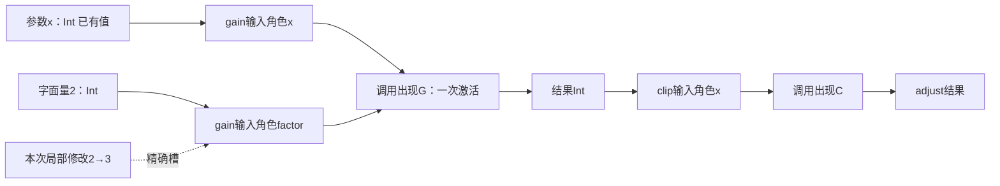

# 结构模型与绑定读取

## 需求形状的局部编辑与原作者位置

共同要求中的关系、规则表、状态条件、保持帧和目标控制可以呈现为局部可编辑视图，但是否可修改取决于真实来源映射。每个编辑位置沿既有对象/角色/版本定位，保留类型、作用域、允许取值和实际消费者；不是任意中文短语都能通过通用setter写进程序。

改值映射到现有editRef或准确源；改关系映射到既有语义变化；改目标形式映射到原control-change；改声明或实现直接形成源码候选。独立需求有自己的作者位置时一并修改接受关系，不通过改生成物或改检查答案绕开它。没有确定改写器时允许同源文本修改，但不能报成结构操作成功。

需要联合修改的跨对象不变量先形成整批计划，再按同一基础检查与发布。重命名引用、反向索引、当前结果接受条件不因为分在两个文件里就独立；中间错误草稿保留。仅改变展开、折叠和图布局不改变需求或编译根；有业务坐标含义的对象按其领域规则解释。

完整来源、候选与回写算法沿本章原规则，需求的逻辑含义引用[唯一合同](../跨软件需求合同.md#cross-software-intent-contract)，不增加另一种作者编码。

## 结构编辑与受管目标回源的边界

本章的结构操作修改真实作者区域；从生成TS取得的节点不能仅因形状相似就当成同一个作者节点。目标修改先经[EditCorrespondence和I-R协议](../../../40-目标与制品/表示/编辑与受管回源.md#managed-edit-roundtrip)确定原定义、使用点或目标控制，再进入本章已有改输入、替换、重命名和私有抽取。精确目标偏移仍只是定位，不是写权或唯一逆变换。

结构重构的保持分析继续检查激活、求值次数、位置捕获、状态身份和资源；来自目标的局部请求不能通过“只复制一段代码”跳过这些条件。一个源节点映到多个输出出现时，声明级和使用点级修改分开。无法保证时保存可继续修复的目标草稿和范围冲突，不通过移除未知节点得到绿色。


**预览计划必须冻结可接受对象。** 多文档查找替换、重构和批量编辑应先固定资源身份、模型版本、坐标编码、精确编辑集合、冲突策略和可见展示的计划代。用户接受指向已展示的准确计划；如果源文档或搜索规则在显示后变化，则依已接受政策拒绝、重新生成并重新展示或重新授权，不得凭点击时的可变搜索输入隐式改写原计划。目标编辑成功但保存失败时，恢复应针对保存进行，不再次叠加相同文本替换。每个文件是否可持久写入以及多文件是否原子，来自真实资源 Provider，不能由 GUI 的“一键应用”名称签发。

## 范围与当前选择

当前具体闭合`gift.semantic/1`中函数及其基础值表达的结构作者路径：参数、类型引用、契约、有序表达式、函数值、调用、条件、匹配、记录和列表。类型、常量、端口与绑定的声明也有结构槽位，但其合法含义仍由原语言规范规定。本章不将事务、时间流、任意原生AST或并行图自动解释成基础表达式；它们保留自己的明确画像和体合同。

普通开发可以一直只写紧凑`.gift`文本。结构作者不要求先写文本；两种入口直接进入同一组绑定和类型/效果规则。机器操作一个输入时只传该输入的变化，不重发整棵树。结构化交换可以比源文本长，适合适配器、交换和结构作者存储；它不能被当成AI每次必须手填的表。

当前选用**有序表达式树＋显式绑定引用＋有作用域的子区域**作为基础作者表示。调用图、数据依赖图、作用域索引和画布都是它的相交投影。目标低层可以再变成SSA、控制流图或其他适用表示。这样不以一个无执行顺序的全局DAG代替源程序，也不要求所有高层领域降成基础函数才能存在。

## 一次出现、一次求值与一个定义分开

| 身份或关系 | 具体用途 | 生命周期与限制 |
|---|---|---|
| 声明身份 | 某个函数、类型或公开能力是谁 | 需要长期引用时沿原身份协议保存；复制定义产生新身份 |
| 参数/绑定键 | 某一作用域内的值由哪个绑定给出 | 当前定义体内唯一；长期被管脚引用时保留对应关系，不分配平台业务ID |
| 表达式出现键 | 源文中的哪一次调用、常量或选择 | 同一候选的局部定位；内容相同不合并为一次出现 |
| 求值激活 | 某次函数调用或区域进入时发生的计算 | 是目标程序运行语义，不为每次运算建立Gift持久任务 |
| 端点句柄 | 本次视图里可读/可改的参数、结果或条件位置 | 绑定候选、定义、出现、角色和映射版本，不是权限凭证 |
| 物理字节范围 | 实际需要替换的作者片段 | 绑定原字节与编码；不是跨版本的永久语义身份 |

同一表达式出现不能同时成为两个语法父节点的孩子。需要使用一个已计算的值两次，先有一个实际参数或`let`绑定，两个引用指向该绑定。需要执行两次调用，就保留两次出现。不能将相同JSON对象、相同源码或相同摘要当成可自动共享的目标计算。

因此，结构存储允许共享不可变元数据，但不能借物理对象共享改变求值次数。反过来，后端能够证明某次公共子表达式消除合法时，可以优化；那是有前提的变换，不是解析器的默认解读。

## 结构体格式与精确字段

当前结构模块外壳采用`gift.author-module/2`，旧`/1`只作准确历史来源读取；其`dialects/imports/definitions/exports`使用[既有字段合同](../../../10-作者与输入/作者源/工程源/工程清单模块与绑定锁协议.md#unified-current-author-writer)。本章定义该外壳内基础定义的`body`，用`representation: "gift.semantic-body/1"`选择结构编码。这个字符串标识编码合同；解释含义仍来自实际锁定的`gift.semantic/1`，不能通过更换representation暗改数值或执行规则。

以下字段是设计中的判别联合，未知字段不静默忽略。没有采用这个结构体的旧领域定义，继续按其原体合同解释；不能给任意旧body加这个标签就宣布迁移完成。JSON重复对象键在解码入口拒绝；对象成员次序不是执行顺序，顺序始终用数组或固定语义槽表示。

### 声明体

| 外壳kind的基础角色 | body中的必需内容 | 可选内容与精确缺省 |
|---|---|---|
| `s:function` | representation、params；无expression时还必需returns | 有expression时returns可省并按有限作者规则推导；typeParams默认空；effects缺省为主体推导；requires/ensures为空数组；expression缺省是要求声明，不是空函数 |
| `s:type` | representation、definition | typeParams默认空；opaque默认false；definition为alias、record或sum三选一 |
| `s:constant` | representation、expression | annotation省略时推导；允许合格函数引用或被动lambda，仍须通过静态构造与捕获检查 |
| `s:port` | representation、params、returns、effects | effects即使为空也必须显式给出；不接受expression；参数位置不因此取得默认具名调用合同 |
| `s:binding` | representation、target、expression | target是实际端口/实现槽引用，expression通过原BindingExpr限制；不生成对外授权 |

这里`s`只是当前模块把精确语言绑定到的别名，不是特殊保留字。function的`params`是有序数组，每项为`{key,name,type}`，参数类型必需；port的`params`是有序TypeTerm数组，不虚构基础端口语法没有声明的形参名。lambda参数项为`{key,name,type?}`：单个未标注参数或显式带类型列表沿原文法；多参项若省略类型，只能先作为待补类型的结构草稿，不能以结构入口暗增基础语言能力。`typeParams`每项为`{key,name}`，当前作用域不重复。公开参数名参与具名调用合同，key承担身份；二者不能任意互换。

key在单个定义体的对应命名空间内唯一，为非空有限字符串；引用的完整身份由定义与该key共同决定，不要求所有模块的局部键全球唯一。没有key的子表达式可以首次分配局部键，但同一出现被赋予两个现存键时要核对对应，不自行合并。名称满足所选语言词法，公开名另由模块出口检查。结构kind与body字段的合法组合是有限表，不允许function携带type.definition等不适用字段。

binding声明的外壳名称仅用于自身记录定位，真正绑定对象由body.target确定；bind不进入模块公开导出。类型声明的外壳导出仅能指向合法定义；外壳namespace是定位信息，不隐式开放名字或取得任何权限。

`effects`为实际能力/效果符号引用的集合表示，重复拒绝。声明里省略effects允许按主体推导；没有expression也没有已接受实现合同的声明无法从空白推导为空效果，而是保留待定。函数**类型**里省略effects沿基础规范为空上界；两处不能共用一个无上下文的补默认函数。

`requires/ensures`顺序保留。`result`只在所属函数的后置区域可读。无expression的函数可以存作设计要求；主体中存在hole表示尚未完成的草稿。这两种状态都不能以补零获得目标实现。

### 作者省略与内部完整数据的区别

[简洁作者合同](../../基础语义/计算基础/紧凑表示与程序范式.md#compact-author-contract)同样适用于结构源。`returns`缺省是推导请求，显式TypeTerm.hole是作者保存的未完成类型；二者都不是Any，也不是已满足的接口。无函数主体时缺returns仍不构成可调用声明。lambda的单个未标注参数可以通过相邻固定约束推导；多参语法、递归与名义类型限制不变。

源结构省略的字段在解码结果中记录来源，不在保存时补回作者JSON。推导完整类型进入HeaderIndex/BodyAnalysis，生成器只能消费真实完成结果。显式注解即使等于推导结果也保留；请求固定签名时才将新注解写入源。旧body修订不认识推导槽时返回不支持，不能以相同representation标签混用新旧规则。

文本省略的导入别名只影响文本解析；结构外壳的imports键已是准确别名，不新增第三种导入身份。文本→结构投影可以展示这个已解析别名，但不能据此让两份表示都取得独立作者权。

### 类型项

下文TypeTerm（记作T）指本节类型项，Expr指下一节表达式，Pattern指模式，R指引用项，K指所属定义内的局部键，N指满足该命名槽规则的名字。每个类型项恰好选择一种构造：

| 形状 | 意义与合法条件 |
|---|---|
| `{core: "Int"}` | 来自本次基础画像的预置类型；Bool、Unit、Never、Text、Bytes采用各自名称；未知core拒绝解释 |
| `{core: "List", arguments: [T]}` | List/Option参数数为一，Result为二；参数是类型项，不把任意字符串当类型 |
| `{decl: R, arguments: [T...]}` | R为本地或导入公开类型引用；实参数量与可见性检查，空参数可省略 |
| `{parameter: K}` | 当前显式量化类型参数的key，不能引用值参数或别的定义私有参数 |
| `{record: [{name:N,type:T}, ...]}` | 匿名结构记录；字段唯一，数组保留声明次序；不是同布局名义类型的强制转换 |
| `{function: {parameters:[T...], returns:T, effects:[R...]}}` | 函数类型；参数位置有序，效果省略为空上界；嵌套返回类型由结构明确分组 |
| `{hole: {expected:"type", rawText?:Text}}` | 类型草稿空洞；不能在生成或证明中作为Any、Never或任意已满足类型 |

具名类型声明的`definition`为`{alias:T}`、`{record:[...字段...]}`或`{sum:[{key,name,fields:[T...]}...]}`。别名沿现有透明规则；record/sum在该声明处分配名义身份。opaque仅适用于record/sum，构造、字段和匹配仍检查表示权限，编码字段不能伪造这种权限。

### 引用项

类型项的decl引用只允许解析到类型声明的本地/导入引用；effects只允许对应效果或能力定义；binding的target只指实际端口/实现槽，不能使用局部值或结果引用。表达式中的`ref`字段仅接受下列之一：`{binding:K}`引用合法局部绑定；`{definitionId:D}`引用本模块声明；`{import:A,export:N}`引用实际导入的公开符号；`{constructor:{type:T,name:N}}`引用具名和类型构造器；`{resultOf:D}`引用当前后置区域的正常结果。

继承外壳的定义引用与普通业务记录分开。只有明确标为引用的槽位解释它们；一个业务对象恰好含有definitionId、import或binding字段，并不因此成为工程链接。外部引用经过导入与公开合同解析，已知私有ID不绕过封装。

`{binding:K}`不是“在整张图里找到同名节点就能用”。读取器必须检查该key的声明区域、绑定时点和当前使用区域。初始表达式不能读自己尚未建立的let绑定，兄弟分支的局部值也不可直接读取。

## 基础表达式的结构与执行区域

所有表达式都有`tag`；可带候选局部`key`。作者未给key时由适配器分配；它不进入普通源码。每个孩子是一个表达式出现，参数与引用按各自规则编码。

| tag与必要字段 | 正常求值 | 子区域与编辑限制 |
|---|---|---|
| `literal`：type；除Unit外需value | 取得Int、Bool、Text或Unit基础值 | Int用规范十进制字符串，允许负号，零只编码为0；不经过IEEE754解析丢精度；Unit不接受value |
| `reference`：ref | 读取当前可见声明或绑定 | 不执行引用所指的函数体；不重放let初始化 |
| `unary`：operator、operand | 先求operand一次，再作原运算 | operator限现有!、+、-；类型和错误沿基础规则 |
| `binary`：operator、left、right | 普通算术/比较先left再right | `&&` / `\|\|`的right为有条件激活区域；不是普通先求两参的库调用 |
| `call`：callee、arguments | 先callee，再按arguments数组顺序求实参，最后调用 | 每项为`{key?,value,label?}`；label只用于有具名合同的声明；同值实参仍各自求值 |
| `field`：receiver、name | 求receiver一次，再读该语言的字段 | 中立值字段与原生getter不是同一操作；基础结构不偷装原生行为 |
| `record`：fields | 按数组次序求各字段一次 | 每项`{name,value}`；重复字段拒绝；名义构造由预期类型及表示权限决定 |
| `record-update`：receiver、fields | receiver一次，随后按数组顺序求更新值一次，构造同类型新记录 | fields非空、每项`{name,value}`；准确字段/名义身份/表示权限/资源条件见基础语言；不作深合并或原生对象写入 |
| `list`：items、tail? | items从左到右，最后求tail并拼接 | tail必须List；相同元素多次出现不自动去重 |
| `let`：binding、initializer、continuation | 在旧环境求initializer一次，绑定后进入continuation | binding为`{key,name,type?}`；其值可被多个使用点读取；initializer不是全图可重排节点 |
| `if`：condition、then、otherwise | condition一次，随后只进入一个分支 | 分支结果经父if产生；内部局部不能直接跨区域逸出 |
| `region`：bindings、expression | 依次计算块中每条绑定，最后计算expression | bindings每项为`{binding:{key,name,type?},initializer:Expr}`；同块重名拒绝，内嵌region可合法遮蔽；不把一个块错误消去 |
| `lambda`：params、expression | 创建闭包；调用时才执行expression | 在原文法允许省略类型的地方由预期类型或有限主体约束补齐；捕获按真实引用派生，不手填第二份捕获清单 |
| `match`：subject、arms | subject一次；按数组顺序选首个匹配 | 每项`{key?,pattern,expression}`；模式绑定只在该分支有效；覆盖另行检查 |
| `hole`：expected、rawText? | 没有可执行值 | 本表达式槽expected必须为expression；类型项与模式hole分别为type/pattern；保留草稿与位置，拒绝对应完整生成 |

字面量type限可由当前基础词法直接表达的Int、Bool、Text、Unit。Bytes等通过有合同的基础库构造，不把JSON任意数组悄悄变成一个额外字面量语义。上表类型项可表示Never，但不存在正常的Never字面量。Bool的value必须为JSON布尔值，Text必须为合法Unicode标量串且不隐式规范化；Int的value字符串采用`0`或`-?[1-9][0-9]*`，不接受指数、前导正号、前导零或负零，原始字面量写法需要保全时放入源补充而非改变数值。Int字符串允许任意精度的有界输入，实际长度受读取预算；超额是资源错误，不舍入。

模式也以tag判别：wildcard、unit、empty-list没有附加含义字段；literal带type/value并采用相同值规则；bind带`binding:{key,name}`；cons带`head:{key,name}`与`tail:{key,name}`两个不同绑定；constructor带`constructor:{type:T,name:N}`与`patterns:[Pattern...]`；hole带expected="pattern"和可选rawText。cons不接受任意子表达式，constructor参数数与所属变体一致；empty-list与unit无需value。模式可带局部key作定位，其他未声明字段拒绝。模式不能放任意调用或属性读取；同模式重复绑定拒绝，裸名字仍表示绑定而不是猜同名构造器。既有覆盖算法直接消费这个模式，不另写图形版匹配规则。

`region`精确对应基础BlockExpr，不是可任意声明新执行语义的插件点。无局部let的块使用空bindings；最终expression必需，因此它不把`{}`空记录解释成Unit。裸LetExpr用let节点，显式块用region保留同块重复检查及嵌套遮蔽。分组括号可以在语义中规范化，实际括号、分号、注释和行尾由CST补充保全；不能只靠有序值树恢复原字节。

结构引用保留绑定键，同时检查名字在当前语义作用域中的可见性。这个基础可往返子域不允许通过内部key偷读在对应文本中已被遮蔽而不可命名的局部。需要暴露该值时先在可见处绑定别名，或进行明确联合重命名。其他专有结构画像可以设计不同的引用规则，但不能冒充与当前`.gift`基础域同义。

`operator`只取原前缀和二元运算符集合；单一binary不承担任意函数语义。位置实参必须在具名实参之前；字段/参数名的字符串只能用于已有命名槽，不是通用代码入口。结果引用的函数身份与当前ensure区域相交验证；更内层lambda的捕获若使结果值逃出该后置检查的允许范围，按基础合同限制，而不是自动保存一个运行结果快照。

### 四个直接反例

**分支不可以被拓扑排序提前。**`if x == 0 then 0 else 10 / x`在x=0时正常返回0。将除法节点提升到共同前置会产生原来不存在的除零。类型完全相同也不能改写激活条件。

**共享引用不是复制调用。**`let v = next(); v + v`调用一次next；`next() + next()`调用两次。next在此是一个由上下文固定的有作用函数，用来描述区别，不宣称库存在。结构编辑不能把其中一个自动当另一个。即使纯函数没有外部作用，也还需要考虑陷阱、非终止和资源。

**未用值不等于可删除计算。**在已有语法中`fn spin() -> Int = spin();`及`fn stalled() -> Int = let ignored = spin(); 0;`的后者不正常返回；删除let初始化会得到0。这是书面运行语义反例。

**同类型同名不等于同一绑定。**`fn sample(x: Int) -> Int = let y = 10; x + y;`对输入3得到13。仅用字符串替换将x改名为y，会使末尾变为`y + y`并得到20。正确重命名检查实际绑定关系，不能只重新通过类型检查。

## 一个完整的结构作者模块

下面与文本`export fn safeQuotient(x: Int) -> Int = if x == 0 then 0 else 10 / x;`表达同一基础行为。它没有外部业务库依赖；`constraint:"1"`仍须在上下文中解析到本版精确语言定义，不将裸版本标签当内容摘要。

```json
{
  "schema": "gift.author-module/1",
  "moduleId": "module:ratio",
  "namespace": "example",
  "dialects": {"s": {"languageId": "gift.semantic", "constraint": "1"}},
  "definitions": {
    "definition:ratio": {
      "kind": "s:function",
      "name": "safeQuotient",
      "body": {
        "representation": "gift.semantic-body/1",
        "params": [{"key": "p-x", "name": "x", "type": {"core": "Int"}}],
        "returns": {"core": "Int"},
        "expression": {
          "tag": "if", "key": "e-choice",
          "condition": {
            "tag": "binary", "operator": "==",
            "left": {"tag": "reference", "ref": {"binding": "p-x"}},
            "right": {"tag": "literal", "type": "Int", "value": "0"}
          },
          "then": {"tag": "literal", "type": "Int", "value": "0"},
          "otherwise": {
            "tag": "binary", "key": "e-div", "operator": "/",
            "left": {"tag": "literal", "type": "Int", "value": "10"},
            "right": {"tag": "reference", "ref": {"binding": "p-x"}}
          }
        }
      }
    }
  },
  "exports": {"safeQuotient": {"definitionId": "definition:ratio"}}
}
```

这个完整对象用于说明实际可解码结构，不是推荐AI每次输入这一长段。普通作者仍可只提交一行文本，结构作者可由工具创建该模型；第二次只改e-div.left。两种首次独立创建可以分配不同内部身份，语义对照使用明确的对应映射；不能借同样行为认定同一作者谱系。公共名、名义类型身份、效果和要求不能被alpha重命名比较擦掉。

本章的同义判断先比较声明关系、规范表达式和可观察合同，再按需要检查目标行为。它不是声称任意两种程序的等价性已有完备算法。若一侧已优化，比较还需那项变换的保持关系，不能只看结构不同就报告错误。

## 读取器、绑定器与共同检查的实际过程

**READ0 固定输入。**从候选或不可变内容取得原字节、外壳、精确语言与表示版本，当前许可和读取预算另外取得。结构版本未知时仅保全，不能把它作为基础表达式猜读。

**READ1 解码形状。**拒绝重复键、非法Unicode、错误判别、重复必需字段和超额输入。递归采用有界工作栈；记录每个表达式、模式和绑定出现。未提供的可选项按本合同补缺省，不由宿主反序列化习惯决定。

**READ2 建立声明。**先收模块、类型、函数/函数值和端口的名字及显式/待推导签名，再按共同补全规则处理，区分工作区导入与锁内容。随后分配或恢复需要保留的声明身份；type、value、effect和构造器名称空间沿基础规则。

**READ3 建立局部可见性。**从参数环境下降到let、region、lambda、if和match的区域。initializer在引入新绑定前检查；region中的let依序更新同块环境并拒绝同块重名；每个分支独立扩展环境；lambda捕获只能来自此处真实可见的外部绑定；resultOf仅在对应后置区域可用。跨定义只经合法声明引用，不携带别的函数局部值。

**READ4 共用静态判断。**调用原类型、模式、效果与契约规则。结构入口没有跳过opaque检查、输入类型或契约定义性的特殊通道；省略effects与显式空effects不同。不能解析的引用和hole形成具体开放项，不作为成功前提。

**READ5 形成共同表示与视图。**得到同一类只读语义节点与位置补充；按需派生管脚、引用和影响。画布坐标仅在其拥有者明确定义为业务空间时参与含义。通常的图布局不决定求值顺序。

**READ6 交付。**结构形状合法但语义未完整，可形成带诊断的作者草稿；解码结构不合法则拒绝这个结构请求并保留原输入用于诊断。生成只选择无开放缺口的真实输出闭包；不完整模块不能凭全图看起来连通取得支持。

若需要引用的语言定义或库还未取得，返回指定绑定缺项。解码与读合同不自动执行该包的生成代码或任意初始化；外部分析器执行仍走实际宿主准入。无相关画像的普通函数不启动其他领域插件。

## 通用局部控制的结构编码

基础`gift.semantic-body/1`保持原结构；固定的新通用组合使用对象扩展体的方法修订，继续复用同一ModuleRevision、名字和表达式。新增局部控制不要求函数先变为class。读取器首先核精确解释和编码方法修订，旧解码器不以同一`/1`标签猜读未知节点。

扩展`region`采用有序`statements`与可选`expression`；旧`bindings/expression`仍可读取为同义局部let序列，但两种列表不能同时给出。顺序、控制出口及清理范围由[局部控制](../../基础语义/对象与控制/控制流与存储寿命.md)唯一规定。字段如下：

| 节点 | 必需字段 | 解释与检查 |
|---|---|---|
| local-declaration | binding、initializer、mutable:Bool | mutable=false对应let，true对应var；创建前先在旧环境求初始化 |
| local-write | bindingRef、value | 只更新当前可见可变绑定，不按同名字符串定位 |
| while | key、condition、body | key是本函数内控制目标，Bool条件先于每轮体 |
| break / continue | target | target由词法绑定得到；只准同函数最近循环，不借内部ID跨函数跳转 |
| return | functionRef、value? | 绑定当前函数/方法/lambda；缺value为Unit |
| expression-statement | expression | 保持一次求值与错误/非终止，普通值丢弃不是删除计算 |

函数检查另外记录出口，不把return伪装成普通值。闭包捕获local-write所用绑定时保留位置身份，不能因值相等自动合并两个槽。任意跨域移动仍需新作用域和资源保持；当前私有抽取只承诺无外向控制出口的表达式，不能把return提取后改成退出新helper。

## 管脚视图的端点、激活与合法连接

<a id="fig-pins-detail"></a>

### 图解：管脚包含值、出现、角色与激活

示例只显示adjust的纯值组合。参数绑定的复用与复制一次调用是不同动作，画布位置不改变执行含义。



管脚查询是现有`gift.query(view:"contract")`的局部投影，不新增一个工具。结果只返回本次对象的必要部分：候选与解释引用，定义/出现句柄，端点角色，类型/效果来源，激活区域，可修改模式和已有的绑定。只有需要显示的端点分配句柄，不导出完整世界图。

调用节点的端点包括callee、实际实参位置、结果和相交的错误。参数接口的角色键与实参出现键不同：前者对应声明参数，后者固定该次调用中的求值位置。工具按已解析签名连接二者，公开名字用于具名调用。后续插入参数不能把旧角色键解释成新数组下标；参数重命名也不能忽略实际具名调用者。

表达式出现的结果与已绑定的值分别标明。参数、合法let绑定或已声明区域输出可作为**当前可用值**连接；一个尚未执行的call节点不是现成可复制值。将它的图输出连到另一个消费者，必须有明确的共同激活和一次求值安排。当前基础编辑不自动引入该共享：需要作者明确构造let或使用已验证的重构计划。

连接检查顺序为：定位候选与端点；核读/写权限及作者拥有者；核端点种类和单值基数；核绑定可见性与激活；核类型/效果/资源；按源适配形成候选；重解析与重绑定；发布实际差异与诊断。后两项失败不修改真实工作区。

函数递归引用是声明依赖，不在作者表达式树里建立循环物理指针。另一个明确的数据流画像可以采用带延迟的循环，但它的调度、初始值、时间和缓冲由该画像承担。本章不能因为接受函数递归就接受所有反馈图。

<a id="prebootstrap-structural-integrity"></a>
## 结构计算体的身份、编辑和源码保持

自举所使用的计算主体直接沿已有 `gift.semantic-body/1` TypeTerm/Expr/Pattern 文法；不得另建一个“自举专用 AST”作为永久作者源。编译器内部可以用 arena、索引和共享节点，但保存时仍输出该区域选定的唯一结构表示，局部表达式的身份不自动变成全局 Definition。

完整检查顺序为：严格 JSON 形状 → 模块/definition 类别 → 局部 key 唯一性与词法可见 → DefinitionRef 可见性与锁 → 类型与效果 → requires/ensures 中 result 所属函数 → 方法/目标资格。JSON Schema 只能覆盖其中结构约束；`$ref` 可访问不意味着程序引用合法，URI 格式正确也不意味着 Meaning 已解析。

`reference.ref` 中的本地 binding、definition、import/export、constructor 和 resultOf 是互斥表示，并按槽位限制。类型位置不接受普通值 binding；resultOf 只在所属函数合法后置区域可见；constructor 的名义类型和名字必须共同解析。任意业务对象恰好出现 `definitionId` 字段，不能被深遍历器当成语义引用改写。

对原样保存，保留未知字段/未知 dialect 的源字节和草稿状态；实际解释当前严格 profile 时未知字段拒绝而不吞掉。结构编辑修改一处 Int 常量，不全量格式化整个工程，也不把 `0` 的字符串载荷改成 JSON 浮点数。源保真、语义相等和确定性目标输出分别有自己的规范；为了内容哈希对作者数组排序会改变调用/字段/分支次序，是错误行为。

复制表达式需要重新分配相交局部 key 并一致重写局部引用，外部 DefinitionRef 保持；移动跨作用域先计算自由变量与效果/资源依赖，不能只改 JSON Pointer。删除参数或导出项要向调用者返回影响和修复候选，不让旧下标指向新对象。引用 key 不能绕过可见性，结构投影不能取得被隐藏原生区域的编辑权。

本包新增的有限计算/合同样例仅演示上述既定源文法中的真实定义与引用；没有生产解释器时仍不称已执行。与 Gift106 `open:contract` 的未绑定 Proposal 分开保存，后者保留原研究意义，不能不改语义版本就宣布它已成为生产 dialect。

<a id="本责任的相交定案"></a>

**关联规范：**[并行源编辑与未知源的无损保存](../../../10-作者与输入/作者源/工程源/作者编辑保存与迁出.md#design-b04)。
