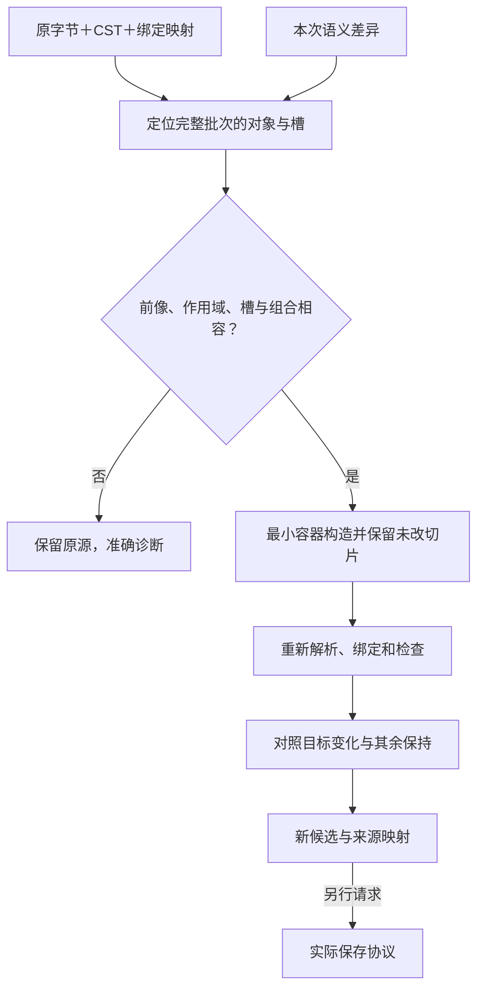
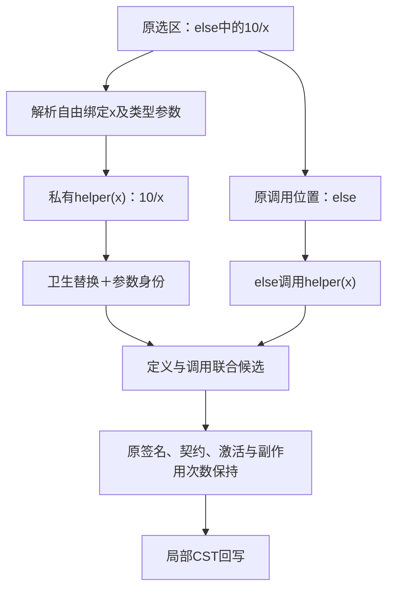
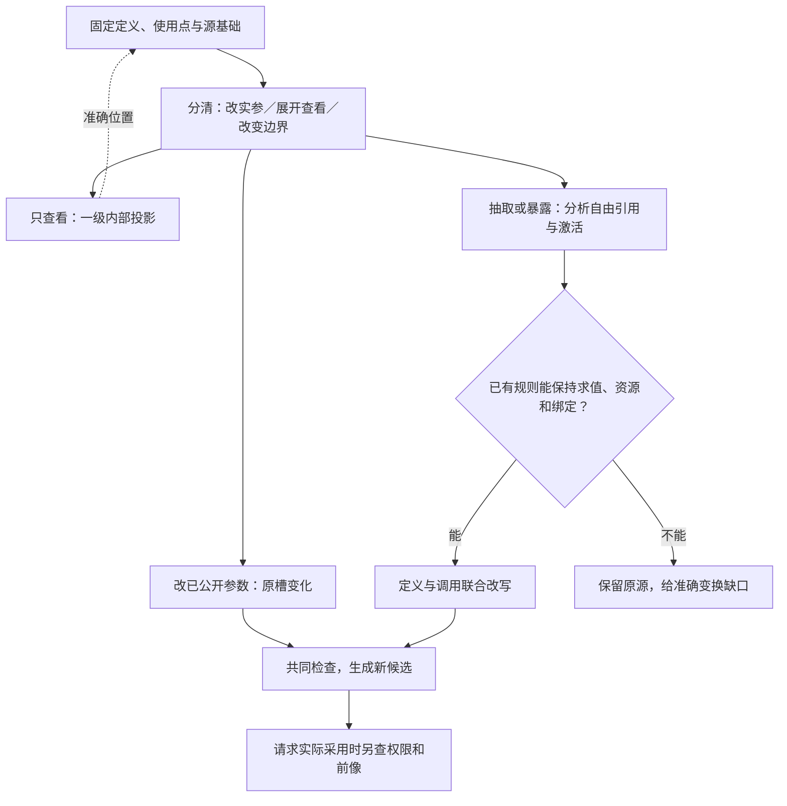
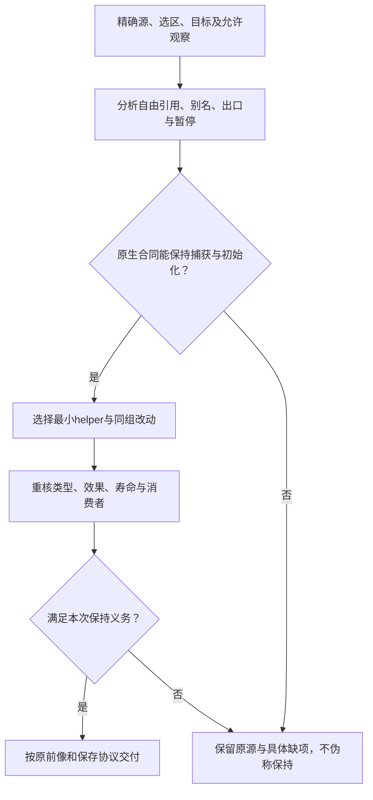

# 编辑重构与确定回写

## 三类精确结构编辑沿原协议进入

`gift.semantic-change/1.operations` 的本节子合同只覆盖已定义的基础结构程序；资产、控制和领域编辑继续由各自选定 variant 解释。外层 `schema/base/purpose/groups/preconditions` 由[共同变化](../../../80-开发者与接口/工具协议/候选修改与批量.md#语义增量临时身份与前提)负责。未知 op 必须拒绝，不以名称匹配动态执行器。

| op | 必需字段 | 明确行为 |
|---|---|---|
| `set-input` | `node`、`input`、`value` | 替换该出现中一个现存的值槽；不隐式调整参数数量和其他求值位置 |
| `replace-expression` | `at`、`value` | 替换一个明确表达式或函数主体；当前要求、签名、其他声明和资产不随之改写 |
| `rename` | `subject`、`name` | 保持指定绑定身份，修改其定义与已解析使用；公开接口与具名调用按下节处理 |

`value` 必须且只能采用 `{source:Text}`、`{tree:Expr}` 或 `{from:ValueHandle}` 一种形式。`source` 依目标槽的已选语言、词法作用域及表达式类别解析，不执行文本；`tree` 按结构体合同解码；`from` 读取在目标位置仍有效且获准的**已绑定值**，不复制原代码、不重新调用生产者、不访问历史运行结果。`node/input/at/subject` 均在本次 base 内以实际句柄解析，不能凭同名字符串定位。

`set-input` 的 `input` 必须来自目标调用的实际端点视图：普通运算按 `left/right/operand` 等固定端点，函数按参数角色键或现存实参槽定位。目标槽不存在时，先通过有权的创建调用/主体操作建槽；不得凭参数默认名增补实参。只应用选定语言已定义的默认值规则，基础函数不具备默认参数语法时亦不特殊放宽。

经现有propose.draft适配的请求可以省略changeId，由服务创建并返回；需要响应丢失后重用原身份时必须携带原changeId，仍核相同基础和内容。内部/序列化长期交换保留完整变化身份。purpose从当前任务继承，客户端自报更强purpose无效。纯候选引用到期后不能凭旧changeId创造一份伪称相同的身份映射。

同批操作先将全部既有句柄解析到**同一个 base**；操作顺序只决定已声明的批内依赖和新建引用，不能在每次排版后重新按路径搜索旧对象。对同槽冲突替换、删除父节点却改其子节点等不兼容写集直接报冲突；整体表达式替换与内部改名须形成一份共同重构计划。无冲突的签名修改和调用修改可共同进入最终类型检查；本子合同的三个操作不负责创建声明、任意移动或抽取函数，超出能力的请求仍可由有前像的整区域源候选表达。

### 一次真实形状的管脚修改

先有原文：

```gift
fn gain(x: Int, factor: Int) -> Int = x * factor;
fn clip(x: Int) -> Int = if x < 0 then 0 else if x > 255 then 255 else x;
export fn adjust(x: Int) -> Int = clip(gain(x, 2));
```

假定已有查询对候选c1返回了gain调用出现n7、它的factor输入p2。这些引用是示例值，不是实际签发的工具引用。修改仅需：

```text
gift.propose({draft: {
  schema: "gift.semantic-change/1",
  base: "c1",
  operations: [{op: "set-input", node: "n7", input: "p2", value: {source: "3"}}]
}})
```

文本作者适配器把当前2替换成3；结构作者适配器只改相应literal值。两者产生新候选，旧c1不变。结果返回新候选、实际改动与必要诊断，不回传整棵结构。工具内部映射不让AI再提供函数签名、参数类型或数字摘要。

若只知道源码而无需结构查询，继续使用原有`edits`更短；没有理由先强制调用query取得n7。若当前factor已在外部变为4，旧基础不会被自动当成当前工作树；候选编辑与真正apply的前像分别检查。

结构入口不适用任意新语言时仍保全其原源；这项限制不能被包装成原生作者必需。已能用中立文本表达的新算法可以直接用文本继续，结构适配缺口单独登记。

## 名称重构的正向算法

**EDIT0 固定真正绑定。**根据subject取得定义/局部绑定、公开角色及当前所有可检查消费者；不能按全文同名搜索确定对象。

**EDIT1 求受影响名字。**收集定义token、解析到它的引用、具名实参标签、已声明导出与相交资源绑定。注释、字符串数据和另一个同名局部不默认改；文档链接或反射名确为消费者时进入各自合同。

**EDIT2 模拟新环境。**在候选中改名并重新解析绑定关系。若某个原引用被新局部捕获，或出现同级冲突，返回RENAME_CAPTURE/NAME_CONFLICT与位置。默认不为了完成用户要求顺便改名其他作者绑定；需要联合改名时形成明确的多操作候选。

**EDIT3 处理公共接口。**公开函数名或具名参数名改变属于接口差异，稳定ID不使它成为无行为变化。当前已知客户可以一起更新；不可读或外部客户保留准确的兼容义务。实际语言允许合格转发时可另行提出兼容门面，不隐式制造别名与运行分派。

**EDIT4 保全写回。**按文本CST或结构作者更新最小必要范围，保留声明身份；重新检查类型/效果/契约与实际引用映射。新名字违反词法、与内建解释冲突或映射不可恢复时给出相应诊断。

**EDIT5 发布与继续。**返回本次语义变化和目标影响；缓存仅复用真正不相交输入。公开名改动可能重建目标门面，私有改名也可能改变诊断/源码映射，但不等于必须重算所有数值分析。

参数位置重排另行处理：具名实参先按原源码顺序求值，再分配参数槽；不能为了打印新参数表排序而重排有作用表达式。函数类型没有具名合同的间接调用，按位置解释。插入参数时既有角色键仍指原参数；删除实际使用的参数要修改调用，不能保留旧数字索引偷偷指向另一项。

## 从语义改动到文本字节的确定回写

<a id="fig-cst-roundtrip"></a>

### 图解：结构变化回到真实作者字节

新增源片段只在最小必要语法容器打印；随后检查变化与保持范围，不从短摘要重新生成整文件。



文本作者的基线算法是**局部CST修改与有限重解析**，不是打印整模块。实际输入为固定原字节B、解析/CST版本、身份映射M、语义改动Δ和当前文本保全合同。

1. 将所有目标先定位到B中的出现，确认范围、种类和作者归属。结构op不能改生成目标或其他未知文件。
2. 计算每项改动的源token范围。字面量/名字优先只替换token；需要改变表达式结构时选能够重新解析且保留作用域的最小语法容器。
3. 对重叠编辑求共同语法容器，一次构建最终候选；同一槽冲突不采用后到覆盖。定义与引用可以在同一批一起改变，类型检查最终候选而不是错误地拒绝每个中间步。
4. 根据父运算优先级添加所需括号，生成该容器的文本。未改子节点、注释和空白优先保留原切片；仅由后端生成的新私有名字按绑定卫生分配。
5. 对所有不相交字节拼接成B'，再用同一语言重解析和重新绑定。比较Δ要求的对象关系及未改区域，不只比较类型是否通过。
6. 形成新候选和映射M'。后续正式写回在实际目标重新比较前像，纯候选阶段不动工作树。

**无操作回写**必须返回原字节。**变化后的回读**要得到所接受的Δ及已声明规范化，不要求恢复一次任意优化的唯一上游意图。语义树不足以恢复的注释、括号、BOM或行尾来自真实补充，不从格式器猜。

源字符串本身语法不完整时，text作者可以得到准确的新原文草稿，其他未改字节仍保留；结构作者将它保存为带原文和目标类别的hole。这样保存并不使新引用、契约或目标产物合格。前像/句柄非法、版本不匹配或越权则拒绝请求，不以草稿名义修改错对象。

一个格式适配器没有能力精确修改该容器时，返回AUTHOR_EDIT_UNSUPPORTED及支持范围；可选择原文编辑或明确的整区域候选，但不能自动全仓格式化。CST范围精确也不代表行为映射唯一，仍需对应增量检查。

## 结果、诊断与下一步

| 情况 | 返回内容 | 下一步与保持范围 |
|---|---|---|
| 结构完整、绑定和语义合格 | 新候选与本次差异，可继续请求预览 | 旧候选与真实目标不变 |
| 程序类型错或主体hole | 新草稿、具体诊断和影响根；不挂旧artifact冒称新产物 | 作者修改相交位置；已独立闭合根可按原规则生成 |
| 表示版本或节点kind未知 | 保全原载荷、对应支持缺项 | 使用原支持路径或实现该合同；不执行猜测 |
| 句柄/base不匹配 | STALE_STRUCTURAL_REF，无新候选覆盖 | 重新读取当前视图或显式重基 |
| from值不在目标可见区域 | SCOPE_ESCAPE，无错误接线 | 显式返回值、参数化或重写相应结构，不跨区偷读 |
| 想复用一次未绑定调用的结果 | EVALUATION_PLAN_REQUIRED | 形成明确let/控制调整，再检查实际行为变化 |
| rename造成捕获或未处理的接口改变 | 具体冲突或兼容缺项 | 选择新名字、联合修改或版本迁移 |
| 字节写回无法保持 | AUTHOR_EDIT_UNSUPPORTED | 保留原文；可提出整区域候选但不自动接管 |
| 结构合法但读取/分析预算结束 | 方法未完成及覆盖；已有字节保全 | 加预算或缩小请求范围；不把未知当不存在 |

有保持承诺的rename、已有值from连接与普通source创作不同：前者不能发布已知道违背该操作语义的重构；后者可以保存错误源码以便继续编辑。它们对同一程序含义采用相同检查，无需在所有操作目的下采用相同的接受策略。

以上诊断是本版设计的稳定类别，消息可更具体；不是已运行错误日志。view/resultRef均受当前披露权限检查，错误不能泄露隐藏定义的名字和存在性。非法请求的定位可以只给可见输入位置，内部记录保留真实原因。

## 有类型任务槽是现有结构修改的简写

完整body继续承担结构作者与交换，不要求AI重发。对已有可见标量槽，服务可以返回[editRef](../../../80-开发者与接口/工具协议/候选修改与批量.md#已定位值的紧凑编辑分支)；新值被确定解码为现有literal，再进入同一set-input、绑定、CST回写与检查。其基础、出现、角色、映射和类型由原候选确定，不从模型自报推断。

只保留一个值的显示不会删除它的完整父表达式。引用或枚举的语义来自实际库/语言合同；未解析的数据不先签发可写句柄。字符串值不当source，函数体仍走source或tree路径。短入口不兼任抽取函数、创建声明、变更激活和跨区移动；这些需要各自已有协议或完整作者候选。

## 私有函数抽取与局部内联

<a id="fig-extract-scope"></a>

### 图解：抽取保持分支、捕获与一次求值

箭头表示重构关系而非运行顺序。helper调用必须留在原激活区域；自由绑定是参数来源，不重放生产该值的调用。



本节给出一个不再留给实现者猜测的常用重构：把同一模块内一个完整表达式抽成私有函数，再用调用替换原出现。它复用已有源码批次、签名和CST回写，不增加全局关键字或顶层工具，也不默认增加新的公共op。一般创作仍可直接提交完整函数；本节的保持承诺只覆盖满足条件的重构。

### 输入、输出与保持范围

输入为精确作者基础、选中表达式出现、拟定私有名称和当前任务要求。选区必须对应一个完整表达式；参数、条件、分支、lambda内部均按真实激活区域定位。字符串范围没有解析到完整表达式时，返回定位诊断，不向外猜测扩大选区。

输出为：新私有定义、原位置调用、源对应变化、影响与保持检查结果。二者组成同一候选批次；原函数的公开名、签名、require/ensure、效果上界及其他资产保持。新函数默认不导出、不设置新的运行契约、不产生静态初始化。需要把它变成公共库是另一项明确变化，需补公开类型与兼容判断。

本有限重构处理基础中立值、函数值和正常的同步表达式。相交外部资源的借用/移动、可变捕获、原生控制跳出、反射或调用栈观察，不凭基础规则接受；只能由对应语言/资源保持方法放行。没有这些方法时仍可保留手工候选，但不能标为保持式自动重构。运行内存和时限有硬要求时，新增调用的成本也要满足；不能仅以返回值相同代签。

### VALUE0—VALUE7：确定处理算法

**VALUE0 固定。**将所有选择解析到同一候选的源码字节、ModuleRevision和表达式出现。复用读集、解释与目标约束，锁外做分析；实际写入仍走既有前像协议。

**VALUE1 检查边界。**确认选区不切断绑定或模式，位于可命名的词法区域；不移动到if、短路、match或lambda之外。只有表达式体发生抽取，所在调用的实际执行位置保持。声明自身的契约区域中含有特殊result引用时，本有限重构不改变其归属。

**VALUE2 取得自由绑定。**遍历选区，扣除其中定义的参数、let和模式绑定。读取的是Binding身份而非字符串。外部局部值按首次词法出现排序成为形参；相同绑定只形成一个参数。它们必须在原出现处已可用，形参实参只引用这些已有值，不能把子表达式、getter或尚未执行的生产者当成免费实参提前计算。模块声明与导入保持原解析关系。

**VALUE3 构造签名。**使用已检查类型形成形参/返回类型；仅复制确实自由的类型参数并维持原身份对应，不能把首次实例类型固化成泛型定义。函数值参数保留潜在效果与契约入口。私有名与局部参数避开冲突；没有用户指定名时采用同一模块内稳定的可读名字，不传播临时句柄到公开输出。

**VALUE4 建立主体。**复制选区的语法内容并将外部局部引用替换成新形参绑定；内部绑定进行卫生改名，模块引用保持解析对象。保留子表达式次序、分支、调用出现次数和错误。原位置仅替换成一次私有调用，不能顺便共享其他相似调用、删未用表达式或进行常量折叠。

**VALUE5 联合检查。**在私有事务树中同时加入定义与调用，重新绑定并检查类型/效果。原公开契约不变；新增函数无自动前后条件，避免引入不同的运行失败。用显式参数代换和绑定对应，检查抽出主体与原选区在本结构域内一致；此处可检查的结构保持不被宣传为任意程序等价证明。

**VALUE6 回写。**原选区注释随归属规则进入函数体或保留调用点，无法确定的注释不删除而是在候选中标明位置。未改区域使用原字节切片；新增函数与调用形成一个完整批次。身份映射标记原表达式迁入新定义、原位置新增调用；不能给两个出现同时保留同一个语法父节点身份。

**VALUE7 发布。**返回候选差异、保持范围与必要诊断。仅要求设计时交付规则与范本；已实现工具中的重构请求可返回候选，但不自动修改真实工作树、升级依赖或运行程序。发生当前工作区冲突时，按原候选基础处理，不以新名称重新搜索猜测位置。

算法遍历所选表达式和必要引用，再执行相交模块检查；不要求扫描所有未相关库。缺类型或映射时返回这项保持方法的准确缺项，普通源码创作仍可继续。查询/诊断预算在本次工作中共同计量，不为每一步重置预算。

抽取选区之前还要查询自由绑定是不可变值还是可变位置。当前值表达式抽取不能把读取共享var的表达式改成“先传一次数值，再在helper里反复使用”而丢失原重入或更新。也不能把内部闭包移到返回位置后仍保留原无外逸摘要。缺少该位置/资源保持方法时，返回这项自动重构的准确缺项，普通作者仍可提交明确的联合源码候选。

内联后不能只删除调用节点的潜在效果；须保留每次真实访问、实参一次求值及原控制目标。字段、lambda和循环出现的结构编码保持不变，本项强化现有VALUE1/VALUE5的接受条件，不增加一个结构操作或关键字。

### 正常轨迹与必须拒绝的错误重构

原作者源：

```gift
export fn safeQuotient(x: Int) -> Int =
  if x == 0 then 0 else 10 / x;
```

选择else中的`10 / x`，抽取为同模块私有函数：

```gift
fn quotient(x: Int) -> Int = 10 / x;

export fn safeQuotient(x: Int) -> Int =
  if x == 0 then 0 else quotient(x);
```

当x=0时，调用仍在未激活分支中，结果为0；x=2时结果为5。错误重构若先写`let q = quotient(x);`再判断，就会在x=0时除零，必须拒绝。这里无需证明quotient对全部整数总定义；要保持的是原位置和原调用条件，而不是新增x!=0的公开输入要求。

原区域已有`let v = next(); v + v`时，选取`v + v`可以把已绑定v传入新函数，next仍执行一次。选区本身包含`next() + next()`时，应保留两次调用；不能为了复用把它改成一个实参。next是此处用于区别求值次数的抽象函数，不声称基础库已有这个函数。

抽取lambda体时，新调用仍在lambda内部；不得在闭包构造时预先计算。抽取含两个同名而不同Binding的区域时，按身份分别传参并卫生改名，不能按名字合并。两次不同的分支各有相似表达式时，本操作只处理选中的出现；全局去重复用另需自己的保持依据。

### 反向内联与边界

私有直接调用可反向内联，但必须先保留callee求值与全部实际参数的源码次序。实参可能失败、产生效果或不终止时，即使形参未被使用，也不能删除其求值；形参被使用两次，也不能复制求值。可用同一作用域中卫生let绑定保存实际参数，再替换函数体。

有实际函数契约时，内联保留进入检查、正常返回检查及错误顺序；没有消解依据就不删除检查。递归函数一次内联只能展开所选一次，不能无限展开。动态分派、反射或不在有权源内的函数，使用其既有语言规则，不因名字可见就允许读取/改写私有实现。

这种抽取/内联不改变业务定义，但可能改变私有栈、编译成本和目标布局。目标调试需要把helper位置回指原源；若任务将原生栈外观或确切分配列为观察，必须保留或明确不接受这次重构。默认稳定布局沿用，不能借抽取重排无关文件。

完整抽取的公开快捷op、跨模块自动迁出、成员方法抽取及任意资源借用不在本有限协议中。实际客户端可以用已有files/edits形成这里规定的联合候选；未来快捷op只做编码简写，不另定义一种重构语义。正常参数修改继续用set-input，无法保持的手工程序改变不冒领本重构的保证。

<a id="宿主sdk作为中立作者前端"></a>

<a id="block-boundary-edit"></a>

## Block边界编辑的确定改写

本节实现[分层block合同](../定义与接口.md#block-composition-contract)的有限编辑动作，不增加持久模型和公共工具。系统将编辑意图落实为既有source/files/edits或已定义的结构操作；工具未提供的专用重构不能仅凭新增操作名视为已支持。所有结果是新候选，工作区采用仍另查前像。

### 展开与定位

对一个已解析的定义或使用点，`query`的`contract/source`视图分别取得外部合同或主体。合同视图展示当前参数、结果、公开效果与保证、保持项和必要缺口；主体视图可按当前模块实际结构呈现一级成员及边界关系。它不改变源。已有source信息足够时不额外查询；句柄与分页按原协议，不添加一个必须枚举全图的入口。

内部节点引用绑定原候选、定义和出现。被折叠节点仍有真实依赖；缺权限时不披露私有源，工具在有权范围完成检查或返回准确缺口。跨分支引用、不可见值和未取得的调用结果不能仅凭图上存在一个端口连入。

### 把组合封装成可复用block

默认处理一个完整表达式，或一个能按所属语言明确解释的连续区域。先应用既有VALUE0—VALUE7私有抽取算法，保持同一词法控制点；不将任意图框选区域假定为单入口函数。具体处理为：

1. 固定原主体、选择范围、要求和读写权限，取得其中的自由值、自由类型、效果、退出目标和输出消费者。
2. 普通不可变值可以成为形参；可变位置保持原别名／闭包捕获或使用已定义的位置合同，不能变成当时值的副本。资源、返回或循环出口跨界时只采用已经具备保持规则的变换，否则保留原源并给准确不可抽取范围。
3. 建立私有定义，参数顺序来自实际依赖和原求值安排；其结果是原表达式值，多个真实输出通过已有返回记录承担。不要增加原来没有的调用、检查、序列化或运行分配承诺。
4. 在原激活位置用一次调用替换选择区。重连的是对应绑定引用，不做全文件同名字符串替换，不提前执行分支内计算。
5. 联合检查新定义和调用方，再以最小CST范围回写；结构作者直接形成同义结构变化。新候选包含完整批次，错误草稿与可生成资格分别处理。
6. 只有用户当前需要共享时才公开定义或加入包出口；本地私有block不需要独立包、发布版本或注册平台。类型／ABI可见性和其他消费者按原导出合同检查。

抽取可能引入真实调用帧、闭包环境或不同调试栈。已接受要求若固定栈深、分配、ABI或可观察堆栈，必须由合格内联／表示方案保持，或准确报告不满足；不能把数值结果相同当成任意资源与调试观察都等价。

折叠画布并不自动执行这次抽取。已存在一个函数边界时，收起内部展示只改视图；无需重新生成一份同名函数。反向内联按原算法保存实参求值、契约、资源、异常和非终止，不自动批准任意优化逆变换。

### 将内部决定暴露为一个公开管脚

给定准确内部位置、所需参数名和目标使用范围，先判定这是值参数、函数参数、状态、资源，还是仅目标控制。目标布局选择进入原控制合同，不伪装成运行参数。

**常量值的完整支持路径：**选中一种已解释类型的字面量；检查新名称与公共接口；新增相同类型形参；仅将选中的出现替换为该形参；受影响调用先补入原字面量，再进行本次选择的值修改。同值的其他字面量不自动替换。若只修改一个调用，先建立私有派生，不能顺带改变公共库的所有调用。

**复杂表达式不能无条件外提。**例如`if x==0 then 0 else 10/x`中的`10/x`若改成外部普通实参，会在进入函数前执行。需要保持延迟时，采用已有函数值参数，在原位置调用它，并明确捕获与调用次数；无法保持资源、退出和别名时，不提供“无行为改变”的自动重构。作者可以直接定义新的合法边界，系统仍检查它的新含义。

删除管脚要求所有使用点有准确处理；重命名使用既有绑定安全规则；参数重排只重排角色映射，原实参求值次序不变。没有目标读写权限、外部消费者尚未取得或公开契约冲突时，只在准确范围形成候选，不宣称全生态兼容。

<a id="fig-block-edit"></a>

此图是作者变化流程；实线表示产生或检查候选，虚线表示同源定位，不表示真实文件已写入。



### 边界替换的接受规则

在同一调用边界选择替代定义，先对齐参数角色、结果、名义类型、公开身份、错误、作用、时序、容量和寿命。可以添加满足要求的适配，但适配也进入真实依赖和成本。当前任务要求严格行为保持时，不能将更强前置、可能新增的外部作用或不同错误顺序称作兼容；改变任务本身另有接受关系。

原输入只能使用一次的生产者，不能因替代需要两路输入而复制执行；流不能默变广播；旧回调和状态实例必须按原代际结算。新定义已安装但尚未取得当前目标的合格实现时，保存候选并报告根缺项，不生成空成功处理器。

<a id="developer-author-services"></a>

## 日常作者服务：定位、补全、格式化、修复与全工程重构

本节复用现有CST、类型/效果、绑定身份、EditCorrespondence、semantic-change及有限抽取/内联规则；不扩大它们已承诺的语义保持域。服务的正常输出是说明、候选项或可审查编辑，不是直接写宿主或调用外部程序的授权。

### 导航和说明要定位到实际出现

定义、引用、调用者/被调用者、类型/效果说明和实现绑定，均以准确工程实例、模块出现、源修订与位置为基础。同名重载、多重实现或共享定义返回可解释集合，不按显示名选第一个。引用查询分别说明静态准确、保守可能、未取得和动态未知范围；全文搜索结果只表示文本出现。关联资料可用origin/contract继续展开，不能把来源说明当可执行实现。

非法草稿可以用容错语法树显示已确定符号和原文范围；旧有效AST只可作为明确旧版参考。位置包含真实编码与端点约定；UTF-8字节、UTF-16单位和屏幕字素经原坐标表换算。定位同一文件的新位置需要真实对应；无法对应则回到源差异，不在同一行号直接应用旧操作。

### 补全与参数帮助的采纳合同

补全输入是当前源/位置、词法可见项、期望语法/类型、已选语言修订和本次预算。先给可验证的实际符号/关键字/契约及其来源；推导提示是只读派生，不默认回写全部类型。生成式建议另标未核候选，不将其与真实库成员混同。静态探测不调用getter、宏脚本或目标函数；需要实际生成器时作为工具效果另行准入。

用户选择一项后，服务解析它的替换范围及所有附加编辑（如import、名称消歧、必要配置）；检查当前前像并形成一个既有批次，再检查相交含义。不能只应用主插入而漏掉所需导入，也不能凭新补全请求覆盖旧缓冲。若合法补全是多占位片段，占位尚未填写时仍是可保存草稿；不宣称可生成。语言服务没有该能力时，普通源编辑和已有类型诊断仍可使用。

### 格式化和整理导入

格式化由明确格式与修订的方法作用在选定范围；默认保留范围外原字节、注释、未知扩展和作者有意短写法。没有语义保持能力的printer不能仅凭AST可解析就全文件重印。无法处理的非法区保留或返回不支持的准确范围；不能通过删除坏文本获得“格式化成功”。

整理导入要区分类型导入、值导入、仅效果导入和初始化顺序；真正无用的项由对应语言绑定/效果判定，不是文本计数为零。格式插件、配置求值和编辑器executeCommand都可能产生工具作用；先识别实际方法，可信且获准才运行，结果作为候选。LSP返回同时含edit和command时，两部分分别归属，不把后者藏在“应用修复”。

### EDIT0—EDIT6：从动作意图到准确候选

EDIT0固定声明/出现或文本范围和用户选择（如newName、目标模块、签名变化）；EDIT1取得方法、前提和实际读取范围；EDIT2沿真正绑定查消费者、导入、公开出口、配置、序列化名和资源引用；EDIT3生成完整修改组与准确保持/变化说明；EDIT4核当前基线并物化同一批次；EDIT5重新解析相交声明/类型/效果和目标合法性；EDIT6返回候选、准确差异、未知外部消费者和下一步。失败保留输入与局部推导，不把前半批写进真实工程。

更名保持绑定身份，但不保证外部协议名、反射字符串或持久数据字段无变化；这些可能需要兼容别名/数据迁移，不能由字符串替换认证。文件移动要同步相对导入、大小写/路径别名、构建入口、资源及真实名称身份。签名变化包含默认值/调用顺序/错误语义/所有权和外部用户，不只更新参数数量。抽取/内联沿已定义的局部值函数规则；跨模块资源捕获或未知原生副作用未获保持依据时给出准确受限方案，不假装所有高阶重构已实现。

对多个候选动作的批量采纳，冲突按读写集、定位和依赖关系计算，不仅比较文件名。格式化、语义修复和全仓改名若改到同一范围，应在新基础上重新解出后者，不能顺序盲贴旧offset。一次fix-all仅收取与任务相交且可自动决定的清晰修改；需要新业务规则、删测试或忽略错误的动作必须显露真实选择，不以preferred之名强行采用。

### FIX0—FIX5：诊断与修复的往返

诊断绑定生产者、被检查主体/方法、覆盖分区和发布代；严重度不替代阶段和证据等级。FIX0接纳到自己的主体；FIX1确认是否属于当前请求；FIX2取得必要原文和规则；FIX3对当前前提计算修复候选；FIX4应用到候选而非现场并复查；FIX5更新相交诊断或保留失败。旧diagnostic参数只能作为线索，不能当当前源仍有同一错误的证明。

一生产者对一个完整覆盖分区发布空结果，只清该分区旧诊断；工具崩溃、局部扫描、截断和未运行不能用空数组清掉旧错误。来自另一生产者的类型/测试/安全诊断不相互覆盖。可以聚合相同原因帮助阅读，但保留不同主体、方法、范围和独立来源；相同文本不等于同一缺陷。

修复再次失败时区分新引入问题、旧问题仍在、方法无能力和任务要求矛盾。达到确定固定点或没有进展时退出修复循环；保留手动原文编辑、换合格方法、明确改要求或保留不支持范围的途径。修复服务不自行批准需求改变。

<a id="developer-refactor-completion"></a>

## 开发中的补全、改签名、格式化和联合重构

rename、私有抽取/内联和AUTHEDIT0—AUTHEDIT7继续拥有原算法；本节补开发者实际请求的组合。保持式重构要求声明保持范围；主动改行为只要求准确呈现新行为与原要求关系，不伪造等价证明。辅助查询可以形成实际EditPlan，普通作者也可以直接给同义source/files，之后用同一检查与生成。

### R-S0—R-S6：一个接口变化怎样连同消费者完成

R-S0固定定义、真实语言绑定、公开性、任务目的和原签名，确定这是保持式改写还是已接受的合同变化。R-S1解析静态消费者、具名参数、重载、实现/覆写、默认值、反射/序列化/外部导出及对应测试/文档；未知消费者不自动删除，公开影响只有实际封闭范围或明确兼容路径才可声称全工程完成。

R-S2构造新参数与结果/错误合同，显式迁移规则按形参身份而非显示顺序对应。新增必需参数要在每个实际调用提供合法表达式；不能用0/null填满求通过。默认表达式属于调用侧还是被调方、何时求值及效果由原语言决定；不把同一个默认式移到不同阶段。改变公开参数名时具名调用者与文档同步，独立调用栈的动态消费者列为边界。

R-S3重写调用时保持原先实参的求值次数、顺序、可能错误和资源转移。把`f(logA(), logB())`从参数(a,b)改成(b,a)，直接生成`f(logB(), logA())`会变序；若原语言允许，可先按原顺序绑定临时值，再按新映射调用。删一个实参也不能自动删掉其可观察计算；移出的Own/Borrow及激活范围必须仍合法。没有合法临时绑定位置、原异常路径或借用生命周期不能保持时，拒绝保持式计划或明确作为行为改变，不能以类型都相同作为证据。

R-S4新返回/错误形状传播到真实匹配、调用和公开边界；模式匹配的新增变体不能只用万能default吞掉，需实际处理或显式接受未知策略。R-S5把定义、消费者、import、资产/配置、用例与说明形成同一候选组，原始错误草稿可以保存但不报完成。R-S6重新解析/绑定、类型效果与相交案例；公开兼容要有真实桥接策略、调用者范围和退役条件，不为每次私有重构强造版本适配层。

### 补全和快速修复的保持边界

补全可以在不完整CST的可靠局部作用域工作。候选排序优先实际可绑定且满足当前位置约束的项，明确区分拼写近似与已验证适用；尚缺依赖、泛型实参或效果许可的项给理由，不将其当已匹配。代码模板只是带待填处的作者内容，不额外产生授权或实现。

补全插入与imports共享相同原版本，按[范围批次](../../../80-开发者与接口/工具协议/候选修改与批量.md#editor-edit-normalization)一次物化。建议收下后重新分析，不假设completion计算时的类型永远有效。快速修复可以改真实拼写、补明确丢失的参数、定位正确已有导入或加入必要局部表达式；默认不能把Error改成Any、禁用检查器、删除失败断言或改独立Requirement让结果变绿。

### 格式化与导入整理不是万能无害动作

格式化只在已明确的语言与格式方法下改变所选允许的表示；BOM、换行、注释、字符串、预处理/指令、原生未知片段和生成标记有真实保全合同。不能解析整个片段时保留原文，可格式化确实独立的完整容器，否则拒绝相交范围，不丢失未知token后再排版。打印出相同AST也不自动证明反射、注释指令或源文本消费相同。

导入整理先区分类型导入、运行导入、纯副作用导入、重导出和资源导入；未被静态名字使用不证明无副作用。按字母排序可能改变模块初始化顺序；合并路径别名可能改变绑定。方法不能证明保持的部分原样保留，删除/重排仅对真实规则允许的集合实施。失败时可返回小范围有效改动建议，不默默格式化整个仓库，也不为一致外观改写所有正确历史样例。

文件移动同时处理真实import/资源/公开出口/测试定位；大小写或别名碰撞按实际宿主处理。移动没有建立身份对应就只是删除加创建，不能给出“引用身份保持”的结论。跨模块Extract到库必须保留初始化、可见性与所有权，不能把任意捕获变全局单例来凑接口。

<a id="cross-module-capture-refactoring"></a>

## 跨模块与资源捕获重构的保持方法

本节是已有EDIT0—EDIT6、AUTHEDIT0—AUTHEDIT7的条件性保持方法，不扩展VALUE0—VALUE7的私有纯值快速路径，不新增快捷op或通用引用语法。输入仍是精确源/语言绑定、被选区域、目标模块、实际消费者及允许变化；输出是原EditPlan的同一原子语义组、来源对应与逐项保持依据，或保留原源的准确缺项。缺方法时能保留候选，但不能标成无行为改变。

**CAP0 先定观察。** 区分保持式重构与已接受的接口/行为变化，取得该语言公开性、初始化、调用栈/反射及资源语义。宏展开、生成代码和动态消费者若可能相交，使用实际来源及拥有者；不能修改派生产物来绕过作者源。不能穷尽动态消费者时保留覆盖缺口，必要时保留兼容入口；兼容入口本身也须保持原效果与初始化。

**CAP1 计算区域边界。** 分析自由引用、读/写/取地址、移动/借用、别名、返回/跳转、异常、暂停点及需要保留的初始化顺序。使用原生前端的准确分析或合格保守结果；“没搜到引用”不是证明没有捕获。外向return/break等出口不能被悄悄改成退出新helper；没有等价控制转换方法就不采用这次保持式抽取。

| 原捕获角色 | 可采用的边界及条件 | 不能替代的处理 |
|---|---|---|
| 纯不可变值 | 保持原激活和一次求值，按值参数/已有闭包合同传递 | 不把只在分支内读取的getter提前执行 |
| 可变位置或共享对象 | 按语言已存在的引用/闭包位置合同保持别名、读写时点与同步 | 不能只传当时快照，或为凑签名新建全局单例 |
| 同步借用 | 原拥有者包围完整调用，helper不保存、不异步逃逸、不扩大可写范围 | 函数返回类型不含指针不证明没有暗中保留 |
| 拥有资源的移动 | 明确在哪一步转移，所有正常/异常/取消出口均有唯一后继责任，释放时点符合原观察 | 不将调用拒绝与接收未知都退回Own；不在helper尾过早close |
| 暂停中的借用/捕获 | 真实宿主方法证明被借对象、执行器与恢复入口在整段暂停中存活，按原任务域结算 | 不把父栈地址提升成长期句柄；不把async变同步 |
| 私有名、接收者和模块状态 | 在原可见域保留helper，或使用已允许公开合同且核初始化/实例归属 | 不自动公开私有实现、重建另一个this或复制单例状态 |

**CAP2 选择最小合法迁出范围。** 先尝试保留原域的helper或显式参数；只有接口、依赖方向和初始化能保持时才迁到目标模块。目标导入形成初始化环时，保留原位置或给出有依据的更大联合变更，不靠懒加载偷偷改异常/作用时点。

**CAP3 构造同组改动。** 新定义、导入/出口、调用者、契约、对应资源及必需文档共同物化。按原实参顺序准备值，分支内的惰性行为仍在原激活点，清理/ensure位置由原出口合同决定。新增适配和兼容层的成本/副作用同样进入条件，不能只比较返回值。

**CAP4 检查与保存。** 对新候选重做相交绑定、类型/效果、别名/寿命、初始化和所需观察保持；不同目标分别有真实方法。证据不足不能生成保持式通过；允许的行为变更另以新合同验证。候选冲突按AUTHEDIT0—AUTHEDIT7重基，实际文件写回按原前像与恢复协议，不能把语义原子组称为跨文件物理事务。

同步扫描借用缓冲、无保留/无暂停且原算术和读取顺序保持时，可以合法迁出helper，调用者继续拥有缓冲；不必禁止所有资源重构。相反，可变x在原区域内先写后读，只给helper传x的旧值会改变结果；私有字段迁出变成全局公开、Own提早析构、模块初始化反序也是独立反例。该有限方法给出准入和改写步骤，不宣称任意原生代码/宏/动态程序都可自动完成。

<a id="capture-refactoring-flow"></a>



图中候选的形成不写真实工作树；只有最后保存执行实际效果。原生分析只提供其真实支持的范围，未知动态消费者不能从图中的“是”分支消失。
