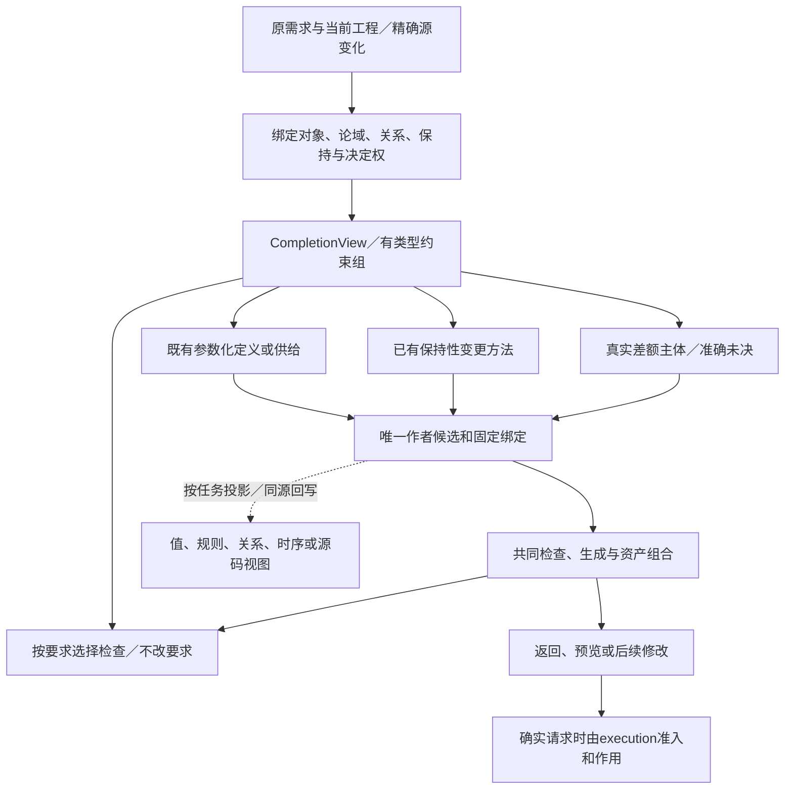

# 跨软件需求合同


### `req:composite`联合不是 `Goal[]` 拼接

跨目标合成需先固定同一对象身份、Root、Scope、时间/资源/规范域，再对有联系的Hard条件求联立；两个需求分别可满足可能同时不可满足。联立结果至少区分：当前可判定且一致、经支持的Unsat及冲突来源、Meaning/数据/外部资格缺失、搜索预算不足/方法空间未穷尽。把不能证明可行写成“已满足”，或把算法没搜索到当成数学不可满足，都不正确。

`RequirementTerm`可以是状态目标、不变量、禁止、时间期限、规范、质量、资源、交付接口等专业形式；它们的不同单位、证据与消费者不能只因属于一个 `requirements[]` 集合就合并。集合内部仍是有类型RequirementUse，不重复存储本来由原Goal派生的整份定义。

### 八种要求项及其联合的准确处理

当前复合要求的基础项保持八种互相不同的构造：`use` 引用已有要求或模式发生点并绑定形参；`require` 明确硬性要求；`prefer` 给合法解排序而不创造硬约束；`all` 合取；`any` 在明确备选之间选至少一个，不表示各自都实现；`when` 保留条件及 then/else 的时点与未决定分支；`forEach` 对指定有权枚举的全域分别实例化；`exists` 必须提供符合条件的见证。语义上是八种 Term，不能因此要求开发者书写八层嵌套容器，也不能把 `prefer` 隐式升级成 `require`。如果 `any` 的所有候选皆不合法，结论是不可满足，而不是选择代价最小的非法方案。

联立之前先固定发生点身份：同一个 Product 被两个 `outputRoots` 选择，各有自己的根级接受义务；共同存储、资源配额或现实 Provider 若实际共享，则沿类型化共享边在更大约束域联立。实现空间中既要保留每条 Requirement 的来源与不可逆限制，又要联立容量、作用时间窗、生命周期与失败清理。用户选择“允许 A 或 B”不等于同时让系统开启 A 和 B；“必须在取消前不支付”与“提交后最终必须结算”需要固定取消/提交边界才能比较，不可靠 JSON 数组顺序决定。

量词的域可来自封闭声明集合、授权数据源、活的事件流、实际 Provider 枚举；只有前两类在具备完成证据时可立即签发全集意义。对开放世界做“所有对象都满足”时，缺少成员全集不能用当前发现的零个反例证明成立。跨源 `forEach` 的枚举权限、版本向量和观察空洞属于真正要求前提。对条件未能判定的 `when` 保留待决分支，不能把其 `else` 当已选择；`exists` 的候选虽存在但未获授权也不能充当可用见证。

联合结果至少区分：已知有满足所有硬条件的实施计划；已知矛盾并能指出参与要求与反例；候选方法或现实输入尚缺；搜索预算用尽但未证明有解/无解；合法但作者尚未选择偏好分歧。后一种不应伪装成编译错误。求得合法 Method 只证明在其已声明前提下能够实现设计合同，不为外部授权、未来资源或观察真值签发现实承诺。


### 根级和跨系统义务

选中的Root在同一工程中有独立 `rootId`；同一业务要求从不同Root、主体、时段和上下文发生，生成不同RequirementOccurrence。联合系统里共享对象须通过具有权威的跨ScopeIdentity合并；否则保留可能关联的Needs而不是独立“都通过”。可组合实现计划必须同时保持硬目标、规范、权限以及所有必须履行的公开接口和状态连续性；目标代码单纯可以编译不构成业务Goal成功。

`quantify`与`temporal` 已作为**设计候选**写回本工程 `schema/semantics/intent-body-1.schema.json`，其中实际域Provider/时钟资格、真假证据与无限时域完成条件不由JSON Schema判定。进一步的规范细节见[意图公式、量词与时间](../作者语义/通用意图语言-意图源与语义组合.md)，不可把新语法当作全域解释器已发布。
<a id="accepted-multiroot-obligation-closure"></a>

<a id="gift141-rooted-acceptance-and-overlap"></a>

**明确的多根接受键**应区分`(target,rootId,sourceRevision,acceptedAuthority/record)`，要求发生点还要携带对象角色、时域与scope。Target根重排时键不应变化；根删除不能删去过去仍有效的已接受硬要求。一个CLI测试中给出的`--expected-hard-root primary=goals:IDEGoal`只是独立传入的**结构对照值**，不是接受方签名或满意度证据。不同根选不同产品Definition时，某根的硬目标不能从另一个定义/根自动继承；对未提供的独立记录返回Needs，不生成零要求的全绿结果。

跨根共同物化时应先建立候选相交图：从根/组件发生点取得可能共享的Subject、Resource、Store、Effect Port、命名空间、Placement及数据路径，结合**真实Issuer、Scope、Grant及供应量**决定是否相交。两个作者`objectRef`文字一致只能提供需要核验的Candidate；文字不同也不能证明它们必定不是一个主体。没有权威确认时既不能合并成相同对象计量，也不能假定隔离；保留未知边并保守阻止全球资格签发。只有受支持的、已签名的隔离谓词能作为安全拆分依据。


### 被接受的产品根、组件实例与多个目标根的义务联合

**输入与有权性必须分离**：作者文件保存“该实现希望表达什么”，有权的接受记录固定“本次真正承诺交付什么、由谁接受、作用于哪些产品/主体/时域”。已接受基线应具有 `acceptanceRef`、`issuer/authority`、输入范围与修订、正负要求集合、有效时域、可追溯撤回/替换及独立锁定来源；这些是现有Requirement/Acceptance/Evidence专业协议的职责，**不得把这些字段机械塞回`product:system`令源文件自证完整**。新的作者根或旧Goal消失时，对照基线报告遗漏、弱化、范围变化和真正有权修改；无基线时保留`NeedsAuthorAcceptanceReconciliation`。

对于任意一次Target选择，保持每个选中Root occurrence的身份 `(project revision, target, outputRoot slot, effective binding)`；所选根之间既可能完全独立，也可能共享Subject、Data、Resource、Effect或同一外部Provider。联合规则只能根据实际有权的**相交关系**合并硬义务，不能简单 `set(unqualified-ref)` 去重，也不能在多根之间无条件互相继承实例/Grant/时钟；硬义务是否适用由接受主体、作用域、产品边界、时间和根配置决定。共享资源的全局容量/权限/时序需在共同受影响范围联合求解；根间隔离已经取得独立证据时可按相交图分区计算。不完整观察时不允许从每根局部PASS归纳整体PASS。

每种 `Goal/Requirement/Policy/Workflow` 导出的Norm必须保留 `(author source, root occurrence, component instance?, member use?, role actuals, scope, time, authority, strength, interpretation)`；不得把两个不同发生点同名Ref合为一个要求。某个静态字面值变化、UI→Workflow触发变化、单根上下文改变、撤权或Method版本替换，只会触发真实读集与影响关系所达到的那些义务重核；若依赖图未知，则保留`NeedsImpactClosure`，不能冒充零影响。

联合判定至少区分 `InvalidSource`、`UnqualifiedMeaning`、`NeedsAcceptance`、`NeedsObservationCompleteness`、`NeedsAuthority`、`HardContradiction`（具有足够证明）、`SearchIncomplete`、`FeasibleWithUnresolvedImplementation`、`QualifiedRealization`；其中`HardContradiction`不得由预算耗尽或样本测试失败推得。对成功运行以外的设计根仍可签发受限结构结论，但不能发表全部产品质量达标结论。


<a id="single-product-requirement-membership"></a>
## 完整产品根对规范义务的唯一归属

`product:system.requirements`及其组件的同名字段是当前产品对已公开`intent:goal`或`req:composite`的**显式义务引用**；当前候选`/2`的`qualityUses`、`workflowUses`、`policyUses`及组件实例的局部成员发生点各有不同的消费意义，不得把政策许可、流程存在或文件包含冒充硬义务覆盖。`strength`为soft不得降低Goal本身的硬安全或禁止性含义；冲突时给出可追到来源的拒绝而非自动选择较弱定义。`SelectedRootSet`须记录根对应的引用闭包和未取得的环境解释；多个独立根按同一目标范围联合，但不能用另一个根隐匿本产品缺失的要求。

<a id="gift137-joint-choice-and-ports"></a>
## 非计算决策、政策和产品连接进入联合要求的完整保留条件

从已选择的产品根联合要求时，必须把下面不同的信息当作独立约束，而不是把 JSON 定义文件收集成一组“可实现的功能名”：

| 来源 | 进入联合图的义务 | 未获资格时不得推断 |
|---|---|---|
| `workflow:plan.routes` | 当前角色与观测范围下的条件证据、选择策略、拒绝/人工/等待后继 | 分支总能命中、数组顺序即业务优先、未知可以走 `otherwise` |
| `state:machine.transitions` | 状态/事件绑定、多个候选的互斥或仲裁、状态不变量与进展 | `missingTransition=ignore` 可处理冲突条件 |
| `security:policy.rules` | Permit/Deny与Oblige分立、规则发布权、例外来源及优先冲突 | `oblige`等于允许执行；`priority`具有跨权威的天然顺序 |
| `product:system.connections` | 实例身份、提供/需要方向、接口精化、跨组件资源和生命周期 | 名称或Kind相同即ABI/效果兼容；未绑定依赖自动存在 |

**进入同一工程并不代表进入同一产品。** Workflow和Policy必须作为真正可达的Requirement/产品组成，或明确列入该目标的`outputRoots`并取得当前TargetProfile的联合资格；编译器不得自动扫描文件把未选定义悄悄加进产品，也不得删除选中根后沿用旧资格。

联合阶段对同一共享主体、相同时窗和资源计算相交硬义务，不允许把一个子模块内部的局部成功当全局成功。四态冲突是可观察证据不足/相互抵触；`UNSAT`仅在**已经有资格的完整相关硬约束**被证明不可同时满足时使用。缺Meaning、未知观察、外部Norm或端口适配是 `Needs`，求解预算耗尽是 `SearchIncomplete`，二者都不是矛盾证明。

分支执行动作或外部补偿仍由有独立授权的实际Method/Provider实现。恢复与修改须把谓词签名、选择资格、政策签发者、端口版本与正负依赖加入ReadSet/ProofDeps；变化影响某个资格时撤销其作用范围内的Claim，不能沿用旧的全产品PASS。


<a id="gift135-static-author-obligation-join"></a>

从非计算作者源进入联合Requirement的最低合同：保留Goal/PatternUse及已选择产品根的独立Occurrence；`conditionRef`只在有权Meaning解释后产生条件义务；容量字面量必须连同真实ResourceIdentity、单位和共享域加入联合约束；`security:policy`的例外与优先级须先验证权威及规则重叠；目标类型、状态和流程声明不得自动转成已满足的业务Goal。缺解释为Needs，已有资格且全局硬约束不可行才为Unsat，搜索未完另为SearchIncomplete。量化完整性与四态证据按原主人解释，不引入普通函数求值依赖。


<a id="gift140-actualized-obligation-closure"></a>
### 真实产品根的义务发生点与独立接受边界

在选定的 `product:system` 根上，义务来源不是一个只读字符串列表：先分别保存系统级 `requirements` 与**每个组件实例**按模板 `requirements` 实际化后的Occurrence，再加入有权独立来源、业务流程/政策中已经由合格解释器导出的规范内容。联合计算保留 `(root, instance?, Definition, roleBindings, actor/scope, time, source revision)`；同Ref的两个文档不能自动当成一份义务，`permit/oblige`也不得替代`achieve/maintain`。结构合法、表达式类型合格和外部Norm解释是不同门禁；共享资源、跨事务、撤权、完成/补偿与证据四态要按既有联合语义处理。

**接受记录独立性**：产品根自身的集合不具有“以前没有漏掉目标”的证明能力。审计输入须另含可追溯的用户/客户接受集合或等价有权确认；缺少时只能签`NeedsAuthorAcceptanceReconciliation`，不能签`ProductComplete`。软目标合法但不削弱已接受硬目标；`hard`与`soft`不能因为同Ref名字一样就无损相并，来源及发生点仍要保留。Gift140有限范本以显式的受限`--expected-hard goals:IDEGoal`独立验证弱化反例，但并未获得任何真实外部客户签署。产品连接/部署与需求均需要独立资格，不得用空数组或Target可构建替代要求的真实完成。

<a id="gift131-root-aggregation"></a>
## 根集合联合的最小充分合同：不能靠选择三个文件便证明一个产品

**输入角色**：`SelectedRootSet`表示作者在固定Target/Revision中明确选择的入口集合；`SelectedDefinitionClosure`表示实际有类型引用的闭包；`DerivedObligationSet`表示合格Pattern/Goal/Req解释器从其中产生的义务及条件；`JointObligationSet`表示多个义务共享同一对象、时间、资源和副作用之后的联合问题。这四者不是同义IR。单独的结构Schema通过只允许产生前两种中受限、未资格化的部分；没有Meaning/Norm/完整域资格不能产生已签发的后三种。

**联合规则**：所有有效根的义务必须按其真正解释合同被共同纳入；同一Goal在同一作者身份、参数、观察域下的相同静态选择可以共用解释，但两个不同发生项或量化实例不得仅因Definition名相同而合并。`require`提供硬要求，`prefer`只约束合格候选间选择；`when`未知保持条件，`any`保留全部候选直到真实见证，`exists`必须有实际量化域及见证；时间与规范责任不能由Boolean合取吞没。根的顺序默认不是业务执行顺序。

**允许跳过的只有经判定不相关的内容**：源码目录里未选的定义不是当前Target需求；未取得解释器的已选Goal是`NeedsMeaning/Temporal/Norm`，不是“不相关”；空Composite只增加零条业务义务，不能证明另一个Goal履约。Root选择变化属于作者接受范围变化，先生成SourceDiff及资格撤回，再按精确正负ReadSet重算。完整Target的HardCoverage必需逐条回链到所有已接受的有效硬义务；未知义务不计作完成覆盖率。Goal、PatternUse与Requirement可以分别作为根进入同一联合问题，前提是选定TargetProfile具有实际RootUnion消费者；没有它不能从输出根数组直接推断RootUnion能力。

**例子**：Gift130的`ReservationProduct`经`ReservationChecks`到空`AuditRequirement`，这条路径不提供容量安全；另一个`ReservationGoal`根才保存有限模型的`maintain`与`avoid`，PatternUse根保存对象绑定与必需Policy/Observer选择。三个同时列于`outputRoots`仍只获得**结构选择证据**，需要真实Meaning、Norm/观察、联合约束和Method/Target解释，不能叫已完成预留服务。删除Goal根会让当前选择不再包含这些六模态条款，必须从旧结果撤回相应Coverage与Claim，而不是自动从别的文件恢复。

<a id="gift122-eight-term-joint-algebra"></a>
## 八种RequirementTerm的联合解释与有限求解边界（Gift122）

<a id="joint-requirement-closed-composition"></a>
### 同一组要求的可追溯联合解释

**根选择与被接受义务分别发生。** 一个输出根建立“此次构建希望产生什么”的选择关系；来自作者及其他合格来源的已接受硬义务建立“什么结果不允许遗漏”的独立关系。增加或删除Root只改变本次选择闭包，不自动撤销原接受义务。每个RequirementTerm保留 source、subject、scope、severity、quantifier/world、作用时间和参数绑定；这些信息相同才允许比较语义，不能凭同一 `definitionRef` 合并两次合同。

八类Term的处理不可统一成 Boolean：`use` 实例化有条件能力并带来前提，`require` 在范围内施加硬条件，`prefer` 只对硬条件合格的候选排序，`all` 联合要求，`any` 保留各候选不同的代价和前提，`when` 根据有资格条件决定义务适用性，`forEach` 保留域元素逐发生点义务，`exists` 需要真实合格见证。未决条件不应使 `when` 自动消失；多个合格替代路线不应由 JSON 数组位置取得业务优先权。

Method 候选能否满足要求须依据实际公开行为、错误、时间、资源、授权、观测与目标条件做整体联立，不能各Requirement分别挑一个局部合格Method再拼接。对于无解、当前候选无解、未知是否无解、搜索预算停止、意义/权限缺件分别输出不同结果；软目标排序不得反向扩大硬约束的可行域。


每个 `use/require/prefer/all/any/when/forEach/exists` 的解释结果必须携带其`RequirementRef`、实例化身份、真实参与者和共享资源、作用域/时间、已满足与未定前提及证据读集。`all` 组成全部硬义务；`any` 是带完整备选与共同约束的析取，不能选择一支就忘掉其它分支引发的全局要求；`when` 的前件若未知，保留条件依赖而不能直接判假；`forEach` 和 `exists` 依赖已资格化的量化域、重数和顺序语义，空域只有在完整域证明下才可分别取得合格真/假；`prefer` 只能在先处理硬约束后比较。

联合图不是将单根计划拼接：先汇总**所有活跃根**，闭合名义身份、共享写集、互斥、可执行时间/截止、资源容量、外部Effect、规范优先及进展约束；耦合组须证明组间不存在遗漏相交边，才能分组并行求解。对同一共享世界，两两可行不保证整体可行。可行结果需附解的完整覆盖和约束见证；矛盾需附适用输入域内的冲突子集及其独立依据；有限预算耗尽和域未知输出`INCOMPLETE`，缺实现供应输出`MISSING_METHOD`，两者均不能冒充联合逻辑`UNSAT`。

一条 Requirement 被撤销、条件翻转、资源事实变化或新强约束进入时，失效的是原联合问题相交的证明与所选方案，后继解析从冻结新快照重做；已发生外部 Operation 不能随编译图重算而重放。这个合同由 Requirement Owner 给出意义，Method Owner 只消费解空间和实现义务。


### 有限组合代数与解释结果

`gift.requirement-structure/1`的八种Term及其合法字段由本章现行合同和`schema/requirements/requirement-structure-1.schema.json`约束。联合消费者把Term解释为包含自由变量、实例主体、规范来源与版本、评价时点及共享上下文的`ReqTerm`树；不能降成无来源、无绑定的字符串列表。具体构造解释如下：

| 构造 | 组合保留的真实差异 | 必须检查/拒绝 |
|---|---|---|
| `use` | 以已锁定Definition、实参和局部主体实例化其有效Terms；保留来源、调用链与所有自由变量绑定 | 引用不存在、无合格递归解释或默认不合法时保留Need；不得假设外部引用已展开 |
| `require` | 将有权解释的硬义务加入当前联合问题，绑定触发/主体/适用域 | 缺解释返回Needs；方法缺失不撤销义务，偏好不能代替硬要求 |
| `prefer` | 在全部硬条件合格的候选域内按已授权的度量与偏序比较 | 度量/单位/权限不完整时保留不可比；不得改变硬可行性 |
| `all` | 同一联合环境中合取全部子要求，保留每项来源及共享状态/资源/时间耦合 | 逐项可行不证明合取可行；资源或状态干扰须联合检查 |
| `any` | 选择至少一条连同其效果、权限与成本都完整合格的替代分支 | 不得拼接不同支路的有利片段；未遍历全域不能签无解 |
| `when` | 在明确时点及权威解释下激活条件性义务；未知时保持两种后继及依赖 | NEITHER/BOTH或缺观察不当False；未证条件不可静默删除硬要求 |
| `forEach` | 对声明完整域的每个带身份实例分别产生义务，保留重数/位置规则及来源 | 动态入场、不完整或无限域不能以本次枚举冒充全域保证 |
| `exists` | 在整个联合约束下给出一个具类型、身份和适用作用域的合格见证 | 搜索未结束或域开放时，“尚未找到”不等于无解；不可任意交换外层量词 |

**结构合法不等于语义成立。** `where` 与值级 `Condition` 只在其声明类型与环境内求值，不隐式读外部世界；条件性 Norm 未经解释保留 `ConditionPending`。对 `all([])`、`any([])`、未绑定变量及缺省值，必须先按当前 Body Schema 判定是否合法，不能借形式逻辑恒等式跳过输入校验。`req:composite` 允许零 Terms 不代表现实世界中不存在额外义务。

### 真正可实施的联合搜索算法

```text
compose_joint(accepted_roots, locked_context):
  1. close typed use/import dependencies or return NeedsInterpreter/NeedsDefinition
  2. instantiate lexical parameters; preserve root, branch, quantifier and source identities
  3. attach finite/dynamic/symbolic domain qualifications and explicit world/time/authority scopes
  4. build constraints over SAME shared object identity, transition frame, resources and effect scopes
  5. enumerate or symbolically search all/any/when/quantified branches with source-preserving witnesses
  6. never delete unresolved soft/hard constraints; separate provable conflict, unknown and budget limit
  7. if required hard clauses are interpreted and jointly satisfiable, emit scoped JointObligationSet
     with alternatives, explicit Needs, coupling graph and required Method obligations
  8. never turn a mathematically feasible abstract model into an existing executable Method
```

设 `Accept(J,u,e)` 是联合要求 `J` 对声明输入域 `U` 中的 `u` 与可观察行为 `e` 的接受关系。资格同时覆盖正常进展、错误、并发和外部效果，单个赋值可行不证明整个方法合格。预算耗尽报不完整搜索，无供应报 NeedsMethod；仅具备联合矛盾的有效证据可签 `UNSAT`。反例 A=`{m1,m2}`、B=`{m2,m3}`、C=`{m1,m3}` 两两有交而三者无交；`when` 为 `NEITHER` 时子 `require` 保持待定，不可当作不触发而删除。

<a id="stable-joint-requirement-contract"></a>
## 采用设计：多意图合取、替代、量词与规范/资源联合（R04–R06）

本章对多个已接受根导出**一份只读联合义务**，不是新业务文件或第二套`RequirementTerm`。`gift.requirement-structure/1`的8种Term及其字段仍由[结构化源码](../../10-作者与输入/作者源/结构化源码.md#finite-requirement-composition)唯一拥有；`intent:goal`六模态含义由[意图owner](../作者语义/通用意图语言-意图源与语义组合.md#stable-intent-modality-semantics)拥有。输入是按一次用途冻结的`RootRefs + MeaningLocks + ActualIdentityMappings + SourceProfile + FactSnapshotSelection + PolicyRefs + Budget`。

### 联合图的节点、边和计算阶段

```text
compose_joint(roots, selected_context, budget) ->
  JointObligationSet { typedClauses, sources, domains, couplingEdges,
    sideConditions, frames, temporalClaims, normClaims, resourceClaims,
    observations, readSet, negativeReadSet, unresolvedNeeds }
  | ScopedConflict { unsatWitness, assumptions, sourceRefs, scope }
  | Incomplete { frontier, remainingBranches, observedBudget, partialClaims }
```

这段是**内部逻辑合同**，不是要求AuthorModule必须保存`JointObligationSet`。实现按阶段：J0锁定真实主体/修订/策略来源；J1严格展开PatternUse及Req的全部有效条款，未定义/未采用分支只在语法与类型上检查；J2按显式身份关系建立共享主体，禁止同名合并；J3生成共享容量、状态读写Frame、Effect/Operation范围、规范义务触发、时间交叠及依赖边；J4按连通耦合组做硬条件联合检查，同时保留跨组接口条件；J5枚举/求解可行分支、见证及冲突，需符号域时调用合格Solver而非错误有限展开；J6只对全部硬合格计划比较偏好；J7返回实际ReadSet和**负依赖**（例如候选Method不存在、所用观察器无法取得），可供精确增量失效。

### 八种Term具体行为和失败资格

- `use`：实例化已锁定Definition、已类型化参数与局部subject；每次私有主体独立，显式共享主体按同一身份联立；导入不越作用域。
- `require`：将有权/已解释的硬义务加入公共合取；禁止降级为`prefer`；不能因为当前无Method就撤销业务Requirement。
- `prefer`：保留所有适用候选共同的比较维度与强度；只在硬资格后比较，不能被`any/exists`支路偷偷消除（沿原有限codec的已有限制）。
- `all`：共同约束同时满足，来源/冲突全保留；可懒求值但结构合法性先检查。
- `any`：允许择一**完整合格**支路；存在可靠见证可签ScopedFeasible，全部有资格排除才签对应有限ScopedUnsat；没搜索完不得报无解。
- `when`：静态编译期条件只有在固定纯值及完整解释下能提前取真/假；动态条件必须编译为有资格的运行守卫并保留下游联合安全；未知不当false。
- `forEach`：对完整有限域的每一发生位置施加要求；不等同运行循环、并行化或删重复；空域恒真**仅限定该完整域**，不能消掉独立进展要求。
- `exists`：在完成所需硬约束下选择有类型见证；允许对词法外层参数依赖，不与外层`forEach`交换；闭合空域假，不完整域未知。

`all/any/not/implies`作为高层Goal的**有资格证据逻辑**与`RequirementTerm.all/any`作为**实现要求组合**不是同一kind；两者引用的是不同作用对象，内部通过专用有类型适配，不允许仅靠同名直接转换。`permit`规范许可不自动产生执行Grant；`oblige`须保留触发实例、责任、期限、豁免/违约及法源；`wall-clock`与`unbounded`需要真实的时序/观察消费者。

### 数学和现实两种可行性，不能误给全局结论

方法集合A=`{m1,m2}`、B=`{m2,m3}`、C=`{m1,m3}`两两相交但三者交集为空：只做局部pairwise筛选是不充分的。多个Method共同实现时更需联合检查状态与Effect，使所有硬义务由整个组合满足，而不是要求某一单Method覆盖全部。容量1的两个请求可以分别拥有可行计划，联合模型却不可同时确认；若允许排队、拒绝部分请求或动态抢占，必须来自作者真正允许的替代/进展/公平性，而非编译器临时降级其目标。

有限全域枚举可证明`NoPlanInSuppliedFiniteModel`，必须附域大小、版本、所有候选与未考虑世界；找到一种完整资格方案可证明**存在性**，不能证明其在未枚举/未测量候选中最优；预算耗尽保留Frontier与已找到的有限见证而不造UNSAT。无限/开放域的一般可满足性与自动合成不可作为总决策算法承诺。安全/活性分别需要不变量闭包和满足前提的进展论证；只满足全部静态布尔不能构成完整产品。

### 失败后继和清理范围

语法或名义类型矛盾应在前端修订；规则意义缺失返`NeedsMeaning/NeedsRequirementInterpreter`；观察数据不足返`NeedsFact/Observation`；硬冲突附可复核ScopedWitness；局部求解器超时返`IncompleteSearch`；所有被限定语义已解释但无实现返`NeedsMethod`；授权缺失不影响可行计划的静态正确性，却阻断真实执行。返回Need时保留可以独立继续的其他根与约束，不制造全工程单一失败码。下游只消费带范围的资格和关联身份，不重复解码作者源。

## 跨软件意图、行为与开发动作的共同合同

<a id="cross-software-intent-contract"></a>

本节拥有**不同软件任务中重复出现的需求关系、保持条件、组合方式和开发变更**。类型推导、短函数调用、领域库和管脚是它的消费者或表达方法，不替代这层设计。当前选择是在既有`Requirement/Constraint/CompletionView/Definition`上补齐具体含义与实现，不增加一份独立可写的IntentIR、业务原子目录、专用IDE或第七个工具。

### 统一的是要求与变化的结构，不是所有程序的执行图

一次任务先区分三个对象：**产品要表现的行为、开发过程中要改变的工程内容、此次现实中获准执行的动作**。三者可以关联但不相等。“给工具增加删除所选文件的能力”是在设计目标程序；“现在删除工作区文件”是现实作用。前者的目标写权限不授予后者，生成一条操作也不表示该操作已发生。

不同任务可以具有同样的要求形状：裁剪图像、变换表格和改写AST都涉及输入到输出的关系及保持项；搜索预览、渲染和增量诊断都可能需要“只发布当前修订结果”；文件改名、节点重定位和公开符号重命名都要定位对象、计算映射、处理碰撞并保留未改关系。但它们的叶操作、数值、身份和失败行为不同。复用共同组合与检查，语义方法仍解释自己的对象；不能用一个万能`transform`字段把区别藏起来。

| 任务中真正的信息 | 准确内容 | 原数据拥有者与省略规则 |
|---|---|---|
| 对象与论域 | 文件集合、输入值、实例、时间域、版本或实际消费者；哪些状态参与比较 | 既有引用和候选确定；不从模糊名字或全局目录猜对象 |
| 希望成立的关系 | 输出、状态变化、结构、轨迹、资源或跨运行之间的条件 | Requirement引用已接受定义或新候选；只有独立信息单独存放 |
| 适用条件与量化 | 对全部哪些输入／发生／对象成立；哪些情况下激活 | 使用固定的类型和域；不凭一个样例替全部输入 |
| 保持与可变范围 | 不可写位置、前后等值投影、语义兼容、布局及允许变化 | 由当前任务和公开边界取得；无信息时不能把“其他不变”无限外推 |
| 尚可决定的自由 | 表示、算法、策略或具体值；谁可以在其中选择 | 既有强度、缺省与委派规则；偏好不覆盖硬条件 |
| 来源与状态 | 原要求、解释规则、决定关系、是否已绑定、推导与未决 | 沿既有SourceRef与接受关系；未解释自然语言不伪装成形式约束 |

上表是分析投影，不是作者每次填写六栏。既有函数／关系定义已唯一确定的含义直接引用；运行参数尚无值可以正常编译；新独特关系没有表达或委派时，不能从短名字恢复出来。

### 当前共同要求形状及直接作用

下表是当前分析能力的开放分类，不是封闭的业务全集，也不声称每类都能自动求解。组合节点只路由到真实参数域和合格方法；未注册的含义可保全，不能冒称已解释。

| 要求形状 | 必须表达的区别 | 适用任务与准确失败条件 |
|---|---|---|
| 值与输入输出关系 | 映射、选择、归并、排序、编码、误差；求值和失败次序是否可观察 | 图像变换、文本与文档、编译、数值工具；同结果不等于允许修改输入或改变错误 |
| 结构与依赖 | 身份、集合／重数、顺序、包含、引用、逆关系、可达性、约束 | 场景图、代码、布局、文件、数据结构；字段齐全不证明引用一致或关系完整 |
| 状态与交互 | 当前状态、触发、守卫、转移、输出、可变域和回滚条件 | 编辑会话、设备、应用行为；同界面动作不证明同样生命周期 |
| 时间与进展 | 先后、直到、最终、期限、迟到、重入、取消与真实完成 | 预览、流、任务运行；仅禁止坏事不排除永远不完成 |
| 资源与作用 | 拥有、借用、容量、外部效果、最后使用、准入与结算 | 文件、内存、设备、并发；只读值类型不证明无写入或同步 |
| 表示和接口 | 目标布局、编码、ABI、名字、类型、序列化和平台观察 | 多目标及原生接入；只改形式也可能改变公开约束 |
| 多运行与比较 | 确定性、非干扰、统计要求、策略／性能相对比较 | 随机算法、安全隔离、优化判断；不能把单条轨迹监控冒充多运行保证 |

有限的逻辑构造可以复用，不说明上表就是最小数学原子数。具体高层要求可以是多个形状共同作用；同一个“取消”可能同时涉及状态、发布次序、设备活动和内存释放。不存在把业务词列成集合就完成这些交互的捷径。

### 组合的语义与非空进展

设要求节点的域、投影、绑定与定义性已固定：

- **共同满足。**`All(A,B)`保留两组独立来源；不因A更严格就删除B要求的有效输入。检查需同时覆盖交互，不能把分别合格等同于组合合格。
- **允许替代。**`Any(A,B)`保留至少一种完整合格路径；不是把A、B都排成实现前置。固定实现后仍保留选择依据，不由完成先后决定业务。
- **条件激活。**`When(P,A)`要求P成立的相应对象满足A。P的定义域、读取时点和未知状态明确；未知不被当作false。任务同时需要“至少有一次P”时另保留存在性义务。
- **全体与存在。**`ForEach(D,A)`不自动提供并行；对象之间可能碰撞、共享状态或资源。`Exists(D,A)`不能用空D满足。集合、重数和顺序按D的真实类型解释。
- **行为顺序。**运行`Seq(R1,R2)`由合法中间状态连接两个转移关系，R1失败是否进入R2、部分变化和清理必须由所选合同规定。它与逻辑All不是一个运算。
- **并发与作用域。**Parallel保留共享状态、冲突、资源和允许交错，不是简单笛卡尔积。隐藏内部状态只减少外部观察，不删除真实效果、权限或资源。
- **保持。**NoWrite约束实际写操作；SameValue约束结束时投影相同；SameBehavior约束规定观察域的行为相同；SamePresentation只管选定字节或布局。写后还原满足某种SameValue，却可能违反NoWrite、触发监听或改变时间戳。

“只发布当前结果”必须与实际进展条件一起解释：在输入最终稳定、当前计算终止且执行获得公平调度的前提下，最终发布当前结果或明确的当前错误。程序永不发布虽然不会发布旧结果，仍不能通过此任务。硬期限需要实际环境与成本界，不能由逻辑eventually自动得到。

### 最小作者面不是一套万能表单

当前开发面继续允许直接编辑真实源；共同意图视图从需求、已有合同与来源派生。它先显示**对象、所要变化、必须保持和真实未决**，而不是要求用户排列所有实现块。完整算法体、签名、结构与端点在需要时展开；已知精确文本可直接改，不先查询图。

| 已绑定的要求 | 默认呈现及编辑单位 | 必须保留的内容 |
|---|---|---|
| 值／映射 | 原表达式、函数输入与参数、字段策略 | 真实值域、失败和顺序；不用伪造全新业务关键字 |
| 条件策略 | 条件与结果的有限规则表，或原match/if | 覆盖、重叠、优先级及未知；行排列何时有义须明确 |
| 结构关系 | 当前关系、逆向查询、作用域和实际邻接；必要时管脚图 | 身份、基数、共享、未读范围；布局不擅自成为执行次序 |
| 状态／时间 | 状态、允许事件、发布策略、进展和取消边界 | 模型不是所有软件唯一外形，不强迫全部程序使用状态图 |
| 保持性改写 | 当前行为与所允许的实现差额 | 等价域、帧、实际成本和调用方；类型相同不足以保持 |
| 运行或工程作用 | 实际目标、前像、授权与未结算责任 | 不将设计程序的能力与执行该能力混用 |

这使用现有`query(view="contract"/"origin"/"impact"/"state")`的相交结果，及source/files/edits、editRef、结构变化和目标控制。表中不是新增公开view枚举或新请求字段；适配器不支持某种精准编辑时，仍然可直接改原源并得到范围明确的检查。

给出自然语言要求时，开发AI先将它与已有语义定义对齐。已有准确来源的内容引用即可；新假设作为候选，按原委派决定或保留待定。显示的中文句子不是编译器自动执行的DSL。没有可解释的条件，不给形式保证；可以继续保存设计并完成独立工作。

### 数据、接口与固定实现流程

在既有`CompletionView`中增加可选的语义需求组：`scope`绑定源／目标及版本，`meaning`引用上述有类型要求表达，`frame`只含独立保持条件，`decisions`引用现有委派与取值，`sourceMap`定位真实作者内容。已被同一Requirement完整拥有的字段只引用，不复制。临时组合摘要存在当前分析内存；需要持久解释或接受时沿原Requirement/SourceRef保存，不创建另一套意图数据库。

实现接口采用下列顺序。它们是模块级函数合同；正文存在不表示相应产品代码已实现或运行：

```text
bindIntentScope(Task, Candidate, Requirements, Context)
  → BoundCompletion | AmbiguousSubject | NeedsInput | InvalidMeaning
composeIntentConstraints(BoundCompletion, SemanticMethods, Budget)
  → EffectiveGoals + Frames + Obligations + ReadSet
     | Conflict | NeedsMeaning | AnalysisIncomplete
planIntentChange(EffectiveGoals, ExistingSource, Bindings, Authority, Budget)
  → NoChange | EditPlan | RealizationPlan | NeedsAuthorContent
     | NeedsInput | NeedsDecision | PlanConflict | PlanningIncomplete | UnsupportedScope
materializeIntentChange(Plan, CurrentFrozenBase, RepresentationMethods, Budget)
  → ExistingCandidateDelta | CandidateWithDiagnostics
     | ReplanRequired | NeedsInput | MappingConflict | MaterializationStopped
```

`bindIntentScope`固定对象与观察域，区分targetProgram/developmentOperation，不以层号改变原值或权限。`composeIntentConstraints`检查类型、定义性、量化与时态域，先共享显式同义关系，再调用能处理该域的有限检查；没有适用算法时保留准确未判定，不以字符串不同报矛盾，也不假装求得全局最小冲突核。

`planIntentChange`按已有约束及编辑目的取得合法动作：原槽改值、现有关系连接／移除、同一声明的约束增删、稀疏目标控制、合格供给切换、保持性改写、生成新的差额主体、观察或现实运行。组合的输入和结果都必须绑定真实定义，不按动词或函数名字猜行为。默认保持已有来源，选不需新增定位和重复内容的合格动作；若多个动作会产生未委派的可观察差异，指出差异，不用算法评分暗改要求。

实现匹配分三条正向路径：**同一参数化语义定义且参数足够确定**，直接实例化其已绑定方法；**有明确变换规则和适用前提**，产生已有源/结构修改并检查新增区域；**新行为不能由已有规则完成**，由获准开发AI创作当前语言中的实际主体，继续用原要求核对。不是每个输入意图都先注册插件，更不是调用任意求解器必然产生代码。候选搜索固定当前真实供给及预算，普通重建只读已接受的结果。

`NoChange`只在作者含义、来源、强度和固定选择都没有变化时成立；新显式固定恰好等于旧默认，不可因目标字节相同被删除。`materializeIntentChange`按[整批落实算法](结构编辑/作者权切换并发与往返.md#whole-change-materialization)只形成现有候选差异；`NeedsAuthorContent`是交给当前获准开发AI的有限创作需求，不是编译器内部运行任意模型。源文字、公开语义、目标表示和实际文件作用分开：改图的显示布局不改程序；增加目标行为不会立刻运行它；取得分析结果也不写工作树。需要实际动作时由application进入原execution准入，不由上述纯分析函数执行。

#### 有类型要求组的内部形态与消解次序

现有Constraint概念模型在内部以以下有限联合实现。`Ref`来自固定语义定义，`Apply`的实参可以是已绑定值、投影或合法的函数/关系引用；`binder`只在其body内有效，和目标程序局部变量及权限主体不是同一身份。此联合没有新文件Schema，不要求任意旧编码直接兼容。

```text
RequirementTerm =
    Apply(meaningRef, typedArguments, scopeRef)
  | All(terms)
  | Any(terms)
  | When(conditionRef, term)
  | ForEach(binder, domainRef, term)
  | Exists(binder, domainRef, term)
```

直接JSON作者的all/any/when/forEach/exists及局部bound编码，由[有限组合合同](../../10-作者与输入/作者源/结构化源码.md#finite-requirement-composition)拥有；它只承担准确有限设计输入，不改变此处一般关系、运行条件与动态域的语义。实例化保留量词顺序和共享主体，语法支持不自动取得求解完备性。

构造前检查每个引用实际存在或明确待读，参数和值域、时间域、相等和量纲与该meaningRef相符。`All([])`为真，`Any([])`为假，空域ForEach为真、Exists为假；任务的成功可达/输出存在条件不由这些恒等式删除。精确的布尔求值与逻辑公式有差别：运行谓词可能失败或不终止，只有被证明在当前域有定义或明确提升为逻辑关系时才可无条件用于对称逻辑化简。未知定义性进入未判定结果，不能将`A && B`任意重排成`B && A`。

`composeIntentConstraints`先完成词法/类型绑定和纯逻辑结构检查，再应用有前提的恒等化简，再取得当前域的方法摘要，最后建立未解义务及来源。不得在绑定前按字符串去重。结构等价可以共享分析，独立接受来源不能被删掉。一般化量词不枚举无限域；只有提供有限枚举或合格规则才采用相应求解。

含义供给使用原MethodSpec提供三类可选能力：`validateMeaning`校验定义性及相容范围，`matchRealization`给出候选及残余义务，`planChange`给出同源修改及保持条件。名称仅说明现有方法角色，不是新公有协议。某项没有第二/第三方法时仍可作为已知要求检查，也可以由AI形成普通源码；不得宣称存在自动生成/结构编辑。Methods返回的是数据和依据，不获得宿主作用权限。

已确定的目标特化、运行框架与计划器可以消费某些关系，而不是全体要求必须被单个求解器处理。多个生产者共同实现All时，应验证组合后的行为交集及资源，而不是简单拼接它们的输出源文件。若实现约束仍有不明的冲突，保留明确输出根的未定资格，不以另一个来源的通过覆盖。

<a id="fig-intent-relations-flow"></a>

图说明相同来源如何支持需求、实现与作者视图。实线是数据和分析交接；“请求执行”不自动发生。



图未展开各语义方法内部实现；New路径可以保留待定草稿，不能因进入Candidate节点就被认定可生成。Assurance执行新工具检查也须沿application/execution，图中的分析依赖不是权限。

#### 需求匹配必须产出可落实计划，而不是只返回一种方案名称

`EditPlan/RealizationPlan`的固定输入、作者变化、方法前提、目标贡献和剩余义务由[计划实现合同](../../30-实现解析/实现选择/实现要求与正常绑定.md#executable-intent-plan)唯一规定。每个实际要求出现保留自己的来源；能共用公式分析时共享计算，不能删除独立要求或其强度。计划中的“拟由某方法实现”只是责任关联，不是该要求已满足。

创建一项新能力时，目标程序所需的读写归到该程序效果；修改哪些作者文件归到AuthorDelta；此次可以运行什么归到实际动作请求。三者的读写集合具有不同对象类型，不能把“生成器要编辑文件”误报为目标程序违反NoWrite，也不能把目标程序有文件写功能当作当前工具的写许可。

简单明确的源码差异直接使用同一候选和相交检查，不要求先完整反演出RequirementTerm。关系驱动计划用于真正需要合成/选择/重构的任务；其结果仍然是原source/files/edits、控制、绑定或结构操作。不同入口一旦完成准确绑定，就使用同一[类型与效果封存](../../30-实现解析/内核/编译值服务.md#callable-effect-closure)和按根产物，不退回满注解作者面。

### 跨动作共用的变更语义

一个开发动作的最小内部合同是：准确主体、原基础、要新增/删除/替换的含义、保持域、修改范围和来源。支持单个位置、单个定义、已接受的使用者集合、有限集合及其关系；不能用同一名字或图上邻近代替作用域。

对允许采用单轨迹细化的性质，细化可以在原允许行为中选择更小集合，仍须保持原任务要求的输入、成功、进展和资源；不是把全部输入改成禁止。涉及多次运行间的非干扰、概率分布/相关性或开放上下文时，行为集合收窄本身不保证这些性质，需要[性质所对应的保持关系](../../30-实现解析/性质保持与开放环境.md#property-preservation-scope)。放宽可能改变公开合同，需要相应接受。替换实现要在明确观察域保持；新增能力通常同时增加目标入口与未改旧入口的保持义务。移动/重命名主要改定位与绑定；去掉一个元素需要检查所有真实引用和外部消费者。

动作不一定可交换。两个不同文件的修改仍可能共享同一公开类型；两个同槽相同结果也可能来自不同固定要求；先删后建与先建后删可能有不同作用。只有独立读写和共同不变量条件成立才合并。目标程序的补偿不等于开发工具的撤销，逆向恢复也不创造已发生作用的自动逆操作。

### 失败、持续修改与实现完成条件

所有结果区分对象不明、含义未解释、相互冲突、缺合格供给、缺精确改写、当前无权、真实环境缺项和检查未完成。运行参数尚无值不是语言缺项；旧实现不能满足新增硬时限是实现资格变化，不是需求要被删除。

当前作者面实现必须能在**至少本章规定的结果关系、结构保持、状态/时间发布与开发修改**之间复用同一分析和动作通道，完成初次创建、一个参数或规则变化、一个跨对象冲突和一次源/目标连续修改。不能只实现“函数签名变短”就宣称 AI/作者投影与跨软件需求闭包已完成；也不以完成这些有限族冒称所有需求都可自动合成。

再次修改时，原源和已接受的要求分别固定：改维度或类型会使关系重检查；只改展示不重算语义；真实环境变更按其读集失效。若新要求改变了关系本身，在唯一拥有者改写，再同步实现、检查方法、对外摘要与图。没有消费者或独立语义的投影不持久保存。

采用依据：TLA+的状态、行为与细化有助于分开结果、进展和实现；Dafny的frame明确写入范围与结束时等值不是同一承诺；Alloy展示结构字段必须用额外关系约束连接。它们支持这些机制区别，不自动提供本节实现或证明所有领域可由一套逻辑求解。精确来源、日期和限界归[资料目录](../../90-治理与参考/维护/设计依据与资料边界.md)。

## 意图进入同一作者源的完成与缺省算法

本节拥有“哪些作者信息可省、由谁补、何时选择、何时仍未定”的具体协议。它接入已接受的作者候选/任务语义、SAT0—SAT6和SELECT0—SELECT6，不新增第七工具、运行数据库或一份必须由开发者填写的意图文件。完整自然语言解释发生在AI创作端；正式source仍按已声明的作者语言解析。下列状态和视图只按相交任务派生。

**用户意图采纳。（消费条件）：** 从引用资料里读取的任务描述是素材，不是新用户Requirement；须区别请求人的实际目标和候选生成器的解释。 合同归属：[外部内容注入、候选来源与有权决定的不可传递性](../../80-开发者与接口/AI协作/委派安全与持续交接.md#gift-ai-prompt-to-authority)。

### 输入、最小内部视图和输出

输入是任务目的与允许作用、作者候选或首次输入、固定解释上下文、所选输出根、已接受的相交要求、可用资源与选择委派。自然语言未解释时可以先作设计候选；固定构建不再次把同一段对话交给模型猜一次。

`CompletionView`是现有Requirement/Definition/Binding/SourceRef的临时投影。只有需要跨边界引用或解释时才保存相应关系，不为每个加法分配永久记录。

| 信息 | 具体角色与来源 | 省略时如何处理 |
|---|---|---|
| 使用点及范围 | 本次函数、实例、资产或目标根，绑定候选修订 | 从明确选择与源引用解析，无法唯一定位才保留对象歧义 |
| 要求项 | 有类型谓词、值域、允许轨迹、帧条件或明确未解释要求；来源和解释版本 | 没有独立要求时以实际作者定义为准，不制造镜像规格 |
| 语义位置 | 参数、公开合同、局部行为、实现槽、运行输入或纯展示 | 由定义合同标明，不能用名称猜测 |
| 强度和选择权 | 硬条件、软偏好、已接受缺省、可委派自由、候选假设 | 未授予的决定权不从“省略”取得；不在每个槽位填主体 |
| 当前内容 | 明确值或表达式、范围、缺少/未知/冲突的原因 | 保留原状态，不转为空值或默认成功 |
| 推导关系 | 实际读取、规则、适用条件和得到的结果 | 没有推导就不写假证明；实现合同是声明而非已验证证据 |
| 保留关系 | 源位置、局部覆盖、接受关系和已选实现 | 作者决定回写唯一作者位置；派生值进入结果，选型进入锁 |

输出为一个新的或复用的不可变作者候选、有效语义投影、合法的待实现槽或已选绑定，及按根和动作列出的开放事项。结构合法、语义选择充分、实现具备、当前可执行和所需保证成立分别返回；不能合成“信息完整”一个布尔值。

### INT0至INT8：从请求到可以继续的真实结果

**INT0 固定本次问题。**确定当前是设计、候选生成、检查还是作用；读取实际可见基础。自然语言请求保留原文字与来源，AI所作解释另有明确候选。项目文档、注释和第三方描述不能自己成为高于当前任务的指令。

**INT1 解析已知名称与真实范围。**source沿锁定文法，普通导入和参数由编译器解析。自然语言中的“它、以前、保持原样”先借助明确选择、来源版本和可见工程定位。唯一明确引用可以确定；有两个会改变结果的对象时保留这两个选择及其区别。无关库的增加不改变这一步输入。

**INT2 形成足以改变结果的差异项。**先调用[共同需求绑定与组合](#cross-software-intent-contract)，得到准确对象、要求关系、观察域和保持条件；再从本次编辑与依赖提取输入域、正常结果、错误、顺序、效果、资源和外部表示的相交变化。一个源中的require已有独立接受依据时检查其是否被削弱；实现内部的假设不反过来覆盖用户要求。不能要求每个小函数重新生成一份完整需求书。

**INT3 合并已决定内容。**逻辑共同满足、允许替代、条件与量化使用共同合同；运行顺序和并发不使用同一合并。按每种字段的已发布规则取得要求、定义、实例和当前固定缺省。硬条件共同满足；相同内容可以共享记录但保留独立来源与作用域。相反条件形成具体冲突，不取“更严格的一项”然后继续，因为那可能排除了原任务必须接受的输入。

**INT4 推导可确定内容。**名字、类型、效果上界、形状、访问范围、公开导出及可检查的规则求值由对应工具处理。先安装真实读集，再判断结果是否同值。任务外的新数据、规则或目录成员没有相交关系时不进入本次上下文。不能确定的推断保留方法/假设与覆盖，不升级成固定事实。

**INT5 处理缺省与委派。**缺省只是被接受策略中的优先候选；先检查其适用性和全部硬条件，再采用。目标实现槽有多个合格候选时按既定政策选择，不要求用户证明实现唯一。未有委派的公开行为差别，交AI形成有依据的建议或交给有权主体；其余设计继续。当前作用预算不足，不获得通过写默认值来绕过的许可。

**INT6 定位真正缺口。**把剩余问题分为行为未决、尚未取得运行输入、真实环境未知、语义/接口缺设计、库或目标缺实现、当前无权、证明方法或预算不足。普通函数参数将在目标运行时传入，是已定义的动态输入，不是编译缺陷。缺口只依赖到本次必要根才影响该根；共享不变量的成员作为真正共同组处理。

**INT7 发布所需候选与说明。**由planIntentChange选择已有合法变更种类，再由materializeIntentChange形成现有候选；它不是第二次解析整套程序。形成的源变化、控制覆盖和资产变化共同绑定旧基础。给开发者新改变的含义、从何处继承、工具做出的有影响选择及真实未决；默认不回显所有推导。只有正式要求的设计选择才更新接受关系；只保存草稿不授权部署。未解释自然语言可以作为要求来源继续保存，但不能给相交强保证签发已满足。

**INT8 进入相应下一阶段或结束。**设计请求交付具体方案与未决项即可；生成请求在真实行为实现和目标映射闭合后继续；检查执行所选方法；作用重新取得当前授权与前像。需要补决策时返回该项的替代、后果和可继续动作；预算用尽保存现有内容，不保持线程或提交锁无限等待。

### 每类“省略”的不同含义

| 表面未写的东西 | 当前解释 | 合法下一步 |
|---|---|---|
| 已接受库合同里的稳定顺序 | 继承同一版本合同 | 直接使用，不复制到每次调用 |
| 没有要求算法或目标库 | 保留实现自由 | SELECT0—SELECT6自动选择并固定，不凭此改变公开行为 |
| 函数参数的具体运行值 | 动态输入已经由签名与契约描述 | 生成接收该参数的程序，运行时再传值 |
| 可推导的类型或内部布局 | 推导项或实现选择 | 工具推导，必要时显示依据 |
| 字段显式None/null/空串 | 按所在类型的真实值处理 | 不将“有值但为空”改成“没写” |
| 没有说明重复项保留政策，且无定义或委派 | 行为未决 | 提出明确比较，或在设计层保留开放要求 |
| 目标明确禁止网络但没有本地实现 | 必需能力尚不具备 | 保留设计并标目标缺项；不把网络默当回退 |
| 没有实际授权或运行结果 | 外部事实缺口 | 取得真实许可/观察，不能在源码中补出 |

### 合并算法与缺省漂移

对每个实际使用点，先确定描述符和所有适用的硬约束，再计算有效域。值相等只说明内容可去重，不撤销来源本来的独立约束。集合条件由定义的集合演算处理；有顺序的规则保留顺序；部分记录沿字段合同合并；排版和私有布局偏好采用其Client owner版本化的merge/default规则。没有可用合并规则的字段返回缺设计，不采用通用JSON深合并来掩盖语义。

硬约束不一致时输出实际冲突关系；未运行的求解不声称已得到最小冲突核。输入域允许为空的类型定义可以成立，但任务要求至少一个成功用例时，不能用空域蕴含证明交付。多个实现都满足完整合同，则没有“必须澄清”的理由；只有未委派的可观察差异才待决。

对允许多个贡献的标量控制，先按[DecisionContribution正交合同](稀疏控制与目标限定.md#decision-contribution-algebra)收集当前使用点的实际producer，并分别检查authority、scope传播、target、适用性和设置资格；显式hard require已进入硬集合，不参加“谁更晚/更近”的软覆盖。普通明确实参是该调用已给出的Meaning，除非参数合同明确把它定义为可择优Control，否则不能降格成偏好。[结构参数default](../../10-作者与输入/作者源/结构化源码.md#closed-parameter-defaults)是在省略条件成立后由参数owner产生的确定值，也不是硬冲突后的备用候选。

**Gift没有一条跨descriptor通用的“对象局部 → 组合参数 → target → project → library → backend”默认优先级。** 对象`prefer`是Prefer贡献，不是default；Profile是可追溯展开，不是source层；target/project/library/backend只有在该descriptor明确授权时才可产生default或候选。descriptor必须版本化声明允许的producer种类、默认触发条件、局部偏序/有界择优规则及无法比较时的Conflict行为；加载先后、数组位置、文件位置和字符串排序都不能破同分。所有hard条件先限定合法集合，Prefer只在合法集合内排序，default只填充仍未定且允许省略的维度；全部候选不合法则返回明确缺项。集合、记录、顺序规则及无法定义标量择优语义的字段使用各自owner的merge algebra，不套标量流程。

形成优先候选之后再校验全部硬条件。新的源码显式设置与上层硬要求矛盾时报告冲突，而不是把更具体当成更有权。旧缺省已进入锁或接受关系时，安装新库不重解释旧构建；明确升级使其进入差异。显式固定恰等于缺省的值，仍保留“即使以后缺省改变也保持”的意义。reset仅移除本层作者覆盖，随后重新解析实际父来源，不修改已执行的历史操作。

[CUE的缺省机制](https://cuelang.org/docs/howto/specify-a-default-value-for-a-field/)证明缺省与普通约束需要明确组合规则；该机制只提供一层偏好，不能直接当成Gift多级策略的实现。这里没有采用CUE作为强制运行依赖，也没有执行其示例。

### 新抽象、封装与生态的实际制作责任

完整定义要有其实际相交的参数和值域、效果与错误、允许替换范围，及实现或明确待实现关系；需要长期身份时才给实例/子身份。正常例与区别反例用于核对该合同，不成为每个调用的字段。创建、复用、局部具体化和更新按[封装协议](模块封装-功能复用与作者责任.md#需求封装的调用与具体化协议)进行，普通项目可自行维护，不以公共市场为前置。

独特算法是作者资产，不是可随时丢弃的临时AI输出；共享规律抽取为库，调用方只保存实例差异。库升级时先保持公开要求，再重算依赖私有实现的产物。抽象不够用时局部具体化，保留精确上游和本地源；差异过大则形成独立局部定义。不能把已下探部分丢回不受控代码，又继续宣称原定义可完整重建。

### 反向案例与条件进展

需同时检验六条可复核轨迹：完整合同有两个合格实现仍可完成；缺少实际业务差别时不任选；新库缺省与旧项目要求冲突时不移除旧要求；自然语言解释两次不同不改变已接受源；无后端的独立输出仍能保存设计；同一源的样例通过不自动证明全部原任务。

对固定有限输入、可结束的规则和有界工具，INT0—INT8每步新增一个决定、一个诊断或结束到当前目的的结果；没有新依据时不重复同一询问和搜索。不能强制任意递归或任意用户谓词都先证明终止，昂贵方法在相应预算下保留准确状态。可生成不要求“全世界信息已完整”，只要求本次所需行为与实现责任已有合格路径。

### 开放项怎样落到实际作者位置

INT5的输出必须能指向一个实际承担含义的位置，不能停在“可能使用某框架”。下面是当前固定的路由：

| 开放项 | 必须产生的设计成果 | 谁取得或生成 |
|---|---|---|
| 需求可由原调用的实参表达 | 新实参及对结果的准确差异 | 开发AI创作，workspace固定候选 |
| 所需语义已定义，但库尚未实现 | 满足该语义的普通主体或具体MethodSpec；声明和实现缺口分开 | 开发AI／库维护者，不让编译器假装有方法 |
| 原接口不能表示合法新行为 | 局部函数／类型／已有领域结构与相交调用；有实际复用才扩大公共接口 | 作者在既定语言中定义 |
| 只有目标外形未定 | 描述符的require/prefer及实际target使用点 | 控制读取器与目标方法消费 |
| 允许多个同义实现 | 按既有合格绑定或固定有界选择策略取一个 | compiler；选择结果入Binding |
| 真正缺少语义构造 | 值域、调用／作用、错误、资源、编辑和目标合同的相交增量 | 语言／领域规范，不能只增加关键词 |
| 输入、工具或权限是运行事实 | ContentNeed、ToolResultNeed或当前准入缺项 | application/execution，不由AI补一份假事实 |

来源保留输入、输出、独立要求和明确假设。只有自己选了某技术，不能反向把它写进REQ作为用户命令。协议不会要求每个用户输入一张这个表；它约束的是设计者和工具内部的完成责任。

**有限抽象分类。**类型系统使用现有值、记录／变体、序列、引用、函数、效果和领域结构；它们不是一个“所有需求原子的并集”。同样的构件集合可以有不同绑定、顺序和状态。逻辑数据结构、物理表示、索引／缓存和生命周期分别有消费者；双向索引是某些查询性能的选择，不证明所有单向结构缺少必需语义。当前不设全世界需求原子总数，也不将每一种新业务提升为语言kind。

**不变量。**相同目标和同一接受依据下，完成开放项不能删除原硬要求、缩小必须接受的输入、丢失错误或新增未授权作用。有效但未具体的内容可保存；相交的可生成根必须具备真实主体或方法。CUE的不完整值机制只支持前一种分工，不代签任意算法合成。

<a id="open-intent-specification-calculus"></a>
## 通用意图约束的形式边界：从有限组合到开放规格

本节补全现有 `Apply/All/Any/When/ForEach/Exists` 的**抽象解释**；它不扩大 `req:composite` 已发布的有限 JSON 字段，也不要求一个全功能 SAT/SMT 引擎。具体公开计算语法仍由基础计算语义拥有，状态/时序/效果的原始语义由对应 owner 拥有。`Requirement` 是带稳定定义引用的**规格对象**，而不是可直接 `eval()` 的宿主布尔表达式。

### 规格对象及满足关系

记一项绑定后的规格为 `S = (T, X, A, O, R, F, P, E, Q)`：`T` 为主体与类型；`X` 为合法输入及符号状态；`A` 为显式环境假设；`O` 为可观察投影；`R` 为允许/必须满足的值和轨迹关系；`F` 为帧/资源/作用边界；`P` 为正常功能及条件性进展义务；`E` 为当前有效的效果合同；`Q` 为需要的资格与证据。每项是已有 `Definition/Requirement/Constraint/Binding` 的**解释投影**，不要求磁盘中有叫 `S` 的另一套大对象。

对于实现 `I`，合格条件不能仅是 `Traces(I) ⊆ Allowed(S)`。还要求：

- 在全部真正被接受的输入与满足 `A` 的环境下，实现不得自发缩窄输入域；必须保持正常结果/错误/帧与已确认的公开行为条件。
- 对 `P` 指定的进展前提，执行不能靠不终止、永远拒绝或「不发布」来空洞地满足 safety；若所需公平/外部完成无法保证，应把依赖写入前提与资格限制，不假报活性。
- 设计要求可能涉及跨运行 `noninterference`、数据泄露、统计概率和多个部署环境的关系；单次运行轨迹集合的包含证明不足以推出这类性质，必须使用对应多迹/概率/开放环境的关系与检查方法。
- 无法判定某项要求时，`Unknown` 不满足这项需要保证的准入门槛；它也不意味着经证明存在反例。规范本身可继续被保存和复用。

`All` 为联合约束；`Any` 表示实现须选择一个**完整**合格分支（除非需求明确要求运行时多方案）；`When` 的前提域/检查时点有名义身份；`ForEach/Exists` 的量词范围与时点来自被引用的明确域。有限 JSON 的固定枚举只是其可执行子集，不能把对无界整数、任意运行图或持续输入流的语义归约为编译时当前列表的有限枚举。

### 开放语义如何不引入封闭的通用 kind 列表

新性质进入现有 `RequirementTerm.Apply` 时，由 `meaningRef` 决定参数 Type、自由变量、作用域/时序、可观察集合、定义性、否定/量化定律、效果及哪些推理方法可以使用。`meaningRef` 必须引用带修订与内容锁的公开 `Definition`；不能接收 `{kind:"fraud-proof"}` 或任意用户文字后自动把它当成可证明安全的基础原语。

模块可以新增 `pathIsSimple(graph,path)`、`synchronizedSnapshot(rev,output)`、`opaquePerTenant(secret,trace)` 等谓词而不改 Core。谓词可以是：有总纯算法定义且可判定；有声明定律及证明责任但尚无判定程序；由外部观测给出且资格受环境限制。三种状态不可混成「字符串相同所以已知」。跨领域消费者仅依赖该谓词的公开合同，不依赖其私有算法或供应者身份。

量化可以用有限集合、类型上所有值、动态状态集合或时域为对象，但**不同域必须携带不同语义提供者与限制**：有限域可有穷举检查；无界域须逻辑/归纳等合格方法；动态域须规定在哪一修订/事件时刻取成员；概率域须规定分布和测量方式。没有方法不使量词语义失效，只使对应保证、自动选型或编译准入未闭合。

### 减少定义复杂性而不牺牲自由

Requirement 作者可引用普通公开 `Definition` 内已有谓词/总纯函数作为复杂关系，不复制一套专属逻辑表达式计算器；`req:composite` 原样保留有限合取/选择/条件表面。需要对运行时任意递归结构作约束时，使用已锁定计算/关系/时序定义进行 `Apply`，不是无限扩增 `req:composite` 字段到 `while/try/async/transaction` 的伪万能对象。真正实现执行体仍由计算/效果/目标合同承担。**一份作者源码可有多个逻辑角色，角色分离不等于同一含义必须双写**。

**独立约束的相互作用**：前置条件不能由实现者偷偷加强；任何候选共享 `A` 时不能改变作者已承诺接受的环境；多个 `Any` 的局部可行不保证联合可行；`ForEach` 的不同实例可能共享状态和资源；一项优化的成本改善不能通过增加失败或缩小合法输入域获得。跨组件 Assume/Guarantee 合成只在非循环或具备明确不动点/归纳依据时有效，不能以两个模块互相假定对方成功而同时签发成功。

**不相容与求解预算出口**：证明的矛盾可返回 `Conflict` 和有效说明；模型尚未找到返回 `Unknown/AnalysisIncomplete`，不是 UNSAT；需求定义缺失返回 `NeedsMeaning`；含义完整但无已知实现返回 `NeedsAuthorContent` / `NeedsImplementation`；目标不覆盖某种效果返回 `UnsupportedScope`，真实观测缺少返回 `NeedsEvidence`；没有当前写/运行权返回 `Unauthorized` 或现有 action 拒绝结果。这些用现有各阶段返回类型承载，不另存全局七色状态表。

### 每个规格必须可独立检验的四种反例

- 保证排序且保持同值元素原有顺序：一个不稳定排序不能因为排序键正确而合格。排序稳定性来自业务独立要求，不由实现方法自己决定忽略。
- `never publish stale` + `eventually publish current`：永久静默满足第一条而不满足第二条；只有输入稳定且方法完成等明示条件下才断言后者。
- `no external writes` + `end-state unchanged`：先写再回滚在某些状态投影上相同，却违反 NoWrite、可能产生真实审计事件。
- `forall x exists y` 与 `exists y forall x`：前者可以为每个 x 选不同见证，后者不能；作者源的量词次序不得为了搜索方便交换。

接受边界：形式合同已完备也不等于实际已提供无界求解器、自动证明器、时序模型检验器或真实安全证明。方法只能承诺自身验证过的类型、求解域、资源预算和版本。

<a id="prebootstrap-contract-composition"></a>
## 合同组合的输入域、进展、帧和替代分支算法

### 合取不是把所有条件装进一个列表

组合两个合同先统一**明确共享的主体身份和参数实例**，再比较输入域、观察边界、时基、效果和状态帧。同名但身份不同的账本、时钟或资源不能自动统一；两个独立定义的内部节点也不因显示名称一样合并。硬要求合取，公开允许行为取相应交集，环境假设保留来源。环境假设的合不能由实现为自己添加新前置，以逃避原本应处理的输入。

若 F 的结果交给 G，须证明 F 在当前前提下的结果/错误及移交资源落在 G 接受域；F 的完成/取消和 G 的启动边界也须匹配。仅 `OutputType(F)=InputType(G)` 不充分。对状态组件，写集、允许别名和并发干扰必须纳入帧；对流，生产/消费速率、背压、关闭和重复策略必须成组检查；对时序，不能把每个组件分别存在的“最终”保证当成组合无死锁证明。

### 替代、条件与量化保持原来源

`any` 代表满足一个完整替代合同，不允许从方案 A 拿性能、方案 B 拿权限、方案 C 拿恢复而形成实际不存在的实现。先对每个分支实例化完整义务、筛硬条件，再按有权偏好选择；未选分支不生成外部副作用。`when` 的条件若是编译期已确定事实，只激活对应静态分支；若是运行期条件，则生成保持分支意义的运行判断，不能猜一边或提前做两边效果。

原 `forEach/exists` 是有限结构组合，不因本节变成无限求解器。无界量词通过有定义的关系/逻辑语义承载；其解释、证明与可执行枚举是不同方法。不能证明的全称保留未决，不能把搜索几个样本升级成 forall。存在量词给出实际见证时还需检查见证属于正确类型、主体和有效域；存在但无构造方法的证明不能自动当作目标可调用值。

### 进展与环境假设的联立

例如 A 等 B 的资源、B 等 A 的关闭，即使各组件在“对方会完成”条件下有进展，也不能将循环假设当成已满足。组合器建立等待、获取、释放和可被外部满足的边，区分调用递归、单调固定点、并发等待与物理反馈。仅对有明确单调域/收敛条件的循环用固定点方法；其他环返回具体组合义务或真实反例，不一概拒绝递归，也不无限迭代至超时后默认成功。

公平调度、稳定输入、可靠消息、有效时钟和资源最终可用是可能的进展前提，必须有来源且在运行模型中有效；同一系统不能自我签发全部前提。超时是观察边界而非逻辑不存在：等待超时、远端未执行和确定失败分别保留。需要取消后有界回收时还检查提供者是否真正停止或安全移交，而非只向等待者返回 Cancel。

### 规格一致性与实例化结果

组合产物复用原 Requirement/Constraint 表达，不新增持久“总规格数据库”。局部实例化保存参数来源、共享关系、选中分支、前提与残余义务，并带相交 ReadSet。矛盾返回可定位的冲突原因集合；只有确有最小化证明才叫最小不可满足核心。预算不足可以给已证实冲突或尚未完成的解释，不伪造“无方案”。多个部分互不相交时允许单独生成，但总请求仍列明未完成根。

<a id="design-b08"></a>
## 合同满足、空域与正常进展

函数合同解释为输入域D、环境假设A、正常关系N、失败关系E、保持帧F及进展P的联立义务，而非只检查已返回结果。对于D内输入，实现必须按合同覆盖允许的正常/错误行为；不能缩小D来避开困难输入。声明total的函数不能永远抛“暂不支持”或永不返回；有意partial或持续交互则按自己的P检查，不能强加所有输入正常终止。

空域只有在作者合同或可核推导确实给出时合法；未取得输入实例、没跑到测试或求解器不知道D是否非空，不等于D为空。接受需求要求存在至少一个有效使用场景时，须另有非空见证；逻辑上空域的安全蕴涵成立也不能代签可用性。

正常结果类型正确但关系不满足仍失败；允许错误的范围不能由实现扩大。前置检查必须在任何受约束效果前执行；事后断言失败只能记录Fault并进入真实效果恢复，不能宣称从未发生。frame区分未变、允许变更、未观察和无权观察；Unknown不能默认为preserved。合同修订须重新核输入逆变、结果约束、错误/进展/效果的兼容方向，不用“新增一个字段”判断兼容。

**验证与反例**：恒返回空、永拒、永不返回、合法空域、未知非空性、错误结果、先作用后断言七类反例分别命中对应义务。

**实际能力边界**：无限输入域证明与真实运行进展证据仍由相应方法取得。

相交合同：[调用观察规则的有限且非空洞语义](../作者语义/需求规则与供给合同.md#design-a05)；[量词与求解状态的可组合解释](../共同语义/关系约束与固定点.md#design-b09)；[Unknown Outcome 的操作生命周期](../../50-执行运行与观测/持久化与恢复/事务提交-外部效果与幂等交付.md#design-b25)。

<a id="本责任的相交定案"></a>

**关联规范：**[调用观察规则的有限且非空洞语义](../作者语义/需求规则与供给合同.md#design-a05)；[三条纵向合同的联合反证](../../60-保证与证据/验收/全域接合检查.md#design-b40)。

## 从多个意图到业务、系统的联合合约：有类型组合算法与错误后继

### 1. 组合输入和同一主体身份的建立

设已接受的意图集合 `I`、有权采用的共享对象映射 `M`、已固定 Meaning/Policy/Fact/Method 快照 `K` 和目标系统交付范围 `D`。组合首先建立 typed reference graph，顶点为原 Definition/Requirement、角色、对象/资源、触发事件、时钟、外部权威与公开效果；边为作者已接受的引用、等价/包含/依赖、共享前像、禁止、先后、资源冲突、数据流及作用因果。每条边携带来源/修订/时域与其事实或授权等级。`role:user` 与 `role:user` 不自动代表同一人，同一资源文本路径亦不能自动确认为同一权限域。

**有共同资源时必须在共同基线下求解**：模型规划、性能计划与真实事务执行是三个不同层次。计划中所有改变状态的候选方法读/写集合必须可比较；未知或遗漏的写集合不能默认与其他方法无冲突。作者要求的 `maintain/avoid` 约束要覆盖每个受约束时刻/转换；不提供长时段独立保证的方法只能产生模型层候选。

### 2. 顺序、并行、替代、条件、重复和委派的语义不同

- `conjunction` 合取所有硬义务，不能由“分别找到方案”推成存在联合方案；共享资源、时间和不可撤销作用可能冲突。
- `sequence(A,B)` 要求 A 的公开完成条件与 B 的前置条件相接，A 的失败/取消/UnknownOutcome 可能阻断 B；交易边界需另证，不能凭顺序符号产生原子事务。
- `parallel(A,B)` 要求可允许的交织或真实隔离，检查写冲突、死锁/饥饿、进展公平、配额、权限与重复事件；执行可交换仅在相应效果/观察合同成立时采纳。
- `choice(A,B)` 先判断它是业务允许的分支任选、互斥政策还是 Method 的内部替代；只能取一个**完整合格分支**，不从每条路径挑互不兼容的局部好处。
- `condition(P,A)` 的 P 必须来自有资格的事实/逻辑解释，未知时保留 Need 或执行有权指定的询问/延迟策略，不能把 Unknown 当 False。
- `retry(A)` 对纯计算与外部效果不同；具有现实副作用的重试必须用原 Operation 身份、幂等/读回/结算协议，不能因为“函数看似幂等”复制扣款或通知。
- `delegate(A, Actor)` 只是责任/执行候选的委派要求，不会凭绑定字符串产生被委派人的权限或接受事实。

组合结果的正常对象是 `JointRequirementGraph + SharedAssumptions + RemainingObligations`，不是已获得实现。可行性结果至少区分 `Inconsistent`（附经核实的冲突见证）、`FeasibleCandidate`（有范围的合格候选）、`Incomplete`（预算或语义不足）、`NoPlanInChosenFiniteModel`（只在本模型完备性范围内）。当冲突由某个求解器推得，必须保存求解域/版本/假设/证明或反例；`UNSAT` 只有在目标域和求解方法实际完备时可发表。

### 3. 可直接实现的联立过程

```text
compose(acceptedRoots, resolvedBindings, context):
  freeze SourceRevision, Meaning/Policy/Fact selection and time basis
  unify only explicitly authorized subject/resource identities
  elaborate each clause -> typed obligation with producer, assumption, observation
  split hard safety / normal outcome / progress / norm / soft preference / effect
  identify shared resource and write/read/authority/time interaction edges
  propagate definite type/logic contradiction; retain Unknown/Unsupported separately
  build global method coverage obligations including frame/error/progress/target
  enumerate only eligible candidates; stop at declared budgets without asserting UNSAT
  check each candidate composition in shared modeled state and time assumptions
  return {bindingCandidates, remainingNeeds, witnesses, dependencies, completionScope}
```

对于持久运行每次操作：仅在当前**一致模型快照**中作出候选，事务中重新检查前像/修订，必要时重新规划；CAS/`BEGIN IMMEDIATE` 等只属于被选定的本地数据库画像，不能用它们给外部系统生成线性化或分布式 exactly-once 的保证。外部效果经过独立 operation/readback/recovery。并行工作器的旧计划不得在当前状态变化后强制提交。

### 4. 从局部意图、复合业务到整体交付的完成判据

单个子能力“成功”只证明其声明范围内的性质。复合业务完整性另外需要公开触发、异常、互相依赖、资源与状态责任、停止与取消、外部事件的结算。整体系统还需要入口/交互、模块与构建依赖、配置/秘密边界、运维监控、发行、迁移及恢复。纯脚本系统可有极少组件；有 GUI 可访问性要求的系统必须交付真实交互，不因为已有业务 API 就默认满足。编译器不得为了填满预设目录生成无消费者的服务、代理或证明器。

### 5. 三个必须持续保留的反例

1. 同一容量为 1、请求各需 1：独立两个计划都能预留，但联合计划不能同时满足 `achieve(confirmed A) ∧ achieve(confirmed B) ∧ maintain(used≤1)`；若允许排队，必须通过明确延迟/进展政策，不是“自动变成功”。
2. 支付“授权成功”与资金“实际结算”是两个 Meaning。支付授权后触发发货的组合可能违反“只对已经结算订单发货”；即使 API 都返回 `ok=true` 仍不合法。
3. 订阅取消后本地字段变 `inactive` 不表示原签约服务停止扣费，也不代表通知义务履行；组合 Root 必须保留未完成的现实 Provider 与规范观察。

<a id="gift119-obligation-composition-closure"></a>
## 从单个意图到复合能力和系统的联合闭包

`Requirement` 是公开的必须满足之义，`Intent` 是产品作者对哪些业务结果重要的声明，`Capability` 将公开输入/输出与若干目标组合，`ProductRoot` 则同时包括服务边界、界面、持久化、迁移、运行与保证。**不能依靠嵌套 JSON 的层数断定某一个对象“更高级”**；一项单独公开能力本身即可成为系统 Root。复用的业务能力只引用已接受 Definition，不复制一份权威 Requirement。

逻辑中间交接（不要求再增加持久格式）：

```ts
type JointProblem = {
  acceptedRootRefs: readonly string[]; sourceBasisRef:string;
  semanticLocks:readonly string[]; factSelectionRefs:readonly string[];
  sharedObjectEquivalences:readonly {left:string;right:string;authorityRef:string}[];
  clauses:readonly {requirementRef:string;kind:string;scopeRef:string;sourceOccurrence:string}[];
  globalConstraints:readonly string[]; methodCatalogSnapshotRef:string;
  targetRef:string; budgetRef:string;
};
```

闭包算法：冻结所有可见作者 Root 与锁；用确切授权的 `sharedObjectEquivalences` 合并主体，拒绝仅凭同名合并；每条 Clause 根据自身 `type/time/norm/resource/observation` 解释为有范围的义务；创建共享读写、时间先后、外部操作身份、资源量、责任主体等相交边；联合检测硬约束和效果冲突，保留需事实、需解释、不完备证据；再调用 Method 目录按完整硬要求寻找组合，**不能先逐 Root 贪心选好再拼接**；只对完整资格的方案按 `prefer` 排序；给出每条原子义务由哪个候选、哪个观察/证据覆盖及失败后继。完整结果是 `QualifiedBindings + UncoveredNeeds + Claims + Provenance`，无未覆盖义务才允许标记目标意义的完整闭包。

必须分别输出：已证冲突（带范围和可复核证据）；有限闭域已证无方案；因缺 Meaning/Fact/Method/Grant/Target 而未决；因预算或不完备求解器尚未知；已找到在明确范围内合格的组合。未知、找不到和不存在不是同一个结果。规范义务具有长时域时，生成运行系统必须保留待履行状态和恢复机制，不能在执行单次状态更新后签 `DONE`。多任务系统还有跨作用域的独占、时效、全局配额和人工责任，其完整性不由单一局部方法证明。

## 适用前提、限制与反例

以下按原版本保留相关定义、反例、判断和实测范围。版本名称仅表明形成来源；条款是否现行有效仍由本文件的当前合同、被引责任文件及实际消费者决定。

### 跨意图全局满足与采样/时序保证边界

多个已采纳 Intent 的 `achieve/maintain/avoid/oblige/permit/prefer` 在同一共享对象身份、时间窗口、权限和资源约束下形成整体要求。静态方法局部保证不能直接合成为整体保证；全局求解必须考虑所有中间状态及共享资源、异步重叠、未履行的法定/组织义务。`oblige` 的责任主体、触发、时限与观察来源不能被一次 Boolean 达成替代；`permit` 不发放 Host Grant；`prefer` 不能推翻硬约束。

有限模型里的每步安全检查最多支持已探索轨迹；不证明全体并发运行或未来永久安全。超预算 `IncompleteSearch`、模型封闭且穷尽的 `NoPlanInSuppliedFiniteModel`、有证据的真正矛盾 `InconsistentIntent` 必须分开。实施算法见施工手册第20章。

---

<a id="gift-intent-composition-algorithm"></a>
