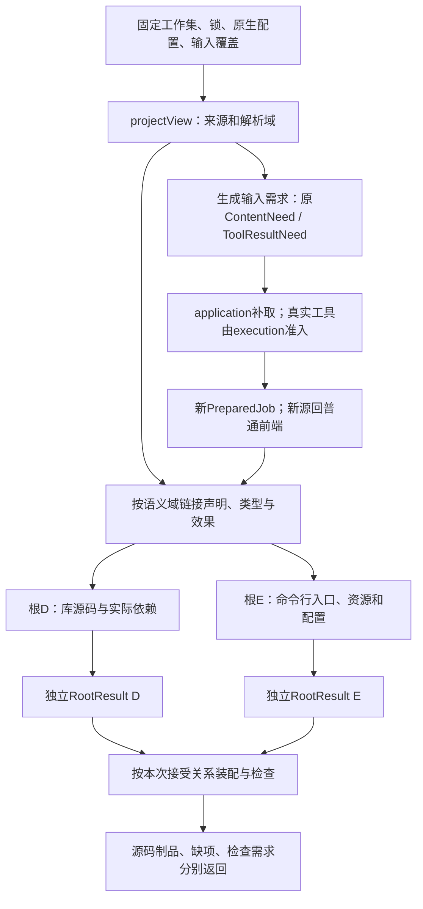
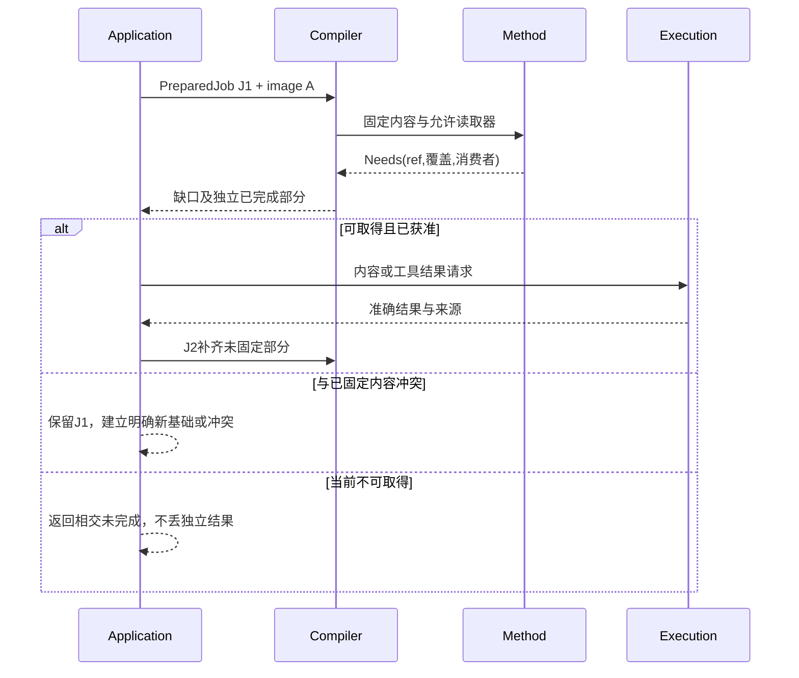

# 语义方法与整体根

## 编译内核怎样承担实现选择而不增加作者负担

`COMP0`冻结本次任务及作者源、资产和来源，不要求所有输入都是JSON。语义/端口绑定确定实现选择槽；只有存在未绑定的方法或跨目标问题时才调用R/J联合解析，已锁定合格构建直接复用。开发者明确Pin实现时遵守其约束；未Pin时按已接受的供给和决策策略选择，并把真实绑定及来源交给降低阶段。

源检查依据对象的当前解释、类型化控制、已接受硬要求与Target条件作合格判定。控制若改变外部可见行为，必须修改相应作者语义并重新检查；仅影响布局的控制不得偷偷修改算法。Target生成消费已固定的实现计划，交付实际代码和资源。控制字段存在、Schema合法和控制已在目标中生效是三个独立状态。

不同源类型进入对应有资格的读取器：程序源码经语言前端，配置与资产经格式/字节适配器，外部事实经宿主观察端口。它们的依赖、身份和保持范围在同一Candidate/Artifact中汇合，而不产生第二套资源真源。编译脚本、下载和资产转换若含外部副作用，必须另经运行授权；扫描到脚本不构成执行许可。

验证报告只为本次所请求的声明形成；纯预览无需构造运行证据图。缓存依赖、证明关系和恢复日志各有真实触发，遵守[最小证据载荷](../../60-保证与证据/保证/要求证据-追踪取证与裁决.md#设计判断运行事实与最小证据载荷)。

## 编译分解与自主设计规划的不同输入

[目标与问题总览](../../90-治理与参考/状态/README.md)用于设计者选择下一份工作，不是编译一个函数前必须遍历的全产品模型。一次编译只沿实际作者根、绑定与目标求解；本次未用到的语义模块、业务组合、问题和远程能力不进入编译键。

COMP0—COMP7的阶段结果可以映射成多个查询动作，不能把每个阶段机械实现为全工程栅栏。一个模块需要其他模块签名时等待签名槽，不等待无关后端全部完成。高层展开产生新动作时，先形成稳定输入与唯一结果拥有者，再加入同一调度域；不通过递归启动完整Gift进程来逃逸父预算。

作者源中递归函数保留递归调用边，有限函数体只在对应实例范围检查。模板/泛型不断产生不同实例时，需要有限特化、共享实现或明确未完成出口；查询去重只解决相同键重复工作，不能证明不断出现新键的展开结束。具体反例及处置由[调度规范](../../40-目标与制品/递归并行与远程编译.md#同键共享等待环与并行死锁)拥有。

## 复用成熟实现并把任务展示移出编译真相

COMP0仍固定完整作者输入和真实读取闭包；不接受一个被压缩的任务摘要代替原源码。任务视图和editRef只在应用层降低成已有候选变化，P阶段消费同一语言/结构与检查结果。展示说明重新排版不改变语义键；被折叠的导入或默认变化仍按真实依赖使对应结果失效。

首个TS后端复用锁定API族的AST构造、打印和Program诊断；原生TS读取使用实际Host与语言服务能力。官方旧API路线当前只对应其已说明的6.0及以前API族，不能假定7.1可原样调用。公共核心用窄类型化适配结果，不直接泄露某版SourceFile对象。具体已安装版本在实施时读取，本设计不指定一个伪造安装事实。

Gift保留独立职责：中立语义检查、已选定义展开、任务/契约保持、目标AST的合法构造和实际产物归属。成熟打印器只打印它收到的结构，不会替错误降低补回被删除的分支。只有现有工具确实不能承担的接缝才自研；不重写JS类型检查器、JVM、通用包管理和数据库日志。

每阶段按[复用分配](../../50-执行运行与观测/平台生态/宿主执行与隔离.md#成熟机制的实际复用分配)选现有能力，按[剩余验证](../../60-保证与证据/保证/要求证据-复用产物与实现证据.md#成熟成果复用与剩余验证责任)得到本次补证范围。没有请求代码执行时停在准确生成结果，未取得的运行事实保持未取得；已覆盖的上游内部义务不变成本次全套测试任务。

<a id="whole-project-compilation"></a>

## 全工程编译：按含义分图、按实际根闭合

**输出根相交。（消费条件）：** 同一语义源变化可以使一目标根需重编而另一根仍有效，必须保留真实共同不变量与本次相交输出集合。 合同归属：[变动影响的有型闭包与非局部反转](../../70-工程系统与演进/信息与生命周期/对象关系与配置基线.md#gift-relation-invalidation-closure)。

### 同一编译器接多个项目，而不是把文件全部铺成一个模块

输入是已有PreparedJob及其[projectView](../../10-作者与输入/作者源/工程源/工程准备视图与编译输入.md#project-prepared-view)。输出继续使用CompileOutcome、逐模块结果、RootResult、ArtifactSet与Needs；不增加一个需要作者维护的BuildUnit语言，也不创建第二套构建平台。`compiler/root-plan.ts`只把这些已有输入分解为原QueryNode/ActionPlan和有类型前置。

COMP0—COMP7仍是共同编译阶段，PREP0—PREP6是它之前的输入准备，下面MR0—MR7只是**多模块多根下怎样调用这些阶段**，不是新的串行管道。当前基础算法允许整模块/相交分量重算，再按实际读集增量收缩；不要求首次实现就完成跨语言细粒度最优调度。

### 七类边分别参与什么判断

| 边 | 实际对象 | 需要的算法与禁止偷换 |
|---|---|---|
| 源拥有/定位 | 工程、源区域、模块出现、实际字节 | 形成唯一来源与捕获范围；不当成编译必须先完成的边 |
| 声明/类型引用 | 模块公开声明、类型参数、允许互引的类型 | 按所选语言完成头、类型约束与合法SCC；不是运行全部模块才能知道类型 |
| 效果与合同依赖 | 已解析调用、直接效果、边界/保持要求 | 进入原单调效果闭包和准确合同分析；未知外部效果不按空集合处理 |
| 严格结果前置 | 某阶段必须取得另一个阶段的实际结果 | 形成当前等待图；没有已定义求解语义的环返回真实路径，不用类型SCC放行 |
| 生成源/资源生产 | 已绑定工具/纯方法→其实际输出→普通解析或装配 | 先有结果才有消费键，新增源再经前端；不能以预期输出文件名代替实际内容 |
| 初始化/运行依赖 | 被选择目标的模块初始化、共享资源、入口寿命 | 用于合法性、目标排程和实际依赖交付；不是让编译器执行目标初始化 |
| 成员与组合义务 | 多根、配置、资源、许可证、共同公开入口 | 按原AND/OR和目标组合器决定完整性；不能把任何一个文件输出称为全工程完成 |

边可以在同一邻接存储里带种类，不要求七套数据库。检环必须保留边种类与实际前置，不能先抹平后仅返回“循环依赖”。同一对模块可能同时有类型互引、运行初始化与资产依赖，其处理结论可以不同。

<a id="fig-whole-project-compile"></a>
### 图：工程输入、共同分析与独立输出根

箭头表示实际结果依赖；D、E不是两个作者程序。声明分量内允许的环已在H中求解，生成工具的严格前置另行判断。



### 多根下的具体计算过程

**MR0 建根需求。** 固定当前请求要求的阶段及[同代BoundRoot](../../10-作者与输入/作者源/工程源/工程清单模块与绑定锁协议.md#output-root-selector-binding)，不把公开选择器或路径当稳定定义身份。只读声明查询无需后端；源类型检查不要求可运行包；preview需要真实目标闭包；完整发行需要所有指定必需成员。默认目标只来自固定上下文，不取“当前机器恰好装了哪个后端”。按目标与布局组保留多个根，避免把两份独立目标配置合成一份。

**MR1 建模块出现。** 从根所需模块开始，按ModuleUse及其resolutionDomain解析实际导入。将字节解析、导入绑定、类型与效果拆成原查询投影。只读某公开接口时允许使用合格的已绑定接口内容；要生成或维护实现时需要相应主体/方法，不能拿声明文件冒充实现。

**MR2 处理语言级完整性。** 先完成必要声明种子与类型约束，再检查主体和关闭效果，最终封存可调用索引。整个模块是否合法由其语言规则决定：若语言要求整模块语法/声明有效，未选函数中的语法错误仍阻止这个模块；不能以根不可达就吞掉解析错误。另一个不依赖此模块的根可以继续。严格初始化环、布局不合法和未定义引用分别给原语言诊断，不统一改成“不支持递归”。

**MR3 选择和展开。** 沿[RES选择交接](../实现选择/实现解析与候选资格.md#realization-binding-handoff)封存或复用实际RealizationBinding，再由resolveUse投影到使用点。目标无关前端可以共享；目标条件改变原生解析、数值范围、ABI或可观察表示时，建立相交目标查询而非覆盖共享分析。展开引入的新声明、调用、效果与资产回到原绑定/检查，未检查的新代码不能直接进入emit。

**MR4 补取真实输入。** ContentNeed交已绑定解析器；ToolResultNeed交application/execution。生产输出必须带实际内容、成员、方法/输入关系和覆盖；只有文件名列表不形成源内容。成功结果进入新的固定准备态，再调用普通读取器与前端；工具返回错误保留上游源、已完成独立根和其真实失败，不删要求来隐藏缺项。

**MR5 规划目标。** 对每个相交目标/布局组收集公开名称、类型、初始化、资源及依赖角色；先解决必须共同决定的布局/冲突，独立文件再打印。返回目标贡献而非直接写用户目录。既有原生源码若就是该工程的唯一作者，则按深维护/保全合同加入目标或构建输入，不先反编译为.gift再生成一份竞争源码。

**MR6 封存与聚合。** 共同组合器核必需成员与实际来源。一个库根完整而一个CLI根缺配置，可以交付库根及CLI缺项；请求原来要求二者共同可发行时，总声明仍未满足。CheckRecord继续与字节制品分离；目标类型检查与行为验证按明确请求发生，不能因生成器没有报错就签发它们。

**MR7 结束与连续变化。** 返回逐根结果、最小可用诊断、已取得覆盖和合法继续位置；保留有用源及独立结果。下次修改重算相交解析域/分量/目标成员，未选择动作不启动。当前任务完成范围由原目的决定，无需把所有未来语言、所有未决设计及实施闭包或整个仓库每个文件都编译一遍才允许返回。

### 生成源的循环与引导有明确选择

`工具T需要先编译模块M`，而`M的声明来自T本轮尚未生成的文件`，这是严格前置环。它不是普通函数递归，也不因文件上次存在就自动被解决。当前选择如下：

- 若源范围已明确包含**固定的、可读取的引导输入**，且生成器可由它独立构建，则本轮先使用该确切输入构建T，再生成新内容，随后用新内容重编译消费者。旧引导内容与新结果分别保留来源；只有实际比较满足本次要求才可说自洽。
- 若T由独立已绑定工具/旧合格制品提供，则把它作为精确外部输入，不要求先用本轮M再造T；更新工具是另一项有范围的变更。
- 两者都不存在，则返回包含M、T与缺少基础的前置路径。可以保存作者草稿及独立根，不能假造空头、任意读取未声明旧输出或无限重复运行生成器。

普通生成器无此环时直接执行原生产协议，不强制两阶段自举。确需自宿主固定点的工具使用[原自举合同](../../40-目标与制品/编译内核/确定性与自举.md#编译器自举可信根与版本演进)，不把所有模板生成都升级成自举工程。

生成器若根据目录集合决定输出，成员集合与相应不存在性也进入它的输入；仅记录已输出文件摘要会漏掉后来新增模板/源。读取了活动目录但不能固定它时，应明示捕获限制或形成新的准备态，不能沿用“精确固定构建”承诺。

### 原生构建与中立生成可以共存，但不能互相冒充

已具有完整原生构建入口的工程，由实际适配器解释其已支持配置和构建合同；Gift可以一次调用成熟构建器，而不强制把它的每个内部节点拆成自己的工作项。这个选择保留真实构建行为，也减少重复维护。

适配器已取得精确输入/输出闭包时，将其映到原ActionPlan；只具备“按此配置调用工具”的有限能力时，结果记录原生工具实际覆盖，未解析的内部图保持未知。它不能因此宣布Gift已支持精确局部重建、字节可复现或完全跨语言迁移。工具中的插件/脚本仍是真实作用，打开工程不自动运行它们。

原生入口依赖一个新生成的中立库时，先取得并固定该库的完整实际成员，再将其作为原生构建输入。不能让原生构建器自由读取一个会被watch继续覆盖的生成目录。反方向亦然：中立调用通过已绑定的原生公开接口和真实实现交付，不仅有一份看起来正确的类型声明。

### 按根诊断的实际结构

内部诊断关联`producer`、精确`subject`、`basis`、实际源/资产位置、原因、已知覆盖与`affectedRoots`。跨模块链只保存解释当前失败所需的有限见证路径，重复共同原因可以共享；完整依赖图通过原query按需查看，不把全图塞进每条报错。

“未捕获”“精确不存在”“语言非法”“当前不支持”“当前无权”“工具失败”“预算中止”保持不同原因。一个缺失源可能同时影响多个根，修复建议回该源或解析输入；不能给每个下游函数都生成一个需要用户分别修改的伪错误。一个目标失败不扩大成无关源也有错，所有根都成功也不证明未请求的部署和用户目的已完成。

## 语义方法的共同调用协议

<a id="fig-need-input"></a>

**动态方法。（消费条件）：** 新语义模块可提供新的候选及约束，变更时由原resolver重算相交绑定，不由method自选全局最优。 合同归属：[开放候选域下的局部最优、不可实现与停止证书](../实现选择/实现解析与候选资格.md#gift-partial-optimality)。

### 图解：动态补输入不修改已固定内容

这是调用时序。Needs是数据需求，不是工具自由执行的命令；解释能力改变时新建准备代际，不热改旧实例。



本节定义最终成品怎样把语言、SemanticModule、作者计算、资源和资产方法装进同一条编译链，而不是只列decode/check/lower几个名字。它复用已有Definition、Binding、QueryKey、SourceMap和Artifact角色；不新增作者IR、业务关键词、公开工具或可随意执行的插件字典。实际装配由[EngineImage](../../70-工程系统与演进/实现与装配/源绑定与解释映像.md#engineimage解释装配和更新协议)固定。

### METHOD0：方法合同和装配前检查

每个实际方法以精确内容引用和方法ID确定。进程内采用有类型接口；跨进程或长期缓存才编码，编码合同不能扩大语义。MethodSpec至少说明下列相交数据；无需的能力不登记假实现。

| 字段/责任 | 确切意义 | 检查与缺省 |
|---|---|---|
| interfaceRef、methodRef | 提供哪一种共同能力，具体方法属于哪个版本内容 | 同名不同内容不覆盖；未知接口不调用 |
| subjects | 能处理的语言/语义模块种类与版本范围 | 限定实际支持构造，不能只写any |
| phase | decode、headers、check、summary、expand、lower、emit、edit或migrate | 按阶段输入合同；顺序不是任意插件列表 |
| inputContract、outputContract | 类型、归属、有效前态和返回关系 | 注册形状合格不等于输出已经语义正确 |
| reads | 能通过上下文读哪些固定内容/摘要；运行时记录实际读集 | 声明允许读不等于本次已读，不能把全目录都作为依赖；若方法实际查询一个候选集合，其成员范围与目录修订也记入 |
| resultScope | 本次获分配的目标区域、源增量或产物命名范围 | 不得修改兄弟输入、公共头或他人产物 |
| executionClass | fixed-pure或external-tool-result | 纯方法不拿宿主I/O；外部结果走execution |
| properties | 确定性范围、分析保持条件、可中断边界与预算口径 | 无证明不宣称全等/完备/恒定内存；预算不足有明确结果 |
| dependencies | 所需类型定义、接口方法和工具族 | 在装配时固定，运行时缺输入以Needs返回 |
| diagnostics | 真实源/资产位置、责任、严重性和已处理范围 | 公共状态不从任意自由文本推断 |

构造MethodSpec由扩展作者或工具适配维护，普通Gift使用者不填写。基础函数、新算法和普通库定义无需成为新的MethodSpec；只要可由已有语义表达，直接编译其作者源。

### METHOD1：三个返回分支而非一个万能success

```text
MethodOutcome<T> =
  Done {
    value: T,
    actualReads,
    diagnostics,
    introducedContent,
    preservedAnalyses
  }
  | Needs {
      requests: NonEmptyList<ContentNeed | ToolResultNeed>,
      completedIndependentResults,
      diagnostics
    }
  | Stopped {
      cause: invalid-input | unsupported | cancelled | budget | tool-fault,
      diagnostics,
      completedIndependentResults
    }
```

`Done`表示本方法按其合同返回了数据，不直接表示整个工程通过验证。check方法的value可以包含源错误；expand方法的value可以是仍须复核的新区域。`preservedAnalyses`逐项指向被保持的既有方法结果及保持条件；消费者验证实际输入关系，不允许仅用布尔true延续旧资格。

`introducedContent`记录新增定义、区域、导入、资产及其真实来源关系。新内容会改变闭包，先检查归属、引用、类型和效果，再作为后续合法输入。纯包装器不能签发尚未运行的检查记录，也不能令生成依赖假称已安装。

### METHOD2：Needs准确说明谁应当取得什么

`ContentNeed`字段为：本次basisRef、role、consumerRefs、精确contentRef或已绑定resolver下的resolutionRequest、所需覆盖。role区分作者模块、库接口、语言定义、目标声明、资产或已有布局，不能只给一个任意URL让核心自行下载。

`ToolResultNeed`字段为：本次basisRef、consumerRefs、toolContractRef、固定inputRefs、受类型约束的配置、所需输出形状与覆盖。它描述一个已知工具调用的结果，不包含任意shell字符串的执行指令。需要真实命令行时由已装配adapter从已验证配置构造，execution检查范围后运行。

取得后输入结果为found/exact-absent/denied/unavailable/failed中的真实分支，分别带准确来源与范围。相同name在不同根/版本/语言解析域不是同一请求。两个consumer需要不同版本，可以取得两份并按其包规则使用；不能由于字符串相同强合为一个content。

若ContentNeed取得的新内容需要另一个解释接口，compiler不就地注册方法。application将该需要交bootstrap，经原任务允许的解析与兼容检查产生新EngineImage和PreparedJob后继。旧纯结果仅按实际不变依赖复用；新的外部工具必须另经execution。不存在合格方法时保留明确不支持，不能通过热改全局表伪称一个固定调用完成。

### METHOD3：实际调用序列

1. compiler根据当前节点与阶段查固定image中的接口，核所选方法支持该对象。缺可选summary时可采用已定义的保守规则；没有足够条件的优化保持不执行；缺必须lower则该根不支持，不能输出空目标。
2. 为该调用创建局部result builder、只读输入访问器、实际读集记录器和预算份额。共享内容仍有当前读取范围，方法不获得完整工程的自由访问。
3. 纯方法直接执行；实际外部方法先返回ToolResultNeed。application按照作用目的准备execution，不在编译器内藏一个可随意读cwd或联网的callback。
4. Done返回后检查输出种类、引用归属、作用范围和introducedContent。新增中立节点补绑定/类型/效果；目标区域检查合法性。违反合同归方法实现错误，不改作者要求使其“匹配”。
5. 先安装真实依赖和新区域，再决定哪些分析可保留。无变化时允许复用，改变实际规则或来源时按消费者失效；只比较输出值不够。
6. 返回Needs时保存可独立使用的完整结果，application处理准确缺口并形成PreparedJob后继。相同需求连续未带来任何新事实时结束为相应缺项，不无限重调。
7. 方法失败或中止只丢弃未发布builder。已独立完整的结果按原根关系保留；运行中的外部任务必须等实际停止或责任转交，不因栈展开就释放它的输入。

### METHOD4：静态阶段、运行阶段和适配的三个边界

decode/headers/check不能执行目标函数“试试看它是什么类型”。静态求值只在语言明确允许的子域内执行，预算和失败沿其合同。数据流循环、状态反馈、函数递归分别检查，不由通用PassManager选一个任意遍历顺序解释。

expand与lower只能改变获分配的候选区域。它们可以要求新依赖，但不能凭自己的输出修改发布目录或登记当前权限。需要多种语义贡献共同控制一个公共导出时，返回贡献交给共同组合器；局部lower不直接写同一最终文件。

edit/migrate产生作者或格式变化计划，仍受实际base和写权迁移合同；它们不是绕过fork/apply的特殊入口。一个包只有读取和生成能力，没有可靠edit方法，仍可有合格产物，但不能宣称任意逆向修改支持。

### METHOD5：整体生成贡献的汇合

语义生成贡献复用既有ArtifactPlan/LoweringResult角色，必须给出：当前root、所需输入、提供的公开符号/资源、每项输出的逻辑身份与候选路径、初始化与运行依赖、残余义务及来源映射。没有运行依赖就空集合，不填空服务。

共同汇合先检查：请求根的AND/OR关系、输出身份、路径规范化与重叠、公开符号、相同资源实例和版本，及跨语义/模块合同。两个贡献输出同一路径的相同字节，仍需要明确同一生产归属或合并合同；两个不同合同不能通过碰巧同值取得永久共享资格。

有序配置、模板区域与CSS等由对应格式组合器处理；普通文本拼接不是通用组合算法。源、资源、许可证和必要配置形成完整成员以后封存产物根。后续检查追加到EvidenceStore；产物的内容身份不包含不断变化的通过/失败状态。

一个算法源码根可以已产生，完整应用包因为图标缺失尚未产生。它们分别返回，不给缺资源的包换上已生成算法的状态。新生成的源码作为另一编译输入时，也要有真实来源/解释和阶段边界，不能绕过普通前端检查。

### METHOD6：可独立重现的接缝反例

| 输入/扰动 | 预期 |
|---|---|
| check方法返回类型合法，lower新增一个网络调用 | 新效果和依赖补查；离线硬要求下拒绝该实现，不删原要求 |
| 方法试图修改只读兄弟区域或同一全局Map | 接口与隔离阻止；发现实际越界则隔离方法结果并限制后续使用 |
| 装配A期间发生库升级B | 该请求继续A；新请求可用B；A产生的结果不能贴B的方法身份 |
| ContentNeed先确认某版本缺失，后来同version出现内容 | 结果范围发生冲突，不在原basis原地覆盖；另取合法新基础 |
| 缺生成器，但已有合法结构读取器 | 读取/保全可完成；生成根准确不支持 |
| 缺优化分析但基础降低有定义 | 保持未优化正确路径，不强制全域证明服务器 |
| 两个语义贡献争文件或公共名 | 采用既有明确选择/组合器；没有时报告真实冲突 |
| 上游方法崩溃，工作者留下半份成员 | 未封存成员不发布完整ArtifactSet；作者和其他合格根保持 |

该协议给通用框架一个可实施边界，同时保留各语义模块和作者库真正的算法。MLIR接口允许通用变换读取已注册语义接口，而Pass管理限制共享可变状态及分析失效；这些是机制依据，不是Gift自身方法的正确性证明。参见[Interfaces](https://mlir.llvm.org/docs/Interfaces/)与[PassManagement](https://mlir.llvm.org/docs/PassManagement/)。

## 状态语义方法的具体输入输出与目标闭合

本次状态语义模块不是新编译器。按[共同METHOD0—METHOD6合同](#语义方法的共同调用协议)装载`gift.statechart/1`实际方法；没有状态输出根不加载它。下表是实现责任而非新增公开工具。

| 方法阶段 | 实际输入 | 当前输出/处理 |
|---|---|---|
| headers/check | 精确普通库模型或statechart-body、回调与类型 | 固定树/顺序/初态/历史/目标、诊断；guard/action继续原类型和效果检查 |
| expand-model | 固定工厂符号、实参、语言/库与预算 | 有限ChartModel或MODEL_NOT_STATIC/预算缺项；不eval宿主代码 |
| summary | 模型、回调和实际活动/输出绑定 | 输入域、稳定状态、未来能力需求、终止条件和真实依赖；纯计划不被当无作用应用 |
| lower | 合法模型、目标及布局/资源合同 | 表/调度代码、回调区域、必要运行依赖和来源；新增区域再次检查 |
| emit | 合法目标表示及根成员 | 普通目标源码；有活动才加driver适配，有持久要求才加存储配置 |
| edit/migrate | 作者或运行快照基础、准确变化与目标模型 | 作者候选或实例迁移计划；实际实例切换仍需宿主准入 |

纯模型工厂可以先从精确绑定的有限构造解释开始，普通运行函数仍正常编译。不可静态确定的拓扑不能假造空模型；有权允许动态模型时选择相应运行库，否则只限制静态图输出。原StaticExpr语法不扩大。

运行解释器与编译期解释器分开：前者按STATE0—STATE6处理业务事件，后者产生有限模型与目标代码。两者不能混用当前权限或线程池。宏步循环的运行预算不是生成期查询结束的依据；源图正交也不要求编译器为每个状态启动进程。

## 关系语义的检查、计划和合法下推

[关系规范](../../20-语义与组合/基础语义/状态关系与流/关系查询与维护.md)给出有限公开库、QUAL0—QUAL7和实现方法表。COMP1/COMP2只解析普通作者与真实库符号；COMP3推导ValueOps并检查字段/回调、Bag/Ordered边界和缺失层次；COMP4识别合格调用形成RelPlan，保留捕获、作者顺序与来源；选型检查总定义与安全屏障，之后lower贡献普通目标代码或参数化SQL。

已绑定的库名不按字符串识别；解析源码不运行数据库；运行参数未知不阻止生成。纯但可能出错的回调不能无条件进入数据库优化区。SQL布尔、NULL、ALL、空聚合与目标Text/Int分别检查，任何一种不匹配都应限制该下推而不是污染中立模型。需要本地残留时，真实数据转移同样必须满足任务与许可。

新展开的调用、codec和源输入进入真实读集并重新接受相交检查。编译结果是产物而非查询完成；目标ViewState是运行对象，不进入作者候选或所有CompilerQuery。无数据库的资产统计生成普通集合、精确整数和排序辅助即可。

## 对象、流与微分的阶段方法

| 方法 | 输入、计算与输出 | 重新检查及失败 |
|---|---|---|
| checkObject | 模块成员、父链、接口、方法体 → 槽表、构造计划、效果与诊断 | 继承环、构造逸出、读前未写和覆盖不相容定位到源 |
| lowerObject | 已检查对象及目标控制 → 布局、构造、分派代码与依赖 | 真实反射/继承要求不能满足则该目标缺项，不打印同名壳 |
| checkStream / planStream | 流构造与回调、源能力、容量和时间要求 → 有序计划 | 无限输出、无界内存或未知源进展不伪装已满足 |
| lowerStream | 合格计划 → 普通循环/异步入口、必要队列与driver | 不改变错误次序、信用、迟到与End规则 |
| qualifyDerivative | 真实函数、空间、规则、模式与数值域 → 活动区和资格 | 原值成功、路径线性化与数学导数分开 |
| differentiate / lowerAd | 合格区域 → JVP/VJP、残余计划与目标 | 新导数节点重新类型/效果检查，缺规则与资源分别返回 |

所有方法通过现行MethodSpec装配。对象扩展由明确语言画像选择；流和AD沿普通库与语义方法识别，不运行任意作者脚本以猜构造。优化器在构造安全、流时间下界、回调定义域和导数数值政策这些前提内工作；原已检查标签不能直接覆盖新插入的节点。

## 按键取优定义的生成接合

`gift/seq.maxByKey`的值域、求值、结果和算法由[库合同](../../20-语义与组合/组合/模块封装-功能复用与作者责任.md#有限可复用合同按键取极值并保留来源次序)拥有。编译器识别准确绑定后可保持普通主体，或调用其已有MethodSpec生成私有字典/顺序扫描；不为一个新库函数扩展全局表达式联合，也不要求调用方提供生成模板。

选择方法时检查有限序列、键/排名/平局及输入前后处理的实际合同。rank与key的回调只有空效果并不足以允许任意重算、调序或提前执行；没有适用保持依据就沿参照调用次数和顺序。最终输出按胜出元素的原位置，不沿键首次出现顺序或字典迭代顺序。原普通程序的自动替换还需要它与该新合同的相容依据，不能看见`hasHigher`名字就重写。只有记录字段读取和精确整数比较的当前范本可直接按相同正常关系校准，资源条件另计。

<a id="completion-aware-lowering"></a>

## 有限并发、顺序流与微分的共同降低接合

下面是COMP0—COMP7内的具体扩展义务，不增加总编译阶段或新的任务服务器。作者源仍使用已有模块、调用、类型与方法选择；只在所选定义确实含相交行为时建立相应运行计划。接口返回类型、失败阶段、结果拥有和停止合同属于被降低语义，不能只保留正常结果公式。

| 相交能力 | 语义检查的精确输入与计划 | 降低、运行与优化义务 | 能力不满足时 |
|---|---|---|---|
| 有限任务域 | 捕获/Own/Borrow/线程亲和性，组合拥有集合，结果可复制性，all/collect/race明确政策，退出与清理依赖 | start之前形成可接回调的登记；await只消费既有任务；退出生成关闭/等待/一次领取或清理路径；禁止把借用帧提前释放 | 可以选择串行或单事件循环的合格方法；不能用裸Promise.all、drop或隐形detach冒充结构保证 |
| 有序流 | 数据ordinal、控制cut、并发/缓冲边界、失败政策、信用与TimeRule | 纯回调可并行但提交按连续前缀；融合须保留普通错误和水位/End顺序；同步回调使用有限排空而非无界递归 | c=1仍可符合；无时间保持依据则有限End结算或准确未最终化，不伪造frontier |
| JVP/VJP | 所选原计算、seed/Space、活动性、规则和数值画像、残余拥有 | 原值与导数故障通道分开；检查和向量化不吞原故障；tape/设备同步/检查点保留真实预算与停点 | 使用可保持语义的较小规则实现或给缺项；黑盒先抛导数错误不自动视为符合 |

检查产生的计划必须把策略和规则修订纳入其方法/画像身份。缓存一个不同故障策略的结果不能仅因输入和数学表达式相同就命中；可复用的原始解析与不受影响纯子结果仍按原查询图共享。并发c及预算改变的是具体执行策略和可完成范围；它们不允许把超预算改成业务Fault。运行记录保存实际被选计划与实际范围，不把设计算例当编译证据。

主动丢弃不可观察且已证明无失败/不终止差异的纯中间值仍可优化；没有证明时保留原计算次序。信息查询的页归并和外部作用RetryBasis属于application/execution，不塞进作者CoreIR；编译器只处理目标程序真的调用的对应方法及效果，不因为开发控制面也有“任务”就混成同一个任务图。

各自的唯一算法见[任务域](../../20-语义与组合/基础语义/计算基础/通用计算与任务语义.md#structured-task-lifecycle)、[有序流](../../20-语义与组合/基础语义/状态关系与流/背压与事件时间.md#ordered-stream-control)与[微分错误](../../20-语义与组合/基础语义/数值/自动微分与线性化.md#ad-fault-precedence)。

## 供给子域与跨实现数据

COMP0—COMP7对结构需求或原生调用均消费相交的[条件方法计划](../有条件实现与公共行为保持.md)。类型或能力已证明的条件可以消去；运行值条件在一次实参求值后检查；guard与所有可达方法的真实输入进入失效键，不能降低时重新按名字选择。

跨实现的数值/字符串/布局/范围、别名和资源由[调用合同](../../50-执行运行与观测/跨实现调用与数据寿命.md)处理。只有输出类型相同不足以省略转换；强范围检查先用精确或检查溢出的算术，再构造窄原生表示。调用/回调/释放的代码与数据责任必须产生实际消费点，不以新增一个安全标签代替。更简单的同语言直接调用可消除无真实差额的包装。

<a id="intent-to-product-root-compilation"></a>

## 从产品意图根到成品工程：统一根编译算法

完整业务生成不以“能输出多少行代码”衡量，而以所选 ProductRoot 的全部必需义务是否闭合。一个根可以主要由成熟Supply承担，也可以含独特作者算法；两者进入同一流程。

### 成品根闭包图：编译、保证与作用各自拥有节点

ProductRoot 的完成不是 `COMP0→…→COMP7→验证→作用` 的万能十阶段状态机。`COMP0—COMP7` 只定义 compiler 在固定输入上的确定性求值角色；Assurance 与 Execution 拥有不同 authority、失败和重试协议。一个请求按真实依赖建立下列有类型 closure nodes，同类节点可由 Query/ActionPlan 并行、复用或回边求解：

| 闭包节点 | 唯一 owner | 输入与输出 | 关键禁止 |
|---|---|---|---|
| `ROOT.AuthorBasis` | Workspace/Application | 固定 AuthorSnapshot、资产、Requirement、Control、project/lock、root/target 选择 | 不把任务摘要、当前 cwd 或未固定 latest 冒充作者基础 |
| `ROOT.Semantics` | Semantics | Definition、Type、RequirementTerm、语义关系、公开边界和 Effective Contract | 缺决定返回 Needs/Unknown；不偷宿主默认 |
| `ROOT.Realization` | Compiler/realization | RES形成的Decision/RealizationBinding，派生UseBinding、Method、Supply、Algorithm、Provider、残余义务及冻结 RealizationPlan | 不在 compiler 内调用 LLM；不让后续阶段重新漂移选择 |
| `ROOT.Target` | Compiler/Target | `TargetProgramPlan`、backend 输入、目标约束和目标专有残余 | 目标假设不反写 Meaning；多个方法不能各自写最终 manifest |
| `ROOT.BuildClosure` | Target/ecosystem resolver | 固定 crate/npm/toolchain/features/build generator/native link 等实际结果或 Needs | resolver 结果不等于已经执行下载/构建；有作用准备仍归 Execution |
| `ROOT.Artifact` | Artifact composer | 源、配置、资源、runtime member、说明、SourceMap 的 `ArtifactSet` 与成员完整性 | 组合成功不等于 syntax/type/build/行为已经验证 |
| `ROOT.Assurance` | Assurance | 按本次 Claim 选择静态、形式、目标工具、案例或现场 Evidence，返回 Verdict/缺口 | Verification 不是 compiler 成功位；缺证据不改 Requirement |
| `ROOT.Effect` | Execution + Observation | 只有请求真实作用时才保存/构建/运行/发布/部署；产生 Operation、readback 与可绑定 Evidence | effect success、readback、adoption 与 assurance verdict 不互相代签 |

依赖不是固定线性顺序。`ROOT.Semantics → ROOT.Realization → ROOT.Target → ROOT.Artifact` 是常见纯编译主链；`ROOT.BuildClosure` 可以为 Target/Artifact 提供已固定解析结果，也可以因真实工具需求返回 Needs 后由 Application/Execution 补取再形成新 basis。Assurance 只消费其 Claim 所需的准确 revision/Artifact/环境：纯形式或源级 Claim 可以在没有 Effect 的情况下闭合，目标 build Claim 需要相应工具结果，运行 Claim 才依赖 `ROOT.Effect` 与 readback。Execution 永远由显式 effect intent 触发，不是“走到最后一步”自动发生。

因此只有 `COMP0—COMP7` 在同一固定输入和所选纯方法范围内承担 compiler determinism；外部工具、测量和现实作用分别服从 Assurance/Execution 的真实协议。一个根可以从“只有需求，没有业务源码”开始，也可以从“成熟框架＋少量独特算法”开始；两者共享同一闭包图，不形成第二编译器，也不把验证与部署吸收到 compiler 状态机。

### TS 与 Rust 双目标共享上游，不共享错误目标假设

同一ProductRoot输出TypeScript和Rust时，COMP0—COMP4尽可能共享语义分析、Requirement、实现选择中真正目标无关的部分；COMP5以后按TargetProfile分叉。一个Supply若只支持TS，它只成为TS方案成员；Rust必须选择另一Supply、生成独特实现或准确报告缺口。不得因为两边接口形状相同，把JS GC/exception/dynamic object假设带入Rust；也不得因为Rust拥有权更强，把额外限制反写成产品Meaning。

目标无关Method可以贡献中立行为计划；目标专有Method明确绑定target。多目标共享同一外部协议或数据模型时，公开Meaning/Requirement仍是一份；wire/storage/ABI分别由其owner决定。一个目标失败时可以返回另一个目标的独立完整结果，但多目标发行根只有全部必需目标和共同成员闭合才成功。

### “任意业务”能力的真实扩展点

新的业务需求通常只增加作者 Definition/库及其必要 Method/Supply/Target mapping，不修改 compiler-kernel。只有通用消费者必须理解、而现有 Standard Semantic Modules 无法保持的新可观察区别，才增加或扩展 SemanticModule/SemanticDialect；只有系统级身份、Requirement、Binding、作用、Evidence、恢复或演进合同仍无法表达时才修改 Core Kernel。这样业务组合可以持续扩展，而核心不会变成包含世界业务类名的巨大枚举。

## 语义模块联合编译与根产物发布

### 各种语义能力与作者组合怎样接到同一系统

每个被采用的语言、SemanticModule 或作者扩展提供其实际类型、体结构、作用域/激活、公开能力及必要的方法。方法分别承担读取、绑定、检查、边界摘要、转换、编辑投影或演进；缺哪项只限制实际依赖它的动作。完整方法合同见[语义方法的共同调用协议](语义方法与整体根.md#语义方法的共同调用协议)。

| 语义/作者内容 | 保留的高层结构 | 编译时接合 | 目标运行或后端责任 |
|---|---|---|---|
| 通用计算与用户库 | 有序表达式、绑定、类型、契约、公开门面 | 原签名与效果规则、实际库/目标映射 | 普通模块、合法循环/数据表示；无强制Gift服务 |
| 网格/数值/设备 | 形状、索引关系、精度、边界、访问与预算 | 计算域摘要和合法调度/表示策略 | 成熟算子、循环、缓冲、设备提交和真实同步 |
| 对象与接口 | 身份、字段、构造、分派、访问与生命周期 | 对象合同、目标特有控制和ABI适配 | 实际类/接口/句柄；仅class外形不冒充对象行为 |
| 复合作者应用 | 由作者 Definition/库组合出的业务对象、规则、作用与交付义务 | 只消费其实际使用的标准语义、Method/Provider 与 Target 绑定；不预置应用方言 | 目标应用自己的存储、消息、认证或其他运行机制；Gift 不直接提供业务 Runtime |
| 层级状态 | 活跃配置、转移冲突、进入退出和历史 | 状态域规则与代码生成 | 规定的微步/宏步、取消、持久或瞬态状态 |
| 关系查询 | 集合/多重集、空值、键、顺序和聚合 | 类型化查询图与合法计划选择 | 实际数据库/本地集合和对应一致性 |
| 时间流与实时 | 时基、水位、窗口、背压、期限与资源 | 有界流/时间接口及目标条件 | 队列、调度、计时和真实设备保证 |
| 微分与近似 | 导数意义、不可微点、随机/状态和记录寿命 | 微分规则、数值合同与变换保持 | tape/检查点/内核及真实内存、误差 |
| 配置、资源与文档 | 格式树或原字节、成员与引用、作者归属 | 选定格式适配与完整资产闭包 | 打包、复制、合法转换和许可资料 |

表中的标准语义只说明进入总体的接口和状态责任，复合作者应用一行只说明组合路径；它们都不等于 Gift 已内置具体业务或 Provider。某些便捷作者形式与详细算法仍有已登记缺项，不能由表格代签完成。不支持一类高级表面不应导致核心重新设计，也不允许通过任意JSON把缺少语义伪装成已支持。

跨域连接生成显式义务：上游正常结果能否进入下游输入，失败/取消怎样交接，资源能否跨边界活到最后消费者，实际适配是否改变精度/顺序/作用。互相假设不能自证成立；必要时合并相交检查域。转换不是免费的箭头。

包描述或接口语言可以说明类型形状，但不能独自证明行为。例如[WIT](https://component-model.bytecodealliance.org/design/wit.html)定义接口合同而不定义函数执行行为；Gift因此把shape校验、语义方法、目标实现与实际准入分别接合，而不是指望注册表自动补全一切。

### 跨语义与作者组合的计划和产物怎样共同发布

编译器使用每个语义模块或作者组合返回的候选贡献，统一取得输入需求、生成输出、连接条件与成本。具体计划算法由相应语义/作者 owner 拥有；共同链接器负责真实跨模块连接、公共符号、产物路径和AND/OR根，不修改业务规则来消除冲突。

每个逻辑输出在同一绑定中只有一个选定生产者，或一个显式组合器。独立贡献争写同一路径时报告竞争；相同字节也不能自动合并两份不同的生成权。共享声明需要合并时，指定一个拥有公共符号表的生成步骤，其他贡献提供结构，不在文件尾按完成顺序拼接。

产物先写隔离的成员builder，检查路径、类型、引用、源码布局及要求的资源。封存ArtifactSet后再对外发布引用。代码生成成功但必需图标没取得：可独立返回代码根，完整包根保持缺项。没有需要的资源或运行功能，不制造空目录/数据库/工作器。

缓存命中只能提供同键合格内容；作者当前可读、结果当前可披露、产物当前满足哪些检查，分别判定。合法历史内容可以保留，但不能由旧操作更新当前头。两个确定动作同键输出不同，隔离相交结果并调查输入、方法或环境，而不是采用后到者或最快者。

<a id="层级状态作为成品总装的具体领域"></a>
<a id="关系计算对成品主链的具体校准"></a>
<a id="对象流与微分的共同接合"></a>

### 同一编译和变更主链中的语义能力

新通用工程使用[一次固定的语言组合](../../20-语义与组合/基础语义/计算基础/紧凑表示与程序范式.md#合同标识默认语言组合与按需能力)，普通作者不逐类选择画像或为每个库创建另一份模型。语义模块规范可以分章，但不因此产生第二套候选、类型、接口、头或权限系统。语义族ID、库入口、编码和实现修订分别承担精确解释，不混成一个全局开关。

对象、状态、关系、流和AD经同一semantics方法进入compiler产物贡献；其[状态所有者](../../70-工程系统与演进/实现与装配/能力接合与文件责任.md#语义模块共享编译责任运行状态由目标拥有)属于目标程序，而非Gift开发库。关系源读取与状态活动要经真实宿主取得，静态库导入不执行它们。ChartSnapshot、ViewState、对象实例、窗口修订和tape各自有含义，不因都叫状态就合并存储。

组合仍检查具体边界：对象读取形成不可变输入后才能合法重算AD；取消流不能使求导器失去仍在借读的内存；同一请求内旧窗口导数只结算原资源，不能覆盖新修订；关系结果可读不自动允许公开聚合，跨源版本向量不冒充全局同时快照。源定义改变需要迁移或重算目标状态，不能假装是一条数据delta。

完整小工具不依赖每个 Standard Semantic Module 先完成；已采用的高层语义也不被降成无合同函数黑盒。新功能若只是更多定义或方法，沿现有边界进入；真的改变公共含义，则修改相交规则与兼容条件。模块图、类图或更多适配名称都不能替代这一步。

<a id="gift95-cross-contract-12"></a>
## 合格Root与未实现Rule的联合行为

根只有在已接受作者闭包可解释、实现方法共同覆盖、目标语义有合法映射且所要求的Artifact成员可实际提供时，才能取得对应的产物计划资格。Rule的某一谓词未绑定不必阻止保存作者模块，却阻止把相关Root生成成“全功能已实现”。单根完成与所有工程输出根完成分开记录；公共语义可能复用，但两个目标不能共享超出双方可表达性范围的优化结论。

## 从整体语义根取得 Method 的责任

[全域共同合同](../../20-语义与组合/共同语义/工程通用语义全域与闭合合同.md)表明编译器不能把所有需求先降成一个普通函数图。MethodResolver 应按当前根实际使用的 Definition/Contract、状态/关系/时序/效果/资源/权限和环境义务取得局部解释与合格候选；缺少真实领域语义消费者时返回准确 Needs，不插入虚构的 `Compute` 表达式。
