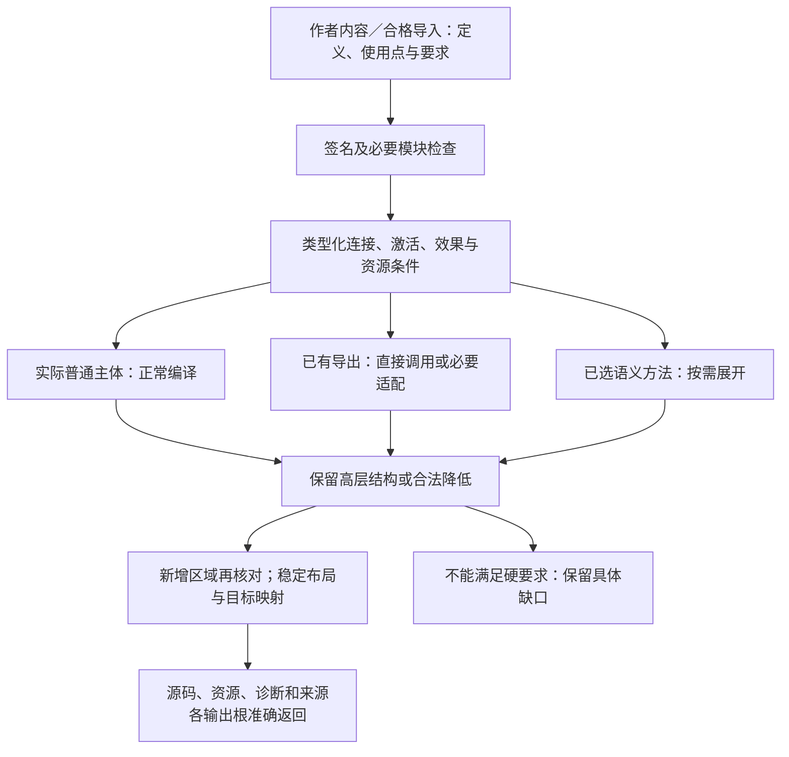

# 编译责任、阶段与目标

## 作者源、语义IR、目标IR必须分离

从`gift.project.json`和模块读取的**作者SourceAST**保留语法、来源与版本；名称解析、类型和语义解释得到有型`BoundDefinition`/`Meaning`结果；目标与Pattern实例化导出`DerivedObligationSet`，对全部选根联立为`JointObligationSet`；Method资格化后导出`QualifiedRealizationPlan`；Target据此构造`TargetProgramIR`或精确的目标AST，再发射`ArtifactSet`。以上是**逻辑阶段结果及类型化消费者义务**，不规定必须保留五个固定IR文件或把所有阶段结果持久化。

`K1–K9`与`V1–V5`是语义职责及抽象视图，**不是**同数量的IR节点；COMP/CAP/S系列是工程任务视图，也不必与IR一一映射。一个Definition可以携带多个语义职责；QualifiedMethod可复用专业算法，不能重新决定作者Requirement。缺少Meaning/Method/Target的产品资格时，保持对应`Needs`，不能以Schema PASS或尚未降低的谓词建立成功的目标AST。开发者唯一源不包括派生IR，参见[开发者归属图](../../00-系统与原则/开发者源码分层与构造归属图.md#gift-author-source-layer-taxonomy)。

## 编译责任、阶段与目标

### 无LLM的固定作者输入到成品程序

生产编译器消费冻结的 ModuleRevision、Requirement/Control、Meaning 解释及 Binding，不在重建时重新调用自然语言模型。人、AI、导入器可在编译前形成待采纳作者候选；原自然语言可以作为明确的资料或字符串保留。缺少必须由作者决定的意义时，返回具来源的 Needs，不暗造算法、默认或新的全局错误类型。

**预览与正式采纳分开。** 已固定且具有解释条件的候选，可在保存、Git 合入及部署前进行分析或试生成，但独立已接受 Requirement 仍然约束预览。正式采用遵守自身权限、前像和版本；离线确定性重建只有在已锁定的源码、解释器、工具及依赖都仍可取得时成立，缺项返回精确 Needs，不联网选 latest 或重新询问模型。

下面INPUT0—INPUT8是COMP0—COMP7及调用方的阅读路径，不是第二流水线或强制九步状态机。纯源码请求不自动执行INPUT7；Assurance按所需Claim可以消费更早的静态/形式结果，不要求先有现实运行。

| 路径 | 准确输入 | 原责任 | 输出及失败边界 |
|---|---|---|---|
| INPUT0 固定作者事实 | 作者/原生源、适用要求、Profile、Control、目标根与revision | workspace/application | 不可变PreparedJob与覆盖；缺输入保留Needs |
| INPUT1 解释与类型化 | 锁定dialect、语言、Type codec、原生观察 | semantics | Definition、类型、效果、主体关系；未知解释不猜 |
| INPUT2 闭合产品义务 | 根的接口、状态、资源、错误、时序及联合关系 | semantics/compiler | 有作用域的原义务结构；逻辑一致不冒领已有实现 |
| INPUT3 解析实现 | 义务、TargetProfile、准入范围内目录与已有Binding | 原resolver | 精确UseBinding/RealizationPlan；优先复用仍合格绑定，不按业务词猜库 |
| INPUT4 物化已定义实现 | 已给程序体、已选 SemanticModule 的语义方法或经原流程接受的创作结果 | compiler及方法owner | 可降低主体；缺独特算法或方法则返回对应Needs |
| INPUT5 确定lowering | 冻结语义、目标Binding、能力与布局控制 | 当前合格compiler owner；长期纯核方向为Rust | TargetProgramIR/ArtifactPlan；打印前不重新决定业务含义 |
| INPUT6 发射与组成 | 目标程序、依赖贡献、资源/config成员 | target backend/composer | TS/Rust源码、manifest、资源、SourceMap；成员冲突不能后写覆盖 |
| INPUT7 原生工具检查 | 精确toolchain、lock、源码与所需资源 | Provider/BuildRunner；仅在请求及准入成立时 | 类型/链接/构建回执；不等于全部业务义务通过 |
| INPUT8 独立保证 | 准确Claim、产物或其他阶段事实、实际证据 | assurance | 绑定范围的Evidence；不反写要求、不扩大作用权 |

**实现取得**：已有合格方法可在固定输入和策略下自动选择；新颖业务算法须来自作者代码、能够承担完整义务的 Definition/Provider，或明确授权的开发委派并经采纳的候选。合格综合器可以在其输入域中生成方法，但不扩张为任意程序可综合保证。无供给时保留 Needs；TODO、空类、panic 桩及“最像的库”均不满足 complete。

关系、状态、数值等已采用 Standard Semantic Module 可以通过合格语义方法承担自己的检查、计划或降低，不要求把其成熟算法逐句重写进通用 Kernel。约束求解器、渲染器、仿真器、游戏引擎等完整能力首先作为作者库、Provider/Target 或外部成熟供给组合；Gift 不因这些业务/工具名称预置同名方法。只有通用消费者必须理解、而现有模块无法保持的新可观察区别才增加 SemanticModule/SemanticDialect；独特业务算法由作者或明确供给实现。语义方法未知、实现缺失和目标无供给分别保留。

Gift 的 Rust compiler-kernel 与 Rust 目标后端分别承担编译算法和业务源码生成；使用 Rust 实现 Kernel 不限定产物语言，也不把输出的 Rust 业务源码纳入 Kernel crate。TS/Rust Target 共用冻结作者语义与共同 Requirement，但各自锁定独立的 TargetProfile、MethodBinding、ABI、依赖和工具链资格；两种目标不应假定共享完全相同的物理实现绑定。

应拒绝：关闭模型后同一固定输入输出漂移；普通重建因目录新增包自动换实现；printer改选异步runtime；缺算法时生成panic/TODO仍complete；两个后端各自重新解释需求；把未正式采用候选一律禁止预览；离线缺依赖却静默换成同名最新包。边界违例应修原owner，不归咎于模型不够聪明。

### 定义组合在共同编译链中的处理

DEF0—DEF6是普通定义／语义模块或作者组合进入既有P阶段的视图，不是每个请求再运行一遍的第二编译器。入口、参数、成员和关系来自真实作者ModuleRevision或只读ImportedModuleView及对应合同；没有被作者写出或被合格规则派生的实现分解，不通过block名称猜测。普通主体沿固定语义编译；专用特化是按需供给。

| 阶段 | 正常算法与结果 |
|---|---|
| DEF0 固定入口 | 固定作者候选、所选输出根、解释与目标，取得定义和公开合同；不先枚举所有库 |
| DEF1 收签名 | 建立引用与必要声明分量，保留函数递归；未显示的内部源码仍按语言检查范围处理 |
| DEF2 检查连接 | 对使用点映射参数角色，保留源码求值／激活；处理类型、效果、借用、时间与共同条件；缺口归到准确端点 |
| DEF3 取得实现 | 已有合格绑定直接使用；普通主体正常编译；目标库／语义方法不以一份同义 Gift 主体为前置。真正无供给时保留缺项，不把名称当实现 |
| DEF4 按需具体化 | 已固定且可安全计算的参数用于特化；动态值留给程序；展开预算结束时只在普通主体仍满足要求时回退 |
| DEF5 变换与目标 | 保留实际阶段、区域和私有高层关系；内联／融合须保持次数、失败、别名、资源和目标结构；新增节点重新检查 |
| DEF6 汇合与返回 | 输出文件、配置与资源进入原组合器，保留布局和源映射；独立根分别返回，纯生成到此即可结束 |

同一个块只查一次签名，不等于整个实例只运行一次。代码可共享，有状态实例和可观察分配不能按内容摘要合并。公共效果可以抽象内部封闭状态，但内部读写依赖仍由BodyAnalysis消费，不能因此把两次next调用当纯值去重。

实线表示编译数据依赖；图中的普通主体／合格方法是实现供给，不是作者必须维护的两份程序。预览没有通往磁盘提交的隐含边。

分析不以用户当前看到几层为上限；也不要求先物化整个递归展开树。条件失败顺序、输入所有权或时基在连接中不相容时，返回生产者提供什么、消费者要求什么、有哪些合格适配。参数变化通常只影响相交定义和特化；公开接口或共享关系变化可能影响更大范围，不能以chip边界许诺绝对局部性。

### 契约驱动的组合计划在编译链中的位置

本节不增加一个全部任务必经的证明器。读取与绑定后取得当前要求和输出根，复用既有类型/效果分析形成稀疏边界；仅在实际连接需要时调用[组合闭合](../../20-语义与组合/共同语义/边界摘要与跨域组合.md#组合边界摘要与义务闭合算法)。单个闭合函数可以直接走目标降低；多组件或跨表示连接则必须保持相应义务。

内部调用责任如下：

| 既有责任的查询角色 | 输入 | 返回和失败边界 |
|---|---|---|
| 边界投影 | 定义、使用点、解释画像和实际依赖 | BoundaryView及读集；不支持的属性为有原因的未知，不补值 |
| 连接判定 | 生产/消费边界、显式映射、要求和检查预算 | 满足、反例或开放义务；新增适配形成可审查候选 |
| 实现选择 | 合格连接、剩余要求、候选与政策 | 固定Binding和完整比较边界，或有限前沿 |
| 目标规划 | 源、固定Binding及所请求输出 | TargetProgramIR/布局、保持关系和未完成输出 |
| 要求判定 | 接受要求、候选/产物、实际方法与环境 | 该层任务结论；不把其他阶段绿色借用过来 |

它们可作为同进程普通函数和查询调用，无需五个进程、五张数据库表或新的作者JSON。公共核心只依赖接口合同，不直接依赖TS/Java厂商AST；所选域适配自己解释类型、时间、资源或布局。相应版本与方法进入实际查询键。

生成前的静态检查用有限规则和预算结束；生成后，目标工具检查产物是否能被该工具链接受。行为保持、任务满足和真实运行另按对应范围取证。CompCert将编译正确性表述为规定观察范围下的源目标行为关系；该关系本身不说明源程序实现了正确用户需求。[机制参照](https://compcert.org/man/manual001.html)。Gift没有获得CompCert的任何证明结果，也无需为普通预览先执行全部形式工具。

后端不得重新优化用户目标或隐式更换提供者。它可以在已授权的等价策略范围安排代码，但若新布局改变边界与硬预算，应重新验证对应计划，再发布与之匹配的产物。预算不足而不能保留合法目标时返回缺项，不用未验证的“较快”版本替换。

组合阶段的CLOS3—CLOS5由[前提与进展闭合](../组合前提与进展闭合.md)细化，明确支持来源、循环推理和整体预算；各转换阶段由[结果接纳与分析保持](../../40-目标与制品/编译内核/变换接纳与分析保持.md)细化，明确私有编辑、失败退回和缓存资格。两者使用原BoundaryView/PassResult，不另建作者清单或第二条COMP0—COMP7；生产用途与验证候选分别判断，不以缺少尚待生成对象的证据阻止合法验证。

### 生成源码结构与片段目标的责任

编译规则负责保持含义，目标程序表示负责目标合法结构，源码组织负责符号放置、公开表面、导入、实例范围与文件形态；这三类判断不能全部交给printer临时猜测。[目标源码组织与生成策略](../../40-目标与制品/目标/成员布局-完整装配与布局.md)是唯一完整规范。源码组织可作为TargetProgramIR的派生视图融合计算，不增加一个必经持久IR或独立服务。

Gift自己的模块化单体、控制面和端口分区，不直接复制进用户产物。短函数默认输出函数/单模块，不生成Service、Repository、容器或后台；已有工程首先保持其公共路径、调用方式和作者区域。只有实际状态、替换、隔离与部署需求才扩大目标结构。

目标层的“闭合”也分为在已绑定上下文合法、单模块自足、分发依赖齐全及已在某宿主运行。一个代码区域在外层函数中合法，不意味着可以直接作为完整文件编译；可用虚拟上下文作检查，但回执必须注明条件，不能用虚拟环境替代真实宿主证据。

实际消费所需的精确输入由[绑定与逐根接合](../../70-工程系统与演进/实现与装配/源绑定与解释映像.md#qualified-binding-consumption)固定。COMP0—COMP7不把说明页迁移、历史链接可达或同签名方法当成解释一致；结构实例化、UseBinding、证据适用和现实写入分别在原拥有者核对。多个根的残余与共享成员由实际关系决定，不为一处资料缺项否定所有独立结果。

### 编译流水线与阶段边界

#### 请求含义与入口映射

应用入口先固定目的、输入作用域、输出根、目标/绑定策略、保证要求、允许效果与预算；只有真正进入纯编译子问题的字段传入 `CompileRequest`。语义字段可以是内存类型或已有交换格式，不强迫新增通用网络 API。

| 名称或合同 | 当前职责 | 禁止的解释 |
|---|---|---|
| ApplicationOperation | 用户工作与跨域组合 | 不能拥有所有领域状态或绕过权限 |
| CompilationRequest | 本文旧名；窄义是 CompileRequest，旧文宽义用途由应用请求承接 | 不把部署、发布和模型采纳都当编译 pass |
| CompileRequest | 冻结输入、输出根、目标/绑定锁、编译策略和预算 | 不持有数据库写连接、真实 Grant 或发布租约 |
| output-request/2 | 选定输出和组合组的有限交换投影 | 缺少上下文时不推成一个完整自足应用请求 |
| DesignTransaction | 在明确 owner 下改变生效语义 | 不是为了运行预览而必须制造一次提交 |
| MutationPlan | 物理变更内容、前像、恢复与读回要求 | 不等于已获准执行，不等于目标已经改变 |
| VerificationPlan | 声明、方法、动作、环境与结果关系 | 不是第二个工具运行器或自签 PASS |

外部格式版本不能暗改。旧消费者若把 CompilationRequest 同时当规划、执行和部署入口，迁移时先拆出应用投影，再适配旧入口并测试错误/状态映射；不存在真实消费者时不凭文档名新建兼容层。

#### 输入的采纳状态与编译合法性正交

固定输入可以来自已采纳定义，也可以来自显式冻结的草稿。两者经过相应语法、类型、绑定与目标检查；前者允许用于其已授予的用途，后者产物标为候选，仅供预览或另外获准的实验。编译成功本身不改变采纳状态。草稿缺陷只按所选检查/输出作用域报告，不放行本来应检查的非法声明；可以先采用选定模块完整检查作为保守粒度，只有具备可靠依赖后才细化草稿分析。

纯编译不调用 AI 重新决定业务。用户要求探索方案时，应用调用候选生产者，固定新候选后再编译；运行时 AI 调用只是目标程序的显式行为。未决设计不得通过模板默认值、空实现或假测试混入完整结果。

#### 按需求展开，不设全工程阶段栅栏

对每个输出根选择合法路线：已解析原生程序可以交原生工具链；公共行为或一般程序可按目标降低；领域语义先调用所需接口；非代码制品沿对应生成规则。并行或融合限于依赖、语义和内存边界允许的范围，不要求所有模块先完成某个阶段才允许其中一个模块进入下一阶段。

传统 Parse/Bind/Type/Lower/Emit 仍可作为某一后端内部实现，不是所有工程必须逐个持久化的全局阶段。多个输出共享查询结果，不能因为经过两个入口就重复解释同一快照；不能为了共享结果而把原生语言差别擦除。

#### 规划与执行的接合算法

1. 冻结所选输入、定义/规则目录、目标与策略；建立输出和保证根。未冻结的实时事实只能通过明确观察进入。
2. 解析本次必须的依赖与已选实现。候选替代关系不作为必须执行的边；同优先级语义歧义保留选择问题，不按注册顺序猜测。
3. 只读分析/降低在查询上下文运行。需要工具、观测或下载时返回 `needs-receipt` 义务，由应用创建已有 PurePlan/执行准入，而非纯函数直接 I/O。
4. 执行完成或读回得到不可变回执，形成新的输入扩充和计划 revision；此前纯结果只在依赖仍一致时复用。未知未来摘要使用有生产者/输出槽/版本的引用，解析后再形成消费动作键，不伪造最终值。
5. 每个输出分别形成产物、诊断和保证缺口；未完成其他输出不应污染不相依输出。组发布由组合合同决定是否必须同时就绪。
6. 将实际源码、配置、锁、映射组合为 ArtifactTree；外部工具检查产生对该树的证据。只请求生成时到此返回，不隐含写回或运行。
7. 要求写回/发布时把同一精确结果交已有变更/发布协议。提交后观察可以触发下一次请求，不能在当前计算中热改原输入。

请求只共享组合过程，不共享一个可变“全工程上下文”。重复的可确定子问题按实际依赖去重；目标改变时不复用不再满足合法性条件的降低结果。

#### 四类边不可混合

数据依赖与执行前置约束形成当前计划的调度关系。读取当前发布结果所产生的证据只能是其后置边，不能倒灌为该次发布开始前的条件。备选边描述可选择实现，不表示全部执行；失效边描述哪些旧结果变陈旧，不是运行顺序。

调用/类型/数据流允许经领域声明的 SCC 固定点，处理后作为一个有明确终止/预算结果的查询；不能将任意调度环统称固定点。约束选择包含非单调决策时先固定策略或保留搜索前沿，再算该分支的依赖闭包。[适用性](../../70-工程系统与演进/演进与实施/适用性与能力协商.md#适用性与最小闭包)规定何时能称最小。

#### 结果状态映射

| 当前结果 | 可以宣称 | 不能宣称 |
|---|---|---|
| complete / Ready | 所选生成合同已闭合且对应结果存在 | 已运行、验证通过、写回或部署完成 |
| partial | 一部分明示输出可用；其余保留原因 | 合并为完整请求成功 |
| invalid-input | 给定检查作用域内有确定输入错误 | 所有备选输入都不可行 |
| unresolved / blocked | 缺语义、绑定、前提或取证结果 | 已证明目标不可实现 |
| unsupported-target | 当前选定实现不具备目标能力 | 语言不图灵完备或工程不能表达 |
| budget-exhausted | 本次分析/搜索未完成 | UNSAT 或业务程序必不终止 |
| backend-failed / tool-failed | 指定实现或工具执行失败 | 没有发生物理效果 |

旧 `Ready | Partial | Blocked | Failed` 是展示投影，必须附原始阶段、原因和范围；不能成为另一套事实。Verification 的 PASS/FAIL/未执行/陈旧和操作的结算状态由其 owner 保留，不压进 CompileOutcome。

#### 性能、失效与恢复

输入字段具有内容、策略、环境、实时资格等明确角色。查询键只绑定影响该结果的输入，生成结果绑定实际生产者/计划；无关会话凭证、临时路径和租约不污染语义键；路径参与源码映射、环境改变目标行为或权限视图影响可读内容时，对应非秘密输入和隔离域必须进入实际依赖。资格改变重新准入，不因续租重建未改变的 AST；改变工具内容或目标约束则重新检查相应派生物。

冷编译应只解析选定闭包、批量使用语言工具、共享签名与索引；热编译在可证明依赖上缩小工作。保持诊断和必要验证的 pass 融合可避免中间序列化，但不能跨信任边界跳过验证。失败重启利用合格回执和查询缓存，不能重放可能已发生的外部效果。

#### 实现与接受条件

现有一般程序链、原生绑定和查询参考保留；它们的具体代码与缺项由[开放内核](编译值服务.md#开放编译器内核设计)维护。本文裁决整体组合，不把文档关系当生产实现。接入时先用一个应用入口组合纯生成与原生直连，再组合外部检查和导出，最后接入已有工作区事务与发布，复用既有实现而非各写第二套 runner。

验收必须观察入口 → 固定输入 → 计划 → 实际结果 → 声明对象 → 所请求物理后像的引用链。禁用无需的 AI、发布、控制持久化、后端和画像仍能完成纯输出；故意混入旧产物或旧证据应被拒绝/标陈旧；失败局限与调用/共享不变量一致；正常编译不经过设计搜索。

#### 本机可执行组合的阶段责任

这里的preview/generate/build/accept/export表示内部职责，不是新增公共工具，也不是当前已运行的代码。现行公共`gift.preview`按请求组合计划与必要生成，返回所请求的源码/差异和实际产物引用；不能只回内部计划却标为已生成。源或目标检查由`gift.check`承担，真实保存与输出由`gift.apply`承担，实际部署及业务执行还须各自被请求。

每次外部尝试开始前解析当前授权，返回后检查实际subject与生产者。退出零仅是工具结果之一；源码、工具、依赖、结果形状或必需成员不匹配时不产生合格构建。生成不改旧候选，构建失败保存实际诊断，行为失败不倒改过去类型检查记录。编译器核心不导入应用、真实授权连接或宿主写入对象。

重复计算可以复用合格查询结果，但作者字节、出现/绑定映射、结果语义和证据资格各自跟随真实依赖。相同结构值不意味着原文字节相同；情境修订只有实际影响语义时才重算对应语义，影响授权时重查实际准入。工具与行为检查的缓存必须有独立资格，不能把查询命中数当成已跳过同等测试的证据。

#### 持久准备不是第二条编译流水线

共同应用在结果已满足请求的交付资格后，将同一产物投影交给新目录导出或已有工作区准备。持久准备固定代际、资格要求、作用域、前像和删除集；它尚不采纳，也不执行文件写入。恢复API不能因重启重新解析用户最新输入或调用新模型来“补完”旧意图。

本地准入将采纳引用与待应用操作放入同一SQL事务；物理作用结束后再结算observed。这个联合动作是明确请求的一种路径，不要求所有业务模型采纳都同时写源码；仅保存、预览、构建和验收仍可停止在自身边界。完整语义DesignTransaction与本地应用代际指针的范围不能混称。

### 中立作者语义与多目标降低的阶段落实

本节消费[作者合同](../../20-语义与组合/基础语义/计算基础/文法类型与求值.md#语言无关的作者合同与当前规格)，不重新定义文法。实施沿已有前端、定义、查询、绑定、目标与宿主职责进行：

1. 选择明确源语言并解析；将语义节点关联到作者位置，普通内部节点不强制持久全局身份。
2. 收集声明、解析作用域与公开引用；原生事实带其语言/解释版本，不自动转换为作者意图。
3. 检查类型、前置/后置条件的可检查部分、效果与组合；记录尚未实现、未知和证明义务。函数体直接决定行为，不先变成返回代码值的模板。
4. 将选定TargetProfile与本次语义闭包匹配；逐节点取得可保持的类型/控制/错误/效果映射。公共语义不接受目标Number、null或初始化规则的隐式覆盖。
5. 在需要的位置进行合法特化、展开与降低，形成TargetProgramIR与布局；符号、导入、实例和异常策略都由明确目标合同承担。
6. 打印源码；对精确Artifact进行独立类型/行为检查。检查和实际应用由对应请求发起，生成成功不等于任何外部作用已发生。

早期两目标校准不要求为所有语言同时建立完整前端。可以先选共同的Int/Bool/Text、纯函数、记录和列表子域；同一冻结作者候选分别产出TS和第二目标。缺少某目标的表示库、资源协议或验证器时，限制那一目标的保证，不反过来降低作者含义。

允许显式原生编译旁路，但旁路证明的是该语言资产的处理，不是语言无关行为已定义。未来Code/quote前端若采用，代码值必须携带源/目标语言、阶段和绑定；任意TS Code不能直接拼进Java目标。旧引用与卫生机制可复用，不是默认作者入口。

### 完成语义与当前开放问题的编译接合

编译结果只携带与当前根相关的未决义务引用及诊断；历史问题编号不进入用户程序。实现里若尚未支持相应构造，源读取层给出该位置的准确能力缺项，不能返回一个脱离主体与 owner 的全产品待办数量。

当库或默认升级时，解析器取得新版本及被改变的实际语义；用户只是重建旧候选，继续使用旧的精确绑定。若要求改变，重新检查相关根与源接受关系。DEF0—DEF6选择实现以后，COMP4—COMP7消费确定选择，不再次问模型哪一套语言或算法更好。

错误按来源分发：作者表达错误定位源位置；域定义缺规格定位相应问题；库实现不符定位提供者；目标转换失配定位后端；外部检查失败保留该次方法和环境。更改错误归属不改变原事实，禁止只靠重试或调低保证把它们合成“成功”。

### 完整计算工程在既有P阶段中的交接

本节只补当前COMP0—COMP7的调用方，不新建第二条编译流水线。应用固定当前计算入口、模块、公开要求、资源/目标控制与资产；前端仍建立已有ModuleRevision、HeaderIndex和BodyAnalysis；语义方法在需要时提供形状、访问、图、迭代或数值摘要。普通函数无需导入全部计算画像。

实现选择保留普通通用目标作为合格默认：不规则分支、动态长度和显式循环/递归不因不能静态展开而被判为语言错误。规则计算可选择已有高层优化，但转换必须保留错误、进展、数值和内存观察。需要执行作者程序才能取得动态数据时，那是执行阶段而非解析补输入；仅在已定义的有限编译期求值合同和预算内计算静态模型。

`lowerRoot`贡献的是具体公开代码、依赖、入口和来源，不把开发者算法隐藏到未交付Adapter里。`emitTarget`封存源码/资源制品；真实目标构建由BuildRunner产生后继可运行制品，而不是打印阶段追加一个假“已编译”。生成带观察信息的变体要固定观察目的和转换，缓存键消费真实影响因素。

完整计算应用的多个输出根可独立返回；若要求整个可执行包，则入口、资源和运行依赖一并闭合。后端方法调用、外部目标构建与目标程序运行是三个阶段，公共[计算操作合同](../../80-开发者与接口/工具协议/构建运行接口.md#计算构建运行与定点观察的可选操作扩展)明确其触发。不是所有根都创建进程、数据库或永久执行记录。

### 作者根结构进入原编译链

符合[结构化源码合同](../../10-作者与输入/作者源/结构化源码.md)的模块、根、定义、原生资产和导入只是作者工程组织，不形成新的编译阶段，也不因目录名取得内建产品/领域类型。COMP0/COMP1按实际项目定位、锁与所选根闭包读取**当次真实模块集合**；模块数量、路径和宿主形态都不是 Core 常量。COMP2收声明、显式类型/效果和静态可构造值，再按真实依赖处理；COMP3/COMP4沿引用、Requirement 和所选根解析；COMP5以后由已选 RealizationMethod/Target 生成目标成员并回到共同检查与采用。返回可执行值的作者函数不等于编译期执行了该程序；只有另有合格、显式且有预算的部分求值合同才允许提前求值。

记录更新在原前端形成`record-update`节点，求receiver类型后检查字段、表示权、资源使用及每值的预期类型。字段判断依赖所属类型的当前字段集合，因此新增/删除字段可以使旧构造或更新检查失效；仅改另一个不相交函数不必全库重新解析。已检查节点降低为有作用顺序的局部绑定与同型构造：receiver一次，更新值按源码次序一次，最后保留其他字段，不能把更新值提前到if/match未选分支。

目标TS的对象展开仅在已确认表示等价时可用；原生getter、proxy、符号属性、不可枚举数据或品牌差异不能套中立记录简化规则。Int保持原精度，Text原语保持标量而不是代码单元；数值暂未越界不证明错误降低合法。具体方法修订、类型/字段布局、原语合同和源映射进入相交缓存键。检测到局部let无明确泛化而被多类型使用时报告真实类型错误，不让某个后端的宽类型掩盖。

首次能力交付须同时有读取/解码、类型/效果、目标保持与回源所选子域的实证。文档中存在规范或研究样本不能生成这些实现证据，也不能把某个样本的模块数、目录或宿主形态变成默认实现。

### 从任意作者根落实到同一 COMP0—COMP7

输入是符合[结构化源码合同](../../10-作者与输入/作者源/结构化源码.md)与[Requirement 合同](../../20-语义与组合/作者语义/需求规则与供给合同.md)的任意选定作者根闭包，不是先逆向一个现成产品，也不要求作者补齐每个目标方法体。结构声明、原生程序、Standard Semantic Module 和合格扩展最终都沿 Definition / Requirement / Binding / RealizationMethod / Target 进入同一编译链；具体游戏、仿真、IDE、服务或其他产品研究样本不能建立第二流水线。

| 既有阶段中的工作 | 输入→结果；算法必须做什么 |
|---|---|
| COMP0读取 | 固定当次模块/资产字节、解释版本、Requirement、所选根与来源；结构源直接解码，明确采用的文本/原生区域才调用相应 parser；不执行作者业务作用来猜结构 |
| COMP1声明与定义导入 | 取得 Definition 参数、SubjectSchema、RequirementDefinition、类型/效果与公开合同；静态逻辑体检查全部局部引用，未知角色/字段/枚举报准确来源；不能由名字自动补库 |
| COMP2绑定与需求实例化 | 为选定根形成稳定 SubjectBinding；组合/实例化执行卫生代换并保持传入主体同一性；有限静态条件与域进入 RequirementTerm；普通运行时递归不能被静态展开预算误杀 |
| COMP3静态语义与相交要求 | 检查类型、单位、引用种类、主体同一性、状态/帧/失败/进展/资源等适用合同；可判定冲突直接定位来源，其余保留真实义务；偏好不能降级硬条件 |
| COMP4实现解析 | 在 Requirement 作用域内寻找共同满足的已有程序、直接 Provider、复合 RealizationMethod 或获准委派结果；固定选择见证、读集和前提；共享主体/资源与全局约束不能在局部逐项选型时丢失；无解返回精确缺口，不先生成空函数 |
| COMP5具体化与生成 | 方法消费 RequirementOccurrence、SubjectBinding、TargetProfile、Provider/锁与已固定参数，贡献中立/目标片段、资源/config、来源及残余依赖；Standard Semantic Module 或扩展 IR 只有在其 owner/方法适用时参与 |
| COMP6相交复核 | 新增片段重进实际类型/效果/资源/权限/Target 检查，并绑定到实际采用分支、输入域和方法前提；生成引入新条件时回到相交选择点；生命周期和恢复前提进入最终作用边界 |
| COMP7交付组合 | 按所选根封存代码、资源、配置、依赖、入口/消费接口和来源映射；任何被其 Requirement 要求但缺失的宿主能力、资产、Provider、Target 方法或 Evidence 使该根保持不完整；其他独立根分别结算 |

内部设计数据只补原对象的必要字段：`RequirementOccurrence`绑定 Definition revision、来源、主体代换、字段与强度；`SubjectBinding`记录逻辑主体到实现实体及其共享/隔离约束；`CoverageBinding`把硬义务对应到方法、前提、Evidence 种类和产物贡献。它们是分析/决策事实，不要求作者维护镜像清单，也不创建第二套产品状态。

#### 为什么不能按名字或模板拼装

每个 RealizationMethod 必须声明输入约束域、读集、消除哪些义务、引入哪些对象/依赖/效果、保留哪些公开关系，及哪些前提仍未知。函数签名相同、产品类别相同、目录相似或库名字相近都不构成替代资格。成熟组件可以一次履行多个义务；compiler 不能为了“一条 Requirement 一个类/文件”拆坏其共享不变量。

多个 Requirement 若引用同一 Subject，所有相交方法必须对这个准确主体及其必要 revision/坐标/生命周期协议保持兼容。例如一个方法选定某个版本化可编辑模型后，后续搜索、分析、变换或持久化方法若声称操作同一主体，就必须通过兼容 Binding 消费它；不能各自选择局部最优 Provider，再用内容相等冒充实体同一。资源唯一拥有关系也不能因 Requirement 合并而丢失。

有限域选择允许使用有界求解、目录匹配或按治理委派取得候选；搜索预算结束只表示当前选择过程未取得更多合格候选，不证明世界无解。已有仍合格的锁定 Binding 可确定复用；普通 rebuild 不在线搜索、不重新调用自然语言模型。设计草稿允许保存未实现义务，但请求 complete 交付时 unknown/缺失不得被吞掉。

#### 具体复杂产品只能作为非权威组合研究

IDE 的冻结编辑、预览接受、版本化应用、保存恢复及目标布局等完整材料由同包[组合研究](../../../fixtures/compositions/README.md)承载，不是本编译协议的隐式输入。游戏循环、仿真求解、金融/医疗规则等同理：这些研究可以极具体地压力检查共享主体、时序、资源、效果、恢复和 Evidence 是否足够，但只有被采用的通用区别回写准确 owner，不能向本节反向注入对象名、方法编号、目录树、产品家族或默认 Provider。

具体 Requirement 到实现的通用输入/输出、前提、读集、残余义务和 Evidence 责任由[RealizationMethod 合同](../../20-语义与组合/作者语义/需求规则与供给合同.md#realization-methods)拥有。生成器可以内联、共享、改变私有数据结构并采用成熟组件，只要实际所选方法保持公开效果、主体身份、失败、时序、资源与已接受选择；没有架构价值的转发层不因某个研究样本曾出现而必须生成。

## 自举编译职责的输入、输出和阶段保持

编译职责复用现有阶段与根，不要求工程永久保存每一步 IR。每个 Pass 读取一个固定语义版本及其真实依赖，返回新的候选值、诊断、ReadSet 和必要保持义务；小输入可直接函数调用，大输入可用查询/arena，不将架构图中的每条边实现为 IPC。

源解码产生保真结构及定位；声明收集产生稳定身份/作用域，不执行模块世界效果；elaboration 产生显式类型/效果/绑定与 Hole；契约实例化产生实际主体和义务；实现解析给出所选方法和剩余条件；目标合法化将该闭包全部降低到目标可消费操作；发射生成完整源码成员与映射；构建和受管采用属于相应外部消费者。阶段名称不是完成证据，产物要带实际覆盖。

允许单阶段融合和增量按需执行，但不能跨越权威边界：结构保存不能签目标保持，类型化不能签真实权限，目标生成不能修改作者源，构建成功不能发布无授权的现场作用。真正未完成的子图可用于编辑诊断，完整发射必须列明并阻断所有相交未知操作。分析模式、部分转换和完整转换的结果类别必须分开。

对编译器自身代码也使用同样规则：先有 C0 能处理的源闭包，再从其结果构建后继。生成编译器的 Schema/规则表/宏不是额外可信捷径；其生成者、输入和阶段进入同一依赖与信任闭包。Pass 不得根据“正在编译自己”跳过诊断、固定点比较或安全限制。
