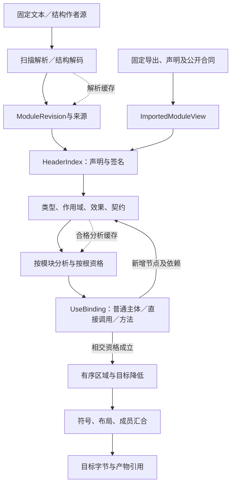

# 阅读入口与实现身份；作者输入、解释与准备

## 阅读入口与实现身份

当前主链见[首期路径](#功能组合与原生程序的首期编译路径)和[最小工作链](../../40-目标与制品/编译内核/运行准备与最小实现.md#最小工作链与代码落位)；原生窄ABI仅是条件性接入；后续源码变换、自举与发布各按请求启用。名称为“参考”的旧段落不代表本包附代码或当前已运行。公共中立语义不继承某个JS宿主的属性模型或旧内部计划格式。

## 作者输入、解释与准备

### 公开作者边界与成品目的进入同一阶段

COMP0/COMP1固定实际根和解释；COMP2在定义自己的导入环境验证闭合default、卫生实例化并解析exposes，只对同一准确主体汇合硬要求。静态默认不是实例合成变量，exposes也不是目标函数表。原CallableIndex和领域接口再解释所选公开边界；多个同型主体没有准确映射时不得选第一个。

COMP3/COMP4沿原绑定选择方法及目标：公开库允许其合同规定的宿主进口，独立应用必须满足实际环境条件。COMP5/COMP6对真正的代码、配置、接口与资源分别降低和检查；COMP7按输出根封存，不把一个根成功推成整个产品族成功。用例需要保存、安装或运行时才进入原执行边界。

不同成品可以共享相同需求和纯实现；新增CLI只增加相交边界和成员，不重新猜算法。原生和可选计算源同样可被方法消费，结构主面不要求先打印任何文本。公开接口、默认值和采用的目标属于输入，不能在printer中私自选择。具体合同见[结构默认与公开边界](../../10-作者与输入/作者源/结构化源码.md#closed-parameter-defaults)及[按目的产物闭合](../../40-目标与制品/目标/成员布局-目标责任与输入.md#public-boundary-closure)。

### 编译触发与作者输入形式分离

编译内核消费固定的作者/导入输入，而不要求这些输入必须经某一种公开propose信封创建。源可来自完整文件、版本化编辑器缓冲、精确差异或合法结构；读取适配器将它们按原合同捕获，语义检查与目标生成共用既有阶段。

普通编辑及候选创建只完成请求所需的准备与诊断；生成由preview或明确的组合任务触发。generated-edit的再生成是回源一致性检查，只处理相交根并复用合法缓存，不隐含全构建、安装、执行、应用或其他语言校准。阶段复用不得把旧产物标成新内容；无变化调用也不必为满足流程额外创造候选。

从无来源程序推测出一个高层定义属于导入/创作与核验，不属于每次编译的隐藏步骤。已接受的定义和映射固定后，普通重建不重新让AI选择相同需求的另一解释。当前输入没有足够含义或供给时，返回真实缺口，不输出空实现。

### SourceProfile 前端统一到同一 SemanticModel

编译入口先按已固定作者区域选择SourceProfile adapter。adapter负责准确SourceRevision、lossless syntax/CST、SourceMap、未知表示保全与诊断，再产生共享SemanticModel；编译内核不直接把JSON对象、Markdown AST、原生编译器AST或编辑器节点当公共语义。

结构化JSON可在适合的区域直接解码，无需中间文本；文本/原生Profile同样无需先转换为JSON。Syntax/CST是来源保持层，SemanticModel是类型化解释层，后续Binding/Lowering只消费后者及明确来源关系。Profile本身变化属于高扇出输入变化，必须重建相交语义与索引，不能只清一个缓存标志。

### 功能组合与原生程序的首期编译路径

默认主路径读取固定作者内容与合格导入供给，不要求AI先写完整TS，也不要求已有库先有同义Gift主体。作者ModuleRevision和ImportedModuleView共同建立签名、要求与引用；实际作者主体按语言分析，调用使用点按公开合同与具体目标绑定检查，随后共同生成目标。TS是当前首个通用目标，Rust已纳入后续目标计划；任何目标的原生检查都不定义公共中立语义。

原生模块是并列、受治理的资产：按真实语言和工具解析其物理、符号和类型事实，业务要求独立保存；可证明的映射进入共同语义，其余保留有来源的原生区域和未知。使用成熟TS/Java/其他语言基础设施，不向公共模型暴露厂商AST。无需重新自研各语言完整编译器，也不能以复用TS工具为理由要求所有管理内容都改成.gift.ts。

运行输入检查可以从明确的有限中立接口合同生成，或使用实际绑定的原生校验器；不能从任意高级原生类型推出全部运行验证。相同签名不重复手填，但独立需求不能由当前实现的错误反向覆盖。类型断言、Any、包名和自报效果都不是完整语义保持证据。

展开消费已确定的定义与参数；搜索只处理真正未决的选择。公共定义可由普通作者组合、局部展开或自定义函数构成。中立行为的直接编译和原生程序的保全绑定共用Definition、Requirement、Binding和变化关系，不建立宽严不同的权限路径。

首次可以用一段小函数检查核心，但不能把固定模板复制或原生算法透传说成已验证一般作者能力。中立输入不要求列出低层目标AST；可选高级画像的具体实现不作为全部短函数生成的前置。来源与目标保持见[作者合同](../../20-语义与组合/基础语义/计算基础/文法类型与求值.md#语言无关的作者合同与当前规格)。

### 要求关系不是第二次自然语言编译

应用层在创作/修改时将实际要求对齐到固定语义与来源；compiler只消费这一结果和真实程序，不重新解释原聊天。既有编译准备态携带Requirement引用及其语义/观察域，来源与分析结果可共享；未解释的要求可以继续保存，但强满足声明不得从中产生。

约束节点不是实现指令：All不编译成先A后B；ForEach不自动并行；“不发布旧结果”不编译成忽略全部失败或永不发布。实现从合格定义、普通主体、语义方法或准确适配取得。当前语义域内有直接实现规则可确定构造时正常编译；没有时调用方的开发AI可以创作固定候选，编译器不靠重试自然语言取得隐藏程序。

`resolveUse`必须保留输入域、允许结果/轨迹、错误、帧、数值与资源条件。运行方法选择可以替换，但不能把NoWrite降为结果最终相同、把最终完成降为安全静默、把图的多个前驱合并成一个。要求中存在概率/跨运行性质时，以相应语义/概率方法与验收对象处理，不用一次类型检查或单轨迹生成成功冒领。

需求计划的部分结果不能直接成为执行动作。`LoweringResult`中真实生成的依赖和新增效果继续进入COMP4—COMP7及目标组合器；契约未证明与目标不可生成分开，不强迫一般程序先被求解器证明全域终止才输出。

### 两种作者前端怎样汇合到同一编译核

#### 图解：编译阶段的数据输入、检查及重新进入

箭头表示准确阶段结果；新展开节点重进相交检查，缓存仅代替自己所属阶段。该图省略具体字段，字段由本章类型表拥有。

文本前端先保全token/CST与源范围，再产生基础有序语义；结构前端按[gift.semantic-body/1](../../20-语义与组合/组合/结构编辑/结构模型与绑定读取.md#结构体格式与精确字段)解码声明、表达式出现、区域与引用。两者在名称/类型/效果/契约阶段共享规则，不各自实现一套“宽松预览”或“图形检查”。源适配器只拥有输入解释与回写，不拥有任意选目标、授权或部署。

**COMP0/COMP1：** 固定实际作者角色、内容、语言与体版本；声明先收集，局部key分配不使用目标运行计数或线程先后。对相同物理内容可以共享只读存储，但一次表达式出现只归属一个语法父节点。

**COMP2/COMP3：** 作用域检查名字、绑定和区域；类型/模式/效果检查真实调用、短路、闭包与契约。未知语言体保全，已知体中的程序错误形成草稿，错误协议与无权请求先拒绝。结构完整不自动视为类型合格，类型合格不自动视为任务正确。

**COMP4/COMP5：** 展开和降低保留求值次数、源顺序与区域激活。仅数据依赖DAG不足以决定目标执行：if未选分支不运行、let初始化完成后后续才可运行、递归保留声明调用。合法优化需独立前提；编译查询并行不将目标程序改为并行。

**COMP6/COMP7：** 布局与打印消费明确公开身份和稳定布局，不使用临时端点句柄命名。返回目标字节、实际生产输入、映射和诊断；仅在相应解释和根都闭合时签发该产物。接口能保存结构，不等于后端已实现这种体。

第一条实现可全模块检查并采用局部CST回写，不必先做增量或远程；所有辅助脚本和静态文档核对都不是本协议的运行实现。新增高层领域继续在相应层保留其结构，不被迫先改写成这些基础表达式。

### 作者前端的读取分派与共同检查

`prepareCompile`使用本区域已固定的前端绑定；新建产品的结构化意图源直接使用已定decoder，明确选择计算文本的区域才使用对应parser。它们返回同一ModuleRevision、源补充、实际读取和诊断，随后共用类型、效果、契约与目标规则。当前不注册host-builder，不在编译时重新选择作者形式。

方法缺失在请求到该阶段时按共同Needs/Stopped协议返回。语义完整且没有后端时仍可保存并查询；只有所需变换和真实目标均满足时才发布产物。已有计算文本协议在其选择范围内保留，六工具入口不变；未采用或未实现的输入能力不进入活动分派表。

### 不依赖新文本语言的正常编译路径

结构作者直接解码为现行语义，原生源由实际前端提供公开合同和方法，沿同一阶段绑定、选择、降低及组合。可选计算画像有自己的真实读取器和后端才参与；不存在JSON先打印.gift再解析的前置。多载体方法按[供给SUP0—SUP8](../供给与替换.md)消费，在[QUAL0—QUAL7资格链](../../00-系统与原则/设计方法/约束强制与整体一致性.md)中保持输入、证据与现实作用分别成立。
