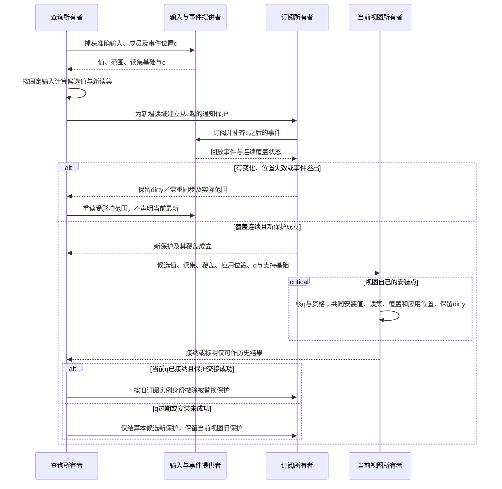

# 复用资格与失效案例

## 作者源、控制与表示

### 业务变更的设计影响与运行状态不要共用缓存资格

高层operation的编译依赖包含声明、规则、类型、所选策略接口、生成器和目标保证。真实actor授权、当前业务行和去重终态是每次运行的输入，不因代码生成缓存命中而复用为永久许可。订阅过滤可以复用纯计算方法，实际事件选择和交付资格仍绑定其真实事件与订阅修订。

用户只改提示说明时是否影响产物由实际消费者决定；改决定表顺序、字段不变量、事件类型或订阅顺序可能影响行为/数据/恢复，不能以正文改动小而局部忽略。旧请求与旧消息不会因源码新修订自动使用新缓存结果，历史解释需要相应保留。

首期编译按模块完整计算是合法基准，业务运行则采用相应索引和受限事务；二者不是同一个全量/增量选择。性能预算分别计作者内容、AI输入输出、编译与目标构建、热请求事务时长、队列存储与恢复开销。先固定正确含义，不将完整体系的未知包装成一个“全局最优计划器”。

### 封装下的接口与实现失效

模块接口分析按真实公共签名、公开契约和它们的依赖缓存；代码生成、内联、专门化和实现相关证明还读取实际实现。二者使用已有查询系统的不同依赖，不建立第二缓存服务。公开面相同且调用源不变时，接口消费者可以复用；新的实现字节不能被旧动作结果冒充。

opaque表示可以使私有字段变化不要求客户端改源；它不保证零重编译或零布局转换。ABI、序列化、资源寿命、启动与公开性能要求若受到影响，仍记录真实连接与成本。库内新建私有函数无需把完整内部树送给AI；请求解释某个异常或修改库实现时再按权展开。

库依赖解析和包版本选择由工具承担；正常编译沿锁直接解析。新增无关库不扩大本次契约上下文，源中通配/反射或显式选择全部公开导出的真实集合依赖不被删除。

### 控制与资产变化的真实增量边界

缓存读取依据必须包含实际使用的控制描述符、已采纳默认、作者显式 Pin、Provider 与 Target 输入；未读取的全球能力目录不构成无条件依赖。显式 `require` 即使与当前默认同值，在未来默认变更时仍可保持不同语义；`reset` 删除本层覆盖后重取相交继承值和锁，而非清空无关绑定。

全工程输入还包括构建配置、模板、资源内容、路径成员、格式规则及实际会改变结果的元数据。Git blob、工作区字节和过滤后内容不是天然同一个输入；必须绑定实际消费层。图片内容改变可使对应资源包失效，路径不变不证明没有变化；重命名路径也可能只影响引用与打包，不必重新推导全部无关函数。

签名缓存与实现/产物缓存分别处理。库作者私有修复不强迫所有客户端改源，但已内联旧实现的目标要重建。源码、清单、配置和资源可以共享一个任务，却不共用无区别的哈希或失效规则。证明或性能上下文没有被实际使用时不制造额外图；有真正资格依赖时则不能为了缓存命中忽略。

#### 性能参数是否影响语义需要单独判定

线程数、任务分块、候选排序、缓存驱逐和超时可改变浮点归约、错误选择、搜索结果或完整性；先按消费方可观察等价关系分类，再决定是否只影响调度。影响结果的参数进入 Method 输入及相应 Evidence；已证明语义保持的调度差异可从该类结果键中排除。TypeScript 7.0 checker 并行参数为潜在影响的外部实例，见[来源](../../../research/sources/语言编译与目标工具.md#implementation-language-sources)；不据此声称 Gift 已发生同类故障。

实际读集要区分行为、字节布局、解释来源和性能证据。相同语义可以复用行为结论而重新测性能；相同输出字节也不能代签来源或授权。并行只改变诊断排列时可规范化顺序；若已改变绑定或推导结果，末尾排序不能修复语义差异。

内存上界须同时约束查询值、依赖图、intern 表、旧快照、SourceMap 与被借用的结果；仅驱逐 memo 值不能证明总内存受界。采用[Salsa等成熟查询机制](../../../research/sources/语言编译与目标工具.md#open-control-evolution-sources)前需核其真实回收、取消点与快照语义；长计算段应设置实际可达的取消检查。唯一恢复证据和仍被使用的字节不属于可随意驱逐的缓存。

稳定身份、解释、取得资格与生成工具仍可用，才有相应重建保证；非确定外部观察不由一份生成脚本重造。历史引用可读、当前结果可用和物理缓存命中分别判定。

### 省略信息的来源也必须进入真实依赖

一个参数没有在调用处显式写出，仍可能来自语言缺省、项目设置、库公开合同或一次已接受选择。这些来源及选择目录进入相交查询依赖；不能只散列用户新增的几行代码。源码相同但缺省解释改变时，不得命中使用旧含义的结果。

只增加一个未被当前任务读取的库，当前输入、语言解释和目录查询都未改变时，应保持既有结果与模型上下文。确有通配导入、反射或全目录择优时，目录成员本身是输入，新增成员可以合法触发局部重新判断。目标是否重建、说明来源是否刷新、资格是否重审分别由消费者决定，不因值同样是first就遗失其来源已变化的事实。

整个系统可先从正确的模块级闭包实施，再拆细查询；短意图不要求实时构造全工程图。性能比较计共享库设计、冷读取、实际上下文、解析、生成、目标构建和后续修复，不能把作者移走的工作全部当成消失。

### 作者表示、布局与研究复用的依赖边界

源文本的CST/位置查询依赖实际字节和解析版本；相同语义的结构查询可在已证明等价的范围复用，但不能把注释、布局或未知扩展一概排除。结构修改先安装实际新读集，再决定哪些值消费者可以复用。

生成布局查询依赖当前目标程序、公开约束、实际结构策略和被消费的历史布局条目。`compareTo`仅是差异查询输入，不进入无关生成查询。布局基础变化可能只影响文件/名称/位置，不一定需要重新检查未变的语言主体；公共ABI或初始化也变化时则相交检查一起失效。摘要不足时采用完整布局基础作保守依赖，不漏算。

研究复用与产品缓存同样需要来源/前提，但不是同一个存储系统。固定来源命题可以复用，当前环境事实需要新观察；复用一项旧理论不携带旧运行授权。原则与知识入口给的是本次读取依据，不为每个纯计算增加永久图或数据库。

### 稀疏控制变化的实际失效范围

控制记录由[唯一编码](../../20-语义与组合/组合/稀疏控制与目标限定.md#control-storage-contract)拥有。查询分别消费作者明确覆盖、有效值及其来源、描述符规则和实际Binding；不能只对最终显示字符串做缓存键。删除一个与默认相同的覆盖，当前代码可能不变，但其未来跟随默认的关系已改变，必须先安装新读集与来源，才能截断无变化的下游。

仅Java的类形式覆盖不自动失效TS私有布局；共同公开类型、资源或任务要求实际发生变化时，沿真实共享边界传播。业务源码变化没有影响控制解析输入时不改语言锁；控制影响算法候选集合时记录该集合，不能只保存最终选中算法。文档里对控制的解释重排，没有语义消费者时不引起目标重编。

源码路径变化通过声明映射保持控制主体，出现映射不可靠时保留缺口，不把旧控制贴到同名新声明。缓存失效是重新计算相交结果，不授予写入、升级或重解释在途操作的权利。

### 需求变化、候选补全与复用边界

缓存的输入是实际消费的源、规则、绑定和必要观察，不是自然语言任务摘要或画布。需求文字同义改写时，不能仅因字符串变更重编所有目标；相同文字指向新对象、新规则或新授权时，也不能直接复用。

缺少实现的查询若实际枚举某个候选集合，应依赖该范围的成员；新增相关方法可以重新评价缺口。已锁定的合格Binding不会因无关库新增而自动重选。新候选写好了主体，要安装新读集和来源，再判断哪些分析可复用。

作者任务投影保留定位和必要合同，不替代真实编译闭包。区间工具改变adjacent时，源为常量则重生成相交程序，值为运行参数则仅产生新运行；更换输入文件不等于代码改变。改变排序实现后，即使同一小样例结果相同，也要重判真实方法与资源资格。说明图布局改变不使程序重新计算。

#### 条件需求与实现选择的增量边界

有限组合的绑定、逻辑判断、方法搜索和成本比较是不同查询结果，沿原ReadSet和查询缓存管理。解析可按准确字节共享；解释还依赖结构版本、公开类型和Rule；实例化另依赖根、外层绑定、共享主体及use出现；选型另依赖域、候选范围、方法与接受政策；比较另依赖工作负载、指标和证据。不能因同一段JSON出现两次就共享不同外层参数的完整判断。

静态false分支的结构与类型仍受其定义合同约束，但未选择的目标方法无需参与当前生成。条件参数变化，必需重新判断分支和涉及的读集，不能因上一轮该分支未激活而丢掉使其重开的条件依赖。有限域增加一个成员使对应forEach/exists重新评价；原可行exists见证若仍满足全部条件且任务未要求重选，可继续使用，但不能复用以旧全集得到的无解或最优结论。

只换高优先级成本证据时，先重开相交比较；最终方法与参数未变，原产物仍可能复用。原比较的未定结果即使最终选择相同，也须更新来源和读集。候选集合扩展不能使旧绑定自动升级；明确重新优化才用新集合。选中不同分支造成主体、接口、方法或配置改变时，沿实际共同消费者重编，不能只改一个摘要标签。

已取得完整域的读取资格与跨任务纯计算复用分别检查。拒绝某个候选分支不会自动取消另一任务共用的检查或取得工作；取消等待者不释放仍在用的缓冲。搜索预算耗尽仍返回准确未决前沿和已满足的独立范围。没有足够细的依赖能力时，相交完整重算是合法基线；不得宣传每次变化必定只更新一个JSON字段或恒定数量节点。

**闭合候选域中的负依赖要显式保持。** “没有更合格的供应者”“该名字唯一”“此类型实例不存在”等资格来自一个带版本和边界的候选集合，而不仅依赖已选中项。候选注册表新增、撤销、权限变化或发现范围扩大时，仅使确实引用这一封闭枚举结论的最优性/唯一性声明失效；已经选择且仍合格的固定实现不因“最新版本出现”就自行换供应者。任何旧闭合证明失去资格后必须回到候选状态，不能继续以缓存命中签发确定性保证。

同一源修改可能影响多个输出根，而独立目标产物可以局部复用。源共用规则与公共接口修订改变相交合同，必须考虑所有使用者；单个客户端文案变动不应自动重编未消费它的后台。局部可重用产物与全项目联合发布资格是两个结果，不能把目标 A 构建成功等价为 A+B 的同一可发布代。异步远端构建晚到时，还要比较其冻结源/锁/Target 身份与当前选中代，而不因最后完成就覆盖最新产物。

### 默认、公开边界与交付形式的相交失效

参数默认由准确复合定义拥有，省略调用与显式同值调用都有来源。结构与类型缓存可以复用不变部分；默认定义升级时只使实际读取它的使用点失效，显式实参不直接依赖该默认值，但仍依赖参数类型和整体定义语义。无实际依赖追踪能力时进行健全扩大重算，不能按表面键未变猜测独立。

exposes键到准确主体的映射进入接口/目标选择键，私有无相交改变不应重排全部公共出口。Library、Command、Worker等共用的Canonical义务可以共享纯分析，Emit、目标、适配、宿主与配置键分别绑定。一个处理器错误状态码改变，只重核相交handler与共同接口；它不能污染不使用该协议的纯库缓存。

主题目录、诊断页面或本设计库的整体摘要不是用户工程的通用编译键。真实规则仍由正文或定义源决定时，它的相交内容必须作为输入；只有合格提取器证明语义输出未变时才能复用，不能笼统以“文档变动”忽略。

## 编译、运行与计算状态

### 编译依赖与目标算法工作不是同一种增量

目标计算的像素、迭代节点、缓存行和工作队列不自动成为Gift持久查询条目。分析需要时可以有高分辨率临时关系，面向AI只投影当前改变；按每个数据元素保存完整身份/证据会改变目标成本而没有必要消费者。

编译增量节省重建，目标增量算法节省目标重复工作，块缓存改善局部性，业务幂等避免重复作用；四者的键、有效期与正确性条件不同。优化器选定布局/随机样本映射/浮点政策会进入其真实生产者身份，不能只比较输出尺寸就复用不相同算法。

性能检查以输入规模与数据域、目标和完整路径为依据，包含传输、初始化、同步、峰值资源及后续修改。不把多做数据库功能当成工程进度，也不凭单核耗时推断整个应用吞吐。无关设施真实未激活与时间/内存已改善分开取证。

### 状态拓扑、回调与运行快照分开失效

编译缓存的输入是准确模型构造、节点及转移次序、回调内容、输入输出合同、语言和目标策略。外部活动返回是目标实例的运行输入，不是编译缓存的全局可变单例。相同模型两次实例化不合并它们的上下文、计时器或设备。

图形坐标变化仅影响呈现；history深浅、entry/exit、转移顺序、回调或事件匹配改变，则使相交摘要、目标与验证失效。单个guard返回值碰巧相同，不能删除新的读集。节点命名与稳定身份、生成表位置分别处理。

编译期保留有限层级与位集/索引。估算内存还要计入当前配置、history、反应工作副本、内部队列与尚未结算活动，而不是只数图节点。任何存储共享要维持原Snapshot不变；跨微步快照可按持久结构或写集缓冲优化，无需每次深复制整个图。

### 目标关系增量与编译查询的不同闭包

[关系的RQ0—RQ6](../../20-语义与组合/基础语义/状态关系与流/关系查询与维护.md)使用固定查询和封闭数据批次；本章CompilerQuery仍使用固定作者输入与实际方法。改变谓词、ValueOps、codec、排序或权限不是数据delta，会使相交ViewState需重建/迁移。两种增量可以同处一个产品，但不能共享无含义区别的currentVersion。

目标内连接的双边变化要保留交叉项；distinct保留支持数；外连接在最后匹配消失时产生None；任意归约和不安全delta回调按相交范围全量重算。编译缓存则依旧按真正的输入和读集失效，不从“数据库结果暂时相同”推导全部资格未变。

成本包含实际输入重数、唯一值数、输出基数、长键与大整数、索引、在途批次、旧读者快照和排序空间。相同物理索引才共享成本，相同名字不代表同一个索引。两源连接可能输出乘积大小，不能承诺对所有查询线性或所有删除局部。合法全量重查是默认路线；只有存在准确变化源且长期成本合适才物化。

### 代码、数据、计划与观测的分别复用

编译结果键消费作者源、语言/库、所用方法、目标和影响生成的控制；目标RunRecord另消费可运行artifact、入口、实际输入、环境、Runner和本次随机/时间条件。展示摘要不替代真实键。一个输入数据变化可能无需重编程序，静态参数或被特化尺寸变化则需要对应失效。

图工具的索引/分量依赖图内容，布局另依赖分量和spacing，场景另依赖样式和边出现，编码另依赖格式和资源。只有这些实际读集稳定才复用；不能从“界面只改一个字段”推断所有算法都局部。SCC新增一条回边可能把全部分量合并，完整重算是合法基线。

动态特化缓存有准确守卫和大小预算；守卫包括该优化真正依赖的形状、数值策略、类型、布局、方法及目标。输入尺寸不断变化时可以用合格一般程序，不无限生成新机器代码。缓存命中不是结果符合最新权限，性能测量也要说明缓存、构建和设备热身条件。

采样、完整统计、探针、断点和性能计数器有不同成本。读取完整数组计算范围不是免费的展示；若使用已有可信摘要应标明来源和输入。插桩可能影响调度和分配，profile记录绑定实际制品与方法，不把它强行等同于原制品无观察性能。当前先优化真正测得的瓶颈，没有测量只采用合理可逆默认。

### 即时运行中的代码复用与可变状态

运行准备可复用固定源及实际方法对应的签名、主体、降低和可调用制品。程序参数属于运行输入；它们不使代码缓存无故失效，但会参与实际运行身份。具有obj.Read/Write、外部资源或其他作用的调用，不因参数相同就复用旧结果并跳过本次执行。

闭包缓存至少区分代码版本与运行环境；同一函数名、同一源码字节和相同初值不等于同一可变实例。循环体内与体外的位置分配也不能被内容寻址合并。即时运行只减少实际需要的编译工作，不声称所有小改动都能局部完成，也不将执行速度归因于未计入的目标加载、GC或设备传输。

### 条件分派、借用与代码寿命的成本和失效

[条件实现](../有条件实现与公共行为保持.md)的guard、适用域、同步画像和分支资格是实际方法输入；原始解析不受这些选择影响时可以复用。仅改变F私有代码，重核F及适配/真实消费者；公共域或守卫变化则重新检查覆盖、泄露轨迹及分支集合。运行时临时值不作为持久作者配置，也不让每次调用修改依赖锁。

性能比较包含守卫、传输/复制、等待独占访问、峰值同时存活、回调和旧结果的释放。pin只延长相应寿命，不证明内容稳定；缓存数据若仍可写不能以摘要相同认定是当前快照。保留旧模块的结果可能导致短时双版本成本，不能只测新核稳态耗时。

## 投影、保证与复用资格

### 任务展示、语义读集与验证复用的不同缓存

任务投影缓存键至少绑定作者基础、相关语义/库解释、视图协议、映射和披露范围；它只缓存可再次交付的内容。编译查询键与读集按实际语义输入形成，不用投影字符串或显示片段摘要代替。显示同一行`keep=first`可以来自不同库、权限或对象，不得互相认领。

隐藏于AI视图中的实际依赖仍保存在分析端；库合同、目录成员、负读取、编译选项或实际映射改变时，按消费者使相交结论失效。只改视图措辞或输出排序，不重算不相交的目标计算。分析缓存与证据资格分别判断；保留分析仅在该变换确实保持时有效。LLVM Pass管理器的选择性保留/失效机制是参照，不使Gift所有变换都自动获得合法性。[文档](https://llvm.org/docs/NewPassManager.html)。

editRef记录可以短期保留来源映射，在请求处理期间固定需要的原内容；超期无法恢复基础就返回失效。响应省略的是重复展示，不是遗漏真实依赖、恢复前像或当前许可。共享底层内容不合并两个用户的权限；给模型的流量、工具内部解析工作、驻留内存与后续重新定位分别计量。

#### 固定结果与活动订阅的失效交接

旧切面的完整结果可以正确，却不代表活动视图已追上当前输入。增量求值得到新的真实读集时，只原子替换value与deps还不足以保证持续通知：例如旧查询只订阅A，新分支改读B，B在新订阅安装前变化，新值就可能一直停在旧B。

活动订阅拥有者须在发布可继续跟踪的投影之前，建立覆盖新读域的合格通知保护，再核所捕获输入/成员/负依赖的版本与覆盖。源支持同域事务时可共同安装依赖与事件位置；否则复用[准确快照与事件接合](../../80-开发者与接口/工具协议/客户端与并行会话.md#快照与事件之间的无缺口接合)，从捕获位置补齐或重读，新保护成立后再撤旧保护。处理中发生变化保留在[dirty交接](../../50-执行运行与观测/运行生命周期/运行实例-订阅部署与调和.md#reconcile-wakeup-handoff)，不能被完成回调清掉。扩大到相关范围的保守订阅可以是较小实现，但仍核披露与容量，不无条件监控整个宿主。

新保护取得失败时，由取得方结算部分订阅，保持仍有效的旧保护及其准确范围；不能先撤全部旧监听再把安装失败报告成已持续更新。候选值仍可作为原切面的结果保留，当前视图是否可采用另核。持续投影的值、读集、覆盖和已应用位置按[共同检查点](../../80-开发者与接口/工具协议/客户端与并行会话.md#projection-checkpoint-resync)安装；收到进度屏障但应用队列未清时，不提前签发该位置已应用。持久cursor失去对应值/读集就重新捕获，不从它跳过恢复所需变化。

提供者没有连续通知保证或缓冲已溢出时，返回带切面与覆盖范围的准确结果，并按合同轮询、标陈旧/需重同步；不能声称持续无缺口。只做固定快照查询无需订阅，纯结果缓存仍按自身EvaluationKey保留，不因显示槽换代把全工程缓存清空。对新视图的安装资格、已算出的旧值与仍待结算的操作继续分开。

#### 读集更换时的通知连续性与发布资格

下图限定于提供者支持“从已捕获位置建立连续订阅并补齐事件”的画像。c是本次输入切面和事件位置，q是客户端请求代；二者都不是权限或全局时间。只有点时读取的提供者采用前节较弱合同，不能进入图中的无缺口路径。

事件回放期间及安装之后的新变化继续标记dirty；“通知连续”保证变化可被再次观察，不表示所有来源在一个全局时刻同时最新。新保护建立失败时，取得方清理已建立的部分并保留仍有效的旧保护。q已过期时不替换当前视图；候选只在自身固定输入和权限范围内作为历史结果复用。事件保护、值的正确性和对外披露资格须分别核对。

### 信息检索、索引代与披露复用

[信息查询](../../70-工程系统与演进/信息与生命周期/接入检索与派生.md)复用本章的纯计算与资格分离：索引分片固定源选择、解析/抽取器和覆盖，语义候选可重用；最终返回另外核用户/租户、当前过滤、删除与披露资格。权限变化不必重编译无相交源码，但必须使相关展示资格失效。

需要全量负结果时，只有相应Provider确具完备枚举/检索且快照范围闭合才可说不存在。top-k、摘要或尚未取完的游标只提供候选；索引落后可旁路读取真源，不能强迫停止独立的合法编辑。分页固定选择和Provider切面，无稳定读取能力就报告准确的弱一致和可能重项，不混拼旧页新页为同一全集。

分片发布先完成并核其成员再条件切换索引目录；事件缺口触发相交重扫，不以空事件流认证无变化。语义边、保留边和元数据导航边分别计算，目录移动一般只影响定位索引，除非真实构建/资源规则确实消费该路径。

#### 引用变化按消费角色失效，不使用全工程万能摘要

一个信息对象可能同时被导航、源码解释、方法选择和证据评价读取，但每次读取的角色和精确输入不同。维护者移动说明文件时，实际字节摘要必须更新；是否重编译程序，取决于程序读取了什么，而不是文档总体是否换了编号。

| 发生变化 | 必须更新或重核 | 可以保留的结果及条件 |
|---|---|---|
| 相同原内容换存储位置 | 可达性、定位、当前读取资格及有定位依赖的视图 | 精确内容/解释不变的纯计算；不把旧位置失效推成全工程语义失效 |
| 只改变排版、链接或说明词句 | 实际源集、来源说明、相交阅读视图；引用该全文件字节的检查记录 | 只有存在明确分层生产者且已确认其语义输入/输出未变，才复用对应语义计算；没有该能力则保守重读，不按文件后缀或改动行数猜义 |
| 同值结果采用新读集 | 依赖边及其缺席、成员和解释前提 | 值可共享；不能丢掉新依赖后继续沿旧失效集合运行 |
| 合同版本或规则含义变化 | 真实相交UseBinding、生成、保持依据和接受范围 | 无关规则、已固定旧运行、准确支持旧Claim的证据不必重建或抹除 |
| 访问撤销但底层纯值未变 | 当前展示、计数、分页和操作准入 | 有权控制域内合法保留的不可变计算；缓存存在不代替披露资格 |
| 使用点插入、移动、复制 | 快照内位置索引、实际编辑映射及受影响主体 | 有确切映射的旧主体连续性；同形不同发生不能自动合并 |
| 方法目录成员变化 | 曾读取候选全集或缺席条件的选择查询 | 不消费该查询域的既有固定绑定；新增无关方法不使全image所有查询失效 |

若某个语义目录由完整规范机械产生，必须记录真实生产者、准确输入范围和完整字段/默认/失败规则，输出摘要相同才可能共享该纯结果；不能为了缓存命中，手工划掉仍决定含义的自然语言、例外和接受条件。准确原字节仍作为来源保存，语义等价不是字符串规范化的副产品。

本设计库的源清单与当前文档定位仅用于本库核对，不自动成为用户工程的语言锁、运行输入或全部编译查询的全局键；本库没有旧文档地址索引的运行前置。自用工具确实消费某份当前资料时，仅按它自己的实际输入记依赖。把整个设计包散列加入所有ActionKey会造成无关重算；完全忽略确实被方法消费的规范同样不正确。没有足够细的真实依赖模型时，允许保守的相交全量重算，不宣传未经验证的最小失效。

引用取得和消费的执行顺序见[装配接合](../../70-工程系统与演进/实现与装配/源绑定与解释映像.md#qualified-binding-consumption)；此表不创建另一套全局变更协调器。

### 开发反馈的局部复用、取消与结果归属

描述/补全/引用/签名查询按准确候选、源区域、解释、实际导出/名称集合及位置编码固定。补全只依赖当前作用域并不总成立：新增可竞争导出、缺失文件变存在、import别名和目标能力变化可能使建议过期。输出值相同也更新真实读集。编辑计划还需保留原写集、成员和保持前提，不能仅缓存展示标签。

显示类型、悬停文本、结构轮廓、诊断和目标生成消费不同阶段；简单补全无需等全工程body/所有后端完成。局部结果必须明确未完成范围，完整引用搜索或保持式rename仍需要其真实闭包。方法只能做保守全量时可以先用全量，未实测不承诺某个查询O(1)或固定毫秒。

连续输入可以合并尚未开始的分析，已开始任务可协作取消/降低调度优先级，不把中间候选全记成已验证。每个生产者返回到原请求槽；空全量诊断只有本范围绑定和请求仍有效才替换本范围。纯计算可以跨用户共享不可变值，但公开结果、权限和文档位置按当前主体重新取得，不把共享memo当授权缓存。

反馈排队应有有界容量与公平性：前台局部操作不永久被后台全库检索饿死，后台完整检查也不因无限打字永远无法在已固定旧候选上完成。策略可用明确优先级、合并旧请求和预算，不硬编码未经验证的阈值。大结果分页、诊断截断与查询覆盖使用同一来源机制；按任务恢复独立结果不重建全库HTML或把文档全塞上下文。

### 语义影响之外的保证依赖与统计选择

功能结果与保证资格分开缓存。相同源码和返回值可以继续复用某纯计算，但改变观察域、开放链接上下文、随机联合关系、推理理论、未验证公理、测试数据暴露或选择方法时，相关Claim和CostEvidence要按真实依赖重评。不能用逻辑数据流没有跨租户边，推断共享缓存/预算不产生时间或可用性影响；强隔离性质由实际资源边界支持。

类型/模式/单次轨迹分析与[性质保持](../性质保持与开放环境.md)的跨运行结论不是同一缓存值。每次消费仍核当前披露资格，保留的旧字节不能越过撤权。重复同一确定报告不是新统计样本；自适应选择按[确认合同](../../60-保证与证据/验收/覆盖与收益判据.md#adaptive-confirmation)处理。

改变一处全局共享语义可能合法影响全部消费者。稀疏读集使不相交部分可复用，但不能在全部根真实耦合时承诺固定小范围重算。缓存策略若超过直接重算成本，可选择当前合格的保守重算，不降低原语义保证。

### 各类分析的增量更新与资格再检查

同一内容计算可服务多个义务，但判定复用遵守[义务身份](../组合前提与进展闭合.md#obligation-identity-discharge)。要求变强而程序字节未变时，可以复用仍有效的分析值，必须重做相应支持判断；检查由≤50ms变≤10ms，不因同一EvaluationKey直接继承成功。分析摘要的方向和范围按[领域摘要](../组合前提与进展闭合.md#domain-summary-contract)，不将未知当空集。

| 分析 | 已明确的默认维护动作 | 使用增量捷径需要的条件 |
|---|---|---|
| 解析/名称/导入 | 重读改变区域及旧/新解析域，失效真实符号、重载和负依赖消费者 | token/CST复用仍保留所选语法与绑定位置，移动或配置变化不能仅按字节命中 |
| 类型/泛型约束 | 重新检查受影响声明/调用分量，保留原范围外稳定签名 | 删除约束或改变实例化不得只在旧解上增加约束；约束维护器须支持撤回和域变更，否则从新输入求解 |
| 可能效果 | 有限集合并集从当前种子求最小固定点 | 仅单调新增可传播delta；删除种子/边/规则或新SCC重划时从底重算或用合格删除算法 |
| 值域/别名/存活 | 按实际CFG、值操作、捕获与出口重算相交区域 | CFG未变不保留值域或借用；扩宽结果是有范围近似，不冒称唯一精确固定点 |
| 关系/状态/流 | 分层关系按低层封存，状态/流按当前模型及真实位置重新建立受影响结果 | 删除重数、否定、窗口撤回及成员变化各有专门规则；不能通用append-only处理 |
| 义务/资格/成本 | 重核变化要求、规则、证据、真实调度与资源共享，数据值可独立复用 | 同值必须更新来源/读集；支持撤销重算相交判定，不删除不相交纯结果 |

维护器先取得旧端和新端的实际差额，再按真实读集求受影响分量；候选分析在私有新代形成，值/依赖/精度与当前IR共同发布。只有本次方法所需的固定点收敛和覆盖成立才截断传播；超预算保留旧准确快照及新未决，不发布半更新。不能由一个preserved名称略过其传递依赖。具有明确保持依据的无变化分析可以直接复用，没有细粒度增量方法则使用较粗完整重算，不能把功能正确性绑在尚未优化的缓存上。

### 观测令牌验证与旧子查询重执行的不同前提

当前不可变快照方案检查旧条目的完整叶子观测、成员/负依赖与传递生产者身份；它不必执行旧路径的子查询，因此不要求所有观测一律按历史读取顺序比较。只要任一影响结果的观测变化就重新执行父查询，全部相同且其余复用前提成立才返回旧结果。该规则依赖读取已受控、解释固定、比较本身不会偷偷执行失去前提的计算；普通外部 tracing 样本不取得这种保证。

反例为 `flag ? 10 / denominator : fallback`：旧输入 flag=true、denominator=2，新输入 flag=false、denominator=0、fallback=5。比较叶子令牌后重跑父查询可合法返回5；为了验证旧缓存而先执行旧除法则会产生本来不可达的错误。以后采用主动强制旧子查询的算法时，必须证明这些检查在新输入下仍可合法执行；有序重放并在控制依赖变化后停止旧路径，是一种合格实现，不是所有缓存算法的普遍字段要求。

回调完整结束后先发布真实的新依赖，再比较消费者所用结果投影。旧X与新Y当前同值，不允许继续保留X而漏掉Y。缓存命中本身也要把相应依赖带给上层和新代图；删除IR后复用同一地址不能沿用旧对象分析。

全局分析与局部消费分别安排。局部遍不得隐藏地反复触发全库扫描；应读取同一分析代的合格外层投影，或把实际必要的外层重算交给原分析拥有者。若n个局部遍各扫描n个对象，这一部分工作为二次量级；换实现语言不改变该结构。索引和更细粒度查询自身的构造、保留和失效成本仍纳入比较。

### 持久派生物的解释依赖与冷恢复负载

持久索引、归一化结果、比较键和分析摘要除数据外，还绑定它们实际使用的函数、解释、比较器、目标及工具修订。同版本的确定函数声明不保证跨版本结果不变。数据字节与schema未变，也可能需要重建；重建前旧结构完整不代签新解释下可用。

验收见证：对值10、20按 `bucket(v)=floor(v/10)` 建表达式索引，再改成 `floor(v/5)`；查询 bucket=2 的新解释应命中10，旧索引可能仍指向20。采用流程须重建或保持旧解释，并分别核对索引路线与独立扫描。此见证说明应用函数版本更换的义务，不把故意改变函数称作数据库引擎新漏洞。

缓存恢复不是无限免费回退。集中冷启动、重连全扫和同时回源会竞争权威存储、CPU、内存与恢复队列；原资源拥有者限制接纳、合并可共享重算、使用必要退避并保留恢复余量。缓存缺失不使持久操作取得重执行许可。旧快照、在途读者和未结算责任仍是回收根；不能为降负载删掉唯一证据或按任意TTL释放合法借用。

### 同一描述文件的独立投影与声明责任

拓扑、公开表面、权限角色、入口、资源预算与退役规则可以保存在同一作者文件中，但消费者按实际读取的语义投影形成依赖。仅修改时长预算可以使资源准入和相交证据失效，不必使未消费它的导入DAG分析失效；新增公开操作影响实际导出集合消费者，不自动改变无关物理预算测量。若一个动作确实读取全部文件语义，完整内容入键仍合法；不得为了局部性漏掉真实共同条件。

声明和操作具有各自责任与权限，文件/模块责任集合由实际声明投影。一个文件共置接口与纯计算不单独构成违法；共置导致权限自签、逆向实现依赖或不同寿命无法正确结算时才产生必须处理的边界。已有声明级事实应复用，不为使一个文件得到单一enum而强迫一声明一文件。未解析声明、动态边与不完整观察仍保留，不能当成空集合。
