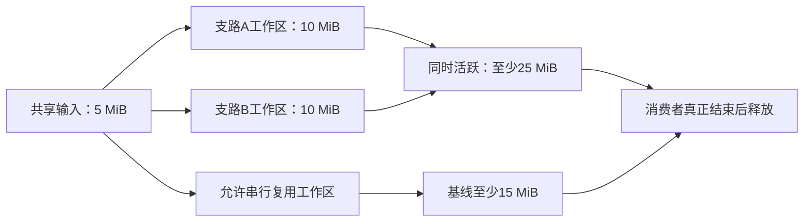

# 性能预算与复杂度

## 端到端预算的组合规则

<a id="fig-memory-liveness"></a>

### 图解：峰值内存取同时活跃分配，而不是阶段最大值

示例输入5MiB、每支路10MiB工作区；未画出的输出、对齐与运行器开销仍需加入实际预算。



本节消费任务硬预算与已接受 Profile，计算相交实现路径的延迟、峰值内存、吞吐、外部成本和其他资源条件。每项预算绑定量纲、主体、负载、输入规模、观察范围、界或统计性质及证据；无关预算不出现在纯函数作者界面，但真实宿主仍限制实际使用资源。算法语义与运行 Grant 由各自 Owner 负责。

### 先固定场景再比较

比较不同实现须固定输入规模/分布、精度与错误合同、冷热状态、并发/硬件、输出消费者及观察窗口。分别报告构建安装、首次初始化、单次请求和长期维护成本；共享固定成本可以按真实使用次数摊销，但首次请求硬期限必须独立满足。模型假设与测量分开存证，缺实测时只给标明前提的估计，禁止填入伪测量。

### 延迟与吞吐

串行无重叠路径的时间等于实际各阶段、转换、等待和同步时间之和。若某些工作合法重叠，依据执行图求关键路径；这个结果只有在假设资源可同时供应、排队可忽略或已纳入时才成立。共享CPU、内存带宽、设备队列或外部配额会产生竞争，不能先取分支最大值后宣称硬截止期满足。

吞吐应在说明负载稳定性、服务率及队列机制的前提下测量，不由单次延迟取倒数。流水线区分首项、稳态与排空；生产速率超过消费能力时必须采取有界缓冲、背压、拒绝或任务许可的数据丢弃。P99 是统计分位，不等于逐次最坏界；硬完成时间需要匹配负载与环境条件的最坏路径保证。

### 峰值内存与所有权

令a为一次真实物理分配，size(a)是其占用字节；Live(t)为时刻t仍被执行、返回结果、异步设备或恢复责任持有的分配集合。对每个受约束的进程地址空间、内存池或设备分别计算`max_t Σ[a∈Live(t)] size(a)`，再加入该范围的分配器、运行库与其他已知开销。CPU与GPU各有配额时不能合成一个总数代替两个上限；只有另有跨池总预算时再计算对应总量。这里只对真实相同分配去重，逻辑内容相同但分别复制的对象必须分别计数。

例：同一内存池中，两分支各有10 MiB工作区，共享同一5 MiB只读输入，结果内存与运行开销暂且假设为零。并行时需要25 MiB，而不是max(15,15)=15 MiB；按30 MiB相加又重复计了一份共享输入。若合法顺序复用工作区，峰值才可能降到15 MiB。真实结果、设备在途与清理责任非零时另加；这个假设例不构成硬件测量。

释放依据最后实际使用和异步完成；取消仅是请求，不是内存马上可重用。分块只能减少它真正替换的临时区域，完整输入和结果仍驻留时照计。改变布局、并行或缓存选择，要重新计算相交寿命。

### 数值误差传播

误差必须写明空间、范数、输入域、绝对/相对口径和有效路径。设f从X映到Y，g从Y映到Z，精确链为g(f(x))，实现分别为f̃和g̃；Y与Z分别选择对应误差范数。若`||f̃(x)-f(x)||_Y≤ε_f`，且g在包含两种中间结果的区域上满足`||g(y1)-g(y2)||_Z≤L·||y1-y2||_Y`，且`||g̃(z)-g(z)||_Z≤ε_g`在所有实际到达的中间值z上成立，则先在精确g(f̃(x))处分解误差，再由三角不等式得到：

`||g̃(f̃(x))-g(f(x))||_Z ≤ ε_g + L·ε_f`。

ε_f以Y的单位计，ε_g与最终界以Z的单位计；L包含相应尺度换算，不能拿两个不同量纲的误差直接相加。

没有上述共同定义域和稳定性依据，不能机械相加两个局部误差。假设L=20、ε_f=0.1、ε_g=0，则组合界是2，不是0.1；任务要求绝对误差至多1时，当前界不足以证实保证。它未必证明某个具体实现真的超差，可以收紧分析或换方案；不得直接标成已满足。精确整数路线无需构造浮点误差预算。

相对误差在真值接近零时需要专门尺度；区间失真、离散分支、极端条件数和截断会改变传播，交由相应数值合同。算法模型误差、离散误差、舍入误差和随机估计误差不先合为一个无解释的ε。

### 失效概率与共同原因

只有取得有口径的事件概率界才计算风险。对同一次任务中的失败事件F_i，联合失败概率可用`P(∪F_i)≤min(1,ΣP(F_i))`作保守上界，这不要求独立性；把组件成功率直接相乘则需要实际相应独立或条件概率依据。共同电源、同一错误生成器、共享数据集和相同授权根会使独立假设失效。

没有可靠概率时，保留故障情景、后果与可恢复边界；不能因无数字就当零风险。目标行为和强制权利约束也不通过平均概率抵消。

### 预算结果怎样进入选择和执行

选型用上述组合判断硬预算、比较有依据的成本；动态执行仍使用当前资源准入。静态范围不足可以保存条件设计或选择更保守候选，不能把估计上界签成真实配额。允许流化、降低并发、重算时采用它们并重新计算；不允许外部落盘或降低精度时，资源不足就返回该限制而不偷换方案。

每条测量或上界记录其输入和方法依赖。共享资源、目标布局、上游误差或任务时间窗口改变时，相交组合重新判断，即使源程序的数学返回值保持不变。对不受影响的普通值消费者可以继续复用，预算消费者不能沿用旧结论。

## 编译器性能模型与复杂度防护

### 优化顺序

```text
消除不必要工作
→ 复用同一有效工作
→ 增量化真实依赖闭包
→ 并行化已证明独立的工作
→ 替换更快机制
```

不能用少分析、少测试、吞未知、扩大 timeout 或削弱恢复换速度。

### PerformanceScenario

绑定真实用户目标、输入规模、环境、正确性结果和阶段分解。记录 wall、CPU、RSS、I/O、网络、启动、等待、执行、cleanup、cache hit/miss、reused/joined/invalidated counts。

### 复杂度风险

- 图/求解器指数爆炸；
- regex/解析器最坏路径；
- 过度细粒度 query 调度；
- 全局 generation 失效；
- 大量小文件和 stat；
- memory retention；
- remote latency；
- serialization 和 digest；
- repeated orientation/analysis。

### Budget

每个 pass 声明输入规模函数、时间/内存上界或已知未知、可取消点、partial result 语义和降级策略。预算耗尽不能生成假完整结果。

### 测量

单次结果不产生 percentile。跨版本比较保持 workload/environment/claim 等价；性能优化也计入维护、迁移、失败、恢复和供应商成本。

### 验证

- worst-case adversarial input；
- small/medium/large；
- cold/warm/cache-off；
- incremental delta；
- parallel contention；
- cancellation；
- memory leak/long session；
- correctness and output parity。

### 结构工作量与耗时分开

反向delta队列可以在稀疏长链上消除重复全扫；记录的边访问数、队列取出数和新增事实不是同一单位，不能把两个不同计数的比例包装成wall-clock加速。改变图密度、标签数、缓存和启动环境后重新测量。全闭包扫描可作为较慢的独立Oracle保留在测试中，不放回常规执行路径。

功能粒度、摘要计算、临时文件与TypeScript启动都可能控制小项目成本；先按真实负载分解，再决定是否长驻、分片或更换语言。缺少吞吐样本不阻止选择可逆默认，也不证明已达到最佳性能。

## 作者体量、派生体量与模型上下文

“体量是否更大”分开计算，不把不同量纲相加：

| 口径 | 当前预算与缩减方式 | 不能隐瞒的成本 |
|---|---|---|
| 人工/AI维护的作者内容 | 组合定义一次维护，实例只写差异，原生源码不镜像成手写AST | 新概念、特殊规则和独特算法仍需表达；初次建定义可能更贵 |
| 生成物、索引和证据占盘 | 按消费者生成、共享可重建数据、限定缓存和留存 | 额外索引/生成物通常真实占空间；恢复资产不能按缓存淘汰 |
| 编译驻留内存 | 按工作集、模块/查询失效、需要时展开，提供全量正确基线 | 缓存与精细依赖换速度同时耗内存；结果数少不等于常驻少 |
| 本次模型输入输出 | 任务相关合同、实例差异、必要源码与反例；有界读取和增量回应 | 只给摘要可能漏约束；复杂任务仍须读取决定性细节 |
| 完整变更成本 | 比较引入、重复修改、检查、返工、维护与退出 | 接口调用更短不自动意味着总时间、费用或风险下降 |

已由定义编码的细节可以引用复用；能从合同推导的值不重复决定；政策允许的多种实现也无需用户手选。只有确实影响含义、无法从现有来源确定且未被委派的差异才需要补充。由此可以保持一般计算能力而降低很多任务的作者工作，准确的理论限制见通用性与简化。宏展开可有很多节点，不要求它们全部保存为作者源或塞入提示。

单个很小、只改一次的函数，直接源码可能更简单。共享合同同时驱动运行校验、接口与多个真实消费者、且反复改变时，工程组合才有更强的节省机会。采用前按相同正确性与保证比较，不能拿有已知缺陷的旧程序作为更便宜的合格基线，也不只比较生成代码行数。

粒度先选正确可解释的模块级查询；出现具体重算或冲突成本再细化到符号、字段或条件读集。缓存退出不丢作者信息；删除依赖与同值新依赖仍按本章原算法处理。新功能不必等细粒度缓存完备，公共规则变化引起广泛失效也不能强行伪装局部。

Bazel公开记录分析缓存/增量状态与内存的取舍，说明减少内存与保留复用信息不是同一个目标。本设计借用这一约束，不把其具体比例或实验特性当作Gift的实测收益。机制来源见[资料边界](../../90-治理与参考/维护/设计依据与资料边界.md)。

### 公平成本基线与可退回的抽象

对照中的原生开发者同样可以使用成熟库、函数、宏或已有生成工具。Gift重复实现了这些能力，或仅把库调用换为更短名字，不自动产生新增价值。需要分开测量新增定义的初次制作/验证/维护、每次实例差异、真正减少的跨产物重复、查错与迁移负担；共享成本不能被永久藏在平台侧。

抽象带来的代价不一定只能转移：从源头消除重复副本和不必要同步，可以减少系统总工作；但省字节可能增加依赖、求解和调试成本，必须用相同量纲分别检验。没有统一任务分布和代价定义时，报告各维结果及条件，不捏造“综合架构分”。

选择展开深度是对当前任务的可逆决策，无需通用最优抽象搜索器。重复且稳定的结构优先命名；持续增加互相作用开关时拆成有合同的局部组成；特殊算法可直接保留紧凑程序。比较抽象、局部具体化和直接原生三条真实路径，若后者更好就保留它。AI专用编码也应测其实际理解与返工，不把字符更少或ID更短当作模型必然更容易。

## 作者交互的成本合同

性能单位是一个同样正确、同样获准、同样需要保证的任务，而不是最短的单个请求。分别记录冷启动schema/画像与陌生合同、上下文读取、AI源或补丁、返回代码/诊断、失败重试、会话恢复、服务端解析/搜索/编译、磁盘与内存、后续维护。不同量纲不相加成任意总分。

字符和UTF-8字节可在文档上精确计算；token依实际分词器，任务耗时/费用/正确率需真实模型实验。压缩JSON空格不是语言简化；隐藏meta字段或把工作移给另一个代理仍要计入完整链路。阶段状态可紧凑表示，但不能省去会改变判断的未知、前提、缺项和实际作用。

作者侧的首期验收：同等目标、上下文和保证下，普通程序可原样作为source输入，不强制第二份AST；已绑定基础画像的普通表达式不新增能力发现往返；单次预览不为流程仪式拆成多个调用；相同内容不以多种表示重复送入模型。协议本身有固定传输开销，不宣称每个单字表达式的完整请求一定比源短。

使用成熟库的原生路线必须能采用相同的简写与库知识。Gift高层源码若和原生同库调用完全相同，就记录相等，不把其生成的循环体当作唯一原生基线。只有多产物共同来源、可靠差异/诊断、局部具体化或实际工具整合减少了真实工作，才记录额外收益。

小任务优先原文/原差异；只有结构操作更贴合任务时才发送图增量。高层库复用不确定时可以直接写普通程序，不要求先寻找复用方案。用户明确需要额外安全或审计保证时，其合理新增成本单独列明，不能靠删除义务满足短输入约束。

## 扩展数量与提示范围的非增长验收

设某次固定任务需要的公开契约闭包保持不变。向未导入、无全局注册、无通配依赖的库集合增加无关定义，不应改变该任务的绑定、输出、固定工具schema或提供给AI的契约正文；已绑定任务仍应有零额外发现轮次。这是声明范围内可验证的非增长性质，不是全部索引、包存储或机器读取永远常数开销的承诺。

反例集合覆盖：冷/暖启动；上下文回收；解释锁升级；重载/别名歧义；隐式全局注册；动态导入；权限变化；批量错误；目录增长；根需求改变；不透明原生接口。其结果分别记录，而非将最好的暖启动路径代表所有情况。

实现默认按锁和实际依赖按需加载；共享解析缓存按实际输入与隔离范围复用；删除支持、同值换来源、负依赖和新约束规则仍沿本章检查。优化为一次批量诊断，不推迟必要的版本/权限判断。全量正确基线保留；没有测到热点之前不先搭分布式搜索或万能最优规划器。

## 把失败定位到产生开销的责任

工具schema增长由传输投影负责；无关合同进入提示由查询/上下文负责；源被重复序列化由作者入口负责；全量库扫描由解析器/索引负责；展开指数膨胀由定义/降低策略负责；目标变慢由语义保持与布局负责。不得一律增加缓存或更长上下文来覆盖这些不同问题。

默认同时保留不增加原生源长度的入口和高层调用入口：只有后者确实减少任务需要表达的独特内容时才选它；没有明显复用收益不强制抽象提取或架构搜索。检验高层合同变更时也要看到其真实消费者，不能仅用一个压缩文本证明跨产物价值。

<a id="prebootstrap-resource-budgets"></a>
## 编译预算、退化与最坏情形的可执行设计

预算由请求和宿主资源 Profile 给定，不能在文档中捏造统一毫秒门槛。预算至少能约束输入字节、嵌套深度/节点数、解码后空间、类型/实例展开、重写/求解工作量、候选数、输出字节、并发工作与墙钟等待；每项区分硬上限与用于比较的估计。默认来自明确版本的宿主配置，缺硬参数的实际请求不得进入声称有界的执行。

先检查帧和声明大小，再分配/展开；对递归结构尽可能用显式工作表而非消耗宿主调用栈。小输入采用低固定成本路径，只有确有重复/规模收益才建索引或跨进程缓存。资源耗尽返回可定位的 BudgetIncomplete/ResourceLimit 与已完成范围，不把所有用户程序变成非法，也不重试直到系统被耗尽。

总工作量包含子查询、插件、求解器与重试；被取消并重新订阅同一任务不重置系统预算。取消控制和基本诊断留出有界资源，避免所有容量都被数据输出占满而无法退出。外部子进程须同时排空 stdout/stderr 并限定捕获量；把日志写满磁盘不是“计算已停止”。

性能方法的比较固定工作负载、输入规模/分布、冷热缓存、目标、并发、内存和工具版本。静态复杂度界要给数据结构与假设，实测只证明其样本条件；同一算法的 O(n) 不代表高常数或实际平台更快。没有数据时可选择合法的简单默认方法，但不签性能最优。硬性能要求在缺测量/静态依据时保持缺证据。

自举无需每次日常编辑重复三次整包构建；完整固定点只在对应源码/工具链/发行资格变化需要时执行。日常构建按实际 Git/SourceSnapshot 变化和消费闭包选择任务，不以 CI 反复失败作为调试循环。机械设计包检查也不得被统计成生产编译性能。

<a id="design-b22"></a>
## 预算的继承、共享取消与局部完成

预算按工作量、内存保留、活跃任务、队列、诊断字节、递归深度、外部进程和真实费用分别核算；它们不是可相加的单一“复杂度分”。子任务从父预算预留/归还，拆成更多节点不能重新获得完整父额度。共享singleflight记录每个等待者的来源和租约，最后一个合法等待者退出才允许终止未被其它任务依赖的纯计算。

请求deadline取消等待和后继调度，不等于能杀死未受控原生工作或撤销外部Effect。清理、读回和持久结算有独立保留预算；耗尽时使资源进入可追踪待恢复状态，而不是为了释放计数标成完成。诊断洪泛按数量/字节限额截断并报告未展示范围，不能丢第一条真正原因后只显示成功。

调度按依赖与资源冲突并行，输出根的完成独立计算。一个根BudgetIncomplete不阻塞无依赖的另一个根；共享必需目标runtime失败则所有依赖根都未完成。降低负载可调整内部队列、分块、索引、优先级和允许的软目标，但不能放松作者硬要求、缩小合法输入域或偷偷切远程执行。

远程/额外worker是明确授权能力；默认本地装配不用Docker或托管runner。协议记录host/build身份和返回制品摘要，断联保留原尝试身份；不会因为没收到响应就重复启动有外部费用/效果的任务。

**验证与反例**：一个等待者取消仍保留共享计算、子任务预算守恒、cleanup预算不足、队列洪泛和部分根完成的有限状态模型。

**实际能力边界**：宿主限额/调度公平性/真实性能仍需实测。

相交合同：[资源线性、借用与效果处理](../../20-语义与组合/基础语义/计算基础/通用计算与任务语义.md#design-b11)；[增量失效与精确负依赖](依赖与失效模型.md#design-b21)；[Unknown Outcome 的操作生命周期](../../50-执行运行与观测/持久化与恢复/事务提交-外部效果与幂等交付.md#design-b25)；[远程算力的条件启用与不确定成本](../../40-目标与制品/递归并行与远程编译.md#design-c33)。
