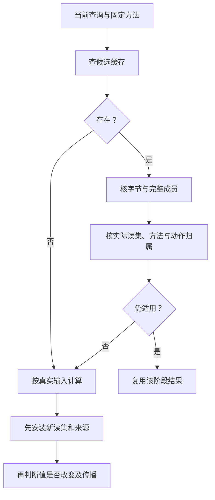

# 查询固定点与缓存

当前缓存/固定点意义由本owner决定；用于内核构建的ReadSet、负依赖、generation和共享singleflight算法见[增量调度施工设计](../../70-工程系统与演进/工程构造手册/07-增量并发与资源调度.md)。

## 增量编译、依赖与缓存正确性

可复用结果以算法/解释规则、实际内容闭包、配置和相关工具语义为键。全局发布代际仅在结果真实依赖它时进入键；不能让无关文件变化触发全部重编译。

缓存依赖同时包含已读引用、集合枚举、负查询、环境缺省和解析路径。对每次观察都通过受控API且完整追踪的确定性计算，已读值、分支条件、负发现与枚举令牌不变时，可复用该次结果；未执行分支不需预读，控制输入变化则重算并更新读集。采样trace或存在绕过观察API的外部读取时，上述充分条件不成立，应使用健全过近似、隔离或禁用对应缓存。

`ActionKey` 相同是比较对象，不是自动授权。源码结果可复用不代表旧读取权限、旧发布许可或过期外部状态可复用。权限验证与语义计算尽量分开，避免刷新凭证重新编译函数。

[快照查询与失效算法](#快照查询与增量失效算法)规定正读、负读、成员枚举、传递生产者、取消和冷/热比较。符号级检查、持久化与远程复用各有额外闭合义务；其实际支持与待完成范围见[设计状态](../../90-治理与参考/状态/README.md)。

理由是降低重复工作而不减少正确性。无免费午餐或不可判定性不否定受控构建输入的精确记录；反过来，也不能因为一个密闭纯函数可精确记录就推广到任意开放程序。

反证：新增原先不存在的模块后错误复用；换工具语义仍命中；无关文件改动全部失效；清缓存改变结果。验收采用干净/增量差分、负依赖变形、缓存损坏和未知前沿测试。

## 快照查询与增量失效算法

**共享计算与取消。（消费条件）：** 单个等待者取消不等于共享生产者停止；结果只按自己所需的版本、权限和有效期消费，不跨作用域复用授权。 合同归属：[远端编译竞速、等待图和不可信结果的分界](../../40-目标与制品/递归并行与远程编译.md#gift-distributed-boundary-lease)。

### 职责与默认落位

本文规定[增量正确性](#增量编译依赖与缓存正确性)的可执行算法；查询的一般语义仍由[程序分析查询系统](#程序分析查询系统与固定点引擎)拥有。查询缓存不是另一个工程事实数据库。调用方可完全关闭缓存，结果应与冷计算一致。

默认是同进程、单所有者、有限LRU、不可变快照和受信分析函数。无需网络、数据库或全项目编译守护进程。共享多消费者、持久缓存、远端执行、符号级增量是可替换的实现层，不能因为出现一个缓存模块就宣称已实现。

### 四种身份不能混用

`LookupKey`根据查询类型、生产者身份与规范参数定位候选缓存，不授予可重用资格；`EvaluationKey`还必须绑定本次实际观察及传递依赖；`ResultDigest`只校验结果字节。`Snapshot.identity`为读取切面提供来源身份，不应将所有无关快照成员加入每项计算键，也不能以Lookup命中替代依赖验证。

因此同一LookupKey在新快照中可以失效；不同完整快照也可以产生同一EvaluationKey。计算结果命中不能把旧权限、外部有效期、运行资格或部署批准一并复用。对此的返回标识明确为计算结果，不签发授权。

### 不可变输入与观察代数

`Snapshot`先检查精确数据类型、键和值的Unicode、节点数、深度与总字节预算，再把每个输入编码成私有不可变字节。读出时解码为新值，不把缓存对象交给调用方改写。可变作者对象在捕获期间由调用方独占；普通可变对象复制不构成跨线程线性化协议。需要并发采纳时沿用既有修订/CAS协议。

`read(key)`返回 `present=false` 或 `present=true,value=...`；不存在不是值null。观测令牌区分absent与present+内容摘要。`members(prefix)`观测排序后的成员身份集合，而不是成员值；只查询成员名的操作不因成员内容改变而重算，却必须在新增或删除成员时失效。成员名再被读取时，值依赖单独记录。

这是受控快照API的完整性承诺，不是对任意进程的文件访问追踪。分析函数读取时钟、环境、随机源、网络、宿主全局变量或未登记文件，会破坏假设；必须把它们显式转成快照输入，或把该查询标为不缓存。不能用一次tracing记录宣布未知程序的全部输入已知。

### 查询、复用与失效的具体步骤

一次请求首先冻结查询定义集合，创建私有pending集合。查询参数是有预算的纯数据；重复活动LookupKey返回 `query-cycle`。它不是程序递归非法：程序调用图的环由专用效果分析处理，普通缓存回调的自依赖不能冒充已定义固定点。

找到缓存候选后，验证其所有传递生产者仍为相同身份，再逐项在本次快照重算观测令牌。全部相等才复用。一个观测变化即可重新运行该查询，子查询可能分别命中；子查询的叶子观测与生产者向父查询传播，避免只检查直接父节点而遗漏祖孙关系。

回调成功后，结果被编码成不可变字节，新的依赖集合替换旧集合。条件分支改走另一输入时，旧分支依赖不能永久粘住，也不能漏掉选择分支的那个输入。每次观察、查询和回调返回后都有预算/取消点。只有顶层请求完整成功才提交pending；异常、预算耗尽、循环与取消不留下新的成功缓存。

LRU只控制重算成本，不拥有唯一权威或恢复事实。条目和结果字节有预算，删除仅导致重算。最小实现可以只缓存成功值；若启用诊断缓存，必须沿下一节的完整语义负结果合同，不能把尚未定义的失败随手塞进成功条目。

### 完整诊断与运行失败分别缓存

类型检查完整结束并发现不合法输入，是一个可重复的分析结果，不是检查器崩溃。其可选缓存条目绑定检查目的、解释/算法版本、实际依赖、覆盖范围、诊断载荷和失效条件，状态保持`completed-with-diagnostics`。它可以复用相同类型错误，不能成为构建成功、搜索无解或其他声明的证据。诊断中的位置与敏感信息按当前源码映射和披露权限重新投影；无法安全分离时对相应主体/范围隔离缓存。

超时、取消、OOM、工具不可用和外部完成未知是执行未完成或效果状态，不作为上述完整语义结果。可缓存它们用于短期退避，但条目明确属于调度/健康状态，不签发UNSAT或否定合法候选；到期、宿主或资源变化可以重新尝试。已可能产生副作用时，重试由操作恢复协议决定，不由查询缓存自行执行。

若算法有预算相关的近似结果或候选排序，预算与停止策略会影响含义，必须绑定该语义配置及覆盖。只限制运行资源、而不改变完整结果含义的期限和取消令牌属于执行条件，不为每个期限变化制造新语义键；复用资格仍检查本次目的与证据。顶层取消不提交未完成条目，有完整独立子结果的复用需明确它已封闭的范围。

### 生产者变化与并发

公开替换接口只允许引擎空闲时更换已有定义；当前请求不能执行一半就换掉子查询算法。生产者摘要需覆盖语义依赖，包括实现、选项及所依赖工具。受信回调仍可通过宿主反射破坏私有状态，因此这不是恶意插件隔离；真正的不可信执行由宿主协议承担。

单进程方案拒绝顶层重入。团队实现采用不可变定义快照和single-flight：多个消费者共享计算，消费者取消只释放自己的引用；最后一个消费者退出后才请求取消可共享工作。迟到结果只能写其原始EvaluationKey，不能覆盖新修订。跨线程同步、持久租约和远程资格须由对应提供者单独满足，不从本地算法推出。

### 查询粒度与渐进细化

初始默认可以把完整程序编译作为一个查询：程序输入和实际影响结果的选项属于语义参数；预算是否入键按前述结果语义决定。其他无关工作区成员变化不强制重算。该粒度是简单保守实现选择，不是符号级增量能力。

进一步按消费者拆分模块解码、签名目录、函数体检查、效果强连通分量、目标计划和制品查询。局部身份先在实际需要的范围稳定，避免无关声明引发全局编号变化；内联等读取函数体的消费者必须记录真实读取。正、负、成员和工具依赖先保守覆盖，再通过完整与增量对照缩小。

分片、序列化和维护成本超过省下的计算时保持较粗查询。没有实际负载时不填写最佳颗粒度或提速比例；本地语义查询不必为了复用机制先引入整个构建平台。

### 反例与验收

正读变化、缺失变出现、出现变缺失、成员增加/删除、仅值变动、传递生产者变化、条件读集替换、调用方篡改返回值、请求取消、回调失败、依赖循环和LRU淘汰分别设计正反例。有限随机图的效果闭包应与独立同步全扫 Oracle 比较，不用缓存自身生成预期。

若出现缓存开关改变目标结果、未登记输入、失去原始恢复事实、跨租户复用泄漏、超预算被当UNSAT，就撤销该缓存资格，保留反例并回退冷计算。回退只解决该纯计算结果，不得对已产生外部作用的执行结果盲重跑。

<a id="query-index-cache-boundary"></a>
### 查询索引只是可丢弃的派生缓存

SourceProfile解析结果可以派生面向查询的`QueryDocument`，再写入SQLite/FTS/内存表或远端索引；这些backend只优化定位，不拥有作者事实、语义身份、权限或Evidence。索引身份至少绑定Source/Profile/parser/ranker revision与覆盖范围；新generation在私有区完整建立后一次发布，查询不得观察半旧半新索引。

增量更新只重新解析改变的Source及真实依赖；索引损坏或缺失可以重建。索引落后、缺源或权限过滤时，查询结果必须携带coverage，零命中不能被提升为“事实不存在”。日常warm查询与source→searchable延迟受性能门禁；full audit、图分析和重型统计属于独立任务，不能成为每次查询的隐含前置。

<a id="query-cached-disclosure-evidence"></a>
### 正确的索引值还必须有当前披露依据

增量QueryCache的值、其依赖集合、缓存检索键、消费者可披露资格是独立的检查层。即使旧SourceRevision对应的QueryDocument被证明语义不变，其标题/片段仍可能因当前ACL、删除策略、scope或租户改变而不能披露。重建失败后的旧代只能按兼容性与逐源字节/权限重新取得**有限可展示集合**；凡不匹配当前源的旧项应被拒绝，而不以`stale`标签作授权替身。这适用于索引内容、搜索摘要、命中数、AI context和缓存导出，不限于正文全文。

严格负结果的依赖除了已消费正集合，还要记录“哪一个范围已完整列举”“本次查询计划能发现什么”“哪些权限排除/未知”和“归因何种解释版本”；将新来源或重配后的空查询视作旧代的`CURRENT`会生成错误否定。源码层缓存的依赖正确不代表索引的权限正确；两者不共用一份无条件可复用的`success`。

读取一个复合generation时，先开启后端一致性读视图，再核它与响应记录的代际相同；查询期间读到新代应拒绝已绑定旧代的游标或重新开始。对两个物理独立分域索引的拼接，不存在共同读事务时只提供代际向量和相应覆盖，不假称全局单点快照。性能门槛必须与同版本、同样本、同缓存状态和宿主负载对照；未经校准的固定墙钟阈值可以提示回归候选，不能单独证明一轮代码变更恶化或生产容量达标。

<a id="gift-negative-dependency-proof"></a>
### 负结果、开放供给与增量重用的证明范围

`notFound`、缺合格 Method、引用不存在是不同语义。缓存否定必须携带本次查询范围、闭合假设、可见权限、目录/索引版本、Provider/工具资格和精确负依赖；仅当这些仍有效时，才可复用同一个有界“未发现”。超时、分页未完、不可见权限或开放扩展域返回 `unknown/partial`，不能持久缓存成全域空。字节 Hash 相同也不证明资格相同：签发者撤证、授权调整、搜索预算和新的相交供应均可改变结论。

固定点分析若有删除、非单调规则或新的负前提，不允许仅追加旧值；必须使对应SCC重新从正确底开始，或使用有证明的增量撤销算法。并行查询共享计算可以降低成本，但不同请求的授权、完成覆盖和截止时间保持私有，不因同一个cacheKey合并。测试轨迹包括“缓存空候选→新Provider登记”“隐去一项权限→缓存结果泄露存在”“删除关系边→固定点多留事实”“取消生产者而另有真实订阅者仍等待”。

## 程序分析查询系统与固定点引擎

**流查询。（消费条件）：** 含撤回/迟到的非单调流聚合不能仅追加固定点事实，需要有证明的撤销和重新计算语义。 合同归属：[事件时间、水位、迟到值与全称完成](../../20-语义与组合/基础语义/状态关系与流/背压与事件时间.md#gift-stream-progress-completeness)。

### 统一查询，不统一所有语义

Compiler、Impact、Verification 和 Explain 都需要可缓存、增量和可追踪的查询，但每个查询仍由所属领域定义语义。

### QueryNode

```text
QueryNode = exact {
  queryKindRef,
  normalizedInputRefs,
  dependencyPolicyRef,
  algorithmRevision,
  resultSchemaRef,
  determinismAndResourceContract,
  cyclePolicy,
  diagnosticsPolicy
}
```

### 固定点

递归类型、调用图、数据流和影响传播可形成 SCC。每个 cyclic query 必须声明：

- 状态空间和偏序；
- transfer function；
- monotonicity；
- bottom/top；
- join/widening/narrowing；
- 终止条件；
- 预算耗尽语义；
- 增量更新规则。

没有这些不能把“循环直到稳定”当算法。

### 缓存

Query key绑定实际输入闭包和算法revision。旧固定点不能无条件作新问题的初值：加事实与删事实分别按下一节处理；不同扩宽策略产生的健全近似也不自动视为同一精确结果。完整诊断与执行失败按[负结果合同](#完整诊断与运行失败分别缓存)处理。

### 删除递归事实与重新求固定点

对有限单调并集分析，初始求值从各分量的底和当前种子开始。规则及图不变、输入仅单调增加时，可以传播新增事实；移除种子、删除边、替换规则或改变分量划分时，默认按新的依赖图重划受影响强连通分量，从底重算这些分量和必要下游。不能用只增加标签的队列修复删除。

设计反例：A、B互相传播标签，最初A有直接`network`标签，两者结果均为`{network}`。删除A唯一的直接种子后，方程成为`A=B, B=A`。新最小解是空集；旧的`{network}`也满足这两条方程，所以从旧值只做并集会永远保留无依据的标签。简单引用计数也可能让环内部互相续命，不能省掉对外部支持的判断。

有确切推导支持与删除算法时，可用过删除/重新推导、差量权重等替代全分量重算；必须说明多条独立推导、重复事实和递归环怎样保持，不能只引用一个增量框架名称。负依赖和否定规则要求分层或明确的非单调语义；无法满足该分析画像时返回对应未决/不支持，不把未知当false。

需要widening的分析还绑定扩宽/缩窄策略、稳定遍历次序与预算后结果含义；不同调度的健全过近似可能不相同。若声明精确确定性，就不能把这些结果放在同一精确内容键下。不能收敛只限制相关分析/保证，普通程序递归不因此变成非法。

该设计选择较保守的分量重算作为删除路径，以重复计算换取可检查性；获得实际热点与正确删除算法后再优化。差量维护可参考[Differential Dataflow](https://timelydataflow.github.io/differential-dataflow/)，本包未实现或运行该算法。

### 结果相等仍需更新依赖

重算结果的值相同，只能让声明“仅依赖该值”的消费者提前停止传播；本次读集、分支选择、生产者及来源必须先完整安装。若开关原来读取X，后来改读Y，而二者此刻恰好相同，仍需移除X并登记Y，否则下次Y变化会漏算。位置、解释、权限和证据消费者分别记录其实际依赖，不能跟着值相等一起保留旧依据。

### 取消与并发

相同内容键只提供single-flight候选；执行读取范围和披露条件还须满足[共享计算的隔离](依赖与失效模型.md#共享计算的隔离与派生数据)。多个消费者各自取消引用，不能让一个消费者取消其他仍有权且已承担预算的工作。旧revision完成后不得覆盖新结果。

### 验证：程序分析查询系统与固定点引擎

- SCC 顺序置换；
- 非单调 transfer；
- widening 失精度；
- 预算耗尽；
- 增量与 clean；
- 并发相同 query；
- stale late completion；
- cache corruption；
- failure reuse。

### 有限实现画像与查询身份

具体值接口、观察代数和提交缓存的算法见[快照查询实现](#快照查询与增量失效算法)。LookupKey用于定位候选，EvaluationKey绑定真实依赖，两者不能混称完整ActionKey。本地起步映射为单所有者顶层请求、有限LRU和成功结果缓存；共享求值、并发取消和远程持久化按上文生产合同设计，不能从这个受限映射推定已验证。

效果分析的有限集合并集由反向delta工作队列执行；普通查询环仍报query-cycle。只有拥有明确偏序和收敛语义的分析才进入固定点，不自动重试任意递归回调。

### 转换之后哪些分析可以保持

按[Pass接纳规则](../../40-目标与制品/编译内核/变换接纳与分析保持.md)处理新的IR generation：实际差额及可信保持规则决定可复用、可更新与失效的分析，并继续传播到分析的消费者。CFG不变不证明值域/别名/效果/成本不变；保留命题需要新基础上合法的引用，不能复用已删除节点的裸地址。准确无变化可以保留全部适用分析，无法证明的相交部分按需重算，不强制全工程失效。

组合假设的支持闭包也有实际依赖。删除或撤销种子后，相交循环不能靠互相引用保留旧成立标记；新跨分量约束需重新确定实际组合范围。仍有合法公开环境进口的条件结果可以缓存，但不以它取代当前宿主能力和运行授权。新IR、依赖和适用分析在同一工作项发布，不暴露“新IR＋旧过期范围”的瞬时组合。

## 编译缓存、远程执行与内容寻址存储

### 三个对象

```text
ActionCache: ActionKey → ResultRef
ContentStore: Digest → ImmutableBlob/Tree
ExecutionProvider: ActionPlan → ExecutionReceipt
```

三者不能合并。CAS 中有内容不代表 Action 合法完成；ActionCache 命中也必须验证 result、producer、environment 和 freshness。

### 结果字节与动作归属的两种完整性

CAS只证明返回字节与摘要一致；动作缓存还必须验证这些字节确由指定输入、方法与环境产生。攻击者可提供摘要自洽却行为错误的 ResultRef，并伪造 ActionKey→ResultRef 关联，因此全成员 Hash 校验也不能签发计算归属。[Bazel远程缓存](https://bazel.build/remote/caching)区分动作结果索引与内容存储；Gift 对动作归属、供应者和可信元数据另有检查责任，不能从内容完整性推导计算正确。

读取动作结果先核对键材料、实际输出清单、生成者及可信执行/证据绑定，再核对每份内容。受信本地纯计算可以使用进程与工作区信任边界，不要求每次签名；跨信任域选择授权写入者、可信执行回执或独立重算/验证。签名只认证签发者，不证明该签发者计算无误。未建立相应信任时，外部结果只能是待检查候选，不能悄悄作为正式命中。

对声称字节确定的同一动作键出现两个不同结果时，保留冲突记录，隔离相交缓存映射并调查隐藏输入、非确定性或污染，不按“更新更晚”选胜者。只有合同本来允许多个结果且缓存键与验证规则明确记录该非确定性时，才按那个合同处理；不得在发现冲突后修改确定性承诺以掩盖错误。读取仍受当前披露权限；选择性隔离不让无关工作全部停机。

纯缓存缺失/失效可在输入与预算允许时重算；持久操作结果不是普通缓存条目，缺失不能推导业务尚未发生。两者的回收、重试和证据保留策略不得共用一个LRU或TTL。

### ActionKey

键材料和复用资格唯一沿用[可达输入闭包与负依赖](依赖与失效模型.md#可达输入声明依赖证据与负依赖)。只绑定声明中真正影响计算的不可变依赖投影，不把整个 `InputDependencyAssessment`（含证书文本、观察时间、审查身份）塞入键。`ProvenExact` 和有作用域证明的健全过近似均可满足缓存安全，但后者不保证最小失效。branch、PR、临时位置、执行时间和无关 generation 默认仅作来源；实际影响输出的路径/时间/策略不能因此漏掉。

### RemoteExecution

远程执行复用现有ActionKey、固定输入、输出与资格合同；完整传输和结算由[远程编译协议](../../40-目标与制品/递归并行与远程编译.md#远程编译的准入条件)规定。除内容字节外，还要固定实际工具链、执行平台、目标平台、环境和读取权限。输入闭包不全或不能合法传出的动作留在本地；本地方法可用不表示远程平台同样可执行。

远端只有读取指定内容、使用配额及写隔离输出的能力，不取得作者库的write/merge凭证。协调者核对结果属于当前动作、实际成员和环境后才接纳；内容哈希正确不能单独证明动作归属。网络断开表示结果或尝试状态未知，不等于没有执行。隔离纯计算只提供重算的语义前提；是否可启动新Attempt还须满足[调度重入与原生产者结算](../../40-目标与制品/递归并行与远程编译.md#pure-attempt-reentry)，或明确准入的有界竞速。真实外部效果沿自己的查询、去重和恢复协议处理。

同键共享也需要执行授权范围与每个接收者的披露资格。两个调用者各自能读半份输入，不允许合并成一份新的执行权限。迟到结果可保留为待核验的不可变内容，但不能直接改变当前请求、布局或作者头。

### 缓存失败

corrupt、foreign、stale、unsupported、partial、cleanup-unclosed 和 trust-unknown 不能当 miss 后无声重跑；需要分类，以免重复外部 Effect 或掩盖供应链问题。

### GC

内容可回收性由 reachability、retention、recovery 和 active lease 决定；年龄/大小只在 eligible 集合内排序。删除缓存只能损失性能，若会损失 authority 或唯一恢复能力，则分类错误。

### 验证：编译缓存、远程执行与内容寻址存储

- cache off/cold/warm/remote parity；
- environment 漏入 key；
- negative dependency；
- corrupt CAS；
- cross-tenant leak；
- worker late result；
- cache poisoning；
- GC 与正在执行 Action race；
- remote unavailable fallback 不改变语义。

### 检查消解、公开契约与增量依赖

编译器若根据证明删除运行检查，该证明使用的语义、表示、假设与消解规则成为该优化产物的真实依赖。不能只记录实现函数体，漏掉require/ensure或端口行为合同。条款、规则目录、假设或可信编码变化时，先撤销相交复用资格；可重新证明、保留检查后重建或报告所需保证未满足，不直接沿用旧无检查代码。

纯内容键可以在确实等价的证据替换后保持，但资格与来源要更新；若消解选择或输出字节改变，相关动作键和产物身份也改变。未请求这类优化的checked程序无需因此加载求解器。绑定一个有名行为契约和只读取函数类型，是不同查询，消费者不能共用一个忽略差异的“接口未变”判断。

## 查询从读取到缓存发布的具体过程

<a id="fig-cache-proof"></a>

### 图解：缓存复用的内容与动作归属双重检查

内容摘要正确只说明字节自洽；输入、方法、集合和负读取的有效性决定能否复用该阶段结果。



本节将已有LookupKey、EvaluationKey、正负依赖和固定点规则接成一个查询调用过程。请求输入为查询种类、规范化参数、固定源范围、生产者及预算。纯值缓存、当前访问许可和证据资格分别判断。

**Q1 查找。** 先校验当前请求可以读取相应内容，再用种类/参数/生产者形成查找键。找到候选结果后核对每个实际依赖的内容、目录、阴性观察、配置与解释。全部相交条件匹配才复用；失效项记录原因，而不是按仓库总hash使无关结果一起失效。

**Q2 在临时求值上下文记录读取。** read记录存在对象的真实版本；lookup记录缺失回答及其范围；members记录枚举条件和成员；子查询记录其结果及实际生产者/依赖。所有读取固定在当前源切面内，不在同一结果中混用活动工作树的两个时点。不可追踪外部读取使该方法失去相应可复用资格，不能通过用户自述“纯”恢复。

**Q3 求值和循环处理。** 普通依赖递归调用；重复进入正在求值的同一节点时，交给该节点声明的固定点机制或返回循环错误。单调有限事实可以工作表收敛；删除支持、规则替换或组件变化，受影响分量从底重算。扩宽、近似或带否定的方法按自身合同，不用一个通用集合并集冒充。

**Q4 先发布新依赖，再决定传播。** 成功结果的值、生产者、完整新读集和实际求值键作为一个缓存版本发布。只有这个版本可见后，才允许因值相等而停止向只消费值的下游传播；消费来源、诊断、布局或保证的下游按其输入更新。

**Q5 结束与资源。** 顶层成功后发布其结果；异常或取消丢弃未完成的父结果。已完成且独立闭合的子结果可以保留，需有独立正确读集。资源限额触发容量淘汰时只移除可重建缓存，不能删除当前任务仍占用的字节或持久恢复资产。求值引用在正常结束、取消后的实际终结或明确转交后释放。

### 同值不同依赖的轨迹

初次控制条件选择X，得到值5，缓存读集为{flag,X}。控制条件改变后选择Y，而Y目前也是5；重新求值必须发布{flag,Y}。下游仅输出5可以不重算，但后续Y变成6时必须失效。保留旧{flag,X}会漏掉变化；将所有下游都重算则可能正确但成本高。当前选择更新依据并按消费者区分传播。

### 失败缓存的正向规则

完整完成的语法/类型错误，可以以输入、解析/检查版本和覆盖缓存诊断。下一次相同输入直接返回同一失败含义；位置投影仍对应精确字节。时间耗尽、进程崩溃、权限变化或外部不可用，只能缓存为该次尝试观察，不作为输入永远非法的证明。新预算、方法或环境改变时允许新尝试，不能因旧失败无限封锁合法输入。

全量基线和增量版本比较的是值、必要诊断、当前依赖与资格；内部执行次数不同可以合法。并发求值可共享相同授权域内的计算，每个等待者仍独立判断披露和取消；一个等待者取消不释放其他实际使用者需要的资源。

## 共享查询在并行调度中的发布与取消

相同隔离范围、计算键和完整解释对应一个在算工作项；其他消费者订阅其结果。节点短锁仅保护状态和等待关系，执行分析、等待子查询、远程传输及目标工具时释放锁。不同工作线程的等待边进入同一环检测范围；同一线程的调用栈不能代替这项全局关系。

一个等待者取消只解除自己的需求与引用。最后撤离、关闭接纳与新等待者加入须按[同一生产实例的SHARE0—SHARE4](../../40-目标与制品/递归并行与远程编译.md#shared-producer-generation)协调，不能读到零之后才锁外决定是否仍可加入。Closing不复活；默认等待原代结算后才接纳下一代，迟到清理不得仅按共享key删除新实例。取消请求不证明远端或子进程已停止，实际占用按原预算结算。

生产者完成后先验证完整输入与真实读集，将不可变结果、读集与对应结果槽在原拥有者的同一发布边界安装，锁外唤醒已有保护的消费者。若同一确定动作得到不同内容，隔离冲突映射并报告隐藏输入或非确定性，不采用最后写入者获胜。此前完整语义诊断与新成功冲突也应暴露；纯执行故障不自动成为反证。各项正常与失败路径见[结果接纳](../../40-目标与制品/递归并行与远程编译.md#远程协议的正常与失败路径)。

## 实现数据流中的缓存发布与资格

parser和结构decoder缓存键至少区分实际源内容、解释/表示版本和当前所需解析选项；目标检查另绑定工具API族、完整配置、lib、声明包与模块解析读集。显示摘要、editRef、临时字节地址和当前cwd不作为这些语义身份的替代。相同源码在不同公开拥有者或类型实例中不能错误共享有身份含义的分析结果。

CheckedProgramView只指向它实际检查的版本。展开后新增调用、效果或依赖，先安装新读集并补查相关区域，再发布新的资格；类型相同不允许沿用旧引用和来源，目标printer无权自行宣布分析保留。ModuleRevision和类型表只读发布，临时统一变量不进入共享结果。

短ticket的memo仅复用纯候选结果，命中仍按当前权限披露；过期memo不提供原候选身份保证。byte store入境复制/转移后才计算和消费同一内容，不允许摘要时一份buffer、编译时另一份已被调用方修改的buffer。原有增量删除、同值传播和全量基线继续适用，没启用缓存不影响正确生成。

## 装配版本和结果资格的分离失效

EngineImage固定本次可用方法，QueryKey使用实际读取的源、接口、方法、默认和环境，不将全image目录摘要无条件加入每个查询。方法升级改变其结果键；新增未使用语言不使当前函数失效。Needs请求返回PreparedJob后继，已固定的引用不被就地换值。

产物字节与来源组成不可变ArtifactSet。CheckRecord独立引用它，检查有效性变化只失效保证/采用等真实消费者；若产物优化确实消解了一个检查，其证明又是编译输入，该证明失效按这条真实依赖重新处理生成。这两条不矛盾：普通后验检查不改字节，参与变换的依据会影响合法实现选择。

单模块phase与validity分别保存。共享签名可在主体检查尚未结束时供合法声明链接使用，但生成根不能借另一个模块的最高phase取得合格。缓存命中更新真实读取、来源和当前可披露关系后再返回，不把权限带进可跨主体复用的内容键。

固定名称调用只依赖实际已绑定定义；自动发现或比较读取的候选集合则保存相应过滤范围/目录修订，新增满足该过滤条件的方法使相关搜索结论失效。已选定的可行Binding可以按政策保持，最优性结论不能继续冒用旧集合。仅增加一个完全不相交的定义不造成全局失效。

<a id="query-cache-port-results"></a>
## QueryCache 的接口结果与非权威写入

本节给上述缓存资格提供直接接口，不建立新的缓存状态数据库或全系统 Outcome。`QueryCache.lookup(lookupKey, evaluationRequirements; readContext)` 返回以下局部结果：

- `Hit(evaluationRecord, protectedResult)`：候选来源、解释/方法版本、完整实际读集、内容闭包与本次使用资格均已按本页检查；protectedResult 已在交付给消费者前取得有效占用或转移字节所有权。消费者实时权限仍按本次主体检查，历史 Grant 不能随缓存复用。
- `Miss(scopeObservation)`：在该可访问缓存索引范围内无条目，只说明缓存未提供可用结果，不证明源对象、定义、候选实现或外部效果不存在。
- `Unusable(reason, entryOrScopeRef, observations, allowedContinuation)`：区分 stale、partial、corrupt、foreign、unsupported、access-denied、unavailable、trust-unknown 与 cleanup-unclosed；未知错误也保留原信息。不能先丢弃原因返回 undefined，再默认重算或扩大读取范围。

`lookupKey` 只找候选，Hit 必须通过 EvaluationKey/实际依赖及实时资格检查；把索引键改名为完整键不能跳过验证。单个合法子结果可按其独立闭包复用，不因此把不完整父结果标成 Hit。

`QueryCache.put(exactEvaluationRecord, resultProtection; writeContext)` 只发布已闭合、可重建的纯求值记录，返回 `Cached(entryRef)`、`NotCached(reason)` 或 `CacheWriteUnsettled(observations, cleanupContinuation)`。Cached 不签发 Head 更新、Evidence 资格或外部作用完成；后两者不否定已取得的纯值。原结果所有权仍在生产者/调用者，不能以“尝试写缓存”代替消费者所需的占用。缓存存储的 pin、文件或远端请求仍按自身资源与作用合同关闭，但不强制为每个纯值创建持久 Operation。

缓存故障只在**固定输入仍可合法取得、计算纯且预算允许、故障不指向所需权威输入受损**时允许旁路重算，并保留准确原因。Access-denied 不能换身份绕过；不完整恢复记录不能当缓存丢弃；只有缓存索引或可重建副本损坏时，隔离坏条目后才可重算。共享受保护内容本身损坏则沿 ContentStore 处理相交失效。冷重算不得重发计划里尚未结算的 Effect；若计算需要新的外部观察，交回 Application 获取新输入，不把 I/O 藏进缓存 fallback。

## 统一求值内核：共享的是 basis、依赖与发布协议，不是一个万能 Pipeline 服务

Gift 的 compiler、resolver、analysis、assurance planning、projection 和 application-side pure preparation 都会做“在固定输入上求一个可复用结果”的工作。它们必须共享同一套**求值闭包纪律**，否则每个子系统都会重新发明 current、cache key、cancel、dependency、publish 和 partial-result 语义；但这不意味着所有任务都经过一个中央 `PipelineManager`，更不意味着 execution/外部 Effect 被塞进纯求值缓存。

一个可缓存/可复用的求值节点至少由以下关系闭合：

```text
EvaluationRequest
  = node kind + exact subject/scope + basis/configuration + parameters
    + method/revision + requested result role

prepare
  → acquire only authorized/declared inputs
  → evaluate owner-local semantics
  → record actual positive/negative/membership/tool dependencies
  → produce typed local outcome + diagnostics + provenance
  → atomically publish result together with its read/dependency set
  → release transient resources or transfer an explicit lifetime owner
```

系统级共同规则：

1. **basis 先固定。** 节点不得在一次求值中静默跨 `latest`、工作树代、EngineImage、Binding、Target、Policy 或 Evidence revision；需要新输入就返回 typed Need/后继 request，而不是原地改 basis。
2. **依赖以实际读取为准。** 结果键不是“整个项目 hash”；也不能漏掉 absence、目录成员、规则、qualification、environment/tool input。过近似允许额外失效，不允许错误复用。
3. **结果与依赖同边界发布。** 消费者不能看到“新值 + 旧 read-set / qualification”的混合状态。失败、取消或预算停止不安装半成品为 current result；独立闭合的子结果可以按自己的 identity 保留。
4. **取消只取消本次消费资格，不改写现实。** 纯求值可以停止工作；已经逃逸到外部世界的动作必须切换到 `Operation/Attempt` 协议，按 terminal / completion-unknown / recovery 结算，不能由 evaluation cancellation 假装撤销。
5. **缓存只缓存可重建结果。** authoritative author state、Grant、运行资源、journal、Evidence 原件和外部现实不是普通 query cache；Projection/cache 删除后不得丢唯一事实。
6. **固定点由 owner 声明。** 递归/循环节点只有在其语义给出合法格、单调性、扩宽或其他收敛合同后才做 fixed-point；不存在全局“遇环就合并集合”的算法。
7. **部分结果按组合关系结算。** 多根、多目标、AND/OR/conditional 与 shared producer 沿真实组合关系发布；一个成功节点不能把更大请求染成成功，也不能让无关失败删除已闭合结果。
8. **方法失败与命题失败分开。** unsupported、budget exhausted、missing input、tool unavailable 只描述本次求值方法；不能自动变成 Requirement false、Claim rejected 或 Operation failed。

因此 “Unified Pipeline Kernel” 的准确含义是**共享的 evaluation/dependency/publication contract + owner-specific evaluator + 显式 effect escape hatch**。实现可以是嵌入式函数、并行 query engine、短 CLI、worker 或远程 action；这些部署形态不能取得新的语义 writer。Application 负责把多个 typed evaluations 与必要 Operation/Assurance 关系组合成任务结果，但不建立第二类型系统或第二 current-state 数据库。

这套内核与[查询固定点与缓存](查询固定点与缓存.md)、[依赖与失效模型](依赖与失效模型.md)、[事务提交与不确定完成](../../50-执行运行与观测/持久化与恢复/事务提交-外部效果与幂等交付.md)及[要求证据与裁决](../../60-保证与证据/保证/要求证据与裁决.md)共同闭合：前两者拥有纯求值的依赖/复用，execution 拥有现实效果，Assurance 拥有 Claim/Evidence 资格。任何新“pipeline”若同时持久化作者事实、调外部 Effect、签发 Verdict 并维护自己的 current 指针，都是违反本节的第二世界模型。

这些共同条件在具体跨层接口中落位，而不增加中央登记册：[根选择器与BoundRoot](../../10-作者与输入/作者源/工程源/工程清单模块与绑定锁协议.md#output-root-selector-binding)连接作者选根和固定编译输入；[ModuleUse与名义域](../../10-作者与输入/作者源/工程源/工程准备视图与编译输入.md#module-use-binding-domain)连接导入、类型和复用；[控制贡献出现](../../20-语义与组合/组合/稀疏控制与目标限定.md#contribution-propagation-identity)连接图传播和有效值；[Decision—Binding—UseBinding交接](../实现选择/实现解析与候选资格.md#realization-binding-handoff)连接选型与lowering；[纯尝试重入](../../40-目标与制品/递归并行与远程编译.md#pure-attempt-reentry)连接缓存、生产代际与现实资源。具体字段、算法和反例分别由这些owner维护；同名不相等、同值可共享但资格不能冒领，是关系约束，不要求每个小函数携带全部系统对象。

## 可缓存的是完整依据资格，不是单一值摘要

查询的可重用判定输入为 `QueryReuseBasis{queryDefinition,compilerRevision,positiveDependencies,negativeUniverses,interpretation,permissionScope,coverage,methodEnvironment}`。结果字节等于 `[]`、`None` 或上次同一个数字，仅表示值相等；不保证依赖、失效边、完整性和方法资格相等。事务性发布应将结果内容、错误/unknown 状态、正负依赖、coverage 与代际一次安装。对增量删除、相同值但新增证明路径等情况，必须更新失效图而不强制无意义重算下游纯值。

读取缓存前验证所有相关源 revision、枚举全集 generation、合法的可见/授权上下文、方法版本和用途 Claim。过期的 `NOT_FOUND` 不因 TTL 尚未到期就仍然有效；开放式探索得到的 `NOT_OBSERVED` 永远不能作为完整 `NONE`。失败可缓存仅限有可描述的确定输入、完整错误类型及适用范围；网络 timeout、取消、预算限制和权限拒绝不能折叠为确定语义失败。发布过程遭遇新依赖更改时，只保留旧已确认结果的合法陈旧显示用途，不允许把它作为当前完整依据。

局部 GC 必须区别可重建的 QueryIndex/派生字节与不可再制造的 Operation/Grant 消耗、尚需恢复的 Attempt、未付资源账与作者源。远程缓存另验证产生者、不可变 Action 输入与输出内容；同一个 CAS 摘要不能独立证明“由指定编译器在指定环境产生”。清除缓存后重算可以提高性能诊断可信度，但不意味着所有持久控制状态可以无损重算。

<a id="gift-index-migration-and-query-incarnation"></a>
## 物理索引升级、代际重建与不可伪造查询身份

先区分四种可失效身份：`SourceRevision` 属于作者源；`InterpretationRevision` 属于解析规则；`IndexGeneration` 属于本次派生查询物化；`IndexIncarnation` 属于数据库物理生命周期。重复使用 `generation=1` 的一个全新数据库不能复活前数据库的分页游标。缓存游标需同时绑定 index incarnation、scope、查询、排序、版本和位置；本地同信任域可使用仅用于意外损坏检测的摘要校验，而跨主体服务必须由授权服务签名/持票，并绑定租户、主体和权限代际。无密钥摘要不是认证。

当前本地 SQLite QueryIndex 使用**单库事务性 DDL 迁移**：先只读核实际表名、列顺序与布局，识别不兼容；在未触碰旧数据时对全部新源完成安全读取、解析和结果资格检查；确认 SourceProfile 及文件集未漂移后，在 `BEGIN IMMEDIATE` 中重建表/索引、安装新 `file_state/query_doc/meta/incarnation` 并提交。任何解析失败、数据库错误或中断都使事务回滚并保留旧数据库；旧代仅在其现时资格全部满足时才用于明确弱化的诊断展示，不允许继续证明现行不存在。物理数据库无法开启、未来跨存储格式升级或数据库需更强跨平台耐久性时，不能强用这条事务路径，应使用影子库、完整自检、文件/Head 原子切换和宿主特定持久化证明，失败保留恢复义务。

`CURSOR_STALE` 与 `CACHE_MISSING` 不证明语义查询失败；重建 `CURRENT` 必须检查文档全集、零源时真实发布空集，且缓存值和依赖、权限、覆盖及 source digest 同代际发布。索引已存储的数据不能通过撤回后的旧 scope 继续披露。优化目标以 `cold / warm refresh / cache-only / concurrent reader` 不同采样定义审查，静态耗时超限是未达性能门禁而非允许降低安全检查的理由。

<a id="gift95-cross-contract-13"></a>
## 解析Method和Target声明后的增量失效读集

解析一个Rule所需读集至少涉及作者RuleRevision、发生位置字段/默认、主体解析、谓词公开签名、观察Profile与相交SourceProfile；Method选择另含候选目录成员和资格，Target降低另含目标画像/ABI/工具链，Assurance另含独立Evidence。若某一消费者没有读取这些条件，就不得用缓存结果为其结论签发CURRENT。

同一输入哈希只证明相同字节，不能证明目标编译器由可信来源按批准输入执行。对未知候选发现范围、远端缓存和撤权后的历史内容，需要单独的覆盖/信任/披露资格。并发缓存更新只能原子发布一个完整代际，取消和超时不写成语义负结果。

## 跨契约缓存键必须包括负依赖、适配器和工具链版本

带状态结论的缓存记录区分 `Capture/Structural/NativeInspection/RequirementInstantiation/EffectiveControls/MethodEligibility/TargetPlan/ArtifactSet/Evidence`，各自存准确生产方法版本、读到的正依赖、枚举范围的负依赖、条件化能力/环境快照及适用观察覆盖。Rule 函数签名的验证还依赖原生文本 SHA、解析器/TypeScript 编译器版本及编译选项，不能只按作者 JSON 哈希缓存；Target 可接受的 Profile 名称、Method 适用域、描述符目录与控制来源变化会使相交结果失效。缓存的 `structurallyValid`、`typechecked` 和 `proved` 是不同命题，不得用先前较弱结果自动升阶。

增量应从变更的最早责任阶段重新计算，沿实际消费边传播：只改 UI 面板不影响 Rule/Target；只改目标 ESM 控制触发控制求值与 TypeScript 成员规划；换 Native `replaceText` 的函数体即使类型相同，仍撤销行为/帧/性能方面的旧保证；增加新 Method 或新不可用条件必须使“无候选”的负缓存失效。共享候选根的联合不变量和正在读到的 Generation 也是失效条件。不能把结构测试的 2s 冷查询阈值失败归咎于未经对照的单因素，也不能为制造绿色结果降低预算。

### 读取→检查→写出之间的二次漂移屏障

除了以源摘要组成 `QueryKey`，生成预览还要保证“检查时实际消费的每一份源”与“随后发射时读取的实际内容”是同一版本。有限 Gift96 见证执行开始/结束的同字节校验，并在独立样本 `--emit` 之前对 read basis 逐成员重算 digest；任一源或供给/Schema/适配器字节变化拒绝 `PREVIEW_BASIS_STALE`，而不继续输出与原判断不一致的字节。阶段之间的真实产品若有受信不可变 ContentStore，应直接消费准确 OID 的不可变快照，避免多次路径读取的竞态；对不合作写者只做前后重读仍不能证明从未出现过 ABA，因此该见证不签发原子快照资格。

<a id="本责任的相交定案"></a>

**关联规范：**[增量失效与精确负依赖](依赖与失效模型.md#design-b21)；[增量并行引擎的实际相同输入比较](../../90-治理与参考/状态/实施闭包.md#design-i09)。

<a id="cache-validation-implementation"></a>
## 缓存校验和发布的实际事务

实际读取次序、结果与依赖的同批发布、历史结果保留及负依赖使增量规则可直接实现。语义固定点、声明递归和等待死锁仍按不同责任判断。

实际数据、调用顺序和失败处理见[相应施工设计](../../70-工程系统与演进/工程构造手册/07-增量并发与资源调度.md#incremental-validation-transaction)。
