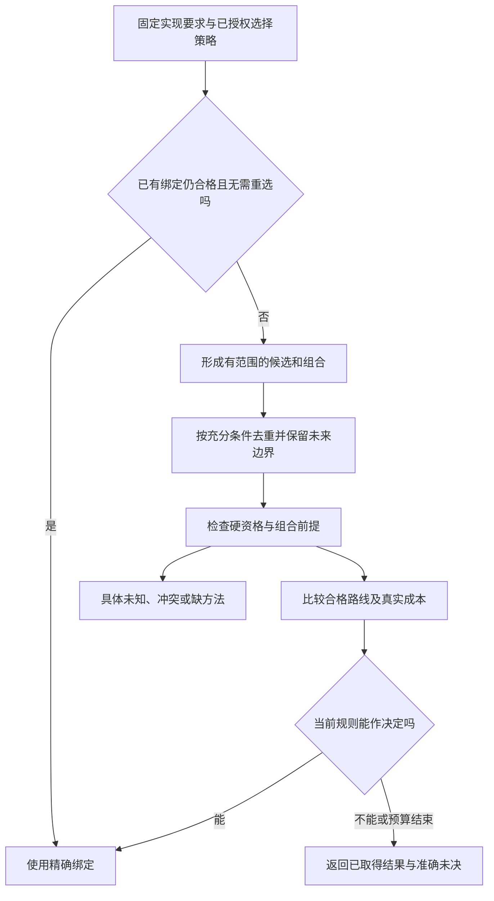
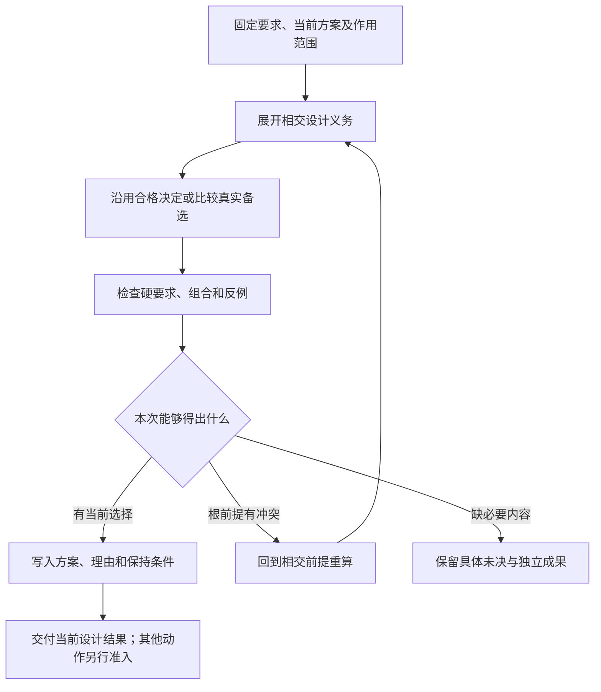

# 设计空间搜索与求解

## 等价重写、电子图与受限搜索

### 何时需要

等价重写和 e-graph 适用于大量局部变换共享等价关系、传统 pass 顺序导致局部最优、且存在清晰语义等价和成本抽取时。它不是默认核心依赖。

### RewriteRule

```text
RewriteRule = exact {
  ruleRef,
  sourceAndTargetPattern,
  semanticPreconditions,
  preservedInvariantRefs,
  effectAndResourceRestrictions,
  proofOrConformanceRef,
  targetProfileApplicability,
  ruleRevision
}
```

### 受限饱和

```text
seed expressions
→ apply eligible rewrites
→ maintain equivalence classes
→ stop at saturation or budget
→ extract hard-valid candidates
→ Pareto/risk selection
```

必须有节点、时间、内存和迭代预算。预算耗尽返回未探索 frontier，不宣称全局最优。

### 等价边界

语法相同、类型相容、返回值相等、观察等价及资源成本相近是不同的判定。纯读取函数仍可能异常或不终止；在删除、提前或融合调用之前，必须取得相关错误、顺序、副作用和终止条件的保持依据。e-graph的等价重写由[观察与优化前提](../../40-目标与制品/编译内核/降低与源码映射.md#语义保持的观察范围与优化前提)限定，成本抽取不得让未合格转换重新成为候选。

### 采用门

只有真实 lowering/search 瓶颈、等价 contract、参考结果和性能证据存在时才引入。否则更简单的 deterministic pass 更可维护。

### 验证：等价重写、电子图与受限搜索

- rewrite soundness；
- rule interaction；
- extraction cost unknown；
- saturation explosion；
- target-specific legality；
- effect reorder；
- floating-point 重写；
- clean reference parity。

## 约束求解、不可判定分类与不满足解释

### 目标：约束求解、不可判定分类与不满足解释

求解入口根据当前约束、理论类别及已锁定的`DecisionProcedureProfile`选择可适用的程序，不存在一个对所有问题都能自动证明可判定性与最优性的分类器。已知前提先检查；无法分类或超预算时保留`unknown`及实际搜索范围，再选择有界继续、取得外部证明或请求已授权的取舍。普通已有合格绑定的构建无需预先运行通用求解。

```text
ConstraintProblem
→ declared profile and checkable applicability / unknown frontier
→ exact or bounded attempt | approximation | proof obligation
  | statistical evaluation | authorized decision | scoped refusal
```

### DecisionProcedureProfile

```text
DecisionProcedureProfile = {
  procedureAndRevision,
  applicabilityScope,
  theory,
  inputUniverse,
  propertyClass,
  decidabilityClass,
  soundnessDirection,
  completenessDirection,
  terminationCondition,
  complexityBounds,
  certificateType,
  assumptions,
  unknownSemantics,
  invalidationRules
}
```

`DecisionProcedureProfile`固定一个求解程序版本的适用理论、能力和已声明限制；每次调用的时间、内存及Provider预算进入`SearchContract`或评价请求。相同procedure revision可以因预算、实际环境和输入不同返回不同`ConstraintOutcome`，不能为一次timeout修改Profile身份。

不能只凭某个 solver 支持输入语法就推断问题可判定。

### 求解结果

```text
ConstraintOutcome =
  | Satisfied(model, certificate)
  | Unsatisfied(core, certificate)
  | ConditionallySatisfied(assumptions)
  | UndecidableInDeclaredClass(boundary)
  | Unknown(reason, frontier)
  | Timeout(partial, bounds)
  | ResourceExhausted(partial, bounds)
  | Unsupported(theory)
  | NormativeConflict(conflictingConstraints)
  | InconsistentInput(diagnostics)
```

求解结果必须区分`TIMEOUT`、`ERROR`、`INCOMPLETE`、`SAT`和有证明资格的`UNSAT`；找到一个模型只证明该实例可行，不证明全局最优。`UndecidableInDeclaredClass`描述问题类别的普遍性质，不判定当前具体实例；即使类别一般不可判定，仍可接受本实例有效的见证或证书。

### 不满足核心

不满足解释至少包含：

- 冲突约束；
- 来源和 authority；
- 哪些是不可放宽项；
- 哪些是偏好或假设；
- 最小性证明等级；
- 放宽候选；
- 放宽影响的主体、风险和合法性；
- 是否存在多个不同核心；
- 新信息能否重新打开问题。

### 不可判定和半判定

对已知不可判定类，系统不得无限尝试后只返回 generic timeout。应返回理论边界并给出可用替代：

- 有界状态；
- 抽象解释；
- 半判定反例搜索；
- 运行时 monitor；
- property-specific proof；
- 限制输入语言；
- 人工 assumption；
- architecture refusal。

这些是可比较的方法或需求变更候选，不是收到类别标签就自动执行的降级链。限制输入、放宽目标或引入新假设须由原有权主体／已接受政策采纳；不得偷偷缩小作者语言或把未知变成已接受风险。monitor 只对可观测且来得及处理的性质适用。已有证书、特定输入算法或成熟工具能解决本实例时直接消费，不先制造人工门槛或强制运行时绕行。

### 优化结果

```text
OptimizationOutcome =
  | OptimalWithinFiniteDeclaredSpace
  | EpsilonOrRatioBounded
  | ParetoPortfolio
  | RobustSatisficing
  | BestKnownWithBounds
  | HeuristicCandidate
  | NoDominantSolution
  | OptimizationUndecidable
  | SearchFrontierOpen
```

最优、Pareto、近似界与未搜索前沿是对**同一选定候选域不同性质**的投影，不互斥；Pareto 集可同时带近似界和剩余未知。每项评价绑定候选域、目标与量纲、硬约束、方法和证据。OptimizationUndecidable 只说明某个全局问题尚无可用判据，不否定当前方案已证明的局部性质；`optimal` 必须指出完整搜索范围或可检查的最优证明，子空间最优不得省略子空间限定。

### 搜索合同

```text
SearchContract = {
  candidateGenerators,
  searchSpaceDefinition,
  exploredAndPrunedRegions,
  pruningWitnesses,
  objectivesAndUnits,
  riskEnvelope,
  time/memory/provider budget,
  incumbentSet,
  lowerUpperBounds,
  unexploredFrontier,
  reproducibilityInputs
}
```

候选生成器变化只使依赖候选完备性的旧决策重新打开，不必使所有规范事实失效。

### 多目标与规范冲突

硬约束先于优化，不同主体与量纲不得默认标量化。非支配方案需要未授权的价值取舍时返回`decision-required`，由有权角色、真实委派或已接受政策处理；旧`HumanDecisionRequired`命名不成为一律禁止AI决定的产品规则。只有证实要求互不相容才给NormativeConflict/Infeasible，否则保留未决与理由。

### 对抗反例

每个求解结果接受：

- 边界值；
- 约束删除；
- 候选新增；
- 单位和上下文变化；
- 策略主体操纵；
- 资源耗尽；
- 不同 solver 差分；
- certificate 独立检查；
- 输入排列和 hash collision；
- 未知理论或不支持操作。

### 验收：约束求解、不可判定分类与不满足解释

- 求解器声明理论和判定等级；
- 不可判定状态可直接表达；
- timeout 保留部分结果和 bounds；
- 硬约束不能被 objective 抵消；
- 不满足核心保留 authority 和放宽后果；
- 最优性声明有边界；
- 外部 solver 结果经独立 checker 或差分验证；
- 无解和无支配解不被包装成低置信推荐。

### 类别诊断与实例结果的边界

类别信息、实例证据与运行监控的保证边界见[形式方法](../../60-保证与证据/验收/方法与独立证据-独立性可信基础与求解.md#形式证明模型检查运行时保证与可信边界)。搜索层只返回本次实际取得的候选、见证和未决前沿，不复制第二套证明状态。

## 候选生成与设计空间搜索

### 目标：候选生成与设计空间搜索

候选生成把目标、约束、现有工程和能力集合转换为有限、可解释的设计或实现候选。它不宣称枚举无限空间，也不把第一条可运行方案当作最优。

### 候选来源：候选生成与设计空间搜索

```text
ExistingImplementation
ReferenceImplementation
StandardLibrary
ThirdPartyPackage
ExternalProvider
Template
RuleBasedTransformation
ProgramSynthesis
AIProposal
HumanProposal
CustomImplementationPlan
```

每个来源产生候选和来源证据，不直接产生绑定。

### 搜索分层

```text
语义架构候选
→ 实现策略候选
→ 具体候选闭包
→ 资格过滤
→ 生命周期成本比较
→ 有权决定
```

避免同时在所有文件、库和架构维度做无界组合。

### 搜索状态

```ts
interface SearchNode {
  readonly partialDesign: DesignDeltaRef;
  readonly satisfied: readonly ConstraintRef[];
  readonly pending: readonly ConstraintRef[];
  readonly violated: readonly ConstraintRef[];
  readonly lowerBounds: CostVector;
  readonly assumptions: readonly AssumptionRef[];
  readonly provenance: ProvenanceRef;
}
```

### 剪枝

SearchNode中的lowerBounds只保存有来源、条件和单位的可靠下界；缺某维界时，该维明确未知，不能把预测成本填成已证下界。源、连接、共享资源或后续策略变化后重新判断其适用性。

候选可因已证实的硬冲突、能力在所声明有限候选域中不可达、或已证明无解的局部结构被剪除。等价规范化和对称消除须保留当前观察与实例身份。**成本支配只在剩余要求及边界状态可比较时成立**，准确条件由下文[联合搜索](#带边界状态的联合搜索与合法剪枝)定义。

估计成本可以安排探索先后，不能冒称下界；预算截止可以放弃继续探索但必须保存不完整范围。安全与许可的硬禁止可排除相应候选，但不是任意风险分数。一个分支没有被探索不是该方案不可能，也不能把状态规格中未知的成本默认成无穷大或零。

### 搜索完整性

```text
SearchCoverage = {
  candidateSources,
  exploredRegions,
  prunedRegions,
  budgets,
  unsupportedDimensions,
  completenessClaim
}
```

预算结束可返回当前非支配候选和未探索前沿，但不能称全局最优。

### 生命周期成本

```text
LifecycleCostVector = {
  initialImplementation,
  migration,
  runtimeLatency,
  resourceUse,
  operationalComplexity,
  maintenanceChangePoints,
  securityExposure,
  providerLockIn,
  recoveryCost,
  retirementCost,
  uncertainty
}
```

成本带单位、测量或推断依据和有效范围。

### 候选搜索与裁决



这是设计与绑定选择图；真正运行仍需当前许可。去重不调用一个假定完备的程序等价算法；未知不能被当成不合格证明或默认合格，选中方案也不自动被称为全局最优。

### 对抗搜索

每个领先候选主动生成攻击：

- 最坏输入；
- 依赖消失；
- Provider 漂移；
- 权限缩小；
- 数据规模增长；
- 并发争用；
- 部分故障；
- 迁移中间态；
- 供应链事件；
- 长期维护和退役。

攻击发现根约束缺失时返回意图或设计阶段重算。

### AI 候选

AI 可生成候选、类比、实现草案和测试，但必须：

- 按实际输入通道解析：文本遵守语言/控制文法，结构交换按其有类型合同检查；JSON Schema只是选择JSON时的结构实现之一；
- 引用现有事实；
- 标明假设；
- 通过硬资格；
- 不拥有搜索完整性声明；
- 不因模型自述自动取得决定权；在已有真实委派范围内可以调用对应决定协议，要求独立复核时另行满足；
- 不绕过安全和许可证检查。

### 去重与等价

候选去重不能只按文本摘要。需要定义：

- 结构等价；
- 语义等价；
- 行为等价范围；
- 实现互换性；
- 仅表示差异。

无法证明等价时保留不同候选，或标记近似聚类。

### 验收：候选生成与设计空间搜索

- 搜索预算和覆盖可见；
- 硬约束剪枝正确；
- 当前最佳不冒充全局最优；
- 候选来源可追踪；
- 成本向量有单位和依据；
- 攻击可推翻不稳候选；
- 新候选源以局部插件接入；
- 候选新增只影响相关 Requirement；
- 最终选择由有权 Decision 产生。

## 工程意图到设计的合成算法

### 设计合成不是模板填充

输入目标可能不完整、互相冲突或有多种满足方式。需要寻找/选择设计时，设计合成处理硬约束、未知、候选、反例和权衡；已有完整采纳模型的确定性编译不必先构造搜索问题。

### DesignSearchProblem

```text
DesignSearchProblem = exact {
  acceptedIntentRefs,
  semanticCurrentStateRefs,
  targetProfileRefs,
  hardConstraintRefs,
  preferenceAndRiskPolicyRefs,
  existingArchitectureRefs,
  candidateProviderRefs,
  acceptanceClaimRefs,
  searchBudget,
  unknownFrontier
}
```

### 搜索流程

```text
规范化问题
→ 约束传播
→ 识别可复用现有责任和契约
→ 生成结构/行为/数据/效果候选
→ 组合候选并检查 hard validity
→ 产生反例；仅已证明 UNSAT 时提取核心，其他失败保留有界未知
→ 计算风险与生命周期成本向量
→ 在可比较边界内作有依据的Pareto剪枝；其余仅调整探索顺序
→ 有权政策选定或返回 frontier
→ 冻结所选 DesignCandidate；有权采纳后写入准确 Definition/Requirement/Contract/Control revision
```

### 候选来源：工程意图到设计的合成算法

现有实现、标准库、成熟 Provider、参考架构、规则转换、程序合成、AI proposal、用户 custom 和不实施。任何来源都不能跳过资格和验证。

### 设计闭包

候选需闭合本次输出实际依赖的责任、契约、行为、作用与保证条件。未检查、已处理、有依据的不适用和缺少环境事实分别记录；不能把没展开写成不适用，也不能让一个纯函数先证明与它无关的全生命周期事项。通用方法不能判定的条件保留相交义务，不以伪造证明补全表格。

### 反例驱动

每个候选主动生成：异常输入、并发交错、资源耗尽、provider loss、升级、恢复失败、安全攻击、用户误用和环境变化。反例推翻根假设时回退到问题定义，而不是末尾加例外。

### 验证：工程意图到设计的合成算法

- 已证明无解的问题返回可复核核心；极小化/最小化等级、方法和预算另报；
- 多个非支配设计保持 frontier；
- 新候选只局部影响相关决策；
- 当前实现不能反向限制目标；
- AI候选内容本身不带授权；有权AI可按当前角色采用合法候选；
- search budget 耗尽返回 bounded unknown。

### 将设计工作集中到仍未决定的差异

高层要求不必指定每个低层步骤。先区分四类内容：由定义和输入唯一确定的事实；被既有政策明确委派的选择；目标允许多种行为而无需进一步区分的自由；会改变当前重要行为但仍未被决定的部分。前两类直接推导或按锁定策略选择，第三类可选一个合法实现，第四类才需要新设计或有权裁决。未提供某个偏好并不自动使问题缺项，但也不允许把未满足的硬要求当无关自由。

求解可以只针对一个已限定参数域或局部程序草案，不要每次建立全工程设计空间。记录所用规格、候选域、预算和检查范围；唯一解、合法但非唯一的选择、已证无解、尚未找到分别返回。数值唯一也不等于规格完整；有限案例通过不能升级成全输入保证。更换求解器或策略可能改变合法选择，必须受实际要求及其绑定控制。

规则库中没有现成模式时，AI可以创建普通局部程序或新的定义候选；不得每次构建重新采样它。接受后的内容成为正常作者资产，继续由同一编译链处理。AI的经验先验可以降低创作工作量，却不能提供尚未给定的私人业务事实；模型不确定也不能回写成来源确定。

[Sketch作者教程](https://people.csail.mit.edu/asolar/sketch2012/)说明程序草案与局部空洞可配合合成；这不是把任意自然语言要求瞬间转为唯一最优程序的证据。求解只是可选实现来源，不是所有普通编译的前置服务。

## 带边界状态的联合搜索与合法剪枝

先固定问题而不是先排序实现名字。比较对象是**能满足当前任务的完整路线**；局部策略只在可继续的条件相当时比较。每个成本说明主体、单位、输入规模、冷热状态、目标环境、统计或上界口径和依据。整体费用、尾延迟、作者维护与内存不能合成没有依据的同一分数。

### 部分方案必须携带什么

现有SearchNode增加的是可派生的比较信息，不新增作者必填字段：已满足和剩余的义务；连接处的逻辑类型/值域；实际布局和设备位置；资源/实例所有权和寿命；共享库/运行版本；待完成的外部作用及隐私范围；当前成本界与依据。对该任务后续确实不可观察的差异可以消去；不知道是否相关时暂时保留或使剪枝依据为未知。

两个部分方案只有在相同任务、剩余需求及未来上下文下可互换，或存在已验证的包含/转换关系时，才能进入同一支配组。该判定所需的是：在当前允许的每一种后续完成中，用候选P替代Q不丢失可完成性与已接受观察，且所比较代价不变坏。实现不尝试解决任意程序等价；默认以精确的剩余义务、显式边界属性及有依据的转换提供充分条件。摘要不能证明已包含后续所需因素时，停止这次支配剪枝而不是扩大假设。一个方案输出CPU行式数据，另一个输出GPU列式数据，不能只凭业务结果类型一样就放在一组。若以显式转换使它们可比，转换及其新前提、作用、传输、内存和错误进入方案。

### 联合规划的顺序

**SEARCH1 形成有限初始问题。**从被要求的输出和固定源取得可达实现，明确选择政策、可动参数、被禁止内容和预算。显式Pin合格时可直接验证，不运行无用途搜索；Pin不使违反硬要求的方案获得资格。

**SEARCH2 投影接口并建立约束图。**调用组合算法取得输入域、共享资源和待满足项。树状、串行、并行及反馈区分别记录；不要把所有边都变成必须先完成的执行边。无关区域可独立规划，但新增跨域约束使它们重新联合。

**SEARCH3 扩展局部选择和适配。**按缺口选择一个未决点，取得当前允许的实现与转换。每次扩展立刻传播硬约束与共同版本条件，记录被违反的具体条件。实际没有实现的接口只形成设计候选，不能组成可执行路线。

**SEARCH4 进行合法剪枝。**在同一可替换边界组内，对每个代价维度有可比较的依据时保留非支配前沿。对完成方案给出的可靠上界，只有在某未完成分支的可靠剩余下界已不可能改进所选目标时才剪枝。边界不同、估计置信不足或重要维度缺失，就只改变探索顺序。许可、输入域和数值硬条件始终先判断，不用成本优势补偿。

**SEARCH5 计算全路线代价。**使用实际依赖图和资源寿命，计入初始化、传输、编码、同步、目标构建、产物大小及必要迁移；真实共享同一分配/进程/工具的费用才合并。纯计算缓存命中可以省计算，不代表外部作用已执行。详见[预算组合](../增量与性能/性能预算与复杂度.md#端到端预算的组合规则)。

**SEARCH6 选择与返回。**完全探索有限域并有正确比较依据，才可报告该域内相应最优；启发式或预算结束只报告已找到的合法路线及搜索范围。任务只要可行时可立即采用合格路线；关键非等价选择未被委派时返回少量真正不同的备选及影响，不能擅自改业务。所选策略和环境前提进入Binding，后端只落实它。

### 一个局部最优会删除全局优选的反例

以下时间均为人为构造的毫秒值，用于验证算法，不是任何设备的实测。上游A有两种实现：CPU用2 ms且结果留在主机，GPU用3 ms且结果留在设备；下游B只能在该GPU上执行，耗时1 ms。CPU到GPU的必要传输耗时8 ms，其余共同成本相同，比较时两条路线都省略同一共同项。

| 路线 | A及边界 | 必要连接 | B | 这段路线合计 |
|---|---|---|---|---|
| CPU A → GPU B | 2 ms，主机结果 | 8 ms传输 | 1 ms | 11 ms |
| GPU A → GPU B | 3 ms，设备结果 | 无额外迁移 | 1 ms | 4 ms |

只看A就删除GPU方案，会使后面永远找不到4 ms路线。正确流程保留两种边界状态，接上B和实际适配后再比较。GPU源输入的取得若不是共同成本，也必须分别加入，不能用本表漏掉它；结果只在本表声明的成本模型内成立。排序、压缩表示、暖缓存和共享初始化同样可能改变后续成本，不能只记一个“局部最快”。

### 不确定代价和生命周期

估计10±5并不自动是经过证明的[5,15]上界区间。观测均值、统计区间和硬上界分开。只有相同条件下可证明某方案的最坏界优于另一方案的最好界，才可以据此作稳健支配；否则报告不确定并可设计测量，不能制造精确排名。

编译期特化可能每次运行更快但首次更贵。设新方案额外固定代价为C，预计每次节省Δ，且只比较可相加的同量纲成本；在Δ>0时，需要使用次数N满足N·Δ>C才覆盖固定代价。这是条件计算，不是预测N。迁移、回归风险或不同主体付费不能无据折成同一个C；高吞吐、低延迟或小体积的硬要求也不能因此被抵消。

### 稳定采用与撤回

已合法采用的方案默认保持。新候选出现仅使明确订阅重新择优的最优性结论过期，不自动让既有产物失效。比较使用当前需要、迁移成本和可解释的观察窗口；真正要切换时形成新Binding和显式差异。引入迟滞或最短驻留必须由实际抖动与代价确定，不凭空写一个通用百分比。

硬语义、当前权限或支持条件被反证时，立即限制相交的新执行，不能等待经济收益阈值。已运行的效果与恢复义务沿原身份结算；恢复原事务不能改成最新的“更优实现”。无持久作用的重新计算可以在明确新请求中采用新方案。

默认实现是小范围枚举/工作表和显式绑定，随后再按热点采用动态规划、分支定界或其他域方法。不是每个任务建立万能最优求解器，也不先部署分布式能力市场。PostgreSQL的[规划器说明](https://www.postgresql.org/docs/18/planner-optimizer.html)保留对下游有用的排序等路径信息，并在复杂查询采用有界启发式；它支持边界属性与搜索范围需要明确，不证明Gift或任何启发式总能最优。

候选结构与搜索约束属于本实现解析 owner；开发任务主链仅引用结果，不另定义候选的字段、身份、决策资格和冻结算法。普通既有设计的直接编译不必先形成 `DesignCandidate`。

## 设计候选：结构、判定、冻结与采纳

`DesignCandidate` 表示为满足已采纳语义与工程约束而形成的设计候选。它比 `SemanticIR` 更接近实现结构，但仍不绑定具体库版本、文件路径或实时 Provider。候选本身不是第二份已生效设计数据库：被有权采纳后，稳定事实由相应 `Definition / Requirement / Contract / Control` owner 写入新 revision，候选及淘汰理由继续作为 provenance。

### 设计候选

```ts
interface DesignCandidate {
  readonly candidateId: string; // 候选身份；不能作为当前合格证明
  readonly candidateRevision: string; // 仅指提案内容修订，非已采纳设计修订
  readonly basisReadSet: {
    readonly positive: readonly {
      readonly ownerRef: string; readonly factRef: string; readonly revision: string;
      readonly role: 'intent' | 'constraint' | 'policy' | 'target' | 'accepted-design';
    }[];
    readonly negative: readonly {
      readonly queryRef: string; readonly scopeRef: string;
      readonly universeRevision: string; readonly coverage: 'closed' | 'bounded' | 'open';
    }[];
  }; // 实际读取与不存在性判断的基础，不是全工程快照
  readonly goals: readonly GoalRef[];
  readonly architecture: ArchitectureGraph;
  readonly responsibilityAssignments: readonly ResponsibilityAssignment[];
  readonly contracts: readonly ContractDefinition[];
  readonly behaviorModels: readonly BehaviorModel[];
  readonly dataModels: readonly DataModel[];
  readonly concurrencyModel: ConcurrencyModelRef;
  readonly errorModel: ErrorModelRef;
  readonly effectRequirements: readonly EffectRequirement[];
  readonly implementationRequirements: readonly ImplementationRequirementRef[];
  readonly verificationObligations: readonly ClaimRef[];
  readonly assumptions: readonly AssumptionRef[];
  readonly residualUnknowns: readonly KnowledgeGap[];
  readonly costVector: LifecycleCostVector;
}
```

### 基础、资格和并发采纳

`candidateId` 只标识候选分支；`candidateRevision` 固定本次提案内容。`basisReadSet` 由带对象身份与修订的已采纳意图、要求、硬约束、版本化政策、所依赖的目标能力和负依赖组成；在开放域中，未找到某候选不是穷尽证明，动态成员集合还须绑定枚举范围及其代际。未依赖的事实不必加入，以免无关改变触发全局重算。

评估返回 `candidateRevision + basisReadSet + 受影响义务 + 硬约束逐项结果 + 未知前沿 + 来源与证据等级`，而不返回一个无条件 `valid=true`。提案可以在已知失败或仍有未知时保存和继续编辑，但只允许满足本次拟采纳保证的部分进入采纳；要求保证中的未知不可当通过，已证实违反硬要求的候选不得采用。

正式采纳前重核写权、相交 Source 前像及所有负依赖，并确认候选仍符合当前 Meaning/Policy/Scope。过期时返回具体冲突与受影响依赖图，已证互不依赖的检查可保留。`candidateRevision` 仅定位被审查的提案，不保证 Effect 已执行，也不等于 `Definition/Requirement/Contract/Control` 的正式修订。变更只能由相应 Owner 在已验证前像上原子采纳；失败保留候选和冲突证据，不污染 current，也不暗用 latest。

同一候选的文字、结构或约束发生实质变更，形成新的提案修订；原评估仅在准确依赖和负依赖都仍成立时可复用。候选被拒绝、撤回或因基础变化失效时，保留其理由与可追溯引用，但不向当前构建/发布输出正式资格。候选入账、实现解析和实际外部作用各有独立准入与恢复，不存在自动的候选→部署一步提交。

### 架构图

架构图使用类型化边：

```text
contains
requiresSemantic
calls
reads
writes
publishes
authorizes
observes
validates
migratesFrom
```

物理部署和代码目录是可选 realization，不是设计节点身份。

### 完整性

对所声明的设计范围，固定当前选择与明确未决；下列事项按真实相交性闭合，未涉及的能力不制造空协议：

- 目标和非目标；
- 责任和 owner；
- 输入、输出、失败和不变量；
- 状态、并发、一致性和时间；
- 数据、保留、迁移和删除；
- 效果、权限、资源和恢复；
- 外部依赖和退出；
- 安全、隐私和供应链；
- 验证声明和证据方法；
- 未知、假设、残余风险和复审条件。

### 设计分支

不同候选可以共享子图。设计搜索不复制整个系统，而构造差异：

```text
Candidate = BaseDesign + DesignDelta
```

`DesignDelta` 必须说明新增、修改、删除、假设和验证影响。

### 冻结

需要机读交换或正式接受时，使用[设计冻结合同](../../70-工程系统与演进/演进与实施/实施/主线前沿-工作组织与成熟度准入.md#设计冻结)，引用准确候选、目标范围、实际决定与未决。该拥有者规定字段和可选的真实签名；本节不再维护一份名字相同、字段不同的回执。

固定内容身份、接受一项设计与授权实现是三件事。普通设计以准确正文、当前选择和剩余义务交付即可；冻结不会自动授权编码、运行或发布，也不妨碍独立的阅读、比较与后续设计。

### 设计候选形成



本图是设计过程，不是产品必须执行的多候选搜索。文档中的当前决定足以记录设计；机器冻结回执和签名只在实际交换或政策需要时产生。

### 设计搜索与反例

按候选真实范围检查下列相交事项；这里只规定需考虑的维度，不强制运行求解器、实验或所有生命周期设施：

- 约束求解；
- 失败场景模拟；
- 对抗反例；
- 生命周期成本；
- 迁移可行性；
- 供应商退出；
- 极端资源和并发；
- 组合边界检查。

反例若推翻责任或核心约束，候选被淘汰或返回上游重算，不能只追加例外。

### 物理实现自由度

拟采纳的 `DesignCandidate` 可以要求最终设计事实规定：

- 必须同事务；
- 必须隔离；
- 必须可替换；
- 必须可取消；
- 必须有读回；
- 必须满足某延迟或资源上限。

但在没有真实需要时，不规定具体文件、类、框架和供应商。实现解析在自由度包络内选择。

### 变更局部性

新增一个目标或约束时，只重新合成：

- 直接受影响责任；
- 与其共享不变量的边界；
- 依赖的实现需求；
- 相关验证义务。

若影响所有候选，系统应能指出是哪个根约束造成，而不是无解释全局重写。

### 验收

- 所需硬约束分别记录已满足、不满足或未知；候选可以保留未知，但需要该保证的实现采纳不得把未知作为通过；
- 每个设计对象有规范 owner；
- 每项效果、权限和恢复闭合；
- 每个未知有影响范围；
- 备选和淘汰理由可追踪；
- 成本比较不混合量纲；
- 设计可降低为有限实现需求；
- 设计变化产生精确 `DesignDelta`；
- 冻结回执绑定 exact candidate。

### 冻结层次与候选预览

本篇“冻结”分为字节/引用固定与有权采纳后的设计基线。前者只固定待解释输入，可以用于预览、实验和诊断；后者才包含适用硬约束和授权决定。[设计完整性](#完整性)与[冻结要求](#冻结)按拟采纳范围与请求保证实例化，不要求一个纯函数先填写全套运维、隐私与发布材料。没有某项风险不制造假字段；风险未知则保留其前沿，不能伪写已满足。

DesignCandidate可保存架构与行为提案，但与SemanticIR的已采纳定义共享引用和差异，不是第二套同时生效的行为数据库。普通重建不先生成DesignCandidate；原生内容可保全并走原工具链，不为套用本篇流程强行推断业务意图。具体请求边界统一见[流水线](../内核/输入与阶段总览-编译责任-阶段与目标.md#编译流水线与阶段边界)。

## 负向搜索依据、开放世界与可宣称最优的充分条件

设计搜索输出不能只记录最终入选 A 的来源。一个“没有其他可行方案”结论依赖**被枚举空间**，这属于真正的负向事实。每个 `NegativeSearchWitness` 必须包含 `{universeRef,universeRevision,scope,enumerationMethod,filters,coverage:complete|bounded|open,subjectPolicyRevision,selectionBasis}`；若搜索访问的是动态 Registry 的第一页或只读部分 Provider，`coverage` 不得填写 `complete`。权限收窄下的“看不到”与客观不存在不能互换。

可签发 `OPTIMAL_WITHIN_DOMAIN` 的必要条件：硬约束已求值、候选评价采用相同成本/环境/作用域、空间边界/分支限界有有效覆盖证明、剪枝规则在该 Domain 有保持依据、所有会改变可行集合的负依赖拥有完整枚举证明。若有未知目标函数、随机启发式、开放候选空间、预算中断，只输出 `BEST_OBSERVED` 与显式上下界/未探索集合，不把新生成一个比 A 更好的 B 误称是“模型突然聪明”。多个非支配解输出 Pareto 前沿与不可比较的目标维度，不通过未经授权的加权和自动替用户决定。

采纳期间检查 `(DesignCandidate.sourceBasis, positiveReadSet, negativeReadSet, solverProfile, constraints, targetBinding)` 的相交版本。若新供给 B 加入合法枚举域，失效只传导给依赖旧无其他候选结论的选择；已确定的与 B 无关的语义计算不必全仓重跑。与作者可编辑的 `CandidateRef`、实现供给候选及形式证明结果均保持不同的身份与状态。单一设计方案可以合法被采纳而不满足全局最优 Claim；不得把“采用”重新解释成“证明最优”。

<a id="gift-decision-adequacy-proof"></a>
## 开放候选、硬约束、偏好与最优性证书的判定协议

`SelectionProblem{acceptedRequirements,hardConstraints,preferences,objectiveUnits,candidateUniverses,observationScopes,targetAndProviderFacts,verificationBudget}` 明确区分已被采用的约束、仍可创作的候选、外部供给可见域与用户偏好。只有硬约束对选中的每个可行实现得到满足/不满足/未知三分裁决，优化才可比较可行解；缺凭证、协议资格或安全界时把该候选标作 `INELIGIBLE` / `INDETERMINATE`，不使用成本权重抵消缺失许可。

`SelectionCertificate` 允许 `FEASIBLE_ONLY`、`BEST_OBSERVED`、`PARETO_WITHIN_ENUMERATED`、`OPTIMAL_WITHIN_CLOSED_DOMAIN`、`UNSAT_WITHIN_CLOSED_DOMAIN`，分别携带搜索域定义、版本与枚举完整性见证、目标/比较规则、合法剪枝证明或反例、剩余未探索空间及所用求解器/方法；运行受预算打断时保留已发现的可行方案而不宣称无解。若发现新的 Provider、candidate 或负依赖域扩张，只撤销依赖旧完备枚举/排序的资格，不删除独立已合格的其他内容。

实现与采用分开：用户可以在并非全局最优但已满足必需约束的若干候选中有权选择。系统不得自动把自己测出的最快实现写成用户新的硬需求，也不得因一个方案实际采用就推断其它选择已被排除。可重复的验证样本至少包含动态候选插入改变最优解、搜索超时但已有可行解、不同量纲的Pareto候选、授权后被撤销的绑定、成本上界未知及现行锁维持不重选的无关源修改。

<a id="universal-design-methods-and-decisions"></a>
## 开放业务设计的复用、最优性与不确定选择规则

一套有限计算核心并不自动产生任意专业工程所需的独特算法和设计选择。面向复杂目标，应用层先利用已有作者 Definition、固定库/Provider 与准确兼容约束确定可供给部分；只有无法从源和已采用策略决定的结构/算法/布局才进入此章的 SearchContract。普通编译不应每次用AI重新搜索同样的设计；人工和模型建议只有成为有依据的候选并经有权采纳后，才能影响正式后续解析。

**搜索结果不得改变可行域**：硬 Requirement、被禁止的效果、保密边界、不可迁移状态、ABI/许可/资源上限先形成资格条件；Cost/Pareto/Heuristic 只能在硬约束合法的方案上比较。候选数多不是穷尽性；budget exhausted 不是无解；未知Provider是否具能力不是已满足。对完全无区分依据的合法候选，保留明确选择/候选关系，不造数学最优证明。为复杂工程的可维护性，实际成本必须包括未来接口稳定性、共同状态owner、增量变化范围、构建图、平台部署、权限、运维复杂度和迁移风险，而不能只优化生成代码的行数。

设计阶段无需每个架构选择都有实机性能证明；但要把**尚未取得证据的性能判断**保留为假设、估计或未决。真正只能由运行取得的数据不能作为已确定的静态前提；若请求的设计要求硬时延、规模或可靠性保障，未能获得可满足/可验证的路径应阻断相应 `ImplementationReady`，不能保守猜一个满足。不同目标的不同方案允许并存，前提是其对外语义和联合发布接口不相互矛盾。

<a id="intent-realization-open-search-protocol"></a>
## 任意新意图的实现取得：不依赖业务模板的搜索与接受协议

本节是现有 DesignSearchProblem/RealizationPlan 的跨方法具体化，而不是增设合成服务或自动 AI Agent。输入 `S` 为准确绑定的规格集合及观察/进展/效果/资源前提；`L` 为固定版本的定义、库、编译方法、目标与已接受实现；`A` 为当前拥有者授权的实现/生成自由；`B` 为当前预算。目标是在 `L,A,B` 限定下尽量找到一个**满足 `S` 的可生成主体**，不夸称搜索遍历世界所有程序。

### 取得候选的四条不同路径

**取得实现的四条路径不可压成一种“编译器会自动找到”：** （1）已经签发的内建降低/标准库操作；（2）固定包依赖中能精确发现和调用的现成方法；（3）用户在原生源或 Gift 计算 Body 亲自提供的算法；（4）在完整可计算约束和搜索预算内的合成/优化结果。前三者都可能缺乏当前业务意义的精化依据；第四种在一般情况下既不能保证有限时间内找到结果，也不能从模糊目标推导唯一程序。

搜索输入必须冻结候选集合与外部供给解释视图，硬约束先行，再做代价、质量及生命周期权衡；剪枝需要可保真的下界或不相容证明，不可拿先验排序当正确性证明。部分方案进入联合搜索时须携带尚未满足的义务、资源和权限占用、交叉负依赖、预计失败/回滚成本；证据和供应变化应使所依赖部分失效，而不是重新给未变化的作者源签发一个不同业务含义。


**1. 复用合格模块**：若现有公开定义直接精化所需行为，实例化参数并核外部保证、输入域、错误、进展、效果和目标限制。引用实现摘要远比按名字搜索特定业务模板可靠；同名函数与相似示例不构成证明。

**2. 组合已有实现**：组合函数、状态处理器、持久组件或库 Adapter；按调用关系和共享状态生成联合正确性义务。对组合中间结果做精确类型及效果检查；`A` 和 `B` 单独合格，不代表 `A∘B` 在错误/时序/资源方面合格。资源/效果要沿组合边界追踪，不做纯函数式笛卡尔简化。

**3. 受限算法合成/优化**：可决定的有限函数、关系代数、抽象解释、约束求解、等价重写、超图/模型搜索可以用于自己的资格子域；搜索输入可含作者给出的例子、方程、规格及独立否定例，不以少数正例替代全部意义。候选生成和候选验收分离，验证结果必须保留其数据域、方法、工具版本、预算和未覆盖分支。e-graph 等价饱和只在已有可靠重写等价与成本模型时启用；不为有循环、异常、秘密与副作用的任意程序擅自宣称等价。

**4. 实际创作新实现**：前三条都没有结果时，由已获授权的作者/AI 在真实计算语言或原生区域编写新的主体，复用公用基础库，生成 SourceMap 与源归属，绑定同一规格。生成器是否为 LLM 不影响编译器的正确性判断；生成的代码必须接受与其他候选同样的约束、独立测试和 Target 资格。没有该权限或仍缺语义的情况下保留 Requirement 与 `NeedsAuthorContent`，**不落入 stub、silent no-op、默认 success、永远拒绝的假实现**。

候选的硬性过滤顺序为：固定 Meaning → 接受输入域与类型 → 公开行为/错误/进展 → 帧与真实效果 → 安全与资源下界 → Target/Toolchain/Environment 可用性 → 证据足够性 → 对可比较的合格候选进行成本/偏好选择。未知代价是未知；未经证明不可删除高代价分支并自称最优；预算终止返回剩余 frontier 和采用理由，不能报告全球最优。

### 从目标代码回到用户意图的归属

编译器必须能够说明任一被生成行为是由哪个 Requirement、哪个 Definition/Library Method、哪个已接受选择与哪个准确 Source Region 导致；若手写原生代码拥有某函数，其生成器不能下次静默覆盖。对一次需求变化，读取依赖只失效真正相交的候选、证明、产物和目标 ABI。需求撤销、接口/行为兼容升级、外部权限撤销或目标退役各有不同影响域。

### 避免固定行业示例制造的虚假通用性

合格的挑战输入必须包含**此前不存在的用户自定义谓词**、未知但可声明的 ADT、无界递归、不同 Effect Handler 的同一操作意图、动态量化、事务读回、错误/取消、目标差异和多次修订。一个新名字落在既有简单加法模板上不是充分覆盖；必须能建立新的语义参考（含失败路径），并可在不改 Kernel 的情况下被查错、再组合和继续维护。每新增一个范本，同时包含**不应通过的负例**，避免同一生成器与Oracle共谋。

### 公开能力声明必须按纵向阶段

现有 Gift105 本地样本只证明已定义受限跨域组合、纯 TypeScript 计划与单 SQLite 单库实际效果路径；**这一设计协议没有为它增加新通用执行方法**。某个开放语言的结构示例通过严格 JSON Schema 只能证明字段形状正确，不能证明它已被 Gift105/106 解释、合成、通过原生构建、执行或达到产品可靠性。后续合格性必须分别给出一次含义绑定、一次生成/编译、一次差异行为/否定反例、一次修改与无关修改失效及一次必要的真实授权验证；有些门槛可由已合格证据复用，不能用文件完整性检查代替。

<a id="prebootstrap-method-search"></a>
## 由任意已定义意图取得实现的有限搜索合同

### 搜索状态与候选产生

输入固定 RequirementClosure、目标 Profile、允许的 MethodCatalog、作者控制、环境事实/证据与预算。工作项是尚未解决的义务及其上下文，不是业务名称；候选是具体 Method 实例、前提、子义务、目标依赖和保持依据。开始时可优先复用仍有资格的现有 Binding，随后枚举固定目录中的实际方法、组合方法与允许的有界合成方法。目录发现和新代码创作都返回候选，不在确定性搜索内隐式联网或调用 LLM。

对每个候选先做便宜的签名、主体、Profile 和硬禁令过滤，再实例化实际前提与剩余义务，再求解能处理的约束与证据，最后计算确实可比较的成本。发现已证实前提不成立立即拒绝；未知前提保持未决，不当成 false 或无须条件。Method 需另一 Method 时加入有来源的子义务；同一精确义务在相同上下文出现递归时，只有明确支持的递归实现/归纳规则可闭合，不能因栈中已见就自签完成。

去重依据实例化的语义与依赖身份，而不是展示名称。一个候选被另一候选支配，只能在全部相关硬条件、保证和可比较成本上有依据地判定；不能靠虚构总分删掉新算法、不同恢复模型或未知性能的方案。未解分支可保存临时搜索状态，公共结果始终区分已知可行、已知不可行、暂未找到与预算未完成。

### 选择规则与作者控制

Pin 指向精确方法/发生范围；被 Pin 方法缺失或不合格就返回对应原因，绝不自动取消 Pin。Require/Forbid 是硬条件。Prefer 只有在硬条件成立的候选之间生效，按已接受的比较口径和优先关系执行。没有可区分证据但允许自动选择时，以固定可审阅的稳定顺序取得**一个**合格候选，不称其性能最好；当前要求必须比较质量而证据不足时返回 NeedsEvidence。

采用已有绑定优先的稳定策略只是一项可选偏好，不能保留已失效、被撤销或不满足新增硬要求的实现。允许 fallback 时，列明失败类别、仍须满足的合同和披露/资源差异；例如本地 GPU 缺失不隐式转远程服务。无权选择影响公开行为的差异时，产出供有权 owner 采用的候选，不把缺决定藏进随机默认。

### 合成的结果和停止

限定语法、模板、搜索深度、逻辑片段或等价重写可形成有效合成方法，但必须记录这些边界和实际预算。找到见证后按所需保证独立检查。有限空间枚举结束只证明没有未枚举候选；只有每个候选均有适用的排除依据、组合和剪枝覆盖完整时，才能证明该空间内无解，不说明所有程序无解。若候选均已访问但仍有checker未知、证据缺失或环境未定，返回这些准确未决及其候选，不将“没有取得合格结果”改写成“所有候选不合格”。编译预算达到上限时可以交付已验证可行但未证最优的候选，前提是用户未要求最优性硬保证；否则保持未完成。

缺少实现而有真实语义时，库/算法作者可以编写一般 Gift 计算体并发布 Method；AI 经授权也可生成这样的候选。新供给进入新的冻结目录与快照后重新检查，不在原快照偷偷改变搜索宇宙。缺合格Target、Provider行为合同或必需实现时仍不能“生成成功”后留下占位调用；只有部署/运行实例尚待绑定而源码实现和公开进口已完整时，按[请求出口资格](实现解析与候选资格.md#method-qualification-by-requested-exit)交付源码并保留运行前提，不把取得生产实例作为所有纯生成的前置。

### 变化与成本控制

缓存键涵盖实际需求、Profile、目录读取/负空间、方法实现、证据与选择政策。未选且不能影响选择的供应变化不强制重选；加入更具体实例或改变硬禁令必须使相关结果失效。共享子义务可以缓存，但租户可见性和各请求授权不能被共享缓存跨越。搜索总预算覆盖重试、子调用与插件，不能每递归一层重置预算而失去上界。

<a id="design-b15"></a>
## 实现供给四路径与合成的准确能力

供给路径分为引用已资格方法、依类型/合同合法组合、在已声明搜索语言内合成/等价改写、受权创作新实现。每个结果记录实际来源：包装旧库不是发明新算法，原生透传不是语义降低，模型提出的源码只是候选。创作不能修改原硬要求来让自己通过。

首个可实行合成子域固定为有限有类型表达式/组件组合：输入候选算子集合、深度/工作量预算、精确输入域、硬规格及checker；先类型/效果剪枝，枚举合法结构，独立验见证，保留失败反例并在预算内精化。有限输入试验不能证明无限域；仅在域有限且全覆盖或有相应证明时宣称该域正确。未完成枚举或检查时返回相应Incomplete/Unknown；完整候选语法穷尽且每个候选均被有据排除，才证明“此语法内无解”，不证明无程序可解。

等价饱和只接受带语言版本、观察域和侧条件的重写。例如数值溢出、NaN、错误、发散、状态和资源都会破坏普通代数等式；成本模型须与当前Target相符。抽取最优仅对已构造e-graph及成本模型，不对所有可能程序。组合产生新循环或资源共享时重新推导联合义务，不能汇总局部PASS。

受权AI/人类创作沿同一候选源和审查通道；输出的代码、依赖、许可和权限变化可见且可拒绝。没有合格供给时用户仍可定义新意图并保存，运行根清楚报告Need；不能用开放表达承诺任意规格都自动拥有实现。

**验证与反例**：有限表达式合成见证、语法内穷尽与全局无解区别、含Fault的x*0错误重写、包装原生库来源、创作越权改合同作为审查对象。

**实际能力边界**：未构造一般自动合成器；本次固定首个可实现子域及扩展门槛。

相交合同：[求值顺序与跨目标观察等价](../../20-语义与组合/基础语义/计算基础/通用计算与任务语义.md#design-b07)；[量词与求解状态的可组合解释](../../20-语义与组合/共同语义/关系约束与固定点.md#design-b09)；[方法资格先于偏好及稳定选择](实现解析与候选资格.md#design-b14)；[证据的适用性、独立性与撤销](../../60-保证与证据/验收/方法与独立证据-独立性可信基础与求解.md#design-b29)。

<a id="design-c13"></a>
## 规划与优化的可行域、目标和证书

规划实例明确输入对象身份、图/约束域、硬条件、软目标、单位/比较序、允许近似和预算。返回类型区分Feasible(solution,cost)、Optimal(solution,certificate)、Infeasible(proof)、Incomplete(bestKnown?,unexploredScope)；不能只返回一个方案而隐藏最优性口径。

最短路径分别定义有向/无向、边权域、无路、负环相关性及from=to；只有非负边等前提成立才选择相应算法。资源匹配要说明一次性/可分割、容量、兼容和公平/优先规则；穷举/求解未结束不能宣称不存在方案。多目标的lexicographic、Pareto或显式加权是不同公开政策，不能由编译器凭好看选择权重。

增量重规划固定输入revision与已承诺现实动作，不把更优计划自动覆盖已执行路线或已占资源。输出plan只是候选，落地调度/资金/设备还需授权和真实前像；计划失效以受影响约束定位，保留可行已执行部分及需要补偿的区别。

**验证与反例**：含负边图、负环但与目标无关、不可行/预算结束、多个同成本解、非可比分目标、现实履约后再规划。

**实际能力边界**：真实规划负载、目标偏好和外部执行参数由作者/环境实例提供。

相交合同：[量词与求解状态的可组合解释](../../20-语义与组合/共同语义/关系约束与固定点.md#design-b09)；[方法资格先于偏好及稳定选择](实现解析与候选资格.md#design-b14)；[实现供给四路径与合成的准确能力](设计空间搜索与求解.md#design-b15)；[库存、位置与履约事实](../../50-执行运行与观测/持久化与恢复/事务提交-外部效果与幂等交付.md#design-c29)。

<a id="本责任的相交定案"></a>

**关联规范：**[量词与求解状态的可组合解释](../../20-语义与组合/共同语义/关系约束与固定点.md#design-b09)；[方法资格先于偏好及稳定选择](实现解析与候选资格.md#design-b14)。

<a id="realization-search-implementation"></a>
## 联合选择的实现程序

### 解析与联合选择（设计机制，非本轮实现算法）

输入是已确认的当前 `SelectedRootOccurrences`、根/组件联合要求、公开接口及Target限制、实际外部环境与锁定候选空间。流程上的必然因果依赖是：

1. **Meaning先于方案**：先确定“保存”在本业务里究竟表示什么结果、并发/冲突/时限是什么，不能先看到SQLite库就把保存定义成它支持的行为。
2. **候选必须覆盖硬义务**：将要求分解成有类型操作和跨操作不变量；拒绝不满足必要前提、错误语义、授权边界或无法保持受保护状态的候选。
3. **共同资源与方法交互**：多个局部方法合起来必须保持锁、容量、顺序、状态Frame和真实外部效果；不能把局部最好简单拼装。
4. **在合格域内优化**：按已授权的性能、资源、部署、依赖数量、维护性和成本偏好，采用可比较的质量合同；不可比较时保留非支配候选或明确要求取舍。
5. **冻结可重复决策**：实现Binding记录准确Method ID、Revision、目标Profile、决策前提/适用域、派生输入及否决原因；用户Pin是额外硬约束但不能绕过类型或安全禁令。

搜索有限或不完整时必须区分“没有发现合适方法”“确知所有候选均不合格”“约束本身已证明矛盾”“方法/环境事实尚未知”。不能用超时/预算耗尽证明无解，也不能把优化找到的局部最优写成全球最优。

### 资格、搜索、比较和锁定的前后次序

输入是一组已解析的整体业务义务、选中根及各实例发生点，而不是一个“保存/聊天/排序”关键词。首先形成真正要求的能力签名（输入输出、效果、错误、时间与资源、授权、可观察性质）；用 Method/库/原生候选的发行合同匹配适用域。候选必须说明：它能提供哪些性质、仍需哪些外部前提、哪些要求只能部分满足、目标与宿主的限制、依赖许可证/ABI/资源、是否保持异常与时序轨迹。候选声明是检索对象，不是合格结论；需要证据或作者选择的部分不能因为供应方写了 `supports: true` 就自动签发。

严格顺序为：**身份和合同解析 → 硬资格排除 → 多根/多组件联合能力与资源约束 → 在所有合法解中比较偏好与成本 → 确定绑定及缺口**。软偏好不可冲破硬约束；把某组件单独最佳的数据库与另一组件单独最佳的事务引擎拼起来，未必产生合法全局解。存在重数、互斥许可、硬件容量、共享数据迁移和目标 ABI 耦合时，应把候选连成约束图；需要有界搜索时说明搜索范围及是否证明候选闭合，不把预算耗尽叫不存在解。

已冻结绑定和未来动态发现是不同决定。锁定记录的是被选 Method/Provider/依赖与适用范围；升级库的版本或发现同名候选不会自动改变用户已接纳实现。Fallback 首先要仍满足当前硬性行为与安全要求，并处理已发生的现实副作用；不能因主 Provider 超时便盲切备用重复支付。优化如果改写数值、排序、消息投递或观察时序，必须先证明这些变化属于被允许的替代，不应以吞吐增加掩盖语义退化。


方法应用点绑定、局部检查快照、资源联立、固定锁及求解退出采用同一候选状态机；不得在只完成局部资格时提交完整绑定。

实际数据、调用顺序和失败处理见[相应施工设计](../../70-工程系统与演进/工程构造手册/05-要求实现候选与资格.md#joint-search-and-obligations)。

## 以所有已采纳意图为根的可组合能力搜索

候选集合以精确 `guarantee/MeaningRef + input type + observationScope` 建索引，不能由库名、行业标签或向量文本相似度产生资格。每个候选必须绑定共同对象身份、运行时域、方法前提、frame、外部 effect、权限/环境、资源、成本及支持其行为的实际 Evidence，衍生的子目标仍在统一约束图内；先查硬合格，再比较偏好。

`NeedsMethod` 是目录中缺合格实现，`NeedsMeaning` 是意义不能解，`IncompleteSearch` 是计算预算边界，`NoPlanInSuppliedFiniteModel` 只能按封闭有限模型声明；找到一个实现不等于全局最优。新增供给、Method 资格撤销和 Meaning 改动须使相交负依赖、缓存与计划失效。参考联合模型只做有限 BFS，并非真正生产合成/最优证明；具体算法见施工手册第20、21章。
