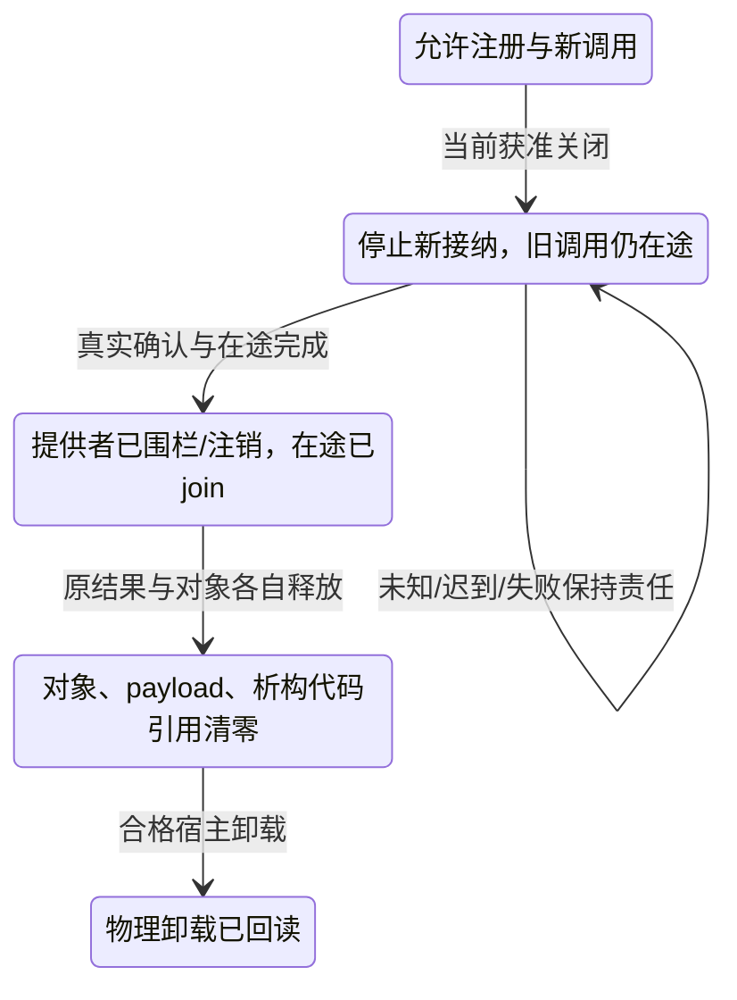

# 存储资源、外部调用与原子边界

本页聚合原生存储/资源生命周期与跨ABI、回调、原子/回收边界。它们共享对象存活、拥有/借用、释放和并发可见性约束，但具体存储操作与foreign/atomic协议仍独立。

## 存储、对象状态与资源映射

本篇只拥有跨目标的存储/生命周期保持义务，不重建[跨实现寿命](../../50-执行运行与观测/跨实现调用与数据寿命.md)、[资源准入](../../50-执行运行与观测/权限与资源/README.md)或目标语言的内存模型。原生Rust安全封装、类型/作用域与成熟资源库能承担的部分直接复用；不能靠unsafe、Pin、Drop或GC的名字跳过实际前提。依据见[映射资料](../../../research/sources/Rust与C++映射依据.md)。

### 对象操作不是同一个move

以下是内部语义区别，不是八个新公开关键字，也不要求每个普通变量进入持久台账。

| 操作 | 对源、目标与资源的实际含义 |
|---|---|
| 所有权转交 take | 原值的使用与清理责任转给新拥有者，源绑定不能再作为原值使用；不自动调用用户移动hook |
| 独立复制 clone_into | 建立另一个有效值，可以分配、失败或执行用户复制协议；不等于位复制 |
| 转移构造 transfer_construct | 建立新对象，源仍存活于合同规定的moved-from状态并需后续销毁；不能等同于Rust消费式move |
| 重定位 relocate | 改变占用存储/地址，必须排除不允许的地址依赖与活跃借用，或有完整重定位协议 |
| 替换 replace | 在已有位置建立新值并负责旧值的结束，求值、提交和失败顺序明确 |
| 内容赋值 assign_from | 更新已有对象，可复用容量，不必改变对象身份；allocator和自别名分支仍需检查 |
| 目的地初始化 init_at | 在最终指定存储中逐步建立有效值，不先构造一个需移动的完整临时值 |
| 原位销毁 destroy_at | 结束对象寿命，通常不等于释放底层存储；释放仍由原分配owner负责 |

状态按真实初始化事实推进：Uninitialized→Initializing(已建立部分)→Live，随后转交、Destroying或Dead。初始化失败只逆序清理已建立的部分，不调用未建立完整对象的析构；销毁/转交前协调重入与所有权，清理责任成功转走后不在旧处再执行。Dead的值不能作为Live读取、借用或再次销毁；无效值字节不能凭类型断言获得有效性。

复制、转移和赋值hook的次数、顺序、分配与错误属于可观察行为。只有所选源规则允许elision，或取得保持所需观察的依据，才可删除或合并；不能因为优化器通常会消除就声明保证。强失败保证要求失败时指定源/目标保持原状态，基本保证只要求进入约定有效状态；自赋值、源目标别名和分配域不相同都有分支。没有准备—提交与回退资源，就不承诺强保证，更不能回滚已发生的外部I/O。

| 定位与需求 | Rust已有路线及差额 | 采用条件与验收 |
|---|---|---|
| A43 自定义复制构造 | Clone支持用户复制；Copy是无任意用户hook的结构复制。隐式复制发生点与原生泛型接口不同 | 默认显式复制，保留成本/失败/副作用；固定外部隐式copy协议才需要精确适配。不得把clone当memcpy或无条件省略hook |
| A44 自定义移动构造 | 所有权move、显式转移函数、偏移表示、稳定句柄或定制容器；普通Rust move不调用用户修复hook | Pin是限制相关移动，不是允许移动时自动修复。内联存储、普通容器迁移和自动内部地址修复必须同时满足时保留真实差额；hook不能修复未知外部旧指针 |
| A45 复制/移动赋值 | clone_from可以覆写以复用资源；assign/replace/mem::take等能转移，`=`不是任意用户协议 | 与A17共享更新机制；保留C++源仍存活与Rust转交后源不可用的差别。不同allocator、自赋值、准备OOM按实际强/基本保证返回 |
| A46 不可移动值的直接目的地构造 | 栈Pin、pin-init、caller提供slot或稳定拥有句柄可用，不必一概Box | 普通返回T不普遍保证从未有临时位置；API、内联和容器兼容可能改变。硬性栈/无堆/按值工厂同时要求时，需合格目的地协议，不赌NRVO |
| A47 placement new/原始存储初始化 | MaybeUninit、raw write、字段级构造和合格初始化库可以做 | `ptr::write(make_T())`不证明make_T没有大临时值。先选最终存储，完整建立前不形成伪`&mut T`；部分失败只销毁已建立字段并由正确owner释放 |
| A48 全局/类级new/delete | 全局allocator、显式allocator/arena、定制容器/工厂已有路线；原生类型级hook和第三方new行为不同 | 新代码优先显式资源政策；导入库不能偷偷接管全局。精确重载、对齐、数组释放、构造失败与CRT归属交给匹配ABI，不把同尺寸当同分配者 |
| A49 依赖泛型的对齐 | 真实T字段和`[T;0]`可使Rust结构对齐随T变化；固定repr align和具体生成也有效 | 撤销“Rust对齐不能随T变化”的错误。任意泛型表达式驱动repr及精确外部布局仍需具体检查，不能把生成具体实例冒称开放原生API |
| A50 位域 | mask/shift、宏/库、字节视图和ABI生成均可实现；无同形字段语法，C++位域布局也依工具链 | wire、nativeABI和设备政策分开；宽度、符号扩展、位/字节序及越界行为明确。不能用普通引用或盲RMW操作有副作用寄存器 |
| A51 no_unique_address/尾部padding复用 | Rust ZST可零空间/共地址，重排、其他表示或raw存储可紧凑；普通非ZST字段尾padding并非同形属性 | 仅许可合格重叠，不保证所有目标缩小。精确布局、正常字段引用和ABI都不可改时可能缺项；宽赋值不得覆盖其他活跃字段 |
| A52 volatile限定与传播 | read_volatile/write_volatile和类型化寄存器访问器可承担常规设备访问；不是同一cv限定和重载协议 | 通过受控视图保留实际访问属性，禁止转成普通引用后丢失volatile。原生qualifier/接口固定时精确适配；volatile不替代原子、CPU屏障或设备完成 |
| A61 标准容器allocator/pmr | allocator-api2、arena和合格容器可提供局部分配；全局allocator解决另一层 | 不等于可直接替换固定`std::Vec`的公共API。检查上下游真实接受的类型、分配策略和允许依赖；复制/赋值/转移/swap分别保留传播规则 |
| A62 native thread_local变量 | thread_local!/LocalKey通常足够，const初始化可免去部分lazy/Drop追踪，不无依据说每次都有包装开销 | 原生TLS符号、取址、链接模型和规定初始化顺序是独立接口。task-local不等于thread-local；跨await借用线程亲和资源需限制调度或合法重获 |

主要比较范围：R07—R10、R20、R24、R26、R29、L03—L04、C05—C08。当前资料中实验API与稳定封装分别核对，不因URL含stable就提高未稳定item的资格。

### 最终位置、Pin与外部地址

建立内部自引用或交出可观察地址之前就要选定最终存储。初始化器只能取得尚未建立部分的合法写能力；完整有效前不公开普通完整对象引用。Pin固定的是被引用对象，外层拥有指针可以移动；栈、堆、区域、映射区等路线各核真实寿命。容器增长要求迁移固定地址元素时，选择稳定存储、间接句柄、不可增长区域或拒绝增长，不能自动追加Box违背无堆要求。

C++同类型prvalue目的地构造与返回命名local的可选NRVO不同。目标ABI无法实现指定按值/栈工厂时，返回相交缺项；显式caller destination是另一种公开API，采用前要核其是否允许。移动hook修复self-pointer，只证明覆盖的内部关系被修复；其他线程、操作系统、设备和外部库保存的旧地址需要固定存储或真正注册/重定位协议。

Rust lowering对同一资源只选择一个真实清理拥有者：原生Drop/作用域，或生成的状态guard。手工调用destructor后不能保留会再次Drop同一Live值的路径。MaybeUninit、ManuallyDrop和raw pointer只承接明确的有效性与责任，不能作为消除类型错误的通用补丁。

**版本化的存储外壳规则。** Rust 1.98将特定ManuallyDrop<Box<_>>在内部Box已手动销毁后移动外壳的行为明确为稳定保证；对应编译器问题在1.96修复。移动允许的惰性外壳不是读取/借用其中的Dead值，不允许double drop，也不使任意自定义包装、派生方法或旧编译器取得相同保证。采用这条路线时绑定实际工具版本和操作集合；不得把“不能再用T”扩大成所有底层外壳一律不可搬移，也不得反向把外壳可移动当成T复活。依据R02及ManuallyDrop原文。

### 分配、容器与区域

一次分配至少固定分配owner、区域、实际大小/对齐、地址或句柄与失败政策。allocate获得存储不开始完整T寿命；destroy结束T不自动释放存储；最后释放使用约定的原分配者。容量乘法、增长、对齐向上取整先核溢出。OOM作为可返回错误还是终止由已采用合同确定，不能将返回错误的路线无声降成不可捕获终止。

复制、赋值、转移和swap分别决定是否传播allocator及其寿命。不同域的裸指针不能直接交换后由错误owner释放；可以在合法条件下转交分配资格，或先取得新存储再复制/转移，或返回不支持。源已部分转移时不得伪称源未变；必须强失败保证的路线先准备能够保证回退的内容。memory-resource自身要活到其负责的最后释放，不能只保证容器对象还在。

区域统一释放并不自动执行元素持有的外部资源关闭。对象/借用不能比区域活得更久；需要逃逸时显式转移到合法长寿命区域并计成本，不能只复制指针。无分配、固定峰值、指定释放者等硬要求分别检验；实现只有动态堆路线时准确返回缺项，不能称行为相同就满足。

### 同步清理、异步关闭和运行域

普通新代码默认使用合格的同步、不可挂起清理；可能失败的flush/commit/close是显式操作。源语言允许不同析构异常语义时由其精确画像拥有，不以默认规则改写原生行为。首因与清理失败分别保留；终止不是清理成功，析构、GC和线程退出都不是外部必需关闭已完成的证明。

异步close需要实际保留关闭续体的拥有者。取消调用者、丢弃Future或JS对象失去引用，不能令必需清理凭空完成。选择已有此合同的运行域/监督者，或要求显式继续与未结算交接；若所求有界关闭无法提供，就拒绝该资源使用路线，不默认建设一个覆盖所有普通对象的异步析构运行时。资源释放晚于最后真实访问，重试关闭还核原效果身份与重复安全。

受控代码中的线性使用保证、公开给任意Rust/JS调用者后的行为、内存安全、无泄漏和必需外部close是不同命题。安全Rust允许某些遗忘/泄漏；GC也不承诺按业务时限关闭。导出边界确需更强保证时，用现有能力、显式结算、运行域或受保护句柄承担，不能只把类型名改成MustClose。

### TLS、全局初始化与退出

ThreadLocal实例按物理线程，TaskLocal按逻辑任务。任务迁移后前者不跟随；线程亲和借用跨挂起时，应使相应任务在允许线程恢复、在借用结束后迁移或按合法协议重新取得，而不能改名当成已解决。TS worker-local只有实际宿主模型符合要求时才可用，不冒充原生C线程TLS符号。

状态为Uninitialized→Initializing→Ready，并有Failed、Destroying和Dead。首次并发访问由真实拥有者协调，初始化依赖A→B→A必须定位循环并向等待者报告，不能等待自己。递归访问、销毁顺序、线程退出、运行域已关闭后的再访问分别有失败语义。失败默认不无限自重试；明确允许重试时先结算上次资源和可能作用。

显式初始化/关闭可作为新代码的最终方案；原生加载器规定的构造顺序、TLS模型或退出时机不能被偷偷懒化。动态卸载还须核在途调用、回调、旧类型表、异常payload和析构代码世代，完整规则见[外部调用](#gift-unit-4d2cfff268705ddea75e5dea4d40583c)。进程被强制终止等不受控事件不能由普通类型系统承诺全部清理。

### 布局、位域、重叠和访问有效性

逻辑布局定义字段与对象关系；wire layout定义跨边界字节；native ABI layout定义特定工具链真实大小、对齐、偏移、基类和传参。三者不共用packed开关。字段宽度、符号、字节/位序、跨存储单元、保留位和超值时的检查/截断由协议明确，C++原生位域不能当通用wire格式。

非对齐、非字节寻址或重叠成员通过合格load/store/proxy访问；不能在对齐、有效值、寿命及别名未成立前先造Rust引用再检查。允许尾padding复用不等于任意有效字段重叠；整对象宽写、赋值、复制不得破坏邻接Live字段。padding不默认是稳定可读值，不能用于值相等、hash或序列化；ZST共地址、尾padding复用和虚共享基是三个独立机制。

原始存储、受tag约束的union与活动成员转换分别保留初始化/销毁。C++特定union寿命、common-initial-sequence等按匹配源规则解释，不以普通enum声称完整兼容。bit-cast/transmute还需大小、表示有效性、对齐、provenance和寿命条件；同样字节数不允许造无效bool、悬空引用或从任意整数恢复拥有指针。

volatile访问视图固定宽度、地址空间、读写权限、实际操作次数及设备政策。W1C、read-to-clear、只写寄存器不能走通用先读再改再写；需要专用掩码写、设备屏障、CPU/compiler fence或read-back时分别调用真实原语。MMIO权限、地址有效性、原子性、顺序与设备完成独立，缺设备合同不返回零伪装成功。

### X06、X14与下一次变化

unsafe承接具体证明义务，不授予外部权限，也不创造stable语法、ABI或线程安全。局部raw/UnsafeCell封装可能避免不必要的Rc/RefCell/锁，但产生的安全接口、动态检查、审计与维护成本要计入；不能把“能够写unsafe”当无损替代。恶意同进程原生代码需要真实隔离，不由private字段或品牌阻止。

全局/TLS/回调与卸载的责任跨越局部Drop，按实际loader与运行画像接合；没有调查的平台协议保持未知，不能按有没有同名语法判断能力。对象字段/布局、区域、allocator、线程政策或目标版本变化时，使相交构造、访问、清理、ABI及证据重评；旧Live对象不在新布局中原地重解释，旧释放者保留至责任结算。

相交验收按真实机制选择：部分构造失败、移动时未知外部地址、固定元素扩容、allocator传播/OOM、TLS迁移、递归初始化、设备位域副作用、padding宽写、原子视图与普通访问冲突、取消后关闭、非法控制流、旧库在用卸载及 unsafe/契约边界等。详细构造见跨语言与原生接缝反例；它们按适用条件实例化 ProofObligation，既不要求普通值引入全套设施，也不允许相关高风险路径省略。

## 外部调用、原子访问与目标供给

本篇拥有[原生编译](../编译内核/原生与跨语言编译.md)与[使用点采用](采用与导出边界.md)在ABI、回调、原子和真实目标上的映射差额。调用寿命、权限、结算与发布继续消费原运行规范，不建立通用foreign消息隧道或第二原子模型。主要来源为R02、R20—R22、R25、R28—R29、R32，L05—L07，I01—I03及T03，详见[资料](../../../research/sources/Rust与C++映射依据.md)。

### 固定实际外部合同

FFI声明至少在真实使用边界绑定工具/ABI画像、符号及调用约定、参数/返回表示、拥有/借用/释放者、null/有效值、对齐和存活范围、可重入性、线程/同步、回调、错误及异常传播。能够由原声明和工具准确推导的内容不再让作者手抄；未知部分不能用extern或unsafe一笔放行。

ABI画像包含实际目标、编译器/运行库及相关选项、类型布局、异常/RTTI域、链接和动态装载关系。源声明、接口元数据、真实库字节、当前加载实例和当前授权分别固定。路径、PID或一个同名symbol不能代替出生身份；加载一个库也不能把它自报的capability当真实权限。

| 定位与需求 | Rust已有路线及剩余差额 | 当前采用及验收 |
|---|---|---|
| A56 定义C variadic函数 | stable可声明/调用相应C变参入口；需要定义真实ellipsis入口时按c_variadic实际稳定性或native shim判断 | Rust slice/tuple、宏和JS rest不是C ABI入口。纯stable Rust-only与指定ellipsis导出同时固定、且没有合格入口时报告缺项，不隐藏C编译成员 |
| A58 C++ ABI与生态 | CXX等受限bridge、C shim、生成绑定和保留原生模块可复用实际库；成熟前端拥有源语义 | 桥接支持子集不等于Rust直接定义任意C++类/模板/RTTI/异常ABI。真实依赖、工具链、发布成员和源保全明确；禁止native依赖的画像下不能暗中例外 |
| A59 泛型Atomic<T> | 独立atomic库、合格原生原语和明确锁模拟可以覆盖部分值；具体std原子类型与受限generic_atomic并非任意T | 按实际有效值、padding、大小/对齐与进展契约选择。C++std::atomic<T>也有类型和实现限制；拥有资源/任意析构对象不自动可原子复制，缺原语不默认降成锁 |
| A60 atomic_ref/原子视图 | 具体原子类型的from_ptr、唯一借用下的from_mut及相关slice API已提供真实路线；不能说Rust没有原子视图 | 对齐、全访问者同步、生命周期和目标支持逐项核对，不等于任意外部存储/类型可安全共享。活跃原子视图不能与冲突普通写混用，本地租约不能约束未知外部进程 |

R02在1.98列出的可变借用/切片接口不应被误写成“stable已支持任意用户结构的std::Atomic<T>”。当前具体AtomicBool/AtomicU32等公共入口与generic_atomic item的nightly标记分别解释。源页面本身列出一个方法，不证明该方法在任意对齐和目标上都可用。

### 原生对象、异常与C变参

可以由匹配的C++前端先获得具体签名、布局、选中调用和实例，生成已绑定的普通Rust调用；不要让每个后端重复实现ADL、SFINAE和类布局。实际C++对象由其原生创建/销毁/调整/RTTI供给拥有，Rust侧使用合格opaque句柄和真实借用。需要完整源或无原生依赖时单独判断，不能把opaque保全称作已恢复全部源意图。

C shim和bridge有独立成本：构建工具、语言运行库、异常转译、复制、间接调用、调试映射与分发成员。无差额直接调用，不强加同义facade；真实差额则不能省略适配。调用者不应因缺Gift同名实现而重写成熟库；供给缺失也不能把一个函数名当成实现成功。

变参入口固定默认参数提升、实际目标寄存器/栈约定、参数解释/数量来源、va_list的合法复制与结束。float等提升按相应C ABI，不能将任意字节序列猜成参数，也不能无协议推断参数数目；va_list不是可随意memcpy或跨线程保存的通用数组。未匹配原生入口就返回准确不支持，允许shim时将其作为真实依赖构建和验证。

错误跨边界先确定允许的unwind域。Rust panic、C++异常、Result和TS throw有不同协议；`extern "C-unwind"`允许的传播不代表catch_unwind提供C++类型化catch。R22说明捕获foreign异常可能终止或得到opaque Err，不能借该接口保证某个确定typed错误；panic=abort也不被catch_unwind捕获。需要稳定错误交接时在实际能安全处理的原生侧截获并转译，且原公开合同允许这项变化。

清理再次失败不能丢失首因。异常/错误payload可能持有原库中的析构器或vtable，必须继续保护其代码世代；分配和释放还核allocator/CRT归属，不把跨ABI大小相同当成可相互delete。安全包装必须保持真实不变量，AssertUnwindSafe或类型强转只是声明，不是独立证明。

### 回调、注册与动态卸载

回调既可能同步重入，也可能在任意允许线程和原调用返回后发生。注册前固定捕获拥有/借用、调用域、线程、允许作用、错误边界和有效世代；把函数指针交出去已建立未来访问责任，不能在注册函数返回后立即释放捕获。

注销分开停止新接纳、提供者确认、在途调用join、释放捕获与退役代码。仅在本地把registered=false、超时或连接关闭，不证明提供者不会再调用。迟到回调必须经有效引用/句柄和generation拒绝；检查generation前就解引用已释放context不是安全方案。不能取得真实停止/围栏时保留原占用或转交未结算责任，不假报关闭。

动态库只在全部相交函数、回调、帧、对象vtable、异常payload、析构器和释放函数不再可能使用时卸载。相同文件名换版也形成新模块世代；新旧类型大小一致不代表旧对象可交新destructor。热替换选择独立新实例、合法状态迁移或保留旧库直至耗尽；回退还要看新作用/数据是否仍可由旧版本解释。目录删除或代码摘要变化不等于物理卸载已完成。

这是原[调用寿命](../../50-执行运行与观测/跨实现调用与数据寿命.md)在foreign边界的消费，不给普通同步纯函数增加持久注销日志。

### 原子值、视图与内存模型

原子方法的实际值域不能含未初始化padding、无效bit-pattern或无法合法复制的拥有资源。指针值还保留其provenance和存活条件；把它转换为同宽整数再转换回来是否成立由真实内存模型决定。C++trivially-copyable、Rust库的NoUninit/其他约束、某条硬件指令的位宽支持是不同条件，不能互相代替。

先固定需要的load/store/RMW/CAS集合、比较规则、成功/失败memory order、对齐和进展，再选择硬件、合格库或显式锁路线。CAS可能按表示而非用户`==`比较；NaN、padding和多重表示需明确。失败memory order与成功order各有合法约束，不能随便拷贝同一值。更强顺序不是普遍免费替换，仍核原允许行为、成本、进展和跨语言协议。

atomic保证不被错误撕裂不等于整个算法lock-free，更不等于每个参与者wait-free或墙钟有界。操作无锁也不证明malloc、析构、回收、回调和整个数据结构都无阻塞；公共算法所求范围必须覆盖实际调用链。目标缺复合原子宽度但库能用mutex模拟时，只在原合同允许阻塞与对应共享域时选用，不凭“值最后一样”放行。

原子视图建立前确认存储寿命、对齐、所有潜在访问者及协议。由`&mut T`建立的具体原子视图以唯一借用为前提；不意味着其他未受控alias不存在。原子与非原子可以按语言允许的互斥时间段切换，但并发冲突访问不被本地类型包装合法化。Rust/C++/外部进程共同访问同一存储时，逐项核布局、原语和共享内存协议，不能仅凭同宽原子类型认定ABI一致。

ABA、内存回收和结构不变量独立。CAS成功只能证明该原子比较/写入条件，不证明所指节点仍存活；地址复用要用合格epoch/hazard/引用管理等实际协议处理，并保留读者在途关系。引用计数的内存顺序及最后释放也是算法一部分，不能从“有计数”得出所有跨线程析构安全。

wait/notify要在真实谓词循环和既有原子协议中使用，唤醒不等于条件为真。库的timeout、目标支持和进展边界不超出实际接口。线程内原子、进程共享原子和崩溃后耐久分别判断；进程内锁回退可能无法服务外部进程，原子写入也不自动flush持久存储。JS Atomics限于宿主支持的共享存储类型，Promise或普通对象赋值不是内存屏障。

### X10 目标、SDK与合格工具链

语言计算表达能力不创造芯片、GPU SDK、驱动接口、调试器、操作系统服务或经过许可的工具链。Rust目标分级和厂商C/C++供给是按实际版本/配置核查的外部事实；不对未调查的芯片/资质宣称不支持，也不从另一个目标支持推断本目标可用。

现成原生内核可由Rust/TS协调调用，这是一条诚实的混合路线，不等于纯Rust/纯TS编写了同一内核。框架构建、依赖、分发、设备权限、初始化、停止和回读都属于所选目标的真实成员闭包；相关缺项只阻断依赖该目标的根。

编译器缺陷、目标支持撤销或运行库ABI变化会使相交保证重评，而不抹掉其他已成立成果。R01的Rust 1.98.1修复特定vtable生成问题，说明实际版本是供给输入；不能把语言规范正确或一次编译退出0当成工具版本无缺陷证明，也不能据一项缺陷推断整个语言不可用。

### X11 标准库之外的工程可用性

成熟crate/系统API能够满足的wait/wake、allocator、SIMD或原子访问不应为标准库名称对称重写。需要核依赖政策、许可、支持平台、no_std/操作系统需求、类型与ABI、同步与timeout范围及维护成本。库存在不是所有项目都可采用；不允许该依赖且没有合格替代时就是准确供给缺项，不用不受许可的封装隐藏它。

### TypeScript与不可信原生调用者

TS类型擦除后，公开给任意JS的消费式值、一次性callable、关闭状态和借约不能只靠静态标注。完全受管且已证明的内部调用可以消去冗余检查；公开边界需要真正的数据解码、复制或受保护句柄/私有状态，拒绝关闭后再用、重入竞争和跨await过期借用。无需为每个普通对象都建全局句柄表。

任意JS对象的getter、proxy、toString、迭代器或thenable可能运行用户代码；判断/遍历它本身也可能有作用。纯数据入口优先消费已固定、有限且有明确编码的字节/值，实际解码不执行用户回调；普通对象观察走已声明foreign效果域，不能先偷偷执行再标纯。`as T`、readonly、属性名称和schema字符串都不产生真实所有权或宿主权限。

JS包装、Rust品牌与语言private不能隔离恶意同进程原生模块。确有不可信代码时使用真实进程、Wasm或所选宿主隔离能力，并核它实际提供的权限/资源/停止保证；选Wasm或native模块就明确构建和运行依赖，不把隔离等同于推理健全、无泄漏或全部系统调用能力。

### 再次修改与相交验收

foreign签名、布局、allocator、异常域、回调线程、原子表示/顺序、回收、工具链或部署画像改变时，重核准确绑定、成员、模型和证据。旧运行实例及未注销回调继续原协议，不因新schema或新文件名复活权限。失败的独立原生根不清空已合格的纯函数/TS根；共同发行需求仍按整体条件返回未完成。

关键验收覆盖原子租约/回收、异常 cleanup 与回调、C varargs、动态库在用卸载、契约/unsafe、原生接口与目标限制局部化、旧源语义保全等真实机制，同时保留两类正常路径：合格 C++ 库经明确桥接可调用并安全关闭；无需原生 ABI 的普通数据通过现成 Rust/TS 接口直接完成。负例包括“pure stable Rust-only却偷偷加C变参shim”“mutex冒充lock-free”“本地AtomicView覆盖未知外部写者”“catch_unwind承诺确定C++typed catch”“旧payload仍活却卸载”“只有限展开却承诺任意下游类型”和“未知原生源被标无损回写”。反例来源见跨语言与原生接缝研究，实际实现和运行证据仍按[跨语言接缝符合性](../../60-保证与证据/验收/接缝符合性.md#cross-language-conformance)取得。
