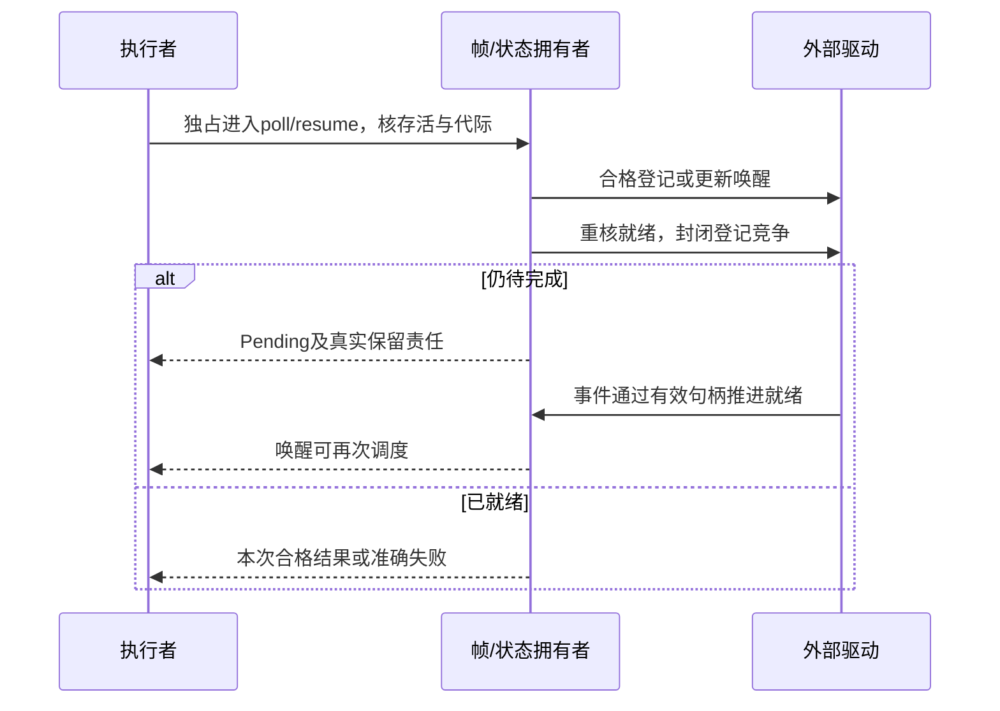

# 对象、数值、控制流与调用映射

本页聚合原生对象/调用与数值/控制流在目标语言中的表示和保持义务。二者共同决定可观察求值、调用与控制行为，但对象身份/布局和数值/控制语义仍是独立稳定单元。

## 对象视图、成员与调用映射

本篇细化[使用点采用](采用与导出边界.md)的对象、接口与调用差额。新代码默认使用已有组合、类型与接口；下面的子对象和重载机制只在源语义或明确选定的能力画像确实需要时使用，不默认加入完整C++类系统。语义由原semantics拥有，具体源的解释交给匹配前端；目标后端消费固定结果，不二次决议。比较依据标记见[来源](../../../research/sources/Rust与C++映射依据.md)。

### 对象身份、视图与动态分派

逻辑完整对象、子对象、接口视图、存储位置和模块世代分别识别。相同类型的两个重复基子对象不能因类型名相同合并；同一完整对象内标为虚共享的基只有一份状态和一次初始化/销毁；不同完整对象不能共享这份状态。投影保留完整拥有者、实际子对象路径、借用/访问类别、寿命及使用的动态代码。普通无继承对象不生成这些额外结构。

检查可变访问先把不同路径归约到真实存储/别名，再判断独占。基视图没有凭空重建整个派生对象的独占权；一个通过基接口调用的方法可能访问完整对象，不能因局部基字段不重叠就允许两个相互冲突的调用并发。若无法取得精确效果/别名摘要，采用安全的更大借用范围、显式协调或保留不支持，不把未知当互不干扰。

选择动态目标时固定实际方法槽和唯一最终覆写者，保留接收者与效果上界、子对象调整、返回视图和代码世代。覆写不得缩小原承诺输入域或扩大调用者未接受的效果；结果加强是否合格按真实替代关系检查。构造/销毁期间只使用当前源语言规定的动态类型与已建立部分，不能跳到访问未初始化派生字段的实现。失败只清理已建立部分，顺序由源语义/所选对象模型确定，原生对象不能被另一个“更安全默认”悄悄改义。

| 定位与实际需求 | Rust已有路径及仍有的差额 | 当前映射与不能放宽的条件 | 具体验收 |
|---|---|---|---|
| A01 实现继承：复用状态/行为并作为共同接口使用 | 组合字段、trait默认方法、泛型/dyn；组合不必堆分配，但不是原生基子对象及继承覆写规则 | 新代码先组合/接口；要求外部派生覆写、基指针代表同一完整对象或C++类ABI时，保留真实子对象/分派或原生桥接；TS prototype仅在满足合同的范围使用 | 经基视图修改后，完整对象观察同一状态；动态清理顺序符合原合同 |
| A02 多重实现继承：多个独立状态基 | 多trait可复用接口，不自动拥有多个实现基；组合和转发要自己维持视图关系 | 有需求时生成分立子对象与明确投影，TS使用受管对象形状而非假称单prototype具备多继承；同名必须消歧，不能按加载顺序选 | A/B状态独立；同名冲突诊断；不能从一个借用重建冲突的完整可变引用 |
| A03 虚继承/菱形：两条路径共享同一基 | 唯一字段加显式访问器、共享句柄或自定义视图可以实现共享；Rc/RefCell/锁不是普遍必需，但其成本若使用必须计入 | 同一完整对象中共享基归唯一owner，两路径规范化到同一存储；要求原生虚基偏移/ABI时用匹配工具链 | 两路径申请并行独占借用被拒绝或合法串行；只初始化/销毁一次；不同实例不相互共享 |
| A04 public/protected/private继承：实现复用与可替代性分离 | 模块隐私、组合、公开trait接口可达到封装目的，不能自动保留C++继承可访问性和转换候选 | 自有新代码显式导出接口；导入源保留其访问、转换和查找结果，语言可见性不提升宿主权限 | 非公开基的非法外部转换拒绝；合法内部复用仍可用 |
| A05 protected：受限派生扩展访问 | crate/module/private、内部trait、扩展接口可用；任意跨库子类选择性访问不是同一协议 | 没有真实继承扩展要求就不新增修饰符；有需求时以明确拥有者和扩展域开放，不能把private改public充作替代 | 合法扩展者可访问规定成员，普通外部调用者不能访问 |
| A06 friend：指定主体访问私有实现 | 窄模块布局、私有辅助函数、密封trait或显式能力式API可承担；不是任意命名friend语义 | 精确源兼容保留原非自动传递/继承的友元规则；自有扩展使用明确许可的语义访问，反射和生成后的代码仍需各自可见性核对 | 获准辅助可用；未获准元程序不能枚举/读取私有字段，更不能用生成代码绕过 |
| A07 协变虚返回：接口实现返回更具体对象 | 静态关联类型、dyn统一返回接口、另设具体入口；单个dyn签名和原生虚表返回调整未必同形 | 保留明确结果视图及拥有/借用；不把可写容器任意协变，原生槽/ABI固定时核精确桥接 | 合法基结果视图指向原对象且寿命正确；不合法可变协变拒绝 |
| A08 dynamic_cast下转/横转：运行期查询同对象接口 | Any精确downcast、enum或query-interface/投影表；Any不自带继承图与横转 | 只有实际需要时建立可验证接口查询；原生RTTI图、地址调整和开放插件要求交给其已绑定画像，不默认全部对象带RTTI | 唯一合法转换成功；重复基歧义明确；失败不伪造引用，不把兄弟对象当同一对象 |
| A09 typeid/RTTI：动态类型身份 | Any/TypeId覆盖常见需求；Any的'static边界不自动覆盖任意借用类型，名称/标签不能安全downcast | 不再声称Rust没有RTTI；普通类型识别直接复用，跨模块身份、非静态借用、ABI或继承图要求分别处理 | 同名不同类型不混同；不能仅凭展示名/数值标签强转，过期借用不因类型匹配复活 |

这些判断依赖C01、R05、R06、R19、I01的各自对象/接口范围，不证明任何现有bridge支持全部行。Rust trait-object vtable的特定编译器缺陷也属于实际供给资格，不能因语言规则正确就宣布所有版本合格；R01的修复记录只校准相交版本，不否定其他版本或全部Rust设计。

**原生对象和类型名的相似性不产生同一 ABI。** 多重继承/虚继承中的基类视图、动态分派槽位、部分构造与析构阶段的虚调用、重载排序、隐式转换及默认实参求值都属于具体语言的可观察约束；中立接口不能仅因双方字段同名就把对象内存直接互转。可借助目标适配层，但必须明确保留对象身份、生命周期、异常与可能的副作用；旧源含义无法确定时禁止以“通常工作”冒充正确转换。

**异步寿命和布局限制需要分别建模。** Rust `Pin`、移动后地址稳定、C 指针逃逸、线程局部状态、原子回收、分配器约束、SIMD 浮点例外、协程唤醒与取消竞态，不应压成一个 `native:unsafe` 标志。类型可能合法、ABI 可能匹配，但所选生命周期、原子内存序或资源关闭顺序仍不可实现；Method/Target 应拒绝不满足的具体供应，而不是为原生互操作定义一个万能免检区域。

### 成员投影、不可寻址字段与opaque对象

成员选择作为值时，语义视图至少保留源拥有者/类型、实际成员身份、接收者类别、结果是否可寻址、访问权限和寿命。普通字段可降为已绑定getter/setter或函数；需要捕获时闭包承担实际捕获与所有权。C++ pointer-to-member可能包含基调整或特殊表示，不能统一编码为字节offset或函数裸指针。

位域、packed字段和按值代理不伪装成普通`&T`/`&mut T`。代理要说明读写时机、暂存、提交、失败、别名和借用寿命；写回可能有副作用，不能由语法糖隐藏。矩阵视图、packed-bit下标和延迟位置选择都使用这条原则，不为每个operator建新内核。

| 定位 | 已有路线与限制 | 采用及验收 |
|---|---|---|
| A10 成员指针 | Rust类型化getter/setter、方法函数、闭包或投影trait可延迟应用到对象；其类型身份、捕获大小、基调整和原生表示不同 | 普通访问器足够就采用；要求真实C++成员指针ABI时由原生供给拥有。应用到错误owner、不可访问成员或过期借用必须失败；位域不能形成普通字段引用 |
| A11 不完整类与前置声明 | Rust源内通常不需前置声明；私有具体类型、opaque句柄、工厂/析构入口可复用。未知foreign大小不能按零尺寸占位分配或做指针步进 | 递归声明可以先登记名义身份和签名；递归指针关系正常使用，无限按值布局拒绝。仅操作句柄不强迫取得完整类型；真实按值ABI缺布局则准确缺项，不新造头文件系统 |

### 调用解析、默认值与求值顺序

解析顺序是源语言合同，不存在一条对所有语言都正确的“先筛私有候选”规则。原生C++先按其规则找最佳候选，再检查选中者可访问性；private精确匹配不能预先删掉以退选public较差匹配。自有前端可有不同规则，但必须明确其解释版本和合法域。准确已解析调用可以直接进入中立绑定，不要求所有后端复制ADL/SFINAE。

一个被选调用固定真实声明及实例、接收者所有/共享/独占借用、必要调整、参数对应、转换链、默认值提供处、求值顺序、返回关系和可能效果。未求值的表达式不得被类型查询执行；显式空值与参数省略不是同一状态。默认表达式在原规则规定的调用时机仅求值所需次数，定义来源和所需环境进入依赖；改默认值是否改变旧已编译调用按具体源规则判断，不宣称所有语言一致。

普通重载如采用按实参转换偏序，某候选只有在各相关位置不差且至少一处更好时才能据该规则胜出；不能把不同参数的优劣加总成任意分数。源语言有其他决议规则时继续消费该源结果。预算结束、类型信息未得、外部声明不可读不同于“没有候选”；访问拒绝和真实不存在也不混淆。

| 定位与需求 | Rust已有路径及剩余差额 | 当前选择、TS映射及拒绝边界 |
|---|---|---|
| A12 同名函数重载 | 泛型+trait、tuple参数、Into和不同入口；没有相同原生重载集合与全部候选排序 | 作者便利可解析成确定调用；TS声明重载擦除后仍需正确实现分派。原生名称/未来第三方开放匹配被固定时不能称无损，nightly/实验方向不自动进入稳定路线 |
| A13 receiver的cv/ref重载 | `&self/&mut self/self`与不同方法名、trait辅助可表达借用/消费；同一拼写的自动选择不同 | 保留实际接收者权限、值类别与结果借用，必要时局部语法降低；不能把共享receiver改为独占或消费。TS公开JS入口还核运行期一次性状态 |
| A14 explicit object parameter/deducing this | trait Self、泛型函数以及合格Box/Rc/Arc/Pin receiver已可用；不能说Rust只支持三种self | 任意自定义receiver、原生方法拼写与精确推导仍可能有差额；先显式参数/现有receiver，不将deducing-this与arbitrary-self-types简单等同 |
| A15 默认参数 | builder、配置Default、额外入口、宏或显式Option政策可减少重复；调用字数和接口不同 | 新代码可采用已有配置，确需省略语法才局部补全；默认副作用不隐藏，显式空值不触发省略分支。原生调用语法固定时报告接口差额 |
| A16 用户隐式转换 | From/Into、AsRef、泛型形参和已有deref/coercion可用；不是完全没有隐式转换 | 默认保留显式成本/失败；受限转换必须进入固定conversion plan及效果检查。任意用户转换不自动参与全局选择，不能为便利改原生决议 |
| A17 自定义operator= | clone_from和assign/replace方法可复用旧资源，普通赋值+Drop处理值替换 | 缺的是把任意协议挂在`=`而非无资源复用；目标包装不能保持固定第三方`=`协议时明确差额。与A45共用替换/更新机制，不重复增加底层能力 |
| A18 用户对象operator() | 闭包包装、call方法或自定义Call trait；原生闭包可满足Fn/FnMut/FnOnce | stable任意类型手写Fn实现受限制，包装会改变暴露类型、自动trait或借用。内部call糖可降为方法；要求原对象直接满足固定外部Fn接口时不能忽略差额 |
| A19 额外operator与代理下标 | Add等traits、get/set、借用代理、Future协议可覆盖；Index固定引用结果不普遍容纳临时value/lending proxy | ++、逗号、箭头等拼写不各造原语；真实代理与顺序要保留。短路逻辑不得降成eager重载或相反；packed-bit写入不能伪造`&mut bool` |
| A20 字面量后缀 | 宏、过程宏、const构造器、单位库可静态解析；拼写和语义查询能力不同 | 原始大数token先按目标规则解析，不先变f64丢精度；错误定位、单位和编译阶段保留。无宏原生后缀协议固定时才需对应前端能力 |
| A21 ADL定制点 | trait显式定制、newtype、传策略/witness、类型拥有者接口；孤儿规则/合作方式与namespace查找不同 | 优先明确定制入口；不合作的外部类型与算法若要求全局透明扩展，不能用改API掩盖。导入C++仍按其ODR、可见性和查找规则，不声称任意开放扩展无约束 |
| A22 类模板推导指南 | 泛型工厂、关联类型、From、impl Trait和正常推导能导出所需结果 | 工厂可作最终方案；任意原生泛型名字注册同形推导指南并非自动支持。公开构造语法、类型身份或可命名性不可改时保留缺项 |
| A23 decltype/decltype(auto) | 局部推导、关联Output、辅助泛型函数、impl Trait覆盖已暴露类型关系 | 任意未求值表达式类型在公开类型位置复用并非普遍stable接口；内部查询不等于作者必须有typeof语法。精确匿名类型/引用类别必须保留时，提供所选查询或显式适配，不运行表达式取类型 |

A12—A23对应R04—R06、R10—R14、R17、C04、C07、C15—C17。引用说明规则或接口，不代表该编译器已实现所有拟采用便利。

#### X03 带捕获的泛型闭包

同一个C++泛型closure对象可对不同参数类型实例化调用。Rust可用具名状态类型的泛型方法、GAT/trait策略或生成的多态callable承担内部需要；普通闭包不因此成为任意类型量化的同形Fn接口。公开高阶库若固定要求原生Fn而不能换协议，类型身份与实例化方式就是实际差额。

当前选择是在真实捕获拥有/借用和调用次数合同上表示该能力，已知使用点生成普通实例；开放下游接口按[四类导出](采用与导出边界.md#四种对外交付不能相互代签)处理。不默认复制全部lambda模板语法，也不把状态对象包一层以后就宣称ABI、大小与静态保证全相同。

#### X07 代理位置与借用型结果

一个临时代理可以定位位、矩阵切片或延迟写回位置，但它是否拥有数据、何时提交、能否跨await、能否并发、失败是否部分作用都必须准确。读取/写入明确方法可以是合法替代；固定外部算法只接受原生`[]/=`时则可能不合格。语法糖不得改变求值次数、代理销毁时机和提交观察，原子位操作进一步使用实际访问域而非普通读改写。

#### X13 自有便利不覆盖原生解释

private最佳重载、默认实参来源、临时对象寿命、构造/析构与访问检查均由源解释固定。改变规则形成新的自有程序或迁移候选，不冒充精确原生兼容。只需正确调用的黑盒库可以直接使用，不为了追求全解析而重写整个C++；需要精确回源时保留原声明、位置和受管修改域，缺映射则保全原字节。

### 失败、再次修改与验收

新成员、基拓扑、方法槽、默认值、转换或可见性变化会使相交查找、反射集合、实例、布局和接口证据失效；已锁定旧调用不因加载新插件自行改义。新增成员必须命中成员全集/否定查询依赖，不能只刷新旧已见成员。当前结果回写继续核候选和前像，旧对象使用旧布局与模块世代，不随源码修改热换vtable。

合法普通组合不负担RTTI图或动态句柄表。相交正反例至少包括：同一/不同子对象的状态与借用、重复基歧义、构造中分派、未授权反射、两个转换维度互不占优、默认值只执行一次、短路与eager区别、编译期类型查询不执行表达式，及泛型捕获对象的真实导出限制。完整条件由[组合验收](../../60-保证与证据/验收/接缝符合性.md#cross-language-conformance)承担；目标编译、运行、ABI、借用与性能证据分别取得，不由表格存在代签。

## 数值、失败与可恢复控制流映射

本篇细化[采用边界](采用与导出边界.md)中真实数值观察、错误和可恢复控制流。原领域数值、函数效果、任务和资源合同继续拥有含义；这里规定目标路线何时足够、何时有不可隐藏的差额。不因为C++有某拼写就默认建设全数值体系、通用异常语言或多次恢复续体。来源键见[映射资料](../../../research/sources/Rust与C++映射依据.md)。

### 数值语义与目标格式

数学整数、有界整数、固定浮点格式、目标long double及软件高精度是不同对象。只在本任务需要的范围固定精度/指数域、舍入、溢出、下溢、NaN、signed zero、subnormal、异常标记和转换；普通程序不配置全部浮点状态。运行与常量求值使用相同被声明的目标含义，不能按构建机类型或库默认值偶然改变。

存储16字节不证明有效精度128位，long double也不统一代表binary128。软件计算可满足数学精度，不自动满足原生参数/返回ABI、目标指令、异常环境、内联和成本。序列化再转换、FFI复制和设备格式分别核对。硬要求缺供给时返回相交不支持，其他普通计算继续。

| 定位与需求 | 已有Rust路线与差额 | 当前采用及验收 |
|---|---|---|
| A53 long double/扩展浮点 | 高精度软件、架构intrinsic/汇编或外部数值内核；原生f128的状态逐item核验 | 指定x87扩展、double-double、binary128及其ABI不能互换。无精确原生要求时复用合格软件即可；有严格格式/成本/异常要求则取得实际供给，不降成f64 |
| A54 类型化栈展开异常 | Result/?适合普通可失败调用；panic_any/catch_unwind是panic协议，匹配FFI域可转译 | Result改变传播签名和控制流；固定回调、C++catch层级、原生unwind或正常路径成本不能称无损。新代码默认显式错误，精确外部展开只在合格域内适配 |
| A55 通用可定制协程 | Iterator、Future、明确状态机、宏/库覆盖常见生成与异步 | 一般resume/yield参数、帧布局、跨挂起借用与调度仍可能要求不同协议；不是所有场景缺能力，也不是稳定原生通用Coroutine已完备。先复用成熟接口，确有差额再选择有限状态机 |
| A57 goto/任意函数内CFG | loop/break/continue/match和CFG结构化可实现算法 | 不可约CFG、dispatch形状或栈/速度硬要求仍需目标证据。高层不必暴露goto；合法跳转保留初始化、清理和效果，不能赌优化器一定消除额外分派 |
| A63 portable SIMD | 稳定架构intrinsics、实际SIMD库和自动向量化；统一std::simd接口及特性状态单列 | 不再说Rust没有SIMD。固定ISA、mask、精度、归约顺序和依赖政策分别核对；自动向量化不保证特定指令，硬性向量要求不准偷偷标量回退 |
| A64 语言级contracts | assert、验证构造器、类型状态、宏、测试或外部验证器可承担实际要求 | C++contracts也不是通用refinement证明器；原生语法/模式/诊断兼容是独立需求。安全检查不能无证明关闭，是否新增公开契约语法按真正作者负担决定 |

A53—A64的事实范围见R21—R23、R27—R31、R33—R34、C09—C11、T01—T04及I03；GNU扩展、标准提案、nightly方向、稳定API和可运行供给分别记录，不作为同一“支持”层级。

#### X01 动态浮点环境

R30所读取的Rust x86 MXCSR文档明确限制改变编译器假定为默认的masking、rounding及denormals-are-zero状态；改变后再恢复、源码之间看不到浮点运算，也不能排除编译器重排。该页面本次返回的版本标记为1.97.1，不能凭stable地址声称已逐字取得1.98.1同页；所选后续工具仍核其实际保证。

需要特殊环境时，采用所有相交运算均在合格隔离范围内、退出前恢复原状态的内核，或使用显式软件定向舍入。对应Rust文档给出单个汇编块内运算并恢复的路线；隔离内部不能回调到假定默认环境的普通代码。C++/Clang也要选实际支持动态环境的严格选项，默认优化不能代签。真实线程状态、编译器重排、异常/退出、调用边界和目标ABI均进入证据。

读取/清除异常标记与改变mask/舍入控制不是同一操作。即使寄存器能读，也不能据此把某一标记精确归因到源码附近的表达式；要由选定严格执行范围建立关联。特殊环境方法失败不能污染后续任务的环境，恢复责任不能用“线程最后会退出”代替。

#### X02 快速代数浮点

Rust 1.98增加f32/f64 algebraic_*操作，允许其声明范围内的代数优化；结果可以因优化选择变化，但这些方法本身不引入未定义行为。它们不是全部编译器fast-math开关，更不是授权任意改变动态FP环境。[R02]

当前采用按操作/区域绑定允许的重排、融合、特殊值、误差和复现范围；普通严格部分保持原合同。明确接受了某种数值自由，才可选择对应方法；不能从“追求最快”推导NaN、signed zero、subnormal或确定性要求全部撤销。优化方法与原值、导数、统计或概率方法组合时还核同一数值域，不把相同f64签名当理论一致。

### SIMD与代码生成控制

向量宽度、lane类型、mask、shuffle、gather/scatter、内存对齐/有效范围与归约关系分别固定。inactive lane是否允许求值、触发异常或访问内存由所选操作合同决定，不能先无条件访问再mask结果。若原需求规定inactive地址不得访问，目标方法必须真的满足；无此能力就另选合法路线。

归约次序与浮点结果有关。确定性顺序不能被并行树随意改变；允许重结合的任务可选择树，但保留允许域和误差/复现条件。runtime ISA分派先取得真实CPU/宿主能力，固定合格baseline和可达特化分支；不把编译机支持当运行机支持。缺ISA时是否可标量回退来自原硬条件，不由库作者偷换。

inline、likely、向量化提示、代码段与优化等级只有其工具合同所给强度；提示不是无调用、无分支或精确延迟的证明。限定指令形状、栈界、constant-time或硬时限时，取得准确目标结构及所需实际证据；不能因一组微基准平均更快就消解全部输入约束。

### 错误、效果与契约的保持

调用的效果包括默认表达式、转换、复制、分配、用户getter、回调和清理；不能只给函数主体最后一行贴pure/nofail。已绑定接口提供的是实际可允许上界和出口，不完整分析保持未知。能够通过现有类型、库和明确调用链保持时，无需新建通用代数效果系统；没有合格依据时也不能把隐藏作用默认成空。

Result lowering 只有在编译器拥有全部受管调用链时，才可保持现有错误序列、清理和可观察结果。固定 native ABI、已发布回调签名或依赖栈展开的外部代码不能被透明替换成 Result；TS throw 也不等价于 C++ ABI 异常。跨域必须依[外部调用](存储资源与外部原子边界.md#gift-unit-4d2cfff268705ddea75e5dea4d40583c)做有证据的转换或拒绝，并保持错误载荷与资源析构的真实存活范围。

一个错误发生后，已有资源先按真实状态清理；清理再次失败时保留原首因与收尾错误，不伪造正常返回。panic=abort、外部终止或异常逃出noexcept会改变失败语义，不能拿“没有返回Err”证明nofail。catch_unwind只承担其具体panic/ABI合同，不作为万能typed catch；断电、进程被杀等也不由普通异常规则捕获。

#### X08 noexcept、无分配和有界执行

noexcept约束异常传播，不能同时代表不分配、不会终止进程、计算必终止或时间有界。函数内部仍可能执行会失败的工作，源语言如何处理越界传播必须保留。原生库若据nothrow选择复制/移动，选择前提和真实cleanup也要匹配；全局panic=abort不等于相同逐函数类型协议。

契约前置、后置、对象不变量和所需old值分别绑定准确语义。只捕获实际需要的前态，成本、并发切面和隐私范围明确；不能为了检查而重复执行有副作用表达式。覆写/替代不擅自加强调用前提或削弱后置；证明消解只能依据适用证据，unknown不等于true。关闭assert或采用不检查模式若移除了裸访问所需唯一安全前提，则不能生成合格产物，除非另有充分保证。

### 可恢复计算的实际状态与资源

默认有限路线为单个活动恢复者的状态机：Created→Running→Suspended/Completed/Failed；取消进入Stopping/Closing，再在真实终结或责任移交后关闭。状态名字是原任务合同的视图，不发布第二套公共终态枚举。完成后不再恢复，Running中不被第二个调用并发resume；被借用或被waker/回调引用的帧不能提前销毁。

帧保存真正跨挂起存活的局部值、初始化位、下一恢复点、资源/借用、参数、yield/resume值和结果；不把全函数临时值永久放入堆。帧可在合法栈/区域/拥有存储中建立；自引用在最终位置建立后才暴露，所需Pin与线程亲和关系按[存储映射](存储资源与外部原子边界.md#gift-unit-b07b343cc53357d8a27b68b7e2d497e6)执行。手写状态机和宏都要满足这些条件，不能因语法不同忽略成本。

正常Future/Iterator足够时使用它们的成熟驱动；自有适配才承担唤醒交接。检查就绪、登记waker、再检查或等价原子协议必须封闭“完成恰好发生在检查与登记之间”的窗口，内存可见性也要成立。同步登记可能重入，必须按状态协调；generation检查不能替代存储存活，旧waker需要合格拥有/弱句柄，使其不能先解引用已释放帧后才核代际。

取消是停止请求，不是任意机器指令处销毁。不可取消的外部调用、已提交写入和仍待关闭资源保留原操作身份；等待者退出不删除真实作用。处于Suspended也不证明close已完成；异步收尾要有真实owner，缺这条路线时准确拒绝所需使用。结果已完成与取消竞争由同一状态拥有者裁决，不能用迟到取消抹掉已有成功事实。

一般Coroutine可有独立的resume/yield协议，但其采用需真实消费者。stackful引入栈保存/切换、ABI和占用，multi-shot还要求可复制的捕获、资源与效果重放政策，不能直接复制独占资源和发生过的I/O。现有单次Future需求不自动激活这些设施。

### CFG、尾调用与厂商扩展

源CFG保留每条边的值、初始化、借用/所有权、处理器、效果和所需清理。禁止跳入尚未建立的对象状态，离开持锁/资源区域必须执行恰好一次正确清理；生成的手工cleanup不能和Rust原生Drop双重拥有同一资源。异常边、取消边及部分初始化边均是实际控制流，不只核正常return。

可结构化的图输出普通Rust/TS控制；不可约图可用明确状态机或专门目标方法，但dispatch、栈、代码体积、调试位置和优化机会可能变化。只有原要求允许这些变化时才是合格替代；必要时保留原生供给，不默认把控制流语法暴露给所有作者。

#### X09 computed goto、尾调用与属性

GNU labels-as-values是厂商扩展，不作为ISO C++一般能力。它与标准goto的析构/作用域行为不能混淆；使用其独立内核要显式保存所需清理。Rust显式尾调用等实验方向不冒充稳定能力；循环、状态机、合格后端tailcall和原生内核是可比较路线。

保证栈不增长、特定解释器dispatch或精确调用约定时，看真实目标和所选版本，不从“编译器通常优化”下结论。尾递归改循环还需保持调用栈可观察行为、异常与清理；无需该观察的普通算法可以用较简单结构化方案。

### 连续变化和验证

数值画像、ISA、优化自由、目标工具、处理器、清理、帧布局、调度或公开契约改变时，相交选择、生成成员和证据失效；旧运行仍绑定原世代。调试/热点优化不能热改未迁移的帧或把旧错误payload交给新析构器。

本篇的正反范围包括：软件高精度与原生ABI不等价、改变浮点控制后回调普通代码、严格归约被重结合、inactive lane非法访问、Result跨固定回调、清理再失败、nofail与abort混淆、丢唤醒、重入resume、取消后异步close、非法CFG、厂商扩展与标准源混用，及无依据删除安全检查。它们分别进入[组合验收](../../60-保证与证据/验收/接缝符合性.md#cross-language-conformance)，不由一次数值样例或目标编译成功证明全部范围。

## 原生互操作资格矩阵与目标上的实际可观察保持

NativeBridge 的支持单位是一个精确的 `NativeContract{targetTriple,toolchainRevision,ABI,callingConvention,dataLayout,ownership,threadAffinity,errorBoundary,exceptionPolicy,memoryOrder,environment}`，而非统一 `native=true`。声明了 C ABI 不等于支持 C++ name mangling/exception/unwinding，声明支持指针不等于可容忍别名冲突或越界，支持任一 64 位目标不等于所有平台布局与系统调用相同。

逐调用解析：在双方准确 ABI 下生成参数、返回、对齐、填充和指针寿命计划；对不透明句柄只能使用提供者明示的方法；对可变别名建立相交 Borrow/Effect 约束；异常必须在合格边界转为既定 Result/Fault 或允许传播，不能让两种语言的 unwinder 在未证明的边界穿透。涉及回调时额外冻结回调生存区、重入次数、线程、异常回传和模块卸载后的悬空指针处理。

裸机/设备扩展另要求 `PhysicalAccessProfile`：寄存器宽度、对齐、volatile/MMIO读写语义、屏障、访问权限、设备复位、DMA共享缓存一致性、ISR安全和真实故障时设备处置。弱内存原子操作必须保留原语言/硬件的允许重排序关系和进展属性；一个强于/弱于所需保证的目标映射都需按观察判断，不能只比较单线程结果。硬实时还需真实 WCET、优先级和抢占/中断边界资格。

一个合格目标声明应精确列支持的 `(operation, targetProfile, environment)` 及所用验证方法。失败时优先输出 `UNSUPPORTED_ABI`, `UNPROVEN_LIFETIME`, `MEMORY_MODEL_MISMATCH`, `DEVICE_ACCESS_NOT_GRANTED` 等定位到使用点的缺口；成熟 FFI 工具与系统 SDK 可作为经过验证的 Provider 使用，不应在 Gift 内重写操作系统或 ABI 标准。导出到现成源码后是否能由原生工具继续编辑是另外的 round-trip/ownership 命题。

## 跨 JSON/TypeScript/未来 Rust 的 Revision64 精确编码

### TypeScript↔Rust的边界

可由TS负责UI/协议/业务外壳，Rust负责明确的性能/安全关键计算或底层原生库，但这是由Method/Target共同确认的可选架构，不是所有工程必须混合语言。跨边界需明确值/引用复制、同步/异步调用、ABI、错误和取消、内存所有者、并发回调、版本兼容与性能测量前提；没有实际收益证据时不因“Rust更快”默认引入FFI。数据传输额外开销可能抵消底层执行收益。

在本受限 Profile 中，作者语义 `Revision64` 的数学集合为 `[0,18446744073709551615]`，运算是检查溢出的无符号整数加法（非模 2^64 加法）；外部 JSON 表示只能使用**规范十进制字符串**，格式 `0|[1-9][0-9]*`，长度最多 20，并在语义解码层实际拒绝大于上界的值。`-0`、`+1`、`01`、指数、小数、任意 JSON Number、超过上限、重复字段和附加字段不能静默归一成合法 author content。超出 `2^53-1` 时，把 JSON String 先 `Number(...)` 再换 BigInt 会永久丢失低位，必须禁止该桥接。`revision` 的 canonical 编码不能承载 `objectId` 或 `generationId`；对象复用仍要保持独立身份。

本受限 TypeScript Native Target 使用 `bigint`、边界 `0n<=rev<=MAX64`、`before<=MAX64-delta`；`BigInt.asUintN(64,...)` 或任意静默截断不符合作者要求。目标若是 Rust：候选仅可使用 `u64::checked_add` 等能表达相同溢出结果的 API，并需独立验证与目标 ABI/字节序/桥接错误语义，不因语法相似视为已发射或验证 Rust。对象序列化采用固定字段顺序与 JSON String；本例 TS Decoder 用字节级 canonical roundtrip 拒绝多余表示，适用于固定三字段受限模型，不推广为通用 JSON Parser；流式 Unicode、非规范文本、UTF-8、文件系统持久性须由各自 TargetProfile 说明。

`fixtures/contract-closure/Gift97/revision64/revision.ts` 与 `revision64-contract.proposal.json` 分别是可运行 native 证据与未发布协议草案，具有不同权威。任何 Target 成功编译只证明可生成/加载对应 bytes，不自带 Rule 证明、ABI 可用性或对持久 Store 的行为保障。
