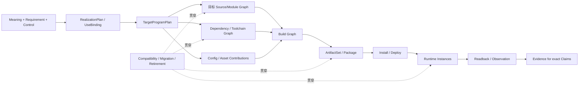
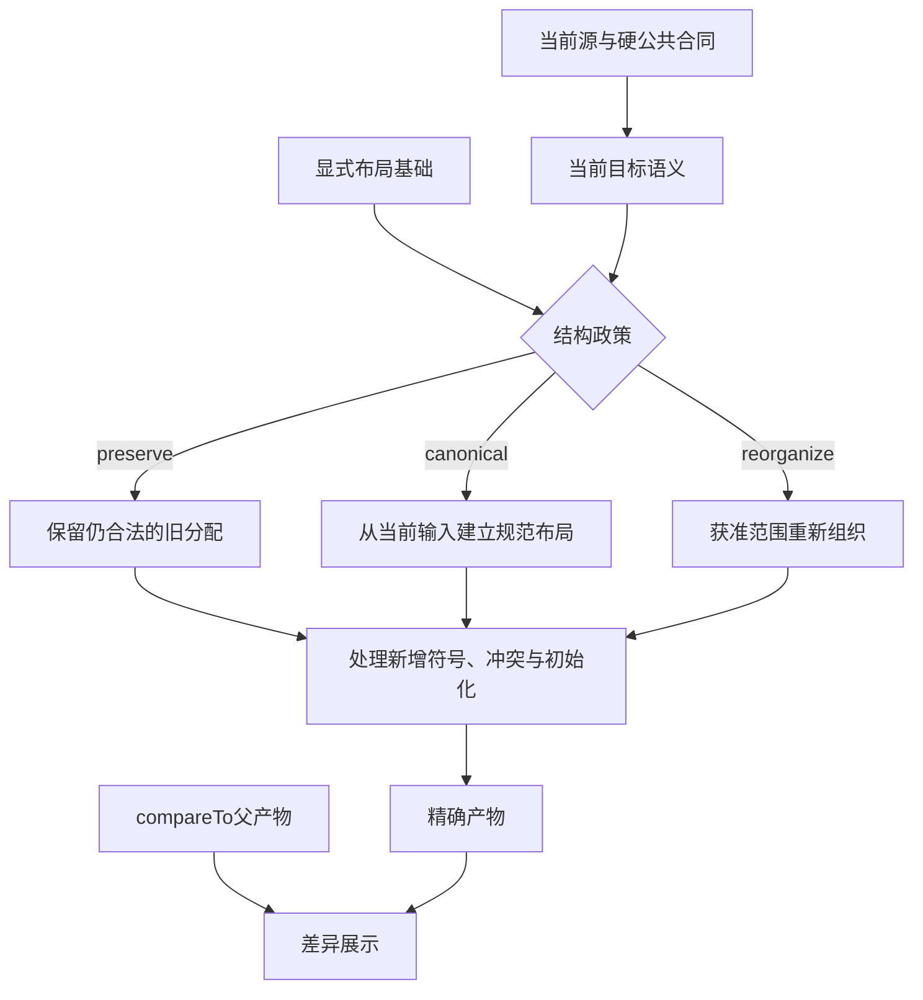
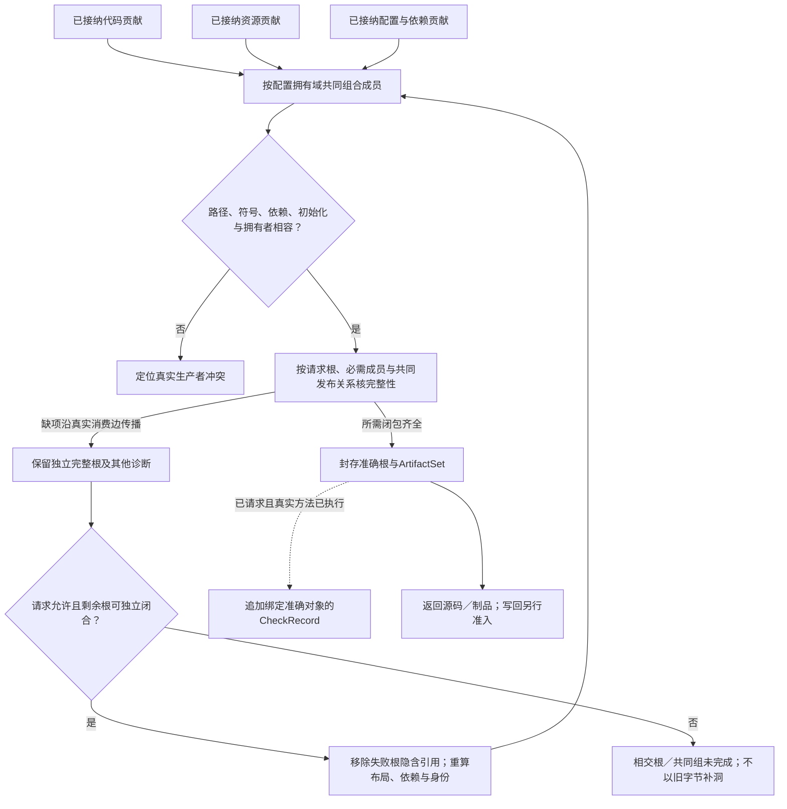

# 布局、成员与完整装配

## 布局、成员与完整装配

**目标成员边界。（消费条件）：** 生成的头/库/桥接元数据必须与真实ABI画像配套，不能在目标选择之后由脚本重新猜长度、布局和所有权。 合同归属：[跨ABI、异步调用与资源释放的共同协议](../../50-执行运行与观测/跨实现调用与数据寿命.md#gift-abi-lifetime-contract)。

### 源码布局必须保留下游可观察边界

布局计划读取已锁定的业务语义、公开接口、硬约束和合格实现绑定。文件分区只是一个选择维度；若布局改变设备驻留、初始化顺序、编码、实例寿命、调用成本或资源归属，就须重检受影响合同，并按[联合搜索](../../30-实现解析/实现选择/设计空间搜索与求解.md#带边界状态的联合搜索与合法剪枝)比较合法方案。

成员布局先固定不能改变的导出、ABI和调用合同，再选实现表示、运行位置和实例边界；依此安排转换、初始化、私有符号、文件和资源寿命，最后打印并登记成员。每个新增helper均须计入依赖、许可、初始化、加载、体积及维护成本。已合格的内联或调用安排可以原样保留，只有满足保持条件且存在明确必要性或收益时才修改。

代码格式化、物理拆分和编译器自身模块树不能决定任务语义。纯计算核可以只是一个函数；大内存流水线可以在同进程分阶段；事务共享域也不以一个文件一个服务划分。组合保证要求保持的内容不依赖文件名暗中传递，必须由原公共接口和实际映射维持。

语义输入没有变化却更换布局时，保留作者候选身份并产生新的目标绑定/产物及相应检查；原产物不能只被重贴更快标签。检查消解、缓冲复用和数值缩窄的依据过期时，旧字节仍为历史产物，新的采用需要恢复检查、重建或取得新依据。

<a id="generated-product-architecture"></a>
### 生成目标系统的完整架构闭包

当交付要求是可构建、可维护、可发布、可部署或可运行的软件，目标工程须按照该用途具备完整入口、依赖、构建、初始化、升级和恢复责任。Gift开发自身的`contracts/workspace/compiler/...`目录与用户产品模块是不同工程，不得照搬内部目录树，也不得仅输出几个函数后把必需的工程职责转交给未声明的手工步骤。

生成产品按本次目的取得以下相交结构；它们是完整性检查面，不要求每个函数都创建八种对象或走完八个阶段：

| 目标产品结构 | 拥有的事实 | 由谁决定 / 取得 | 不成立时的结果 |
|---|---|---|---|
| **Logical / Public Architecture** | 产品根、公开 API、业务模块、状态/关系/协议边界 | 作者 Meaning/Requirement + RealizationPlan | 不能用文件布局猜公共语义 |
| **Source / Module Architecture** | 目标语言模块、symbol、visibility、import、generated/native/managed区域 | TargetProgramPlan + target lowering/layout | 目标源码不完整或不可维护 |
| **Dependency / Toolchain Architecture** | crate/package/system library、版本/features、compiler/runtime/toolchain、构建期执行 | 精确 UseBinding + 真实生态 resolver | 返回 Dependency/Toolchain Need；不得选 latest 补洞 |
| **Config / Asset Architecture** | Cargo/package config、env schema、resources、messages、templates、migrations、assets | 各实际 owner 的 contribution + 单一目标组合器 | 缺必需成员时根不能称完整 |
| **Build / Package Architecture** | build graph、generated steps、link/package/install members、signing/release inputs | target adapter + Artifact composition | “源码生成成功”不等于可构建/可发布 |
| **Runtime / Deployment Architecture** | process/component topology、实例寿命、资源、持久状态、外部接口、部署边界 | 产品 Requirement + runtime/deployment method | Artifact 完整不等于运行实例已经成立 |
| **Assurance Architecture** | 产品 Claim、target-specific checks、运行 observation、coverage 和 Evidence | Assurance owner | 目标工具通过只覆盖其准确 Claim/环境 |
| **Evolution Architecture** | public compatibility、schema/data migration、dependency upgrade、generated/native ownership、rollback/retirement | 原演进 owner + target-specific facts | 新生成版本不得无条件替换旧运行/数据/消费者 |

这些投影用准确ProductRoot和相交Binding关联；不同目标仍有各自绑定，不用一个target键替全体签发资格。它们**不是一份万能`ProductIR`**。Source graph 可以重排而 public contract 不变；Runtime topology 可以在满足 Requirement 时变化；Evidence 也可以在完全不修改源码时更新。只有真实消费需要的交叉关系进入相应计划。

<a id="fig-generated-product-closure"></a>



#### 目标工程的代码组织怎样选择

Target 项目布局由实际交付根、公开 API、语言惯例、状态/资源寿命、部署隔离、已有实现供应及后续修改稳定性共同决定，不映射文档目录、编译 Pass 数或模板名。默认用满足全部合同的最小惯用结构：纯函数可为一模块，库区分公开接口与私有实现，服务才需要服务入口/配置/外部适配，多包/多服务仅在独立部署、版本、权限、资源或协作责任真实存在时引入。

决定拆分一个目标 module/package/component 时至少出现一个独立见证：公开接口/封装、状态或资源寿命、部署/权限域、版本与发布、性能/设备边界、可替换供给、独立恢复/迁移，或目标工具本身要求的真实边界。没有这些见证的“分层”优先合并，避免生成充满 Controller/Manager/DTO/Repository 等无独立语义的样板。

相反，两个功能即使最终能放在同一文件，只要具有不同持久状态、事务/恢复、权限、ABI、生命周期或升级责任，其逻辑边界仍必须保留；文件合不能吞掉系统责任。

#### 目标源码、目标构建和目标运行的三套图不能合并

`Source/Module Graph` 表示引用、可见性与源码拥有；`Build Graph` 表示工具/生成步骤/产物前置；`Runtime Graph` 表示实例、调用、事件、资源和部署。它们可以引用同一 component identity，但一条 source import 不自动意味着 runtime RPC，一条 build dependency 也不证明运行时常驻。

目标产品的 Evidence/Provenance 又是第四种关系：它把准确源码/Artifact/环境/Observation 与 Claim 连接，不能作为 runtime edge。全体系怎样组合这些图见[架构图谱](../../00-系统与原则/统一多层工程模型.md)。

<a id="delivery-purpose-completeness"></a>
#### 成品输出的“完整”必须按目的分别签发

至少区分：可读目标源码、构建输入闭合的源码、已实际构建制品、可分发库／包、安装／部署材料、已安装／部署实例、正在运行系统、满足指定Claim的合格系统。它们不是无条件线性等级：纯库无需部署，已有合格制品可以直接被有权发布，静态验证可以在真实运行之前发生。

“输入、依赖及构建计划已完整”只支持待构建候选；只有指定工具链和环境真实通过，才可报告可构建的实测范围。源码交付可包含完整逻辑、资源、配置、依赖、构建和接入说明，不要求先部署或取得生产 Grant；部署材料有效不代表已部署，后者须由 Execution 的实际 Effect/恢复证据证明。任务明确要求可运行或已上线时，不能把源代码文件存在当作完成。

目标所需外部服务、秘密和运行输入可以是明示的合法进口，不在源码包伪造真实值；其可得性影响哪一出口由对应合同决定。完整性不能通过失败后缩小outputRoots、删掉未完成成员或改变AND为OR获得。

目标源码可脱离 Gift 独立维护时，必须保留其真实依赖、构建和公共合同；若继续由 Gift 受管生成，则保留足够来源对应和 ownership 规则。两种模式都不要求目标运行时携带 Gift 的工作台、planner、Evidence store 或作者控制面，除非该产品本身明确选择这些能力。

<a id="supply-artifact-composition"></a>
### 实现调用、依赖和资源怎样形成完整目标工程

目标发射器消费UseBinding和实际主体，不要求将全部输入恢复成中立函数体。SourceBody生成自身算法；ExternalExport生成实际调用；GenerationMethod产生有合同的代码与资产。三者统一返回原LoweringResult中的贡献，不各自直接写文件或各自生成package.json。

| 贡献 | 最小内容 | 汇合责任 |
|---|---|---|
| 符号与调用 | 精确提供者/出口、接收者、参数位置、作用域、公开要求 | 按真实符号分配别名，保持原求值顺序；同名不自动同物 |
| 类型与表示 | 边界类型、编码/布局、借用和转换 | 共享合法表示；不能为了统一对象树每步复制 |
| 初始化与状态 | 工厂、触发时点、实例拥有者、销毁或完成 | 共享代码与共享可变实例分别决策；不按配置摘要合并状态 |
| 依赖 | kind、精确解析节点、目标/执行平台、发生位置及必要性 | 每目标一个依赖组合器；缺解析返回真实Needs |
| 文件/资源 | 相对路径、内容/生产者、输出归属、必需或可选范围 | 核同路径竞争、编码/格式和完整成员；保留非拥有区域 |
| 来源与诊断 | 作者/导入/生成规则的位置和实际依据 | 外部无逐token来源就给准确边界，不能伪造源码行 |

依赖的kind至少区分运行、编译类型、构建工具、生成期工具、检查、资产。它们不是六份必须出现的清单：一次目标运行不应带仅用于开发检查的包；只提供类型声明也不代表运行实现已具备。目标标准模块也有宿主/版本要求，但不虚构npm下载或Maven坐标。

#### 一个目标只有一个配置与依赖输出拥有者

先收集全部必要贡献，按实际包工具的身份、版本约束、目标条件和共享类型/资源合同合并。已锁选择符合时复用；发生不相容的单例、ABI或版本要求，返回准确冲突。工具允许多版本且消费者不要求共享时可以并存，不能统一按包名强制去重。

需要新解析时返回DependencyResolutionNeed，application调用获准包工具取得真实锁与安装观察后固定新准备输入。Gift在其锁中引用这些实际结果，不自行另算一套版本；printer不能静默选择latest。未执行安装不填“已安装”，未获得平台二进制不填“运行可用”。

公共配置由该目标组合器生成或按成熟格式编辑器修改已有拥有区域。不能让每个库适配器独立覆盖package.json、构建脚本和依赖锁。已有人工字段保持；未知或冲突字段保全并报告。输出根宣称完整前，实际运行依赖、必需文件和入口引用必须按该根目的闭合；库的明确公共宿主进口可保留为消费者合同，独立应用不得把必需宿主伪装成已取得。

#### 调用形式的当前选择

函数可直接导入就直接导入；目标允许相同公共出口的重导出就重导出。只在调用方要求独立名字、静态类门面、表示/错误差额、隐藏供应商接口或初始化边界时生成门面。门面不是作者维护的另一个算法，也不是所有库都必须先登记的Gift包装。

需要工厂实例的规则在正确的目标激活范围生成。一次性有状态操作通常按调用创建；会话共享须来自真实合同及拥有者；可复用不可变格式器可按合格规则共享。不能把同步函数的无外部状态合同推导成目标内部无可变临时状态，也不能从库代码共享推导运行对象全局缓存。

无源码主体工程仍可请求目标源码，但这表示公开入口和实际调用源码，不表示已将底层算法抄入同一文件。标准运行时、外部二进制与可分发源代码的边界必须按交付合同说明。任务要求完全自包含或无运行时而供给不能满足时，选择另一合格路线或明确缺项，不改名为“完全编译”。

### 按输出形态的默认结构

| 输出 | 默认结构 | 何时增加结构 |
|---|---|---|
| 表达式或上下文区域 | 只给该语法类别的文本、必要上下文与候选补丁 | 引用需要新导入/声明时列出相交补丁，不能暗插顶层状态 |
| 单个纯函数 | 普通函数和本地临时变量；必要类型与私有辅助同模块 | 有实际公开消费者、生命周期或复用依据再拆分 |
| 小型或大型计算库 | 公共计算/数据接口及实际算法模块；热循环和局部临时状态在需要位置 | 以访问局部性、独立变化、目标编译和设备接口分区，不按体量自动建服务 |
| GPU/向量/设备计算 | 必要的目标核、薄启动/参数接口和同步资源管理 | 真实跨设备或部署边界才增加进程；不把每个tile当远程任务 |
| 编译器、图算法、解析/压缩程序 | 输入表示、变换/算法、目标输出与局部工作状态 | 新阶段有独立语义或真实优化接口才物化，不能为每个token建持久对象 |
| 已有应用 | 保留原框架入口、公开路径和非受管字节，在明确区域输出 | 实际需求改变时作可审查布局迁移，不自动重建整棵目录 |
| 新建有状态应用 | 按功能与不变量聚合，运行入口连接真实资源 | 只有不同运行实例、信任、扩容/运维与失败域才拆服务 |

单函数不产生Service、Repository、事件总线、依赖容器、Gift客户端或数据库。一个私有helper不自动产生一个文件；一个实体不自动产生一组CRUD端点；一个函数也不自动得到`async`、全量Result包装和operation context参数。

#### 一函数与一模块

完整例见短函数。要求函数源码且Item由上下文提供时，仅输出函数及其环境条件。要求自足单模块时，输出必要的Item声明与函数；不另建types.ts、interface.ts、factory.ts与空index.ts。要求函数“一个表达式”而合法实现需多句计算时，不擅自改IIFE导致捕获和错误行为变化；提供保持条件内的表达式表示，或报告形态不满足并提出完整函数形式。

#### 有状态应用的结构示意

下面仅在新建应用确有对应责任时成立，不是每个输出都要生成的模板：

```text
src/
  features/orders/contract.ts    真正共享的公开合同
  features/orders/approve.ts     用例及其必须保持的规则
  features/orders/storage.ts     已选择的存储连接，必要时由端口适配
  adapters/http/orders.ts        网络输入校验、错误和协议映射
  app.ts                        组装真实数据库/网络等运行依赖
```

若contract只有一个使用点且没有独立版本义务，可以与实现同文件；若现有框架在路由文件内支持清楚的事务用例，不强制增加一层application service。反之，必须同事务改变的订单、审计与outbox，不能仅因为属于三个名词就部署成三个不能共同提交的服务。成熟框架能直接满足边界时使用其能力；只有真实替换、协议、信任和资源责任才增加适配器。

### 符号放置与依赖生成

先收集当前输出根的声明、类型引用、运行引用、初始化效果、实例依赖与原生绑定；再决定公开面、文件与作用域。声明互引、运行调用环和严格初始化环分开。原生checker需要模块全体时按实际范围检查，不把未输出声明的错误静默隐藏成“项目通过”。

公共名称、导入路径、导出种类与真实消费者绑定；不以是否出现在仓库静态搜索中为唯一依据，反射、框架约定和外部分发消费者按声明保留。新私有名从局部源名与稳定局部身份生成，避开目标保留词和作用域冲突；不要把整个工程哈希作为所有名字后缀。内部AST可使用紧凑局部身份，不将长摘要打印到每个变量名。

名称卫生与求值不同：改局部名要保持绑定，提取函数要保持参数次数、顺序、this和异常，改变公开名要经过接口迁移。生成名称供可读性服务，源身份与来源另保留在映射中；不可用行号作长期对象身份。

#### 类型导入与运行导入

类型引用不应无意造成模块运行，运行导入也不能为排序好看而改变初始化顺序。采用TS/ESM时根据目标模块解析与真实依赖生成导入，`import type`仅用于真正无运行值需求的引用；运行检查器或类构造不能被误擦为类型导入。保留副作用导入的已接受顺序，未知依赖不擅自树摇删除。

模块格式、解析策略、文件扩展、包exports/条件和动态导入由目标画像确定。浏览器、Node、Bun和bundler可能要求不同的组合；不能只因tsc类型检查通过，就认为目标宿主一定能加载。ESM的活绑定与初始化顺序不能用对象复制或CJS包装随意替代。普通TS模块机制参见[TypeScript模块参考](https://www.typescriptlang.org/docs/handbook/modules/reference.html)；这里不固定某个未来TypeScript大版本API为永远不变。

公开入口只导出真实API，避免递归barrel泄漏内部或扩大初始化闭包；没有公共入口消费者时不额外生成一层。纯类型和纯声明可以有合法环，strict值初始化环必须处理而非用文件排序伪装解决。

### 实例、数据与资源的具体策略

| 责任 | 默认设计与保持条件 | 必须拒绝或重新选择的反例 |
|---|---|---|
| 局部状态 | 每次调用创建属于该调用的临时状态 | 把去重Set提升为模块单例，导致第二次调用漏结果 |
| 实例状态 | 由明确工厂/构造及拥有者分配；共享由合同决定 | 两个配置相同但有独立寿命的实例因内容相同被合并 |
| 类与函数 | 无身份/生命周期需求优先函数与值；资源、协议或原生框架需要时用类 | 为每个动作生成class和接口，只搬运同一数据 |
| 缺省、空值与存在性 | 保持源定义中的缺失、None、Null和错误含义 | `\|\|`把0/空串当缺失；后端以undefined补未决业务 |
| 数值、文本与集合 | 使用已选精度、溢出、单位、编码和等价关系 | 任意精度整数降成Number，键顺序或NaN规则改变 |
| 错误 | 保留业务结果、异常、陷阱、取消与不确定效果区别 | catch全部返回成功默认值；所有同步调用强改Promise |
| 运行校验 | 在实际不可信边界检查一次或依据有效资格复用 | 仅凭类型擦除认为输入可靠；内部每步重复全量校验 |
| 资源与异步 | 分配、清理、等待和取消按当前拥有者与目标能力 | 取消后还有任务使用资源却提前释放；普通片段强加持久工作流 |
| 事务与外部作用 | 按真正共同不变量安排提交与投递 | 状态写入和要求同事务的审计被拆成无协调服务 |
| 配置与秘密 | 公开静态参数可专门化；秘密与运行凭证按宿主注入 | 把构建时机器环境或令牌写进源码/共享map |

这些规则引用[语言](../../20-语义与组合/组合/抽象与开放定义.md)、[原生ABI](../编译内核/原生与跨语言编译.md#原生调用的表示生命周期与失败合同)和[效果恢复](../../50-执行运行与观测/持久化与恢复/README.md)的含义，不另造一套目标侧类型或权限系统。

### 从目标程序得到具体文件树的布局算法

<a id="fig-stable-layout"></a>

#### 图解：局部变化与稳定目标布局

已有合法布局优先保留；compareTo只参与差异显示，不作为隐含的生成输入。箭头代表生成依赖和选择分支。



输入为已选择的TargetProgram、公开输出根、实际依赖与初始化关系、原生保留区、旧布局（如请求复用）、目标格式与宿主限制。输出是SourceLayoutPlan及其对应源码候选。旧布局若参与稳定选择，就是显式输入，不是隐藏历史。

**LAY1 固定公开外观。** 解析导出名、调用合同、目标类型与允许的文件位置。先确定不能改变的公开引用，再安排私有实现。原生消费者的真实路径和模块模式进入输入；缺少时形成有限模块输出或准确缺项，不凭cwd推导部署。

**LAY2 建立声明依赖和初始化组。** 把纯类型引用、运行值引用、实例创建及副作用初始化分开。允许的递归函数可在同一编译单元声明；值初始化环需要目标支持的明确机制，否则诊断。不能靠排序打断真实环，也不能把类型导入当运行值导入。

**LAY3 选择最小的合格分组。** 单个函数默认留一模块，公共类型仅有一个消费者时可以同文件。真实独立加载、生命周期、信任或共同变化需要时拆分；有共享状态的不变量不能因拆文件转成RPC边界。已有项目的公共布局优先保持，冲突时给出需要迁移的实际引用。

**LAY4 分配私有名和导入。** 以稳定声明身份、局部角色和确定消歧产生名字；显示名变化只影响相交可读名，未改变身份的无关对象不重命名。导入解析到选定提供者；运行副作用顺序按目标约束保留。工具已明确纯类型用途时可产生type import，否则保留真实值来源。

**LAY5 放置状态和辅助内容。** 函数局部集合每次调用创建，实例资源按所选实例生命周期创建，共享只在合同允许时发生。辅助函数是否复用或内联按既定策略决定，需比较初始化、函数身份、错误和代码体积；不能只因两个表达式文本相同而合并资源。

**LAY6 选择表示和打印。** 数值、文本、列表、变体、端口与契约按目标映射完成，布局不重新决定公共语义。打印器消费目标AST和选定风格；格式化仅作用在生成区。明确的注释/指令与来源映射要保留。构建时秘密不进入源码，必要配置作为目标接口输入。

**LAY7 检查产物闭包。** 核对每个输出名的唯一生产者、路径碰撞、所需导入与资源实际存在、所有公开导出可由目标工具解释。打印完成先返回generated-unchecked；实际类型/行为检查分别绑定产物。文件树本身是候选，直到apply才写入真实位置。

#### 正常选择与反例

锐化核只需一个函数、公共值类型和必要helper，不生成Service/Repository。用户已有网格ABI时复用它，不另建镜像。TS目标内部采用32位临时数值，公共接口要求bigint时边界按所选合同转换；不得把内部表示变化藏到公开签名。

同一函数第二次生成时，公共名字和布局未变则差异仅为实质修改与必要生成。新增一个无关模块不改变全部私有名。修改了目标模块规则或布局政策则可能改变导入路径，必须记录为该绑定的结果，不能宣称所有输入不变。

更大应用默认按实际功能与生命周期聚合；只有目标确有分离部署/资源需要时生成多个服务。这个默认减少无收益组织，但不是所有系统只有一个文件；分组选择与反转理由保存在已有Binding中，开发者可以按需查看和约束。

### 产物装配与检查记录分开的最终输出

<a id="fig-artifact-merge"></a>

#### 图解：多生成器到完整制品的汇合

一个根只有所有必需成员齐全才完整；独立库根可以单独交付。不存在最后写入者优先，也不让某目标检查改变另一目标字节。



emitTarget返回指定根的文件/资源贡献，不直接写工作树。共同装配器核对公共名称、路径、初始化、依赖与必需成员后封存ArtifactSet。它的身份来自真实内容与生产输入，不包含会追加或撤销的检查状态；RootResult.targetCheck由应用关联独立CheckRecord形成。

后端输出需要的运行辅助、配置或模板必须作为实际依赖与成员返回，不能把未交付的手写Adapter称为“零原生作者”。反过来，纯函数目标不输出Gift的workspace/compiler/execution等控制组件。运行软件自己的状态归目标运行时，开发平台的候选和权限不成为它的业务身份。

多个lower贡献同一文件必须使用明确组合器；不能按worker完成顺序拼接。领域布局有冲突时回到真实语义与目标控制解决，不让打印器悄悄抹掉一方。最终模块与输入关系见[总架构](../../70-工程系统与演进/协作与状态边界.md)。

### 条件方法与装载依赖的完整成员

由本次`RealizationBinding`派生的准确`UseBinding`包含运行分支时，Artifact必须保留所有可达分支的真实实现、依赖及必要资源。只有依据本次固定目标/配置证明不可能选择的分支，才可删去；一次测试或基准只走F不能证明G成员多余。公开宿主进口仍按所请求成品处理，不因分支存在就无条件打包宿主。

原生制品的依赖不止主库路径；加载器搜索、已加载模块、实际ABI和初始化会影响真正采用对象。按[加载和退出](../../50-执行运行与观测/跨实现调用与数据寿命.md)核实际闭包与装载窗口；编译器不通过装载未知库来完成被动解析。新方法已成为未来默认，不删除旧运行或返回对象仍需的模块与释放代码。

### 按消费合同取得真正成员

[交付消费合同与发射](交付消费合同与发射.md)把既有目的范围具体化。声明完整不等于运行库完整，handler不等于监听服务，静态页面不等于完整编辑器，镜像不等于实际硬实时。Artifact成员由真实方法贡献收集，不从形态名称造空目录；公开进口必须有准确客户可满足的合同，不能作为内部缺实现的托辞。

<a id="layout-shared-organization"></a>
### SourceLayoutPlan消费共同组织合同

已有SourceLayoutPlan与本篇LAY1—LAY7算法是[多维组织与树形落位](../../70-工程系统与演进/信息与生命周期/多维组织与树形落位.md)的目标源码消费者，不另建TreeProjection Compiler。共同合同提供准确输入、类型化分组约束、源/表示/出现对应、残余边、稳定性和合并前像；本篇仍拥有合法TargetProgram成员、目标名字/路径、导入初始化、布局与ArtifactSet。

先由RealizationPlan决定实际组件、公共边界、包/部署与资源策略，再选择合法物理文件。布局遇到公共类型不可见、初始化次序、共享配置或包依赖冲突时向原方法返回准确差额，不得靠扩大pub、复制单例、改变事务域或把同进程调用变RPC自行修补。相同语义实体可有多个目标表示，一个文件也可承载多个声明；对应关系不压成一对一。

本篇preserve/canonical/reorganize政策继续成立。输出形态是用途决定的必要闭包，不要求所有生成函数具有项目树、独立包或运行宿主。目标代码、Gift自身代码和文档使用共同组织原则，不要求三者目录同形、实现语言相同或共用真实写权限。

## 多根 ArtifactSet 与联合发行的完成条件

工程的单个 root、工程成员全集、可发行 ReleaseGroup 是三个不同主体。`RootBuildResult(rootRef,artifactDigest,toolchain,exportContract,dependencies,proofs)` 可独立完成；但 `ReleaseGroup` 只有在固定成员集、相互 ABI/协议、共享 schema/资源、跨根不变量、安装次序与版本约束全部闭合后才可标记 `RELEASABLE`。更快的独立根不必等待无关根；要求共同原子发布的成员必须在同一组内验证。

对联合发布执行 `freeze membership → build each root → resolve cross-root imports/exports → validate common invariants → assemble immutable release manifest → authorize publish/deploy`。部分失败保留已完成的独立根和准确欠缺；旧 ReleaseGroup 继续可用，不以缺了一个成员的候选覆盖原发布入口。生成 `Artifact` 不是构建/签名/部署，部署成功不证明外部迁移与旧会话退出。

相交反例：后端新请求参数与前端旧类型同时编译成功但协议不兼容；两个微服务各用旧/新库版本却只在联立环境失败；目标二进制存在但运行资产或迁移脚本缺失；并行构建把一个旧缓存结果错误地接入新 ReleaseGroup。不要为两个没有共享发行要求的独立输出创造同一个全球发布事务。

<a id="complete-target-project-design-blueprint"></a>
## 设计阶段的完整目标工程蓝图：图、成员、交付和资格

### 设计出专业工程，不是模仿目录

“完整目标工程蓝图”是现有 `ProductRoot + RealizationPlan/UseBinding + TargetProgramPlan + SourceLayoutPlan + DeliveryProgram` 等对象及真实 Requirement 的**只读聚合投影**，在界面可命名为 `TargetProjectPlan`；它不是新独立作者文件、新持久 `ProductIR` 或编译器已产生代码的证明。本节拥有 L3 对“所请求目标工程的计划是否完整”的判定，不改变 L4 的运行、安装和部署真值。

对于一个可交实现的专业工程，至少按相交要求检查这些不同的图及其正确连接：

| 图/表面 | 蓝图中必须确定的对象、接口与关系 | 若不确定应怎样交付 |
|---|---|---|
| **产品/功能图** | 产品根、需求、公开行为、协议、错误、目标用途及需求覆盖映射 | Requirement 未决，标记哪一根受阻 |
| **作者/来源图** | 哪一部分由原生作者源、结构定义、库或外部供给拥有；Revision及读写来源 | 未观察/无权不可宣称已经可修改 |
| **语义/状态图** | 类型与单位、进程/交互状态、状态寿命、Effect、调度、资源和不变量 | 无法解释可观察区别则返回语义缺项 |
| **服务/协议图** | 组件边界、端口、公开 API、消息序列、错误和版本、信任边界 | 签名同名不证明协议互通 |
| **源码/文件图** | 目标语言模块、文件/资源成员、名称、import、公开导出和生成/原生区域 | 只列目录不能视为完整源布局 |
| **依赖/构建图** | 包和工具链锁、编译/代码生成/链接/打包顺序、平台产物与发行要求 | 无真实供给返回 `Need`，不写假的构建脚本 |
| **运行/部署图** | 进程或线程拓扑、资源、权限、存储、端口、启动关闭、容错、部署/更新 | 蓝图包含的是目标条件，不是运行实例 |
| **演进/验证图** | 公开兼容、状态迁移、回退与弃用、各 Claim 的适用方法/证据缺口 | 静态检查不签发实际测试PASS |

这些图是不同关系的类型化投影，不要求八份数据库、八种核心节点或每个函数八组元数据。边必须指向现有稳定对象与准确 revision；多目标有各自供给与环境基线，共享源码并不推出共享 ABI/部署资格。文件可物理合并但其不同权限/恢复责任仍独立；源码可以物理拆分但不强制改变公开 API。构建图、运行图、作者图和许可/证据图之间不存在凭同一路径名自动生成的等价边。

### 设计蓝图的确定性计算顺序

1. 固定 Request/Goal、项目实例、作者快照、已接受 Requirement 与目标/环境集合，记录正负依赖范围；未知源覆盖不得按空集解释。
2. 解析并核对选中产品根及公开接口，在固定语义下归约状态、效果、约束和资源义务；如果需求相互矛盾，返回准确冲突而不是默认删掉其一。
3. 取得当前已采纳的实现绑定或列出阻断供给缺项；不能把一次 AI 推荐当成已锁定 Provider。对多种合法布局在既定硬条件内选择，固定稳定的公共边界和成本依据；无区分依据时保留可替代候选，不虚构单一最优。
4. 将组件依照所有权、信任、版本、资源和部署约束放进目标的源码、配置、依赖、进程/运行成员，并生成准确来源对应与设计变化影响；没有请求真正的源码生成时此步停在目标计划。
5. 检查跨图完整性：每个要求的消费者都有提供路径；每个需要运行的接口有实际实现供给或待供给约束；循环初始化、共享状态/事务、跨权限 RPC、资源泄漏及升级回退有合法责任；所有缺项逐根报告。
6. 导出可读工程蓝图与只读导航。在工具真正实现后，选择新的**生成源码**请求才把已固定输入交给降低器产生真实成员与 ArtifactRef；静态设计合格不能填写生成、编译或部署时间。

### VS Code 级目标布局的示范，不是 Gift 默认骨架

```text
ide-target/                          某个被采用的 TypeScript/平台 TargetLayout
├─ package.json                     依赖脚本及工具版本的目标消费
├─ build/                           各平台构建、bundle与打包计划
├─ resources/                       资产、消息、图标、许可/归属
├─ src/vs/
│  ├─ base/                         纯基础能力、事件和生命周期
│  ├─ platform/                     服务接口/注册/配置及权限边界
│  ├─ editor/                       文本模型、视图、编辑行为
│  ├─ workbench/                    用户交互、贡献点与服务组合
│  ├─ code/                         Desktop宿主、进程启动和CLI
│  └─ server/                       远程服务入口与会话管理
├─ extensions/                      内置或独立扩展的实际供给
└─ test-and-release-plan/            仅设计中的目标验收与发行规划
```

VS Code 的真实仓库不被要求必须完全落成此树；这是一个 **VS Code 风格**目标计划而非官方目录的逐文件镜像。以后语言服务、调试器、终端、Git、搜索、插件市场、无障碍、主题、浏览器与Web/远程运行等能力都应作为相应组件与 Provider 纳入已请求的完整闭包。没有输入定义和真实实现供给，仅把它们列为文件夹不够。

**判定公式仅为可审阅约束，不是万能分数**：对于请求根 `r`、固定Basis `b` 和请求的设计观察集合 `O`，`CompletePlan(r,b,O)` 当且仅当相交的所有**必要**作者、接口、状态、效果、依赖、布局、演进与设计验证义务都有可解析责任和确定处理，且不存在阻断性冲突/缺项；这可以被局部破坏/重算。若接口、算法和可实施供给尚未到位，只能是完整的概念方案或有缺项的规划，不能提升为 `ImplementationReady`。一个构建成功的程序还必须另有实测 Evidence 才能称可运行。

<a id="gift95-cross-contract-16"></a>


**同一产品的三套关系分别形成成员。** 作者源码关系决定类型、定义及可修改来源；部署运行关系决定 UI、扩展宿主、远程代理、语言服务器、调试端和终端任务能否相互通信并各自隔离；目标与发行关系决定不同平台入口、构建依赖、ABI、资产、安装更新及签名边界。共同使用相同业务 Definition 并不要求三张图一一同构。源码定义、生成成员、运行实例与持权主体四种身份不能合并；目标成员选择可能因平台变化分裂为多种布局，运行主体则只有在实际分配/连接后存在。

**替代总体实现不等于删掉产品功能。** 已有成熟框架/编辑器内核可以整体作为一条有资格的 Method 供应，另一条路线可以独立生成必要成员；两者必须在相同已接受 Requirement、错误、时序、许可和部署条件下比较，不因实现路径更短而静默删掉语言服务、键盘辅助、恢复或动态扩展等硬要求。没有请求某项功能时不生成相应服务，不应强加一个按行业预装的目录骨架。

## 完整目标工程蓝图与字节产物的分割接口

专业目标蓝图是一个从BoundRoot/RealizationPlan推导的只读结构：列出源码成员、公开符号、资源、构建图、部署边界、兼容/迁移/未来验收义务，并为每项显示来源、producer、Need及影响；不是另一套可写Project Source。

`TargetProjectPlan`可以在Target未实施时部分取得合法设计事实，`ArtifactSet`必须来自实际执行的降低和成员汇聚。空 `targets` 的工程可停在设计阶段；有目标请求但画像未绑定时只能显示待解析目标。把项目文件树预览当成已编译工程或已做过typecheck，应视为结果资格错误。

<a id="design-b19"></a>
## 目标成员集合、依赖和再生成

ArtifactSet记录稳定成员逻辑身份、角色、相对输出路径、内容摘要、生成来源及所需构建/运行依赖；路径是投影而非唯一身份。模块拆分/合并要保持公开导出与映射，不通过旧生成目录里残留的文件补缺项。一次生成在干净候选目录捕获精确全体成员，再与当前已受管前像形成add/change/delete。

文件名大小写、保留名、路径逃逸、跨根共用成员和生成/原生区域冲突由输出宿主预检。两个输出根可共享内容寻址只读库，但发布原子范围须包含其依赖版本；一个根换runtime不能悄悄破坏仍使用旧runtime的另一个根。被删除的生成成员只有确认当前仍属于本次生成所有权且前像匹配才删。

构建环境包括toolchain、flags、标准库、包锁、目标平台、链接/打包工具及影响输出的捕获环境。固定依赖解不隐式联网升级。生成文本格式、稳定排序和符号名字有自己的确定性规则；注释/布局变化可以使字节变更而语义不变，但不能掩盖公开API或构建依赖变化。目标完成同时交付可构建的成员与依赖说明，而非只给一段函数。

**验证与反例**：干净目录构建、旧文件残留、共享runtime升级、大小写碰撞、被手工改动的待删成员、第二次作者改动的最小受管Diff。

**实际能力边界**：实际目标工程两轮生成/构建/迁出仍需产品实现。

相交合同：[完整目标接纳与可运行根](具体降低与目标输出.md#design-b17)；[多段源码映射与回写授权](../编译内核/降低与源码映射.md#design-b20)；[工作区发布和非合作写者](../../50-执行运行与观测/持久化与恢复/版本库与文件系统提交.md#design-b26)；[渐进采纳与可退出的原生工程](../../80-开发者与接口/原生维护/存量工程重建与采纳.md#design-b31)。

### 业务能力根到完整目标制品的交接

SystemIntent/BusinessCapability 的输出需要按真实选定的接口、配置、数据源、迁移、依赖、构建、运行与可观测范围形成完整 ArtifactSet；仅生成业务判断函数而漏掉授权作用/交互/恢复，不构成其完整交付。具体目标 Lowering 与必要生成/复用边界见[源码装配](具体降低与目标输出.md#gift-intent-to-artifact-assembly)，原子/远端执行另由执行 Owner 拥有。
