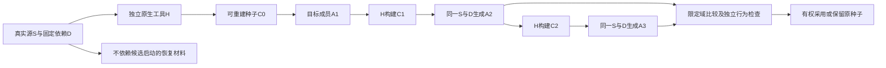

# 确定性与自举

## 确定性与可复现编译

### 定义

确定性指同一规范输入和算法 revision 产生相同规范结果；可复现指在独立环境中能重新构造相同结果和来源。

<a id="determinism-observation-contracts"></a>
### 确定性的观察层次

“确定性”按 Claim 分为**产物字节可重复、运行轨迹/错误可观察等价、浮点容差、随机分布及研究结论可复核**，不能相互代替。所用输入和环境、容差或等价关系须由[性质保持与开放环境](../../30-实现解析/性质保持与开放环境.md)等对应 Owner 明确规定；两次同摘要或同统计分布不足以证明全语义一致。

Canonicalization 先按锁定语言识别**可交换的表示自由**：Map 可按声明的键序规范化，具有执行顺序的语句、事件或文档序列不得随意重排。整数宽度/溢出、舍入、NaN、±0、Unicode 与路径大小写按各自 Profile 保持；诊断摘要或对象Hash不替代原始输入的语义等价证明。

并行数值归约与随机流分配按所承诺的轨迹/数值/分布分别检验。实验、实体、用途固定逻辑随机流，不随线程领取顺序重复；密码密钥与真实令牌使用独立安全随机供给，不能为复现挪用固定模拟种子。

[可重建构建的定义](../../../research/sources/全域组合与仿真依据.md#reproducible-buildsdefinitions)只支持约定源码、环境和指令下指定产物的一致性。作者/发行者身份、恶意工具链防护与语义安全各需自己的依据；缓存和双构建结果不携带永久当前权限。

### 非确定性来源

- 文件枚举顺序；
- 哈希表遍历；
- 并发完成顺序；
- 当前时间和时区；
- 随机数；
- 绝对路径；
- 临时目录；
- 未锁定依赖；
- 编译器和系统库；
- locale 和编码；
- 网络返回顺序；
- Provider 漂移；
- AI 采样；
- 未声明环境变量。

所有来源必须消除、固定或显式进入输入和结果边界。

### 规范编码

IR 和回执的规范编码定义字段顺序、集合排序、数值、Unicode、时间、未知字段和扩展命名空间。摘要只基于规范字节。

### 并发确定性

并行任务以稳定键归并输出，不按完成时间排序。诊断、关系、候选和制品清单使用规范排序。若算法本质依赖随机搜索，输入包含 seed，并记录搜索覆盖。

### 环境封闭

编译动作声明：

```text
ToolchainRef
TargetProfile
EnvironmentProfile
AllowedEnvironmentInputs
DependencyGeneration
LocalePolicy
```

未声明环境读取由沙箱或监控拒绝。

### AI 和统计组件

非确定模型输出不能直接成为 frozen IR。处理方式：

1. 保存模型 revision、参数、上下文和原始输出；
2. 解析为候选；
3. 通过确定性 Schema、约束和验证；
4. 有权选择后形成独立 Decision；
5. 冻结的是候选内容，不是“重新调用模型”的过程。

### 可重现构建

构建输入包括源码、依赖、工具链、生成器、构建配置和目标画像。构建输出去除本机时间和路径，生成 SBOM、来源证明和摘要。

### 双构建

关键制品在独立环境执行两次或多实现编译：

```text
Build A digest
== Build B digest
```

若目标格式存在允许差异，比较规范化语义并记录差异规则。

### 不可复现处理

返回：

```text
ReproducibilityFailure = {
  differingArtifacts,
  differingInputs,
  suspectedHiddenInputs,
  environmentDifferences,
  diagnosticPlan
}
```

不可复现制品不能获得高成熟度发布资格。

### 时间

生成时间等运行元数据放入与制品内容分离的签名清单。需要时间语义的业务数据显式作为输入，不读取墙钟。

### 验收

- 冷缓存重复编译摘要一致；
- 串行/并行一致；
- 不同工作目录一致；
- 不同时区和 locale 一致；
- 依赖来源和工具链固定；
- AI 候选冻结后可重放；
- 双构建差异可解释；
- 规范编码黄金向量；
- 旧编译回执可在声明支持期验证。

## 确定性生成范围与剩余实现

### 生成目标

目标是减少必须独立维护的工程事实与重复工作，不是最大化代码行。成熟库能承担的语义应优先通过明确能力和版本绑定复用；独特逻辑需要由AI、人或已验证合成规则提供。不能以生成大量接口、默认成功实现或复制库源码提高虚假的生成比例。

### 可派生制品与前置决定

| 工程输入 | 可生成内容 | 生成前必须明确 |
|---|---|---|
| 类型/数据模型 | 目标类型、序列化、校验和模式 | 数值/空值/编码、键、兼容 |
| 行为/规则表 | 分支、组合、计算与错误路径 | 完整条件、冲突优先序、副作用 |
| 状态机 | 状态处理和合法转换 | 入口、终态、非法转换、并发 |
| 操作/API | 服务和客户端接线、协议描述 | 输入输出、授权、错误、版本 |
| 持久模型 | DDL、查询、映射与迁移候选 | 隔离、索引、保留和数据演进 |
| 并发/事务 | CAS、事务、幂等、outbox等接线 | 线性化点、重复语义和存储能力 |
| 目标/依赖 | 包、构建和部署制品 | 精确绑定、支持平台和供应链 |
| 验收/不变量 | 测试义务、夹具候选与追踪 | 独立Oracle与证明范围 |

自动派生只有规则闭合时成立。领域知识可以由库承载；作者不必逐个手写底层IR。没有规则时允许受治理实现，不允许推断一个未经采纳的业务政策。

### 三类实现和一个缺口状态

`DeterministicGenerated`由固定输入与规则重建，修改上游；`GovernedAuthored`由人/AI创作并保存原字节，在自由度与合同内验证；`OpaqueExternal`通过外部Provider接口绑定并记录未知边界。`RequiredUnbound`是尚无实现的义务，不是第四种默认可执行实现。

导入旧工程不会因为源代码可读就变成确定性生成区。将手写区收编为生成区需要差分、来源对应和变更权转移；反向转为手写区也必须停止生成器写入该区域。每个生效区域只有一个可裁决的当前**语义写权归属和采纳协议**：生成器和受管原生作者的来源角色不能并行竞争，协作编辑者可以提交独立候选，但需按准确前像和原区域合并条件裁决后才正式生效。

### 生成规则合同

规则具有ID/revision、适用语义、目标能力、显式输入、输出路径函数、所有权、规范化规则、诊断、复杂度限制和验证义务。输出碰撞包含同路径、父子路径、大小写/Unicode等价和目标平台保留名。跨规则顺序必须由数据/效果依赖决定，不依赖插件加载顺序。

所有制品先形成desired manifest：创建、修改、保留和退役集合。删除只作用于已证明归属的旧生成物；手写/外部/未知文件不因新manifest缺项就删除。生成到新目录也必须拒绝覆盖既有外部内容。

### 目标闭合

原生目标要求所选必需闭包全部由目标语言、明确运行库或目标本地能力承载。混合目标必须列出原运行时/FFI/服务桥；部分目标列出已生成产物与阻断项；失败返回具体缺口。固定算法、类型和行为的语义保持规则与业务意图推断是不同证据。

### 迭代与增量

新字段可能影响DTO、DDL、序列化、查询、API和测试；它应由同一上游事实生成多个投影，不由AI分别编辑。每个规则记录真实正负依赖与目标配置；在精确依赖证明范围内只失效受影响规则；健全过近似允许保守多失效，规则见[可达输入闭包与负依赖](../../30-实现解析/增量与性能/依赖与失效模型.md#可达输入声明依赖证据与负依赖)。一个全局发布generation变化不自动改变所有ActionKey，但真正共有的算法、模式或信任变更可以扩大影响。

### 验证与反例

改变同一输入得到同一输出；加入无关实体不应无故改变已知独立结果；字段单位变化必须传播；生成器故障不能由同一生成器产生的期望值掩盖；未绑定业务操作不能生成空成功；桥接输出不标原生；删除生成器后手写资产仍存在；库升级改变事务语义时须重做资格与验证。

## 编译器自举、可信根与版本演进

本节给出实际可实施的种子、版本和阶段关系。采用时点见[实施自举路线](../../70-工程系统与演进/演进与实施/实施/仓库迁移与自托管.md#自托管逐步接管与旧机制清零)，可信性检查见[验证自举](../../60-保证与证据/验收/方法与独立证据-独立性可信基础与求解.md#可信计算基自举与候选自证防护)。本包没有种子二进制、编译器实现或自举运行记录。

### 冻结输入和最小种子

令S为本次Gift自身的真实源集合：结构工程定义、当前采用的原生源（TS／Rust等以准确源集合为准）及构建配置，及仅在明确选择时存在的中立计算源；H为固定的目标编译/运行工具链；D为库、语言定义、目标与宿主依赖。先用可独立取得的原生源及H按非循环构建方法建立被本次接受的种子C0，不要求H先调用尚未构建的Gift。S的每个来源必须能被C0直接处理或经已固定的合格原生供给路径处理，不将可选计算前端变成启动前置。源输入、C0、H、D、构建参数和实际允许的环境全部分别有身份，不只记版本字符串。

读取S只形成输入；编译期执行、有作用脚本和目标运行仍按原阶段准入。自举不能将“为了编译自己”变成所有权限的豁免。种子可以仍由TS实现，中立公共类型不因此依赖ts.Type。

### 正常阶段

1. 用C0对同一S、D和所选目标生成目标树A1，再由H构建可运行的C1。
2. 用C1对同一S、D生成A2，再由同一H构建C2。
3. 有条件的固定点检查使用C2再生成A3。比较A2与A3的声明域，并比较C1/C2在独立输入语料上的结果、诊断和边界。
4. 差异按作者语义、目标表示、环境非确定、生产者元数据或实现错误分类。只有事先明确不属于比较语义的路径/时间字段可以规范化；不能删除错误诊断、检查、代码顺序或其他真实内容来凑一致。
5. 通过对应检查后，在独立已接受流程下采用新编译器；失败保留C0/旧接受绑定与可重建输入，停止相交晋级。

这是源到源路线，所以每阶段包含真实目标工具链H；“生成自身所选目标的.ts或.rs等源码”与“已取得可运行编译器”分别处理。运行的编译器与它生成的源码目标也分开，交叉目标不要求在不能运行的设备上完成本机自举。

### 固定点与正确性不是同一证明

A2=A3可以发现一些阶段漂移，不能排除两个版本共享的错误、种子污染或规范错误。还应比较旧/新输入与旧/新检查器，并对数值、类型、作用域、错误、效果、opaque与包链接使用独立期望、性质、差分或受支持的证明。检查对象、输入范围和独立来源分别记录，不把来自同一错误生成器的两份结果算成两个证据。

旧编译器不支持新语法时，旧×新那一格预期是准确拒绝或经明确迁移后的输入，不是要求旧工具一定支持未来语言。修改验收期望要列明规范差异并独立接受，不能借自举自动更新答案。

GCC的三阶段构建比较stage2/stage3；Rust也区分种子和后继编译器及库的阶段。这些方法说明如何组织自举，不证明任意相同结果没有后门，也不要求每次普通修改都跑完整阶段。

### 新语义和目标工具的引导

S若需要新语法X而C0不支持，先在C0支持的子集内实现处理X的Cbridge，或由明确的外部受信路径构建新种子，然后使Cbridge处理S。Cbridge本身不能依赖尚未能构建的X。所需标准库也按同一依赖图分阶段；不存在库API时准确停止对应模块，不以预编译黑箱假称完整中立自举。

库版本、ABI、对象布局及目标运行库的组合需要实际一致。C1使用旧阶段运行库而C2使用新布局时，不能直接混用动态对象。目标私有接口跨编译器阶段需要显式桥接或同阶段重建；中立抽象类型的稳定名称不取消这条要求。

### 可信边界与当前操作

候选编译器可以自测、用自己的类型检查器检查程序，也可以作为被测对象参与四组合；这不等于候选有权认证自己、修改接受政策或删旧失败。最终的比较执行、证据归属与采用权限必须有当前接受的独立依据。

本次启动的操作固定实际C、S、H和D。即使新编译器已被采用，正在执行的旧操作仍按原输入结算；新请求才使用新绑定。恢复必须读取原可信意图，而不是用新编译器重新解释旧失败并覆写历史。安全事件限制新执行，不能抹掉已发生的外部作用。

### 失败分支和保留资产

种子不可取得：回到可重建种子和完整内容获取，不将候选当成自己唯一来源。阶段崩溃/超预算：保留阶段结果与输入，不晋级，也不声称语言无解。确定性比较不符：隔离差异，检查隐藏输入和规则；原接受路线仍合格时继续使用。新编译器不能读取旧恢复格式：保留合格旧读取器或先提供明确迁移。原种子被证实不可信：不能盲目回退，按信任恢复方案建立新的独立基础。

保留资产包括必要的种子来源、目标工具链与库、源码快照、版本映射、比较规则、独立语料和恢复说明。摘要不能代替内容；无需保存可廉价重建且无独立义务的所有临时树。设计文件描述这些资产，不因此在当前设计ZIP塞入一套实现和测试仓库。

### 验收对象

必须分别观察：种子能构建当前支持子集；同源自生成能形成可运行编译器；普通后继任务继续成立；新增语法引导无循环；旧/新库和目标ABI不会混用；自举未扩大权限；失败后仍有可信可用路径。完整自宿主是后续目标，不取代第一条产品链，也不被永久从产品路线删除。

### 原始机制参照

[GCC构建说明](https://gcc.gnu.org/install/build.html)给出原生三阶段及stage2/stage3比较和交叉编译限制；[Rust编译器自举说明](https://rustc-dev-guide.rust-lang.org/building/bootstrapping/what-bootstrapping-does.html)区分种子、后继编译器和标准库，并说明跨阶段ABI问题。这里只借鉴阶段与依赖关系，不将其当前具体版本、环境或通过结果移植给Gift。

<a id="bootstrap-claim-boundary"></a>
## 自举声明、阶段资产与外部恢复入口

自举继续使用S、C0、H、D与原阶段产物，不增加另一份Bootstrap状态数据库。为每阶段保留实际输入闭包、原生委托、生成成员与构建命令的来源；命令参数由既有构建合同拥有，不从文件后缀猜测。必须能从种子源和已接受工具取得C0，再按阶段形成C1/C2，不能只有一份候选生成的二进制可下载。

原生TS经H构建是合格成熟供给；它证明了该范围的工程重建，不独自证明Gift已实现TS前端的全部语义或独立机器码生成。若A2/A3只是同一份原生文件的透传，字节相等主要检查转交保全，不能冒称新增编译语义的固定点证明。自用报告分别说明由Gift读取/分析/选择/生成/编排的部分、原生委托和实际消费者；完整自宿主不要求放弃H，完整自编译也不由透传计数代签。

阶段恢复只复用身份、工具和输入仍一致的完整结果；部分输出先隔离，失败不晋级。规则/库/ABI变化从首次受影响阶段重新构建，正在运行的旧阶段保持原依赖。采用新控制器前，至少保留不依赖该候选正常启动的可信恢复入口，能够读取原操作格式、核当前权限并查回外部作用；它不能依靠新候选给自己批准或重写唯一Oracle。

旧种子退出要同时满足实际消费者已迁移、在途及格式读取责任结算、剩余受支持版本可重建，及合格替代恢复路径确实可取得。保留源和摘要但丢失唯一工具、依赖或解码器，不算可恢复；受信前提被反证时也不盲目回退旧种子。固定点、行为符合性、可重建性和采用权分别判断。GCC阶段比较只作组织参照，不证明这里的Gift产品已自举。

<a id="bootstrap-stage-flow"></a>



后续阶段仍实际读取同一S、D与构建配置；箭头不是丢掉这些输入。原生委托与源码透传分别报告，比较成功不自动产生生产采用权。

<a id="versioned-canonical-encoding-compatibility"></a>
## 身份编码的跨实现保持与展开预算

内部容器、实现语言和编码库可以替换，但已采用身份profile的前像语义不能随之漂移。编码profile固定数字、键序、文本、缺失值、共享/重复出现、分帧及域分离；不是看到名称含JSON就采用另一套规范。JCS或其他标准可作为明确的新profile，不能冒充历史字节兼容。

跨实现见证至少包括整数索引形态的键（如2与10）、UTF-16码元和Unicode标量/UTF-8字节顺序不同的键、-0、稀疏数组、对象字段缺失与null、组合字符及孤立代理项。原profile若将-0编码为0，只能用于无需相应位模式或倒数符号区别的消费者；不因此改变整个数值语义。历史域允许代理码元时，UTF-8宿主不能替换为U+FFFD后宣称同身份，需有限兼容表示或显式迁移。普通Text继续使用自己合法域，不被兼容载体扩大。

无递归栈、分块写出与整个编码过程有界是三个独立保证。令v0=0、vd=[v(d−1),v(d−1)]，源图只有d个唯一数组，树形JSON却有2^d−1次数组出现，此例输出为4×2^d−3字节。若先完全展开再分块哈希，分块不能限制前面的临时分配。输入拥有者与编码器需在分配/展开之前检查适用的节点出现、输出字节、工作和保留内存预算；只数唯一对象或只在最终输出检查不够。

源格式本来是树就保持树语义，不能暗加引用节点改变旧身份；源格式确实保存图身份时另用已有相应profile。流式遍历只在固定且可合法读取的输入上采用，并保持访问次数、访问器处理、错误与捕获前提。哈希结果正确不证明处理过程没有超预算；编码失败不发布半个正式身份。

<a id="bootstrap-levels"></a>
## 自用、自生成、自构建与语义自举必须分级声明

“Gift已自举”不是一个布尔值。为了避免把Rust包能够生成若干源码、能够构建自己或真正由自己解释自己混为一谈，采用以下四类分项声明；编号用于定位，不构成必须逐级发生的总成熟度。BOOT0是实际消费关系，BOOT1是生成范围，BOOT2是构建范围，BOOT3是后继解释与自举闭环，各自要求准确对象和证据。

| 级别 | 成立条件 | 不证明什么 |
|---|---|---|
| **BOOT0 自用 Self-use** | Gift 的正式工程开发真实消费Gift产生的只读分析、导航、代码/配置候选或其他非权威产物，并有独立readback | 不证明产物由Gift完整生成，也不证明可构建Gift |
| **BOOT1 自生成 Self-generation** | 对冻结Gift作者源，compiler-kernel/目标backend能够生成一个声明范围内的Gift自身目标源码/配置/成员，重复输入可重建且来源可追踪 | 不证明生成结果能构建、运行或覆盖全部源码 |
| **BOOT2 自构建 Self-build** | BOOT1或受控原生源集合加固定外部工具链H能够形成可运行Gift compiler/runtime，并通过准确启动/基本任务readback | 不证明新编译器能再次处理自己，也不证明语义正确 |
| **BOOT3 语义自举 Semantic bootstrap** | 可运行后继编译器使用当前正式Semantic/Requirement/Target合同处理同一支持范围，完成多阶段生成/构建、独立行为比较、fixed-point适用比较和可信恢复 | 不证明规范本身无错误、所有目标/领域已支持或无需外部工具链 |

BOOT1可以先在未采用候选中验证，不能由此宣布BOOT0正式消费；BOOT2也可以直接经原生源与固定H成立，不能倒推出BOOT1已生成该源码。BOOT3须指明由Gift真实解释、变换和生成的支持范围；透传原生源只支持其保全／编排范围，不按同一字节比较增大语义覆盖。

完整“自托管”可按产品需要进一步区分是否仍依赖rustc/linker/OS等成熟工具；Gift没有必要为了宣称自举而重写这些工具。Rust compiler-kernel最终由Rust源码构建，仍可合法依赖固定rustc/Cargo作为H；“完全自编译”只有在Gift自身承担相应源语言编译责任时才成立，当前路线不以重写rustc为目标。

### Rust迁移与自举的接合

TS→Rust compiler-kernel迁移的MIG0—MIG5与BOOT0—BOOT3正交：MIG3表示某一compiler capability的生产owner已切到Rust；BOOT1表示Gift开始用这套能力生成自己的某一范围；BOOT2表示这些结果实际参与形成可运行Gift；BOOT3才要求后继编译器重新处理同一支持范围。不能用“Rust实现已比TS快”跳过B阶段，也不能为了BOOT1先把尚未取得MIG3资格的shadow实现当生产writer。隔离验证可以使用该候选做BOOT1范围的自生成实验，其输出和证据仍是验证候选，不能推进生产Binding；这样不把生产切换门禁错误地倒灌成设计或候选试验的前置。

新增Rust内核能力若从第一天就是唯一生产owner，可以直接进入BOOT1使用，但其Oracle、恢复和工具链资格仍须独立存在。自举失败不能自动回写作者Requirement、降低目标或让当前候选给自己授权；回退只沿已验证种子／release和原ImplementationBinding执行。

<a id="prebootstrap-semantic-selfhost"></a>
## 语言自举的实际职责、阶段算法与可信边界

### 工程自用、语言自举和可信自举不得合并

工程自用是 Gift 管理并重建其真实工程，允许全部由原生 Rust/TS 供给；这是有用的产品能力，但不证明 Gift 的通用计算承载了编译器。语言自举要求实际的解析、绑定、类型/效果、契约/方法处理和 lowering 等被声明职责由 Gift 作者定义计算，候选编译器消费这些定义产生下一编译器。可信自举在此之上建立独立来源、语义检查和恢复链；重复构建相同字节不能证明不存在共同错误。

覆盖以责任为单位，逐项列实际作者 Definition、运行入口、生成成员、原生余部及消费者。没有“复制源码占 90% 所以已自举”的比例。只自举类型检查器可以准确声明部分语言自举；解析器或目标后端仍原生要明示。最终全部被声称的编译器语义职责都必须出现在真实 Gift 源与行为中，而原生 OS、成熟目标编译器或密码原语可以继续作为信任依赖存在。

### 单生产内核与生成源所有权

新生产 Kernel 按既定 Rust 路线落地。设计中的 C0 是能由独立工具链从真实原生源构建的种子，不是假定已存在的可执行文件；若现场只剩合格旧 TS 种子，可用于兼容恢复/过渡，但不因此重新建立长期双生产 Kernel。自举后的 Gift 语义实现生成 Rust，与尚未迁移的 Rust 模块在明确 ABI/包接口装配。生成区域只有 Gift 作者源可写，不能人工修一份生成 Rust 并继续声称双源自动同步。

### 精确阶段输入与算法

冻结 `S`（编译器实际作者源及必要标准库源）、`D`（锁定依赖与语义/方法供应）、`H`（本机目标构建工具及运行库）、`P`（build/host/target、代码生成选项、环境与比较范围）。`H` 是调用真实 Rust 或其他已选择原生工具链的受权构建方法，不是 Gift 自造机器码的承诺。构建器启动权限不交给候选编译器。

1. 独立准备并核验 C0 的真实来源、摘要、运行条件和可恢复安装；必要标准库/运行 ABI 与编译器阶段成对固定。未取得 C0 返回环境缺口，不从文件名推断其资格。
2. 运行 `A1 = emit(C0,S,D,P)`，由固定 H 将 A1 构建为 C1。C0/C1 的标准库和接口不能凭名称混用。输入不含 C1 才能生成的未知语法。
3. 运行 `A2 = emit(C1,S,D,P)`，H 构建 C2；再运行 `A3 = emit(C2,S,D,P)`，H 构建 C3。每步有分离的只读输入与独占输出目录，禁止从上一输出目录隐式拾取依赖。
4. 比较 A2/A3 的完整受管成员集合、相对路径及规范输出字节；二进制可复现主张另比较在同一 H/P 下 C2/C3 的相应字节。生成源相同而原生二进制不同应定位工具链/时间/随机/路径/链接差异，不直接称 Gift 语义失败或已通过二进制固定点。
5. 独立行为集比较 C0/C1/C2 的接受/拒绝、诊断类别、求值/效果轨迹、目标行为和二次修改；旧 C0 不支持的扩展只能与匹配的独立语义参照比较，不能把旧拒绝当新实现错误。
6. 只有对应主张的比较通过并完成恢复演练，才采用 C2/C3 中预先规定的发行产物；签名/发布由外部有权主体完成。验证器、比较白名单和 Gate 不得由候选编译器在本次执行中改写。

固定点比较默认不进行未知差异的归一化。若时间戳、调试路径或签名必须排除，排除字段必须在运行前由比较规范精确指定，且不得影响声明的程序行为；保留原始差异。一般程序行为相等不通过“反复运行没差”证明。跨机器只能在 P 明确承诺的平台/工具链等价条件下比较，不默认所有机器二进制相同。

### 新规则引导和混合阶段

设旧编译器认识能力集 B，新编译器源需要 B 加扩展 X。先用 B 写出识别/解释 X 的过渡实现，并用 B 可表达的测试输入或原始字节检验；得到 Cbridge 后才把普通作者源迁为 X。扩展 Schema 的生成器也必须被旧消费者理解，不能在构建时先信任 X 产生的验证器再验证 X。必要桥接源/生成表可随准确来源固定，生成物是暂时引导供给，不是第二份作者权威；取得可重建替代后才退役。

跨目标自举固定三个平台：构建执行的 build、编译器本体运行的 host、其输出运行的 target。不能在 build 上直接运行一个只面向另一 host 的 C1。交叉运行需要已准入的模拟器/远程执行方法、输入披露授权和相应证据；没有这些条件只得到交叉构建产物，不得到实际自举执行记录。

### 独立信任与恢复算法

种子可信、语义正确、源码对应二进制、工具链来源真实、可复现、发行授权是不同主张。关键规则采用独立小语义解释/数学见证/另一实现的结果，不把同一生成器吐出的预期值当独立 oracle。多样化双编译可以用于源码—二进制对应性，但前提是替代编译链正确支持所用源语义、输入环境受控且比较方法有效；不能据此证明源码无恶意或业务规范正确。

失败时冻结证据并停止采用，保留既有可用编译器、准确输入和失败输出；不删除当前用户源或自动回滚世界状态。恢复读取器与恢复构建链必须可在候选 C1/C2 无法启动时运行。若失败来自种子/供应被确认污染，不能盲目回退同一污染种子，应改走独立来源的恢复路径并撤销相交信任。历史数据格式迁移与真实操作结算另按原存储/Effect 合同，不由重建编译器撤销。

<a id="design-b28"></a>
## 自举信任链与固定点范围

自举冻结C0、作者S、供应D、原生工具/标准库H与build-host-target及选项环境P；每个对象取得真实摘要和来源，而不是用一个“编译器版本号”替代全依赖。A09所选职责的原生余部明确列出，源码透传不计语言自举覆盖。编译器对其本身输入的处理不能改变外部独立挑战、比较器或发行权限。

按C0编译S得A1并构建C1，C1→A2/C2，C2→A3/C3；A2/A3比较完整目标源码及成员集合，C2/C3再比较所声明的二进制范围。必要标准库、链接器、宏/构建脚本和路径/时间等环境进入差异归因。不能为了得到字节一致删除有语义作用的字段；允许忽略的非语义元数据必须事先定义并保留原制品。

固定点说明该构建链的稳定性，不证明源算法无错或无恶意。独立语义测试、负例、不同实现/工具来源和需要时的多样化双编译分别检验不同信任假设；共享同一checker/同一错误算法的两个包装不是独立来源。发布由外部已授主体依据精确证据执行，候选编译器无权给自己签发生产资格。

污染恢复从只读保留的种子、源和工具链重建；疑似泄露签名/编译供应需要撤销及重新发行，不能仅清cache。新能力bridge按旧语言可编域先构建，再迁移源；未知种子/宿主版本准确保持缺项，不伪造C0已存在。

**验证与反例**：源码固定点与二进制不一致、共同错误、候选修改比较器、旧种子不支持新语法、丢失标准库、污染后恢复与外部发布权限分开验收。

**实际能力边界**：没有实际C0—C3、可信种子和多样化双编译记录；本次不宣称完成语言自举。

相交合同：[首个自举职责的实际选取与种子接入](../../70-工程系统与演进/演进与实施/实施/仓库迁移与自托管.md#design-a09)；[首个标准库与自举计算闭包](../../70-工程系统与演进/实现与装配/源码分区与机器合同.md#design-a10)；[阶段计算与新语言能力的引导](阶段求值与反射生成.md#design-b12)；[迁移兼容的五个独立方向](../../50-执行运行与观测/持久化与恢复/迁移备份与权威恢复.md#design-b27)；[依赖、插件、构建与发行的四重权限](../../70-工程系统与演进/演进与实施/实施/安全构建发布与环境.md#design-b32)。

<a id="design-b38"></a>
## 协议字节、标准与迁移方向

每个SourceProfile单独固定词法、语义值、规范字节与摘要域。作者原字节、规范表示和语义对象不是同一摘要；字段排序/排版变化可以保持语义却改变原源身份。JCS只能用于明确选择且满足其数字/字符串要求的Profile，普通json.dumps(sort_keys)不能冒称JCS；旧精确Int数值词法不能先经binary64再做canonicalize。

严格JSON解码先检查重复键和合法字符串/数值词法；未知schema版本保留源并拒绝解释，不用最相近历史版本猜。Requirement有限literal仅接纳整数词元，故`1`合法而`1.0`、`1e0`不在其形式；其它typed/profile可有自己的精确词法，JSON Schema数学integer判断不能改源语法。控制分片、工具协议、作者定义和目标manifest各自版本协商，某一层升级不默认其它层升级。

迁移保存旧来源、精确前像及语义比较范围；只有已证明含义不变的转换才能标等价，新增选择/错误/观察域需明确采纳。新规范只修当前设计，历史fixture按其原版本读，不重写样本抹去过去限制。旧锁缺实际解释映像时返回供给缺项而不是自动联网取最新。

**验证与反例**：大整数、负零、非法代理项、重复键、同短版本不同内容、工具兼容但source不兼容及老Profile重放。

**实际能力边界**：完整JCS实现与跨语言codec兼容发行未由本次声称完成。

相交合同：[控制分片与项目第二版的设计定案](../../20-语义与组合/组合/稀疏控制与目标限定.md#design-a02)；[Rule、Method、Target 的唯一机器结构来源](../../70-工程系统与演进/实现与装配/源码分区与机器合同.md#design-a04)；[Requirement 八构造编码与解释冻结](../../10-作者与输入/作者源/结构化源码.md#design-a07)；[身份与变更事件的精确传播](../../10-作者与输入/作者源/工程源/工程清单模块与绑定锁协议.md#design-b03)。

<a id="本责任的相交定案"></a>

**关联规范：**[首个自举职责的实际选取与种子接入](../../70-工程系统与演进/演进与实施/实施/仓库迁移与自托管.md#design-a09)；[阶段计算与新语言能力的引导](阶段求值与反射生成.md#design-b12)；[C0—C3 实物和部分自举声明](../../90-治理与参考/状态/实施闭包.md#design-i13)。

<a id="stage-build-adapter-implementation"></a>
## 自举阶段的具体运行适配

阶段输入、build/host/target、成员集合比较及固定归一化规则由施工设计明确。历史仓库观察不是本轮现状，实际C0和阶段二进制仍缺实物。

实际数据、调用顺序和失败处理见[相应施工设计](../../70-工程系统与演进/工程构造手册/12-自举与真实仓库替换.md#bootstrap-source-and-stage-adapters)。
