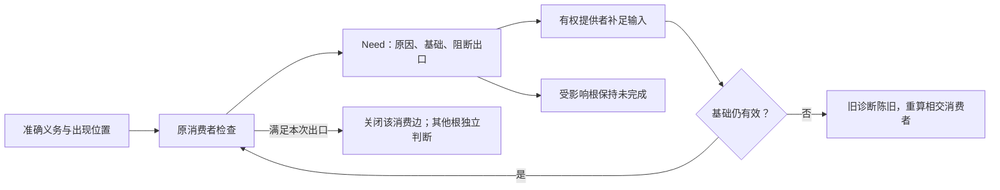

# 诊断与追踪

## 诊断、解释与决策追踪

### 目标

工程编译器必须解释“为什么得到这个设计、实现和变更”，而不仅输出结果。对重要结论还必须能够定位为什么成立或未成立、谁作出决定、实际读取了什么、淘汰了哪些候选、发生了什么现实作用及仍有哪些未知。解释本身是从规范图、求解回执和来源生成的投影，不是人工拼接日志。

### 解释图

```text
ExplainGraph = exact {
  question, answer,
  nodes: ExplainNode[],
  edges: ExplainEdge[],
  supportingFactRefs, constraintRefs, decisionRefs,
  rejectedAlternativeRefs, evidenceRefs, unknownRefs, counterexampleRefs,
  sourceLocationRefs, disclosureProfileRef
}

ExplainNode =
  Intent | Definition | Observation | Fact | Constraint
  | Candidate | Decision | Binding | Plan | Admission
  | Effect | Readback | Evidence | Verdict | Unknown

ExplainEdge =
  derived-from | rejected-by | selected-because | authorized-by
  | depends-on | invalidated-by | observed-by | supports
  | conflicts-with | replaced-by
```

图节点引用规范对象；自然语言只是 locale 投影。

### 典型问题

系统应回答：

- 为什么这个文件受影响？
- 为什么选择实现/库 A 而不是 B？
- 哪条约束阻止编译？
- 哪个未知导致不能冻结？
- 为什么某缓存失效？
- 为什么需要人工批准？
- 为什么这项验证必须重跑？
- 为什么某项验证是 required、not-applicable 或尚未取得？
- 哪个输入改变会使结论反转？
- 这个生成代码对应哪个意图和设计对象？
- 哪个授权允许了某个 Effect？
- 哪个未知阻断了发布？
- 哪条关系使一次局部变化传播到另一个领域？
- 这个结果如何恢复、反转或前向修复？

### 最小解释与完整性

查询投影覆盖所问结论必需的因果、约束、反例和未知，并在声明的有限模型内尽量减少无关上下文；它不能为了简短删除会改变结论的约束或未知。投影保留真实identity、source、counterfactual与expansion handle。底层事实不会因为查看者不同而改写；披露权限只决定能够返回的投影，必要时连“存在受限证据”本身也必须受披露策略控制。

### 诊断生命周期

诊断绑定：

- 对象 revision；
- 编译阶段；
- 算法 revision；
- 作用域；
- 来源位置；
- 相关诊断；
- 可能修复；
- 陈旧条件。

输入变化后旧诊断进入 `Stale`，不能继续显示为当前错误。

调试对象可以是 compiler pass、query、cache、provider、operation attempt、verification action 或 migration step；每个实例都绑定稳定 reason code、输入闭包摘要与可重现 capsule。自由文本用于解释，不能成为机器决策或生命周期身份。

<a id="need-provenance-and-resumption"></a>
### 未决义务的归因、汇聚与恢复

`NeedsMeaning/Method/Target/Evidence/Authority`等原因沿原Result、Obligation、来源图及诊断记录传播，不另造一套错误协议。每个未决至少能解析到：原义务及出现位置、所选根和实际参数/主体、冻结输入基础、发现它的检查或方法、当前阻断的出口、应补的事实/内容/决定及有权提供者、恢复入口和失效条件。尚未选出Method或生成成员时，其引用可以不存在；不能为使解释图完整伪造Binding或目标路径。



实现选择向降低传递未决时，保留原义务身份并增加真实消费边；降低引入的新辅助、导入或资源义务反向关联生成它的绑定。多个根需要同一外部事实时可以共享一次取得和检查，但各自接受条件、参数与阻断范围保持独立。同一错误码、相同文本或同名Method不足以合并；共同原因消除也不保证所有消费者已通过。

汇聚先按实际义务身份和基础去重，再沿依赖边计算受影响根。保留根与原因的多对多关系；诊断按稳定来源顺序展示，不由并发回报次序决定哪个错误覆盖其余错误。某一根在本次出口闭合时可独立返回，其余根的Needs仍属于原请求；共同发布或共享资源要求整组成立时，不能将独立返回误报为整组完成。

未决消解需要原消费者核对新增输入并重新判断，不能仅由提供者把状态置为done。输入同代且新事实满足原条件时更新该义务；要求、方法或目标已变则先使旧诊断陈旧，再对新基础重算。因缺输入而暂停的确定查询，须取得改变该缺项的输入后再恢复；无新增输入的相同Needs不循环重试。预算停止是另一种状态：允许在获准剩余或新增预算内从已保存前沿继续，即使业务输入未变；续算仍累计已消耗资源，并重核基础，不将每次恢复当作重置总预算。无合法续算预算时返回原前沿，不占用工作槽等待。有限目录无供给、目录读取失败、权限不足、已证矛盾与预算停止各保留原结果，不能因为后端都无法发射而统一成“缺实现”。

反例：两个目标都缺同一库的ABI资料，补齐TS资料只消解TS使用点，不能顺带关闭Rust目标；源码已完整但生产Grant未取得时，诊断阻断运行而不撤销源码。前者检验共享原因与独立消费者，后者消费[按出口分层的资格](../../30-实现解析/实现选择/实现解析与候选资格.md#method-qualification-by-requested-exit)。

### 不满足解释

约束失败以图呈现：

```text
目标
→ Requirement
→ 冲突约束
→ 来源和有权 owner
→ 受影响候选
→ 可放宽项
→ 修复候选和后果
```

不能只输出求解器内部表达式。

### 解析解释

实现选择显示：

- 候选闭包和完整性；
- 硬资格逐项结果；
- 被拒绝原因；
- 成本向量；
- 政策或人工决定；
- 适用范围和失效条件。

### 变更解释

每个物理编辑可追到：

```text
工程意图
→ 目标声明
→ 语义对象
→ 设计 Delta
→ Target 节点
→ MutationOperation
→ 文件范围
```

格式化噪声和语义变更分开显示。

### 隐私与安全

解释不自动暴露：

- 其他租户对象；
- 秘密值；
- 内部安全规则细节；
- Provider 原始敏感错误；
- 模型隐藏上下文；
- 未授权源码片段。

脱敏发生在投影层，原始证据按权限保存。
不同主体可以得到不同披露投影，但底层事实和因果边不因此改写；不得通过错误消息、计数或“存在受限对象”的提示绕过存在性披露策略。

### 多语言

错误码、对象 ID、路径、字段和代码保持不变；标题和说明通过 `messageKey` 派生。翻译必须保留否定、条件、数值和权限模态。

### 可操作修复

`RepairCandidate` 包含精确 Delta、前提、权限、风险和验证。用户选择修复后进入正常意图和变更编译，不能由诊断 UI 直接写文件。

### 验收

- 关键决定有完整解释路径；
- 解释引用真实对象而非复制文本；
- 不满足核心可理解；
- 诊断随输入局部陈旧；
- 源码映射双向可用；
- 敏感信息负向测试；
- 多入口展示同一机器事实；
- 修复候选不绕过准入；
- 解释生成确定且可缓存。
- 输入排列变化不改变解释语义；删除关键因果节点会使 explanation validator 失败；
- 同一 reason code 可以定位多个不同实例，但实例身份、输入闭包和来源不得因 reason code 相同而合并；
- 解释投影与实际 decision/receipt digest 一致。

<a id="gift-unit-a8ead7e795d059e9a6d611f5511a6b2a"></a>
<a id="debug-source-binding"></a>
## 运行调试位置绑定：来源图不是可恢复值的证明

有限调试消费现有SourceMap、来源链和制品成员，不建立另一份作者IR。每次DebugSession固定实际可执行制品、构建/插桩转换和源内容；源文件名只能显示和定位，不能用同路径当前编辑器内容替换该运行的原字节。

源码断点位置先验证sourceRef与byteOffset，再沿准确转换链定位实际目标成员/位置。映射结果分别为准确单点、多个出现、可解释的合成区域、删除/融合后的不可定位或未知。多个出现保留其实际范围，由断点配置说明要处理哪些；缺映射不得按相同行号猜。调试器返回重定位位置时反向标出实际位置与原请求差异，必需精确断点不能自动变为邻近位置。

Gift源坐标、目标打印坐标与底层调试器路径/行列合同分别转换：绑定编码、行尾、基数和具体适配器列单位。UTF-8字节、Unicode标量、UTF-16 code unit并不相同；代理对、组合字符、CRLF和文件首标记都可能改变偏移。转换表从实际字节建立，超范围/落在非法编码中间的请求拒绝，不在错误一列时继续假装精确。

生成后再经打包、缩小或原生编译的制品必须组合实际映射；缺某一阶段的映射时，只提供能证明的边界。代码被内联后可有多调用上下文，局部变量被消掉后可能没有运行位置。即使来源能定位一个变量，也不能从编译常量、旧运行记录或相似名字伪造它本次运行的值。

`PauseRef/FrameRef/ValueRef`是运行观察引用，不是Definition身份、源码节点ID或生成编辑的EditRef。继续后旧帧失效；同一底层编号在新暂停复用不延长其寿命。值需要离开暂停继续查看时，仅保存实际读取到的不可变内容及其覆盖，不能保留一个后来指向新对象的活句柄冒充快照。

调试定位到原生作者，可以沿原生编辑；定位到中立作者，修改原源；定位到合成辅助，使用其实际规则与来源解释，必要时调整有权控制或受管回源。生成A1不热替换正在执行A0的会话；旧源码引用与新的当前编辑器内容分别展示。目标调试、源码导航、保持性逆向编辑是三个独立合同。
