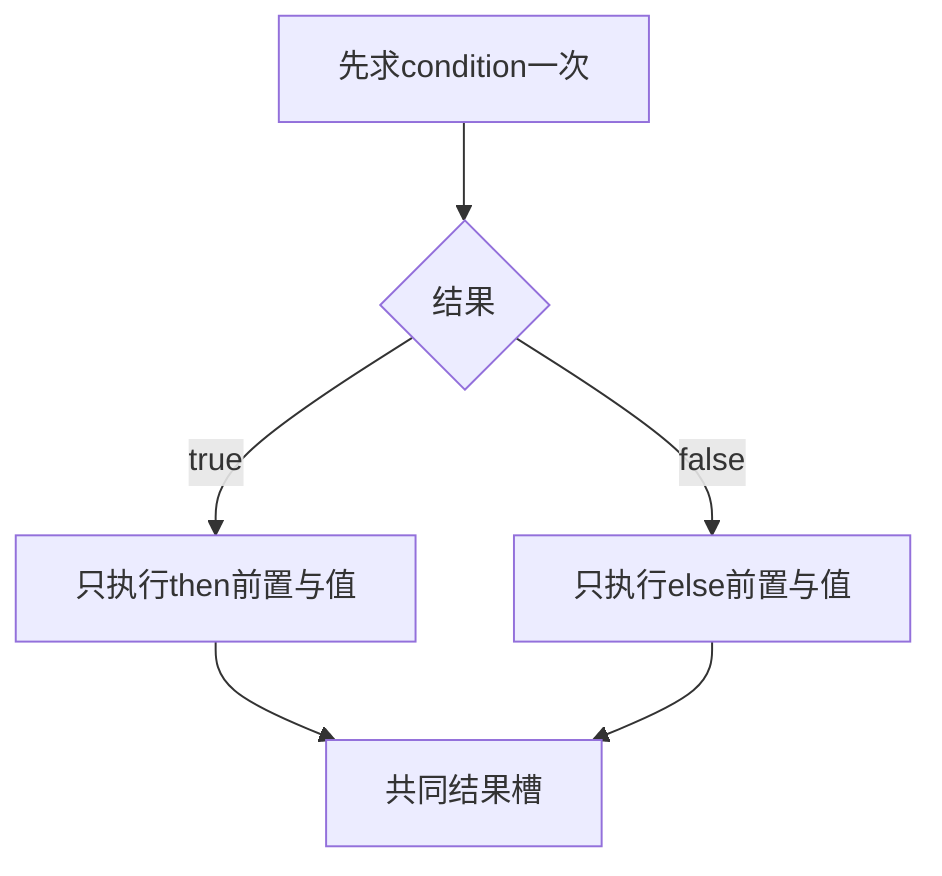
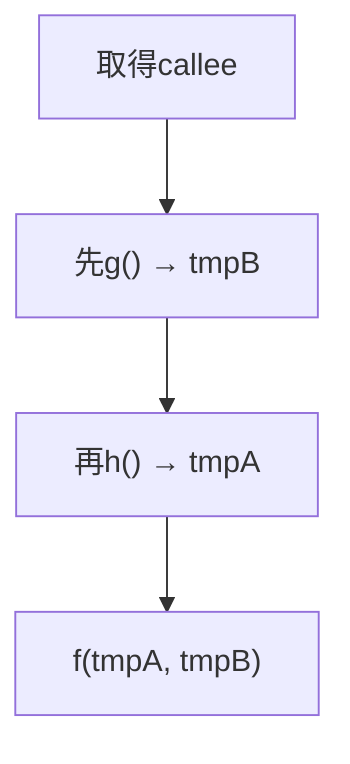
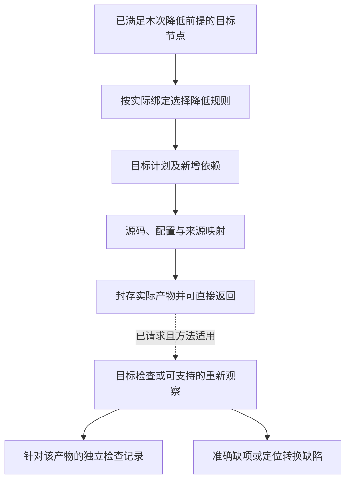

# 降低与源码映射

## 源码编辑合成、保留区与冲突

### 对应不是重新打印全部源码

作者来源、CST/词法trivia、无修改字节保全、精确位置单位和可写子集统一沿用[编辑往返合同](../表示/编辑与受管回源.md#编辑往返的具体合同)。该合同承担人和AI入口的保全与逆向条件，后端不另定一套恢复规则。

### 编辑算法

解析请求中的稳定对象 → 读取指定作者层及基础 → 匹配相同版本的来源关系 → 构造被支持的语义或文本候选 → 检查重叠、引用和名称捕获 → 在候选中执行可用重解析/检查 → 写回前复验前像 → 提交与读回。

采用原字节局部编辑还是重新打印，由前端映射与目标格式合同选择。仅有一对多来源关系时可以追踪，不能凭旧行号反推唯一作者更新。缓冲与磁盘分歧返回`writable-layer-diverged`或明确的三方候选；没有协调，不用缓冲语义覆盖另一磁盘版本。

### 往返合同

可用等级、非目标区域保全、未知内容、坐标换算与版本失效均归共同合同。重复解码/编码不是独立行为证明；跨语言转换通常只有指定观察下的保持关系，不能宣称无损返回所有作者意图。

### 理由与反证

全量重新生成对纯生成项目简单，但对存量工程会破坏风格、人工逻辑和未理解构造。最小编辑更复杂，因此只对需要保留的区域使用，纯生成区域仍可整体再生。

反证为同名节点误匹配、注释丢失、外部修改被覆盖、人工区域被自动删除、两个生成器写同一位置、代码格式化写入未授权文件。检查必须覆盖这些，而不只看最终能否编译。

## 高层保留、分阶段生成与残留程序

编译器按当前Target需要在仍保留足够语义信息的层完成链接、规则验证与优化，满足各步保持条件后再降低。不同粒度的高层定义、普通程序与原生引用可以在同一候选内共存；已注册操作不代表当前Target可降低，未参与本次交付的未知Dialect也不自动使其他独立根失败。

当前默认顺序是：冻结作者与解释 → 解析显式或由政策允许的选择 → 按需展开和类型/效果检查 → 选择可保持的目标实现 → 产生源码或残留的目标调用 → 由成熟目标工具继续检查。这里的层级是处理阶段，不是要求新增常驻服务。

确定性、无可观察副作用且在预算内可安全求值的静态输入允许部分求值或特化；动态输入应保留为运行时参数、条件或循环。预算耗尽时，只有目标能表达残留并保持错误、顺序和效果合同，才可输出合法的未优化形式。业务含义未知、授权缺失或类型非法不是可延后到运行时自动解决的残留。

运行程序可非终止；生成程序本身也可能递归或超预算。不能为了生成而自动运行任意原生初始化、读取网络、取当前时间或调用模型；获准过程生成器的真实输入和工具执行另按宿主合同承担。类型正确的生成代码不等于与未分阶段版本等义，代码移动、重复求值、错误和资源顺序仍遵守本章原保持条件。

已知定义的专门化可以减少目标运行分派，也可能增加构建时间与代码体积。没有已测收益时可以输出普通通用调用，不能为了“零抽象成本”无界复制代码。MetaOCaml的分阶段生成说明高层抽象可用既有编译后端实现；Halide的形式研究也揭示调度保持并非自动成立，二者都不认证Gift实现。来源归[机制依据](../../../research/sources/语言编译与目标工具.md#语言编译与目标工具)。

同一实现记录作者定义与局部选择的来源；用于诊断的展开轨迹可以按需生成，不要求永久保存全部中间代码。打开一层与最终后端降低不是一回事，已优化合并掉来源的目标片段不能无条件逆向写回作者源。

## 降低规则、后端与源码映射

<a id="fig-evaluation-regions"></a>

### 图解：分支和具名实参的降低边界

本图显示分支激活，下一图单独说明参数映射；参数最终位置不能决定其求值次序。正常源程序可能失败或不终止，降低不得删掉该区别。



### 图解：源码实参顺序与形参槽映射

本图只说明 `f(b:g(), a:h())` 的求值顺序，不与上图形成先后关系；若g出错，h不执行。



### 降低的职责

降低把高层 IR 中已决定的语义转换为目标画像可表达的结构。每条规则必须说明前置、输出、语义保持、失败和来源映射。

```ts
interface LoweringRule<I, O> {
  readonly ruleId: string;
  readonly revision: string;
  readonly sourcePattern: Pattern<I>;
  readonly targetCapability: CapabilityConstraint;
  readonly preservationClaims: readonly ClaimRef[];
  lower(input: I, context: LoweringContext): LoweringOutcome<O>;
}
```

### 语义保持的观察范围与优化前提

每条降低先确定源与目标共享的观察域：输入值与类型边界、正常结果、业务失败、异常/陷阱、外部动作及因果顺序、终止/发散与所承诺进展。明确不观察的内部名字、临时布局和调度可变化；若目标任务要求时限、内存、反射或精确数值，这些不能再被排除为“实现细节”。

顺序确定程序通常要求指定输入域内的结果与可观察轨迹保持。具有非确定性的程序可能允许目标从原合法轨迹中作精化选择，但只有所采用合同允许精化且保持必需的进展/公平条件时才成立。允许轨迹没有增加，不足以证明没有引入死锁或无限等待；也不能只比成功返回值而忽略目标多了一条失败路径。公开声明写明采用等价、精化、误差包络还是有权接受的改变，不把四者统称完全等价。

优化器不要求为任意程序求解语义等价；它采用小型、带前提的规则与相应分析。不能确认某项规则前提时，保留原计算或选择更保守路线，仍可生成。确需改变已接受含义时返回新的设计选择，而不是在后端悄悄降级。

| 拟作变化 | 必需前提与反例 |
|---|---|
| 删除未使用调用 | 不能丢失可观察效果、陷阱、异常、非终止或约定释放；`spin(); return 1`中的spin无写入也不能直接删除 |
| 提前/推测执行 | 新路径上也必须合法并保持相关观察；将条件内的除法提到条件之前，可能在原本不除法的输入上除零 |
| 公共子表达式合并 | 输入及可观察读取相同、重复结果可替换、身份/分配/错误/时序不变；读取时钟两次不能只因函数无写入合并 |
| 内联、宏展开与融合 | 求值次数和顺序、短路、捕获、资源释放保持；`twice(send())`不能由值传参变两次发送 |
| 代数改写 | 按数值类型检查溢出、舍入、NaN与正负零；浮点加法不能默认结合，`x*0`也不授权删掉计算x的异常 |
| 循环和并行重排 | 冲突/别名/控制依赖、异常优先关系、同步与进展符合；可交换数学运算不等于外部写入可交换 |
| 类型/包装擦除 | 仅擦除无需运行观察的表示；精化检查、反射tag、防伪身份和释放责任不能被静态类型名遮掉 |
| 分配消除或栈化 | 逃逸、资源身份、生命周期和所承诺的资源失败语义保持；降低资源用量也不得破坏明确的上界/生命周期合同 |
| 浮点容差或近似实现 | 误差模型、输入范围和组合后误差有依据；有权采用的近似是明确语义选择，不是优化器发明epsilon |

无外部写入只是部分效果信息。借鉴MLIR时须同时考虑副作用、可推测性与非局部控制流的范围，不能把其接口名字当成Gift完整错误/资源证明。声明来自未受信插件时，必须由所需资格或保守边界约束；插件自称pure不使任意调用可删除。

语义规则、前置分析和目标运行库各自有版本和依赖，结果记录实际选择与保证义务。规则组合不能仅拼接“每条有Claim”的文字：前一条的后置必须满足下一条的前置，误差和效果保持在接合处重新计算，多个正确局部适配也可能在别名/取消/未知数据上不相容。

反例审查采用明确源/目标行为、初态与观察，不等同已运行。后续实现可用受限形式证明、独立解释、变形关系、目标验证和差分组合；同一前端往返一致只能证明它没有发现不一致，不能单独认证业务符合性。

<a id="control-lifetime-lowering"></a>
### 控制与寿命降低的共同接合

资源、异步和错误的组合保持由[取得责任](../../20-语义与组合/基础语义/对象与控制/控制流与存储寿命.md#acquisition-custody)、[控制出口](../../20-语义与组合/基础语义/对象与控制/控制流与存储寿命.md#控制出口与清理结果的确定合并)、[任务领取](../../20-语义与组合/基础语义/计算基础/通用计算与任务语义.md#task-result-transfer)与[失败边界](../../60-保证与证据/保证/系统不变量与组合.md#failure-boundary-contract)定义；后端只实现它们，不再选择一套隐含错误优先级。每个受影响激活的私有控制图按以下接合降低：

```text
原次序求值并接住已取得捕获
→ 取得/启动前建立实际责任位置
→ 原生调用；一次记录实际正常/失败/取消事件
→ 成功资源交到已准备拥有者；未交付值留在临时结果位置
→ 停接新工作，排空相交任务与仍在取得的责任
→ 清理本域自有资源并合并原出口
→ 合格正常结果检查ensure，再在交付点移交
→ 交付前失败则弃置仍自有的结果；未知责任留给真实恢复者
```

这个顺序图描述相交义务，不要求每个函数物化全部步骤。普通无外部资源的同步纯函数仍直接调用；只有普通值的局部返回不生成资源票据。原生RAII、受保护栈槽、结构化任务或明确的移动ABI可以承担责任位置，能证明没有相交运行观察的中间记录可擦除；不能以“类型已检查”删除实际防伪、真实停止、调用资格或尚未结算的外部义务。

拥有形状、词法退出目标、捕获移动、结果依赖和效果由semantics提供；方法/目标选择由compiler固定；真实获取/计量/停止由execution与adapter负责。保留这些依赖的分析输入；内联、尾调、融合、标量替换及公共子表达式消除均不能越过真实取得/交付点，不能复制Own领取、提前释放仍被结果使用的资源，或把错误载荷真假变成退出判据。目标不支持所需移交或有界清理时返回具体保持缺项，不能增加默认成功分支。

原生源码保全仍按其原有finally、异常及析构顺序；只有明确转换到本中立合同的部分才使用上述步骤。方法已有合格完整实现时直接引用它，不生成一层同义wrapper；存在差额适配时，生成的控制点与来源说明应能定位到准确取得、退出和交付，不要求作者维护这些派生记录。

### 契约入口、尾调用与特化责任

函数引用默认指向保留实际契约的入口。直接调用优化可以按[契约实现](../../20-语义与组合/基础语义/计算基础/文法类型与求值.md#契约怎样成为可运行产物)选用受证的内部入口；间接调用、跨模块和原生导出不能无依据绕开检查。内联、特化与去虚拟化都要保留该入口关系，不让性能优化变成删除require/ensure的捷径。

尾位置的主体调用若仍有待执行ensure、清理、转换或外层错误映射，就不是整个实现的无续体尾调用。可以在满足顺序条件时用显式续体/循环机、共享泛型体或合格目标尾调用保持行为；不能只看语法最后一个调用就抛掉后续责任。无相交后置责任时，普通尾递归可以直接循环化，不强迫所有函数使用蹦床。

类型参数造成的特化节点增长和运行递归分别受预算。共享泛型表示只在类型/表示/调用合同合格时采用；否则报告所选目标策略缺项，而不是导出Any、丢弃递归实例或扩大核心语法。具体表示由目标规范承担，不新增另一份作者模型。

### 降低层次

```text
Design IR
→ Implementation IR
→ Target Program IR
→ Backend IR
→ Artifact Plan
→ Source Artifacts
```

以上是可用降低路线，不是所有输出必须物化的六层。每步只作属于该步的决定；无独立保持义务的中间表示可融合。后端发现所选表示不支持时返回相关设计/绑定缺口，不能自行回头改变责任、契约或实现绑定。

### 语言映射

目标语言差异通过：

- 类型表示策略；
- 错误和结果策略；
- async/cancellation 策略；
- 模块和可见性；
- 泛型与 trait/interface；
- 内存和所有权；
- 反射和元数据；
- 构建与包结构；
- FFI 和原生边界；

显式建模。无法保持的语义产生 `UnsupportedLowering` 或额外运行时/验证要求。

### 生成区域与人工区域

后端生成：

```text
GeneratedArtifact
GovernedAuthoredPatch
OpaqueExternalBinding
MigrationAdapter
```

不得随意重写整个人工文件。生成区域使用稳定标记、结构化节点身份或独立文件；标记仅用于实现映射，不进入语义身份。

### 地址分配

物理路径由 `PlacementPolicy` 决定：

- 责任聚合；
- 语言和构建约束；
- 可见性；
- 循环依赖；
- 变更局部性；
- 测试和部署；
- 人工维护边界。

路径分配结果是 `AddressBinding`，可独立迁移。

### 源码映射

```text
SourceMap =
  IntentRange
→ SemanticSubject
→ DesignElement
→ TargetNode
→ ArtifactNode
→ PhysicalRange
```

映射支持一对多、多对一和生成链。删除或重排后保留历史 revision 映射。

### 格式化

格式化器是受控 Provider：

- 输入精确字节；
- 配置和 revision；
- 允许修改范围；
- 输出和诊断；
- 确定性声明。

格式化不能扩大写集或改变语义。大面积噪声可作为成本和审查风险拒绝。

### 构建文件和依赖

后端生成或修改：

- 包清单；
- 锁定输入；
- 编译器配置；
- 代码生成步骤；
- 测试配置；
- 分发元数据。

安装依赖是运行效果，不在纯 lowering 阶段发生。

### 后端降低与来源映射



源码生成与目标检查是不同结果；重新观察、语义往返只是所选检查方法之一。没有逆向能力不自动否定合法发射，也不能将未经检查的产物标为符合性通过。

### 往返

当本次选择并具备相应往返检查方法时，产物按下面的观测链复核；仅请求生成可在产物返回处结束：

```text
TargetProgramIR
→ Backend Output
→ Reobserved SourceProgramIR
→ Reconstructed SemanticIR
→ Conformance Compare
```

源码结构可以不同；重新观测只校验前端能恢复的身份、类型、效果及相交约束。完整行为符合性按其独立验证义务取得，不能把同一错误前后端的自洽循环当成证明。不具备逆向前端的后端可用其他适用方法，不能仅因此禁止生成。

### 后端扩展

新后端提供：

- 目标画像；
- 类型和行为 lowering；
- 地址和构建策略；
- 源码映射；
- 诊断；
- 符合性套件；
- 分发能力。

不修改核心 IR，除非发现无法表达的新不可约语义。

### 验证

- 每条 lowering 有具体语义保持义务、输入域、规则前提与证据方法；写有Claim不是已证明；
- 黄金向量和差分；
- 生成确定性；
- 格式化前后语义等价；
- 地址移动不改变语义身份；
- 人工区域保护；
- 具备相应方法且本次需要时的生成/重新观测 round-trip；
- 多后端交叉符合性；
- 不支持语义不被静默降级。

## 固定画像下的紧凑源编译

sourceLanguage、源角色和固定上下文决定前端。中立.gift使用中立文法与语义检查；原生.ts使用其锁定的成熟前端；其他原生语言逐项加入。不能将没有标签的所有文本默认给TS解析器，也不能只换后缀就声称语义已迁移。前端可使用成熟解析工具实现中立文法，输出却不是目标厂商AST。

读取、定义解释/分析、目标执行分别处理。函数与端口声明不执行，require/ensure形成相应语义与义务；缺失函数体是未实现规格，不能补空实现通过。有限静态求值与优化仅在具有保持条件且预算足够时进行；安装、网络、随机、getter或原生初始化不成为preview的暗中回退。

名称解析消费显式导入和锁；AI不代替链接器逐一查询ID。记录实际正/负依赖与解释版本，未知含义只限制对应声明；同批缺项聚合诊断，不重新采样一个不等价实现。文本和结构投影共享同一候选，保留作者字节与位置，不要求两份源同步维护。

库名不是语义：只对已绑定符号与其合同进行高层改写。中立纯列表可以采用其允许的融合，原生getter/Proxy与稀疏数组按原合同保持。后端不能用更短结果覆盖作者要求，也不能因某目标暂不支持而撤销作者的合法设计。

## 计算结构的主路径与条件降低

[网格、迭代与数值合同](../../20-语义与组合/基础语义/计算基础/计算结构与算法.md)直接进入同一类型/效果与中立目标体系，不先转换成持久Operation。对已解析的库符号保存形状、索引映射、逻辑读写、数值及错误条件；未知原生调用保全边界，不按函数名猜“像一个map”。

当前默认顺序：源与相交库绑定；计算域/值域和边界检查；选择合法算法及目标；在结构仍可用时进行有条件融合/分块/向量化；再规划缓冲、别名和最后使用；生成真实目标并按请求检查。中间表示只在有消费者时物化，不规定每个模块都完整经过全部优化。输出与资源不足的诊断可以早于对应实现，不以占位程序替代。

并行generate需有结果、进展和错误顺序的保持依据；in-place需同时满足外部别名和内部旧值依赖；浮点/随机调整需相应许可。单一用户源加几个库合同不等于所有条件已证明。可以采用成熟优化器，但适配提供的语义接口也进入可信边界。

编译路径按[裁剪协议](../../70-工程系统与演进/演进与实施/适用性与能力协商.md#不需要部分的处置与退出协议)不初始化与本次生成无关的数据库、消息、身份或恢复实现。编译器内部解析不等于任意作者顶层执行；证明器、优化器和缓存均为当前请求的条件消费者，不成为普通函数必须使用的设施。

## 封装库在编译链上的实际处理

输入层解析`opaque`及已绑定包出口；声明收集层给出公共签名和私有表示两个可见视图；类型层检查外部不得结构构造或字段访问，并防止公共契约泄露；链接层解析真正的包/类型/实例身份；目标层选择私有布局和合法ABI；缓存分别跟踪公共与实现依赖；输出层保留公共门面，不把源码封装误当恶意宿主安全。

分析器可在有权限范围内检查私有源码；AI的contract查询默认只读公开面。后端内联需要实际实现内容与保持前提，因此实现更新仍使相交产物失效。库名相同但版本/实例不一致时，先统一绑定、显式转换或拒绝连接，不靠“接口长得一样”强转。共同机制见[封装规范](../../20-语义与组合/组合/模块封装与复用库.md)。

<a id="actual-generic-compute-lowering"></a>
## 通用表达式到真实函数体的受检降低与结构保持

`Compute`的Target输入已过声明引用解析、参数/字段/返回类型、条件分支类型、闭合列举、跨定义调用无环性、精确数值及有限资源门禁。Lowering不能从`definitionId`猜算法，也不应将作者JSON字节在运行时用`eval`解释；参考TypeScript发射器为每个定义生成带真实函数体的`compute<Definition>`，字段、函数、导入由准确Source身份构造，文本字面量经安全编码。嵌套求和、条件、筛选/映射降低成强类型代码与受检的公共计算原语；Target允许生成单独`.ts`文件和一次共享Runtime，但不允许为不同业务域再复制各自算法模板。

计算图建立依赖后，每个模块只引用相交的类型、方法与计算定义。参数和结果用实际字段/集合边界验证；整数使用BigInt中间运算再回到JS SafeInt域，溢出/零除数直接形成可观察失败；不把`number`的静默舍入当作成功。输出是可审阅的TypeScript声明与函数，后续`tsc --strict`承担真实Target语法、链接与宿主类型检查；文档Schema和本地AST检查都不代替目标构建。

有限决策表综合与计算Lowering是两个阶段：前者先证明有限输入积**每个组合唯一且有结果**，再用确定性选择生成表达式；后者用与手写`derive`相同的类型/effect/资源/目标规则生成源码。只有条件保持、错误时序与枚举语义等价被证明或验证，才允许优化共享子计算或融合数组遍历。例如`sum(filter(xs, p),f)`的简单单循环改写在`p/f`可能抛出异常时会改变可观察失败顺序，不具有无条件优化资格。

纯局部意图修改导致的相交目标成员差异由原Artifact manifest前像检查与reconcile机制处理，不要求全部源码重写；跨文件导入变化、共享Runtime变更或方法版本变更须沿准确依赖失效。当前参考工具不提供通用SourceMap、增量高并发写入事务、正式Rust目标或全部任意原生工程回写。

<a id="checked-lowering-hygiene-and-private-calls"></a>
## 受检计算图的卫生降低与边界物化

对于有限 `Compute` 定义，目标发射器必须对用户可声明名称进行卫生分离：运行时 `safeAdd/safeMin`、跨模块引用和编译器临时量不能直接占用开发者允许使用的同名变量。当前有限实现统一为内部 `__gift*` 别名（作者名字不能以 `_` 开头）并在每个模块以 TypeScript 显式 `import ... as` 绑定；对 `Math`、`safeAdd`、`computeSubtotal` 等名称遮蔽已有目标实际构建负例与修复验证。任何新表示加入后必须重新审查同名捕获，不得只运行 Python 编译器测试代替 TypeScript 检查。

入口 `computeX()` 完成受界输入数据快照及输出契约验证，受类型/效果证明约束的同一生成模块内部调用 `__giftInternalX()`，避免受管纯值函数链上重复物化参数。仅在同模块完整依赖闭包已检查、没有未知外部效果、没有动态运行时重新绑定、列表稠密且快照不可变时可以采用该优化；带有未知 Provider、可变共享对象或额外权限的函数必须继续走受控边界。生成 `index.ts` 只重导出公开 wrapper；内部桥虽然在目标模块中可导入，**不是隔离沙箱或授权控制**，生产宿主必须另外限制外部导入路径及运行权限。`stripInternal` 只影响声明文件，不是安全屏障。

发射保持每个作者定义独立源成员以支持局部更新。不同 Lowering 的作者语义摘要保持相同，Artifact 成员与绑定 SHA-256 必须准确改变；没有观察等价与环境资格时拒绝会改变异常次序/值域的无依据优化。此参考实现未提供 SourceMap 到每个 `.intent` token 的目标位置、全面优化器、Rust 目标或多编译进程生成一致性保证。

<a id="prebootstrap-source-map-compose"></a>
## 展开链、多坐标与自举诊断的组合映射

每份映射绑定准确源/目标内容修订与坐标编码。JSON Pointer 标识结构发生位置，字节 span 标识具体原文范围；文本列可能以 Unicode 标量、UTF-8 字节或 UTF-16 单元计数，不能直接互换。LSP 客户端协商的位置编码只是界面协议，不改变 Gift 源身份。原生诊断返回时先按目标文本解码，再沿映射链回到作者源。

生成节点允许多来源、无直接作者片段或由某 Method 创造三种关系。多来源不能硬选第一项隐藏其它来源；没有作者片段时应定位到实际方法/生成规则及其触发使用点，不伪造用户某行写错。宏/定义展开保留调用发生点与定义规则来源两个层次，编辑动作必须指出会修改哪个真实 owner。

映射可复合：Gift 作者结构→已绑定语义→Rust/TS 源→原生编译诊断；每条边都检查版本。一个旧诊断不能应用到新编辑后的相同偏移；重新定位需依实际稳定节点/内容变化，无法安全定位就显示旧版本只读位置。发射中的变量名/行号变化不改变稳定定义身份。

断点和运行观测只映射有真实执行意义的位置；被优化掉的定义、内联的多个发生点、异步恢复和生成辅助调用分别说明。禁止伪装完全逐行可逆；用户修改目标源码回源需要既有 EditCorrespondence 的明确反向规则，普通 SourceMap 只有定位关系不授予逆向改写正确性。

<a id="design-b20"></a>
## 多段源码映射与回写授权

SourceMap边记录source revision、AuthorRegion、JSON Pointer及字节span、语义发生项、展开调用点和定义点、目标成员及其坐标单位；变换合成保留多对多映射，不强行取一个“最近文件”。未知/被优化掉的位置标明无精确映射，而不是编造行号。

错误回源优先展示造成约束的作者位置及相交被调用定义；生成器错误另外展示生成器和输入，而非把所有责任推给业务调用者。断点的运行目标位置和作者语义位置不完全一一对应时，呈现可观测停点范围，不能承诺所有作者表达式都有一个机器指令停点。

定位映射不等于反向编辑能力。修改生成区域时只能拒绝覆写、通过已资格化逆变换生成作者候选、或明确采纳该区域为原生真源；任何路径都核当前前像和写权，并影响自举覆盖。source map已过期不能作为当前写入依据。隐藏源/跨租户源只在授权允许时披露位置和片段，诊断不能绕过query权限。

**验证与反例**：嵌套宏一对多、优化删除、移动文件、代理对span、旧map回写、生成区手改和私有定义诊断的可见范围。

**实际能力边界**：生产调试器及逆变换未运行；本次不宣称自动回写任意原生源码。

相交合同：[身份与变更事件的精确传播](../../10-作者与输入/作者源/工程源/工程清单模块与绑定锁协议.md#design-b03)；[并行源编辑与未知源的无损保存](../../10-作者与输入/作者源/工程源/作者编辑保存与迁出.md#design-b04)；[授权、披露和已发生作用的区分](../../50-执行运行与观测/权限与资源/授权与执行准入.md#design-b24)；[渐进采纳与可退出的原生工程](../../80-开发者与接口/原生维护/存量工程重建与采纳.md#design-b31)。
