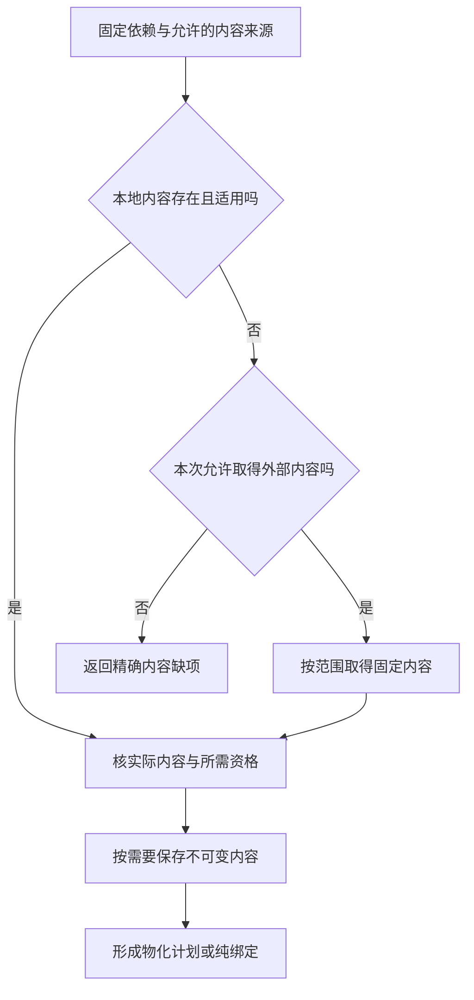

# 依赖与生态解析

## 供应商锁定、退出、替代与业务连续性

### 锁定是多维的

API、数据、身份、运维、人员技能、合同、成本、性能、支持和生态都可能形成锁定。使用抽象接口不等于可退出。

### ExitPlan

```text
ExitPlan = exact {
  providerAndCapabilityRefs,
  dependencyAndDataInventory,
  alternativeCandidates,
  semanticAndOperationalGaps,
  exportAndMigrationMechanisms,
  credentialAndIdentityTransition,
  serviceContinuityAndDualRun,
  costTimeAndRiskEnvelope,
  triggerAndDecisionAuthority,
  verificationAndRetirement
}
```

### Provider disappearance

服务终止、价格变化、许可变化、安全事件、地区不可用和账号封禁都是触发器。关键能力必须有数据备份、替代机制或明确接受的单点风险。

### 抽象边界

只抽象真实需要替换的 capability。过早统一所有 Provider 会损失特有能力和增加最低公分母成本；完全无边界会使退出不可能。

### 业务连续性

退出期间需要双运行、数据同步、流量切换、错误处理、回滚和用户沟通。兼容层有明确结束时间。

### 验证：供应商锁定、退出、替代与业务连续性

离线导出、替代 Provider、凭证撤销、大规模数据迁移、语义不匹配、混合运行、性能或成本回归、退出期间 Provider 不可用和旧集成退役。

## 依赖解析、物化与垃圾回收

**生态解析安全。（消费条件）：** 可解析到旧包版本不代表该版本满足新的安全/资格要求；降级只有明确政策及受影响消费者重新判断后才可接受。 合同归属：[协议协商中的降级、未知字段与旧客户端保护](../../70-工程系统与演进/演进与实施/兼容迁移/生态协议与版本演进.md#gift-capability-downgrade)。

### 对象分离

依赖管理至少区分：

```text
DependencyRequirement
DependencyCandidate
ResolutionDecision
LockedDependency
Artifact
Materialization
ActiveBinding
UsageLease
GarbageCollectionDecision
```

名称、版本范围、下载结果、解压目录和当前活动依赖不是同一个对象。

### 需求和候选

```ts
interface DependencyRequirement {
  readonly requirementId: RequirementId;
  readonly ecosystem: EcosystemId;
  readonly packageIdentity: PackageIdentity;
  readonly versionConstraint: VersionConstraint;
  readonly requiredCapabilities: readonly CapabilityRef[];
  readonly targetProfiles: readonly TargetProfileRef[];
  readonly licensePolicy: PolicyRef;
  readonly trustPolicy: PolicyRef;
  readonly optional: boolean;
}
```

候选包含来源、版本、制品摘要、签名、许可证、平台、传递依赖和撤销状态。注册表标签和版本字符串不能代替内容身份。

### 解析

解析先应用硬条件：

- 版本范围；
- 目标平台和 Runtime；
- 能力和 ABI；
- 许可证；
- 安全和信任；
- 撤销与漏洞策略；
- 离线可用性；
- 组织允许来源；
- 依赖图一致性。

再对合格候选比较更新成本、兼容、体积、性能、维护和退出成本。

解析结果必须可复现：

```text
ResolutionKey = digest(
  requirements,
  indexes and registry snapshots,
  policy revisions,
  target profile,
  existing lock state,
  resolver revision
)
```

### 锁定

`LockedDependency` 记录：

- 规范包 identity；
- 精确版本；
- 内容摘要；
- 来源 URI 与 registry snapshot；
- 签名和证明引用；
- 许可证结论；
- 传递依赖边；
- 解析器和策略 revision；
- 允许的平台与能力范围。

锁文件是解析决定的序列化，不是唯一事实。下载字节必须再次核对摘要。

### 制品获取



取得内容、将内容放到执行环境、运行代码是三个动作。签名、许可证和检查按真实政策与来源风险应用；有内容摘要不自动得到可信性，形成计划也不表示已安装或执行。
下载、解压和安装属于受准入效果。网络响应成功不能替代最终制品摘要和物化读回。

### 不可变内容库

内容库以摘要寻址并禁止原地修改。对象元数据记录：

- 字节长度和分块摘要；
- 来源和首次观察；
- 签名、SBOM 和许可证；
- 扫描结果与适用范围；
- 引用者；
- 租约和保留；
- 加密和数据分类；
- 损坏和撤销状态。

同一字节可以共享；不同租户是否可共享由安全、许可证和隐私策略决定。

### 物化

```ts
interface MaterializationPlan {
  readonly lockedGraph: LockedGraphRef;
  readonly targetHost: HostProfileRef;
  readonly layoutPolicy: LayoutPolicyRef;
  readonly isolationRoot: PathCapabilityRef;
  readonly expectedBytes: ByteCount;
  readonly fileCountCeiling: Count;
  readonly verificationSteps: readonly VerificationActionRef[];
}
```

物化产生新的物理视图，不改变制品身份。它必须处理：

- 文件名和路径限制；
- 大小写冲突；
- 符号链接和目录穿越；
- 可执行位和权限；
- 压缩炸弹；
- 磁盘不足；
- 并发物化；
- 中断和恢复；
- 防病毒或文件占用；
- 原生二进制平台匹配。

共享物化代际的身份由实际制品闭包、物化算法及其会改变结果的语义参数决定。attempt、时间戳、工作区、分支、projection/cache 路径、消费顺序和 provenance receipt 都不进入该代际键；它们保留为本次操作或来源事实。需求绑定仍属于具体工程与环境，不能因两个绑定复用同一字节代际就合并它们的 owner、requirement、manifest 或 provenance。

消费者按真实写入和重定位合同选择访问方式：可直接读取不可变位置时使用 direct read；Provider 给出可认证且寿命充分的 immutable locator 时可直接绑定；消费者需要私有可写视图时使用 copy-on-write projection；会改写、重排或执行不受信步骤时使用 isolated materialization。能力不足必须返回不支持，不能在这些方式之间隐式 fallback。

### 活动绑定

```text
ActiveBinding =
  project/environment scope
+ locked graph revision
+ materialization ref
+ runtime/toolchain profile
+ activation epoch
```

切换采用新 generation 暂存、验证和原子活动指针更新。不能在共享目录中逐文件覆盖并假设消费者不会观察中间态。

只要真实消费者仍通过 pathname 使用某个 generation，持久 UsageLease 就必须覆盖 locator 发布、消费者取得、实际执行、最终读回和 projection 退役。不能先释放 generation 再向调用方传递裸路径，也不能用进程是否仍存活或事后的 drift check 代替跨进程路径寿命保证。

发布者、消费者准入和 GC 共用可协调的互斥域与 durable hold 集合。制品已发布但尚未被领取、消费者故障待恢复、验证/复现/法律用途仍需旧代际时，相关 hold 不得因进程退出自行消失；释放必须核对 Owner 与 fencing。若相同 generation identity 对应不同 manifest、Merkle 根或实际字节，隔离冲突并报告 nondeterminism/generation conflict，不覆盖已存在的可信代际。

### 缓存与离线镜像

离线包或镜像必须携带：

- 完整锁图；
- 所有制品字节；
- registry 和信任元数据快照；
- 签名、透明日志证明和撤销信息；
- 许可证和 SBOM；
- 适用 Host 范围；
- 创建时间和过期策略。

离线使用不能把陈旧安全元数据自动视为最新。超出允许陈旧窗口时，系统明确降级、阻断或要求有权风险决定。

### 更新和漂移

依赖更新是新候选解析，不是原地改变旧绑定：

```text
new index observation
→ candidate closure
→ hard eligibility
→ resolution decision
→ locked graph
→ materialize
→ conformance and regression
→ bounded cutover
→ old binding drain
```

运行中发现物化字节与锁定摘要不一致时，立即隔离，并使使用该制品产生的候选和证据进入陈旧或不可信状态。

### 垃圾回收

可删除条件不是“最近没访问”，而是：

```text
GCEligible(artifact) =
  no active binding
∧ no execution lease
∧ no recovery dependency
∧ no verification or release retention
∧ no legal hold
∧ no offline package reference
∧ retention window expired
∧ not required to interpret supported history
```

垃圾回收分为标记、计划、准入、删除和读回。删除失败或部分完成保留显式状态。

标记从 typed roots 出发：活动绑定、durable consumer、未完成恢复、验证/发布保留、法律保留、离线包与历史解释分别说明为什么仍可达。进程退出、缓存压力或普通访问时间不能清除这些根。标记完成后到物理删除前，GC 必须在同一协调域复核 hold-set 的比较交换条件与物理围栏；期间出现新 hold、代际变化或身份不一致即放弃本次删除。这样 mark-and-sweep 的快照不会与新消费者取得路径发生竞态。

### 恢复与历史解释

旧工程 revision、验证证据或发布制品可能需要旧依赖解释器。系统可以保留：

- 旧字节；
- 旧锁图；
- 兼容解释器；
- 迁移器；
- 只读容器镜像。

但不得因此维持旧依赖的新执行权限。历史可解释性与活动可用性分离。

### 安全和供应链事件

发现恶意或撤销制品时：

1. 阻止新解析和新绑定；
2. 定位活动绑定和派生制品；
3. 停止或隔离高风险执行；
4. 撤销相关证据和资格；
5. 轮换可能泄露的秘密；
6. 选择修复、替代或移除候选；
7. 重新构建和验证；
8. 清理被污染的物化与缓存；
9. 保留事件证据。

### 并发和故障测试

- 两个进程同时下载同一摘要；
- 下载完成但元数据提交失败；
- 制品写入后进程崩溃；
- 解压中磁盘耗尽；
- Windows 文件占用阻止切换；
- 旧活动绑定在新指针切换后继续运行；
- 垃圾回收与新租约竞态；
- 发布 locator 后、真实 pathname consumer 取得前发生租约释放；
- 同一 generation identity 产生不同 manifest 或 Merkle 根；
- GC 标记后新增 durable hold，旧删除计划必须被 CAS 拒绝；
- registry 标签被重写；
- 离线镜像信任元数据过期；
- 恢复旧备份后已撤销制品重新出现；
- 同摘要对象出现字节损坏；
- 跨租户共享泄露私有依赖。

### 验收条件

- 需求、解析、锁定、制品、物化和绑定分离；
- 所有活动依赖可追溯到字节摘要和来源；
- 解析可复现或明确记录不可重现输入；
- 物化无路径逃逸和中间态泄漏；
- 更新不原地篡改旧 generation；
- 离线包可独立验证；
- 撤销能传播到活动绑定和证据；
- 垃圾回收不会删除恢复和历史解释依赖；
- generation identity 不受 attempt、workspace 或 projection 路径污染，需求绑定也不被共享字节合并；
- consumer 的 durable hold 覆盖其真实 pathname 使用和最终读回；
- generation conflict 被隔离，GC 与新 hold 的竞态由共同协调域和 CAS 阻断；
- 删除经过准入和读回；
- 并发、崩溃和空间耗尽路径可恢复。

<a id="gift-supply-chain-identity"></a>
### 来源锁、包身份、构建脚本与被替换的下载终点

生态依赖的**名字、版本约束、解析得到的版本、仓库身份、精确下载字节、签名/完整性凭据、构建脚本资格、传递依赖与实际构建环境**是不同维度。只有“锁文件存在”不能证明包下载端未被替换；只有内容hash也不能证明这些字节来自被授信的发布者。解析结果冻结后，应把真实下载源、摘要及选定验证策略交给宿主受控取得；失败不能悄悄切换镜像、降级算法或执行陌生安装脚本。

依赖的构建脚本、代码生成器、动态插件与安装hook跨越**纯选择→现实执行**边界，独立获取执行准入、资源限制和秘密隔离；传递依赖不能继承调用者全部本机权限。重建同字节产物依然要说明环境与工具链依赖，不能把可复现构建等同于没有后门，也不能把签名验证等同于实现正确。对已撤销签名或被通报不可信的依赖，保留历史构建的实际身份，停止不合格的新使用并按相交Claim复核，不以覆盖旧缓存修改历史事实。

## 可移植、互操作、标准、协议与生态采用

### 通用不等于最低公分母

Gift 保留共享语义，同时允许 Target/Provider 特有能力。可移植性必须声明在哪些能力和环境之间成立。

### PortabilityAssessment

```text
PortabilityAssessment = exact {
  assessmentRef,
  sourceAndTargetEnvironmentCells,
  basisRevisionRefs,
  methodRefAndRevision,
  requiredCommonSemantics,
  allowedAdaptersAndRuntimeSupport,
  unsupportedOrDegradedFeatures,
  dataProtocolAndIdentityMappings,
  conformanceEvidence,
  migrationAndExitCost,
  coverageAndUnknowns,
  invalidationRules
}
```
`PortabilityAssessment` 固定 source/target basis、方法、coverage/unknown 与失效输入；其中 Evidence 只支持该评估范围。它不是用户配置 Profile，也不能自行产生兼容 Verdict 或迁移授权。

### 标准采用

先拆能力和真实 consumer，再评估标准/实现的语义、版本、互操作、许可、安全、维护和退出。标准存在不等于所有实现兼容。

### 互操作

协议双方需要 schema、语义、错误、顺序、权限、数据和版本兼容。能解析消息不代表理解相同业务含义。

### Adapter

Adapter 只做边界转换，不拥有目标语义和全局 fallback。信息损失、默认值和 unsupported 明确可见。

### 验证：可移植、互操作、标准、协议与生态采用

多个独立实现的符合性、往返一致性、未知字段、版本协商、错误映射、大规模与边界情景、安全、性能和混合版本部署。

<a id="extension-marketplace-lifecycle"></a>
## 插件Marketplace、安装代际、启用与运行权限

已有 `HostExtensionProfile` 继续拥有扩展宿主差异；Marketplace只是发现/分发Provider。插件listing、publisher、package bytes、version/channel、installed copy、enabled scope、loaded instance、activation和实际Grant必须分开。

```text
ExtensionInstallationBinding = exact {
  extensionLogicalIdentity,
  marketplaceOrSourceRef,
  publisherIdentityAndTrustRefs,
  packageArtifactVersionSignatureAndProvenanceRefs,
  hostProductVersionAndCompatibilityEvidence,
  extensionDependencyRefs,
  requestedCapabilityAndDisclosureProfile,
  installationGeneration,
  enabledScopes,
  updateChannelAndPolicy,
  stateDataAndRetentionRefs,
  validityAndInvalidationRefs
}
```

`ExtensionInstallationBinding` 只表示某个 installation generation 的包、宿主、启用 scope 与声明政策关系。实际 loaded host process、activation instance、Grant/sandbox、block/revoke/retirement readback 分别由 runtime/authorization/Observation/Record owner 维护，不回写安装 Binding。

### discover / install / enable / load / activate 分开

Marketplace search result、评分、下载量、推荐或publisher描述只是discovery metadata。选择Install后才取得具体package bytes并核source/integrity/signature/compatibility；安装到目录不表示enabled，enabled不表示已加载，loaded也不表示当前workspace触发了activation或获得所有请求权限。

扩展包声明的capability/permission/requested access是请求，不是Grant。若宿主插件模型像传统IDE那样给予扩展广泛宿主权限，Gift应把该事实视为高信任Provider边界并通过进程/容器/工作区trust等实际机制限制；不能用manifest中的“readonly”自证沙箱。

### 版本、更新、channel和兼容

stable/pre-release/custom channel与具体ExtensionVersion分开；channel移动不改旧package identity。auto-update只是生成/采用新安装候选的policy，仍核host compatibility、签名/provenance、组织allowlist、撤销和数据迁移。更新后要求restart/reload的宿主在旧extension host仍运行时不能提前声明新代active；新旧代码可短暂并存时分别有generation。

插件依赖解析沿已有dependency graph；Extension Pack只是一次选择多个独立插件的便利集合，不把成员合成同一信任主体。一个成员失败/撤销不能被pack整体“已安装”掩盖。

### disable / uninstall / block / revoke / data retention

disable阻止新的activation或使用范围，是否立即卸载已加载代码取决于宿主真实能力；需要restart的场景在restart/settlement前旧代码仍可能在内存。uninstall删除package/materialization，不自动删除插件创造的workspace文件、用户settings/cache/database或外部云资源；这些按各自owner和retention处理。

Marketplace blocklist/revocation、publisher certificate revoke、组织policy deny可使新加载资格失效；已在运行的恶意/不可信实例按实际隔离/终止能力处理，并审计它已获取的数据和Effect。Marketplace下架也不能召回用户已下载副本。

### 签名、信誉与功能正确性分开

package signature支持来源/完整性Claim，不证明插件代码安全、API兼容、性能或功能正确；Marketplace审核、publisher trust、install count/rating也不是产品验证。插件可通过签名但包含恶意逻辑，也可因宿主API变化在签名不变时失效。

### 验证：插件Marketplace、安装代际、启用与运行权限

覆盖local archive与Marketplace来源、签名失败、publisher变更、host升级、pre-release切换、dependency缺失、auto-update中断、enabled但未loaded、loaded后disable需restart、workspace/global scope差异、blocklist晚到、插件崩溃/输出洪泛/秘密访问、卸载保留状态、旧host进程残留和扩展数据迁移失败。

## 网络、协议、服务发现、限流、熔断与兼容

### 网络失败不是一个异常

DNS、连接、TLS、认证、代理、路由、超时、半开、丢包、乱序、重复、截断、服务端提交和客户端确认分别建模。

### ProtocolContract

```text
ProtocolContract = exact {
  endpointAndPrincipal,
  transportAndSecurity,
  messageSchemaAndSemanticVersion,
  requestResponseStreamSemantics,
  idempotencyAndOrdering,
  timeoutDeadlineAndCancellation,
  retryAndBackoff,
  rateLimitAndQuota,
  errorAndPartialResult,
  compatibilityAndDeprecation,
  observabilityAndReadback
}
```

<a id="network-observation-boundary"></a>
### 网络抓包、代理与Service Mesh只是有位置的观察

pcap/eBPF/socket stats、reverse proxy、sidecar/service mesh、load balancer、TLS terminator和application access log都可以提供网络Observation，但它们观察的层和位置不同。packet、transport connection、HTTP/QUIC stream、application request、Provider attempt和business Effect必须分别映射，不能因为共享五元组、连接或trace id就合并。用于一次相关/解释查询的对象叫 `NetworkObservationContext`：它冻结 capture provider、位置、命名域、协议代际、可见范围、clock/sampling/loss 与所引用的 Observation/Attempt 集；新的包、重试或读回形成新的 context/query result，**不追加进一个长期可变 Binding**。

```text
NetworkObservationContext = derived {
  captureProviderAndRevision,
  capturePointAndNetworkNamespace,
  interfacePathDirectionAndPeerObservation,
  transportProtocolAndConnectionGeneration,
  encryptionTerminationAndVisibilityScope,
  streamOrMultiplexingRefs,
  packetByteAndReassemblyCoverage,
  proxyHopAndRetryAttemptRefs,
  applicationProtocolMappingRefs,
  relatedOperationAttemptRefs,
  clockDomainSamplingAndLoss
}
```

**packet不是message。** TCP可以重传或收到duplicate segment；分段、合并、offload和中间设备会让packet数量与应用send/read次数无一一对应。TCP ACK说明相应传输层序列空间已被peer接受，不证明HTTP handler执行、数据库提交、消息消费或业务Effect完成。

**connection不是request。** HTTP/2在同一TCP connection上并发多条stream，QUIC同样在connection内复用stream，而且QUIC connection可在地址/端口改变时迁移路径；因此五元组变化不必然是新connection，connection相同也不必然是同一应用请求。stream id只在相应connection generation内解释。

**代理改变观察拓扑。** NAT、ingress、mesh sidecar、gateway、HTTP proxy和TLS termination可能使服务端看到的peer地址/证书/connection属于代理而非原始caller。可信forwarded identity需要准确代理信任链和协议合同；不能从`X-Forwarded-*`、PROXY protocol、自报header或sidecar metadata直接创建Principal。一个下游request可因proxy retry/hedging形成多个upstream attempts，必须关联而不能误报多个用户意图。

**加密和可见性。** 抓到密文只支持相应packet/transport事实；没有解密材料和合法披露范围不能推断HTTP字段、payload或业务语义。TLS终止点能看到明文也不自动获得长期存储、调试或导出权限。key log、pcap和完整payload都可能含credential/PII，按secret/data-use/retention规则治理。

**捕获缺失。** capture point只看到经过该位置的流量；NIC offload、sampling、buffer drop、filter、namespace、kernel bypass、QUIC encryption和代理拓扑都可能形成缺口。`no packet observed`只在固定capture coverage内成立，不能普遍推出调用或Effect不存在。

网络时间戳继续绑定capture clock domain；多个探针不同步时不按wall-clock直接重建全局顺序。应用级因果优先用operation/message/event/trace的有类型关系，packet时间只作相交Observation。

### 服务发现

发现结果有来源、TTL、健康、区域、版本和权威。first-found 不能替代 capability/eligibility resolution；stale endpoint 不应无限缓存。

### 限流

客户端和服务端 rate limit 分离；retry 必须尊重 Retry-After 和 parent budget。token bucket 等补充资源使用 ReplenishingRate 语义。

### 熔断

熔断防止故障放大，但会产生新的降级状态和恢复探测。不能把 open circuit 当业务失败，也不能让所有租户共享一个错误熔断域。

### 兼容

协议字段兼容不等于业务语义兼容。未知字段、枚举、错误、流控制和版本协商必须有明确策略。

### 验证：网络、协议、服务发现、限流、熔断与兼容

域名解析漂移、传输层安全证书轮换、代理、半开连接、响应截断、服务端已提交但客户端超时、重试风暴、限流窗口重置、协议模式变化、回退端点和熔断器振荡。

<a id="package-registry-publication"></a>
## Package/Registry发布、可移动标签与退役

依赖解析与制品构建已产生固定Artifact，但把它发布到npm/crates.io、私有registry或其他包索引是新的外部Effect。至少区分：

```text
RegistryPublicationRecord = exact {
  registryAndNamespaceRef,
  packageLogicalIdentity,
  artifactAndManifestRefs,
  packageVersionIdentity,
  publicationOperationAndAttemptRefs,
  immutableVersionReceipt?,
  ownerAndCredentialRefs,
  provenanceSignatureAndSBOMRefs
}
```

`RegistryPublicationRecord` 只记录一次已发生 publish 的不可变历史。mutable channel/tag、visibility/propagation、deprecate/yank/unpublish 是之后独立 Operation 与 Observation；不能把这些变化写回 publication Record，也不能用一个 `*Binding` 同时表示发布事件和可变 channel current。

package/version、artifact bytes、registry record和tag/channel是四种身份。npm类`latest/beta`、容器tag、channel名可以移动；不能把tag当内容身份或历史version。某registry声明version不可覆盖时，已发布同名version即形成长期外部事实，失败重试前必须查询原publication identity/bytes，不能用同version重新上传不同内容。

### Publish、tag、deprecate/yank、unpublish不是一个动作

publish创建version record；dist-tag/channel改变解析默认或人类入口；deprecate/yank通常保留原版本字节但改变新解析/告警行为；unpublish/delete在允许的registry中改变可取得性，同时可能仍有镜像、缓存、lockfile和下游副本。每类都经独立Operation/Grant/Readback，不能把“撤回latest”冒充“删除版本”，也不能把deprecate当修复了已安装用户。

Cargo/crates.io类yank允许既有lock继续使用而阻止新的解析选择；npm deprecate给安装者警告但仍可安装；这些只作为具体Provider语义，公共模型保留“解析资格变化”和“内容可取得性变化”两个轴。

### Namespace/owner 与发布授权

registry package owner/team、OIDC trusted publishing、API token、2FA/OTP等是Provider授权机制，映射到现有principal/Grant/SecretBinding。能构建artifact、能merge代码或拥有package名字不自动获得publish权；反之registry owner也不能修改源码authority。owner transfer、token revoke与package version历史分别结算。

### 传播、镜像与最终读回

publish响应成功后仍可有registry index、CDN、mirror、search、lockfile cache和企业代理传播延迟。要求“已公开可安装”时必须从声明的解析端点取得相应readback；不能只凭上传HTTP 200。删除/unpublish同理不能承诺已传播副本被抹除。供应链签名/provenance支持来源Claim，不证明package API兼容或功能正确。

### 验证：Package/Registry发布、可移动标签与退役

覆盖响应丢失后版本已创建、同version不同bytes重试、mutable tag竞态、owner/token撤销、2FA challenge、private/public namespace混淆、镜像延迟、deprecate/yank/unpublish区别、已有lock继续取yanked版本、下游缓存保留已撤版本、provenance与registry artifact不匹配及发布后才发现secret泄漏。

## 固定内容与可信更新的双重边界

依赖解析固定具体内容不等于允许它永久执行。获取到的同名新包不能悄悄替换锁定字节；相同旧字节也可能因撤销或新的风险政策失去本次资格。内容复现、发行者身份、发布渠道信任与当前可用资格分别判断。名称解析先限定受信来源和命名域，不让公共同名包覆盖私有锁定依赖。

需要安全自动更新的画像，采用成熟的受保护根、版本单调性、元数据有效期及目标哈希/大小校验机制，并在下载/解压前限制长度、深度、成员数量与路径。缓存可减少内容下载，不能跳过真正要求的新鲜信任元数据。元数据过期而离线时，按已接受政策限制执行或只保留设计/解释能力，不自行把旧签名当作当前许可。

正常根轮换与根失陷恢复分开。正常轮换按原根与新根要求校验；失陷根不能独自签发“自己已安全”的证明。若失陷已超过既定阈值或所有受保护根丢失，需要已设计的独立恢复渠道/有权重新绑定，并收窄旧端点资格；这一步保留风险和信任变化，不能声称无外部依据恢复全部原保证。根或构建基础设施失陷还可能污染控制程序、工具与已生成制品；恢复校验从独立可信的软件/宿主基线开始，不能只换密钥就沿用未核对的旧执行环境。受影响下游按真实依赖重新判断，不靠控制端换钥匙自动宣称全部产物安全。

[TUF 1.0.36](https://theupdateframework.github.io/specification/v1.0.36/index.html)提供更新元数据、角色及防回滚/冻结检查的机制参照；它不替Gift决定所有权、目标程序行为或真实根失陷后的社会授权。本设计不自创加密协议，也不要求离线普通源文件先成为软件更新仓库。

## 一个提供者从声明到可用能力的接入过程

Provider的名字或接口形状，只产生待检候选；接入过程的输出是被限定到具体主体、版本、环境和保证范围的可用绑定。该协议由当前应用调用，不要求所有普通源解析先建立提供者注册中心。

**H1 确认所需能力。**从实际请求提取需要解析、生成、执行、存储、读回或恢复中的哪一种能力。一个包提供多个能力时分别限定作用，避免安装一个编译器就同时获得网络和发布权限。

**H2 取得真实身份与内容。**在当前允许范围读取本地工具或显式包内容，固定版本与实际字节；远程获取作为独立动作准入。配置、标准库、模块解析和初始化属于真实闭包，不能只记录一个版本号。只有需要来源认证的声明才要求对应认证材料，普通本地自用不虚构公共签名门槛。

**H3 验证合同形状与行为边界。**检查输入/输出、错误、同步/异步、数值、所有权和支持画像。通过静态形状不自动证明行为；已有可信约定或实际验证只能提升相应能力。不能验证的内部保留opaque合同，依赖强保证的动作继续待满足。

**H4 选择执行方式。**受信纯库可同进程；需要资源隔离或不受信过程时使用实际宿主支持的权限、文件、网络、秘密和资源边界。进程与容器名称不代替这些限制。若宿主不能满足任务隔离要求，返回缺项或选择另一合格提供者，不静默扩大权限。

**H5 发布绑定与使用。**把已取得的内容/环境、适用检查、限制和有效条件形成不可变绑定。每次调用仍按当前权限与能力状态准入。运行可用性与静态内容身份分别变化；能力暂时离线不删除其历史解释。

**H6 替换与退出。**新提供者对相同合同检查，准备相应迁移和运行资源；切换时新请求使用新绑定，旧请求结算后释放旧能力。安全撤销可立即阻止新作用，但已发生责任继续读回/协调。取走凭证不意味着业务数据或外部操作已消失。

例：读取TS源码只需对应解析能力，类型检查可能需要实际标准库与配置；运行生成代码另需执行能力；发布到远端又需要单独的目标权限。四步可以由同一物理工具提供，但资格和动作不能合成一次“安装成功”。

正常无外部需求的纯函数不经过H2的网络获取、不建立常驻Host进程。只有真实跨工具边界存在时保留薄适配；没有独立语义就复用最窄成熟接口，避免层层转发和重复解析。

## 提供者方法在固定装配中的采用

Provider供给先按接口、精确内容、环境与消费者核资格，再进入EngineImage或实际执行绑定。纯解析/打印方法可以同进程复用成熟库；需要I/O的语言工具以ToolResultNeed经execution调用；恶意插件不因接口宣称pure就取得宿主全局。

通用HeadStore与QueryCache不强迫实现事务应用专用的Outbox接口。文件、关系存储、消息交付、设备与目标工具有各自作用合同；bootstrap按本次产品画像选择，未使用的驱动不初始化。成熟实现的保证按实际配置继承，自己的装配/转换/跨系统接缝继续承担剩余验证。

实际版本由安装与锁确认，不以依赖清单声明代签安装成功。新的工具 API 族留在窄适配层，公共类型和任务输入不随具体 SDK 自动改变。

<a id="developer-environment-setup"></a>
## 环境与依赖的开发操作：准备可用条件，不篡改工程含义

依赖需求、候选、锁、内容、物化、活动绑定和使用租约仍由前述合同拥有。本节只补开发者从“打开工程”“增加一个依赖”“在新机器复现”到这些对象的具体调用，不能把相同规则再登记一份。

### ECOPREP0—ECOPREP6 正常准备流程

ECOPREP0从实际根、语言/目标、工具配置和本次动作计算所需能力；ECOPREP1检查已安装/已绑定的准确工具、依赖、目标平台与输入，并区分未配置、缺内容、版本不合、权限、失联；ECOPREP2提供最小修复计划及真实成本/作用；ECOPREP3按任务选择保留原绑定、仅解析新候选或物化固定内容；ECOPREP4在合格隔离区取得、验证、安装/生成；ECOPREP5检查真实输出与所需入口能力；ECOPREP6建立本次实际绑定，保留仍被旧运行使用的环境，再结算临时资源。

不把缺运行时报告成源代码错误，不因某调试适配缺失阻止纯源检查。没有网络时已具备内容的任务继续；缺内容列出准确制品、提供者和需要的权限，不诱导下载任意最新版。安装界面可一次汇总多个缺项，但每种实际作用、失败和重试范围独立。凭据由安全宿主注入；普通配置/日志只包含引用与必要状态。

### 修改依赖与按锁物化是两种动作

“添加/升级/移除”先改实际依赖要求，求解本次允许的候选并生成锁/调用方/配置变更；预览传递变化、许可、安全、API/ABI、平台和错误语义。选择已有合法绑定可以不访问注册表。不能仅因新的包版本可解析就自动升级未请求依赖；必须被解算带动的相交变化明确列出。移除依赖同时检查源码导入、生成器、测试工具、脚本及资源消费者，不只看运行import。

“按锁准备”不改要求或锁；锁与声明不一致则返回差异，用户可选择重新求解或修正声明。准备方法要固定真实包管理器、平台和必要flags；原生锁仍由原工具拥有，Gift不得另写一份会漂移的等义锁。同一文件里缺少工具不应触发重建整个工程。

安装并非无害读取。npm v10的ci说明明确包含移除已有node_modules，而锁不匹配时失败且不改锁；它说明“冻结解析”不代表“现场无变化”。实际方法可能还有脚本、网络、原生构建和共享缓存写入。可选新隔离根后切换或停用本次拥有的旧环境再改；没有隔离/停机条件时准确报告影响，不破坏其他会话仍使用的环境。禁止脚本后如包需要它们才能可用，返回缺能力而非安装成功可运行；不能绕过项目必需检查凑绿色。

### 内部计划和外部通路

宿主`prepareEnvironment(intent, projectView, selectedProfile)`只计算需取得内容、将运行的准确工具/脚本、读写根、网络/秘密引用、预算、产物校验及可恢复切点。结果沿原Needs/Conflict/可用计划分类；`executePreparedEnvironment`经原execution和注册ProviderSession调用。参数由受信绑定序列化为argv/cwd/env，不拼接自由shell文本；确实需要shell的原生脚本依其真实脚本合同执行，不声称没有shell。

这两个函数是客户端/宿主的内部实现接口，不是本版新增的六工具参数。SDK或既有命令客户端可以直接接入；只有六工具而无宿主安装能力的远端不能假造`operation(kind:install)`。它仍可交付精确缺项和已有源，后续收到真实宿主结果再捕获后继context。环境准备的回执不将旧候选强行标为使用新版本：新绑定形成新准备输入，仅相交依赖失效。

物化未知/失败先按原意图查回；有来源不明的目录不冒认完成。用户要求退出时停止本次准入、结算临时根和使用租约，不清别人缓存、不撤销仍被其他工作使用的绑定。软件卸载、锁删除和工程删除是不同请求。

<a id="sandbox-host-call-and-update-qualification"></a>
## 隔离边界内的宿主调用与更新资格

插件的指令fuel、epoch或guest内存限制，只覆盖提供者实际声明的执行范围。guest进入阻塞宿主调用、使用宿主栈或执行大块不可中断操作时，不能据guest预算声明整个任务已受控。宿主能力入口另承担参数/输出、资源、等待、停止、释放和可能产生的外部效果；异步让出线程不证明效果已取消。需要强停止时选择实际支持它的隔离，不能用单独进程或线程名字代签最小权限。

第三方扩展与宿主同权限运行、隔离进程但共享凭证、真正受限能力三种方案的保证不同。结构解码、签名、Marketplace来源或模型能运行不授予执行权。relaxed SIMD、NaN编码等可能使平台相关结果合法；位级确定性、误差允许、缓存身份和历史重放各自固定需求，不用“近似相等”包办。

依赖锁定、签名完整性、可信更新新鲜性和当前执行许可分别检查。历史固定版本可用于获准复现，不因此永久满足新部署要求；追最新也不能改写旧历史。更新协议按其实际角色、阈值、版本、过期与混搭防护处理。构建固定输入时间、更新验时起点和真实敏感作用点的当前授权使用各自合同，不折成一个无解释now。

<a id="prebootstrap-supply-chain"></a>
## 依赖取得、构建域和发行来源的完整责任

依赖请求含准确包身份、范围与来源政策；解析后固定实际内容、修订、特性、构建域、目标和所需工具。版本标签不代替内容摘要，摘要不代替来源信任，来源签名不代替功能/安全资格。命名空间、私有/公共来源及替代源政策必须明确，避免同名包从另一来源被自动采用。

取得依赖是受权宿主动作，纯解析只处理已有固定集合。离线或被撤销的供应返回实际缺项，不能自动升级/降级或联网补齐。包缓存可以按内容复用存储，但读取/执行资格还受主体、来源、平台与当前政策约束；不因另一项目已下载就跨越当前工程禁令。

编译器依赖、目标运行依赖、开发工具、构建脚本、proc-macro 和可选测试工具分别入域，只把所需部分装配到真实消费者。可选依赖禁用时不启动其线程/网络/数据库；但其已有现实状态仍需退出责任。动态反射或加载边未知时保留相交能力缺口，不靠源码搜索没有字符串证明完全不存在。

发行说明随制品保留实际依赖、作者/许可来源、已声明义务、构建工具和可重建输入。许可证文本与分发权事实由真实来源核验，编译生成不自动改变许可，也不由系统猜合法性。供应撤回、校验失败或已知污染时使相交资格失效并停止新采用；已生成/已部署产物的风险与恢复需单独处理，不能只删缓存视为解决。

<a id="本责任的相交定案"></a>

**关联规范：**[依赖、插件、构建与发行的四重权限](../../70-工程系统与演进/演进与实施/实施/安全构建发布与环境.md#design-b32)。
