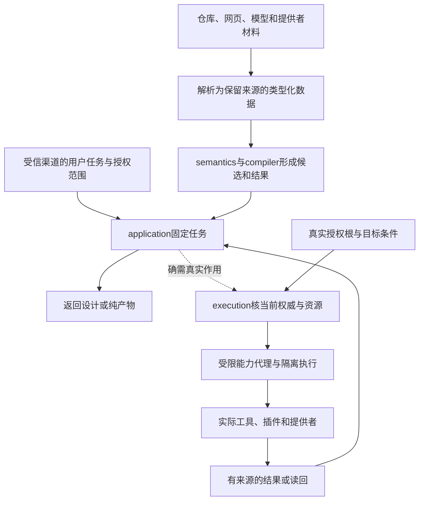

# 安全信任与外部权威

## 安全、隐私、供应链与信任

**非可信源。（消费条件）：** 项目磁盘内容、下载包和运行插件均须分离解析许可、披露许可和执行许可；来源被记录不表示可信。 合同归属：[外部材料、作者私有源码与可复现定位的隔离](../../10-作者与输入/作者源/工程源/资产与非源码.md#gift-source-scope-privacy)。

### 保护对象

Gift 处理源码、工程意图、凭证、模型上下文、执行能力、制品、验证证据和发布权限。安全设计覆盖输入、编译、扩展、执行、存储、供应链、恢复和界面。

### 威胁主体

- 恶意项目源码和构建脚本；
- 被污染依赖、插件、模型或 Provider；
- 越权用户或 Agent；
- 跨租户攻击者；
- 失陷 Host 或 runner；
- 供应商账号和更新渠道；
- 错误配置和内部误操作；
- 响应丢失、重放和旧凭证。

### 信任区域

```text
UntrustedInput
SandboxedProvider
ApplicationControl
TrustedKernel
EvidenceVerifier
SecretStore
PromotionAuthority
```

跨区接口最小、类型化、带能力句柄和审计。

### 源码与提示注入

仓库文件、注释、README、测试数据和外部网页都是数据，不因包含命令而成为系统指令。AI 工具调用由独立策略和 Schema 决定。

### 秘密

秘密使用引用而非明文传播：

- 最小作用域；
- 短期凭证；
- 运行时注入；
- 不进入 IR、日志和缓存；
- 使用审计；
- 轮换、撤销和泄露响应；
- 离线节点的过期策略。

### 供应链

按本次依赖/工具/插件/模型/制品所承诺的支持与安全范围，取得适用的材料并记录缺项：

- 来源；
- 内容摘要；
- 签名或证明；
- 许可证；
- SBOM；
- 漏洞状态；
- 构建来源；
- 维护状态；
- 撤销和替代。

版本标签不能替代内容身份。纯本地自建模块不因此被要求存在外部签名、SBOM服务或维护评级；这些材料缺少时限制依赖它的声明，不默认禁止无相交风险的设计和生成。

### 构建可信

从冻结源码和工具链生成内容寻址制品。验证后在环境间提升同一字节。构建服务本身有身份、隔离、日志和证明。

### 信任边界



Schema合格只形成可解释数据，不把材料提升成命令或授权。compiler不直接推进权威头和Journal；真实写入由execution及对应提交所有者完成，返回内容仍按来源与披露范围处理。

### 隔离

单用户宿主在真实受保护边界提供明确安全上下文，内部纯函数不为“未来多租户”逐层传递庞大信封。多租户画像的存储、缓存、索引、消息、遥测和模型上下文闭合其访问与披露范围；共享计算不得合并不同请求的授权，沿[共享计算的隔离](../../30-实现解析/增量与性能/依赖与失效模型.md#共享计算的隔离与派生数据)。

### 审计

审计事件具有：主体、操作、权限链、目标、前像、效果、结果、读回、时间来源和完整性。审计不保存不必要秘密；高价值日志发送到独立受保护存储。

### 漏洞响应

```text
发现
→ 确认和范围
→ 遏制
→ 撤销能力和证据
→ 修复候选
→ 独立验证
→ 发布与轮换
→ 可信重建
→ 复盘和控制更新
```

紧急修复可缩短流程，但不能跳过身份、权限、最小验证、读回和后续完整审计。

### 验收

- 威胁模型对应实际部署；
- 最小权限和沙箱负向测试；
- 跨租户测试；
- Prompt 注入和数据外泄对抗；
- 依赖摘要、签名和 SBOM；
- 秘密扫描和轮换演练；
- 审计防篡改；
- 供应链撤销传播；
- 失陷环境可信重建；
- 安全事件不使用同一可疑证据自证。

## 密码、密钥、秘密、身份认证与信任轮换

### 密码机制服务于具体 Claim

哈希、签名、加密、MAC、证书和硬件密钥证明的性质不同。使用“已加密”不能说明身份、完整性、机密性、前向安全和授权全部成立。

### CryptoProfile

```text
CryptoProfile = exact {
  protectedSubjectAndThreatModel,
  algorithmAndParameterRefs,
  keyTypeAndUsage,
  keyGenerationStorageAndCustody,
  identityAndCertificateBinding,
  rotationRevocationAndExpiry,
  protocolAndNonceRequirements,
  migrationAndAlgorithmAgility,
  verificationAndAudit
}
```

### 身份认证与授权

认证证明 principal identity；授权决定其可执行操作。session、token、device、service account 和 human identity 分离。

<a id="tls-peer-identity"></a>
### TLS/PKIX服务身份、会话恢复与0-RTT边界

TLS握手、PKIX路径、应用服务身份、证书状态、mTLS客户端身份和业务授权是不同资格。建立加密channel只证明所选TLS/transport合同；不能把“证书链能验证”“握手成功”或“mTLS成功”压成一个`authenticated=true`后交给业务。

```text
TlsPeerAuthenticationObservation = derived {
  connectionAndHandshakeGeneration,
  tlsProviderAndRevision,
  endpointSniAndAlpnRefs,
  referenceServiceIdentifierRefs,
  presentedCertificateChainRefs?,
  trustAnchorBundleAndValidationProfileRefs,
  pathValidationResult?,
  presentedIdentifierAndMatchResult?,
  certificateValidityAndRevocationObservations,
  serverAndClientAuthenticationResults,
  authenticationMode,
  resumptionPskTicketAndOriginalContextRefs?,
  earlyDataOfferAcceptanceAndReplayPolicy?,
  negotiatedProtocolCipherAndKeyProperties,
  verifiedPeerIdentityMappings,
  coverageUnknownAndFailure
}
```

**服务身份来自可信reference，不从证书倒推。** 客户端先由配置、URL/协议或受信发现建立预期service identity，再按实际协议规则与leaf certificate的presented identifiers比较。RFC 9525语义下DNS服务名使用相应subjectAltName类型，不能因为Common Name或任意subject文本“看起来像域名”就认同。一个证书含多个SAN也不代表它们是同一个Gift主体；只说明该证书在相应验证条件下可呈现多个identifier。

**PKIX path与name match分开。** certificate path validation核trust anchor、issuer链、有效期、约束/用途及所选撤销政策等PKI条件；service identity matching核本次reference identifier是否与presented identifier符合应用协议。有效CA签发的别的域名证书不能通过name match；名字匹配但链不可信/过期/撤销也不能通过完整peer authentication。

**证书状态是有时间和方法的Observation。** CRL、OCSP/stapling、平台/组织撤销列表和其他机制分别绑定issuer、响应/列表revision、thisUpdate/nextUpdate或等价freshness、验证结果与fail-open/fail-closed政策。OCSP的`good/revoked/unknown`只支持相应状态查询，不签业务authorization，也不能在响应过期后无限缓存。Provider无法取得实时撤销信息时准确保留未检查/未知/按政策接受的资格，不伪造“not revoked forever”。

**mTLS authentication不等于business Principal Grant。** client certificate/SVID等首先建立相应peer credential identity；只有显式IdentityMapping把它绑定到本业务Principal/tenant/role且当前Policy/Grant允许，才能产生对应业务作用。证书subject/SAN里的任意文本字段不能自行声明管理员、租户或on-behalf-of关系。

**connection与认证代际。** full handshake、post-handshake authentication、PSK/session resumption和externally provisioned PSK是不同authentication mode。TLS 1.3 resumption可以使用先前连接建立的PSK，不要求每次都重新呈现完全相同的certificate链；因此ticket/PSK要绑定原authentication context、SNI/reference identity、ALPN/协议、发行与有效窗口、当前应用政策。证书/信任根/授权后来撤销时，是否允许已有connection或ticket继续使用由明确session/revocation policy决定，不能因旧handshake曾成功而永久放行。

**active connection不是永恒证书判定。** 证书到期/撤销、trust store更新、身份映射变化或业务Grant撤销不会逆向改写历史握手；它们使未来连接、重新认证或当前高风险Effect的资格按实际政策陈旧。需要即时断连接/禁用ticket时产生真实控制Operation并读回，改元数据不能远程杀死已建立的socket。

**0-RTT是独立风险边界。** TLS 1.3 early data可以在完整新握手完成前基于PSK发送；标准明确没有天然的跨连接non-replay保证。只有应用操作本身允许重放或部署具备相应anti-replay/idempotency/业务去重合同，才允许0-RTT产生相交Effect。GET/“safe”命名、TLS库自动重发或ticket single-use都不能替代本业务Effect的防重复要求。0-RTT被server拒绝后，客户端是否重发也由应用语义决定，不能盲重放。

**TLS终止和代理。** gateway/mesh/proxy终止TLS后，下游连接认证的是代理到后端的peer，不自动继承原客户端certificate身份；端到端caller信息必须通过受信、抗伪造且有版本的映射/凭证链传递。反过来，后端看到mTLS sidecar也不能把sidecar进程身份直接冒充最终用户。

验证至少覆盖错误SAN但有效链、正确SAN但错误trust anchor、expired/revoked/unknown状态、wildcard/IDN/profile差异、SNI/reference mismatch、mTLS错误identity mapping、ticket在证书/Grant撤销后重用、session resumption跨ALPN/服务范围、0-RTT replay、TLS termination代理及信任根轮换中的旧活连接。

### 轮换

新旧 trust roots 并存需要有界 window、双验证或 cross-sign、consumer migration、revocation、cache/session refresh 和 readback。旧根不能因新根存在自动退役。

### 加密敏捷性

算法和参数可能退役。协议保留 version/negotiation，但防 downgrade；持久数据迁移和历史签名验证需要独立策略。

### 验证：密码、密钥、秘密、身份认证与信任轮换

随机数重复、弱随机源、密钥用途错误、过期证书缓存、撤销延迟、算法降级、密钥备份不可用、跨租户秘密、轮换竞态和旧制品验证。

<a id="vulnerability-exploitability-boundary"></a>
## 漏洞存在、可利用性、缓解与VEX

组件清单、漏洞匹配、产品可利用性、缓解控制、风险接受和修复状态是不同事实。SBOM/SCA发现某组件或CVE只产生相交存在/匹配候选；VEX类材料表达**某产品上下文中的exploitability assertion**，仍需绑定准确artifact/component、配置与调用可达性、环境、分析方法、issuer、有效期与证据。

```text
VulnerabilityContextAssessment = exact {
  productAndArtifactRefs,
  componentAndVulnerabilityRefs,
  configurationAndReachabilityContext,
  assessmentState,
  justificationAndMethod,
  mitigatingControlRefs,
  evidenceRefs,
  issuerAndAuthority,
  validityAndInvalidation
}
```

这是assurance/input projection，不新建漏洞真值数据库。`not_affected`、`code_not_reachable`或`protected_by_mitigating_control`不是永久属性：依赖升级、feature启用、配置变化、动态加载、目标差异或缓解撤销会使相交判断陈旧。供应商VEX与独立分析可以冲突并同时保留，由当前Resolution/assurance规则裁决；不能因为格式只显示一个state就覆盖反证。

漏洞严重度、可利用性、业务影响和修复优先级也不压成一个分数。补丁升级可能引入兼容/可用性风险；“不修”需要真实接受权和剩余风险，不因VEX文本存在自动允许发布。

## 许可证、法规、地域、政策与外部权威

### 外部权威不是产品自己定义

法律、许可证、行业标准、合同、平台政策和组织制度具有独立 issuer、法域、版本、有效期和解释边界。Gift 只能观察、绑定和采用，不能伪装成内部 Product 决定。

### ExternalAuthorityBinding

```text
ExternalAuthorityBinding = exact {
  authorityRef,
  issuerAndJurisdiction,
  sourceAndVersion,
  applicabilitySubjectsAndOperations,
  effectiveAndExpiryDates,
  obligationsProhibitionsAndExceptions,
  interpretationDecisionRefs,
  evidenceAndAuditRequirements,
  changeAndAppealProcess
}
```

### License

源代码、依赖、模型、数据、字体、图像和生成制品分别有许可。兼容性取决于使用、分发、修改、链接和地域，不由 SPDX 字符串单独决定。

### 数据地域

存储、处理、访问、备份、日志和支持人员位置分别建模。云 region 名称不能自动证明法律驻留。

### 政策冲突

多个法域或合同冲突时，返回冲突、适用范围和人工/法律裁决，不由技术系统暗选更宽松规则。

### 变化

外部规则变化只使实际适用的 Policy/Support/Delivery closure stale；不能让所有项目全局失效。

### 验证：许可证、法规、地域、政策与外部权威

许可证不兼容、传递依赖义务、政策过期、区域故障转移、备份跨境、用户删除请求、法律保留、外部来源不可用和解释变化。

<a id="design-c09"></a>
## 认证主体、凭据与授权决策

身份实例明确主体类型、发行者、凭据格式/验证算法、受众、有效期/时钟偏差、委派范围和撤销机制；登录成功只建立被验证身份，不自动拥有对象写权或发布权。用户输入的角色/issuer字符串只作为待核声明，不能自授Grant。

每个受保护动作将principal、resource、action、context及policy revision送到受信准入点；缓存授权要有范围和失效条件，长任务在派发/披露前重核相交权限。认证令牌与CSRF/会话绑定、重放风险、权限提升和秘密储存分别处理，不将它们合为“有token即安全”。

凭据轮转保留新签发与旧核验所需的明确重叠窗口；撤销后历史receipt可以验证来源但不授新执行。密钥泄漏进入撤销、隔离、重新认证/授权及审计流程，不能仅重启进程。缺发行者真实配置或可信时间时不签身份已验证；开发测试凭据必须与真实域隔离。

**验证与反例**：错误audience、过期/重放、角色自报、撤权后cache命中、密钥轮转、测试issuer冒充生产和委派链越界。

**实际能力边界**：未取得或设置任何真实账号、密钥、发行者与撤销服务。

相交合同：[授权、披露和已发生作用的区分](../权限与资源/授权与执行准入.md#design-b24)；[依赖、插件、构建与发行的四重权限](../../70-工程系统与演进/演进与实施/实施/安全构建发布与环境.md#design-b32)。
