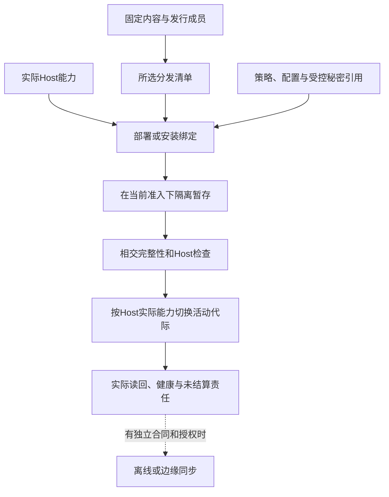

# 宿主执行与隔离

<a id="native-kernel-boundary"></a>
<a id="窄原生内核与crust的当前接入合同"></a>

## 窄原生内核与C/Rust的条件接入合同

本节仅在选用原生内核时生效，规定 C/Rust 等供给的 ABI、资源和安全边界。C 仅用来展示定宽数值与缓冲实例，不能预设最终语言；TS/Bun 产品控制、既有 TS 能力及 Rust compiler-kernel 的独立迁移不因此连带迁写。没有原生消费者时不新增相应 crate、构建阶段或生态依赖。

### 有限原生内核的条件范围

该有限 ABI Profile 采用**同步、无回调、无可变共享全局**内核，支持 Bool 显式 0/1、定宽整数、字节/元素缓冲、长度、状态码和不透明句柄。数学 Int/Text 必须经具备相应精度或编码保证的库表示；不允许隐式降为 C int 或 Rust usize。任何导入/导出均绑定 Target 的整数宽度、字节序、布局/对齐、调用约定和编译工具参数。

例如`max_u32`的跨边界合同可采用以下C声明；它是接口范本，不声明当前已有对应产品实现：

```c
uint32_t gift_max_u32(const uint32_t *data, size_t length,
                    uint32_t *out_value, uint8_t *out_present);
```

输入是U32元素序列，输出最大值和是否存在；空输入正常返回`out_present=0,out_value=0`，非空全零则返回`out_present=1,out_value=0`。状态固定为0=成功、1=可检查的必需指针为空、2=长度的字节表示溢出。先检查这些条件且失败不写输出；真实可达性/对齐/存活仍是调用方必须满足的前提，不假装全部伪造指针都能安全返回错误。其他宿主故障不伪装成此三值结果。`length=0`允许data为空且不解引用；否则输入必须在整个同步调用期间真实有效、对齐、已初始化且稳定。out指针必须真实有效可写、彼此不重叠且不别名输入；这些是ABI前提，不声称C能安全检查任意伪造地址。受管调用器在传入前验证其可知的长度/范围/别名并取得合法借用；不可信跨进程输入先解码，不能把外部整数当成可信指针。

内核不保存输入、不分配输出、不启动后台任务；扫描成功后统一写两个输出。预知失败不写输出，若宿主故障或越权代码破坏了前提，不以返回约定声称已回滚。借用在真实调用返回后结束；强制超时无法确认停止时仍保留输入占用。这个接口只检验精度、缓冲和ABI，不引入自己的数组框架或分配器。

### 布局和资源不依赖目标默认

C提供者使用精确宽度类型可用性检查；传size_t前核宿主长度可以表示。C标准库、头文件、编译器与实际flags是构建输入，不凭后缀认定ABI。结构布局按字段、宽度、对齐和padding规定，不用`memcmp`推导业务相等，不使用未初始化padding作为输出。禁止有符号溢出、悬空借用和未经定义的指针关系作为优化捷径。

Rust提供者可导出`extern "C"`入口，边界结构按明确`repr(C)`和字段合同；普通Rust布局没有这种承诺，外层repr(C)也不改变内层默认布局。Vec/String/Result/trait对象不直接过边界，改用准确切片、状态码或拥有者句柄。资源由其实际分配者提供释放入口；不能交给另一侧任意free。panic/异常不可穿过普通ABI；unwind/abort策略固定，不能承诺abort仍可被调用方恢复。[Rust布局](https://doc.rust-lang.org/reference/type-layout.html)用于核这些前提，不据此宣布所有类型都能FFI。

异步、回调和长期缓冲按[跨实现调用CALL0—CALL8](../跨实现调用与数据寿命.md#call-lifetime)接入原execution/资源机制：提交前登记；结果、未来访问关闭、在途帧和回调分别结算；输出拥有权和其释放代码保持到真正最后使用。pin不等于只读，取消不等于停止，返回结果不等于可以卸载模块。上面的无回调同步窄核仍可沿普通栈寿命使用，不被强制升级为异步框架。

### 原生源码能维护才升级为工程支持

C读取使用真实编译命令、include、宏、目标和工作目录；同一文件在不同配置下可能有不同AST，不能任选一次编译称全域覆盖。复用[Clang compilation database](https://clang.llvm.org/docs/JSONCompilationDatabase.html)获取相应输入，读取不等于执行构建。

改写按语义匹配加原文本切片，宏展开、条件编译与头文件共享分别确认写回位置；宏调用中的一次变化不能误改所有宏使用者。[Clang Transformer](https://clang.llvm.org/docs/ClangTransformerTutorial.html)提供AST约束与源码编辑结合的成熟机制，但单次重构规则不认证任意C/C++到中立源的逆向。

Rust源码维护复用其真实语法/宏/名称工具，展开后节点的来源歧义保留。只有取得普通编辑、依赖、构建、生成和再次修改的范围证据，才称Rust工程支持；能调用一个Rust二进制只记供给接入。该原生维护路径没有当前消费者就不主动扩张；用户产物的Rust目标后端及Gift自身Rust compiler-kernel分别由各自目标/迁移owner决定，不能由本节的宿主接入条件取消或代签。

## 成熟机制的实际复用分配

当前采用“先复用实现，定边界后适配，只自研独立差额”的实施原则。成熟算法的说明、实际软件包、形式定理、上游测试和本机观测是不同资产；取得一种不冒称取得其他种。下表是本设计的实际责任选择，不是实际安装或运行记录。

| 责任 | 当前默认复用 | Gift仍要实现的差额 | 允许重造的触发 |
|---|---|---|---|
| TS/JS原生读取、符号、实际类型 | 锁定API族的官方编译器/语言服务 | 受控Host读取、版本/来源与中立映射 | 所需版本无接口、无法隔离输入或有已证实不可接受成本 |
| TS目标构造、打印与检查 | 独立Rust发行使用受检有限发射器；合格factory/printer为可选Provider，目标诊断单独请求 | 合法目标结构、实际字节/映射、布局和真实结果归属 | 所选实现不支持相交语法、映射或维护要求时按同一合同改绑；不重写完整类型检查器 |
| Java等目标编译与执行 | 所选发行版的成熟工具链 | 中立类型/效果/错误到目标的映射、参数与日志、实际产物 | 目标任务与现有工具根本不相容时重新选路线 |
| 原生安全编辑 | 支持当前语言的成熟CST、语言服务或版本化编辑能力 | 冻结前像、SEM变更到编辑的适配、保存所有权与并发检查 | 工具缺保全能力；换适配而非自动重写整门语言 |
| 版本库、依赖和常规构建 | 已有VCS、包解析器与构建器 | 真实输入输出闭包、角色、权限与结果适配 | 原工具合同不能满足需求；不自己维护第二套依赖解析真相 |
| 字节摘要、归档、基础编码 | 成熟库及其合法模式 | 选择算法/参数、输入大小与路径保护、生命周期 | 存在不可弥补接口或合规条件，不自制密码算法 |
| 需要持久化的本地操作 | 合格SQLite等实际存储提供者 | 正确事务边界、文件/远端交接、前后像与恢复 | 真实并发/部署要求超出其能力；纯预览无需启用数据库 |
| 排序、容器、专业数值、解析和数据转换 | 满足精度、输入、顺序、错误与许可范围的现有库 | 确实不同的语义、ABI、资源或目标连接；已有共同表示不重复转换 | 现有供给在本任务范围不能满足要求，且更小适配不成立；缺同名Gift封装不是重造理由 |
| 数据流/低层优化框架 | 只在选中相应目标时复用MLIR/LLVM等合格机制 | 领域语义、Pass前提和实际转换 | 首个源码后端没有需求时不引入整个低层框架 |
| 结构解释与任务投影 | 复用真实格式解码、类型/解析算法和数据结构 | 结构意图、阶段检查、任务满足、投影回写和跨资产连接；仅在选用计算文本时承担该文法解释 | JSON结构和TS语法都不自行解释产品要求；可选.gift读取器不是全工程前置 |

复用原生CST编辑或语言服务时，先确认动作覆盖域、版本化文档、权限与工作区范围，再接入同一候选流程。工具只提供字符串格式化而不保持原作者注释时，可用于明确生成物，不能用于无修改往返。官方工具返回一个建议也不成为自动应用许可。

### 版本与调用方式先确定，安装事实后取得

一个TS适配器当前至少绑定API族、实际package内容、选项、标准库声明、模块解析与Host输入。[官方Compiler API页面](https://github.com/microsoft/TypeScript/wiki/Using-the-Compiler-API)注明其所述内容覆盖6.0及以前并提示后续API变化；具体核查记录由[语言编译与目标工具](../../../research/sources/语言编译与目标工具.md)维护。故首条旧factory/Program路线绑定兼容API族；未来7.1使用单独版本适配，公共Gift模型不直接泄露旧AST类，也不把更新网页当作已安装版本。[官方说明](https://github.com/microsoft/TypeScript/wiki/Using-the-Compiler-API)。

正常过程是读取现有工具链及项目约束，优先复用已存在且合格的安装；没有则形成明确依赖选择，安装与运行另取得许可。不同API族不共享不成立的缓存或节点句柄；升级只重审相交适配与消费者。仅需语法读取时不强迫创建全Program；需要跨文件类型时不能用单文件transpile冒充。

### 复用不变成重复验证整个上游

正式采用按[剩余验证协议](../../60-保证与证据/保证/要求证据-复用产物与实现证据.md#成熟成果复用与剩余验证责任)核定：上游承担什么、使用条件是否成立、Gift修改了哪一层、还剩哪个接缝。允许把成熟库作为当前任务的明确信任基础而不是重新证明其全部内部，但不能将这种信任选择描述成形式定理或全测试覆盖。项目没有相应安全保证要求时，不默认运行上游全量测试、多个模型审查和全部故障矩阵。

接口与表示能直接满足时使用直接绑定，而不是默认先做薄包装；确有跨目标、权限、内容身份或表示差别时才增加必要适配。采用单位可以是一组共享合同的函数，类型/布局/调用转换复用一次，个别方法例外单独保留；不为每个原生函数手写同名Port。新增适配的返回、取消、错误、值域和资源要单独审查，不能因里面调用成熟函数就忽略外层。具体准入由[语义与供给分工](../../20-语义与组合/组合/模块封装-功能复用与作者责任.md#semantic-supply-boundary)拥有。

## 提供者合同在组合点怎样落地

一个提供者在单项测试中成功，不保证在当前使用点合格。绑定器提交的是所需语义、接受域、目标表示、错误/效果、资源和当前信任范围；提供者返回支持的精确合同、内容与方法版本、环境前提和可用证据，不使用自由文本`compatible=true`覆盖全部维度。

核对流程是：解析接口与版本；比较当前使用域；取得必要适配；验证适配前后行为与成本；核对外部能力和当前可用性；最后生成完整Binding。若只支持输入子域，可以形成限定绑定，不对外宣称完整替代；若任务必须覆盖更宽域，继续找实现或报告缺项。已存在正确但无优化接口的提供者可采用基线，不强迫写原生作者代码补上相同算法。

适配可能复制、转码、排队或跨进程调用，必须计入资源、失败和隐私。零复制只有布局、寿命与同步满足才成立。某接口由厂商C++或其他语言实现，不使应用作者必须维护一块原生区域；但只有接口而没有真实实现，仍然是能力缺项。

每种适配器只将相应工具事实映射为现有模型，不把宿主AST、专用数值或账号权限提升为公共语义。宿主版本升级优先检查它的相交边界与方法依赖，再扩大实际采用；不以“工具成熟”跳过新组合检查。

## Host 运行时、分发、离线与远程执行

### 运行时中立核心

领域模型和纯编译器不直接依赖 Bun、Node、操作系统或云 SDK。物理能力由窄端口提供：

```text
FileSystemPort
ProcessPort
NetworkPort
ClockPort
RandomPort
SecretPort
ContentStorePort
ExecutionSandboxPort
```

### Host 画像

```text
HostProfile = {
  operatingSystem,
  architecture,
  runtime,
  filesystemCapabilities,
  processCapabilities,
  sandboxCapabilities,
  networkCapabilities,
  resourceControls,
  installedToolchainCapabilityRefs,
  observationBasisAndInvalidationRefs
}
```

Host 画像是**一次带basis的能力画像**和Binding输入，不是核心编译语义，也不是“这台机器现在仍然如此”的永久断言。`installedToolchainCapabilityRefs`来自准确Provider/文件/版本Observation；工具被卸载、PATH/权限/宿主代际改变时使该Profile资格陈旧并产生新的Observation/Profile revision，而不是把运行变化原地写回旧Profile。

### Bun 与 Node

当前 TypeScript 实现可优先使用 Bun 作为产品运行时，但：

- 领域和应用层只依赖标准 TypeScript 和端口；
- Bun 专用 API 位于 Host Adapter；
- 需要作为 Node SDK 被其他工具导入的模块，明确声明 Node 兼容；
- 外部生态包通过兼容和契约测试决定，而不是假设全部可用；
- 原生扩展和进程行为隔离验证；
- 运行时切换只改变 Host Binding 和符合性证据。

不为了抽象而支持所有运行时，也不让 Bun 专用能力扩散到核心。

### 进程执行

子进程绑定：

- 精确可执行文件和摘要；
- 参数和工作目录；
- 环境白名单；
- 标准流限制；
- 进程树；
- 超时、取消和 kill 语义；
- 资源限制；
- 沙箱；
- 退出和效果读回。

父进程退出后不得留下无归属子进程产生效果。

### 文件系统差异

必须适配和测试：

- Windows 大小写、保留名、短名和文件占用；
- POSIX 权限、符号链接和原子 rename；
- 网络共享和同步盘；
- 路径长度和 Unicode；
- 不支持目录原子交换的文件系统；
- 文件锁语义；
- 崩溃后的刷盘保证。

抽象只能暴露实际能力，不能假装所有 Host 等价。

### 分发制品

```text
DistributionPackage = {
  content-addressed artifacts,
  manifest,
  target host constraints,
  dependency closure,
  SBOM and licenses,
  signatures and provenance,
  configuration schema,
  migration plans,
  support and retirement
}
```

安装器使用已验证字节，不在目标机器无记录重建不同制品。

### Host、运行时和分发绑定



本图限定为已请求的安装或部署。只有Host确实提供相应原子切换时才宣称原子；否则采用明确的阶段、前像与恢复。秘密引用不等于把凭证字节写进产物。

### 安装更新修复卸载

```text
Downloaded
→ Verified
→ Staged
→ PreflightPassed
→ Activated
→ ReadbackVerified
→ PreviousDraining
→ PreviousRetired
```

更新失败可回到旧活动 generation 或前滚。数据和配置迁移与程序制品分开管理。

### 离线画像

离线包包含：

- 精确依赖和工具链；
- 信任根、撤销和漏洞快照；
- 模型和 Provider 能力；
- 策略和许可证；
- 有效期；
- 离线操作日志；
- 重联协调规则。

离线不意味着授权永久延长。无法确认的新高风险效果默认阻止。

### 远程执行：Host 运行时、分发、离线与远程执行

只有在共享算力、隔离或团队协作带来真实收益时启用。协议明确：

- 候选和输入内容身份；
- 远端环境；
- 租户和权限；
- 调度和资源；
- 日志和证据；
- 取消；
- 网络分区；
- 迟到结果；
- 数据驻留；
- 结果完整性。

远程 runner 不拥有规范状态；结果进入控制面前验证摘要和适用性。

### 重联

离线或分区节点重联：

```text
重新认证
→ 协调 epoch、策略、密钥和依赖
→ 查询未确认操作
→ 解决重复和冲突
→ 重新验证本地候选
→ 恢复允许能力
```

### 验收

- 核心无 Bun/Node/OS 直接依赖；
- Host 能力真实而非虚构统一；
- 进程树结算；
- 文件系统故障测试；
- 安装原子切换和读回；
- 离线权限过期；
- 远程结果完整性；
- 分区和迟到结果；
- 同一制品跨环境提升；
- 卸载不删除用户工程和保留数据。

## Web、浏览器、前端、样式、可访问性与运行证据

### Web 不是 TypeScript 的附属语法

HTML、模板、DOM、CSS、资源、路由、浏览器 API、可访问性和运行时渲染具有独立语义。AST、模板树、渲染 DOM 和运行时 DOM Observation 必须分开。

### Web Source Program

```text
WebSourceModel = {
  documentTemplateComponentNodes,
  attributesPropertiesSlotsFragments,
  routeAndResourceBindings,
  cssRulesSelectorsSpecificityCascade,
  customPropertiesMediaContainerQueries,
  eventAndStateBindings,
  accessibilityRolesStatesLabels,
  dynamicOpaqueRegions,
  sourceSpansAndOwners
}
```

### CSS

CSS 不是 key-value。selector、specificity、cascade origin/layer/order、inheritance、custom property、pseudo state、animation 和 media/container query 都可能改变结果。

### Runtime Evidence

computed style、layout、paint、focus、keyboard、form、hydration、navigation 和 browser capability 通常需要真实浏览器。browser 未执行不能支持需要 browser 的 Claim。

### Browser runtime binding

真实浏览器观察不能只绑定URL或当前源码。一次浏览器开发/验证至少把browser process/context、DevTools target/session、frame/document navigation generation与script execution context分开，再把DOM/AX/network/layout/tracing等Observation映射到相交artifact/source。

```text
BrowserRuntimeBinding = exact {
  browserProviderAndVersion,
  browserProcessAndContextRefs,
  targetAndSessionRefs,
  frameTreeAndDocumentGeneration,
  executionContextRefs,
  loadedArtifactAndSourceMapRefs,
  emulationAndPermissionProfile,
  validityAndInvalidationRefs
}
```
DOM/AX/network/trace 的实际 coverage 属于相应 Observation，不进入 `BrowserRuntimeBinding`；document/context generation 或权限/emulation basis 改变时创建新 Binding revision。

CDP的TargetID、SessionID、FrameId、NodeId、AXNodeId、ExecutionContextId、RemoteObjectId等都只在对应Provider/会话/代际中定位对象；导航、frame replacement、execution-context destroyed、target crash/detach后按实际事件失效，不能因数值/字符串相同跨代复用。运行DOM和AX tree是Observation，不回写成模板/作者源码。

浏览器协议同时包含只读观察和有Effect的控制：navigate/reload、DOM mutation、Runtime.evaluate/callFunctionOn、权限/设备模拟、文件输入、下载、脚本注入等都按真实Effect分类。拿到DevTools session不授予任意浏览器命令；需要纯检查的工具只开放对应窄能力。

### 可访问性是多层Evidence，不是一个扫描分数

可访问性要求、静态语义、浏览器可访问性树、交互行为、视觉呈现、实际assistive technology输出和用户完成任务能力是不同层。一个自动扫描器、AX tree快照或WCAG checklist都不能单独代表“产品可访问”。

```text
AccessibilityRequirement
→ Source/Component semantics
→ Rendered DOM/CSS
→ AccessibilityTree Observation
→ Keyboard/Pointer/Touch interaction Observation
→ Visual focus/reflow/contrast/motion Observation
→ AssistiveTechnology Observation
→ UserTask Evidence
→ Accessibility Verdict
```

每层绑定准确browser/OS/device、viewport/zoom、locale、theme/high-contrast、reduced-motion等user preference、输入方式、辅助技术及revision。AXNode、accessible name、role/state是browser accessibility mapping的运行Observation，不等于作者写的ARIA属性，也不能从一棵AX tree推断屏幕阅读器在所有OS/版本上的最终输出。

**名称与语义。** accessible name可以来自visible text、label、`aria-label`、`aria-labelledby`及host-language规则。视觉标签存在不证明accessibility name正确；反过来，用ARIA覆盖名称还可能隐藏descendant content。静态ARIA属性合法只说明结构要求的一部分，仍需核browser计算后的name/role/state与实际交互。

**键盘与焦点。** “可focus”不等于“可完成任务”。验证Tab/Shift+Tab、组件内部arrow/escape/enter/space等实际模式、focus order、focus trap退出、modal恢复位置、动态内容后的focus relocation和disabled/hidden变化。focus顺序可以不同于视觉布局，但必须保持含义和可操作性；focus indicator还需真实可见且不被author-created overlay完全遮挡。

**视觉和用户偏好。** resize/reflow、text spacing、zoom、non-text contrast、high contrast/forced colors、reduced motion、orientation和dynamic viewport分别观察。`prefers-reduced-motion`匹配本身不证明应用已停止非必要motion；实际运行状态和动画/transition脚本都需验证。

**辅助技术与平台。** screen reader、braille、switch、voice control、screen magnifier、OS accessibility API和移动TalkBack/VoiceOver等是不同Provider/环境。只有任务要求相交能力时运行相应组合；不要求普通纯编译加载辅助技术。模拟AX tree适合快速检查结构，但真实AT互操作问题必须由相应Provider/人工/自动化Evidence补齐。

**自动工具。** axe/Lighthouse/静态lint/ACT规则等finding进入原Verification Evidence并带规则版本、页面状态和coverage。无finding只表示其规则和实际扫描状态中未观察到相应问题；人工判断、完整键盘流程、屏幕阅读器输出和产品任务仍可能失败。

Accessibility Verdict绑定目标标准/规则版本、conformance scope、页面/流程集合、环境矩阵、自动/人工方法与已知未覆盖。部分页面AA通过不能被聚合成整个产品AA；标准不适用项必须给理由，未测不等于not-applicable。

### Framework

React、Vue、Svelte、Angular、Next 等作为领域 Provider/Adapter，不能进入 Core switch。动态表达保留 unknown/opaque，不执行任意应用代码猜 DOM。

### Governed mutation

rename component/prop/class/token、bind event、add accessibility contract 等通过统一 Mutation，保护人工和 vendor 区域。

### 验证：Web、浏览器、前端、样式、可访问性与运行证据

服务端渲染、客户端渲染和水合；动态选择器、层叠顺序、资源地址、焦点与键盘、屏幕阅读器、浏览器版本、不适用时浏览器零成本和框架升级。

## 云、容器、无服务器、远程执行与隔离

### 部署机制不是语义 authority

Kubernetes、容器、serverless、VM 和远程 worker 只是运行/物化 Provider。它们不能决定工程责任、业务成功、验证适用性和实现选择。

### CloudExecutionProfile

```text
CloudExecutionProfile = exact {
  providerRegionAccount,
  computeAndIsolationModel,
  imageRuntimeAndKernelRefs,
  networkAndIdentityPolicy,
  storageAndConsistency,
  scalingAndLifecycle,
  quotaAndBillingPolicyRefs,
  observabilityAndAudit,
  availabilityAndDisasterRecovery,
  portabilityAndExit
}
```

`CloudExecutionProfile`描述被选择/允许的region/account、隔离、网络、存储、伸缩、资源/费用政策和退出要求；它不保存某时刻剩余quota、当前账单、实例健康或扩容结果。此类实时值归Provider State/Observation/Receipt，只有确实影响资格时才使Profile/Binding陈旧。

### 容器

image identity、runtime config、container instance、volume、secret、network、runner registration 和 cache 分离。容器不是安全边界的自动证明。

### Serverless

冷启动、并发模型、执行时限、重试、事件重复、临时文件、连接和 provider-specific semantics 明确进入 Target/Provider contract。

### 远程执行：云、容器、无服务器、远程执行与隔离

worker 只读取内容寻址输入并写声明输出；无仓库凭证和 ambient network。结果绑定 worker image、host capability 和 cleanup。

### 可移植性

使用 capability contracts 和 adapters 隔离 Provider，但不假装所有云能力等价。退出方案包含数据、身份、网络、日志和运维迁移。

### 验证：云、容器、无服务器、远程执行与隔离

镜像漂移、容器逃逸、配额耗尽、区域故障、重试重复、无服务器执行超时、存储一致性、跨租户泄漏、远程工作节点失陷和 Provider 退出。

<a id="iac-declarative-control-boundary"></a>
## IaC、声明式控制与字段所有权

Terraform/OpenTofu、Kubernetes、Pulumi及云控制器都可以成为基础设施Provider，但声明配置、Provider本地/远端状态、远端现实、计划和一次apply必须分开。不能因为工具称自己“declarative”就把这些对象压成一个current state。

```text
InfrastructureControlBinding = exact {
  desiredConfigurationRef,
  managedScopeAndResourceRefs,
  toolAndProviderRevisionRefs,
  ownershipAndCoordinationRefs,
  planningPolicyRefs,
  validityAndInvalidationRefs
}

InfrastructureReconciliationRecord = exact {
  infrastructureControlBindingRef,
  providerStateSnapshotRef?,
  observedRemoteStateRefs,
  planRefAndMode,
  plannedPreconditionsAndUnknowns,
  applyOperationAndAttemptRefs?,
  authoritativeReadbackRefs?,
  driftObservationRefs
}
```

`InfrastructureControlBinding` 只封存 desired configuration、managed scope、Provider/tool 与 ownership 之间的稳定控制关系；一次 refresh/plan/apply/readback/drift 闭环记录为 `InfrastructureReconciliationRecord`。后者引用 Binding，不能把执行历史追加回 Binding。

### Configuration、state、remote 与 plan

configuration是作者/输入；Terraform类state是工具维护的**管理知识/绑定投影**，不是远端资源本身，也不是作者配置。refresh会从实际Provider读取远端并产生新的state观察；`refresh-only` apply可以只更新state和outputs而不修改远端。反过来，远端被人工/其他控制器改动会形成drift，但不能让一次refresh自动决定“接受漂移还是恢复desired”，该选择仍由Requirement/Policy/Operation拥有。

普通plan通常会取得当前远端观察再提出动作；`refresh=false`、offline plan或Provider读能力不足产生较弱前提和unknown，不能与已刷新plan等价。saved plan必须绑定其configuration、state/remote观察、variables、provider/tool schema与计划模式；应用saved plan不重新把它解释成另一个latest plan。未保存plan重新运行时结果可以因远端drift、Provider升级或数据源变化而改变。

plan生成本身通常不应修改被管理resource，但可能读取远端、运行Provider/data source、消费API配额、访问敏感数据或执行受信范围内的辅助Provider逻辑；是否纯由实际Provider合同决定，不能把命令名字`plan`当纯度证明。

### Apply、state lock 与现实Effect

state lock只协调遵守同一backend/lock协议的state writer；它不能阻止云控制台、其他IaC workspace、Kubernetes controller或直接API修改远端资源。拿到state lock不等于业务Effect authority。真实apply继续走Operation/Attempt/Effect/Readback；部分成功、远端超时、Provider crash和state写入失败分别结算。

apply若消费saved plan，仍在Effect前核当前Grant、目标账号/区域、Provider资格及计划允许的前提；计划文件不是可携带到任意环境的永久执行票据。state成功写回不证明所有远端Effect成功；远端资源成功变化而state落盘失败同样必须保留unsettled/recovery。

### Field ownership 不是权限ownership

Kubernetes Server-Side Apply类机制可以通过field manager记录“某workflow依赖并管理哪些字段”，用于检测协作者之间的字段冲突。它属于Provider协调事实：

```text
DeclaredFieldManagement = derived {
  remoteObjectAndApiRevision,
  providerManagerIdentity,
  fieldSetAndGranularitySchema,
  operationKind,
  sharedOrExclusiveClaims,
  observedManagedFieldsRevision
}
```

它不是Gift semantic owner、resource owner或Capability Grant。`fieldManager:"x"`通常由客户端声明，不能以该字符串认证主体。两个manager把字段断言成同值时可以共享management；后续改值可能冲突。force-conflict是一次真实写入/ownership-transfer Effect，必须有当前授权，不能因控制器自称owner自动获得。

省略一个先前管理字段可能释放管理权，并在没有其他manager时导致字段删除或恢复默认；因此“manifest没写字段”不能一律解释为“不改”。field schema从atomic到granular等变化也可能改变冲突/ownership含义，mapping必须绑定API schema revision。

### Drift、接受与调和

`desired != observed`只产生drift relation；策略可选择restore desired、adopt observed、局部接管、报警或保留unknown。adopt observed会形成新的作者/配置候选或有权state adoption，而不是直接把remote readback写进canonical source。多个controller可按真实field/资源边界协调；没有安全划分时保留冲突而不是last-write-wins。

### 验证：IaC、声明式控制与字段所有权

覆盖state陈旧、refresh误定位账号/区域、saved plan过期、provider/data source变化、state lock丢失、远端人工写入、两个workspace控制同资源、partial apply、远端成功而state失败、state成功而readback不一致、SSA共享字段、force ownership transfer、schema granular/atomic变化、controller与人工manager竞争和destroy/refresh-only模式误用。

<a id="prebootstrap-host-isolation"></a>
## 编译、构建和候选代码执行的隔离层级

纯编译只读取获准的不可变输入并产生候选数据。启动原生编译器、执行宏/插件/构建脚本、写候选输出和运行生成程序都是宿主作用，按各自最小权限和预算准入；不能因任务名是 build 就共享用户主目录、密钥、网络与所有设备。编译器候选源中的指令文本只是输入，不获得调度器权限。

受控构建先固定工具可执行字节、参数、cwd、环境白名单、可读源/依赖和独占 staging 输出，再启动并有界捕获 stdout/stderr。默认不经 shell 拼接；确实调用 shell 的方法须公开其注入/转义边界和实际需要的能力。构建脚本和动态库初始化也属于代码执行，不是只读依赖解析。绝对主程序路径不能证明其加载的全部库或子工具已固定。

对可信同进程插件可选低成本直调，对未受信代码需要真实可用的进程/系统隔离；普通语言 wrapper、只读 TypeScript 类型或 try/catch 不构成沙箱。没有合格隔离时保持源码/结构可审阅，但不得运行未受信供应并声称安全。Windows、Linux、Web 和远端执行分别解析当前能力，不用一个平台的句柄/信号/文件语义代签所有平台。

取消时停止新启动，按真实方法请求终止，再等待确认结束或保留未知/隔离责任。进程组外逃、子进程继续运行、远端任务已接受等情形不能由本地 PID 消失推定全停止。输出目录、临时凭证和资源释放等到真实最后使用/明确隔离之后，失败信息不携带秘密原文。

自举的 C1/C2 以与普通候选相同或更窄的权限运行，不能写比较器、挑战输入、旧 C0、信任根或最终发行位置。验证记录由独立控制面捕获；候选编译器退出码零只是一项观察，不得覆盖外部核验结果。外部证明工具也可能执行元代码，须按同样规则对待其未受信输入。

<a id="本责任的相交定案"></a>

**关联规范：**[连接、消息与命令身份](../../20-语义与组合/交付语义/调用宿主与服务边界.md#design-c08)。
