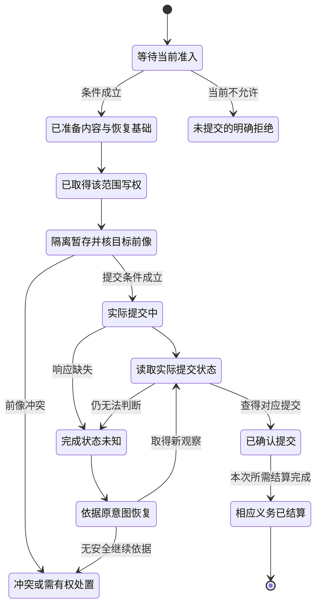

# 任务合同、事务变更与读回

本页的持久状态是唯一语义owner；将SQLite/内容库、操作journal、文件CAS、外部重试、读回与补偿建成实际程序的施工说明见[持久恢复建设流程](../../70-工程系统与演进/工程构造手册/09-授权效果持久化与恢复.md)。

## 任务合同改变时的持久关系

持久操作必须锁定原行为目标、前/后像、输入、方向、Requirement/Method 版本及其解释来源。恢复按**原 Operation 身份及原业务含义**确认或收敛，不能在恢复时加载 latest Requirement 重新计算新后像；同请求身份但内容不同按幂等冲突处理，不能靠切换 Provider 或清理审计记录变成新请求。

对作者采纳，候选和要求源可以在同一变更中修改，但接受关系要与所许可的修改原子一致。最终提交复核正读、负读、成员/规则范围和相交要求版本。只是修改实现时，原任务要求仍参与判断；读取到另一份新政策时根据其真实生效规则重评，不让旧候选自授予权限。

已合格结算的历史 Effect 保留其原始事实和当时资格；新 Requirement 只改变后续采用/迁移条件，不倒改旧效果。旧数据进入新合同须明确迁移；在途 Operation 遇权限或规则变化时，保持原目的并重新核当前准入、回滚或隔离，不无条件执行，也不清除恢复证据。

纯计算没有持久作用时，可以丢弃无消费者的派生缓存并在新请求重新计算；这一自由不推广到付款、消息、文件修改或仍被独立引用的证据。

## 事务化变更、读回与恢复

### 目标

事务运行时把纯 `MutationPlan` 安全地应用到真实工程。它不能在部分提交、崩溃、超时或响应丢失时报告虚假成功。

### 状态机



本图突出选定提交协议的提交与未知分支；准备、写权、配额和媒体故障按下方完整分支合同处理。省略画线不表示不存在该错误，状态名也不能创造跨文件或跨系统原子性。确认提交后发现产物或业务问题，按新前像作前滚修复或明确补偿，不回到“从未发生”。正式检查与发布按另行要求处理，不是本图中的无条件后置阶段。

### 准备日志

不可安全重复的写入前持久化：

```text
PreparedIntent = {
  executionId,
  exact plan,
  target roots,
  readSet,
  writeSet,
  preimages,
  expected semantic delta,
  staging plan,
  recovery strategy,
  authorityRefs and historical decision bindings,
  deadline,
  integrity checksum
}
```

对本节要求耐久意图的作用，日志写入并读回成功后才能执行；日志保存历史决定与引用，不把可执行凭证或旧grant当永久许可。恢复时由当前权威重新准入，纯候选不受这套效果日志前置约束。

### 唯一写者与围栏

冲突域按语义写集、物理写集和外部效果计算。写者获得 Lease 和单调 `FencingToken`。目标适配器拒绝旧 token，防止失联旧主晚到覆盖。

<a id="receiver-fencing-and-stale-writer"></a>
### 接收方栅栏与暂停旧写者

旧写者在租约1内暂停，新写者获得代2后，旧者仍可能带句柄、连接或待发命令恢复。协调器换owner、客户端判断过期或关闭页面均不证明目标拒旧。强排他路线要求实际副作用接收方在与写入原子关联的提交点核对象、操作和世代，拒绝小于已激活世代的修改；较新数字仍不产生授权。

新世代须先在实际目标上完成受授权的激活/条件更新及读回，再对需要该保证的调用者宣布接管；只在租约服务里签发2而目标仍只知道1，不足以拒绝迟到1。接收方重启、故障转移或从旧快照恢复后也须保留/重建相同拒旧基础，不能将世代归零。检查后无条件写、未受控的旁路或旧连接绕过检查都不满足此合同。

缺接收方条件提交时，可采用确实唯一的提交代理、资源分区、停机交接或原任务允许的幂等/人工协调；这些各有前提，不虚构CAS。授权时钟与可回退仿真钟分离，无限离线与即时全局撤权不能同时无条件保证。验证覆盖暂停→到期→新代目标激活→新写→旧者恢复，及重启后拒旧；旧记录消失不代签物理停止。

### 暂存

所有可暂存制品先写到 operation-owned 隔离根：

- 路径不可逃逸；
- 内容摘要和大小验证；
- 不执行生成文件；
- 与目标位于兼容文件系统或有明确复制恢复协议；
- 暂存资源记账；
- 崩溃后可识别归属和回收。

### CAS

提交前同时检查：

- 物理字节前像；
- 语义对象 revision；
- 可写层；
- 所有权；
- 路径能力；
- 写租约和围栏；
- 目标仍适用；
- 相关策略和权限。

任一变化返回冲突并停止新效果。

### 多文件提交

若 Host 支持目录或快照级原子交换，使用并验证。否则采用 journaled commit：

1. 记录提交顺序和每项状态；
2. 为每个替换保留前像或可恢复副本；
3. 每步完成后持久化并读回；
4. 崩溃恢复根据日志和目标状态继续或前滚；
5. 不把逐文件 rename 称为全局原子。

### 读回

提交响应只是观察。终态由目标工作区重新读取：

- 路径和内容；
- 语义重新解析；
- 实际 Delta；
- 生成器和配置；
- 目标不变量；
- 外部发布状态。


**业务操作结果的读回与重新执行分离。** 同一 `Operation` 的接受输入、作用域、目标对象和输入摘要保持稳定；同身份但载荷不同必须冲突，不能读取前一次结果，也不能成为新的合法尝试。收到超时、连接中断或响应丢失时，先按受信操作身份和实际持久提交记录读回；未获可判定的前像/提交状态则保持 `Unknown`，而非推断事务已回滚。读回原结果仍单独核对当前结果披露资格。事务内部的原子集由实际存储 Provider 能力定义；多个独立数据库各自提交成功，不能声明跨库共同不变量已原子成立。

**提交前像必须覆盖相交语义，而非仅覆盖编辑文件。** 两个作者/业务操作分别修改不同记录、源文件或服务时，仍可能同时破坏同一个金额守恒、工作流条件、约束或唯一性范围；准入绑定真实读集及共同不变量，在目标提交点重新核对所依赖修订。仅对每份独立文件执行成功的 CAS 不能代签整组联合语义。

### 不确定完成

```text
UncertainCompletion
→ 检查持久日志
→ 查询目标和外部幂等记录
→ 重新观测
→ ConfirmedApplied | ConfirmedNotApplied | PartiallyApplied | StillUnknown
```

没有有效重复抑制的非幂等作用，只有确认未应用且重试安全才重发；仍在目标承诺的幂等窗口内，可用原键与原载荷按提供方合同查询或安全重复，不要求先证明未应用。两条路径都重新检查本次许可与剩余预算。

### 回滚与前滚

若后继写者已修改目标，旧事务不能盲目恢复前像。优先：

- 对尚未公开的暂存直接丢弃；
- 对可安全逆转且无后继写入的本地变更回滚；
- 对部分提交生成前滚修复；
- 对外部不可逆效果生成补偿；
- 无法判定时保留现场与未结算责任，由实际有权主体按政策恢复、取得新观察或继续停放。

### 验证失败

应用后验证失败不自动回滚。根据影响、可逆性和后继状态决定：

```text
hold candidate
forward repair
safe rollback
compensation
quarantine
authorized recovery or explicit unresolved responsibility
```

### 故障矩阵

必须注入：准备前/后崩溃、写权丢失、暂存耗尽、CAS 冲突、每个文件提交后崩溃、读回不一致、验证器崩溃、日志损坏、旧写者迟到、恢复器重复运行和 Host 重启。

### 验收

- 每个非终态有合法恢复下一步；
- 重放终态不重复效果；
- 部分提交可识别；
- 旧围栏不能写；
- journal 和目标状态可协调；
- 读回决定完成；
- 实际 Delta 可追踪；
- 后继写者阻止危险回滚；
- 资源和临时对象最终结算；
- 有权恢复者取得本次恢复所需的完整依据，仍遵守披露范围；角色不默认限定为人。

### 本地持久写回配置

持久工作区适配器和文件宿主适配器共同承担本合同的可选本地落位。共同应用层先执行与新目录导出相同的资格检查和产物投影，再持久准备；不重写编译器、原生桥接或验收解释器。未选择写回的内存预览不导入SQLite或本模块。

本节配置的支持范围是一个受信POSIX本机根目录中的普通独立文件；配置是目标设计，不表示本包附有实现。合作写者经同一个作用域锁；外部编辑器不受该锁强制约束。前像检查能发现已观察到的外部修改，不能消除检查与rename之间的所有非合作竞态。需要抵抗这种竞态的画像必须使用真正的目标能力/句柄、隔离工作树或快照交换；不得把该配置的有限故障论证升级为敌对文件系统安全证明。

#### 数据与状态分别归属

本地小型恢复画像默认在`.gift/state/control.sqlite`保存以下五类逻辑记录（可按实现合并表）：`meta`保存根身份与当前头，`generations`保存不可变应用胶囊，`operations`保存精确意图与方向，`files`保存读集、写集和前后字节，`events`保存有序尝试与结算。小载荷暂时同库，是为了让内容、引用与准备意图处于同一真实事务；并不合并其语义，也不规定所有生产画像都使用同一个数据库。

头含`revision / desired / observed / observedRevision / active / fence / managed`。`desired`是本地已采纳代际引用，不是已实现的文件树；`observed`是最近一次成功读回的代际，不是持续监控或部署事实。读回操作在合作锁内重读已管理文件，显示是否仍匹配；返回历史头不能代替本次读回。未跟踪的原生文件不自动成为该保证的一部分。

#### 准备、准入和结算

准备工作区操作接收结果引用、明确根、操作ID、预期头修订、逐文件前像和明确删除集；具体客户端函数名可以映射，不能重定义这些前提。相同操作ID只允许相同意图；修改代际、目标或资格要求要产生新意图。准备检查全部路径和载荷预算，冻结调用方输入，持久保存代际、前后字节与意图，然后返回；此时不采纳代际，也不改工程文件。

前像为缺失值`null`，或`sha256 + bytes + mode`；缺失本身是负依赖。新文件必须明确预期不存在，覆盖必须明确旧值，删除必须显式列出。调用方可以额外提交只读依赖。路径清单不是权限；检查器仍要取得受信宿主授权。`gift.workspace-observation/1`绑定根的规范路径、设备与inode；CLI拒绝误用另一根的观察。它是有限观察合同，不是有签名的外部证明。

准入在锁内重新检查全部前像、预期修订和活动操作，分别取得本地代际采纳与文件应用许可，再用一个SQL事务写入`desired`、递增revision/fence及活动意图。若该事务中止，全部数据库变更回滚。**数据库原子性不覆盖工程文件**。准入后出现故障，desired可以前进而observed保持旧值，且active阻止同一根继续接纳冲突操作。

应用先对完整声明读集作恢复预检，再按稳定路径顺序逐文件执行。每步允许当前内容等于前像或已达后像；两者都不等则停止，保留第三方字节。实际替换使用目标同目录临时文件，写入并请求fsync后再次检查权限与前像，再replace并请求目录同步。返回值含实际写入数和已匹配路径数；已匹配不是再次执行。

全部声明文件与读依赖满足后，再读回并在单个SQL事务内更新observed、managed和终态。文件写回过程不执行目标文件中的程序，也不从字节相等推断已理解业务语义。语义往返、业务不变量和真实部署仍需各自生产者；物理字节符合只支持本配置声明。

#### 恢复判定

| 持久状态或现场 | 合法动作 | 禁止动作 |
|---|---|---|
| prepared、没有准入 | 重新核对后准入，或显式abort | 因有准备记录就认定模型已采纳 |
| applying、每个作用点仍为前像或后像 | 取得当前许可，续做尚未达后像的文件 | 新建另一个操作重写全部文件 |
| 已替换、未记逐项回执 | 用意图中的后像读回并继续 | 因缺回执就恢复旧字节 |
| 已全部写完、最终SQL结算未提交 | 重读全部声明域并结算 | 将旧observed当作未发生写入的证明 |
| applied、响应丢失 | 读回并返回原终态与当前是否匹配 | 重放物理写入；把后来漂移改回旧值 |
| 任一文件既不是前像也不是后像 | recovery-required，展示具体路径和原操作 | 覆盖人工修改或猜测来源 |
| 数据库版本未知、内容摘要不匹配、根身份改变 | 停止，走显式迁移/可信恢复 | 自动重新初始化、导入未认证回执 |

#### 回滚不是时间倒流

prepared可abort；已准入的未结算操作可以显式请求rollback。回滚方向先持久化，崩溃后必须沿同一方向恢复，不能默认又前滚。逆序检查每个写路径：等于前像则跳过，等于该操作后像才恢复持久前像，两者都不等拒绝。删除的旧内容来自保存的前像，不从其他文件猜测。

回滚成功使用**新的递增revision**恢复上一代引用，不把修订号调小；事件保留原采纳、部分作用与回滚过程。已settled的操作不能原地回滚，要基于当前头创建新的逆变更，避免覆盖后继合法写入。

回滚保证仅限明确文件及模式。新建但已为空的目录保留，不递归删除；目录ACL、所有者、扩展属性、符号链接和跨文件系统目录替换不在本节配置范围。目录清理和复杂元数据恢复必须另有归属记录与当前权限。

#### 权限、取消与恢复预算

采纳不蕴含文件写权，写权不蕴含采纳；恢复、回滚和代际加载也分别取当前权限。每个新文件作用前再次授权，临时文件就绪后替换前再检查。缓存和胶囊不保存永久许可。授权回调是受信宿主；跨服务实时撤销仍需目标端强制协议，不能把一次回调当全时段保证。

准入前取消不改变头。中途取消保留已发生字节和恢复记录；完成后才观察到取消，不降级真实完成。恢复尝试上限由所选宿主预算画像提供并绑定操作，次数不使用无条件全局常量。画像明确已开始尝试次数、剩余时限、I/O与恢复空间；缺少有效预算时允许状态读取和有权补齐预算，不自动重复写入。耗尽后返回有界停放与监督恢复条件，重复拒绝聚合为有界状态，不能通过删旧意图解除责任。文件数、保存载荷与操作数量另有上限；这些是本地默认预算，不是系统表达力限制。磁盘配额、I/O错误和物理介质故障仍需宿主提供。

#### 故障证据与强度

测试直接终止子进程，覆盖准备事务前/后、准入事务前/后、临时文件持久后、replace后回执前、逐项日志后、最终读回后、结算事务前及响应丢失。恢复进程没有原应用句柄，也不重跑编译器。另测两进程竞争、人工冲突、删除恢复、连续两次变更和回滚再崩溃。各故障方法只对实际执行的环境和切点提供依据。进程中止不等于主机掉电，SQL事务通过不等于普通文件整体原子。

#### 已确认的人工前像与历史生成代际

用户可以在准备新变更前明确接受已有人工编辑作为前像。回滚恢复的是该已接受前像，不一定是上一个生成代际的字节。恢复后再次比较历史 managed 清单；只有它确实匹配，才把旧 observed 绑定到新修订。否则保留恢复后的 desired 引用，把 observed 清为空、observedRevision置0，并让当前读回显示不匹配。不得因为操作名叫回滚就伪造“已恢复到旧制品”。反例是：第一代应用后人工修改，第二代以人工内容为已确认前像；第二代失败回滚恢复人工内容，不得签发第一代生成制品已恢复。历史案例ID无需作为本设计包的运行入口。

## 作者联合发布与外部效果的原子性边界

一项作者编辑涉及多个真实文件时，不能将单个磁盘文件的 rename/replace 与数据库事务混称为“跨文件 CAS”。生产作者 Writer 应先决定完整受管参与者集合、需要保护的读取范围（包括不存在的名字和共享谓词）与本次 `generation/operationId`，将候选内容写入不可见的已 fsync 暂存代际；提交点必须是同一有权存储提供的条件更新的权威头。头成功后的旧 generation 仍可由已有读者引用，真实路径物化及清理作为后续可恢复子状态单独记录。若存储无法提供这些保证，报告原子承诺降级与不可合作外部写者的具体风险，不宣称自动解决。

`Prepare → ValidatePreimage/Grant → StageImmutableGeneration → CompareAndPublishHead → ObserveHead → MaterializeIfRequested → Reconcile/Recover` 是同一 Operation 的状态推进，不是执行结果由过程退出码直接决定。前像失效在提交前拒绝；提交响应超时则以同一 identity 读当前头和日志判定 `COMMITTED / NOT_COMMITTED / UNKNOWN`，只在已确认未提交且新前像成立时重新准备；执行后见到其他写者的变化不能机械恢复旧文件覆盖他人合法更改。外部副作用（构建进程、发布、远端服务）仍走各自有权 Provider 与回执/费用/补偿合同，不被作者 generation 的本地事务隐式包含。

Gift96 隔离样本只读验证与在包外组装 TS 文件，**没有运行本段事务发布器**；此算法是生产接口规范，不能作为该样本已完成持久恢复的 Evidence。

<a id="design-c07"></a>
## 跨事务参与者的协调与补偿

事务实例列出所有参与者、各自原子域、prepare/commit/abort/readback能力和恢复身份。只有实际支持共同协议的参与者才进入同一个分布式原子提交；纯HTTP调用不能靠本地数据库事务包装成跨服务原子操作。强原子要求而能力不足时返回TransactionCapabilityNeed，不悄悄改Saga。

接受Saga时，公开结果含每步状态、已发生效果、Unknown和补偿状态；按业务因果定义哪些步可重试、可逆、不可逆，及补偿失败/期限后的责任。outbox设计只能原子连接其所在数据库的状态与待发送记录，消费者仍须实际去重和读回，不能因此宣称任意外部effect exactly-once。

协调者故障从持久操作及参与者读回恢复，prepare但未决不得按超时随便提交/撤销；协议给阻塞或安全解除规则。重发保留原操作身份和payload，幂等窗口不足时转Unknown处理。补偿每步需当前权限及原作用引用，不能把“恢复成功”混同“业务曾经未发生”。

**验证与反例**：单库成功远端超时、prepare后协调者宕机、outbox重复消费、幂等窗口过期、补偿不可逆和补偿失败逐项验收。

**实际能力边界**：实际参与者和协议资格未取得；没有派发任何跨库/远程操作。

相交合同：[Unknown Outcome 的操作生命周期](事务提交-外部效果与幂等交付.md#design-b25)；[一致性模型与过期写者围栏](分布式一致性与协调.md#design-c06)；[账本守恒和真实资金的不同合同](事务提交-外部效果与幂等交付.md#design-c12)。

<a id="control-five-table-physical"></a>
## 五类持久记录的物理实现

本文件拥有逻辑desired/observed/active/fence、准备/接纳/读回及回滚含义；施工章节首次给出可执行DDL与事务步骤。未结算操作可以在原操作内切换回滚方向，已结算效果才另建逆变更，二者不能混写。

实际数据、调用顺序和失败处理见[相应施工设计](../../70-工程系统与演进/工程构造手册/09-授权效果持久化与恢复.md#physical-control-store-and-transaction-programs)。

## 受界持久本地模型的一次真实事务

[本地装配参考](../../70-工程系统与演进/工程构造手册/25-意图到本地持久程序-可运行装配施工.md)明确把静态模型与现实动作分开：一条已编译计划只能绑定初始修订，`BEGIN IMMEDIATE` 内重查操作 receipt、前像、Method 前提与每步 maintain/avoid，再将实际变化对象、修订、receipt 同事务提交。重放相同操作读旧 receipt；不同身份命中已更新模型返回 `StalePlan`。本机 SQLite 写入中途故障有负例回滚证据；这不说明跨系统 exactly-once、外部作用已发生或真实掉电后的设备恢复。
