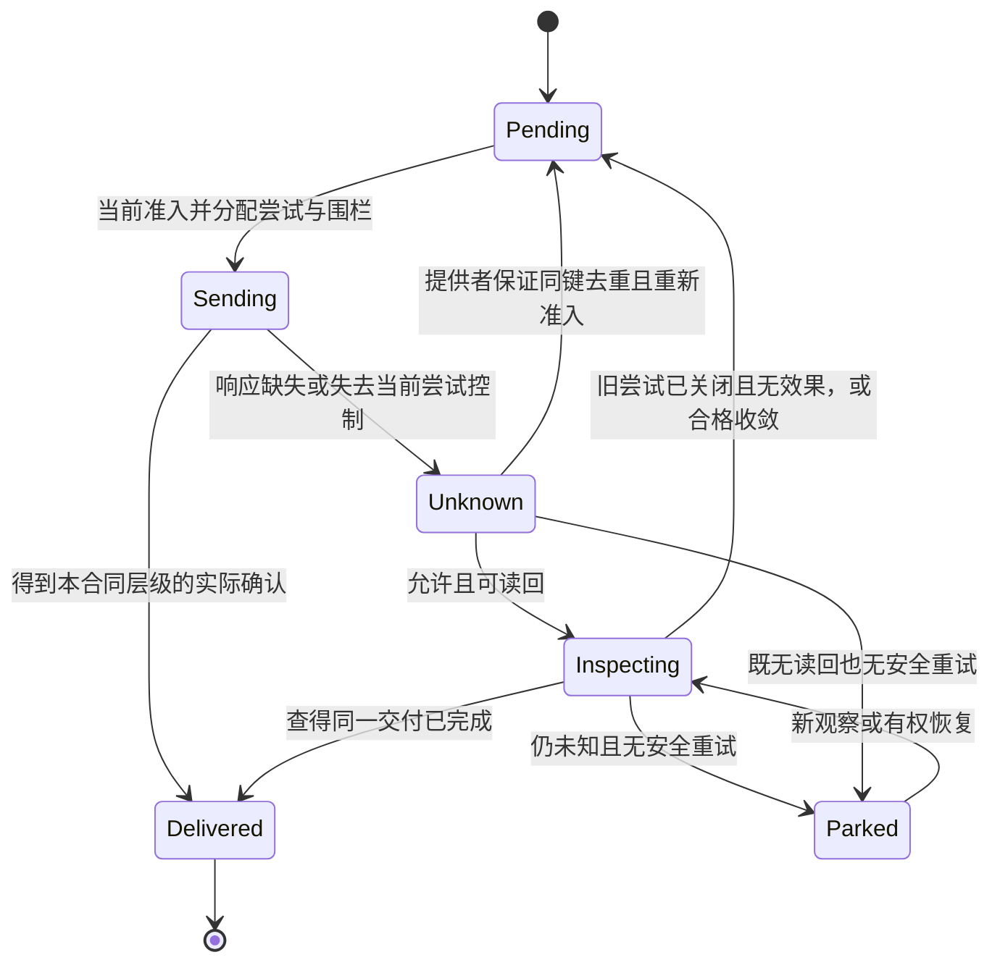

# 外部效果、不确定完成与幂等交付


### 状态/效果恢复

执行单元应区分逻辑Operation、每次Attempt、最终Settlement及Readback。相同Operation重试使用稳定身份和有资格的幂等/补偿规则；重复派发是否可接受由Port+Method+Provider而非编译器默认决定。失败模式包括仅本地事务失败、远端成功回执丢失、局部多资源成功、实际结果不可观察、凭证已撤销、运行进程崩溃和跨版本恢复；不能一律以`retry=true`掩盖。恢复动作应明确前态、状态外泄影响、成本与不可逆事件，不能把补偿等于回滚。


### 原子性、可见性、租约和资源所有权分别声明

“并发安全”必须指定具体共享对象和所需语义，例如顺序一致、线性化、快照隔离、单写者、多读者、事务原子性或最终收敛，不能由 `threadSafe: true` 一概承诺。原子操作需要精确宽度、对齐和允许的内存顺序；CAS 可能失败重试，ABA、对象回收和跨进程持久一致性另有约束。任务的取消不是释放所有资源的证明，锁/租约的失效、续租、代际和强制回收影响下个持有者能否安全继续。长期占有、背压等待、死锁、饥饿和优先级反转是不同风险。

资源 Owner 声明容量、单位、占有者、申请与归还、隔离租户、用量结算、超额策略和真实计量来源。共享资源不能按多个组件私有预算简单求和再加上“无限共享”；跨根供需先按实际身份联合。时间约束必须明确事件时间、墙上时钟、单调时钟、业务日历/时区与截止发生点。硬实时条件还需要最坏情况而非平均延迟，误把计时器请求发出当作时限满足属于未完成行为。

<a id="stable-operation-runtime-boundary"></a>
## 采用设计：抽象业务Effect与实际世界操作的严格交接（R09）

**一次业务指令和一次外部物理效果不是同一个对象。** Workflow 的 `OperationUse` 说明调用哪一个声明端口操作及如何绑定输入；运行 Owner 另行创建不可混淆的 OperationIdentity、授权上下文、尝试ID、幂等作用域、提交记录与观察/读回记录。成功派发/网络返回/远程业务系统受理/最终现实结算要分别建立事实，不允许被 `terminal:succeeded` 自动代签。权限撤回后重复执行、Provider更换、超时响应晚到、跨根相同 idempotencyKey 都须按照真实Issuer、scope、operation及有效期判断去重，不能只用字符串全局唯一。

任何已产生外部效果但本地不知道终态的场景先形成 `UnknownOutcome`；若 Provider 支持同身份读回或终态回执，则以固定事务和授权查清，再决定继续、停止、人工处理或合格补偿。不存在读回能力、外部操作不可幂等或恢复窗口已过时，不能贸然自动重试，也不能把本地日志标成已撤销。这个边界从上层意图一直传递到目标调用与运行恢复，但并不要求在每个 Definition Body 复制一套外部事务字段。


<a id="unified-operation-unknown-recovery"></a>
### 同一个Operation跨授权、派发、未知和读回保持身份

对每一个可能改变现实的操作，必须在派发前确定原始业务意图/Method绑定、Operation稳定身份、精确Grant及其作用域/生效时点、资源预算、重试/幂等和对账方式。**计划、许可Permit、准入Grant、尝试Attempt、Provider确认、实际Settlement和Observation属于不同主体。** Host/Provider发出的超时或连接中断不能证明“没有执行”，必须保留同一个Operation身份和不可判定结果；禁止创造新Operation来简单重试未确认的前一个Effect。

持久化状态机按原运行Owner承担，设计级不变量为：有前像与准入才能尝试派发；`UNKNOWN` 只允许基于原Operation/Provider幂等键的受控重询、重试或人工接管；外部最终性以可信回执/读回的声明覆盖为准；撤销Grant只阻止其生效范围外的新Attempt，不能追溯宣称已经发生的世界作用被取消；确需补偿的操作发出**新的有权补偿Operation**，并明确它可能失败或不能恢复原世界。Provider不存在可靠幂等/查询能力时，进入`RECONCILIATION_REQUIRED`，不能假装at-most-once或exactly-once已经得到证明。

运行结果仅通过已取得的真实观察进入下一轮Meaning/Requirement解释。编译缓存失效可以要求重新生成程序，但不得删除或重放实际Effect账本。一次完成、部分完成、失败、未知、可补偿与不可逆必须各有实际证据和恢复路径；UI显示成功和数据库本地提交不能替代银行、设备或外部服务的事实。


公共`EffectIntent`陈述期望及禁止的外部可观察变化；Method只确定可用操作协议，不触发操作。作者源、已构建Artifact、MethodClaim及规范`permit`都不发行真实Grant。实际派发、回执、重试和结算继续由本篇既有`Operation/Attempt/RetryBasis`合同负责，不建立第二套效果状态账本。

```
prepare(intentRef, qualifiedBinding, frozenPreimage, effectScope, idempotencyDomain)
  -> DurableOperationRef | NeedsPreimage | NeedsQualifiedMethod
check_grant(operationRef, actor, purpose, currentEpoch) -> AllowedDispatch | Denied
submit_attempt(operationRef, providerBinding, attemptIdentity)
  -> provider-receipt | definitely-not-issued | result-unknown
reconcile(operationRef, qualifiedReadback)
  -> scope-specific occurred | not-occurred | partial | unknown
recover(operationRef, originalRetryBasis, currentGrant, budget)
  -> same-operation retry | compensation-plan | wait/readback | authority-escalation
```

**外部效果不变量**：一件逻辑 Effect 持有稳定 `OperationId`，可外发的 Attempt 必须先持久化可恢复前像。超时、HTTP 500 和客户端取消均不证明未发生；否定结算须有完整且有权的读回或提供方可靠保证。再次发同一 Operation 前，应验证原前像、Provider 幂等域和去重有效期；不得因回执未知换新 `OperationId` 盲发。`reconcile` 宣称未发生须排除迟到、复制延迟、缓存与时钟误差。补偿是经新授权的另一个 Effect，绝不抹除旧发生证据。

**运行Grant时效**：计划时的规范许可不等于派发时的执行授权；每次派发或重新派发都检查当时的主体、用途、资源、Grant、撤销代际、预算与审批。撤权阻止后续动作，不改写已发生的结算事实；作者修改也不能撤销历史效果。本地数据库提交无法单独证明跨Provider原子性或exactly-once交付。

请求完整运行系统时，生成物应提供适用的`Operation`、`Readback`与`Recover`端口，且真实授权和结果由运行Owner签发。`source-only`交付可在缺现场Grant、返回`NeedsAuthority`时完成相应源码资格，但不能据此声称运行或部署成功；若所请求的业务正确性依赖缺失的Observer或恢复机制，相关完整交付资格仍须保持未决。

## 外部效果、不确定完成与权威读回

**撤权与在途。（消费条件）：** 已发出而结果未知的Operation继续保留协调责任，但权限撤销不自动允许再次作用；恢复权和重发权单独判断。 合同归属：[委派能力收窄、重定向与执行时再检查](../权限与资源/授权与执行准入.md#gift-delegation-attenuation)。

**在途占用。（消费条件）：** Effect未知终局时，相关计费/资源责任不能按本地取消状态清零；协调失败要返回可交接的未结算负债。 合同归属：[取消后的孤儿资源、额度归属与优先级反转](../权限与资源/资源核算调度与交接.md#gift-resource-orphan)。

**流输出作为作用。（消费条件）：** 修正事件产生的新外部写入应按独立Effect身份并与旧聚合相关联，不能借重算抹去已发送的消息。 合同归属：[事件时间、水位、迟到值与全称完成](../../20-语义与组合/基础语义/状态关系与流/背压与事件时间.md#gift-stream-progress-completeness)。

### Provider 返回值不是现实终态

网络、云、支付、GitHub、部署平台和设备可能在返回前、返回后或超时期间完成 Effect。完成判断依赖该作用合同认可的权威确认回执、状态查询或相应独立 observation；确认只覆盖其实际承诺。受理/入队回执不能当执行完成，超时也不能当无效果。原子操作的合格确认可以作为其范围内依据，不为形式统一强制再造独立验证者；相交 Claim 另有独立性要求时仍须满足。

### ExternalEffectReceipt

```text
ExternalEffectReceipt = exact {
  operationAndAttemptRef,
  providerPrincipalEndpointRegion,
  requestAndIdempotencyIdentity,
  submittedPayloadDigest,
  providerResponseObservation,
  authoritativeReadbackMethod,
  readbackSubjectAndResult,
  consistencyAndFreshness,
  unknownAndResidue,
  effectClassification,
  attemptFinalityRefs,
  reconciliationRequirement,
  compensationReceiptRefs
}
```

`providerResponseObservation` 保留实际确认、受理或错误回执的解释范围。`authoritativeReadbackMethod/readbackSubjectAndResult` 记录本次真正使用的方法与观察；未请求、尚未取得、受权限限制或 Provider 不支持读回时，明确记录对应情况和原因，不能填空结果冒充“已查询且不存在”。合格确认已证明请求范围时，可以没有独立读回；只有弱受理回执或响应未知时，不据此补成完成。回执同时表达已知依据与剩余缺项，而不是要求无读回 Provider 伪造接口。

### 终态

`effectClassification` 是此回执在所声明对象、作用和观察范围内的判断，不是执行进度、请求是否返回或全部责任已结算的总枚举：

```text
effectClassification =
  confirmed-succeeded
| confirmed-failed-no-effect
| confirmed-partial
| completion-unknown
```

`attemptFinalityRefs` 引用本回执实际覆盖的尝试及其关闭依据；没有依据保持未知，不能由“客户端收到错误”补成终局。`reconciliationRequirement` 分别保存是否需要协调、哪些作用/未知/残余仍待处理及需要哪种当前权威；`compensationReceiptRefs` 引用已尝试或完成的补偿操作及其准确结果。只有观察、尝试关闭和责任条件都成立时，原 owner 才能按自己的合同结算。

`requires-authorized-reconciliation` 表示需要实际有权的协调与决定，不必然是人工；它属于协调要求而非效果结论，可以与 confirmed-partial 或 completion-unknown 同时存在。`compensated` 只作为关联补偿结果的有范围摘要：原效果已发生的事实不被删除，部分补偿与补偿未知不能都称“已回滚”。取消等待、退出进程和释放本地句柄均不改变这些区别。

回执不可变。新增权威读回、尝试关闭或补偿产生新的观察/后继回执，引用原操作与前序依据；Application 可派生当前视图，但不能把旧未知回执原地改成成功后伪装成当时已知道。跨多个 Attempt 聚合须明确覆盖集合，不由单个成功子项宣布整操作成功。

**编码演进：** 新交换使用准确协议版本下的上述字段，不兼用 `terminalClassification` 作第二写者。读取旧版本时，confirmed-* 或 completion-unknown 仅映射其原声明范围；旧 requires-authorized-reconciliation 只恢复协调要求，旧 compensated 只恢复有依据的补偿摘要，两者缺失的原效果或终局信息仍未知。曾使用 requires-human-reconciliation 的旧协议保留原人工限制，只有明确版本映射和当前授权才能改变。新消费者不得默认缺少的 attemptFinalityRefs 是空且已关闭，也不能依据字段改名对尚在运行的旧对象强制迁移。

### 重试

重试依据必须同时覆盖原意图、原尝试和真实作用边界。可采用仍有效的目标端同业务身份去重；也可在已排除旧尝试以后仍会生效的前提下，由权威读回确认所要求范围内未发生Effect，再经当前准入发起新尝试。仅收到404、空列表、X=B、超时或取消已受理，均不能单独建立后一依据。更换request ID可能创建重复业务对象；提供者接受某个键字段，也不等于它兑现了同意图去重合同。

<a id="attempt-finality-and-retry"></a>
#### 旧尝试关闭与可继续动作

`execution`在原ExternalEffectReceipt、意图和尝试记录上计算有限的`RetryBasis`，不新增一个业务结果库。需要的输入是：原业务身份/载荷、所有仍可能作用的尝试及转交子操作、准确端点/主体/地域、实际作用种类、权威观察切面、目标去重或最终拒旧能力、当前恢复许可与预算。已存回执缺少其中的依据时保持未知；不能为兼容旧编码把“没有该字段”补成已终止。

**Attempt 关闭**必须证明该尝试及其已转交工作未来不能再产生所防护的 Effect，不等于客户端停止等待。可用证据包括 Provider 已确认的不可逆终态、真实排斥旧工作的撤销提交、已 join 的本地工作结束，或最终生效点的拒旧协议。租约变化、断网、取消请求回执、暂停新增发送或一次读取对象列表均不足。已越过 Provider 最后准入点的任务仍须结算，不能凭本地 fence 计为未发生。

| 内部依据 | 需要实际成立的条件 | 允许继续什么 | 不允许推出什么 |
|---|---|---|---|
| `TargetDeduplicates` | 相同意图、受信命名域及全部作用仍处于目标真实去重窗口，载荷完全匹配 | 按同业务身份、同合同继续调用；产生新的调用尝试但不造新业务意图 | 请求体看起来一样或本地缓存过结果就有目标去重 |
| `ClosedNoEffect` | 所有旧作用尝试已关闭；覆盖所要求效果的权威观察在关闭后取得，或由同一终结证明同时包含无效果 | 当前资格/前像复核后，为原意图发起新尝试 | 当前资源不存在证明过去没发通知，或瞬时未见证明以后不生效 |
| `ProtectedConvergence` | 原任务明确只要求某种可收敛状态；目标比较/版本协议涵盖该要求，全部可观察附带效果也符合允许的重复合同 | 在该有限要求内推进相同目标值，保留其他历史效果的未知 | 值最终相同就有exactly-once、费用不重复或历史执行证据 |
| `WaitOrReconcile` | 上面均未成立；包括只取得点时不存在/前像、拒旧未覆盖远端、去重已过期 | 继续有界权威观察、等待实际终态，或由有权者形成明确补偿/新协调 | 默认重发、用新键绕过去重窗口、把人工确认当无效果证明 |

`ProtectedConvergence`不是默认弱化。普通覆盖文件也可能触发watcher、增版本或计费；这些是任务所约束的效果时必须包含在依据中。旧尝试已完成又被别的主体删除资源时，当前“不存在”不撤销历史完成。需再次创建是新的、有权的业务意图，不是原意图恢复。

具体恢复次序为：**RETRY0**取得可信原意图及相交尝试集合；**RETRY1**先读取原终态/去重合同，能直接读结果就不写；**RETRY2**把`observedAbsent`和`attemptsClosed`分别归类，必要时请求目标停止并等待其实际终结；**RETRY3**在关闭以后捕获所需无效果观察，或验证目标去重/收敛合同的准确范围与期限；**RETRY4**在本地短原子段内占有原意图的新尝试、重新核当前权限/前像和依据有效性；**RETRY5**按原载荷发送并分项结算，响应再次丢失就记录这个新尝试，不能回到“不存在所以重发”的循环。等待期间不持有业务提交锁，真实已付费用和仍使用的资源不退回。 使用有期去重时，窗口必须覆盖旧尝试可能到达并被执行的范围，不能只在新请求发出瞬间尚未过期就认为安全。网络延迟无可靠上界而提供者又不拒绝过期意图时，客户端无法自行保证此覆盖；应取得旧尝试关闭、使用真正长期识别/拒旧能力，或保留未决而不自动重发。

RETRY4的短协调只比较已取得依据、原意图与本地代际并登记下一尝试；外部查询、取消和网络等待在锁外。真实写入前仍由原最终作用边界核有效许可、围栏/前像与目标去重条件，不能把登记时成立的本地检查当成随后任意写入的永久许可。

所有未来尝试的准入和旧尝试集合更新必须由同一操作拥有者串行化；关闭集合后另一执行者重新发送旧尝试，会破坏RETRY3的前提。跨端点没有共同拒旧/去重时，停止自动重发而不是声称本地锁已解决远端重放。在途外部工作不能被枚举或关闭时，选择`TargetDeduplicates`或保持未决；没有要求纯计算逐次持久化这些记录。

**最小反例：** t0提交A，t1客户端超时，t2目标强一致查询仍不存在，t3客户端提交B，t4与t5两个创建分别完成。t2的观察可以完全正确，错误在于把“当时没有”推成“A以后不会发生”。修复的成功轨迹一是A/B共用仍有效的目标业务键，另一是取得A不可再作用的终态后再核无效果；仅多等几秒或多查几次不是第三种证明。

依据与限制见[重试、晚到和保留期](../../../research/sources/存储关系与交付.md#retry-finality-sources)。恢复方案是Gift的合同选择，不宣称各提供者已具备这些能力。

### 无读回 Provider

外部系统没有可靠查询时，先检查是否有真实、仍有效的同业务身份去重或其他安全重试合同；具备时可以按该合同继续。查询和安全重试均不可用时，保留完成未知与残余责任，不盲目重放；由实际有权主体取得其他合格观察、采用补偿或接受相应风险。人工确认只在政策要求且能提供决定性依据时使用，不能让点击确认变成外部未发生的证明。

### 验证

提交后超时、重复响应、最终一致性延迟、Provider 模式漂移、地域或主体绑定错误、批处理部分完成、补偿失败、读回陈旧和外部人工变化；另核补偿成功但原效果历史仍在、局部成功仍有旧尝试未关闭、旧 compensated/协调字段不能补成无效果，及回执后继不篡改旧观察。

<a id="gift-external-outcome-ledger"></a>
### 外部未知效果、资金/资源结算与去重窗口

同一 `Operation` 上下文必须**关联但不能代管**三个不同owner的结果：实际Effect结算、资源/预算/费用结算，及回执与Evidence资格。每个结果分别由原Effect、资源和证据owner维护，不压成一个 `success` 或替对方签名。外部请求已可能到达时，即使客户端超时，仍维持稳定 `(operationId, effectKey, providerScope, generation)`；本地只记 `UNKNOWN_EFFECT`，绝不能新建另一幂等键继续扣款、发消息或下单。若Provider承诺的幂等保留窗口已过，原键再次提交也不能自动认为安全；优先用独立账目、订单/回执查询或人工核对，若无读回只能显式停在待对账，不能从缺失回执推导零效果。

资源计费的预留可在上限内继续封存；释放与记账分别依赖实际计量、账单或明确失败。部分退费、异步补偿和最终账单是后继 `Effect`，不抹消原作用事实。恢复器按原稳定身份逐项解释 `not sent / sent-unknown / observed-applied / observed-rejected / conflicting / reconciliation-required`，并保留读回覆盖与时间窗口。验收轨迹包括“回执丢失但付款成功”“Provider缓存去重记录已过期”“费用结算晚于本地取消”“双Provider各自成功但共同目标未成立”。


**订阅事件顺序与现实去重分别承担。** 已提交事件先按类型、作用域与当前订阅修订解释；若有选择谓词，明确为 `false` 表示排除该事件，求值失败或资源耗尽表示选择未完成，不能视为 `false`。`aggregate` 有序仅要求同一订阅实例、同一聚合身份中的所选事件保持前后驱；不要求全局排序，也不能仅凭消息分区键保证。已排除事件不阻塞后继；未知结算或停放的前驱必须阻挡本有序域的后继，其他业务键可以独立推进。业务行版本可能因无事件修改产生序号空档，不能将空档一律认定为消息丢失。

事件身份与消费者效果身份不能合并：前者属于原事务中实际提交的逻辑事件与部署/租户域，后者还需订阅实例、目标交付域和稳定操作身份。普通重新部署不自动生成新的业务操作。请求已接受、Provider 已执行和终端收件人已收到是不同层次的结算；系统只能签发实际获得的观察。`retry=none` 只是没有计划重试，并非 exactly-once；即使本地 Inbox 有去重，除非它和外部副作用在对应受信边界原子提交，也不能向邮件、支付或远端设备转移一次效果保证。

## 幂等授权与出站交付协议

### 适用对象与唯一责任

本合同约束有持久状态和外部交付义务的业务操作，也约束模型采纳等内部写操作。它区分一次业务提交、一次调用尝试、一个结果读取和一次外部发送，不能用一个请求ID替代所有身份。

本合同不重新定义产品状态机，不要求纯函数引入幂等数据库，也不保证所有网络通道恰好一次。

### 幂等域

默认键为 `(工作区或租户的稳定命名域, 受信幂等主体, 客户端请求ID)`，操作种类与全部影响意图的语义载荷进入版本化请求摘要。相同键同载荷按当前披露权限返回原结果；相同键不同操作、实体、前置版本或语义理由产生`IdempotencyConflict`。主体来自真实调用上下文，默认是承担该意图的稳定用户/服务主体；代理尝试身份单独审计。被授权接手同一意图的另一执行者不因换Agent、令牌或会话而获得重新执行的理由。

不同协议若确需独立键空间，先显式声明生产者命名域/格式版本，不能临时将方法名插入键来绕开本合同。命名域迁移保留旧记录的精确解释，不静默重算旧键。未被承诺为等价的理由变化属于新载荷；纯显示注释是否排除由合同明确。

幂等键不能只由租户和文本请求ID组成，否则两个主体可能互相冲突或读到彼此结果。也不能直接把正文中的 `principal` 当可信身份。真实主体必须来自受信认证上下文，请求 Schema 不能通过自填主体取得身份。

### 三种授权不能混同

初次执行检查业务动作权限；重复结果读取检查当前披露权限；未完成操作需要继续执行时重新进行效果准入，已完成操作不因读回失败而变成可重放。初次授权结果不永久授权未来读取，同样，当前拒绝读取也不意味着旧操作从未提交。

单机画像将动作角色、政策revision与业务状态读取置于同一数据库事务。生产外部授权系统必须明确撤销新鲜度和提交点协议。将一个过时缓存判断粘进事务不能宣称已解决权限竞态。

### 提交原子集

```text
一次业务提交
  = 条件状态更新
  + 业务审计
  + 出站事件
  + 幂等请求结果
```

上述集合只包含本次真实要求的记录；没有业务审计或外部交付义务时不创建空审计或outbox。有这些义务时，所要求集合必须同事务可见。回复必须在提交后；没有提交的内存结果不能先发送给用户。只在提交之后异步调用外部通知，避免慢网络锁住业务事务。数据库原子性来源、隔离条件和耐久假设见机制依据 [S1](../../../research/sources/存储关系与交付.md#单独的来源定位)[S2](../../../research/sources/存储关系与交付.md#单独的来源定位)。

#### 顺序

1. 严格解析、认证调用上下文并确定幂等命名域；不得通过可猜键跨主体查找。
2. 在适当一致性边界内部查询受信作用域的原记录；对外返回是否存在、冲突或结果前，先应用当前披露规则，再核对或报告规范摘要关系。已提交的同请求进入结果读回；读许可不足时不给出可区别隐藏记录状态的额外诊断，不改写旧提交事实，也不因无新写权而重执旧动作。
3. 记录不存在才进入新动作准入；取得当前业务写权限、证据和审批，固定其提交点及撤销条件。
4. 在提交事务内再次占有/检查同一键，读取前像、适用规则目录和不变量，处理并发先提交者。
5. 同事务保存条件状态更新、必要审计、出站事件和幂等结果；冲突不产生部分提交。
6. 原子提交后，再按当前披露条件返回结果；响应丢失沿同一键查询，剩余外部交付独立结算。

新写许可、旧结果读取许可和恢复/重试许可不互相代替。并发操作返回的错误也按披露边界处理，不暴露另一个主体的载荷。“新请求发现已处理”与“同请求读回原结果”仍是不同业务情况。

### 出站交付状态



Delivered只表示选定交付确认层，不自动表示最终用户收到。租约到期不证明旧发送未发生；新围栏仅能限制参加该协议的写者，不能单独防止外部重复副作用。Parked保留义务而非强制某个人工角色。
有限参考把未知发送继续保留在 `sending` 与到期时间中，没有实现网络提供方读回。生产合同应显式记录发送尝试和结果不确定性，不能把租约过期等同于“外部未收到”。

`eventId`标识稳定业务事件；`deliveryToken`标识某次占有；`worker`标识执行主体。接管使令牌单调增加。旧工作者即使迟到，也不能确认或覆盖新工作者的状态。令牌阻止本地旧写，不阻止已发到外部的重复消息。

### 时间与恢复

持久租约使用具有明确 epoch 和来源的时间合同。跨进程重启不能比较失去共同基准的单调时钟值。墙钟前跳可能导致提前接管、后跳可能延迟恢复；因此重复交付安全来自稳定事件身份与接收方幂等，不来自“时钟永远正确”。

同一受控时钟域内的时间推进检查，只覆盖该时间域的过期、接管与令牌关系。跨时钟偏移、失联节点和远端撤权，需要各自的宿主合同与依据，不能从一次本地逻辑时间检查推出。

### 清理与保留

幂等去重窗口必须覆盖本协议允许的重试、队列延迟、离线续做和恢复重放范围，或由更长期的目标端去重/显式拒旧机制接管。仅选一个方便的TTL，不足以证明删除记录后旧作用不会再发生。窗口不能取得有限上界时，在“保留紧凑拒旧记录、拒绝超期请求、借助目标长期去重、明确放弃无限期保证”之间选择，不伪造通用有限保留期。

域代际用于拒绝旧命名空间时，由受信端持久维护其可接受下界；它不是每次令牌刷新或重启就生成的新重试键。旧备份不能把已拒绝的代际重新开放。超期请求没有原结果可读时返回`deduplication-window-expired`及未知边界，不等于未执行；产生新意图必须先做相应业务协调。

日志压缩可将大响应移走而保留必要的键、请求摘要、终态或响应定位，但不能因此永久保留无用个人内容。幂等、审计、出站消息和删除义务各有保留政策；来源摘要和墓碑本身也可能敏感。恢复后先沿[隔离恢复](迁移备份与权威恢复.md#备份恢复与权威重新加入)取得足够的拒旧依据，再开启交付。

同一键安全重复可以在上次完成未知时成立；它要求真实目标端合同、相同意图及仍有效的去重范围，不从HTTP动词或客户端缓存名字推导。重复结果的状态码或观察时间可以不同，业务意图的重复抑制不等于回包字节永远相同。[RFC 9110 §9.2.2](https://www.rfc-editor.org/rfc/rfc9110#section-9.2.2)提供此处的协议依据，不替代具体业务和保留期设计。

### 成本与替代

数据库状态表加审计和outbox适合当前单机一致性要求；把所有历史改为事件溯源不是必要前提。高吞吐系统可采用分区、批量投递与有界并行，但不得改变每聚合版本序、权限与幂等域。

对只需短期、可重复副作用的操作，内存去重更轻，但不能宣称跨崩溃有效。对外部本身具有强幂等语义的接口，可复用其键合同，仍需绑定真实主体、端点和保留期。[S3](../../../research/sources/存储关系与交付.md#单独的来源定位) 对自动重试的限制只提供协议边界，不替 Gift 推导业务幂等。

### 关键反例

同租户不同人相同请求ID；同请求换操作；授权撤销后读缓存；审批与取消并发；状态提交而审计未提交；通知成功但确认丢失；旧worker接管后迟到；时钟大幅跳变；幂等记录被回收；恢复旧备份；跨租户消费；令牌整数溢出。

模拟时钟参数不构成远程时钟验证。事务、重复、竞争、进程退出和围栏分别按实际方法及环境验证；进程故障不能代签掉电、介质或跨节点时钟保证。

<a id="gift95-cross-contract-19"></a>
## 从设计绑定到未知外部效果的恢复身份

当需实际写源码、构建、安装或发布时，Operation必须绑定精确作者/Artifact Revision、目标路径/资源、规范载荷、当前Grant和幂等条件。外部超时后若作用可能发生，结果进入未知，按原Operation身份读回并与实际供应者对账；不能因为重新调用同一个 `methodRef` 就认为天然幂等。

后继作者设计变化不会改写旧Attempt事实；即使已生成新的TargetProfile/Method计划，旧真实副作用只能按自身原意图及资源持有者规则结算。

## 产品 Meaning 与外部效果不能相互代签

从[全域语义](../../20-语义与组合/共同语义/工程通用语义全域与闭合合同.md)取得的订单/库存/支付等业务义务，只构成需要保持的合同；是否取得 Grant、哪个 Operation/Attempt 真实执行、已/未/部分/未知结算及幂等凭据寿命，继续由本页拥有。一个 `derive` 函数或状态图即使类型正确，也不能自动签发真实外部效果成功。

## 单库存本地 Effect 的可执行接合：容量预留参考约束

本节保留**外部Effect的真实结算责任**，以[有限本地实验的研究说明](../../../fixtures/semantic-universe/Gift104/README.md)中的容量预留为受限设计案例；原执行代码不随本包运输，本节不声明本次复验结果。案例操作`reserveOneCapacityLocally`表示**只在同一个可信本地 SQLite 库**对当前 aggregate 的容量扣减 **1 个定义的计量单位**；`guard:capacity.atLeast` 则是执行前最低可用量门槛，不是扣减量，不允许从 `atLeast=2` 推断此次扣减 2。

一次有效操作的精确输入包含：编译作者模型的 `semanticRevision`、`aggregateId`、`operationId`、`expectedRevision`、事件、经受信发行者绑定的 actor/roles/action/resource/effect/expiry，及应用当前目标实现的字节锁。`SIMULATED_PLAN_ONLY`、模拟 attestation 和模拟 guard witness **都不进入授权输入**；若目标转换依赖 `cd:observation`，而没有具资格的现实事实消费者，就返回 `NEEDS_QUALIFIED_OBSERVATION_ADAPTER`，不从模拟器提升证据等级。

**原子状态变迁**：设数据库中的当前 aggregate 为 `(state, revision, modelRevision)`，容量为 `(source, unit, available)`；首先按 `(aggregateId,operationId)` 查已提交的 receipt。相同请求与相同授权身份的重复操作只能读回原 receipt，身份复用但作用不同则 `IDEMPOTENCY_CONFLICT`。对尚未提交的操作，先完成签名与作用域、授权时限、modelRevision、当前状态/修订的比较和策略 deny 优先检查，再在同一个 `BEGIN IMMEDIATE` 事务中读取真实容量，判断 `available >= atLeast`、只有已登记的 `fixture-utc-clock` 才能以受信宿主 UTC 秒钟消费截止语义（其他时钟 source 返回 `CLOCK_SOURCE_NOT_QUALIFIED`）、时限满足、修订未达 `2^64-1`，一次性写入 `(nextState, revision+1, available-1, receipt)`。不允许分别提交状态与容量，也不允许把读取到的模拟容量当作数据库当前值。

**提交、未知与恢复**：提交前异常必须回滚全部更新；SQLite 提交后、响应返回前丢失连接时不能直接再次尝试效果，只能按原 operation identity 查询 receipt 决定是否已执行。该样本把读回称为 `LOCAL_REPLAY_READBACK`，实际提交称为 `LOCAL_COMMITTED`，外部 Provider 效果永远为 `NOT_ATTEMPTED`。它使用 WAL + `synchronous=FULL` 在正常本地 SQLite 条件下提交，不因此证明真实断电硬件持久性、网络文件系统、跨数据库原子性、备份恢复、分布式 exactly-once 或其它 Provider 的提交语义。

**扩展边界**：新增的真实 Effect kind 必须独立给出可观察作用、授权消费者、实际事务/补偿法、重试窗口、幂等主键、readback 与错误定义；不能简单把 `reserveOneCapacityLocally` 的 Method 复制为支付/发消息/设备写入。提供不存在的原子性或第三方事实时须停在 Needs/Unknown，保留可用纯规划输出。

<a id="prebootstrap-effect-state-machine"></a>
## 真实作用的派发、未知和恢复的最小状态规则

在原 Operation/回执模型中，先有冻结意图与实际准入，再有持久派发身份，随后才调用能产生作用的 Provider。状态含义至少区分尚未尝试、已准入未派发、已派发/接受待结算、确认无作用、确认成功、部分作用、完成未知与补偿责任；这些是既有结果语义的细化，不建立第二套操作数据库。

派发前记录足以识别该操作和重建查回的信息；派发之后发生崩溃或通信超时而无可靠回执，进入完成未知，不能回到“未尝试”。重试使用同一逻辑操作身份与原有效载荷，幂等键的范围、保留期和 Provider 对相同键不同载荷的拒绝均要固定；键过期后不能假设还安全去重。新业务请求不能因为载荷相同就复用旧操作身份。

查回先确认真正作用域和操作，取得已签/可信来源的当前结算；没有 readback 能力就保留未知或走人工/安全隔离策略。只在 Provider 明确保证未执行或幂等重派安全时才重试。补偿是新的有授权业务作用，有自己的失败与未知，并非时间倒流或原子回滚；无法补偿的不可逆点必须在执行前暴露。

单数据库提交可把该库内状态变化与回执置于同一事务，但外部网络、设备或另一数据库不因此也被原子覆盖。跨域协议要定义实际协调者、确认与恢复；没有则拒绝“跨域恰好一次/全原子”的强声明，不要求纯计算无端装配分布式事务。物理动作的最终性与本地日志 durable 是不同事实。

恢复只根据原操作版本、真实 Provider 状态和当前授权处理；不能因最新作者意图已删除就忘记旧动作，也不能用新默认参数重新执行旧请求。Gift 编译器/控制面升级后，仍保留旧操作所需解释和查回能力，直到责任真正结清或合法移交。

<a id="design-b25"></a>
## Unknown Outcome 的操作生命周期

外部作用采用既有Operation身份和不可变语义payload。安全派发顺序为：冻结意图/前像与授权依据；持久化Operation及幂等坐标；准备供应；在临近dispatch时核当前权限/期限；派发；记录观察并通过独立读回结算。准备成功不等于已执行，网络断开不等于未执行，receipt收到不等于所有业务后继完成。

状态必须区分未派发、已派发待确认、确认已发生、确认未发生、结果未知、补偿中及补偿结算。结果未知时复用原idempotency key和读回坐标，仅在Provider确实保证其幂等寿命覆盖重试时允许安全重复；供应幂等窗口过期后不得换新key盲重试。缺读回能力时保留Unknown及人工/独立证据的处理入口，不能由无限重试制造伪可靠性。

恢复先核持久记录完整性和真实供应状态，再决定重发、结算或隔离；本地“发送完成”日志不能代替远端事实。补偿是独立且受权的新操作，引用原作用、有自身前像/错误/幂等与读回；若原作用不可逆或补偿无法完全恢复，准确记录残余影响。源码回退、删除任务或取消等待都不撤销现实已发生状态。

单库事务、远程服务和迟到设备命令分别提供证明范围：同一数据库原子提交不推出跨服务exactly-once，设备最后一个ACK不必证明物理动作达到目标。整体用户状态要同时显示已知部分与未知部分，不能只保留“失败”丢掉已发生成本。

**验证与反例**：有限状态见证检查dispatch前持久化、重复响应、重启Unknown、过期幂等窗口、迟到成功和补偿失败；真实Provider与设备观测另列。

**实际能力边界**：真实远程/设备效果、当前Grant和幂等readback未执行。

相交合同：[授权、披露和已发生作用的区分](../权限与资源/授权与执行准入.md#design-b24)；[工作区发布和非合作写者](版本库与文件系统提交.md#design-b26)；[跨事务参与者的协调与补偿](事务提交-任务合同与事务读回.md#design-c07)；[设备动作、测量和安全状态](../../20-语义与组合/交付语义/设备与实时交付.md#design-c22)。

<a id="design-c12"></a>
## 账本守恒和真实资金的不同合同

账本实例定义LedgerId、账户、币种/单位、JournalId、entry量、账期及版本。每份被接受journal按币种有符号金额和为0；不同币种不直接相加，换汇必须通过明确汇率/舍入/对手账户规则。余额由已提交不可变journal投影，修正通过反向/调整journal，不能删除历史而假装从未发生。

同账本同事务提交核journal唯一身份、账户/币种合法、当前前像、约束和授权；已存在相同操作返回原receipt，不同payload同ID冲突。提交与业务订单状态是否原子由真实存储域决定；本地守恒不能证明外部银行/支付服务结算完成。结果保留Rejected、Committed和Indeterminate，而不是只用布尔成功。

外部资金动作独立Operation/Provider和读回，账本记账和现实余额需要对账来源；异常差异进入悬账/调查/补偿，不自动改数使其看起来平衡。账户关闭、撤权、灾难恢复及ledger schema升级按明确前像/epoch处理，旧writer不得继续记账。生产强安全和法规资格另有真实权威。

**验证与反例**：每币种守恒、同ID异payload、跨币误求和、已本地记账远端未知、重复receipt、补偿失败和旧writer重连。

**实际能力边界**：本设计包只保存相关规范及有限整数模型，不包含真实支付的执行记录或金融领域资格证据。

相交合同：[Unknown Outcome 的操作生命周期](事务提交-外部效果与幂等交付.md#design-b25)；[跨事务参与者的协调与补偿](事务提交-任务合同与事务读回.md#design-c07)；[认证主体、凭据与授权决策](../平台生态/安全信任与外部权威.md#design-c09)；[费用、配额与迟到计量](../../20-语义与组合/基础语义/计算基础/定量合同与误差传播.md#design-c11)。

<a id="design-c29"></a>
## 库存、位置与履约事实

履约实例定义订单/包裹/批次身份、单位、地点/坐标/时区、可用/预留/在途/已交付状态、时窗、容量、过期和损耗规则。库存计算与现实盘点不同；路线计划不是已发货，承运方受理不是已送达。每次现实状态更新绑定来源、事件时间和版本。

预留需在实际协调域内原子核余额/容量，超期释放与支付Unknown按联合政策处理。拆单/合单保留原订单映射与数量守恒，单位换算/批次替代/先出规则显式声明。规划方法可优化成本/时效，但不得违背不可替代地点、危险品/冷链等由真实业务Policy提供的硬条件。

迟到/重复扫描、丢件、部分交付、库存差异和承运方断联分别结算；补发是新的受权作用，不能自动重用已送达状态。重规划考虑已不可逆的路段/发货和共享资源，恢复围绕原identity和真实读回而不是重置订单。最终责任/赔付由真实合同主体规则决定，不从本地状态图推出。

**验证与反例**：并发最后一件、支付Unknown释放、拆单数量守恒、重复扫描、错单位、计划已完成但现实未发货、部分交付与补发。

**实际能力边界**：真实库存/地理/承运方/业务政策及作用证据未取得。

相交合同：[跨事务参与者的协调与补偿](事务提交-任务合同与事务读回.md#design-c07)；[费用、配额与迟到计量](../../20-语义与组合/基础语义/计算基础/定量合同与误差传播.md#design-c11)；[规划与优化的可行域、目标和证书](../../30-实现解析/实现选择/设计空间搜索与求解.md#design-c13)；[组织批准、责任与申诉](../../20-语义与组合/共同语义/决策风险与利益约束.md#design-c28)。

<a id="本责任的相交定案"></a>

**关联规范：**[跨事务参与者的协调与补偿](事务提交-任务合同与事务读回.md#design-c07)。

---

<a id="gift-business-world-effect-refinement"></a>
## 高层业务意图与真实外部效果的接口（不能由模式实例化自行授予）

从已接受业务意图到 `MethodBinding/Artifact` 后，现实操作仍有独立准入：具体主体、有效 Grant、Provider 能力/协议/版本、操作前像、对外 payload、幂等身份、真实提交范围、预期读回与恢复所有者。公共业务模式仅给出例如“资源被有权分配且不会超额”的**要求**，不能由 `resource.reserved += 1` 或 `confirmed=true` 自动声明已发生医院/云平台/支付/设备效果。

业务合成方法若引用真实 Provider，先用目标服务合同精化其前置条件、保证、可见错误、时序与重试语义。装配生成受检适配器和准确 Operation；执行时在准备前保存可恢复身份，作用后按原尝试记录结果。客户端得到超时、进程取消或网络断连仍可能有结果未知；沿原 Operation/Idempotency 的权威读回或真实目标去重/拒旧协议恢复。补偿是具有独立身份的新作用，不能把既往效果当作从未发生。

在时间、主体或规范规则变化时要分别更新：已接受意图的解释/绑定、未来操作准入、历史已发生事实、后续取证和必要迁移。机构授权撤销可以阻断新的真实作用，却不会抹去已接纳的负债、在途结算及旧 Receipt；另一个 Provider 的成功也不代表全系统都已完成。需要持续监控或定时义务时，必须选择真实负责的调度/观察者，不能让一次编译通过冒充无限未来符合性。
