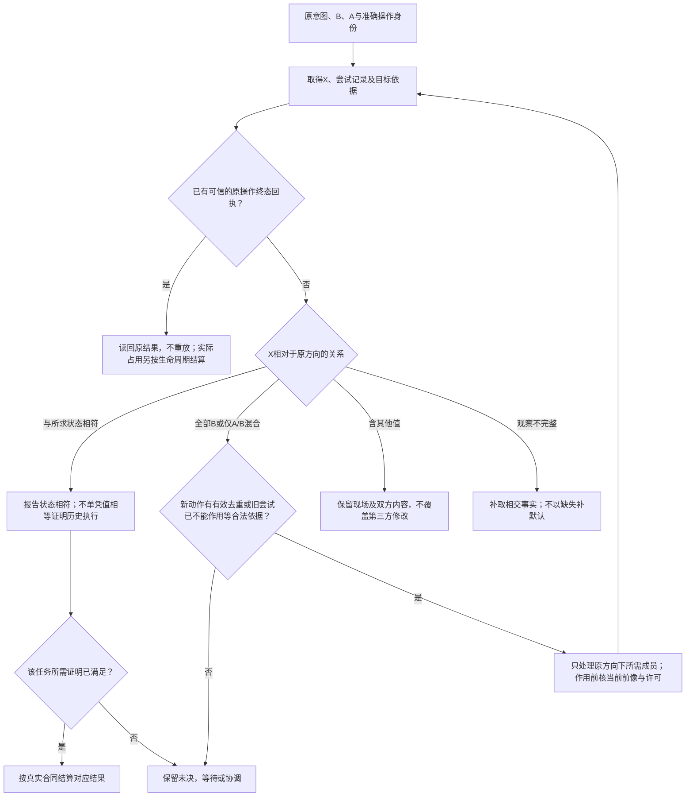

# 恢复状态机、前后像与发布顺序

## 提交恢复状态机与故障切点

### 规范归属

原[核心提交协议](持久状态与存储协议.md#核心数据存储与提交协议)拥有内容与元数据的顺序，本篇将其展开为实施状态、边界错误和故障试验。模型事务与外部效果是两个相关但不同的状态机；不能用一个 `done` 字段同时表示数据库提交、消息已发、远端效果已完成。

### 模型操作的状态与转换

`proposed → prepared → content-ready → committed` 是含CAS内容的写入路径；纯元数据变更可以从prepared进入committed。`prepared/content-ready → aborted` 仅在围栏和提交排斥条件成立后允许。`committed`不可回退成aborted；业务撤销是新的操作。发生介质损坏或无法判断外部状态时进入恢复分支，而非把历史记录改成未发生。

准备事务登记 `operationId, requestDigest, scope, baseRevision, authorityRevision, fence, expectedWriteSet, contentPins`。同一幂等键不同requestDigest返回冲突。相同请求重试先读记录，已提交返回原结果；未提交继续时重新检查当前权限、前像和围栏。外部返回给无权调用者的结果必须仍经过披露授权，幂等查询不是数据泄漏通道。

提交在线性化点之前同时检查：当前写scope的围栏；权威revision/许可；精确前像或受支持的不变量冲突规则；准备状态；完整内容可达性；请求摘要；事务内约束。然后在同一个DB事务写模型变化、操作结果和outbox。任何一项失败，DB事务不产生部分模型变化。权威撤销若发生在提交之后，它不抹除已提交事实，但禁止后续新效果；发生在提交之前则由同域revision检查拒绝。

围栏token的意义是存储拒绝旧owner，不是计时器认定旧进程已死亡。发出新token与受保护存储比较必须有同一可线性化排序，不能从应用时间戳猜测。租约用于安排进度和活性，围栏用于迟到写入的安全性。

### 响应丢失与两类重试

DB提交后到响应前中止：恢复者查询operationId；结果存在就返回原结果，不再重复更新。提交前中止：若没有已提交记录，按准备、内容和权限重新选择继续或取消。请求是否提交不能仅靠客户端超时判断。

数据库冲突属于可重新计算的计划；外部效果未知属于必须读回的结算。两者不能用同一 `retry()`。所有重试都携带预算和诊断，有限确定性失败不能指数退避后无限重放。

### 出站交付状态机

`pending → dispatching → acknowledged`；响应丢失进入 `outcome-unknown`。若远端支持稳定幂等键与权威查询，可以用相同业务效果ID重复询问/投递并确认；若不支持，则保留未知、停止可能重复的不可逆投递并要求有权处置。至少一次消息传递不能推导任意远端恰好一次效果。

队列消费者资格与领取代次要在结算时检查；旧领取者不能把新尝试标为成功。outbox与模型同事务，但远端ack不在本地事务里。顺序有业务含义时携带聚合revision；接收者检测缺口、重复与超前，不按到达时间猜顺序。

### 内容库、GC和恢复

内容发布后、DB引用前中止：存在带准备pin的孤儿，可以后续继续或回收。DB可见引用前必须确认目标内容合同满足。GC看到无引用不是立即删除权；其隔离代次与新引用提交排斥。取消准备先使未来提交不能成功，再移除pin，最后择机回收。读者需要的恢复根、证据根和租约pin不得因磁盘满而误删。

远端CAS允许内容暂未物化时，主体状态应明确pending-materialization，不能复用完整制品状态。备份包含DB快照和该快照可达内容，不要求复制无关缓存。恢复后核对外部已发生效果与权限变动，避免从历史备份重复执行。

### 故障切点与明确Oracle

| 切点或攻击 | 注入 | 必须观察到的结果 |
|---|---|---|
| 准备前 | 进程立即结束 | 模型、操作与outbox均无新增 |
| 准备提交后 | 进程中止 | 准备可解释，模型未变，可恢复/取消 |
| DB写模型后、写outbox前 | 强制中止或异常 | 全事务回滚；不能有模型变而outbox无记录 |
| DB提交前 | 强制中止 | 旧头与旧值完整 |
| DB提交后、响应前 | 强制中止 | 新头、操作结果和outbox一起存在；重试不重复 |
| 同前像双进程写 | 同时提交 | 至多一个成功，另一个冲突，不丢更新 |
| 不同请求共用幂等键 | 重放 | 摘要冲突，不返回另一个请求的成功 |
| 旧围栏 | 先换代再提交 | 旧owner被拒绝且无模型变化 |
| 权限revision变化 | 撤销后提交 | 新效果被拒绝，历史查询按披露政策 |
| 远端ack丢失 | 已收而本地未知 | 幂等可查询时正确读回；否则保留未知 |
| 磁盘/配额不足 | 内容或事务失败 | 不宣称成功，保留唯一恢复材料 |
| 媒体损坏 | DB或blob被破坏 | 完整性检查阻止提升，进入隔离恢复 |

每个试验记录OS、文件系统观测、数据库版本、PRAGMA、进程数量、注入点、原状态、最终读回与清理。SIGKILL/进程强制结束只证明当前进程中止情形；无证据时不能推广到主机掉电、控制器缓存失效或远程网络盘。

### 安全性、活性与有限模型

安全不变量：同操作至多一个模型提交；提交与outbox一致；旧围栏不写；前像冲突不丢更新；未提交操作不获得提交结果。活性另需假设：存储最终可用、重试有调度、权限仍足够、外部读回可得。缺这些条件时正确结果可以是等待、取消或保留责任的有权恢复，不保证无限期网络分区下所有任务完成；取消仍不等于外部已停止。

采用有限状态探索时，公布变量范围、转换、实际访问范围、截断与失败轨迹。有限实例检查只支持对应范围，不是对无界进程数或任意实现的证明。验证方案包含移除围栏检查、把outbox移出事务的故障变体；实际执行后应检出所针对反例，否则不能用“正常通过”支持关键设计。

## 依真实前后像选择恢复动作

### 图解：按真实B、A、X恢复，而非重新生成目标

B为原前像，A为原后像，X为当前观察。先核归属和当前权限；不完整观察不通过默认值补齐。

本节为已有准备、准入、逐文件应用、结算和反向恢复补齐操作选择表。它不替换各目标的物理协议；数据库提交与普通文件写入仍是不同原子域。

### 恢复所需输入

恢复者先从可信持久意图取得原逻辑请求身份、内容代际、目标根身份、路径/键集合、前像B、预期后像A、已选方向、最后已确认阶段及恢复资产。核对意图和引用内容完整性后，取得当前披露与恢复权限、冲突域协调和真实目标观察X。不能从活动作者源码重新生成A，否则恢复的将是另一次需求。

元数据缺失时先判它是可重建缓存、可从可信结果日志恢复的索引，还是证明业务意图所需的不可替代状态。前两者可以依已有来源重建；最后一种缺失时返回需要权威重建，不把目录存在当成原操作已完成。

工程升级的原备份同时保留封存前像和所属操作的组成动作意图；两者不是相互独立的恢复数据库。组成动作在现实写入前固定准确目标、原前像、预期后像、顺序与所属操作，写入后另存实际结果；相同路径的后续动作消费已确认的前一后像，不能将后来读到的任意内容采纳为新前像。数据记录可以保存内容、权限投影与物理身份事实，但不保存可复用的物理权限；恢复重新取得原物理拥有者的当前观察和许可。

升级的自动反向恢复只适用于前后像、成员和实际结果完整的已支持组成动作。普通文件更新、新建、删除和改名分别检查当前内容、模式、存在性及联合源／目标状态；外来文件、新成员或未允许的模式变化使恢复转为`recovery-required`，保留现场与原备份，不能先删除整个当前目录再用备份重建。已知组成动作的合法前后像混合与不明部分效果分开处理；恢复先保存反向方向，逐项在作用点比较，完整原前像读回成立以后才能报告`rolled-back`和退役备份。恢复所需的权限模式必须由已选择的物理能力准确承担；普通模式使用已固定的前像值，不从稍后重新打开的备份继承新模式。特殊权限位没有合格恢复供给时，在任何反向作用前拒绝该恢复，不能用旧备份赋予额外权限。

某一能力没有完整组成动作回执时，必须在调用该能力前记录恢复覆盖缺口。目录树批处理、无法确定所有权的父目录创建及生成／格式化／覆盖／锁发布组成的编译作用，在未提供完整前后像闭包前均不具备自动覆盖式回滚资格；它们可以按原许可完成正常操作，但后续失败须保留备份与未结责任，不能将“有备份”提升成安全恢复保证。后继实现只有接通这些生产者、比较恢复与验收以后才能扩大自动恢复范围。

旧定位器、缺少意图的历史备份或仅从序列化字段重建的对象按恢复未知处理，不自动补造预期后像，也不自动删除。当前受理的恢复句柄与持久内容事实分开；新进程必须先经实际恢复入口重新准入，读取历史记录本身不恢复旧权限。格式迁移不得让不理解这些关键条件的旧写者继续作用；无相应恢复入口时准确保留人工／后继有权处置所需的原位置与材料，而不宣称自动续跑已具备。

### 按观测谓词选择行动

下表在原意图与目标归属已核对后使用，按上到下处理。条件里的“相同”包含本次协议要求的字节/值、成员集合、模式与根身份，不仅是路径存在。进入新的正向/反向作用前，先通过[旧尝试关闭与可继续动作](事务提交-外部效果与幂等交付.md#attempt-finality-and-retry)。已有可信的原操作终态回执可以按其真实范围查回，不为读取历史结果再执行一次操作；操作结果结算与仍在用的资源释放分别判断。没有原回执或其他足够依据时，X=B或X=A只是现场观察；任务若只承诺当前状态且已满足其全部条件，可以准确结算这一较弱结果，但不能据此宣布历史执行恰好一次、旧工作已停止或资源已可释放。

| 当前观察 | 正向恢复 | 反向恢复 |
|---|---|---|
| 原意图或目标归属不可信/不匹配 | 停止写入，保全现场，重建可信关系 | 相同；备份文件不能夺取目标写权 |
| X不可完整读取或作用是否发生仍未知 | 依目标合同读回/同键协调，暂不写覆盖 | 相同，未知不是可回滚前提 |
| B与A相同且X满足该值 | 不需要重复写值，记录条件已满足；历史执行仍按真实记录解释 | 同样处理，不伪造一次曾经发生的写入 |
| 所有受检对象已为A | 读回结算或补齐丢失的结算记录 | 在当前许可与比较保护下按意图恢复B |
| 所有受检对象仍为B | 在当前准入后按原意图应用A | 读回确认B，结束对应反向恢复 |
| 每项分别为其B或A，属于允许的中断混合 | 只处理仍为B的项，逐项比较并读回 | 只处理仍为A的项，按已保存反向方向进行 |
| 至少一项既非B也非A，或出现未允许的成员/模式改变 | 返回冲突及可披露差异；有权形成新意图后再改 | 相同；不把回滚理解成强行覆盖人工内容 |

受检的只读依赖也参与判断：它变化可能使A不再可采用，即使写集仍是B也不能直接继续。最后的比较必须由实际原子目标或相应协作协议承担；仅在检查后无锁写入，仍存在检查/使用竞态。本地协作锁不宣称阻止任意不合作管理员或敌对文件系统。

### 准入、写入和结算的具体交接

准备只持久保存意图与前后像，不改变目标头。准入在可承担的存储事务中验证期望修订、规则目录与围栏，记录目标代际和活动操作。文件执行按原计划处理临时字节、单文件替换与读回；多文件过程可能有中间态，读者是否会看到它由所选发布机制决定。全部相交条件满足后才更新已观察代际和结果。

操作完成以后响应丢失，新请求先按同一逻辑身份查原结果，再根据当前披露权返回；没有写权但有读权时可以读结果，不要求再次取得写入准入。重新执行只有目标幂等/比较协议保证时才允许。同键异载荷产生请求身份冲突，不能通过更换内部操作种类绕出去。

### 基础控制动作只接合一个稳定恢复意图

只携带`operationRef/action`的基础控制请求没有独立命令身份和预期状态代际，不能承载同一运行中的周期性暂停/继续。其每个有作用的`(operationRef, action)`只能在原Operation的固定合同内接纳一次稳定控制意图；`status`仍是按当前披露权读取实际状态。执行Owner在原operations/events中持久关联该动作的接纳依据、固定恢复方向及唯一continuation或补偿Operation引用，不增设竞争账本。

接纳时先核当前权限、原操作及允许转移，在原协调/比较域内以一次原子CAS接纳意图并保存所需子Operation/continuation关联，然后才调用恢复程序；CAS失败先读回胜出的原关联，不重复分配并派发。相同基础动作重复到达，先读回已接纳意图：未完成时仅join或依据原RetryBasis继续同一恢复；已完成则返回其原结果与当前观察，不把它解释成对新暂停轮次的第二条命令。已有恢复方向、终态或其他动作使该固定转换不再合法时返回状态冲突；不能为使迟到命令成功而切换新目标。相互冲突的cancel/resume/rollback由原Owner串行化接受关系，不按网络到达的最后一个值覆盖状态。

rollback导致新补偿或已结算操作的逆变更时，先分配并保存唯一子Operation关联再允许派发。响应丢失后查原关联；即便补偿本身失败或未知，也只按其身份恢复，不能因再次收到rollback创建第二笔补偿。子Operation仍单独消费当前授权、前像和自己的结算合同，原动作关联不是永久许可。

重复的暂停/继续、不同恢复决策或同一运行的后续控制轮次，只能使用已协商、能携控制请求身份和预期状态代际的调试/进程扩展，并在真实控制点比较后接纳；没有这种能力则明确返回需要代际扩展或原Owner提供的新合法恢复引用；不得仅更换身份绕过未知旧作用。原基础动作记录丢失、过期或无法核真时不得重新当作首次命令执行，应返回恢复资料缺项。

反例：第一次resume完成后运行再次暂停，旧resume响应丢失引起的网络重放只返回第一次控制结果，不恢复第二次暂停；第一次rollback已派发补偿但回执未知，重放只定位原补偿，不再建立新补偿。有限内存画像只在其明确存活与去重窗口内作此保证；承诺跨重启控制恢复时才要求相应持久载体，记录丢失不证明旧命令未作用。

### 回滚不是历史修订倒退

回滚以当前观察为前提，按已保存B恢复对应数据；修订与围栏继续推进。B可能包含当时人工已编辑的内容，不等于上一份生成物，因此恢复后重新核对“已观察代际”。不能直接把旧标签贴回去。已完成的业务需要撤销时形成新的有权反向操作，不把过去结果改成从未发生。

临时文件只清理由本意图明确拥有且仍满足记录身份的对象。陌生文件、后来创建的成员和已被其他任务使用的资产保全。恢复失败留下明确拥有者、剩余对象和允许下一动作；候选与历史不会因清理失败丢失。

### 可复核的三条轨迹

1. 写入A后、响应前退出：新进程读取同一意图，观察X=A，完成读回后返回原操作结果，没有第二次业务作用。
2. 两文件只写完第一份：X=(A1,B2)，在仍满足前提和权限时只继续第二份；期间B2被人工改成C2，则转冲突而不是覆盖。
3. 反向恢复中断：方向已持久为rollback，恢复者继续将仍为A的对象转到B，不因默认路线而重新正向应用。

这些是协议轨迹设计。外部系统不提供必要观察、去重或原子能力时，明确停留在未知/恢复条件，不能借一张决策表创造不存在的物理保证。

## 最终所有者和跨存储发布顺序

成品HeadStore的提交由execution唯一调用，workspace只生成含前像的保存计划；compiler只发布不可变结果。多个模块不能各自直接更改同一个“当前”指针。一个后端物理同库时允许短事务合并元数据，但作者、检查、内容与在途记录的不同用途仍保留。

外置ContentStore的顺序固定为stage与pin、验证、不可变publish、再提交可见引用。引用提交失败时，准备对象按明确窗口保留再回收；提交已发生而回执丢失时依据事前操作身份读回。内容发布不同时证明真实工作树已写入，文件部分修改按原B/A/X和方向恢复。

恢复在旧解释已被升级时仍处理原操作固定的数据和实际目标；新image不重新生成原A。旧解释不宜再运行时，可以使用独立的格式读取/恢复处理器，在真实权限下处理原数据；没有这种能力保留具体未结算和修复路径，不执行未经允许的旧程序。备份不恢复已撤权力，具体权威前沿协议继续有效。

## 源码和自举产物发布的前像、持久性与恢复

生成与构建先在独立 staging 进行，读取固定源/依赖。检查成功以后才计划向拥有的目标区域发布；候选未完整、校验失败、原生工具仍在写或当前目标前像改变时禁止采用。预览可以保留 staging 与诊断，但不把它指向当前已采用制品。

支持不可变版本目录与受检引用切换的消费者，可先持久写完整成员/清单，再在有资格的原子发布点切换引用。要求普通固定路径工作树的消费者沿既有 journal/前像协议逐项发布；多文件 rename 不能冒称整体原子。并发构建/运行应使用固定已确认制品快照，不从可能处于混合状态的工作树自行拾取文件。

发布者协调锁、租约和围栏只在真实存储/写入者执行它们时有效。对不合作的外部写者无法仅靠本进程内锁承诺隔离；需要实际 ACL/句柄/文件系统能力或缩小保证。存在检查与实际写入之间要再次验证前像及路径身份，不能先检查无 symlink 后经不安全路径重新打开；无法取得安全能力就拒绝对应强写入。

断电持久性与进程内原子可见性分别声明：rename 完成不自动证明全部数据与目录元数据已持久；具体 flush/fsync/平台文件 API 保证来自真实存储 Profile。恢复先读有效日志与当前成员状态，识别尚未派发、已写未确认、部分写、已提交等情况，然后继续/回退/隔离；不能把所有异常都归为从头重试。

回退只处理实际拥有且前像仍匹配的区域，用户的新修改不被旧备份覆盖。自举发布保留 C0 与已采用版本的独立可启动恢复链，候选比较失败不删除它们。真实外部世界效果仍按其 Operation 结算，不能以恢复源码目录为名回滚或重复执行。

**关联规范：**[Unknown Outcome 的操作生命周期](事务提交-外部效果与幂等交付.md#design-b25)。
