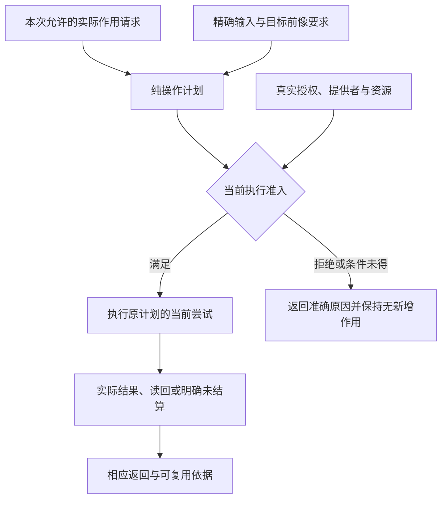

# 授权与执行准入


### 规范语义与授权语义分开

法律、行业准则、业务政策中的义务/许可/禁止有Authority、法域、版本、生效与撤销规则；一个`security:policy`规则可以`permit`、`deny`、`oblige`，但单条`oblige`需有义务内容、责任主体、触发/期限/解除方式及履行事实，而不是只记录 effect=oblige。优先与例外只在有权且范围兼容时生效；显式优先序不能使不具有正当权限的旧规则凌驾新规则。规范冲突可保留为未决，不编造“deny wins”来处理所有法域。


### 为什么这些约束必须横跨全部业务组合

同一个业务动作可能同时受权限、计时、资源、状态一致性、法律义务、个人数据用途与部署环境的限制。让单个Workflow自证合法而忽略共享对象会造成局部正确、系统错误。Gift对这些主题使用共同作用域和身份机制，**但每个专业合同仍有自己的定义、消费者、来源和失败类别**。


### 权限四种不同来源

`security:policy`是有权主体在适用范围内作出的规范性许可/禁止或业务义务；`native:implementation`描述某实现会尝试什么效果；`effect:port`说明可请求的效果接口；**宿主Grant**则是现实执行权限（凭证、租户、操作、资源、有效期和撤销代际）。这些不同来源逐项相交才能准许派发。不能因为“业务允许保存”就假设文件系统写权限，更不能因为能够调用某API就推定合同允许这么做。秘密属于Host注入和运行时保管，不应硬编码进普通作者Module。

有权政策冲突先检查Authority、适用时段、例外/优先规则和主体Scope；未确证的优先关系保留Contested，而不是为方便写固定“最后一条赢”。撤销对尚未派发的操作立即按生效规则限制，对在途操作的真实完成仍需Settlement确定。审计日志是事件来源，不天然证明业务已履行。


### 数据安全与隐私

真实数据权限有读、写、披露、保留、撤销、删除、地域和目的限制；加密不是所有这些许可的同义词。导入数据、临时缓存、日志、构建产物和外部API调用均可能形成新披露路径。类型中含`PII`标签可以帮助推导，但外部用途的合法性仍需有权规范/实际Grant。未来Target必须保留最小权限和边界可见性；不存在真实Provider资格时不得从抽象源码推断已实现安全。

<a id="gift130-run-effects-grants"></a>
## 完整产品从源码到真实外部操作的严格授权边界

编译器提出的操作仅是`EffectIntent`；业务规范中的`permit`不是HostGrant，文件写入许可也不是第三方Provider授权。**实际运行必须另获作用域、有效期、主体、目标资源与具体操作一致的Grant**；无法证明这些条件时停止执行并返回可定位Need/Denied。运行前为每次真实作用分配稳定`OperationId`并持久化可恢复意图，之后的Attempt不得因为进程重启、增量重编译或超时未知而更换操作身份并盲重试。

派发后的`accepted`、`started`、`committed`、`settled`、`observed`属于不同事实。Provider响应超时表示`UNKNOWN`，若有查询/幂等合同则先读回和对账，再决定等待、补偿或需人工介入；绝不推断“没有发生”。若供应商没有合格幂等、查询和回滚能力，运行器应在执行前限制保证范围或拒绝不可安全恢复的自动操作。源码生成本身不授予任何运行权，纯库目标和离线算法可以完全没有真实Operation路径。

## 计划可以组合，但执行许可与实际停止不能继承成事实

`EditPlan`与`RealizationPlan`规定候选修改和实现选择，不发行真实执行权限。目标程序未来可能写文件或操作设备，与本次把作者差异应用到工程，是两种不同的操作主体和准入对象。任何当前文件、网络或外部操作都需由有权宿主在实际执行点核对Grant及前像；计划中的`authority`文字不是可消费能力。

应用可按一次有效委派连续执行获准的多步任务，不要求每步重新请求人工批准；但每次有真实作用的步骤仍检查当前工具能力、目标前像、Grant和资源预算。若条件改变，只使受影响动作停止或重新求证，不撤销无关已合格源。取消工作者不能抹掉已派发Operation，未停止的计算也继续占用真实资源直至确认释放。

任何新返回投影、错误或计划摘要都按当前读取许可披露。引用过的内容被撤权后，即使解析或规划已缓存，也不能通过错误信息或“未显示数量”泄露。维持作者与回源必需的数据按原保留合同处理，不借当前规划失败当作清理全部历史的理由。

## 设计出的行为不等于当前获准动作

要求目标程序未来读写文件、运行任务或调用设备，不给当前Gift会话相同权限。application固定任务目的和实际主体；execution只接受当前动作合同、输入、准入和前像。需求模型中的允许转移或能力名称不能成为执行请求。

取消可重算计算后，可以拒绝使用其结果；资源释放必须以实际停止、隔离或移交完成为准。带强制交付义务的命令不能套用“只保留最新值”的丢弃策略。`NoWrite`检查是否发生写入，`SameValue`检查结果值是否保持；两者各有适用对象与观察方法，不能用同一个“保持”标记替代。

具体需求形状由[跨软件意图](../../20-语义与组合/组合/跨软件需求合同.md#cross-software-intent-contract)拥有；完整实例只提供固定生命周期验收载荷，本章保留现实准入和资源的最终责任。

## 权限、能力、策略与效果系统

**重试不继承旧许可。（消费条件）：** 只有原幂等身份仍合法且本次有权恢复时才允许协调；保留证据的权利不等于可再次发起同一外部作用。 合同归属：[外部未知效果、资金/资源结算与去重窗口](../持久化与恢复/事务提交-外部效果与幂等交付.md#gift-external-outcome-ledger)。

**依赖执行。（消费条件）：** manifest/registry元数据是可解析数据，不是可执行Grant；安装hook与动态插件需要按其实际文件、网络和凭证副作用准入。 合同归属：[来源锁、包身份、构建脚本与被替换的下载终点](../平台生态/依赖与生态解析.md#gift-supply-chain-identity)。

**新效果授权。（消费条件）：** 旧作者保存的文本变得可执行时，旧保存动作不是新现实Effect的Grant；执行时独立取得当前许可。 合同归属：[老源解释升级与隐式新效果的采纳资格](../../70-工程系统与演进/实现与装配/源绑定与解释映像.md#gift-source-interpretation-upgrade)。

### 权限模型

权限回答“谁可以在什么范围、条件和时段内决定或产生什么效果”。进程身份、文件位置、工具安装和用户文本都不是权限。

### 有效授权

先构造受信的作用请求：实际执行者、代表的主体、委派关系、目的、动作、资源及版本、接收端/受众、待披露数据范围、执行条件和所需保证。输入正文只能提出请求，不能覆盖受信主体和能力句柄的绑定。

决策顺序为：认证实际执行者及发行者；核对该执行者是否有权代表指定主体；匹配目标端、动作、资源和目的；计算所有适用的强制政策；检查时间/撤销新鲜度及所需证据；只有存在覆盖本动作的有效授予且必需条件成立，才签发有界许可。`Deny`阻止本动作；`Unknown`、缺证据和缺审批保留各自原因及可继续的无作用范围；没有适用的授予按拒绝处理。

“交集只收窄”仅适用于已定义为同类权限范围的约束。政策判断、数据分类、时间、证据和审批不是天然可相交的同一种集合，不能写一个混合`intersection`便宣称算法确定。事前政策已允许的低风险动作无需额外审批；审批不适用不等于获得全权，缺少确实要求的审批也不能当作不适用。

普通纯函数不传完整授权信封；受信调用边界为有保护的数据读取和实际作用解析这些条件。授权既不决定程序的数值含义，也不因某次计算缓存命中而永久有效。


**读前探测、提交准入、结果披露不是同一份授权。** 对一个持久状态业务操作，读前 `probe` 只取得范围受限的读取许可，决定哪些对象的前像可以接触；取得受信主体、租户和当前作用域内的前像后，提交前 `admit` 取得绑定对象、操作、读集和权威修订/有效期的准入见证；处理成功后的 `disclose` 决定当前能否把具体结果、错误参数、审计和恢复信息返回给这个观察者。名称相同的“用户”、租户字符串或应用内生成的 Actor 结构，都不是受信身份来源。某次操作有历史写权，不保证后来的结果读权；结果读权也不倒签此前的写权。三段可以在一个进程内使用同一策略实现，不能因为语义分段就强制创建三个服务。

**远端撤销的原子性限额。** 数据事务无法自动与另一个身份库的撤权事务共享提交时刻。若撤权即时生效是硬要求，必须有目标端执行检查、共同事务参与者或可证明等效的受信协议；只能提供有界授权租约时，应把最晚撤权生效时间作为明确的已接受风险，不得描述为“提交瞬间绝对最新”。决策依据包括授权权威代、主体与目标身份、操作范围、读前像及消耗的见证；显示层的缓存 Bool 不再生签执行资格。无权与不存在可对外采用不可区分错误，但内部来源、诊断与查询覆盖不能因此混成同一事实。

### 能力、Permission 与 Grant

`Capability`只描述一种可要求/可提供的动作或资源能力，例如读取某文件域、调用某Provider方法或发布某目标；它可以成为 Requirement、Provision 或准入输入，但自身没有 authority。`Permission`描述某 authority 在明确主体、scope、effect、资源和条件下**允许授予什么**；`Grant`才是对本次 principal/actor/subject/effect/resource/epoch 实际有效的授权。三者不能因字段相似合并。

实际执行可以把一个已有 Grant 物化成不可伪造/受保护的能力句柄：

```ts
interface GrantHandle<K extends string> {
  readonly kind: K;
  readonly scope: ScopeRef;
  readonly permissions: readonly string[];
  readonly issuer: AuthorityRef;
  readonly epoch: EpochRef;
  readonly expiresAt?: Instant;
  readonly attenuationChain: readonly GrantRef[];
}
```

文件、网络、进程、秘密、数据、Provider 与发布须采用实际类型化能力，禁止万能授权 Token。`CapabilityRef` 仅描述可请求/可授予的能力；Effect 边界消费的是当前有效 `GrantRef`，并可通过 `GrantHandle<K>` 物化其 issuer、scope、epoch、期限和衰减链。`GrantHandle` 不是另一种 Grant 身份；失效、丢失与撤销必须回到原授权生命期处理，不能凭句柄曾存在而继续执行。

### 委派

委派必须可衰减：

- 范围不扩大；
- 权限不增加；
- 有效期不延长；
- 风险等级不降低；
- 可被上游撤销；
- 保留完整链。

只读分析、实现、独立复核和外部观测使用不同委派模式。

### 委派的主体执行者与目标端

代表用户的Agent、运行该Agent的服务、用户本人和实际接收端分别记录。审计保存历史委派链；执行端只采纳自己信任且当前适用的授权规则，不能把链里出现过的高权限主体的权限累加给当前执行者。凭据必须绑定受众/资源和可用动作，A工具收到的令牌不能因字段结构相同就交给B服务使用。

父任务下多个子任务的权限不取并集。共享计算在自己的固定读取能力下工作；调用者按各自披露许可取得结果。需要更多读取时形成新的有权请求，不从另一个等待者那里隐式借权。普通人类客户端、脚本和AI遵守同样的执行边界。

宿主可以通过本地能力对象实现，不强制部署OAuth。采用OAuth时，[RFC 8693](https://www.rfc-editor.org/rfc/rfc8693)的主体、当前actor与目标资源需要按协议映射；嵌套历史actor用于追踪，不自动构成当前授予。令牌与模型提示不能相互替代。

### 策略

策略是版本化、可测试的决定规则。策略输入和输出结构化；不能用散落条件和环境变量组成隐式政策。

```text
PolicyDecision =
  Allow(policyConstraints)
| Deny(reason)
| RequireApproval(requirement)
| RequireEvidence(claims)
| Unknown(missing facts)
```

### 外部策略引擎只生产决定，不拥有执行

OPA、Cedar或其他策略Provider都只把其精确policy/data/schema revision与固定输入映射为现有 `PolicyDecision`。Provider自己的query名、bundle revision、policy id或decision id只作来源/locator；执行端仍以当前受信principal/actor、action、resource、context、Grant与Effect边界重新准入。

```text
ExternalPolicyEvaluation = derived {
  providerAndPolicyRevisionRefs,
  principalActorActionResourceContextMapping,
  decisionInputDigest,
  policyDecision,
  decisionEvidenceAndCoverage,
  evaluatedAt
}
```

`PolicyDecision` 本身不取得独立 authority，也不是 `EnforcementReceipt`：策略返回 Allow 而请求未到执行门禁、策略已换代、资源 revision 已变或 Grant 已撤销，都不能推出真实准入仍有效。Provider 只有实际处在 Effect 防护边界并提供相交 readback 时，才可签发它真实强制过的事实；不可用产品说明或曾返回 Allow 代替。

principal、actor、resource、context不能混装。尤其Agent代表用户行动时，用户身份、Agent执行者和目标服务分别保留；使用Cedar/OPA context字段传递“on behalf of”信息也不能让context中的主体自动继承principal权限。

### 策略求值错误与可施加保证

接入外部策略引擎必须读取其真实错误组合规则。某些引擎跳过出错策略并返回诊断，不能由“默认拒绝”推定关键forbid出错必然拒绝。[Cedar依据](../../../research/sources/语言编译与目标工具.md#open-control-evolution-sources)仅支持该具体边界，不否定其成熟实现。与本次必须满足的权限限制相关的求值错误、缺上下文或未知映射，不能当限制不存在；准入返回Deny／Unknown或已获准且不突破原约束的限定路径。无关坏扩展按隔离范围处理，不无条件冻结全部工程。

授权检查、实际执行和当前有效性分开。PolicyDecision是判断证据，不是永久持有的能力；将正确决定跨目标、跨修订或跨接管代复用仍可能越权。真实目标缺少围栏时，按[接管边界](../运行生命周期/运行实例-订阅部署与调和.md#control-takeover-fence)明示已接受的操作及停止能力，不能声称本地撤销立即控制了远端。

资源能力分别说明可观测、可软调节、可硬限制、可取消、可确认终结及可补偿；不是一个supports布尔值。RSS采样不能证明峰值永不超界，延迟账单不能证明外部费用实时受控。采用前绑定限额执行点、覆盖的子进程／线程／设备／宿主调用、实际超限行为与恢复者；缺硬限制时只有经接受的软保证，不能悄悄降级硬要求。

Wasm指令fuel／epoch、guest线性内存或栈限额只覆盖各自域，不自行中断阻塞宿主I/O、限制宿主原生分配或确认设备停止。宿主调用与回调分别携带期限、能力、在途资源和结算；其不可中断部分必须计入相应最坏界或隔离策略。沙箱终止后仍在运行的宿主工作不得释放所用缓冲或重发非幂等动作。具体限制依所采用引擎与Host，不能把Wasm文件格式当成整个进程的资源证明。

取消响应还受检查点之间不可抢占工作量限制。即使guest持续运行，bulk copy等大指令也可能只在入口检查期限；单独增加epoch频率不能约束其内部耗时。强时间保证需同时约束输入／内存／批次规模、切片及实际终止能力；失败后仍按真实停止而非信号发送释放资源。[案例](../../60-保证与证据/验收/控制与演进区别见证.md#s78取消检查点之外仍有不可抢占的大操作)给出相交检验。

### 效果代数

```text
Effect = {
  kind,
  targetScope,
  operation,
  idempotency,
  readback,
  reversibility,
  compensation,
  authorityRequirement,
  resourceRequirement,
  auditRequirement
}
```

效果按实际外部可观察变化分类，而不是按函数名称。

### 不可逆与补偿

删除、发布、付款、通知等可能不可逆。补偿创建新效果，不抹去历史。计划必须明确：

- 是否可真正回滚；
- 是否仅可前滚；
- 补偿的风险和权限；
- 外部观察者已看到的结果；
- 数据和审计保留。

### 撤销

撤销按真实执行/披露边界阻止新效果，并使相交准入陈旧。已发生效果进入结算或补偿，不能用撤销假装未发生。离线节点重联时先协调撤销epoch；失联期间只有原先明确接受的有界离线授权/信任条件仍成立时才可继续对应用途，不承诺不能被端点观察的即时撤销。持续投影在观察到撤销后立即撤下相交披露资格，不等待完整重同步；已取得自有副本的内容身份、仍有权保留的恢复记录与今天的读取/执行许可分别判断。具体接收/重同步消费[投影检查点](../../80-开发者与接口/工具协议/客户端与并行会话.md#projection-checkpoint-resync)，物化按[离线准入](../运行生命周期/资源登记物化与回收.md#offline-materialization-freshness)处理；它们不取得新的授权根。

### 沙箱

能力句柄在 Host 边界物理强制：

- 文件根和操作；
- 网络目标和协议；
- 子进程可执行文件；
- 环境变量和秘密；
- CPU、内存、磁盘和时间；
- 系统调用和设备；
- 输出大小和路径。

提示词和代码约定不是沙箱。

### 审计

权限和效果事件记录：主体、委派链、计划、Grant、目标、前像、结果、读回、撤销和证据。敏感值不直接写日志，使用受控引用。

### 验证：权限、能力、策略与效果系统

- 最小权限正反测试；
- 委派不可扩权；
- 权限撤销和排队任务；
- 跨租户缓存和消息；
- 旧 epoch 和围栏令牌；
- 沙箱逃逸；
- 批准重放；
- 策略未知不自动允许；
- 补偿不被报告为回滚；
- 审计链完整。

### 本地持久应用中的授权接缝

代际加载、观察、准备、采纳、应用、恢复和回滚是不同动作。Workspace默认拒绝，无应用胶囊、前像JSON、缓存命中或原执行回执可自行授予当前权限。当前回调接收动作、精确请求摘要和目标根；宿主须按该请求的已冻结资格要求和当前政策批准，不能只按动作名称全放行后声称强治理。

每次新文件作用与最终replace前重新取权；回滚同时需要文件逆操作与目标代际恢复权。远端撤销的时间窗、作用中的授权一致性和真实ACL仍由目标宿主承担。早期本机参考仅检查受信回调；当前设计交付不执行该参考，也未提供租户认证、恶意同进程对象隔离或分布式撤销证明。

<a id="gift-delegation-attenuation"></a>
### 委派能力收窄、重定向与执行时再检查

授权检查至少绑定真实主体、资源、动作、用途和适用的授权/策略基础；在存在委派、租约、撤销纪元或过期条件时，继续绑定相交的 `(actingFor, grantRevision, policyRevision, epoch, expiry)`，没有此机制的纯只读局部请求不强制伪造字段。被委派主体只能获得可验证的**权限交集/进一步收窄**，不能通过子代理、换Provider、换工具名或把操作包装成“验证”获得更宽能力。创建子任务时记录委派链；真正发副作用时还要在实际执行目标核当下可用的授权和撤销条件，计划时允许不等于运行时继续有效。

撤销的界限必须分开：阻止未来准入；已入队但未到不可撤回点的尝试要尝试围栏/取消；已发生的外部Effect不能从日志抹去。凭证泄漏后的撤销不保证收回对方已复制的明文，泄漏记录及派生索引按保留/删除政策处理。外部策略引擎只提供有范围的Decision；工具处理器不得接受未经验证的自称`approved=true`。反例：Agent A获准读取目录，委派B“汇总”后B要求上传原始文件；应拒绝越权写/外发，允许在原read范围内给出已获准的摘要。

## 紧急权限、降级模式与故障隔离

### Break-glass 不是 admin 默认通道

紧急权限只用于正常控制面不可用且不行动造成更大损失的情况。它不能成为绕过设计、验证和审查的便利入口。

### BreakGlassOperation

```text
BreakGlassOperation = exact {
  incidentRef,
  triggeringHazardAndEvidence,
  authorizedPrincipalsAndQuorum,
  minimalSubjectsOperationsEffects,
  explicitDenyExceptions,
  absoluteExpiry,
  requiredLoggingAndReadback,
  containmentAndRecoveryPlan,
  postIncidentReviewAndCredentialRotation,
  residualRiskAcceptance
}
```

### 降级模式

系统预先定义 safe/degraded/read-only/isolated/manual modes。降级必须明确牺牲哪些能力，不能把安全、数据完整性或用户权利默默降级。

### 故障隔离

使用 cell、tenant、process、resource pool、deployment ring 和 authority partition 限制 blast radius。共享控制面和恢复资源必须避免与被保护系统同故障域。

### 退出

紧急权限到期后自动失效；所有 Effect 重新观察；临时配置、凭证和 bypass 退役；系统回到正常 authority path。事后审查不能只依赖执行者自报。

### 验证：紧急权限、降级模式与故障隔离

- 主控制面不可用；
- 两名审批者同一受损身份根；
- 紧急 token 过期仍可用；
- 日志系统共同失效；
- 临时 bypass 未清理；
- 降级模式引发数据丢失；
- 恢复后旧写入晚到。

## 纯计划、规划计算与执行准入

### 三层分离

```text
OperationDefinition  定义操作语义
PureOperationPlan    闭合稳定输入和所需能力
AdmittedExecution    绑定当前权限、资源和物理现实
```

这三层不能合并。

### 纯计划

```ts
interface PureOperationPlan {
  readonly planId: string;
  readonly operation: OperationDefinitionRef;
  readonly normalizedInput: ContentRef;
  readonly semanticInputs: readonly RevisionRef[];
  readonly expectedOutputs: readonly OutputContract[];
  readonly requiredCapabilities: readonly CapabilityRequirement[];
  readonly requiredEffects: readonly EffectRequirement[];
  readonly resourceBounds: readonly ResourceBound[];
  readonly preconditions: readonly ConstraintRef[];
  readonly verificationObligations: readonly ClaimRef[];
}
```

不包含：实时 `Grant`、Provider 实例、写租约、资源分配、绝对 deadline、临时路径、进程 ID 或执行 epoch。

### 零效果规则

纯计划生成不得产生文件、进程、网络、秘密、数据库、发布或日志持久效果。内存分配和调用方提供的纯缓存不算外部效果。

### 规划计算

若计划需要调用编译器、求解器或探测工具：

```text
PlanningComputationRequest
→ Pure PlanningComputationPlan
→ Admission
→ Isolated Execution
→ Immutable ComputationReceipt
→ Plan compiler consumes receipt
```

规划计算的临时 I/O 属于已准入执行，不污染最终纯计划身份。

### 准入输入

```text
ExecutionAdmission = join(
  exact plan,
  current authority,
  policy,
  target preimage,
  provider binding,
  resource allocation,
  writer coordination,
  deadline,
  security context
)
```

任一项不满足时返回明确阻塞原因。

### 从意图到物理执行



只在真实作用请求中使用此图。计划与内容引用不授予权限，准入失败不表示其他纯设计不可继续；结果未结算时保留相应责任。

### 已准入执行

```ts
interface AdmittedExecution {
  readonly executionId: string;
  readonly plan: PlanRef;
  readonly grant: GrantRef;
  readonly providerBinding: ProviderBindingRef;
  readonly allocations: readonly AllocationRef[];
  readonly preimages: readonly RevisionRef[];
  readonly writerLease?: LeaseRef;
  readonly deadline: ClockDomainDeadline;
  readonly cancellationScope: CancellationRef;
  readonly attemptPolicy: AttemptPolicy;
}
```

### 时效与重新准入

授权、Provider、资源或前像变化使 `AdmittedExecution` 失效；纯计划在稳定输入不变时可重新准入。不得为了续租重建语义计划。

### 准入与批准

人工批准是 Grant 的一种来源，绑定精确计划、写集、效果、风险、期限和一次性 nonce。候选或关键输入变化使批准陈旧。

### 执行状态

准入只决定本次 Attempt 能否开始，不拥有一套从 Planned 到 Verified 的全局完成枚举。准入路径是：固定计划 → 当前条件检查 → 拒绝/等待准确缺项，或产生本次 AdmittedExecution。进入真实尝试后，状态转换与结算由[提交与不确定完成](../持久化与恢复/事务提交-外部效果与幂等交付.md)拥有。

Attempt 在途/终局、目标效果确认、调用者等待状态与恢复/资源结算沿[独立观察面](../../20-语义与组合/共同语义/规范元模型与结果语义.md#完成状态与错误分离)并存。确认成功后仍可能需要释放资源；确认失败且无效果也可以结算；取消或失败都不能自动说明效果未发生。需要事后验证时，将精确回执交给相应 Claim 消费；`Verified` 不能作为执行自行签发的终态，事后 Evidence 也不能倒过来成为动作开始前必须已存在的依据。

### 验证：纯计划、规划计算与执行准入

- 同一输入生成同一纯计划；
- 授权和 Provider 变化不改变计划；
- Effect sentinel 证明零效果；
- 准入缺一项即拒绝；
- 过期授权和旧围栏令牌负向测试；
- 规划计算回执完整；
- 重准入不重复计划语义；
- 完成状态和调用错误分离。

### 作为共同执行接缝而非新的总编译器

工具调用、观察、测试、导出、写回与发布复用本协议的准入/尝试/结算责任，领域计划分别保存自己的数据语义，不各自复制一个运行状态owner。一个本地纯函数调用不必序列化成操作；长期或跨边界效果才需要相应持久协调。

“Provider变化不改变纯计划”限于会话、租约等实时实例条件。若改变的是已锁定的实现内容、目标行为或语义绑定，输入计划及对应计算必须重新裁决；不可把两种变化混同。规划所需外部回执由明确执行取得后进入新输入revision，不热改已开始的纯求值。post-evidence只约束结算，不能使本次动作等待它自己的完成证据。

## 高层操作的当前授权与纯决定边界

作者定义的高层操作若引用授权策略，该引用不是调用者填入的批准结果；事务型应用组合研究只是这一规则的压力例。可信actor在目标宿主的认证边界产生；引用同名记录不能得到该能力。请求可见性、限定读取、当前变更准入和历史结果披露分别校验；错误优先级不能泄露原先不可见对象。

决定函数不读取随机、时钟、网络或活动权限系统。来自外部的角色/关系需要由运行层以明确版本/有效期见证提供，并在承诺的提交点复核。数据库事务无法自动线性化另一权威系统的撤销；若采用租约，必须说明有界时滞并获得政策允许；需要即时撤销则让实际权威与目标参与协议。

不能持有业务写锁等待AI设计、人工审批、远程复核或不可控网络。长业务拆成明确持久状态和消息步骤；对应的新授权、相关身份与竞争条件由下一operation重新判断，而不是保留无限寿命的旧权限。运行超时/取消不抹掉已提交状态；资源与恢复责任按实际后像结算。

开发AI是否能改这份源码，与部署后某用户是否能关闭一条工单，是两个权限域。query/propose/check/apply不会因产生了授权规则而获得规则所描述的生产权利。

## 计划合格到真实准入的两次检查

联合规划使用固定输入和当时有效的条件得到可行计划；真实执行可能发生在稍后。因此，在执行点重新取得当前主体、目标范围、实际资源与授权见证，并检查所需保持关系。计划满足不等于当前资源已预留，预算表也不是远程配额令牌。

先作不产生目标作用的当前条件检查；再按原共同资源协议准备能够短期撤销的占有；在真正提交或作用前核对内容前像、必要权威与目标状态。原子性只能由实际参与协议保证。条件变化时释放不再需要的预留，返回具体变化或重新规划的候选，不能擅自选择一个被用户禁止的低成本回退。

一个循环中源任务与幂等身份保持不变；需要改变实现或目标时先判断它是否仍属于原操作意图。尚未产生作用且合同允许，可以建立新尝试；可能已作用时，先按原协议读回/结算，不用新算法重做旧业务。恢复时的安全限制优先于成本优化，恢复路径仍须保留原结果解释与当前授权。

队列与并发选择消费[端到端资源预算](../../30-实现解析/增量与性能/性能预算与复杂度.md#端到端预算的组合规则)。多个任务申请同一物理缓冲或设备，并不因拥有不同逻辑声明就获得两份真实容量。反之，两个相同配置但独立实例不能被去重为一个有状态对象。

## 准入分配执行与结算的正向协议

执行端的输入是固定动作计划、实际内容/目标/前像、当前调用主体及委派链、资源需求和受信预算。凭证由宿主按引用取得，AI只见可披露的动作信息。动作计划说明“准备做什么”，当前准入才决定“此时允许做什么”。

### 六个实际步骤

**E1 解析主体与动作。**校验协议、作用域、目标与所选Provider身份；区分原业务幂等主体和本次实际执行者。内部可在当前允许范围查找原操作，结果是否向调用方披露另判。身份验证失败在有限入口成本内结束，不创建无限持久去重记录。

**E2 检查当前资格。**按实际目标的政策解释动作、对象、受众、期限、委派和必要批准。当前证据不足时产生具体的缺项；计划内容或关键输入变化时旧批准不匹配。只有政策显式要求的角色才参与审批，不把所有合法作用都变成逐次人工确认。

**E3 共同预留资源。**资源管理器在短的内部原子段内检查CPU/GPU槽、内存预留、打开句柄、费用与速率额度，及恢复需要的有限余量。满足全部当前启动条件才建立Reservation；不足时进入有界等待或返回资源缺项，不先占住一半资源等待另一半。物理提交锁在等待期间尚未持有。

**E4 最后准入与启动。**取得对应目标的冲突域协调后，复查真实前像、围栏和授权/规则见证。必要写集/意图按作用合同保存，然后启动选定执行器。立即可撤销许可的目标要支持实际撤销检查；仅支持有界租约时在绑定中明确窗口，不能声明零时滞。

**E5 观察和终结。**执行器将实际输入、输出、错误、资源消耗和完成信息交给结算者。超时或取消触发停止请求，不直接证明进程/设备已结束；持有缓冲的任务确认终止后才释放那部分资源。目标已成功但响应丢失时转入读回/同键协调，不再生成新业务身份。

**E6 释放和返回。**可再用的槽位与句柄在实际最后使用后释放；已消耗费用计入父预算不退回；恢复意图需要的内容转交其持久拥有者。返回实际业务结果、作用状态和未释放责任的最窄摘要。清理失败单独报告，不能把它覆盖成业务未发生。

### 资源的计量与排队

预算来自已选择的宿主/任务画像，不要求每次AI调用填每一个阈值。计量位置要固定：字节在接收/分配前核算，速率在请求准入时核算，时间来自同一宿主可比较的时钟域，跨宿主传递剩余预算而不是比较原始单调时间点，费用按Provider实际计费动作累计。不能从某次测试较快任意推出全系统固定timeout。

默认单宿主调度按主体轮转，每个主体内按已接受优先级及入队次序选择；每个主体的排队条目与占用字节也受预算限制，超限返回具体准入失败。扫描时在本地资源账目中尝试一次性取得整组配额。大于单请求可支持上限的任务直接报告需要拆分或更强能力，不永久排队。

仅做“哪个放得下先运行”会让大任务长期被后来的小任务越过。默认公平画像允许受限借道：为每个被跳过的队首记录等待轮次；达到该画像明确配置的借道上限后，将其所需可再用资源标成预留目标，停止启动会继续占用那些资源的后来任务，等待已在运行的任务归还，再一次性启动队首。无关资源上的任务仍可以继续。队首取消、权限失效或超过本次期限时撤销预留并处理下一项；不能持续为一个已失效任务闲置全系统。该上限是已绑定调度政策，不是这里杜撰一个适用于所有场景的数字。

这项本地预留不等于远程Provider已保证未来容量。远程租约或配额需要按其实际协议取得，失败时释放本地预留，按剩余预算重入队列或返回能力缺项；不持有目标提交锁等待外部配额。若各外部资源无法共同预留，采用明确的获取顺序、失败撤回和重试预算，并限定可承诺的无死锁/无饥饿范围，不把内存计数器冒充跨服务原子分配。

在有限竞争者、各任务会归还资源、所需Provider最终可用且预算允许的前提下，借道上限与预留目标保证大任务不会因无限新小任务持续越过而永久停留。若高优先级抢占、外部不响应或不可抢占任务没有占用上界，就不签发有限等待时间保证，而是按本次截止返回或保留真实运行责任。公平调度不是无限负载下仍满足所有期限的证明。

恢复预留由当前实际恢复义务估算和配置，在普通任务准入时保护；它仍有上限。恢复任务也经过权限和幂等判断。为恢复腾出资源可暂停或拒绝新工作，但不能未经合同丢弃已发生的不可逆责任。

### 异常分支和取舍

| 观察 | 当前动作 | 保留的责任 |
|---|---|---|
| 还未启动且权限/前像不符 | 拒绝启动，释放预留 | 候选可保存，真实目标不变 |
| 还未启动且预算不足 | 等待到实际截止或返回缺项 | 不占用目标提交锁 |
| 已启动后取消 | 请求停止，继续观察或隔离 | 缓冲/设备/外部作用至实际结算 |
| 返回成功但需读回 | 取得规定层次的后像 | 响应不等于全部目标保证 |
| 执行器失联 | 按持久意图和目标去重合同恢复 | 不以连接断开推断未执行 |
| 清理失败 | 记录残余，指定当前拥有者与下一动作 | 真实成功/失败和残余分别存在 |

单宿主协调器容易实现且足够支持初始范围；只有真实多节点共享资源与故障需要时才引入相应租约/共识或目标端强制。拆更多服务不会自动扩大准入保证。

## 编译纯值与旧写入口的执行准入

新的纯编译调用只消费已固定输入和已准入的确定工具，不取得workspaceWriteLease；实际compileWorkspace/save-source/write-output保持原写入前提。把原入口包在readonly标志下不等于没有副作用，必须按[具体代码映射](../../70-工程系统与演进/实现与装配/模块与运行实例-部署维度与代表性装配.md#现有生产入口到纯编译服务的迁移)实际分离值函数与写入调用。

EditTicket先与内容占用一致固定，再在锁外核当前准入并执行语义操作；结果披露按要求复核。取消外部同步工具后，资源必须等待真实停止或隔离责任移交，不能因为Promise.race先返回就回收。此规则不强制每个小函数开子进程，软预算和可信协作执行仍可同进程。

## 最终执行器的唯一准入和提交范围

application请求执行已类型化动作；execution解析当前主体、目的、目标和前像，领取共同资源，调用明确宿主，然后读回/结算。纯编译器只产生数据或Needs，不拥有可变工程头写接口，插件也不能通过返回一个ActionPlan自行取得执行权。

读取已有固定内容与准许产生新作用分开。EngineImage内的工具资格不是永久许可；实际使用仍核当前限制。许可与目标不在同一事务域时，使用真实见证/租约及其窗口，或限制保证，不由一个布尔字段冒充即时全域撤权。

资源以真实使用者寿命为准：请求返回、引用到期或目标检查超时，都不自动证明工作进程停止。持久操作结束前的原意图、前像和结果只在合法释放/转交后回收。

## 状态退出与活动终止的实际准入

状态选择取消只是逻辑决定。driver对原activation生成取消请求，实际提供者确认停止、成功隔离或合法转交以后，才释放原输入、设备缓冲、工作目录与资源槽。未确认期间仍计费和占有。独占活动槽的后继默认排队；允许重叠时必须有互不混淆的输出、身份与预算。

旧活动回调先按原记录结算，再判断是否仍可成为当前图事件；不能只丢弃回调就声称没有未结算责任，也不能把旧完成路由到同名新状态。根图Completed可以与settlement Pending并存。实际取消不响应时，计算控制可停止/隔离pure reducer；它与业务cancel事件是两个对象，不能替对方签发已处理。

模型里的ProviderRef、效果和策略是需求及绑定，不授予当前权限。启动、重试、续接和输出读取按真正目标检查；只设计状态模型时不自动发任何启动命令。

## 产品安全策略与宿主执行准入

[Product Security/Privacy配方](../../20-语义与组合/组合/机制组合与作者配方.md#recipe-product-security)描述生成产品主体、session、policy和数据用途；它不是本页HostExecutionAuthority。两域只通过有发行方/受众/对象/用途/期限的明确关系接合，不隐式继承Grant。facet/profile/目录和成功编译均不能签发本次操作权；产品程序在Gift外运行的活动，只观察确知关系，不补造Gift Operation或全局管理员。

## Policy：独立资格与消费者边界

Policy 是有权主体在明确范围内选择的可执行约束或排序规则。它有 issuer、subject、operation、effect、时间、法域、revision 和 deny semantics。自由文本 policy 只能是 authoring input。

## Permission 与 Grant：独立资格与消费者边界

Permission 描述可授予的能力范围；Grant 是对具体 principal、subject、operation、effect、资源和 epoch 的当前授权。策略存在不等于 Grant 已签发。

## 准备与真正接受外部作用之间的授权重验

`Method` 可调用、`Provider` 已注册、probe 成功、作者设计采纳、当前 Grant 有效，是五项独立条件。准备阶段输出的 `AdmissibilityProof` 必须绑定 `{subject,delegateChain,operationKind,resourceScope,providerIdentity,policyRevision,grantRevision,expiry,plannedEffect,resourceBudget}`；它只说明“当时准备可以继续”，不代表操作已在现实世界中有权发生。

进入不可逆外部 Effect 的接受点（Provider accept/本地系统调用/远端已确认提交）前，execution 按真实委托主体重新评价当前 Grant 和 policy，核实际资源、目标及费用前像；重定向后端、更换执行账户或要求范围变大都必须重新准入。若 Grant 在准备后撤销，未被 Provider 接受的作用应停止；已被接受的不可逆作用按原 Operation 结算、撤权不篡改历史或倒转已披露的数据。无实时强一致授权服务的远端只能采用明确的短期能力与过期窗口，并向 Claim 报告可能的撤销延迟，不得隐称瞬时撤销。

Provider 把名字为 `probe`、`prepare`、`resolve` 的动作内部执行联网、拉取、设备控制、计费或第三方代码时，这些步骤也必须经 execution/Grant；只有纯元数据检查才能保持在无作用规划中。Provider 自报可以作为待验证输入，不能自行授权自己。验证反例包括中途撤权、准备后替换凭证、后端未告知地转移区域、作用前预算耗尽和托管服务重复接收同一个操作。

<a id="gift-admission-revocation-commit-closure"></a>
## 执行准入与撤权竞态：检查位置和可证明保障

一次执行分开 `PreparedOperation`、`AdmittedOperation`、`ProviderAcceptedAttempt`、`ObservedEffect` 与 `SettledOperation`。准入输入含 `(principal,tenant,delegationChain,operationKind,targetEffect,sourceAndPlanBasis,grantIds,policyRevision,revocationEpoch,resourceReservation,deadline)`。计划生成和候选筛选可以在权限不足时返回缺项，但**任何真实 Effect** 都必须由最后持有写权的执行者在可接受时点重验，检查命令参数、目标/作用域、委派深度、用量与撤权代际。客户端、AI、文件中声明的 grant 或缓存凭证均无权延长许可。

授权确认与 Provider 实际接受之间若存在无法关闭的窗口，必须使用目标端可验证的短寿令牌/条件提交、可撤销队列及 fencing，或降低 Claim 为 `ADMITTED_BEFORE_REVOCATION_WITH_IN_FLIGHT_UNCERTAINTY`。权限撤销只能保证实施边界之后不再**新接受**，不能追溯取消已真实接受/已结算操作；取消请求要产生可查回结果及仍在运行的 Attempt 引用，不能释放其可能继续产生外部效果的资源账。

输入内容和披露也受授权：搜索结果、诊断、错误字符串、计数、补全、日志、缓存、AI 上下文与下载包在每次向主体返回前，按现时可见域与用途重验，不得把保存时可见视为未来永久可见。跨租户候选相同不意味着缓存片段可互相披露；真正共享可证明去敏感的数据也必须有独立派生与授权资格。

当 PolicyProvider 不可用，安全敏感写与新数据披露按声明的 fail-closed 规则拒绝；已接受的支付、设备动作和资源租约进入单独 readback/reconciliation，而非简单清零。紧急 break-glass 必须有外部授权、有限用途和可追溯审计，不能成为 Agent 默认免询权。验收在权限检查→Provider接收→回执保存三个切点分别注入撤销和超时，比较应有结果。

<a id="design-only-no-unrequested-effect"></a>
## 设计专用请求的零效果准入与后续实现边界

本条只明确当前用户请求用途的**消费边界**，不复制本页已有Grant/Attempt/恢复状态机。作者明确要求“只设计最终产品形式”时，解析、查询、候选推演、布局可视化和静态结构审查不由此取得工作区写入、目标代码生成、外部构建、安装、网络下载、运行、发布或真实部署的许可。必要时可将后续工具/Target/Provider能力列为明确未实现/待授权的义务，但不能代用户执行。

一个 UI 显示“已接受蓝图”不产生文件写Effect；用户请求保存作者设计时才进入当前有权save-source及真实CAS/联合写集；用户未来选择产物写出、运行或发行才进入相应实际Operation。若预览文档过程中，某所谓“发现所有插件/获取版本”会触发第三方代码执行、下载、扫描私有工作区或上传信息，则必须将其识别为外部动作和独立授权，不能藏在纯查询。撤权、超时、远端断线、运行结果未决分别保留原责任，不从设计界面关闭推断进程已停止。

<a id="gift95-cross-contract-18"></a>
## 声明、资格与实际Grant保持三条独立链

作者的Method/Target声明与控制记录不产生任何真实Grant。需要执行下载、编译脚本、外部运行、设备或远端调用时，在操作前按当前身份、租户、工作区、目标、时间及作用准入；EffectPlan与真实Attempt还应记录当前授权使用的范围。Scope撤销后不允许缓存Grant继续启动新作用；已发生作用独立结算并提供安全恢复。

读Profile/Rule结构、核JSON Schema、形成候选或只读蓝图属于不自动产生作用的活动。把 `toolchainRequirements` 或 `capabilityRefs` 字符串当成已执行的授权命令，是跨越权限边界的严重错误。

## 受信本地签名准入的有限实现合同

[本地单库参考执行适配器](../../../fixtures/semantic-universe/Gift104/README.md)验证了一个明确有界的授权形状：发行者签名的 Grant 含 `aggregateId/operationId/actor/roles/event/resourceType/effectKind/modelRevision/validUntilUtc`；执行端用从受信宿主**外部提供**的 HMAC 密钥校验签名，固定请求主体、角色集合、动作、资源和模型修订，deny 优先于 permit。作者源码、模拟器和计划均不得自行签发 Grant；所有新执行前必须再检查当前受信时钟、数据库前像及实际资源。一次已确认的旧操作可以在 Grant 到期后凭同一有效签名读取原回执，但**不得因此发起新动作**。

HMAC 仅在预先安全分配并保密的本地测试密钥及本地可信执行者假设下构成有限身份门禁，**不提供真实组织授权、密钥轮换和撤销、外部身份认证、政策时代/签名链、跨租户密钥隔离或现实资源所有权证明**。这些义务必须由生产 `GrantProvider`、撤销消费者及实际执行者分别履行。本地操作者 `bootstrap()` 和只读调试 `snapshot()` 都不是公开的经授权 API。样本签发器仅存在于测试文件，不作为产品发行者。

<a id="prebootstrap-authority-chain"></a>
## 意图、策略、当前授权和实际作用的边界

Source 中的 effect 描述只表示目标程序需要什么，策略许可表示规则关系，Grant 表示当前有权主体对具体动作/范围/时限的授权，实际 Operation 表示一次被准入的尝试。四者不可按同名 ID 相互转型。编译器自举、管理员界面或 AI 任务不得自己签发满足自身要求的现实 Grant。

执行准入绑定真实主体、动作与目标范围、当前政策/撤销状态、输入/计划摘要、限额、时效和必要前像。先获得资源租约/实际接受条件，再产生对应作用；快照里看见容量足够不等于已预留。预览结果不长期缓存执行许可，采用和派发前重新检查仍然有效的相交授权。

权限未知默认不执行对应作用，但不妨碍已授权的纯分析或设计保存。明确拒绝的候选不能靠换 Provider、远端 fallback 或隐藏子进程绕过禁令；限制随实际数据/作用传播。敏感内容的读取、传输、日志、缓存和删除分别检查，不把“没写源文件”当成没有数据泄露。

撤销与在途动作可能竞争。尚未接受的动作停止；已接受动作按可取消、可隔离、已发生或完成未知处理，不宣称撤销能逆转事实。后继动作重新准入；旧回执和必要恢复资料只保留获准范围，不能因授权撤销就抹除唯一结算依据。签名校验、issuer 身份及密钥可信来源不能从候选自报字段得到。

<a id="design-b24"></a>
## 授权、披露和已发生作用的区分

可读、可修改作者源、可生成候选、可运行原生工具、可派发Effect、可签发布分别是不同能力；一个总“允许”字符串不能由输入文档自己签发。授权依赖真实主体、资源范围、动作、有效期、委派链与撤销状态，运行前使用当前Grant，生成代码包含某操作不等于此刻授权执行。

缓存、搜索索引、diagnostic、SourceMap、trace、构建日志、模型上下文和下载制品都是独立披露面。对外发送前核当前权限，数据投影不得靠从文件名/长度/错误差异泄露不允许的主体；跨租户缓存只能复用不带访问权的内容，返回时仍按请求者可见范围过滤，不能复用上一个人的结果授权。

撤销后阻止新的dispatch和披露，已派发尝试仍以原身份进行必要结算；结算所需最小保留权限由独立恢复规则控制，不能让用户撤权使系统伪造“未发生”，也不能借恢复继续执行新业务。秘密以受权句柄传给宿主，不写入作者源、普通锁、编译cache或公开诊断。轮转改变秘钥版本/接受集合，不重写既有操作payload冒充原签发。

Policy/事实来源变更传播到相交准入，但不使无关纯函数语义失效。不能取得发行者、时钟或撤销观测时返回明确AuthorizationNeed/Indeterminate，不能由作者JSON中的时间和角色自证。

**验证与反例**：并发撤权、缓存跨租户、诊断私有路径、导出日志泄密、已派发后撤销、恢复权限被滥用、轮转中旧receipt核验。

**实际能力边界**：本设计包未取得实际身份发行者、密钥、权限服务或侧信道测量证据；本文件不创建或扩大任何现实授权。

相交合同：[六工具第二版的线协议与结算分离](../../80-开发者与接口/工具协议/客户端与并行会话.md#design-a06)；[身份与变更事件的精确传播](../../10-作者与输入/作者源/工程源/工程清单模块与绑定锁协议.md#design-b03)；[Unknown Outcome 的操作生命周期](../持久化与恢复/事务提交-外部效果与幂等交付.md#design-b25)；[依赖、插件、构建与发行的四重权限](../../70-工程系统与演进/演进与实施/实施/安全构建发布与环境.md#design-b32)。

<a id="本责任的相交定案"></a>

**关联规范：**[认证主体、凭据与授权决策](../平台生态/安全信任与外部权威.md#design-c09)；[真实 Effect Provider 的实现与读取](../../90-治理与参考/状态/实施闭包.md#design-i07)。

## 意图规划器、规范许可与真实 Grant 分离

`permit` 是一条来源明确、具有作用域/时间/主体的规范陈述，不由 Gift 推导成当前宿主 `Grant`。联合模型的 `ModelPlanCandidate` 只是在不可变有限快照上得到的候选，未执行任何数据库/设备/资金 Effect。真实方法调用前，实际有权宿主必须按 operationId、方法绑定版本、对象、租户、具体动作与凭证校验授权并持久化必要前像。

外部派发超时要保留 UnknownOutcome，在原 ID 下读回/对账；禁止以新 ID 盲目再做一次真实作用。历史已发效果不能凭作者二次编辑被重写成未发生，补偿需要新的授权。模型状态的成功后像不能替代 Provider 的真实结算证据。
