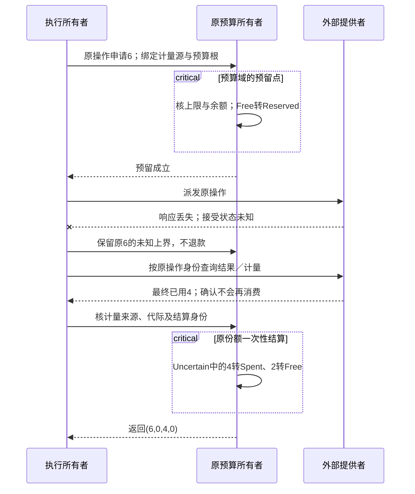
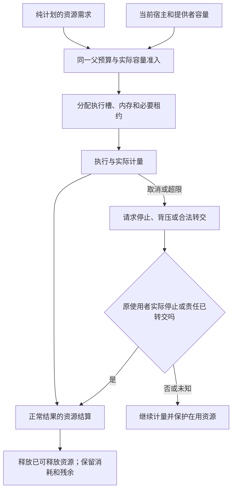

# 资源核算调度与交接


### 多根共享与归属边界

Project可以选择多个Root、一个Root可以有多个同模板实例、多个Root也可能引用同一个Product定义。这是不同的复用层次：

- 同Product定义≠两个Root具有同一硬要求接受记录；根资格与目标发行时间独立。
- 同Component模板≠共享实例对象、状态、主键空间与Grant。
- 两根引用了字符串相同的资源≠同一现实资源；真实Issuer和Scope映射是必要条件。
- 确认共享了同一资源后，资源容量、并发、Norm、计费、外部效果的约束必须联合，而不是把两个局部“可行”相加。

### 两个根、三个实例、一套共享存储的实际模型

举例，根 `desktop` 与 `web` 各使用 `EditorComponent` 模板，桌面根里另有两个 Editor 实例分别绑定 `docA`、`docB`。Definition 可以共用；每个 `ComponentInstance` 的静态参数、当前业务对象上下文、激活状态、订阅和未提交草稿必须局部拥有。`docA` 是否与另一根读取的 `document-17` 相同，必须由有权对象签发者和版本/租户/分区规则确认；共享同一个名称或模板不构成别名证明。

内部端口连接边指定 `from(instance,providedPort)` 和 `to(instance,requiredPort)`，其可连性取决于接口操作签名、协议、角色、数量和生命周期；一次一对多扇出需要明确是否广播、如何处理某一订阅者失败和重复消费。产品 `publicEndpoints` 必须指向**实际实例的已提供出口**，不能指向没有实例化的 Component 定义；`externalRequirements` 则为尚需外部承担的输入，不是系统内部自动生成的提供者。部署节点只能引用对应 Root 的已选实例，副本数不复制共享数据库或外部权限；滚动升级前后混合版本并存属于真实部署约束。

对共享存储的两个根，联立范围至少包括租户/对象身份、读写可见性、事务隔离、更新冲突、存储容量、共享凭据是否允许、跨根协议兼容以及迁移先后关系。某个根自己的结构闭合不会把共享存储变成有资格 Provider；一根撤销授权可能需要停止新请求，但不自动否认另一根历史已结算的外部效果。即使共同库代码能够复用，资源租约和现场 Operation 也分别属于各自签发作用域。

系统装配的层级不要求开发者从 Goal 再人工拷贝出 Capability、Product、Deployment 四套定义。**只有确实新增了可复用、可独立替代或可部署的边界，才引入对应对象**。静态参数改变模板实例的受控行为；运行输入改变一次会话；产品结构改变连接图；部署改变实际宿主义务。这些变化不得互相冒充。


### 大项目中的运行资源和环境

编译和工具运行可采用本地进程/独立Worker及并行任务，但宿主环境的权限、预算、取消、缓存和副作用域独立，不能无条件创建云端Runner、Docker或远程工作台。更改环境、锁和资源配额会改变Method/Target适用性，但不改变作者已接受的核心业务意义。真实部署/运行前需按对应目标和宿主明确授权；本设计文档发布不会启动任何运行时进程。


### 跨根共享不是“相同Ref”

两个根引用相同数据模型定义，最多证明**结构相同**；只有相同且有权验证的现实 `objectRef/issuer/scope`、存储/租户的真实绑定、访问协议与共享资格同时成立，才能说明同一对象被共享。共享后的写冲突、容量、配额、事务、政策以及迁移要求归多根联合约束。不同根的已接受硬要求分别保存来源，任何一个根不能因为别的根不要求，就删除自己的限制。

## 资源核算、调度、取消与截止时间

资源的创建、预留、借用、共享、派发、释放、恢复及供应者替换统一遵守[全系统控制闭包](../../00-系统与原则/设计方法/约束强制与整体一致性.md#system-control-closure)。资源模式的计量单位、实际所有者和寿命各自保留；协调器、资源控制器与恢复者的自身消耗也计入实际宿主预算，不能以共用协议消除真实消耗。

**费用与作用分账。（消费条件）：** 撤销任务预算不会撤销Provider可能已发生的收费；`resourceHold`须保留可追踪的最终对账责任，不能因UI显示cancelled释放所有风险。 合同归属：[外部未知效果、资金/资源结算与去重窗口](../持久化与恢复/事务提交-外部效果与幂等交付.md#gift-external-outcome-ledger)。

**关闭资源。（消费条件）：** 引导失败产生的资源预留要按真实归属撤销；外部无法立即结算的额度转交恢复义务，不假定释放所有预算。 合同归属：[初始化半途失败、依赖倒序销毁与驻留回调](../../70-工程系统与演进/实现与装配/模块与运行实例-成品装配-实际对象作用域与入口闭合.md#gift-bootstrap-lifecycle)。

**竞速预算。（消费条件）：** 并行本地/远端竞速会实耗双边资源，取消失败仍需结算；性能收益须与成本及污染风险比较。 合同归属：[远端编译竞速、等待图和不可信结果的分界](../../40-目标与制品/递归并行与远程编译.md#gift-distributed-boundary-lease)。

### 资源模式

### 资源与并发

`resource:model`描述计量单位、容量/分配/守恒、租期及Admission边界；`concurrency:contract`描述访问域、排序、原子性、可见性、公平与进展。不因定义容量为32就已经分配32个真实Slot；也不因某流程加锁就有跨进程原子性。有限资源在共享身份确认后按重叠时间和真实竞争域联合求解；无供给或快照陈旧时保留Needs。

需要区分独占所有、共享、借用、租约、转移、释放；不同权限与寿命规则决定被占用对象是否可读写。并发下必须明确谁是线性化点、哪些写必须串行、冲突可否重试、回滚能否撤销外部已发生效果。客户端缓存与数据库事务、数据库事务与跨服务幂等是不同的原子边界。

### 资源竞争、占有与进展不是一个容量字段

`resource:model` 给出可计量资源及真实单位、供应者、租用作用域和生命周期；`concurrency:contract` 规定共享访问的隔离、顺序、原子性、竞争处理与进展。拥有资源的法律/业务主体、拥有内存中的资源句柄、获配一次租约以及可使用某个效果能力，并非同一个 Ownership。容量模型必须含具体时段与有效地域：CPU 核数、磁盘字节、网络吞吐、外部 API 配额、资金余额和独占硬件设备不能用一个总预算数字互换。

并发安全至少分离 data race freedom、可串行化、线性化、消息顺序、公平/饥饿、死锁自由、等待有界、超时恢复；它们彼此不蕴含。例如一个系统可无数据竞争而持续饿死低优先级任务；两个独立服务各自事务正确也不证明跨服务动作原子。资源申请可能采用先预约再提交、租用附 TTL、带 fencing token 的所有权更替或补偿协议；锁租期结束不能使已经派发给外部设备的命令自动撤销。无界队列在流入速度长期超过服务能力时必然资源累积，不能靠目标代码优化消除物理约束。

含资源的 Method 选择要联立峰值/平均预算、并发峰值、失败重试、回退代价与当前其它根的占用，且比较必须使用相同工作量、时间窗和单位。物理配额与授权可能随运行时变化，故设计中“方法在给定容量内可行”不等于实时运行有足够容量；运行时拿不到资源时须明确排队、延迟、降级或拒绝，不得默默取消硬性响应时限。


不同资源不能使用统一 consume/return 计数器：

```text
Consumable        CPU 时间、传输字节、调用次数
Lease             锁、进程槽、连接槽
Gauge             内存、临时磁盘、打开句柄
ReplenishingRate  QPS、带宽令牌桶
ExternalQuota     第三方额度、组织预算
```

### 资源维度

```ts
interface ResourceDimension {
  readonly dimensionId: string;
  readonly mode: ResourceMode;
  readonly unit: UnitRef;
  readonly capacitySource: CapacitySource;
  readonly reservation: ReservationContract;
  readonly measurement: MeasurementContract;
  readonly settlement: SettlementContract;
  readonly recovery: RecoveryContract;
}
```

模式决定合法状态转换。

### 分层预算

```text
SystemBudget
→ Tenant/ProjectBudget
→ OperationBudget
→ StageBudget
→ AttemptBudget
```

子预算不能超过父预算。必须保留：

- 结算预算；
- 恢复预算；
- 安全日志预算；
- 控制面最小运行预算。

正常工作不能耗尽恢复能力。

<a id="budget-reservation-settlement"></a>
### 分层份额的预留、计量与结算

分层预算采用**共同所有者的原子预留/转交**：父额10时给两个子任务各8会产生总额16的超卖，即使各子额均不大于父额。派发前由同一资源所有者核减可分配余额并记录实际持有量；子域接收的是已分配份额，不复制额度。普通单机纯计算可使用现有运行器或栈内计数，只有实际跨域持有/恢复才需要持久账本。

**BUD0 固定核算对象。** 使用维度、单位、模式、真实容量来源及其代际、预算根和当前责任范围确定计量；正常工作份额与已授予恢复保留分开。阶段、attempt、备用实现和子代理继承同一逻辑操作的消耗边界；新尝试身份不创建新余额。预算估算、获准上限和已发生的实际用量分别保存。

**BUD1 准入时独占预留。** 单一可协调域内先核全部相交上限与可用量，再把本次份额从Free变成Reserved；不能读可用量后锁外无条件扣款。多维需求按下述共同预留或跨提供者有序协议执行。每份实际预留具有唯一拥有者/代际和结算身份，父子投影引用它，不把子预留又叠加到根上一次。共享祖先必须共同接受；多个独立权威无法原子核准时，逐个取得可撤销预留并处理接受未知，未齐备不开始依赖完整额度的工作。

**BUD2 执行中按模式转换。** 累计消耗把已预留部分转换为Spent；分段操作在产生下一段成本前取得其上界份额。租约槽和存活容量继续占Reserved，只有真实释放才退回；速率令牌按其取用/补充规则推进，不能照租约在调用返回时全退。费用预留不等于第三方已冻结价格或额度；ExternalQuota还需其实际预留、扣费和权威读回能力。

对固定、有限、可强制的单一Consumable额度Q，可将其普通工作份额分成互不相交的`Free + Reserved + Spent + Uncertain`，四者非负且总和为Q。Uncertain是已承诺但实际消耗未能判明的上界份额，不与同一部分的Reserved或Spent重复计入。层级统计是该分区的投影，不在各层求和再次收费。这是该模式的核算不变量，不套用于内存峰值、速率或无限外部授信；实际资源增长不受控制、缺支出上界或提供者能超额扣费时，不能宣称这一硬界已成立。

**BUD3 接纳计量而非重复累加回调。** 同一计量来源明确采用单调累计读数还是带唯一序号的增量。累计读数只接纳新高水位的差额；增量按准确来源/尝试/序号去重。重复、乱序、来源重启或计数器回绕不能被当成新的免费周期；代际和重置基线由真实计量合同绑定。多个来源覆盖同一用量时选择权威值或保留核对差异，不把估计、设备总数和调用局部数全部相加。并发观测不一致时保留当前界和不确定性，不能为了凑平衡把真实消耗删掉。

**BUD4 终结或转交。** 确认从未接受，才归还该未用预留；已接受后只退已知未消费且不再会消费的余额。停止/扣费未知时保留Uncertain或真实占用及原身份，读回后把原份额转换为准确Spent/Free，而不是在旧金额之外再次计一笔。责任移交改变后续结算拥有者，不退款过去消耗、不重新计同一占用；接收未知仍保留原保护。额度或容量下调时先停止/收窄新准入并撤回可撤销预留，已发生超额如实报告，不能改历史用量使其看似合规。

**共享生产者与多主体归因分开。** 同一物理查询或缓冲只在真实资源池计一次；每个等待者的队列、复制、解码和交付仍各计实际成本。共同工作先由有权的生产者预算承担，租户之间如何分摊由已接受政策决定，不能临时把取消者的费用偷偷转给其他人。共享不扩大读权，也不使新消费者免费突破自己的准入上限。全部等待者离开后，生产者尚未停止的成本仍归原责任；内容身份相同不是免账依据。

**BUD5 恢复与退役。** 恢复者只使用独立准入的有限保留，不能用恢复标签继续已过期业务。预留/计量状态本身也计入存储和寿命；仅在实际资源、未知成本、去重窗口及后续查回责任均结算后退休。无需跨崩溃保证的局部纯计算不写耐久记录；有外部已接受消费而本地丢失记录时，不能重新初始化为零花费。


图只描述上述单一累计额度分区；一次部分结算可以分别进入Spent与Free，每一部分只转一次。它不是所有资源的通用退还状态机。CPU槽可归还时，已消耗CPU时间仍在另一维度累计。

<a id="budget-uncertain-settlement-trace"></a>
### 累计额度在响应丢失后的结算轨迹

本例只采用BUD2的单一Consumable模式：Q=10个计量单位，预留6，后续权威记录确认最终消费4。数字是可复算的协议案例，不是性能测量。四元组顺序为(Free, Reserved, Spent, Uncertain)，各分区互斥；实际在途占用另按对应资源维度保留。

| 已确认的状态变化 | 四元组 | 能否再次使用原预留 |
|---|---|---|
| 初始 | (10,0,0,0) | 可以申请尚未预留的10 |
| 原子预留6 | (4,6,0,0) | 原6不能再次分给其他请求 |
| 响应丢失，接受／最终计量未知 | (4,0,0,6) | 不退还；使用原操作身份查回 |
| 已知最终消费4，且其余2不会继续消费 | (6,0,4,0) | 只释放原份额中的2，已消费4不退款 |
| 再次收到同一结算回执 | (6,0,4,0) | 幂等接纳，不再次扣4或退2 |



若只知道当前已用4而不能排除继续消费，则不能执行表中最终转换；应保留剩余2的承诺或未知上界。若提供者无法强制6的支出上界，本例只成立为本地授权核算，不能据此承诺远端绝不超支。读回、停止与披露失败各归其原责任，不由新请求替代结算。

### 调度输入

调度器考虑：

- 依赖就绪；
- 优先级和公平；
- 截止时间；
- 资源向量；
- 冲突域和写权；
- Provider/Host 亲和；
- 数据位置；
- 可取消性；
- 恢复和结算任务优先级。

调度必须保持所声明的结果、时序和效果合同；它会影响等待、预算与完成程度，不能把这些观察差异隐藏。目标程序自身的任务域与Gift工程操作协调域分开，不强迫每个用户异步函数启动持久调度器。

### 绝对截止时间

有界逻辑操作在第一次准入时固定总期限及其时钟域；每个attempt和子调用只取得不晚于该总期限的局部期限。重试、退避、排队、选择备用方法与结果交付均消耗同一个总窗口，不能每开一次attempt就重获完整timeout。更短的阶段期限可以收窄，但不能延长根期限；新的有权业务请求与原操作恢复按各自身份另判。跨节点传播规则、墙钟有效期及独立恢复预算统一见[时间因果一致性与不确定完成](../../10-作者与输入/作者源/工程源/身份断言与采纳.md#时间因果一致性与不确定完成)；不把本机单调读数当跨节点绝对时刻。

### 取消、清理与未结算责任

未开始任务可以取消；可中断的纯计算停止后记录其真实未完成范围；已可能产生效果的动作先查询或读回。多个合法消费者共享计算时，单个消费者取消不停止其他人需要的工作；最后一个退出也只是请求取消，不制造已终止的事实。

目标程序的Deferred、TaskHandle、结构化子任务及流语义由[语言资源与异步合同](../../20-语义与组合/基础语义/计算基础/通用计算与任务语义.md#资源借用与闭包)拥有。这里承担宿主执行：协作取消点、独立清理预算、不可响应任务的监督/隔离、真实资源读回和残留结算。若宿主不能停止任务，不释放仍在使用的所有权资源并声称取消完成；保留未结算责任，或采用明确的强终止与后续恢复能力。

函数析构、操作补偿、数据库回滚和平台资源回收分别处理。析构没有在kill/abort后执行的普遍保证，也不能撤销已提交交易。无法取消的Provider需要查询/幂等/补偿合同或明确接受的未知状态；只写“隔离和幂等”不会让原本不具备这些能力的通道获得保证。

### 背压

系统根据队列、资源、依赖和恢复余量产生：

```text
Accept
Delay
Degrade
Reject
RecoveryOnly
```

降级不得降低安全和语义硬约束。可降低搜索广度、并行度、解释细节或非关键验证，但必须显式显示。

### 资源准入和结算



取消请求不直接连到释放。图中的分配与结算按资源种类执行：消耗过的时间或费用不回滚，仍在用的缓冲不因等待结束就复用；需要恢复时继续使用原责任协议。

### 多资源准入与恢复保留

CPU槽、内存、GPU、文件句柄、连接、配额和预算是不同维度。调度请求声明本阶段的需求向量及可分段范围；在本地共同资源域内，只有可同时预留必需的有限资源才派发，不能A占CPU等GPU、B占GPU等CPU且永久互等。跨提供者无法原子预留时，采用确定的获取顺序和可撤销预留，失败释放已取的可释放资源；不可撤销作用不能伪装成预留。

等待工具、模型、远端资源或人工决定时，不持有模型提交锁、全局目录锁或别人的编辑锁。长任务拆为有明确输入/输出和责任的阶段，需要时保存检查点，短提交前重新确认前像与资源资格。被抢占不等于外部作用自动撤回。

父预算向并发子任务预留可分配额度；子任务只能消费其份额，重试和换模型累计计费。CPU/GPU占用槽等可复用资源释放后归还，已花掉的费用、令牌和外部调用不因取消退款。估计值与实测值分开，运行中分段核算，未知放大输入设预算并在越界时保留实际完成范围。

为确认、读回和清理设置被明确授权的有限恢复容量，准入时为可能发生的恢复责任预留，不能让普通队列耗尽全部存储后才发现无法写恢复日志。恢复通道不授予额外业务写权限，也不无限高优先级吞掉其他工作。预算耗尽后仍可按独立维修授权读取必要状态、停止后续派发和制定恢复，不能为记录一次拒绝继续无界扩大日志。

公平性按实际服务成本和等待龄推进，不只按任务数平均。采用每主体队列、权重/额度与老化；需要可证明等待上界时，还必须限定非抢占运行时长和到达负载。驱动卡死或外部不可抢占时，普通优先级算法不提供实时保证。增加代价由并发/多资源画像承担，纯同步函数不引入这个调度器。

### 资源结算

执行完成、失败、取消或恢复都进入结算；已知与未知用量、仍活跃资源、清理失败分别保存。尚未结算不得自动标成零占用；实际释放/核销要有对应提供者依据。结算项目按适用性包括：

- 实际使用；
- 释放 Lease；
- Gauge 峰值和尾部残留；
- 外部配额权威读回；
- 成本归因；
- 泄漏检测；
- 回收任务。

### 资源不足

`ResourceExhausted` 说明维度、需要、可用、已保留、可释放和安全下一步。禁止无限重试造成放大。

### 验证：资源核算、调度、取消与截止时间

- 每种资源模式的状态机属性测试；
- 父子预算不可超卖；同一份额不在层级、共享等待和重复计量中重算；
- 恢复保留不可被普通任务占用；
- 取消在各效果阶段；
- 共享动作引用计数；
- Provider 不支持取消；
- 时钟漂移和 deadline；重试/退避不重置总窗口，重启不复用旧单调读数；
- 公平与饥饿；
- 内存和磁盘泄漏；
- 配额读回不一致。

<a id="gift-resource-orphan"></a>
### 取消后的孤儿资源、额度归属与优先级反转

一次请求取消的是**需求/等待**，不自动取消已派发的外部作用、运行中的不可抢占GPU任务、持久写入和已发生收费。对每个持有资源的子任务维持 `(ownerOperation, leaseEpoch, reservation, measuredUsage, unsettledEffects, releasePrecondition)`；父任务不再等待时，资源仍由实际执行或恢复责任持有，不能转入空闲池造成双重分配。资源租约过期仅使旧持有者失去新操作资格，已完成事实需由实际执行者或可信回读结算。

当任务占有资源A又等待B，而其他任务占有B等待A时，调度器必须有**全局等候图/有界抢占/分阶段预约**等有效机制；只增加线程池不能解除资源环。高优先任务等待低优先者持有的不可抢占锁时，要评价优先级继承、额度回收边界或请求拆分的成本；没有公平性保证时不能宣称长期不会饥饿。验收包括父取消后远端继续运行、响应丢失重复预留、配额回收后旧执行写回，及三个资源维度同时接近上限。

## 资源池、公平性、优先级、抢占与外部性

### 资源模式不足以决定调度

Consumable、Lease、Gauge、Rate 和 Quota 描述核算；共享池还需要公平、优先级、预留、抢占和外部性政策。

### SharedResourcePool

```text
SharedResourcePool = exact {
  poolRef,
  dimensionAndCapacityRefs,
  tenantAndWorkClassRefs,
  reservationAndPriorityPolicy,
  fairnessAndStarvationBounds,
  preemptionAndCheckpointPolicy,
  overloadAndAdmissionPolicy,
  externalityAndCostAttribution,
  recoveryReserve,
  measurementAndSettlement
}
```

### 公平性

可选择 FIFO、weighted fair、quota、deadline、priority class 或 domain-specific policy。任何政策都必须说明 starvation、priority inversion 和 abuse 防护。

### 抢占

只有可安全 checkpoint/cancel 的 operation 可被抢占。不可逆 Effect 和持有外部锁的任务不能随意终止。抢占成本和恢复资源进入决策。

### 过载

优先 admission control、backpressure、load shedding 和 degraded mode；不能无限排队或让 retry storm 放大故障。恢复 reserve 不能被正常负载耗尽。

### 外部性

一个任务的缓存、网络、锁和日志可能增加其他任务成本。资源计量和性能 claim 必须包含这些转移，不只计算任务自身。

### 验证：资源池、公平性、优先级、抢占与外部性

饥饿、优先级反转、配额绕过、重试风暴、效果执行期间抢占、恢复保留资源耗尽、租户噪声邻居和测量不可用。

## 计算资源、平台权威与业务身份的界限

目标函数没有账户/租户体系，不等于运行它的宿主没有资源权限。普通纯计算可以由调用方现有权限执行，不为每个元素颁发业务grant；编译工具的文件读取、远程数据、设备访问、安装和执行仍遵守真实请求范围。

任务取消后需要确认设备停止使用内存才能复用或释放；工作进程退出不证明外部设备或子进程已结算。未选GPU、远程执行和遥测不启动探测/传输，替代方案也不能越过硬禁令。可在获准范围内分块、重算或使用CPU，但不能以恢复为名创建未允许的临时文件或远程计算。

## 递归编译的资源归属与远程数据准入

编译动作的父子关系分配的是已有预算，而非新的额度。宿主先限制总池，请求再给子动作预留所需份额；已用费用不因子任务失败或取消退回为从未使用。准备等待子结果时，父动作释放不再执行所需的CPU槽和短锁，继续持有的输入/续体内存仍计入峰值。展开前检查子链能否在剩余资源与合法回收/重算策略内完成。

只有释放CPU而所有父任务仍占满内存时，系统仍不能进展。当前设计选择较小并行度、父子局部串行或合法释放重算；只有明确允许外部存储才可溢写磁盘。必要工作在合法资源范围无法完成时，返回对应资源不足，保持未完成状态；不能无限等待一个当前调度永远不能释放的资源。

远程准入先检查数据能否离开当前边界、执行者权限、工具与环境及输出披露，再上传最小内容。设备/远程配额来自提供者的实际准入，不由本地估计代签。纯远程编译仍可能消耗费用和泄露数据，因此不是天然无作用。完整等待、尝试和接纳流程见[递归编译协议](../../40-目标与制品/递归并行与远程编译.md)。

## 有限计算的资源准入与观测

纯源解析/生成仍可在已有固定输入和任务预算内执行。计算start则按真实Runner取得进程、内存、设备、可读数据和隔离输出；不把“离线”当作无限本地文件权限，不把“纯计算”当作不会超时或耗尽资源。任务没有网络需求时，不为库默认联网；新依赖下载与实际安装另作可审计准入。

资源准入按整次工作集和阶段保持：输入及输出、工作区、观察引用、设备迁移和仍在运行的旧任务都计入。只让出CPU但仍占满内存不能保证子计算可运行；采用既有挂起、共享计量、正确串行或资源失败分支。可重建结果可以释放后再算，不可重读输入和未停止设备不能视为可随时丢弃。

观察权限和执行权限不相等。能运行一个函数不代表允许披露其全部输入；summary、样本、日志和剖析栈也按数据范围过滤。暂停后句柄仅对应那个状态，恢复后不能沿旧句柄取得另一对象。能力不足不擅自执行程序中的表达式来显示值。当前尚未实现的交互调试要报告范围，不借规则名声称全支持。

## 任务规则与实际执行入口的接合

执行器使用既有TaskSpec、Admission、目标引用与资源协议。规则装载记录只说明采用了哪些约束，不能单独授权操作。真实入口按顺序核：当前主体与委派范围、任务目的、操作类别、目标与必要前像、读写和披露、实际能力、预算及所需复核；成立后才执行。

设计任务的文件处理可写本套文档与临时交付区域，不因此获权执行产品例子或修改在线仓库。将动作改名为check、使用另一个工具、子代理或缓存，不改变实际Effect及准入责任。新授权须通过真实有权渠道取得并建立新的关系；候选修改AGENTS或规范不会给同一动作自动扩权。

可结构检查的限制在宿主执行前拒绝，不靠模型自觉；无法从工具字段判定的语义正确性，由对应分析与审查承担。运行器不会因为模型声称“已读全部规则”跳过本来要求的检查，也不为每个纯查询创建独立的规则审计服务。

## 作用域清理与解释式体验的真实资源

词法名字失效、托管值不可达和外部资源已关闭是三个事件。执行端记录自己实际取得的worker、文件和设备；目标程序的局部变量不逐个登记为Gift任务。目标resource.scoped只有在真实close方法、借用与结束合同成立时提供保证；不得仅凭作用域退出释放未停止的设备缓冲。

compute-eval与已编译制品运行具有相同作用许可、数据披露和资源限制。它不放开eval任意宿主字符串，也不继承整个进程环境。控制取消可在循环回边等安全点执行；第三方同步代码不响应时隔离/终止真实执行单元，并在确认停止后回收输入，Promise超时不替代停止。

## 对象、流与反向残余的资源交接

目标对象Ready是可调用状态，不授予新的网络或设备权限。可重算区域不能读取未固定的可变对象；跨执行者共享须有实际同步或隔离。

流准入同时计数据条目、字节、在途输出和worker工作集。未知膨胀的原生回调若不能在分配点受控，硬内存任务需要可隔离执行或相应已知上界；不能在已越界后报一个错误就称预算从未被突破。控制消息也有处理预算。

AD的tape与流输入借用进入同一实际资源核算。取消只撤销新准入和发布资格，停止、隔离或有权转交后才能释放已不再被使用的内存；保留一项未结算责任不意味着必须创建数据库。

## 实现加载和共享分配的实际权限

静态读取源码/元数据与装载库不同；初始化、动态链接和能力探测经原执行准入。固定主文件摘要不单独固定依赖解析，路径级撤权也不关闭已打开句柄、原生帧和已转交任务。采用[加载合同](../跨实现调用与数据寿命.md)中实际可验证的对象、搜索范围和隔离；无能力时不提升保证。

跨线程/进程传递只暴露准确被授权的数据范围。包装一个池化缓冲的切片，不允许因此发送整个池。pin、readonly标注和TS品牌都不能防止恶意同进程访问；在不可信边界使用合格隔离和返回校验，而不是把普通Node工作线程当作OS安全沙箱。常时间或非干扰要求还限制guard及分支所暴露的轨迹。

<a id="streaming-state-spill-and-recovery-reserve"></a>
## 流式接口、持久读者与恢复工作的联合预算

输入分块、Iterator、异步接口或有界队列，不单独给出整体内存上限。精确分组、distinct、排序、连接和窗口可能保留随键域或输入增长的中间状态；每次只读64项仍可累积1024个分组。预算依据真实物理计划，把同时存活的输入、状态、输出缓冲、共享分配和恢复数据纳入对应资源域；库内memory_limit不冒充整个宿主进程硬限制。

spill是内存与磁盘/I/O的条件替代，不是无效果优化。只有实际获得允许的数据落盘、临时目录、容量和清理能力才使用；秘密和恢复资产沿原政策处理。无法spill时选择其他合格方法，或返回该资源保证未满足，不隐式减小精度、丢数据或绕开配额。

旧快照、长读者、在途设备和未结算操作可能阻止回收。释放按真实最后使用与保留根，不能以年龄清掉仍有责任的WAL、journal或回执。正常任务、冷缓存重建、重连扫描、重试及恢复共享实际容量；恢复余量在接纳之前建立，不能资源耗尽后才尝试保存唯一恢复信息。必要时限制新接纳、分批重建或准确降低可用范围，不把未知故障改成健康。

单条大记录、宿主阻塞调用、一次展开的大量输出和计时器批次构成最长不可中断工作。取消/检查点API存在不证明这些窗口有界；按实际平台能力约束输入、扩展倍数、工作与缓冲取得。累计已耗预算不因取消、换attempt或换provider而归零。

## 取消、停止、释放、收费和对外效果分别结算

不要用单一 `Cancelled` 表示多个独立事实。对一个长 Operation 分开追踪 `RequestInterest`（调用者还等待吗）、`WorkerExecution`（进程/任务是否真正停止）、`ResourceHold`（CPU/内存/文件锁/网络/设备是否已归还）、`BillingSettlement`（额度/费用是否结清）与 `ExternalEffectSettlement`（外部动作是否发生或仍 Unknown）。取消请求仅改变调用者意图；执行者返回确认也不自动证明第三方费用/设备已停止。

预留资源按 `(operationId,attemptId,resourceKind,leaseEpoch)` 建账，计量要允许“预留、实际消耗、归还、待核对”并存；绝不因 UI 清屏或会话断线直接释放仍被 worker/外部 Provider 使用的有权资源。每次替代 worker 建立新 fencing epoch，旧执行者迟到不得以原身份更新新候选；但旧尝试产生的外部副作用仍要归原 Operation 观察与处理。对断线取消有无幂等取消接口、超时、不可读回的服务，输出 `STOP_UNCONFIRMED`, `RESOURCE_HOLD_UNKNOWN`, `BILLING_PENDING` 等受影响子结论，而不是统称 failed。

独立的纯查询可只用内存作用域清理，无须持久账；只有真实跨进程、跨重启或有不可逆成本的操作才要求 durable Ledger。验收以“调用者取消但云端仍计费”“进程停止但设备动作仍继续”“晚到的旧 Attempt 返回成功”“预算重复扣除”四种反例分别核对，而不是仅测试 cancel API 是否返回 HTTP 200。

<a id="gift-resource-escrow-and-cancel-closure"></a>
## 资源保留、并行上限与不可见消耗的结算

资源消费需要同时表示 `Budget{owner,unit,hardCeiling,period,authority}`、`Reservation{op,amount,expiry,epoch}`、`ActualUsage{attempt,measured,source,confidence}` 与 `OutstandingLiability{unknownAttempt,possibleMaximumOrUnknown}`。货币、CPU时间、内存字节、设备寿命、网络调用和风险限额不能无定义相加。调度器先为真正会竞争或收费的操作预留相交资源；共享纯结果由 singleflight 降低计算重复，但取消一个等待者不撤销仍有别的消费者的共享作业。

在 `ProviderAccepted` 前取消可以释放未使用预留；已发起但结果未知的外部请求只能将必要额度转为 `OutstandingLiability`，等回执/对账后结清。若 Provider 无最大消费上界，无法保证硬额度，必须拒绝该类自动执行或采用 Provider 侧强限流/托管额度。远端任务抢占/重启不能创建新的唯一费率事件来规避预算；重试是否额外收费须由真实宿主合同决定。

并行计划以 CPU/内存/IO/网络/API quota 与外部副作用域分别限制；可独立的纯任务尽量并行，而共享锁、全局不变量与外部不可逆动作按必要协调串行。饥饿避免、公平性与租户优先级是明确可选 Policy，不由工作窃取算法默默决定。回收依赖真实资源生命周期，`TaskDone`、`RequestCancelled`、`WorkerExited` 和 `EffectSettled` 必须分别观察。

<a id="本责任的相交定案"></a>

**关联规范：**[费用、配额与迟到计量](../../20-语义与组合/基础语义/计算基础/定量合同与误差传播.md#design-c11)。
