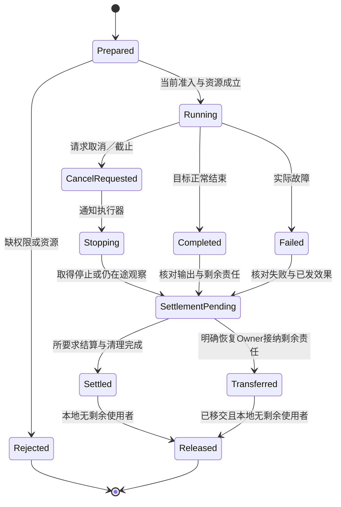

# 运行主线与实例寿命

## 当前计算运行主线与结果寿命

### 图解：请求完成与物理资源结算分离

状态图区分一次运行的控制结束、责任结算和本地资源释放；Completed/Failed只表示执行器结果。未决效果或仍活动的消费者进入SettlementPending，不能从超时、隔离或取消请求直接进入Settled。

Transferred只结束原Owner的相应占有责任，不表示Operation已结算；接收者继续保留原身份、未知与资源计费责任。隔离只能在已证明其覆盖的范围内阻止访问或新效果，不能证明远端活动已停止；本地尚有借用、回调或执行线程时仍不能释放其资源。没有实际接收者或停止依据就保持SettlementPending，控制请求可返回准确未决及恢复引用。

当前优先本地计算的构建、运行、输出与观测；下面数据库、容器、云和持续调和是条件能力，不是每个程序的部署需求。完整接口由[compute-run扩展](../../80-开发者与接口/工具协议/构建运行接口.md#计算构建运行与定点观察的可选操作扩展)拥有，这里定义宿主消费。

先固定artifact及入口，读取参数与真实工具/环境；建立操作身份并取得本次资源份额；在隔离输出区构建或调用；保存结果、成员和当前执行状态；按请求取得观察；结算后释放。一次运行可完全在本地进程/worker内完成，无需联网服务或数据库；所需内存、文件和设备仍需真实能力。

多个独立计算可以并行，但输入共享不能导致别名写冲突，未停止的消费者继续占用缓冲。每个应用会话的可见结果绑定当前输入和选项版本；旧运行可完成为历史结果，不可更新新画面。取消请求和实际停止分开，RunRecord的结束分类沿真实Runner能力。纯计算输出可放弃，已发出的外部作用不能用删除记录撤销。

构建得到的可执行制品与生成源码是两份有生产关系的ArtifactSet；实际运行数据不是新的作者头。依赖缺失时报告真实缺项，不自动安装；需要安装则独立授权后继续相应准备。运行成功但结果超出任务误差，仍可准确记录执行成功而需求未满足；二者不互相改写。

观察器只读实际可得状态，不以有格式化方法为由调用未知getter。一个被优化掉的源值不能用旧运行或重新计算值填充；重跑与原运行分开。需要观察变体时固定其产物与原来源关系，不能在start中无记录地换代码。

## 从源候选即时运行与运行实例结束

[compute-eval](../../80-开发者与接口/工具协议/构建运行接口.md#从候选直接运行的有限扩展)明确请求准备某个源入口后运行。准备出的制品和实际RunRecord分别保存，准备失败不产生已运行结果。原compute-run只接已可调用制品。获取依赖、临时写盘、进程和设备仍要实际准入，预览不暗中触发。

运行实例拥有本次状态根、闭包和实际资源。代码可以与其他运行共享，可变对象与全局会话配置只有显式共享才相同。实例结束先停止新准入并结算在途使用者，关闭实际资源，再释放根引用；宿主GC何时收集剩余不可达值不是业务完成条件。输出或会话继续持有闭包时，原代码与其环境继续有效，不热改在途解释。

## 采用合格路线与证明已经运行

发布输入是精确产物、当前被要求的保证与环境条件。组合检查只能说明在这些条件下具有相应设计/生成资格；实际应用和运行必须取得真实目标状态及读回。代码可加载、端口连通、任务结果满足和用户目标达成都有各自观察对象，不合并成“部署绿色”。

新绑定比旧绑定更快时，先判断是否更改公开表示、状态、运行资源和在途责任；按迁移合同切换。允许只读或影子比较时不重复真实外部效果；对不能安全双执行的操作采用精确事件/结果或其他合格验证途径。既有操作继续绑定原代码与语义，除非显式迁移具备相应保证。

真实环境失去某项假设时，区分停止新准入、保留只读、缩小支持范围、重新生成带检查版本和隔离受影响实例。该处理由实际控制能力执行；离线独立产物没有回连与约束机制时，Gift不能只改元数据就声称它已停止。历史制品和旧证据按其范围保全，新资格从当前事实形成。
