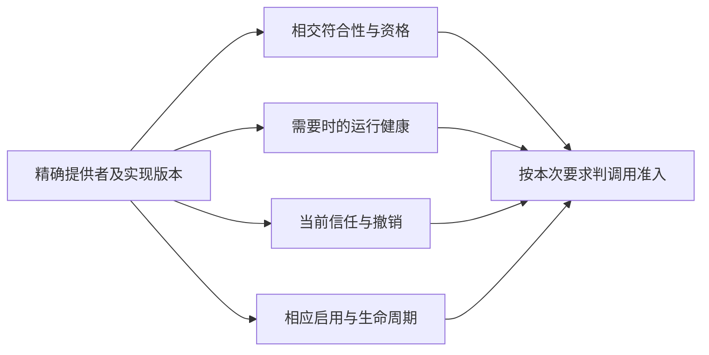
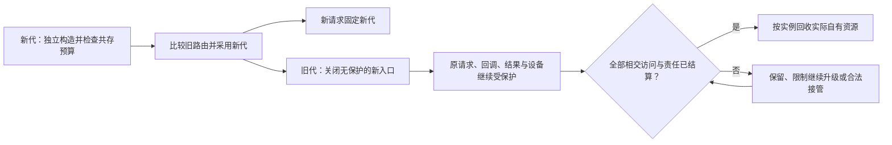
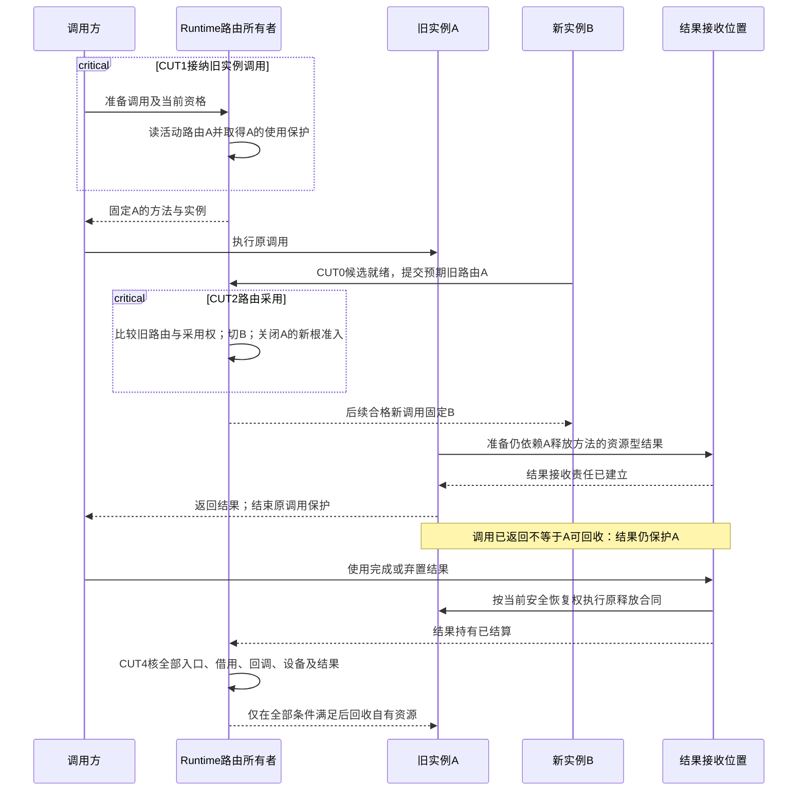
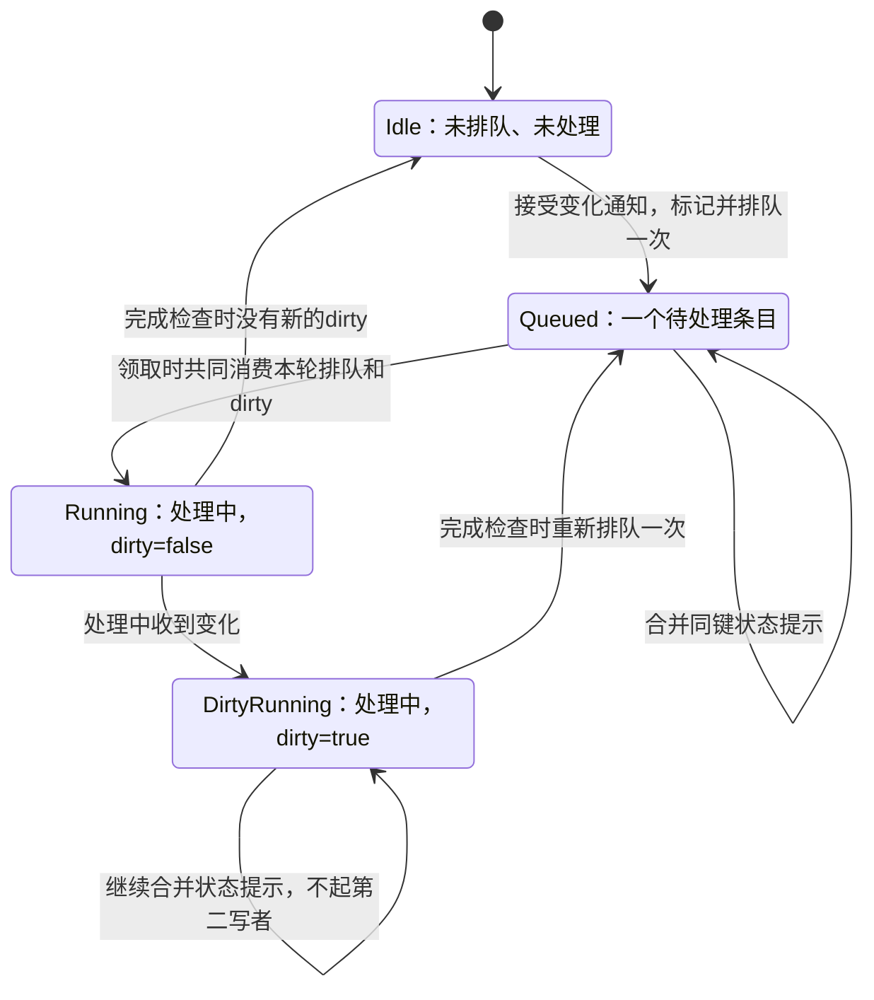

# 控制、调试与 Provider


### 外部依赖与供应链

原生包、代码生成工具、目标框架、数据库和Provider都有版本、许可证、信任、漏洞与ABI适用性，但不能要求业务作者手动在每个Definition上声明所有供应链细节。项目约束及锁确定目标实际使用的依赖，解析器提供对版本替换和环境切换的准确影响。锁文件和来源文档是派生/管理信息，不是新的行业业务语言。

## 反馈控制器、调和、漂移与持续收敛

### Desired 与 Current 分离

控制器依据[ControllerContract](../../20-语义与组合/共同语义/反馈控制与稳定性.md#controller-contract)消费已接受目标状态/轨迹/策略及有来源的当前观察。允许自适应时按锁定政策重算目标行动；已观察状态容易实现或一次写入成功，都不具有修改原 Requirement 或宣称长期收敛的资格。

### ReconciliationCycle

```text
observe exact current
→ compare with desired generation
→ compute pure delta
→ admit bounded actions
→ execute and settle
→ read back
→ record goal/stability observation, admission/progress and operating mode separately
→ schedule next observation
```

### 多控制器

多控制器必须为共享字段/状态/Effect 定义实际写入协调：单写域、分区所有权或经过验证的类型化冲突合并。可交换状态允许并发更新，但仍须证明其合并律及实际调度条件；默认 last-write-wins 不能代替不变量保持或收敛证明。

### 外部漂移

外部人工修改、Provider 自动作业和其他系统写入必须保留来源。策略可以接受、覆盖、忽略、报警或停止，但不能把所有差异都称为错误。

### 稳定性

按相交 ControllerContract 选择幂等、滞回、限速、退避、围栏、死区和具体安全过程，不把策略名字当稳定性证明。共同执行器、饱和与内部积累、采样/排队/反馈延迟和恢复余量进入组合摘要；硬响应由真实调度与资源画像承担。重试/auto-scale 的正反馈不能由字段单写自动排除。

### 版本变化

新旧 controller 并存按实际写协调与共同不变量准入，可以单写、显式分区或已证明保持合同的多写协议；不能以版本不同免除共享执行器检查。desired/observation schema、控制隐状态和 rollout 分别检查；旧动作的结算不由新目标覆盖。

### 验证：反馈控制器、调和、漂移与持续收敛

持续漂移、乱序观察、两个 controller、快速目标变化、网络分区、资源耗尽、外部 override、恢复动作冲突、版本切换和长期振荡。

<a id="debug-driver-lifecycle"></a>

## 调试驱动、目标控制与引用失效

### 消费者与驱动接口

[有限调试工具合同](../../80-开发者与接口/工具协议/交互调试接口.md#debug-session-contract)是开发者入口；本节拥有其真实执行与状态转换。`execution/debug-session.ts`维护一次会话/命令归属，`adapters/debug/`实现已选成熟调试器端口，`application`只协调请求、固定内容和返回。与普通RunRecord/operation共用原资源与结算，不另建调试权限数据库。

`DebugDriver`必须给出以下真实方法，未支持的方法返回明确能力缺项而非空成功：

| 方法 | 输入 | 返回/保持 |
|---|---|---|
| `prepareLaunch` / `prepareAttach` | 固定制品/入口/输入或真实runtimeTarget、调试能力、当前准入与限额 | 有类型的实际启动/连接计划；不会在纯准备里已经运行目标 |
| `connect` | 已准入计划及原operation/尝试身份 | 驱动会话和有序、有限的结构事件；返回连接建立不等于目标就绪 |
| `replaceBreakpoints` | 明确配置代、按真实源分组的完整位置集合 | 每项实际位置/验证状态或未决；空集合实际清除本拥有者该源断点 |
| `control` | 已核当前状态/暂停/配置的有限控制联合、实际线程/runScope、pendingControl和请求身份 | 已发送/完成/失败/未决；不接受任意DAP方法名或shell字符串 |
| `readPaused` | 当前PauseRef、帧/值选择、预算与披露范围 | 带暂停与观察范围的有限内容，或陈旧/不支持；不执行用户getter |
| `reconcile` | 原意图、最近可信会话/目标身份、待决命令 | 当前可验证事实与仍未知范围；没有查回能力不得伪造读回 |
| `close` | launch/attach归属、明确结束方向、当前许可 | 调试连接、目标、子资源分别结算；不从会话terminated推断进程树结束 |

接口规范由execution拥有，具体SDK/DAP类型留adapters内部。Dap sequence、threadId、frameId、variablesReference等底层编号均映射为本会话下的受限引用；它们不直接成为全平台稳定身份，也不跨新暂停复用。

### 实际启动和控制步骤

**DBG0 固定与准入。** 核已协商协议、制品与工具内容、源映射、入口/参数、目标身份和目的。选择本次实际Runner/调试器配置；不继承任意工作区调试脚本、环境或扩展安装。附加现有进程分别核可披露数据、暂停/控制及终止权。

**DBG1 建立驱动。** 在当前资源和秘密范围内启动独立适配进程或连接已接受的受信服务。记录本次拥有与借用资源；端点不是任意用户URL。握手核实际能力、路径/坐标约定及消息/输出大小。没有安全读取变量的方法时，降低为无法展开该值，不能通过表达式求值补功能。

**DBG2 配置。** 按驱动实际就绪时点设置断点，消费每项实际位置与验证状态；配置完成是否允许目标继续由required条件与真实适配保证决定。目标启动、模块加载和断点配置可能交错，不能写死“连接完成就已在入口停住”。需要用户代码前停住的能力不足则不宣称支持。

**DBG3 接收状态。** stopped/continued、线程出生/退出、断点变化、输出、会话结束和目标退出各更新相应对象。线程ID复用建立新出生身份；续跑使相交PauseRef失效；只有一个线程停止时不假设全堆冻结。输出流可以在明确限额下截断，控制状态流丢失则使状态不再可信，不能悄悄丢弃后继续签发暂停引用。

**DBG4 读取/发命令。** 命令接受与本地状态更新串行，驱动I/O在其外进行；不要持有全局查询锁等待目标。读取返回后再次核暂停/来源是否仍相容，过期结果不作为当前值；单步、继续和暂停都有真实执行效果，不在传输重试中重复发出。反向请求启动终端/进程也要重新通过原execution边界，不能由调试器请求自动授予。

DBG4还消费公开合同的单个pendingControl：本会话未结算命令阻止第二条独立状态改变，继续/单步接受时先撤掉旧暂停的活读取资格；发送前检查最新本地前提及实际驱动可承担的控制范围。runScope=thread不支持就拒绝；必需断点未verified不允许继续。动态强配置只在实际全目标暂停边界进行；附加前的执行历史不属于它的保证。命令响应丢失保留pending/未决并查回，不能清空槽给第二条next制造双执行。

**DBG5 结束与查回。** launch会话终止需要分别核目标退出、子进程和驱动结算；attach默认只解除本次连接。对失联保留最后可信状态与可能已发生的命令。可安全重连时先核同一目标出生身份、适配能力与实际控制资格；旧PauseRef全部作废。不能确认同一目标或实际状态时返回unsettled，不能自动附加同PID的新进程。

### 宿主保证、运行观察与持久边界

本地有序消息和单控制者减少竞态，但不替代宿主真实控制边界。多个调试器、目标自发恢复、信号或远端消息缺口都可使本地paused过期。声称原子“仅对这个暂停单步”需要适配器能实际履行；有限原生协议只能提供较弱观察时，拒绝依赖强保证的命令或按已接受范围使用，不通过注释伪造保障。

运行中读取的对象可能含秘密和任意规模数据。默认给定数量、字节、深度、时间预算并保留截断/不可读原因，不全量收集堆、环境或每步日志。观察本身的暂停和读取成本计入这次运行，不能拿被调试执行的耗时代表无调试性能。

短本地会话可以只保留内存状态和有限输出；没有跨崩溃恢复承诺时，断开后报告失去的会话范围。真实外部写入的业务后果仍归目标作用合同，调试记录不能恢复其未建的幂等协议。确需可恢复命令时复用原持久意图/结果，并保存准确目标/工具/输入；不因有调试日志就认为控制命令恰好一次。

DAP是消息与能力机制，不定义本产品全部启动参数、权限或沙箱。具体驱动需锁定实际协议/工具修订，使用其真实启动、暂停、变量、配置与结束能力。[官方说明](https://microsoft.github.io/debug-adapter-protocol/overview)作为这些机制的来源；本节未指定或运行任何实际调试器实现。

## 外部能力 Provider 运行时

### 定位

Provider 是语言工具、编译器、求解器、测试器、模型、远程服务、数据库或 Host 能力的实现载体。Provider 提供能力，不拥有 Gift 的产品语义、权限规则和验证裁决。

### 能力分解

```text
ProviderDefinition   供应者身份和协议
Provision            声明可提供的能力
ProviderRevision     精确实现修订
ProviderBinding      Requirement 到 Provision 的解析
ProviderSession      一次可调用运行会话
ProviderReceipt      调用观测和结果
```

会话重建本身不改变稳定实现绑定；实现/能力合同、所用目标与依赖语义变化可使绑定重评。授权、撤销、健康与实时资源变化也可使当前调用资格失效，但不因此改写历史 Binding 的语义身份。

### 成熟度

本篇不定义另一套 Provider 成熟度直线链。合同、符合性和范围化资格沿用[能力依赖图与局部插入](../../20-语义与组合/共同语义/对象必要性与能力依赖.md#能力依赖图与局部插入)；健康为 healthy/degraded/unavailable/unknown，信任为 eligible/revoked/unknown，生命周期为 active/retiring/retired。各值绑定精确实现与作用域，可以独立变化。发现候选不自动取得任一资格。

### 会话合同

```ts
interface ProviderSession {
  readonly sessionId: string;
  readonly providerRevision: string;
  readonly provision: ProvisionRef;
  readonly environment: EnvironmentRef;
  readonly grant: GrantRef;
  readonly limits: readonly ResourceBound[];
  invoke(request: ProviderRequest): Promise<ProviderOutcome>;
  query?(operation: ExternalOperationRef): Promise<ReadbackOutcome>;
  cancel?(operation: ExternalOperationRef): Promise<CancelOutcome>;
  close(): Promise<SettlementReceipt>;
}
```

### 完成语义

Provider 必须声明：

- 调用是否幂等；
- 幂等键范围和保留期；
- 超时后效果可能性；
- 查询或读回方式；
- 取消是否真正停止效果；
- 迟到响应处理；
- 重复和乱序；
- 会话丢失恢复；
- 外部错误映射。

无读回且不可幂等的破坏性 Provider 不能取得要求可判定恢复或防重复效果的调用资格；可以如实记录其发现/实现状态，但不能用泛化“成熟度高”放行不满足的保证。

### 适配器

适配器负责协议、类型、错误、取消、资源和回执映射。适配器不能：

- 放宽 Requirement；
- 隐藏未知完成；
- 根据错误自行选择其他 Provider；
- 把日志文本当结构化结果；
- 获得超过会话 Grant 的 Host 权限。

### 沙箱

本地Provider的边界由实际信任、资源和故障隔离要求选择，不以“本地”一律决定进程数。已获准的可信纯方法可同进程直接调用；worker可承担并行或可中止计算，但名称本身不证明文件、网络和秘密隔离。不可信代码、需限制宿主权能的插件，及进程内无法满足的硬资源/故障界，才使用确实提供相应保证的受限进程、容器或解释器。未知模块的顶层初始化也算执行，必须在合格边界内进行，不能先加载到主进程再检查。

需要沙箱的提供者按本次要求验证实际具备的边界：

- 只读或限定文件能力；
- 网络目标白名单；
- 受控环境变量和秘密代理；
- 进程树、CPU、内存、磁盘和时间限制；
- 输出大小限制；
- 系统调用或容器边界；
- 关闭时进程树结算。

列表是相交保证的核对范围，不宣称每种宿主都支持全部能力。缺少本次必需边界时返回不支持或改选有权且合格的方式；不以降级成普通子进程冒充沙箱，也不强迫无此要求的短纯调用支付隔离、序列化与守护成本。

### Provider 生命周期



本图是准入输入关系，不是提供者必须依次晋级的成熟度阶梯。各项按本次真实要求消费；历史符合性不代替当前权限，健康变化也不改写原产物。
该图是独立证据共同参与准入，不是从已发现到已退役的必经状态机。恢复健康不自动解除安全撤销；新资格证据不自动重新激活已退役实现。

### 健康与漂移

健康信号包括：

- 能力发现；
- 合同握手；
- canary；
- 错误率和时延；
- 结果差分；
- 资源异常；
- 版本和证书；
- 安全或供应链事件。

运行健康不是语义符合性替代。漂移只使真实使用该 Provider 的 Binding、计划、证据和候选陈旧。

### 升级和撤销

新 revision 作为独立候选：

```text
发现
→ 来源和签名验证
→ 合同测试
→ 所需符合性与故障检查
→ 必要时隔离影子或有限流量
→ 限定切换
→ 观察
→ 旧会话排空
→ 旧 revision 退役
```

恶意或撤销事件立即阻止新会话，终止可安全终止的活动，轮换泄露秘密，并重建受污染派生物。

<a id="runtime-generation-cutover"></a>
### 路由切换、在途固定与旧实现回收

新实现可被选用、某次调用已固定它、旧实现已不再接纳新工作、及旧代码/资源已可释放，是四件不同的事。这里精化原EngineImage、ProviderSession和Runtime的接纳/释放接缝；不新建一个掌管所有对象的版本管理器，也不改写每次方法的公开参数。

**CUT0 准备候选。** 原装配工厂先构造独立只读新代，取得真实依赖、接口/数据兼容性与相交符合性；按[取得责任](../../20-语义与组合/基础语义/对象与控制/控制流与存储寿命.md#acquisition-custody)保护部分初始化和未交付句柄。新旧代码、缓冲、连接、在途结果与恢复材料共存的峰值先受宿主实际池及本次预算约束。准备失败只结算新代确实取得的资源，旧代的调用和恢复责任不被清空。

**CUT1 读路由和取得保护是同一接纳动作。** 既有Runtime入口按真实路由域选择活动代，在同一短协调段或等价合格原语中核生命周期并取得使用保护，然后才返回固定方法/实例引用。反例是先读A的指针，更新者切到B并释放A，读者才对A加计数。单线程重入也不能把外部getter/回调插在这两步之间；跨线程必须使用真实同步及发布可见性，不把普通赋值称为原子保护。保护可以在PreparedJob/会话入口取得一次，内部安全借用复用它，不要求每个纯函数深层调用重复登记。

**CUT2 单点采用。** 新代全部准备就绪后，按预期旧路由和当前采用权，在同一拥有者内切换默认路由并关闭旧代的无保护新入口；必要的根保护与退出观察位置预先准备。切换冲突保持当前已采用者，重新评价是否仍需该候选；切换结果未知先读回原操作，不再盲发另一次。只有真实共享一个提交点的路由集合才一起原子；跨进程/多目标按原分项发布与围栏处理。默认路由只影响允许选择它的新准备态，不能替换锁定旧解释的工程。明确保留的历史入口是独立的接纳根及资源责任；只撤默认路由不等于关闭了实例全部入口。若实例整体已Closing，则不能通过另起入口名称重新接纳无保护新工作。

**CUT3 旧请求完成原合同。** 已固定A的请求、回调、设备完成、结果弃置和释放方法继续使用A的实际实例，不回查currentProvider来找B的析构器。排空禁止新的无归属根，不禁止原接纳任务完成其已绑定、有限且仍获准的子调用/清理；这些派生使用须在父保护释放前完成登记或转交，不能让计数先归零再“复活”子任务。尚未开始的独立冷任务不能仅凭旧闭包名自动取得新作用权。新请求确需旧解释时，只能进入明确保留且仍合格的旧版本入口，或重新装配获准的新实例；已进入回收的旧实例不重新开放。保留历史入口意味着其根保护尚在，不可同时宣称旧版本已排空。

**CUT4 先断未来访问，再判可回收。** 原请求、借用、回调栈、设备使用及仍依赖A代码/分配器的返回对象全部结束或被真实有权接管后，才释放A实际拥有的部分。结果就绪和调用数归零各自不足；一个仍须由A释放的结果就是独立保留原因。永久纯字节无需不必要地pin整个运行实例；仅保留它真正依赖的内容与解释依据。共享宿主池与外部已接受业务仍归原拥有者。不可加载/卸载的宿主可保留到进程退出，或在允许的独立进程边界替换；不能把移出Map宣称为已卸载代码、已擦除秘密或已停止设备。

**CUT5 有界演进与失败恢复。** 同时存活代的数量、真实占用和准备队列由既有预算/调度控制；旧代迟迟不退出时，优先等待、取消尚未采用且无独立义务的候选、限制进一步升级，或合法隔离/转交。不能为腾内存提前free旧代，也不能每次配置消息都开一个新Runtime。合并的是尚未执行的状态请求，不是已采纳的操作、审计、补偿或未结算责任。旧A→B→新A仍是不同运行代，迟到回调按实例比较而不是名称相同就接纳；退役失败保留原实例及准确残余，恢复不重复执行已完成析构。

**撤销和回退不由pin授权。** pin只保证所需实现/资源的寿命；安全撤销仍在真正效果消费点阻断新越权作用。继续清理、读取或补偿也使用当前允许的恢复权，不能为了“保证释放”运行已不可信的原代码；没有安全回收能力时保留隔离与未结算。回退是新的有权采用，先核新数据格式、已发生作用、外部依赖和恢复方向；版本A仍在磁盘不证明可恢复业务前像，已销毁实例也不能被状态字段复活。



实现默认可用已有入口短锁和作用域引用；只有测得读路径竞争且目标有合格原语时，才换等价的无锁/epoch/RCU方案。RCU资料支持“移出可见路径后等待旧读者，再回收”的机制，不证明跨异步悬挂引用、外部作用或所有宿主都已满足条件；[来源与取舍](../../../research/sources/构建分发与迁移.md#dynamic-lifecycle-sources)记录这些限制。

<a id="runtime-pin-handoff-sequence"></a>
### C协议的调用保护与结果交付时序

A、B分别表示两个实际运行实例，不是可重复使用的版本标签。根保护、派生子使用、回调/设备访问和资源型结果是不同持有关系；实现可以合并等价的内部计数，但不能遗漏任何真实使用。下图的admit、pin、release均为CUT1—CUT4语义步骤，不增加公共API。



结果保护必须在调用保护释放前建立；接收未知则保留原保护，不能在两个保护之间出现零持有窗口。采用B失败不改变A的路由责任；A的清理失败也不撤销已独立成立的B，但必须保留A的残余并限制共存占用。上图未绘出的安全撤销仍约束每次真实效果，pin只保证寿命，不授权执行已不可信的代码。

### Fallback

Provider 故障后先确定外部效果状态，再重新解析候选。Fallback 需要新的 `ProviderBinding` 和可能的新批准，不能复用旧会话权限。

### 验证：外部能力 Provider 运行时

- 合同黄金向量；
- 错误、超时、重复、乱序；
- 取消和进程树；
- 资源耗尽；
- 会话丢失和重建；
- 漂移检测；
- 沙箱逃逸；
- 供应链撤销；
- fallback 不扩权；
- Provider 与参考实现差分。

<a id="reconcile-wakeup-state-detail"></a>
### 调和队列的唤醒状态投影

本图仅展开[RECONCILE0—RECONCILE4](运行实例-订阅部署与调和.md#reconcile-wakeup-handoff)中的排队、处理中和dirty标记，不替代外部操作状态。Idle/Queued/Running/DirtyRunning是三项已有事实的阅读投影，不要求新增持久枚举。状态提示可合并，独立业务命令、回执与未结算操作不得按此丢弃。



领取与完成的状态修改必须和通知标记使用同一协调域。通知先于完成时，完成者观察dirty并重新排队；通知后于完成时，由Idle进入Queued，均不得丢失再次观察的机会。关闭新准入、队列容量、期限和背压是正交条件：它们不由Idle推定成立；关闭后已接纳工作仍须按RECONCILE4结算。异步D1结果不能将已改变的D2目标标为收敛，外部接受未知仍沿原操作身份查询。
