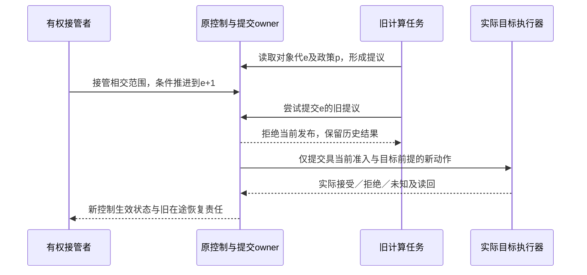
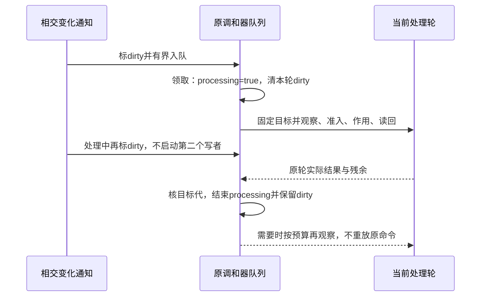

# 订阅、部署与调和

## 工程订阅与部署的状态接合

源码发布只是新的定义/处理版本可被采用。运行数据、幂等终态、事件编码、订阅偏移和实际交付分别保有原身份；部署成功不推导旧数据已迁移或历史消息已按新合同处理。

作者定义的交付 subscription 在运行绑定中取得消息源、端口、交付身份、顺序和有限重试；事务型应用组合研究只提供一组反例。默认有序键停放时只阻断相交键，不停止整个租户或应用；需要跨键顺序时另有共同协调合同。工作器租约和数据库记录还必须由实际目标约束迟到确认；没有端点去重不承诺网络外部作用一次。

选择不含订阅的输出根时不创建投递器。删除已部署订阅则不是“从输出根去掉，所以旧义务不存在”；退役要明确排空、转移、授权跳过或停放，保留所需恢复资料和隐私边界。只关闭线程不关闭业务责任。

开发者可以用成熟调度/流程提供者承载长期任务，不要求Gift自己建设分布式工作流服务。即使采用可重放引擎，也应记录非确定输入和外部活动结果，不能在重放时重新生成身份、重新调用AI或重发不可重复作用。Temporal的[Side Effects说明](https://docs.temporal.io/develop/go/workflows/side-effects)区分记录结果与回放再执行；它不是外部副作用恰好一次的保证。

## 发布与运行调和的正向闭环

发布输入是已选定的Artifact集合、实际目标和布局、相应检查要求、当前许可与旧目标状态。一个发布动作只承担自己的交付层次：上传包、切换版本引用、启动实例、业务读回是不同结果。计划同时说明哪些层次是这次必需，哪些未请求。

### 发布路径

**DEP1 冻结交付内容。**从产物引用固定实际字节、成员集合和依赖，不重新读取活动工作树替换输入。检查秘密、原生保留区和路径在实际范围内；清单基于同一份捕获内容生成，不自报一个摘要后打包另一份字节。

**DEP2 准备目标。**读取当前版本、能力和资源，选择目标真正能承担的切换机制。新目录交付可以写入独立候选目录；已有工作区按前像/恢复协议；支持单一版本指针的目标可准备不可变版本后原子切换那一指针。多目标没有共同提交能力时明确逐目标状态，不宣称整个集合瞬时原子。

**DEP3 执行当前请求。**取得当前权限、预算及必要协调后应用所选计划；状态只随实际观察更新。准备完成未切换不能显示已生效；上传完成未启动不能显示业务健康。

**DEP4 读回和交付。**按请求声明的层次读取真正产物、活动引用、实例或业务检查。内容已匹配但目标健康未取得时，返回对应部分完成。失败选择恢复、回退或向前修复，先检查数据与接口是否仍允许回退，不能把所有发布都定义为可逆。

**DEP5 保留与退役。**正在使用、用于恢复或受明确留存要求约束的版本继续保存。无引用且满足回收条件后按代际删除；归档、已停止执行和物理消除不是同一状态。单一编译任务不要求持久发布服务。

### 调和循环怎样推进而不抖动

循环输入为固定目标D、独立当前观察C、实际差异规则与允许动作政策。每次观察先检查自身范围和时效；不完整观察只限制对应判断。若在所要求的等价关系下D与C相同，则记录该时点收敛，并按已接受监测计划再观察；不是宣布永远一致。

存在差异时，先分类为受管理漂移、外部有权变化、未知或不属于本控制器的字段。政策决定保留外部变化、形成新的采纳候选、或恢复既定目标。生成纯Delta和动作计划后，重新准入并只执行本步预算允许的步骤；读回新C再判断，而不是根据成功返回码直接重试同一动作。

离散状态使用精确状态条件，不凭任意阈值近似。连续测量确需抑制噪声时，由领域合同定义误差带、采样间隔和进入/退出阈值；这些参数是明确政策输入，不是通用“最佳迟滞系数”。响应滞后长于循环周期时，等待对应在途操作的读回，不启动相互抵消的动作。

固定D和规则下，重复动作既未推进任何受管理条件又产生相反变化，或来源显示另一个合法写者竞争时，循环进入冲突/振荡诊断，停止自动对抗并返回决定点。独立领域可以继续运行，不要求整个平台停机。相同失败、输入和环境不变时复用已有结果；真正状态改变才开启新尝试。

### 在线自适应固定政策，而不冻结每个瞬间的参数

自适应是在已接受约束内调节真实实例，不是每个采样都修改作者源、重新构造EngineImage或重新批准全部系统。原调和器持有本轮固定的目标、政策／方法修订、观察定义、允许的执行器与动作域、资源预算、接管代及退出条件；实际选值、观察与结果归对应运行轨迹。未请求自适应的纯调用不启动监测或长期控制进程。

| 既有运行信息 | 需要区分的内容 | 责任与限制 |
|---|---|---|
| 政策与允许动作 | 硬约束、可调自由度、固定方法、选择规则、切换与停止条件 | 原已采用定义与委派；不能由控制器自行放宽要求 |
| 观察 | 主体／实例、样本窗口和时间域、准确方法、覆盖、误差及缺测 | 实际Provider；缺失不是零，延迟样本不能伪装当前快照 |
| 调节提议 | 所用观察和政策、预期基础、具体参数、预计影响及预算 | 纯决定；产生提议不等于取得作用权限 |
| 实际生效 | 操作、准确实例／控制代、目标接受与读回、部分结果和残余 | 原execution与执行器；请求值不冒充实际值 |
| 恢复与交接 | 在途动作、已有费用、资源引用、已知合格基线与下一责任 | 原操作记录；换轮、进程重启和换模型不清零 |

**A0 捕获。** 从有覆盖的观察取得当前状态，明确哪些条件只能估计。政策依赖的观察迟到、矛盾或失去权限时，选择其已定义的保持、降级或停止路径；保持最后值也必须满足其安全适用期。若可见观察无法区分需要相反动作的两个状态，则只能取得新观察、选择共同安全动作或保留未知，不能宣称自主控制全知。

**A1 决定。** 在固定自由度中产生有界动作，计入变化幅度、作用时滞、迁移成本、在途动作及共存资源。滞回、限速、最小保持时间和分阶段探索是可选政策机制，参数由所需保证、真实采样和工作负载支持，不给所有控制器一个武断阈值。在线学习改变模型参数时，学习规则和允许更新域固定，影响选择的模型状态也进入运行依据；修改学习规则本身是新政策采用。

**A2 仲裁。** 缓存扩容、提高并行度和加大批量可能争用同一内存或I/O。各控制器只拥有自己的局部提议，不各自取得整份共享额度；按[资源预留](../权限与资源/资源核算调度与交接.md#budget-reservation-settlement)在共同owner仲裁。资源、初始化、事务或公平性相交时联合考虑，互相依赖的反馈须有适用的稳定／进展依据。没有共同原子边界则分阶段取得许可并处理部分生效，不把局部同时通过称为整体成立。

**A3 施加和读回。** 按下节的实际围栏执行；读回区分尚未接受、已接受未收敛、实际达到、失败和完成未知。产生新观察前不把旧未结算动作当成已取消，避免重复计费或相反动作相互抵消。数据资源可立即改变而其他资源只能等安全切面时，保留其不同生效时间与状态。

**A4 停止、修正或再委派。** 合格目标已满足且无持续观察请求时结束；持续请求按既定再观察政策运行，不把“仍可改善”作为无限探索理由。资源耗尽、反复振荡、观测失效、越出保证或外部合法写者冲突时，只停止相交新作用，保留可读历史与必要恢复。用户重新委派使用当前有效目标和观察，不恢复已失效的旧政策／权限。

精确重放与行为满足是不同要求。需要重放实际决策时，保留相交观察、顺序、模型状态和非确定输入；种子相同不证明外部时序相同。只要求统计或误差合同的控制器可以有不同轨迹，仍按该合同评价。用于解释的遥测可采样，恢复所需回执和接管围栏不能被采样丢失。

### 人工接管、撤权和迟到提议的真实发布边界

接管使用原路由／调和／操作owner，不另建控制总线。协调键包含真实对象出生身份及相交字段／作用域；同路径删除重建不是同一对象。新接管推进其单调控制代或等效不可复用令牌，固定新目标和权限范围；旧任务即使计算完成，也没有更新当前发布槽的资格。

在同一可原子协调域，发布同时核准确对象、控制代、预期目标／政策修订、当前前像、仍有效的执行权及原操作去重状态，再改变实际目标。检查后另行无条件异步写入会重新打开竞态。纯结果可以保存为旧代历史，但当前诊断、布局、采用指针和后续派发都必须核自己的安装资格，不能只有UI防旧而真实执行器仍接受旧写。

跨权威域不能由一个本地原子段制造全局撤权：目标支持fencing／版本前提时必须在那里强制；只支持网关阻止新派发时，已接受的远端操作按其真实取消与读回合同处理。无目标围栏且旧写者可能仍执行时，不能立即启动竞争写者并承诺不会迟到覆盖；可以等待可证明的安全切面、隔离新实例，或保留该控制的能力缺口。短租约、心跳和客户端超时只提供其实际语义，不等于外部已停止。

取消等待、禁止后续派发、发出终止、确认终止、撤回未提交内容和补偿既有效果分别报告。接管成功不自动意味着旧资源已释放，也不取得销毁借用进程的权限。临时覆盖到期的恢复要比较当前仍是它自己写入的后像；另一个作者已续写则保留冲突，不把旧值盲写回去。根政策和授权规则的改变仍走有权演进，不能由新政策自行证明本次接管合法。

### 变化通知、调和排队与再次观察的交接

变化通知只是重新观察的触发，不能签发新的目标、重放一个业务命令或证明某次作用已完成。控制器的协调键按真实对象实例及字段/作用冲突域确定；目标版本、控制器进程号与attempt只是本轮输入，不能因它们改变就为同一冲突域创建第二个独立写者。对象删除后同路径重建也不是同一个实例。

**R0 建立可解释观察。** 复用[快照—事件握手](../../80-开发者与接口/工具协议/客户端与并行会话.md#快照与事件之间的无缺口接合)：从准确切面及相交事件位置继续，或在有界缓冲保护下捕获；轮询也可以承担本次要求。断档、历史过期、重连换了范围或权限后，先标相交观察未知并重取，而不是把“没有事件”当成状态相同。各来源游标只按其合同比较，不将任意字符串版本号取数值最大值；多来源没有共同顺序时保留各自切面。原[投影检查点](../../80-开发者与接口/工具协议/客户端与并行会话.md#projection-checkpoint-resync)只有在完整应用通知后推进；队列标dirty/领取不是目标已收敛或业务消费确认。可重建的纯dirty队列允许重启后重新观察；不可重建输入不走此简化。不因重建派生视图而删除真实operation、未结算责任或作者草稿。

**R1 合并唤醒而不漏掉变化。** 既有调和器对每个协调键保留队列归属、是否正在处理、是否需要再观察、当前观察缺口和原在途操作引用。到达通知时在短协调段标dirty；尚未排队且未处理才入队，正在处理则只保留dirty。领取时同段确认唯一处理者并清除本轮以前的dirty；结束时同段解除processing，若处理期间又dirty则只重新排队一次。因此事件先于结束和事件晚于结束两种次序都不会丢唤醒。等待/运行的用户逻辑、远端调用和日志均在锁外；队列长度的非同步快照不能用来决定是否已安全入队。

**R2 固定本轮判断，保留变化后的义务。** 领取后固定已接受目标、政策/解释、观察范围和本轮身份，再观察、纯规划及逐步准入。实际写入仍比较真实目标前像、当前权限和必要围栏；本地dirty标记不是跨系统原子性。已接受目标改变后，旧轮可以保存其真实结果，但不能把新目标标为已收敛；更新当前投影须比较仍是本轮目标与对象实例。原操作已执行、接受未知或仍可能晚到时，先按原身份查回/结算，不能仅因队列开始新轮就获得新尝试许可。相反目标也不删除过去效果，是否取消、补偿或前滚另按该效果合同判定。

**R3 有界容量和进展。** 同键通知可以合并为一次“需再观察”，不能合并彼此独立且不可重建的业务命令、完成回执或唯一数据。等待键数、字节、活动调用、退避计时器和重同步成本共同受预算限制。键数超出容量时，只有在有权且能够重新枚举的范围内，才退化为该范围的待重同步标记；不能丢若干对象后还宣称观察完整。无法重建的输入须背压、保留到原耐久介质或准确停止相交接纳。重同步本身受限速与有限恢复份额控制，不让溢出触发无限全量扫描。

重复通知而真实基础未变，不重放已核确定性失败或在途写入；按既定退避/再观察政策处理。合并延迟若采用debounce，必须有本次要求允许的最大等待或可报告期限，持续事件不能永远把执行向后推；没有公平资源与稳定目标时也不能承诺最终收敛。排队、退避和重同步不刷新原业务deadline。控制器不得为让指标看似收敛而擅改已接受目标、成本单位或隐藏外部合法写者。

**R4 退出、崩溃与恢复。** 关闭先停普通唤醒准入，已接纳工作明确排空、取消或移交；关闭后的提交者取得拒绝/停止语义，不被静默记成已接受。纯dirty队列在可重取权威状态的模式下无需每事件持久化，重启先建新观察基础；实际作用必须保留原操作与恢复者。旧控制器未确认退出且目标缺围栏时，不启动竞争写者来假装可用；独立只读观察可继续。悬挂通知的清理与旧代资源沿原代际结算，不用全局reset清除无关控制器。

该协议复用`execution/reconcile.ts`与原操作存储；`entry/application`只提供实际目标/结果投影，`adapters`提供有范围的观察与读回，不再设一条可直接改作者头的全局事件总线。单次纯调用没有持续调和需求，不因本节启动队列或订阅服务。client-go的dirty/processing交接和Kubernetes的带位置Watch分别作为两个独立参照，采用范围见[依据](../../../research/sources/构建分发与迁移.md#dynamic-lifecycle-sources)。

### 运行资源的生命周期

计划声明实际拥有的进程、设备、端口、临时目录和内容引用；创建后由拥有者跟踪最后使用。退出先停止新工作，等待可结束的使用者，超时后按真实宿主能力停止/隔离或转交。取消信号不是设备栅栏，收到信号不提前回收仍被使用的缓冲。

纯生成只持有短期读取和内存；目标应用自行使用其真实运行依赖，无需回连Gift控制面。长期运行调和仅在用户或部署政策选择时启动，不因为用户说“持续设计”就在当前聊天后台执行产品操作。

## 状态实例终止与模型发布分别完成

发布新的模型产物只改变新实例或明确采用范围；运行实例继续固定原模型。逻辑根进入终态后停止普通事件，新活动不启动，旧活动与计时器进入取消/结算。该过程中可以保留终态路径供观察，不能据此保留所有状态资源继续运行。

部署控制从产物版本取得模型/回调及必要Provider依赖，选择保留旧实例、稳定切面迁移或停止后重建。迁移涉及活动接管时有真实目标前提，不能把快照内容复制当成接管成功。纯短实例结束可直接释放，跨故障或外部动作责任仍按对应协议保留。

## 运行适配的登记、停止与资源终结

目标入口若创建有限子任务，应使用[任务域](../../20-语义与组合/基础语义/计算基础/通用计算与任务语义.md#structured-task-lifecycle)的登记后启动和退出合同。宿主适配工厂可能同步完成，不能先调用再把handle登记；工厂可能已启动却抛出/断连时，失败不等于未运行，已捕获资源保持在未结算登记。对原生已热启动的Promise/Future，先承认真实启动事实，再核能否接管；无法停止且无合法接收者时，报告准确剩余责任，而不是构造一个“尚未启动”的Deferred。

一个目标退出、一个流订阅结束、一个等待客户端离开和某次外部尝试关闭不是同一个提交点。程序主入口返回后，域仍需结算已启动子任务、未领取输出和活动借用；发出cancel的成功响应不允许回收仍被原生线程或设备使用的缓冲。真实附加运行不因本客户端取消就获得杀死整个外部进程的权力，原debug/attach范围不变。

外部结果恢复采用[RetryBasis](../持久化与恢复/事务提交-外部效果与幂等交付.md#attempt-finality-and-retry)。状态查询可以如实显示当前模型、文件或资源内容，但不能因当前为前像就重复具有通知/收费/版本增量等额外作用的写入。分项纯制品生成可重新计算，不把它与已发送的发布或部署动作统一重跑。

### 系统意图重解释不得倒改旧运行事实

持续服务的当前 Root 可因作者采纳新 Meaning/模式版本重新生成部署目标，但旧运行实例、已接收事件、未结算 Operation 和历史回执使用其绑定的旧版本解释。迁移必须有准入/兼容/切面/回退路径；只改作者 JSON 不表示服务自动运行/升级。新模式抽象不授权 Provider；效果结果仍按[原操作读回](../持久化与恢复/事务提交-外部效果与幂等交付.md#gift-business-world-effect-refinement)结算。
