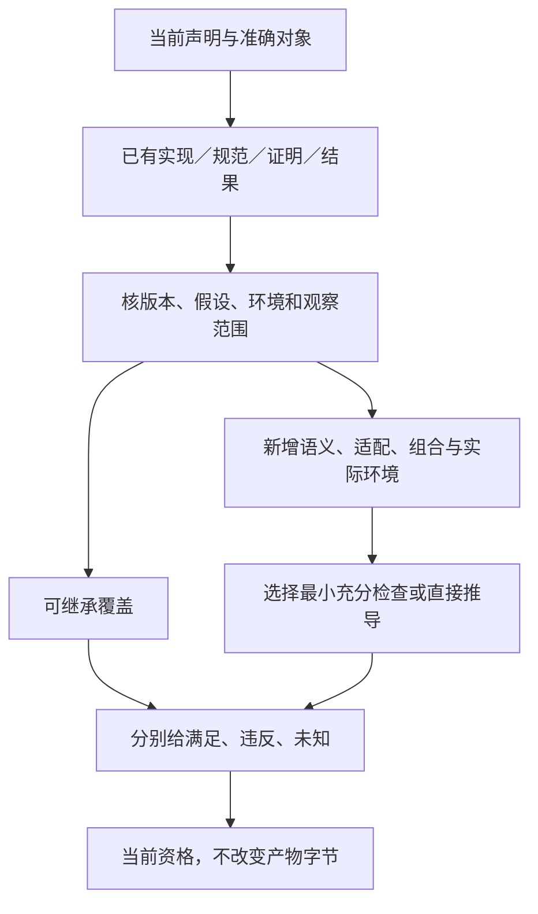

# 复用、产物与实现证据

## 复用、产物与实现证据

### 成熟成果复用与剩余验证责任

#### 图解：继承已有成果与本项目剩余义务

上游证明、规范、测试与接受的信任基础各有范围；图不把成熟名声转成整产品的已验证。

已有V3先检查合格复用，本节补齐的是**上游成果怎样真正消除本工程的重复工作**。目标不是再认证整个TypeScript、SQLite或标准库，也不是因品牌成熟取消所有接合检查。验证单位为当前任务的一项声明及其使用范围，不是代码行数、组件星数或测试总数。

#### 可继承的五类成果

| 实际取得内容 | 可以怎样使用 | 不能推出什么 |
|---|---|---|
| 固定规范与明确语义 | 作为当前解释、连接和反例的依据；条件不变时复用推导 | 文档中的软件已经在本机安装或按此正确实现 |
| 数学定理与证明 | 在前提和翻译均成立时消解所覆盖义务，无须每次重新证明 | 任意同名函数、换数值域或新模型也自动满足 |
| 成熟代码/二进制 | 作为明确选中的实现与信任基础，避免重写其内部 | 这个具体输入、配置、环境和所有上层组合都已被上游测过 |
| 上游测试和缺陷记录 | 校准可信范围、已知反例和需要加的本地边界用例 | 有限测试等于全称定理；自己的新Adapter零风险 |
| 本工程既有结果 | 对同主体、方法、实际输入及仍有效条件复用 | 旧结果可换标签给新版本或新产物 |

直接采用成熟实现通常只需边界资格、正确集成与实际任务符合性，不以重新做其全部测试为常规准入。具体任务要求独立认证、受监管或敌对部署时，再按该范围增加工作，不把这种强画像推给一个本地纯函数。

#### V-R0至V-R7：从总义务中确定真正剩余的工作

**V-R0 固定声明。**写明要确认的是源类型、目标行为、任务结果、边界保全、实际提交还是性能。没有要求的保证不为扩张验证图而制造。

**V-R1 划分责任。**将该声明与真实生产者、转换、调用和消费者对齐。能用普通表或引用说明时不用图数据库；只有组合推理确实需要时形成稀疏关系。

**V-R2 取得复用资格。**固定上游实现/API族/配置和相关规范或证据；明确当前选择是被证明、被测试、受信采用还是未知。核重要已知限制与当前任务是否相交，不默认进行全源审计；实际需当前安全状态时按许可获取对应信息。

**V-R3 对齐前提。**检查值域、求值/错误、整数/浮点、线程、VFS、ABI、依赖版本和所需环境。只检查相交项；未改变且已有资格的关系直接复用。形式证明的源模型若不同，先检查翻译；不能把错误模型的正确证明作为完成。

**V-R4 划出残余。**已覆盖的原组件内部义务引用继承依据；保留新语言到目标的语义映射、包装/变换、跨组件共同条件、显式修改、实际宿主输入和原任务满足。它是带前提的义务消解，不是从一个测试数字减去另一个数字。

**V-R5 选择最小充分方法。**字面结构可检查时用结构检查；有直接推导时记录推导；边界案例、差分、回放、目标类型或故障试验只用于它们能回答的问题。已接受信任基础内无需重新证明上游算法；不适用的方法不运行，不伪称通过。没有单一方法覆盖声明时组合必要方法或保留明确开放部分。

**V-R6 执行与归属。**仅执行本次许可允许的方法。设计阶段可完整给出方法与期望，但执行状态保持未运行。结果分别标记继承依据、当前分析、当前执行或有条件信任，不将它们压成一个绿色节点。普通确定结果由合格规则处理器判定；只有实际政策要求独立角色/方法时才另行复核，不默认再找第二个AI读同一套输出。

**V-R7 复用与失效。**输入、API族、配置、源合同、Adapter、环境或漏洞前提变化时，重新打开真正相交的义务。仅展示版式改变不使计算证据失效；库内部变更可能不影响公开合同，但旧内联产物和依赖其性质的证明仍要处理。保留历史实际记录，不将资格失效写成历史未发生。

结果可以为：`复用既有组件合同；本次检查新Adapter；尚未运行目标`，而不是“全部未验证”或“成熟库所以全部通过”。在精确输入和已存在结果足够时，本次可以零新增执行；没有依据又没执行时则仍是未核验。

#### 完整例与最强反证

**原生透传路径。**对不修改的TS源码，使用合格官方工具取得诊断和输出。无需再实现一个TS类型系统。Gift仍需确保读取的是冻结文件、实际选项正确、输出属于该请求且没有漏副产物。新Host错误地漏读一个声明文件，不能被TS工具的成熟度抵消。

**新中立降低。**`.gift`的`if x==0 then 0 else 10/x`降到TS。若Gift把除法提前，TS完全可能正确编译这个错误目标。应验证分支激活的转换与相应边界输入；重复跑TS的内部解析测试没有解决这个接缝。证明目标语言正确不等于证明Gift的源到目标关系。

**存储接合。**SQLite已有多种I/O、崩溃和资源故障测试。选择合格配置时不重造其日志算法；SQLite事务外的文件替换、邮件效果或原请求身份仍由Gift的协议承担，不能把它们写成同一个由数据库自动保证的原子域。[上游测试范围](https://www.sqlite.org/testing.html)。

**已有证明。**CompCert的证明支持其规定源与目标观察下的转换，手册同时说明预处理/部分前端及汇编链接等信任范围。复用其中适用的结论无需重演证明，但它不会覆盖新加的Gift前端，更不提供全部时间、内存和业务目标保证。[正确性与信任边界](https://compcert.org/man/manual001.html)。

**少量代码仍可能高风险。**十行包装若交换参数、改变错误或在响应超时后重放付款，比一大段已验证的纯算法更值得检查。所以“剩余很少”只能在义务与影响已划清后判断，不用自研行数给统一减免比例。

#### 设计产出与实际产品状态

本节直接给复用与验证设计，不建立一个需先实现的认证平台。实施者可在所用能力的合同位置记录上游绑定、接受范围和本地接缝用例；普通消费方不用维护该表。实际版本与运行证据尚未取得时记清缺项，不为说明“真实”而在设计任务中开发参考产品。

### 实现设计对应的证据对象

“已读取仓库代码”支持这些文件在该提交的事实，不支持当前工作区可写、测试通过或新作者语言可运行。新接口、算法和反例属于设计。当前将源分析、逐目标生成、目标工具检查和实际应用分维记录；CompileOutcome的展示摘要不是一份更强的完成证明。

实施时按[新增接缝判据](../验收/接缝符合性.md#implementation-runtime-conformance)检查：纯入口无写入、旧归属保持、新模块合法、目标求值顺序、字节拥有权、VFS完整输入、引用重放和结果归属。上游TS、JSON解析库或数据库已覆盖的内部机制沿V-R协议复用；源任务、目标映射和宿主环境不因此免查。有限设计例没有相应运行，就不能登记运行通过。

### 产物不可变与检查可追加的共同合同

ArtifactSet只保存真实产物内容、来源和目标。每份检查记录另外固定subjectRef、methodRef、input/basis、覆盖、实际结果及条件，并绑定[准确义务与方法选择](../验收/方法与独立证据-义务方法与已有知识.md#verification-obligation-selection)的身份和修订。同一方法／工具但Oracle、环境或接纳规则改变时，ActionKey与Evidence的相交资格重新判定；旧记录不追随latest，也不改写原观察。assurance可以追加新的支持或反证，也可以判断旧依据失效；它不直接改artifact，也不由“有一次passed”形成永恒合格。

示例：C2生成A2，源检查有效；目标工具尚未运行时，A2可以按权限查看，但目标检查是not-requested。随后E2通过，只增加E2→A2关系。E2因方法错误失效时，A2字节仍然存在，采用资格需要重评；原来针对A1的E1不能转贴到A2。若另一次合格检查E3仍覆盖本次要求，允许复用，不因为一份证据失效就否定所有独立支持。

源分析逐模块保留phase、有效性和未知；父根按真实依赖与AND/OR要求聚合，不通过最大阶段或最低等级抹去范围。设计中的接口闭合只支持相应设计选择，不能因此签语言健全、宿主掉电和AI收益。

### 部分域方法与跨实现适配的证据

子域方法F的测试不自动证明全域D。条件组合还要检查纯守卫g的定义域、完整覆盖、通用分支G、求值/错误、表示和资源；适配转换必须绑定实际版本。候选生成与隔离测试是取得方法资格的路径，生产资格不作为生成该被测候选的循环前置；测试需执行仍经原授权。

调用结果相等不证明数据访问合法，取消结果不证明底层已停止，模块引用数为0也不证明没有仍需其析构的输出。有限范围算例、模型检查、原生工具的动态检查和真正目标测试分别提供证据；不互相冒领。具体责任见[条件实现](../../30-实现解析/有条件实现与公共行为保持.md)和[调用寿命](../../50-执行运行与观测/跨实现调用与数据寿命.md)。
