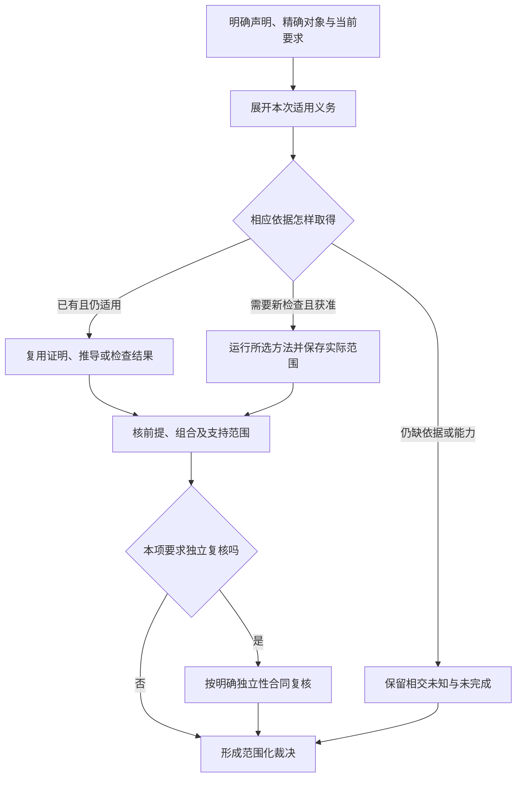

# 义务、方法与已有知识

## 义务、方法与已有知识

<a id="verification-obligation-selection"></a>
### 验证义务、方法选择与精确下游绑定

Verification证明工程对象是否符合已接受定义，Validation判断该定义和产物在实际使用条件下是否满足用户目标；后者沿原ValidationClaim处理，不塞进工程方法枚举。前者沿以下既有责任交接，不要求全部检查包装成测试文件：

```text
Accepted Requirement / Invariant / ExplicitCheckRequest
→ Claim（准确命题、主体、来源修订与适用域）
→ ProofObligation（需要何种观察、范围及独立性）
→ VerificationMethodSelection（本次采用的方法、Oracle与条件）
→ 纯／静态评价，或已准入的VerificationAction
→ Observation / Result / Evidence
→ VerificationEvidenceUse（exact consumer binding + qualification）
→ 资格、覆盖及共同原因检查
→ ClaimVerdict
```

Claim的唯一字段合同见[声明身份](#canonical-claim)；保证、编译、测试与会话只引用它，不各自定义一个字段不同的Claim。Requirement owner决定要求，assurance生成或接纳义务、选择方法并评价证据；compiler提供语义、依赖和目标事实；application协调当前目的与结果；execution负责实际准入和恢复；adapter提供工具事实。方法实现、测试器和CI均不能自行修改原要求或签发发布权。

#### 方法中立的义务

```text
ProofObligation = exact {
  obligationRef, obligationRevision,
  claimRef, claimRevision, ownerRef,
  requiredObservationOrPredicate,
  applicabilityScope, requiredIndependence,
  admissibleMethodFamilies,
  environmentAndCapabilityConstraints,
  coverageAndFailureSpace,
  lifecycleAndInvalidation
}
```

一个Claim可产生多个义务，分别约束正常、失败、并发、保持与覆盖；相同谓词在不同来源或适用域不自动合并。 机器 `ProofObligation` 额外绑定 `claimDigest` 与自身 `obligationDigest`；复杂谓词、适用域、独立性、能力约束、覆盖/失败空间和生命周期使用原 owner canonical value digest 固定，不在 assurance 中再造一门表达语言。方法族约束说明允许怎样取得所需保证，不要求提前指定某个工具品牌。无可用方法时保留准确未决，不改谓词以迁就当前runner。义务的谓词、覆盖、假设或独立性改变产生后继修订；稳定ID不能把旧观察解释成新的义务已满足。

#### 方法选择不是方法名字

```text
VerificationMethodSelection = exact {
  selectionRef, selectionRevision,
  proofObligationRef, proofObligationRevision,
  methodFamily, methodContractRef, methodContractRevision,
  environmentAndCapabilityRequirements,
  oracleCheckerOrReferenceRefs,
  executionRequired, evidenceQualification,
  lifecycleAndInvalidation
}
```

所有方法、Oracle、参考数据和条件引用在固定解释上下文中解析到不可变修订。 机器 `VerificationMethodSelection` 同时绑定 `proofObligationDigest` 与自身 `selectionDigest`，并要求 `methodFamily` 属于义务声明的 admissible family；否则不能形成有效 specification binding。选择可以换Provider、比较器、误差规则、观察窗口或独立性要求；同一个方法名不能掩盖这些变化。只有变化与被支持命题及资格确实无关且有对应映射时，才复用旧观察；该复用形成针对新义务／选择的明确资格关系，不改写历史Evidence。

物理 Action 与“该 Observation/Evidence 能否解除某项义务”的接纳关系分开。ActionKey 只包含会改变实际执行或观察结果的输入；两个不同义务／选择若解析到同一个可执行检查和相同物理输入，可以 single-flight 同一个 Action。每项接纳关系仍固定 proofObligationRef/revision 与 selectionRef/revision，并核 `selection → obligation → claim`；义务谓词、覆盖、独立性或 Evidence 资格变化会使该接纳重新判定，但不在物理输入未变时强制重复计算。Oracle、比较器、测试数据、环境或方法实现变化若会改变实际观察，则必须进入 ActionKey。只带 method revision 会漏掉这些差异；只带 claimRef 会混淆同 Claim 的不同义务。缺少旧精确绑定时返回资格不足，不以当前 latest 补齐。完整会话复用见[动作身份](会话集成与结果复用.md#动作身份)。

<a id="open-verification-method-contract"></a>
#### VerificationMethodContract 是开放方法合同，不是中央测试枚举

Gift 不维护一个封闭的 `VerificationMethodKind = Unit | Integration | Fuzz | Formal | HIL | ...` 来决定未来世界允许怎样取得证据。`methodFamily` 只是 ProofObligation 用于表达**所需证明能力/观察性质**的可扩展资格描述；真正的方法由带稳定身份和 revision 的 `VerificationMethodContract` 提供。用户、组织、第三方工具、实验设备或领域库可以提供新方法，只要它仍接回同一 Claim → ProofObligation → Selection → Evidence → Verdict 主链。

一个方法合同按实际需要固定以下责任；这不是要求塞进一个万能 JSON：

| 责任 | 必须可解析的事实 | 不能偷做的事 |
|---|---|---|
| identity / provenance | method identity、精确 revision/content、发布者/来源、解释版本 | 以命令名、包名或“已安装”冒充同一方法 |
| capability / observation | 能观察/证明何种谓词、对象、关系、边界、近似方向或失败空间 | 用“test/formal/AI”标签自动扩大证明能力 |
| subject / applicability | 可接受的 subject、输入形态、Target/Provider/环境与适用前提 | 为迁就工具偷偷缩窄原 Claim |
| execution / effects | 纯评价还是需要进程、文件、网络、设备、人工或现实操作；所需 Grant/资源 | 方法注册成功即取得执行权限 |
| oracle / checker interface | Oracle、参考实现、比较器、证书 checker、测量设备等真实接口与版本 | 方法自己修改接受阈值或把自身输出当独立 Oracle |
| soundness / assumptions | 方法成立依赖的语义、模型、抽象、统计或物理假设及限制 | 省略假设后把局部结果外推为全域真值 |
| coverage / failure space | 本方法能覆盖的域、抽样/枚举/界、未观测区域与停止条件 | “跑过一次/0 error”自动变成完整覆盖 |
| independence surface | 代码、模型、数据、权限、人员、环境与 Provider 的共同原因 | 用两个进程/两个名称伪造独立性 |
| result / evidence mapping | 原始 Observation/Result 怎样形成可审计 Evidence、需要哪些原始材料 | 让方法实现直接签发最终 Verdict 或发布权 |
| lifecycle / compatibility | 升级、并存、迁移、旧 Evidence 适用性、撤销与退役条件 | 安装 `latest` 后重解释历史 Evidence |

**发现不等于资格。** Registry、项目依赖或 Provider 可以发现一个方法合同，但 Assurance 必须核它是否满足本次 ProofObligation 的观察、独立性、环境与 Evidence 条件。自带 verifier、自报“verified”、供应商 benchmark 或方法作者签名都只是输入事实，不能自授资格。

**资格不等于执行。** 需要现实 Effect 的方法必须经过正常 Execution/Grant/Operation；只读/纯证明也必须绑定准确输入和解释 revision。一次 Selection 冻结准确 method contract、Oracle/checker/reference、环境要求与资格条件；Registry 后续新增方法、方法注册顺序或全局默认不能热改既有 Selection。

**升级与退役。** 新旧 method revision 可以并存。旧 Evidence 只有在其原输入、producer、假设、coverage 与当前 EvidenceUse 资格仍成立时复用；不能把旧观察改写成由新方法产生。发现方法不健全、供应链失信或关键假设失效时，撤销的是相交资格/后续采用，不删除历史 Observation。停止新选择、保留仍需解释历史 Evidence 的旧合同、消费者归零后才退役。

因此“支持新验证技术”的正确验收是：此前未知的方法能否在**不修改中央方法枚举、不复制 Claim/Evidence/Verdict 系统、不自行取得执行权**的前提下，被发现、资格化、选择、执行/求值、产生可审计 Evidence，并在失败时只留下准确 Needs/Unknown/Invalid，而不是要求 Gift Core 预先认识每一种测试框架、证明器或实验设备。

#### 按义务而不是目录选方法

| 方法 | 直接支持的观察 | 不能被它代签的结论 |
|---|---|---|
| 类型、Schema与静态合同 | 当前受检输入的类型／结构与对应诊断 | 业务完整正确、未观测外部效果 |
| Source Program／架构分析 | 有覆盖的引用、依赖、所有权和相交规则 | 启发式未发现即全球零消费者 |
| 静态安全分析 | 所选规则与建模边界中的数据流／缺陷 | 未建模攻击全部不存在 |
| 案例、性质、变形、差分、模型生成与故障注入 | 输入或序列下的结果及可区分关系 | 未覆盖空间、模型正确性或任意未来运行 |
| 形式证明、模型检查、符号执行 | 明确语义、假设、翻译及界内的性质 | 未建立对应关系的实现或物理世界 |
| 权威读回与运行观测 | 指定对象、时点、覆盖的实际状态 | 未观察历史作用或未来持续保持 |
| 性能、容量与统计方法 | 固定语料、环境、采样与成本口径 | toy基准外推、平均值代替硬上界 |
| 独立工程审查 | 具体候选、依据和审查权限范围内的判断 | 没运行的测试或未授予的权限 |

凡实际物化案例的方法都进入[TestResponsibility](经验验证与测试生成方法.md#test-responsibility-binding)，不能只判断`methodFamily == TestCase`。不产生案例的纯求值、证明和读回使用各自直接路径。生产规则只在其canonical checker维护，案例校准规则的独立正反例，不再复制一份“当前源码必须包含某串”的同义规则库。

验证结果状态及 Evidence qualification/invalidation 关系唯一由[VerificationResult canonical模型](会话集成与结果复用.md#验证结果取得状态与聚合)拥有；本篇不再复写五维枚举，也不维护第二套 ExecutionResult/ExecutionMode。这里仅规定方法取得与复用边界：未决细节写回 canonical result、诊断与覆盖／资格；没有新增执行但已有当前 `VerificationEvidenceUse` 可以复用，零案例、工具exit 0、runner跳过或环境缺失本身不能解除义务。

#### 验证设计本身的变化

参考算法应足够简单并能区分真实错误，不必成长为另一套生产内核。参考和优化共用决定性逻辑、模型编码或数据来源时，差分一致仍可能是共同缺陷；用独立性质、手工见证、目标工具或独立翻译补足所需独立性。测试数量和换一种语言都不自动创造独立证据。

开放配置的发布资格定义适用配置空间、禁止组合和未资格化组合；局部通过不能相加为全部笛卡尔积通过。按真实资源、顺序、类型、生命周期交互检查；pairwise或随机采样明确其有限范围，三方共同条件另有反例。新维度不自动触发全仓慢测，也不能为节省成本省掉相交义务。

可修改性用演进演练取得依据：新增控制、新变体、同合同表示替换、新I/O失败、旧读取者和退休后恢复分别观察公共合同与真实消费者。文件数、类型错误数和构建时长是观察，不是固定质量阈值；真实跨域新含义可要求多owner共同修改。案例与联合反例由[控制与演进区别见证](控制与演进区别见证.md)承载，登记不等于执行。

### 接缝校准不形成固定根测试表

任务域与候选定义域、组合值域、循环假设、成本剪枝、共享资源、误差传播、依赖失效、旧 Operation 与新实现选择等关系都可能出现“局部检查通过但整体结论错误”。正式处理方式是从当前 Claim/Requirement 和实际组合图派生 ProofObligation，而不是维护一张所有任务都要执行的根案例表。用于手算和故障设计的具体数值构造已移到非权威作者与组合反例研究；它们只校准区别，不成为 Coverage 计数。

### 声明、证据、裁决与独立复核

#### 验证对象

验证回答：某个精确主体修订，在指定环境、覆盖和时间范围内，是否满足某项声明。

```text
Claim(subject, proposition, scope, assumptions)
```

<a id="canonical-claim"></a>
长期Claim的唯一公共字段如下；工具调用中的简短引用可以由冻结上下文补足，但不能随latest漂移：

```text
Claim = exact {
  claimRef, claimRevision,
  source:
    | { kind: requirement, requirementRef, requirementRevision }
    | { kind: invariant, invariantRef, invariantRevision }
    | { kind: explicit-check-request, checkRequestRef, checkRequestRevision },
  ownerRef, subjectRef, subjectRevision,
  proposition, applicabilityScope, assumptions,
  requiredAssurance, lifecycleAndInvalidation
}

机器 identity 不复制 proposition/scope/assumptions 等上游语义对象的第二份自由文本；它保留同名稳定引用/修订，并为这些结构化值绑定 canonical digest，再计算 `claimDigest`。因此 revision 是来源修订，digest 是当前机器内容身份，两者都必须匹配；不能只凭相同 ref/revision 接受不同内容。
```

`explicit-check-request`只把调用者明确要求检查的命题固定成有边界 Claim，不把该请求升级为长期产品 Requirement、Invariant 或发布政策；需要长期采用时另走相应接受关系。三种 source 都必须固定实际来源修订，不能为了构造 Claim 伪造 Requirement 身份。

`requiredAssurance`限定所需保证，不保存本次Provider、Oracle或方法选择。有效时间与可反驳条件分别由适用域、假设和失效合同表达；这些内容不因换一种检查工具而自动改变命题。Claim 的下游消费者是关系／索引 owner 根据实际引用派生的反向投影，不进入 Claim 不可变身份；新增 checker 或 gate 不应迫使命题本身产生新 revision。方法限制进入ProofObligation，本次具体方法进入VerificationMethodSelection。VerificationPlan与保证图中的Claim是本对象的引用／投影，不是可独立改义的第二定义。

#### 对象分层

| 对象 | 作用 |
| --- | --- |
| `Claim` | 定义要证明的命题 |
| `Gate` | 决定哪些动作必须执行 |
| `VerificationAction` | 执行一个检查 |
| `Observation` | 工具或环境在声明coverage/time/source下返回的观察值/读回 |
| `Result` | 动作对输入的结构化结果 |
| `Evidence` | 将结果与声明、环境和覆盖绑定 |
| `Review` | 独立检查证据和方法 |
| `Verdict` | 在范围内对 Claim 的裁决 |

任何一层不能自动跳到下一层。

#### 裁决状态

```text
Satisfied
NotSatisfied
NotApplicable
Unknown
Stale
Invalid
```

未运行、零测试、环境不可用和Provider超时本身不能成为`Satisfied`。若全部适用义务已由准确绑定且仍具资格的静态推导、证明或历史Evidence解除，可以没有新增测试或执行；不能把它记成刚发生的运行，也不能因新增执行数为零否定合法复用。

#### 证据方法族

- 设计模型和不变量；
- 类型与静态分析；
- 形式证明或可检查证书；
- 构建、SBOM 和来源证明；
- 单元、属性、契约、集成和端到端测试；
- 故障、并发和对抗测试；
- 部署读回、遥测和运行审计；
- 独立实现或独立环境复核。

不同方法不构成通用强弱阶梯，必须比较声明、范围、前提和方法。

#### 声明到裁决的证据链



本图是依据与裁决的处理关系，不要求一次任务做完所有验证方法。独立性由真实声明与政策决定；裁决不改候选字节，也不自动执行采纳、权限提升或发布。

#### Evidence DAG

```text
Evidence
  references exact subject revision
  references exact producer identity:
    - executed VerificationAction → ActionKey
    - pure/static DirectEvaluation → evaluationRef + evaluationRevision
  references input and applicable environment closure
  references exact proof-obligation and method-selection revisions
  references method, oracle/checker and result
  references coverage
  references upstream evidence
```

`DirectEvaluation`是没有外部Effect、无需Execution准入的可检查求值身份；其evaluationRef标识准确求值实例，revision固定实际规则／证明器／输入闭包及会改变结果的解释上下文。它不是伪造的VerificationAction，也不能用于隐藏真实需要进程、网络、文件或其他Effect的方法。复用旧Evidence时仍保留原producer；当前消费资格通过 `VerificationEvidenceUse` 绑定 exact subject/obligation/selection，不把历史Evidence改写成一次新执行，也不把反向消费者塞进 Evidence identity。证据内容寻址并签名或完整性保护。

#### 独立性

独立性关注共同缺陷和权力分离。关键维度：

- 候选产生者是否能修改验证；
- 验证器是否共享同一实现；
- 测试数据是否由被测实现生成；
- 环境是否可被候选污染；
- Reviewer 是否有独立读取候选和证据能力；
- 发布者是否能修改 Verdict。

#### 声明支配

`Evidence A` 仅在以下条件下支配 `B`：

- 命题相同或更强；
- 主体和环境覆盖；
- 输入 revision 可比较；
- 覆盖不更弱；
- 方法证明能力不更弱；
- 独立性和完整性仍成立。

#### 陈旧和撤销

源码、配置、依赖、环境、政策、模型、Provider、测试数据或方法变化后，相关证据和 Verdict 局部陈旧。安全事件可撤销历史证据的可信资格。

#### 合并和发布授权

发布前准入闭合当前能够获得、且本次发布必要的材料：

```text
exact candidate
+ required satisfied claims
+ independent review
+ current branch/environment preimage
+ one-time promotion authorization
+ declared readback/recovery protocol
```

发布动作发生后，按稳定 operation identity 取得读回，将实际目标状态、结果和未结算事项纳入结算；结算后才能签发“本次发布已完成”的声明。本次发布后的读回不得作为同一次发布开始前的必要输入。已有前一次发布的健康证据可以是本次前置，但必须绑定其真实主体，不能用历史读回代替本次结果。

CI 页面“绿”不是合并权限。证据计算只产出当前声明状态，不产出执行 Grant。

#### 验收：声明、证据、裁决与独立复核

- 声明、结果和裁决分离；
- 证据可离线验证；
- 零测试不自行签发通过；全部义务已由合格非案例方法或合法复用解除时允许零新增执行；
- 关键声明独立复核；
- 证据复用合法；
- 陈旧传播准确；
- Reviewer 无候选写权；
- 发布后读回；
- 证据撤销传播到认证和发布状态。

#### 证据任务与未满足结果

生产证据的动作自身也有前提。任务图把输入声明、任务、Oracle、产出声明和需要这些声明的动作连接起来；环只有在存在明确外部种子或迭代边界时才可执行。缺失证据先产生采集/实验任务，不默认转为无解；多个正样本不能投票抹掉同范围反证。结构检查和有限裁决见[证据缺口驱动的设计与取证闭环](../保证/要求证据-追踪取证与裁决.md#证据缺口驱动的设计与取证闭环)。

独立性不能用两个不同字符串或两个进程证明。真实部署须核验主体、写权限、数据来源和共同依赖；测试中的主体标签只是夹具，不能换取真实发布资格。

### 验证与用户确认的分离

#### 两个不同问题

```text
Verification: 系统是否正确实现了被接受的定义？
Validation: 被接受的定义及其实现，是否在预期使用环境中产生正确用户结果？
```

系统可以完全符合错误需求，因此二者不能合并为一个 `passed`。

#### 对象

```text
VerificationClaim = property over exact engineering subject
ValidationClaim = stakeholder outcome over context of use
```

Validation 绑定用户类型、任务、环境、数据、辅助技术、组织流程和时间尺度；Verification 绑定规范、实现和技术环境。

#### 证据

Verification 可使用静态检查、证明、测试、模型检查和 physical readback；Validation 使用真实或代表性用户、工作流、可用性、可访问性、现场试点、业务和社会效果。模拟只能在其代表性边界内支持 Claim。

#### 失败处理

- Verification failed：实现不符合定义；
- Validation failed：定义、实现、交互或环境不满足真实结果；
- Validation unknown：样本、环境或长期效果不足；
- 两者均通过：只对声明的 exact scope 成立，不自动外推全部用户和环境。

#### 反馈

Validation 发现目标错误时，产生 Intent/Definition revision proposal，不能直接修改实现测试使其绿色。新目标会使相关设计、实现和证据按反向闭包 stale。

#### 验证场景

- 单元测试全绿但用户无法完成任务；
- 目标用户依赖屏幕阅读器而测试未覆盖；
- 性能在实验环境合格但真实数据规模失败；
- 产品符合内部需求但违反外部法律或用户权利；
- 短期指标改善、长期留存或维护恶化。

### 从协议设计派生可复核 ProofObligation

本节规定测试设计方法，不要求当前设计任务实现或运行测试软件。输入为某条规范的数据、正常步骤、分支条件、保持范围和外部假设；输出为案例规格及其判断依据。

**第一步，建立独立期望。**对可手算的小域写出输入、允许结果、错误顺序和应保持不变的对象。对更大域明确代数性质、差分关系或外部标准；参考实现若与被测实现共享同一算法/生成器，保留共同原因，不能当唯一独立依据。

**第二步，证明合法路径能够进展。** 对本次 Claim 的允许域，需要有足以证明合法进入、执行与结束关系的 Evidence；它可以来自直接求值、已有证明、性质或一个/多个代表性轨迹，不规定固定案例数量。对复用路径仍要证明返回的是正确主体；空输入和零变化若会改变结论则分别保留。仅列拒绝反例不证明合法任务可完成。

**第三步，按分支变量构造反例。**逐个改变来源版本、输入范围、规则选择、权限、预算、结果身份或目标状态，说明首先失败的位置。取边界值、相等边界和交叉条件，不只随机制造异常。多个变量共同决定一条安全规则时加入其组合；未覆盖组合明确列在范围之外，不以案例数量证明全域。

**第四步，插入中断与竞争。**在意图前、意图后、实际作用后但响应前、结算后安排中断。每个切点记录可能真实发生的内容，再用恢复协议推导后继，而不是假定异常一定回滚。并发案例描述各线程读取/写入的顺序及原子边界，分别验证最终不变量和独立工作能否前进。

**第五步，检查反向失效。**故意删掉关键检查或制造错误来源，预期案例应能发现具体故障。例如删除新读集发布使同值换依赖遗漏；把partial当complete使缺文件产物通过；取消后提前释放缓冲使仍在使用的任务失去资源。这些是待执行的破坏设计，不因为写出来就称已检出。

**第六步，记录方法的观察范围。**返回值测试不覆盖所有副作用，进程退出不等于掉电，单宿主锁不证明跨机器一致，结构Schema不证明权限有效。每种方法写出不能观察的对象及补充方法；没有方法时保留未知，不以“未来验证”隐去它对应的决策影响。

具体表达、计算、增量失效和未知完成的校准构造放在非权威研究中；任务只选择能区分其竞争实现的构造，不因研究中存在某组轨迹就生成固定待跑队列。

<a id="existing-knowledge-design-evidence"></a>
### 已有知识怎样直接支持设计，而不是等待产品运行

成熟语言语义、协议、算法证明、固定源码、复现实验与事故材料都是可消费的设计输入。它们不必等 Gift 先实现一遍才有价值，也不能只在每条末尾添加“尚未实测”便停止采用。现有 Method、ProofObligation、Evidence、QualifiedEvidenceUse 和 CLOS0—CLOS6 已足以承接这些关系，本节不新增独立研究审批系统。

**先恢复要判断的准确命题。** 区分模型性质、接口保持、有限构造、实现机制、特定平台运行、实际事故与预测效果；固定对象、条件、量词、单位、版本和时间。再选能直接承担该命题的原始材料，不让“有论文”或“官方文档”替代命题匹配。资料页记录原始事实和读取范围，Gift 采用的条件与具体机制回到唯一规范。

**把前提映射出来再消费结论。** 从材料中的模型／接口到本次 subject 给出实际对应，标明保持了什么、哪些条件可由结构检查或既有合同解除、哪些需运行输入或外部环境承担。若已知定理在这些前提下成立，可以直接得到带前提的设计结论；不要求重新证明全部基础数学。若本次只读了介绍或源码局部，则只消费它真正支持的部分，不能冒充完整证明或完整调用闭包。类比提供候选而不直接签发结果。

**优先寻找能区分方案的现成反例。** 改变一个关键条件，检查结论是否反转。例如局部残差变小而病态放大仍大；观测晚于不可逆作用；同一返回码而原操作已提交；模拟时钟可回退而物理执行器不可回退。能用精确算例、既有协议的允许轨迹或已知失败机制证伪的设计，直接修复，不把发现责任推给未来实现。没有反例不等于已证明；有限正例只支持其范围。

**再判断是否确实需要新执行。** 准确可复用的证明／已验证映射可以直接支撑相交结论；纯算例可复算；现成测试和事故须核其环境与观测。只有剩余命题依赖当前实现、时延、设备、实际权限、部署配置或未建模行为时，才安排对应最小运行证据。不能要求所有讨论先搭完整产品，也不能用源代码存在代替已执行的性能或安全结果。

**结果、反方和未知分开保留。** 将支持的子命题、被反驳的规则、采用条件、残留假设和失效触发接到原 claim／owner。一个有效反例可以立即推翻全称保证，不需累计例子数量；一个合格模型证明也不会因不涉及真实硬件而失去模型内效力。新反证只重开相交依赖，不能连带撤销无关已成立的结论。

**组合后还检查接缝。** 单组件的性质通过 CLOS 的输入域、共享资源、作用、时序、误差、故障和恢复关系组成；共同依赖与相互假设不能伪装独立支持。这里得到的是具体组合的设计依据，不是给未见过的全部未来组合永久认证。

完整理论、领域模型和组合反例随包保存在[研究入口](../../../research/README.md)。尚未采用但可解释异常、提供替代或构成反证的材料仍保留，日后有相关任务时直接使用；没有本次 Claim 不再成为把研究移出完整交付的理由。所选原语的证明假设、模拟与现实测试的差别分别见[科研与保证依据](../../../research/sources/科学计算仿真与保证依据.md)。
