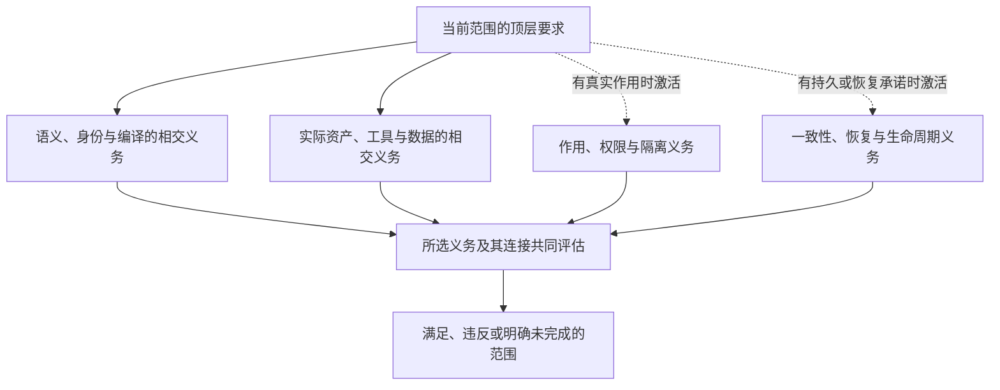

# 安全、体验与发布资格

## 安全、体验与发布资格

### 危害分析、安全论证与运行时监控

#### 高风险系统需要显式危害模型

功能需求和安全测试无法自动发现所有危险控制动作。涉及物理设备、资金、健康、基础设施、不可逆数据和自动决策时，必须建立损失、危害和控制约束。

#### HazardModel

```text
HazardModel = exact {
  lossRefs,
  hazardStates,
  controlActions,
  unsafeControlActionConditions,
  causalScenarios,
  safetyConstraints,
  detectionAndMitigation,
  safeStatesAndShutdown,
  residualRiskAcceptance
}
```

#### RuntimeMonitor

无法静态证明的约束编译为独立监控：输入、采样、阈值/模型、延迟、动作、fail mode、资源和旁路。监控不能与被监控系统共享全部故障域。

#### 安全停止

safe shutdown 仍是 Effect，需要保存关键状态、限制作用范围、避免重复和证明实际进入安全态。停止不一定总比继续更安全。

#### 变化

环境、设备、负载、算法、人员和法律变化都会使安全案例 stale。复用旧软件到新 Target 必须重新验证假设。

#### 验证：危害分析、安全论证与运行时监控

故障注入、极端环境、传感器错误、控制延迟、错误顺序、权限误用、恢复失败、monitor down、common cause 和 human override。

### 安全、隐私、合规与供应链保证接合

#### 四个独立维度

Security、Privacy、Compliance 和 SupplyChain 相关但不能互相替代。没有攻击不代表没有隐私伤害；合规不保证安全；签名不保证内容无恶意。

#### AssuranceCase

```text
AssuranceCase = exact {
  claimHierarchy,
  argumentRelations,
  evidenceRefs,
  assumptionsAndContext,
  rebuttalsAndDefeaters,
  coverageAndFreshness,
  residualRisk,
  responsibleAuthority,
  invalidationAndReview
}
```

#### Security

威胁主体、资产、信任边界、攻击面、权限、秘密、sandbox、network 和 incident response。控制必须有 enforcement evidence。

#### Privacy

目的限制、最小化、数据主体、同意/法律基础、可见性、推断、保留、删除、跨境、申诉和社会影响。加密只是其中一个控制。

#### Compliance

法域、适用范围、义务、例外、证据、审计期和变化。法律文本是 ExternalAuthority，产品需要 project adoption 和具体映射。

#### SupplyChain

source/dependency/build/runner/artifact/signature/SBOM/provenance/发布路径。内容寻址和签名证明身份与完整性，不证明实现正确。

#### 验证：安全、隐私、合规与供应链保证接合

提示注入、依赖混淆、恶意更新、秘密泄露、跨租户缓存、非受信构建、许可证不兼容、隐私推断、数据删除失败和控制旁路。

### 用户旅程、可访问性、国际化与实际效果验证

#### 技术通过不等于用户成功

用户旅程横跨安装、理解、配置、操作、错误恢复、协作、升级和退出。每一步可能因认知、语言、辅助技术、网络和权限失败。

#### JourneyScenario

```text
JourneyScenario = exact {
  actorAndContext,
  startingState,
  intendedOutcome,
  requiredOperations,
  allowedTimeAndEffort,
  accessibilityAndLocalizationNeeds,
  failureAndRecoveryPath,
  successObservables,
  privacyAndTrustExpectations
}
```

`JourneyScenario`固定验收场景、上下文、允许成本、恢复路径和成功可观察量；它是 Claim/VerificationAction 的输入模型，而不是另一种 Claim identity。实际要裁决的用户结果仍通过 canonical `Claim(subject, proposition, scope, assumptions)` 建立，并由 Evidence/Verdict 生命周期处理。

#### 可访问性

键盘、焦点、屏幕阅读器、对比度、缩放、字幕、错误提示、认知负担和动作时间按界面类型验证。自动扫描不能替代真实辅助技术和用户测试。

#### 国际化

文本、日期、数字、时区、排序、地址、姓名、输入法、双向文本和复数等由 locale profile 处理。技术 identifier 不翻译；用户内容和协议语义分离。

#### 实际效果

上线后按任务需要观察完成率、错误恢复、支持请求、退出、少数群体差异和长期维护。用户明确选择的指标可以是目标或阈值；代理指标和实测结果分别解释，不能以代理分数改善代替真实要求满足。

#### 验证：用户旅程、可访问性、国际化与实际效果验证

新手/专家、离线/高延迟、屏幕阅读器、键盘-only、不同 locale、错误恢复、权限不足、升级迁移和卸载/数据导出。

### 系统保证、认证与发布资格

#### 顶层保证



这是义务分解，不是组件证书自动向父节点传播。虚线是条件激活；条件不成立不生成对应设施，已成立的硬要求不能靠改线型取消。各子项与连接都满足后才关闭相应父范围。
任何硬分支失败不能由其他分支通过抵消。

#### 保证包

```text
AssurancePackage = {
  exact candidate,
  target claims,
  input and environment closure,
  design references,
  threat and failure models,
  verification plan,
  evidence DAG,
  independent reviews,
  residual unknowns,
  residual risks,
  promotion authorization,
  post-promotion readback
}
```

保证包内容寻址，可离线验证。

#### 组合保证

系统保证不是组件通过的简单与：

```text
ComponentClaims
+ BoundaryClaims
+ CompositionClaims
+ EnvironmentClaims
+ OperationalClaims
```

需要专门证明跨边界身份、重试、权限、缓存、版本、恢复和写权。

#### 风险接受

残余风险记录概率依据、影响、检测、缓解、owner、期限、复审触发和接受权限。接受不等于消失，也不能永久通配。

#### 认证

认证绑定：

- 精确实现 revision；
- 能力范围；
- 目标画像；
- 环境；
- 证据和方法；
- 有效期；
- 撤销条件。

认证不是品牌永久标签。

#### 发布资格

发布分为两个时间不同的判断，不能在执行前要求尚未发生的最终读回。

**准入判断**：候选内容冻结，发布前必需 Claim 满足，适用的独立复核、供应链/许可/签名要求闭合，目标前像与当前策略有效，授权绑定精确候选、目标和幂等操作范围。内容暂存读回可在此阶段存在，但不是目标已发布证据。

**完成判断**：同一制品进入目标后，建立实际提交 revision 和权威读回，处理残余义务，再依据画像运行 canary/运行观察。无法确认提交或读回时，保留 committed-but-unverified 或 recovery-required，不补造发布成功。

授权一次性消费的含义是只授权一次逻辑提升操作；丢失响应后的同一幂等操作查询/恢复不应被误判为另一次未授权发布。新的不同载荷或不同目标不得复用该授权。

#### 主分支与生产健康

PR 候选通过不代表合并后的主分支或生产制品通过。合并和部署后建立新的主体 revision，并运行最小不可省略健康验证。

#### 持续保证

源码、依赖、策略、环境、Provider、模型、数据、验证器和真实事故变化使相关 Claim 局部重评。未受影响证据保持。

#### 反保证攻击

发布前主动检查：

- 测试只覆盖易状态；
- Oracle 与被测实现同源；
- 遥测缺失被当作健康；
- 权限在缓存或队列中丢失；
- Provider 成功未读回；
- 恢复路径从未演练；
- 旧机制仍有隐藏消费者；
- 数据或供应链证据已陈旧；
- AI/Agent 自证；
- 生产部署重建了不同字节。

#### 验收：系统保证、认证与发布资格

- Claim 分解完整；
- 证据绑定 exact revision；
- 组合边界有独立 Claim；
- 残余风险有权接受；
- 发布授权不可重放；
- 合并和部署后读回；
- 撤销和陈旧传播；
- 保证包可独立校验；
- 生产效果与设计状态分开报告。

#### 保证包的阶段

保证包有准备阶段和完成阶段。前者只能包含发布前已产生的证据及未来读回义务；后者引用实际提交和读回。阶段由已发生的事实推进，不把 `post-promotion readback` 空字段当作前置成功。空制品清单可以有合法内容身份；“无额外文件”与“没有清单/没有提交证据”不同。
