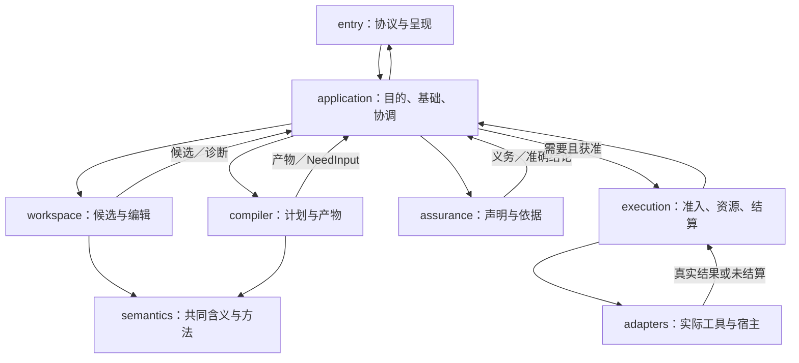

# 信息类别与全生命周期路由

本篇是全体系已发现信息家族的路由表，决定内容由谁拥有、如何关联、存在哪里和如何退出；不是封闭枚举，也不定义另一份AssetView。物理格式、角色、权属、粒度、时间和保留策略是正交维度，一个对象可同时命中多行。当前没有的材料不制造空文件，未来出现表外类型使用末节的接入方式。

## 范围和存储代号

**当前设计包**实际只有Markdown、图源和必要导航身份。下表的代码、制品、数据、运行和组织材料属于最终产品/工程需要管理的可能信息，不表示已取得或产生。

`作者库`指原源码/规范/配置的版本管理位置；`内容层`指有实际Provider的不可变或版本化大对象；`状态层`指原事务、操作与当前选择拥有者；`索引层`指可重建目录/检索；`外部源`指不被本系统接管的权属系统。它们可以物理共存，不是五个必须购买的服务。只保存引用时明确字节未取得、不能保证离线复验；完整归档须按实际保留目的取得必要内容。

## 目标、知识、设计与实现

| 家族 | 独立内容与拥有者 | 真源及关键绑定 | 变更、保留与边界 |
|---|---|---|---|
| 01 目标、需求与接受标准 | 用户/产品有权主体；谁要什么、允许什么、受益与受损者 | REQ正文或目标项目实际要求；对象/范围/版本/接受来源 | 提问、提醒技术和助手选择不自动是要求；要求变更与事实纠错分开 |
| 02 术语、单位与语义词汇 | 所属语言/协议规范 | 定义、单位、值域、时区/编码层和跨域映射 | 同名不同义保留命名域；词典解释不自动建立类型等价 |
| 03 架构与质量属性 | 各系统职责和总装拥有者 | 系统边界、接口、数据/控制/部署视图及假设 | 视图可省略细节但须可定位完整合同；部署图不是已部署证据 |
| 04 作者语言与形式合同 | 原语言/领域规范拥有者 | 文法、类型、效果、默认、错误、状态机、规则与版本 | 公共合同精确兼容；纯内部结构不强制公共schema |
| 05 算法、数学与证明 | 语义/算法和论证拥有者 | 命题、量词、假设、推导、证明工具/TCB及反例 | 形式结论只在前提内成立；算法描述与实际实现分开 |
| 06 D决定、替代与代价 | 当前采用决定的负责域 | 问题、当前选项、竞争方案、证据和重开条件 | 失败/被拒方案含独立取舍时保留；沉没成本不锁死采用 |
| 07 未决义务、风险与缺口 | Gift 自身未闭合的设计/实施/证据义务由相应规范 owner 与[实施闭包](../../90-治理与参考/状态/实施闭包.md)承接；目标项目由真实问题系统维护 | 精确主体、前提、影响、消费者、阻塞动作、恢复责任、关闭条件 | 问题号和历史工单不产生当前独立真相；局部已验收不等于整体已结算，票据关闭不等于产品资格 |
| 08 外部资料与研究命题 | 来源作者拥有原材料；Gift拥有采用判断 | 精确URL/版本、实际读取范围、命题、条件、使用位置 | 摘要不冒充全文；同源转述不算独立证据；未核旧日期不补造 |
| 09 原生/中立作者源 | 区域作者拥有者 | 原字节、版本、解释、模块归属和锁 | 保留注释/未知区/格式；原生文件不另建必须双写的.gift镜像 |
| 10 工程配置与环境声明 | 项目/部署配置拥有者 | 明确层级、合并顺序、有效值与来源，非默认填值的schema | 期望环境与实际观察分开；未知字段保全与使用能力分开 |
| 11 工具链、依赖与锁 | 真实解析器、包/工具发行与项目选择 | 内容/版本、平台、解析条件、许可、实际补丁 | 指针不是已取得字节；库可用不等于允许安装/执行；可复现还需环境 |
| 12 模板、生成器与转换 | 明确生产者 | 输入、方法版本、参数、输出成员、来源对应 | 模板源码与生成字节不同时成为作者；生成器输出要重新检查 |
| 13 资源、媒体和设计资产 | 原作者/受托生产者 | 图片、音频、视频、字体、样式、模型及必要元数据 | 原样保全与有损转换分开；媒体隐私/版权不由打包成功消除 |
| 14 数据模式、接口与互操作 | 对应数据/协议拥有者 | schema、编码、单位、迁移、兼容和非法输入处理 | 字段可解析不证明业务含义、DB隔离或ABI正确 |
| 15 源码对应、布局与调试映射 | 编译/格式适配生产者 | 作者revision、制品内容、坐标空间、转换和覆盖 | 旧运行对应旧源；普通SourceMap不是任意逆向算法 |

## 检验、制品、运行与恢复

| 家族 | 独立内容与拥有者 | 真源及关键绑定 | 变更、保留与边界 |
|---|---|---|---|
| 16 测试/验收设计、预期与基准任务 | 需求/验证设计拥有者 | 条件、动作、断言、独立oracle、负例、资源范围 | 用例文件不等于已运行；只有同方法生成的期望不能独立认证方法 |
| 17 测试运行、证据与保证论证 | 真实执行/观察者与assurance | 实际输入、被测对象、方法版本、环境、结果、覆盖及原字节 | 失败、跳过、未收集、截断、空结果不同；证据有效和内容保留分开 |
| 18 性能实验与成本 | 实验负责者；必要时独立复验 | 基线、冷热、样本、重复方式、单位、资源、方差/限制 | 代理指标不替代任务净收益；调参选择偏差和失败测量不能藏掉 |
| 19 构建/检查活动 | 实际Runner/构建器 | 输入闭包、解析锁、环境、命令、输出和退出观察 | 日志写“成功”不是制品存在；内容复用还需正确action上下文 |
| 20 制品、发行与SBOM/来源证明 | 生产/发行拥有者 | 完整成员、确切字节、许可、依赖/组件清单、签名与源映射 | SBOM不是漏洞不存在；签名认证声明来源，不证明行为正确 |
| 21 安装、部署与迁移 | execution及真实目标提供者 | 期望版本、目标出生身份、计划、前像、操作ID、分项读回 | 发布、安装、运行和实际配置不同；全局原子性不能由目录统一获得 |
| 22 活动运行与资源 | 实际进程/设备/服务拥有者 | RunRecord、目标身份、输入、Runner、生命周期、输出 | PID、文件路径、名称可复用；停止请求不是物理停止 |
| 23 操作日志、幂等与恢复前后像 | 原OperationStore和目标操作拥有者 | 固定意图、稳定作用身份、真实前像/后像、围栏、结算 | 不能用普通日志TTL回收；重试保存不重放已编辑内容；未知保留 |
| 24 可观测性数据 | 观察提供者 | 日志、指标、trace、采样策略、时间/关联、掉数和成本 | 聚合/采样无事件不证明未发生；不把高频trace当不可丢操作账 |
| 25 事故、安全事件与复盘 | 相交安全/运行与调查负责域 | 事件时间线、证据、系统版本、影响、竞争解释、修复与残余 | 动机不是行为证据；事后知识不改写当时观测；敏感证据限制披露 |
| 26 备份、档案与移交 | 保留/恢复拥有者 | 一致选择、实际成员、解释器、密钥可用性、恢复方法与试读结果 | 只有摘要无法恢复内容；异地副本不一定防同权删除；恢复隔离拒旧 |
| 27 支持、弃用与退役 | 发行/用户合同及实际目标拥有者 | 支持画像、日期、受影响消费者、迁移与残留责任 | 产品退役不抹去数据/许可/在途作用；停止维护不代表资料不存在 |

## 数据、AI、协作与外部责任

| 家族 | 独立内容与拥有者 | 真源及关键绑定 | 变更、保留与边界 |
|---|---|---|---|
| 28 原始数据与静态样本 | 数据产生者和许可的控制者 | 原字节、采集方法、模式、分片、身份与使用目的 | 每次运行输入不默认打进发行包；抽样不等于全体；删除与复验冲突须裁决 |
| 29 派生数据与计算结果 | 真实计算活动 | 源数据选择、算法、参数、环境、结果、损失/误差 | 血缘不自动证明可重建；外部源过期/硬件非确定时须保留实际结果 |
| 30 流、事件时间与检查点 | 流源与运行状态拥有者 | 分区、序号、时间窗、水位、迟到、检查点和恢复边界 | 不为无界流创建无限manifest；快照末尾不是永久完整 |
| 31 模型权重、训练、评估与特征 | 实际模型/数据/实验拥有者 | 权重与配置、数据切面、训练方法、许可、评估条件 | 只有实际项目需要才管理；不是Gift本体默认训练系统；删除训练数据不等于已消除模型影响 |
| 32 AI任务、上下文与工具材料 | 任务拥有者和真实来源 | 用户目的、规则版本、最小披露ContextBundle、工具输入/结果及候选 | 不保存私密思维链或所有提示；模型自述不成证据；输出格式不授予权限 |
| 33 协作讨论、Issue/PR与审查 | 原讨论系统与有权采纳者 | 原评论/提交/审查版本、决议与实际承接 | 讨论中有效规则并入规范，历史讨论不成为第二现行规范；不可读讨论仍未知 |
| 34 教程、操作说明、参考与解释 | 对应产品/文档维护者 | 真实支持版本、任务/读者、合同链接、例子与限制 | 四种阅读需要不复制四份接口；未实现的操作只称设计轨迹 |
| 35 多语言、无障碍与派生表现 | 原文拥有者与翻译/呈现生产者 | 固定原文单元、术语、源变更、译文/图源和检查范围 | 译文不改变规范；视觉/字幕/alt可含独立解释，先并回有权源再派生 |
| 36 身份、权限、秘密与信任材料 | 真实身份/授权/秘密提供者 | 主体、角色、委派、范围、撤销；秘密只保存受限引用 | 普通索引/AI不得接收秘密值；权限引用不是权限自身；租户隔离不由命名约定保证 |
| 37 许可、知识产权、协议与保留义务 | 实际权利/协议与有权主体 | 文本版本、对象、权属、法域/适用条件、期限/hold | 不臆造固定保存年限；引用资料不默认获得复制/再发布权；冲突需要具体规则 |
| 38 组织、计划、资源与经济信息 | 原组织/项目负责域 | 责任接受、排程、预算、用量、账单和成本假设 | 计划不是完成；目标预算和已花费不同；用户私人账户不因工程整理而被读取 |
| 39 硬件、工程图、BOM与实物 | 有此目标时的工程/资产拥有者 | 设计版本、实物序列、批次、校准、制造/安装/维护配置 | 设计BOM、实际安装BOM与库存不同；数字资料不证明现场已按图施工 |
| 40 检索、图、缓存与迁移旁路 | 相应可重建投影/迁移执行者 | 输入选择、解析器、索引代际、覆盖、权限/删除前沿、失效 | 可丢缓存不是可丢真源；旧址映射是兼容帮助，不是新规范或网站部署 |

## 这些行怎样真正工作，而不是一份关键词清单

### 生命周期相接处的作者、转换、故障与退出

以上四十类不是四十个必须创建的表。一个完整工程轨迹通常涉及不同 owner 的**局部状态机**；下表只给出它们的合法交接，不创造一个 `globalStage`。生产者和消费者必须能够分别拒绝不合法的转换，且允许无需后续阶段的请求提前结束。所有引用在作用点固定准确 subject/revision/basis，而不是传递一个可变 `latest`。

| 局部生命周期 | 首次有权状态变化与消费者 | 故障/不确定与退出条件 |
|---|---|---|
| 作者候选 → 接受修订（01、04、09、33） | 作者原前像、明确采纳与写权限固定新Definition/Requirement/source revision；语义/编译只读其后继 | 未采纳候选仍候选；作者竞争编辑需CAS/冲突处置；历史修订在旧选定消费完成前不删除 |
| 输入固定 → 实现资格 → 绑定（10、11、14、15） | Application固定PreparedJob选择；resolver以Requirement/Target/Evidence资格过滤，经Decision固定RealizationBinding；compiler消费UseBinding | Needs生成后继PreparedJob而不覆写旧basis；供给不可用、资格失效或选择冲突只重评相交调用点，不默认回退到`latest` |
| 生成成员 → 发行采用 → 部署实例（12、19—22、27） | compiler密封ArtifactSet；发行owner按渠道/供应链准入；部署才由execution执行并创建运行generation | 生成物可停在ArtifactSet；promotion与deployment分别提交；旧发行仍可能被旧运行固定，退役需迁移/支持/回收单独结算 |
| 意图准备 → Effect尝试 → 读回结算（21—23、36） | OperationStore固定意图、幂等主体、前后像、权限前沿和围栏；实际Provider尝试各有Attempt | DB提交、远端受理和现实效果不是同一终态；未知只可协调/合格去重/权威读回，不得换键重复不可逆作用；取消请求不撤销已发生效果 |
| 实际观察/材料 → Claim资格 → Verdict（16—18、24、25） | 原方法/主体/时间/覆盖产生Observation或Proof；Assurance对确定Claim评价适用、独立性和有效期 | 缺资料、冲突、反例、未运行和不适用保留其不同身份；实现修复不能删旧反例，负结果也不自动修改规范 |
| 保留目的 → 保护根 → 退役/删除（20、23、26、27、28—32、37、40） | 原数据/证据/操作/发行拥有者声明所需字节及期限/保护；实际存储和GC承接保留/拒旧 | 仅能重建索引可先丢；操作幂等墓碑、未结算外部Effect、法律保留及旧实例解码不能按缓存TTL删除；目的结束和可删是两次判定 |

关系精确输入、输出、authority、revision、失效传播与原owner的接口见[有型交接](对象关系与配置基线.md#typed-handoff-contract)。本表不为所有项目强制要求六阶段；例如只做设计可在作者候选/规格后停止，纯运行观察无需重新编译，备份恢复固定的是原意图而不是当前新版源码。

一个工具发行包含源定义、目标二进制、许可证和用户说明时，四类成员由实际发行目的共同选取。用户的输入数据库不因为同在一个目录就被打包；必要的私有实现不因为叫private就遗漏。SBOM、签名、来源对应都是特定声明的产物，真正材料不存在时不生成一个“已完整”占位文件。

一个性能报告中的“更快”至少要能追到具体任务、输入、版本、冷热和测量方法。报告图表可以单独保留为展示，但原数值、排除试次与方法有另一个准确拥有者；需要复验时共同固定。不为了节省空间删原数据后仍标“可完整复验”，也不为每条稳定数学结论强建实验仓库。

同一日志可能同时含普通诊断和事故证据。提升为证据保留必须由真实活动确认范围，把必要字节固定并取得保留根；不能把整个系统所有日志无限期升级。反过来，操作journal本来承担不可重放的作用结算，不能因为格式也是JSON就按普通日志轮转。

模型提示、Issue讨论和用户聊天可能包含设计理由。采纳时把独立规则/理由写回当前规范及D，将准确来源位置与取得范围留作引用；不把每轮聊天永久复制到规范，也不保留无需的个人信息。原消息不可读时，摘要只能证明取得了该摘要，不能还原作者的全部意思。

## 表外信息和多重角色的处理

新信息先回答对象是什么、是谁的、为何要使用、字节/状态在哪里、需要哪些行为及失败后谁负责。能以现有角色组合表达则复用；不能表达时，新增有命名域的类别/关系与有限读写合同，保留原字节。无合格解释器先只保全；没有接入授权不取得；没有实际用途不永久收集。

目录可给主位置，标签/关系给其他入口。一个含协议规范又含执行记录的文件，先确认是否可分离为各自真源；不可分离的原始材料整体保全，分别引用精确区间和角色。严禁用单一`kind=document`取消它作为证据或敏感数据的独立处理义务。

扩展验收要给一个正常接入/读取/修改/退出轨迹、一个身份冲突、一个权限不足、一个来源丢失、一个未知解释版本，及对既有类型无影响的说明。类别新增不自动新增数据库、工具或每对象元数据表。

## 事实真源与装配投影的物理责任

### 各种“真相”分别放在哪里

#### 图解：运行调用图与纯值返回

箭头表示一次请求的调用和返回，不是包依赖图；只有execution到宿主的路径可执行实际作用，其他模块通过application请求该动作。

| 内容 | 写入责任与取得方式 | 消费者可以做什么 | 不能由它代替什么 |
|---|---|---|---|
| 作者资产、区域作者权和候选 | workspace接管字节/结构，创建不可变候选；真实保存由execution执行 | 读取、构造下一候选、派生视图 | 当前权限、已运行状态 |
| 任务要求与接受关系 | application定位真实要求来源；有权变更才形成新关系 | 作为本次判断基准 | 候选不能靠改测试自动修改它 |
| 语言/语义定义及精确工具绑定 | 固定的解释装配，内容由库和提供者取得 | 按绑定解释、检查和生成 | 安装名字不证明已实现或有权执行 |
| 类型、效果、引用、来源与局部IR | semantics与compiler按实际输入派生 | 只读复用、按依赖失效 | 不成为另一份可手工维护的作者源 |
| 实现选择与布局基础 | compiler在要求与委派内选定，形成精确绑定 | 重建、比较、明确重选 | 不携带永久执行权 |
| 目标产物 | compiler发布满足成员条件的不可变内容清单 | 查看、构建、检查和有权应用 | 内容存在不等于检查通过或已部署 |
| 检查记录与当前适用性 | assurance保存针对对象的方法结果；当前适用性按需计算 | 继承合格依据，呈现准确结论 | 不修改产物字节，不签执行许可 |
| 当前作者头、装配头与目标状态 | 对应HeadStore或真实目标，仅由其提交协议推进 | 按前像比较、固定快照和读回 | 不用一个全局revision统一全部 |
| 在途操作、尝试、恢复资料 | execution保存原可信意图、实际步骤和结算 | 按原意图继续/撤回/协调 | 不作为可任意丢弃的查询缓存 |
| 问题、原则和研究采用理由 | 对应文档/实际任务系统的单一登记 | 按本次目的读取和更新 | 不因记录存在就成为运行强制或已证明事实 |

**具体收敛：ArtifactSet只拥有产物内容和来源，不拥有可变的“检查已通过”事实。** `RootResult.targetCheck`是应用根据独立检查记录形成的返回投影。删除、增加或撤销一份检查，不改变同一产物的内容身份；对a1检查通过不能贴到a2。同一结论也不能同时由缓存、产物和UI三个位置各自改写。

同一内容可以有多来源观察；被接受定义在其范围内有明确写入协议。“唯一拥有者”不是全世界只能有一个事实来源。库维护者可以改自己的私有源，普通使用者只依赖公开合同，编译器可以在有权范围分析私有实现并记录真实依赖。
