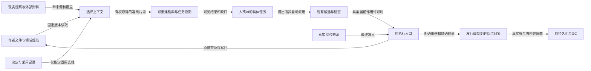

# Gift全体系信息结构

本篇拥有Gift自身工程、Gift产品内所管理工程、外部协作与长期运行之间的**信息组织合同**。它不拥有语言含义、编译算法、业务事务或授权；这些仍由原十职责的规范承担。目标是在不牺牲独立信息的前提下，让不同主体能找到准确版本、理解依据、完成变更，并能解释缺失、冲突、失效和退出。

这里采用的是当前目标下有理由的架构，不是对未知未来唯一最优的宣言。规模、参与方、权属或媒介变化可触发后面的转换条件；尚未启用的未来资料类型有接入责任，不生成空服务。

## 系统事实、关系与结构

<a id="information-architecture"></a>
### 当前决定：分责真源、类型化关联、配置化选择、按需投影

**同一含义只在其范围内有一个规范拥有位置；同一事实可以有多个相互冲突的观察；同一内容可以服务多个入口，而不复制出多份可独立改义的规范。** “一个真源”不是一个中央人员决定物理事实，不是把全部资产放进一张图数据库，也不是所有信息都转成Markdown。

逻辑上区分四件事：

| 层 | 负责什么 | 本地最小落点 | 不承担什么 |
|---|---|---|---|
| 作者与现实真源 | 人/AI写的源码和理由、配置、实际提供者的状态、原始观测与证据字节 | 原文件、原库、原提供者 | 不由索引副本反向替换；物理权限不等于有权改义 |
| 身份、关联与选择 | 哪个对象的哪个版本、在哪个配置下、关系由谁声明且支持什么 | 现有引用与锁；确需长期定位时的显式Contract Unit与准确revision | 不创造新领域语义，不替代原始载荷 |
| 计算和检索投影 | 文件树、依赖、影响、全文/语义检索、API/任务/角色视图 | 可重建索引、进程内查询或现有Provider | 不因搜索命中变成规范、证据或授权 |
| 交付与保留 | 为源码发行、部署、复验、长期引用、恢复选择实际成员并保护内容 | 既有ArtifactSet、ContentStore、OperationStore及目的性manifest | 不把所有历史打入每个包，不把普通引用当永久保留令 |

Gift自身工程、某个用户的目标工程及跨工程发行配置都使用同一个工程信息元模型，但作为不同Subject/Configuration实例保持各自身份命名域、信任边界、写入拥有者、费用与删除责任；“同一模型”不等于把实例状态合并。

首选物理实现是原文件与版本控制加上需要的稀疏元数据；全局查找是跨提供者查询，不是全局强事务。纯本地文档无需安装数据库。真实产品需要跨重启操作恢复时，使用已设计持久层；不因为设计了信息目录就启动它。

<a id="unified-engineering-model"></a>
### 统一工程信息模型：因果角色与信息责任

全工程使用[统一多层工程模型](../../00-系统与原则/统一多层工程模型.md)区分L0 Origin、L1 Semantics、L2 Resolution、L3 Target Representation / Artifact Specification、L4 Execution / Materialization / Runtime Effects、L5 Observation、L6 Assurance七种因果角色；它们不是所有信息的排他分区或必填层级。已有对象通过原合同共享 `Entity / Statement / Configuration / Transition / Evidence / Projection`。`Statement`覆盖有类型 Fact、Relation、Constraint、Claim、Decision；authority/provenance、适用scope/environment/target、revision/lineage、valid/observed/recorded time按相交对象附着，不再建设 `S/A/C/P/T` 这种第二套平行坐标对象。

`Representation`仍不是新的现实类型：Markdown、结构JSON、原生源码、IR、目标源码、Artifact metadata、runtime record和Evidence payload是现实对象的载体或 Projection，通过真实的 source/provenance/materialization relation 连接。`Domain/Mechanism`继续是开放facet，不建立封闭全局枚举。

纯计算流程以准确输入、结果和实际依赖表达；发生采用或现实作用的流程使用各owner的有前提Transition与恢复协议，不要求每个查询落一份持久事件。生命周期属于具体对象的状态／变迁；配置选中、当前用途资格、历史有效与退役按[选择与有效性](对象关系与配置基线.md#selection-and-current-validity)分开。所谓“成熟度”拆成真实implementation fact、adoption transition和Claim/Evidence，不再用全局数字或单链覆盖。

历史六维 `Object × Lifecycle × Invariant × Environment × Authority × Evidence/Maturity` 已由[历史六维到现行模型的唯一映射](../../00-系统与原则/设计方法/设计综合与必要性.md#historical-six-dimension-mapping)完整承接；本章不再维护第二份字段对照。这里的 current authority 仍是上文 `Entity / Statement / Configuration / Transition / Evidence / Projection` 及其真实 qualifier/relationship。

<a id="orthogonal-dimension-decomposition"></a>
### 正交维度分解与重新组合：先拆独立事实，再用关系组织

信息复杂不意味着每出现一个区别就增加“维度”。先判断它属于已有 Entity/Statement/Configuration/Transition/Evidence 的字段或限定信息、一个新的typed relation、一个纯Projection，还是确实出现了具有独立身份与生命周期的新对象/协议。只有最后一种才新增核心实体/协议。分开以后通过有类型关系重新组合，不能把独立信息拆成互相找不到的孤岛。

#### 何时必须拆成独立信息

一个候选信息出现以下任一强见证时，优先分责：

- 有不同的 canonical writer / authority；
- identity 或 revision 可以独立变化；
- 生命周期、保留或删除条件不同；
- 正常/失败/恢复状态机不同；
- 并发和冲突裁决不同；
- 权限/披露边界不同；
- Evidence、freshness 或 coverage 的评价对象不同；
- 可以被独立替换、迁移或退役；
- 有独立消费者，且把它合并会迫使无关消费者读取/修改更多内容；
- 合并后会丢失一个可观察区别或导致第二 writer。

仅“名字不同、页面不同、查询方式不同、展示颜色不同”不构成拆分理由。一个从现有事实可完全重建且没有独立作者权的视图，保持派生即可。

#### INFO0—INFO7 分解/组合算法

**INFO0 固定问题。** 说明这份信息改变什么决定、结果或理解；没有消费者的分类不先持久化。

**INFO1 找区别见证。** 比较它与已有对象在 authority、identity、scope、lifecycle、failure/recovery、permission、evidence、consumer 上是否能独立变化。

**INFO2 选择 owner。** 能落到现有 owner 就复用；只有没有任何现有责任能无损承担时才新增对象/协议。不能用“统一管理”建立第二真源。

**INFO3 决定物理表示。** 选择原文件、结构源、锁、runtime store、Evidence store、外部 Provider 或可重建 index；逻辑拆分不要求每项单独文件/数据库表。

**INFO4 定义 typed relation。** 明确 `contains / references / requires / realizes / generates / invalidates / authorizes / observes / supports-claim / succeeds / migrates` 等关系，不用一个无类型 `links[]`。

**INFO5 定义组合视图。** 按 Developer task、Product root、Target、Operation、Claim、Configuration 等实际问题投影多 owner 信息；投影无独立写权。

**INFO6 定义失效。** 上游哪类 revision/coverage/permission 变化使关系或投影 stale，不能用“更新时间较新”代替真实依赖。

**INFO7 反向简化。** 若后来证明两个对象没有独立 writer、identity、生命周期、失败/恢复、消费者或替换责任，合并并退役多余边/存储；分解不是永久增加实体数的单向过程。

#### 组织收缩的保全不变量

“旧分类不是正交维度”只能证明**分类方式应该调整**，不能证明分类中承载的事实可以删除。任何层、面、图、目录或旧模型被归并前，都要对其中仍有效的定义、不变量、正常/失败/恢复、authority、scope、消费者、Evidence、迁移与反转条件逐项给出去向。

允许删除的只是：重复导航、完全可重建投影、被更强设计完整 supersede 的同义内容，或已 consumer-zero 且兼容/恢复/审计义务结算的 retired 内容。无法确认去向的旧独立事实标为 `unresolved` 并保留，不得因新模型更简洁而消失。正式算法与状态见[设计综合、必要性与结构保全](../../00-系统与原则/设计方法/设计综合与必要性.md#asmrve-design-closure)。

#### 组合后的完整结构不是一棵树

工程同时存在包含、语义引用、实现依赖、生成、运行连接、权限、Evidence、版本/迁移等多种图。目录可以提供一棵阅读树，Product root 可以提供一棵局部组合树，但全工程事实是**多个有类型关系图共享身份**。因此“整个系统有完整结构”应理解为：任一事实有 owner，任一跨域连接有类型，任一视图可追到原对象；不是要求所有事实能被一棵父子树无损表达。

全体系视图与图册入口见[Gift 全体系架构图谱](../../00-系统与原则/统一多层工程模型.md)。

<a id="fig-information-roles"></a>
### 信息责任图：共享入口不合并权威

本图的箭头标出读取、选择、交付或真实控制，不表示无条件执行。源的事实角色、当前作用许可与存储保护分开；图省略每个Provider自己的事务、格式和字段，完整合同在各机制篇。



Q不是第二份作者工程，D不是G，来源O不是已证事实的集合，B不是全库快照。只有实际变更请求才进入C/E；普通读取可在H结束，纯内存结果无需为了本图创建持久保留根。

### 同一工程的结构、因果、时间与树形表示

统一是同一对象和准确引用上的**组成、约束、实现、使用/生成、观察/评价与修订关系**共同一致，不是把全部信息转换成一棵树或一个基类。系统可以按子系统/责任展开，各节点按需显示L0—L6角色和ASMRVE设计信息；共享类型、跨域约束、资源、证据和历史仍以原有类型化关系连接。

源码树、文档树、目标包与Workbench层级共用[多维组织与树形落位](多维组织与树形落位.md)。组织域内以准确成员和有类型约束规划分组；真实架构决策先由原实现选择，路径布局再由各表示owner执行。父子目录不替代依赖/初始化、事务/权限、版本/来源或保证关系。没有树消费者的信息保持其原关系/流/值表示。

一实体多表示、多来源一成员、多处显示一实体都合法；单写权按同一语义面、修订、作用域和表示协议限定，不升级成一实体一文件。作者正文和源码可能是真源，派生导航/摘要才是可重建投影；将两者统称Projection并删除原字节会违反本章的保留责任。

## 物理布局、视图与规模

### 信息量和文档量不能共用一个指标

必须分别计量人工规范、作者源码、唯一内容、历史版本、发布制品、运行/实验数据、索引和缓存，及物理副本。行数受换行、语言、表格与自动生成影响，不作为知识量、正确性或目标配额。文本规范详细程度由语义消歧决定，不能从TB级资料库推导应写TB的说明书。

可用的容量估算先固定口径。例如以下只是可复算情景，不是Gift预测：200 MB的有效事件输入每小时产生、持续30天，逻辑输入为200×24×30=144,000 MB，按十进制为144 GB；保留原始与一个同尺寸派生各一份、再各有三个实际物理副本时是864 GB，尚未计索引、压缩、历史重处理或纠删码。若源日志采样、压缩或分区保留不同，必须重新按每类内容计数，不能把上述乘数当常数。

容量账分`uniqueLogicalBytes`、`versionedLogicalBytes`、`physicalBytesByStore`、`rebuildableBytes`、`nonReconstructibleBytes`，每项标明范围和测量切面。逻辑多引用不增加唯一字节；跨租户不能为了去重泄露另一租户是否拥有相同内容。备份、副本与可重新生成结果也不能互相代签耐久性。

[信息组织来源与取舍](../../../research/sources/工程信息组织依据.md)保存大型工程资料实例及核验边界。没有可支持的需求、统计样本或成本模型时，不设“最终应该多少行”的配额；这不撤销详细规范或机器派生的价值。

### 物理目录只负责定位，不承载全部分类

本章定义Gift所管理信息的责任与生命周期，不再兼作这份文档库的详细目录。当前包的维护架构由[文档架构](../../90-治理与参考/维护/文档架构.md)拥有，阅读从[主题入口](../../00-系统与原则/导航/主题导航.md)开始；以下是仓库画像中几类材料的示意分界，不是本离线包的实际成员清单；本包真实位置见根README。

```text
Gift/
  README.md / AGENTS.md      当前阅读入口、任务读取约束
  docs/                     产品、作者、编译、开发、运行、领域、信息、演进
                            以及决策、状态、依据、文档维护
  examples/                 当前结构化作者源与有明确范围的各类范本（实际仓库存在时）
<包外投影/cache>/           从作者源按需派生的导航、Contract Unit定位与查询索引
research/                 来源、比较、理论与领域场景；单一编辑源及阅读投影
fixtures/compositions/    完整组合压力样本；不签发当前规范 authority
witnesses/                反例与挑战；不自动成为已运行测试
```

目录前缀用于阅读位置，不是实现先后或价值等级。语言与领域语义分开，是因为共同求值/组合规则和特定事务、时间、关系、数值机制有不同修改责任；不是认为领域内容次要。共享语义和身份属于工程模型，不与目标运行对象共用同一个状态机。来源、理论、D理由可以互引，但外部结论、形式推导和当前工程采用不因此合并。

大型范本按完整使用场景拆分，资料按实际机制分题，原父入口保留概念与导航。单个规范内部仍按对象、状态、算法、消费者、反例组织；长而内聚的协议不因文件超过某尺寸强拆。拆分触发是独立拥有者/独立变更/独立读取需求；合并触发是相同合同被重复维护，而不是为了目录整齐。

产品代码所在仓库可按实际工程采用`src`、`tests`、`docs`等普通位置，信息层读取真实布局，不要求搬迁到本包目录。构建制品到选定制品存储，运行数据到所选Provider，秘密到真实秘密管理者，工作回执到独立工作材料。完整去向见[类别路由](信息类别与生命周期路由.md)。

<a id="information-role-separation"></a>
### 信息角色必须在身份和生命周期上分开

全工程统一采用八类角色：`AuthorSource`、`Syntax/CST`、`SemanticModel`、`Projection`、`Index/Cache`、`Codec`、`Artifact`、`Observation/Evidence`。它们可以引用同一SemanticIdentity，但生命周期、writer、失效与可删除性不同。Projection/Cache被删除只损失便利或性能；AuthorSource丢失可能损失不可重建决定；Evidence即使能从日志索引查到，也不能因此变成缓存。

物理编码只是载体属性。一个对象能JSON序列化不等于JSON文件是其作者源；一个Markdown可读不等于它是规范authority；一个SQLite行能快速查询不等于数据库成为知识真源。选择存储前先判角色，再判持久化和codec。

### 一个对象可以出现在多种视图中

任务、读者角色、系统子域、信息用途和UI分组是不同的查询条件；它们可以相交，不必构成独立统计变量或完整笛卡尔积。先按真实对象、责任与消费目的取得信息，必要时再以L0—L6说明因果角色。Entity/Statement/Configuration/Transition/Evidence沿原合同携带或引用authority、context、revision/time及领域语义；无法归入某个layer不构成排除信息的理由，也不因此先建另一套总控坐标。

用任务入口定位唯一拥有者，再按需要展开消费者、理由、证据和残余；API使用者可能只需字段与错误合同，维护者还要算法及ABI条件，但两者读取的是同一revision上的不同投影。

关系图是局部投影。节点可能是源文件、合同、具体运行或研究命题；边有明确类型。折叠只改变展示，不改变底层必需依赖、授权、顺序或完成。当前Markdown中的图源可以按需显示，不为了完成信息组织另建GUI。

### 规模扩展不等于中心化元数据无限增长

| 实际条件 | 选择的结构 | 启用前要确认 | 未采用的过度方案 |
|---|---|---|---|
| 单人/单进程文档与源码 | 原文件、Git、目录及少量稳定身份；按需全文搜索 | 字节/编码、链接、身份、备份目的 | 每段文字一行数据库，每查询永存日志 |
| 多进程本地恢复 | 原持久元数据和不可变内容层，索引可重建 | 锁、提交、pin、实际文件系统、备份与拒旧 | 仅靠Git提交替操作恢复，或所有读取都开事务 |
| 多团队/权限边界 | 按权属与提交域分区，提供者联邦 | 身份命名域、披露、配置选择、离线边界 | 复制所有私有资料到一个全公司知识库 |
| 大量制品/数据 | 分片manifest、范围读、对象存储、分层保留 | 完整成员、介质完整性、成本、取回/删除能力 | 把二进制base64塞Markdown/向量索引 |
| 高频遥测/实验 | 事件/数据原系统、时间窗、采样、聚合与准确血缘 | 丢弃/迟到、隐私、重处理、可复验所需原数据 | 永久保存每条调试消息，或聚合后假装原始无损 |
| 外部档案与监管/取证 | 目的性只读清单、版本保全与独立恢复能力 | 适用义务、范围、可控制副本、密钥与解释器 | 默认永久保留全部内容，或仅存URL称已保全 |

是否引入全文服务、图索引或向量检索，以真实查询任务、变更频率、延迟、权限和维护成本判断，不以“百万行”设一刀切门槛。完全不建新的知识平台、仅做好现有源码/文档/制品工具接合，是必须持续保留的竞争方案。独立检索服务只在可观察收益覆盖失效、安全、备份与运维成本时采用。

## 状态、控制、取舍与完成

### 同一概念的几种状态不能被“最新版”吞掉

规范v3、实现提交c7、在产品R2中采用的规范v2、一次测试t9、运行中的旧制品a4、研究候选v4可以同时存在。它们由[基线选择](对象关系与配置基线.md#baseline-selection)关联；不使用一个`status=approved`替全部维度。

跨仓、跨数据集配置是各命名域的精确选择向量，不是假定同一墙钟时刻取得的一致全球快照。配置自洽、内容可用、兼容成立、检查完成、允许部署分别报告；“全部版本已固定”不能推出接口互相兼容。升级新默认只影响新准备态，旧运行仍按原制品解释。

历史归档不进入默认当前搜索结果，但显式钉住的历史版本可以是当前发行、复验或恢复的合法依赖。不能把存储层的冷归档状态误当语义上的不适用；它的取回成本、权限与缺失风险要单独说明。

### 控制面与材料的边界

外部网页、源代码注释、工具返回、聊天、邮件、PDF和模型生成文本都只能作为有来源的输入。文件放进`docs`目录不是接受动作；规范实际效力来自明确采用和范围。操作指南中的命令可以被分析，但不能自动执行。模型“建议采用”形成候选，不能提升成Grant或证明。

最少元数据按消费者产生：对话临时推导可以是正文；跨文长期规范需要稳定定位；跨组织证据需要主体、版本、方法和校验材料；大量时序数据需要分区和窗口而不是每个标量的永久身份。具体必需字段见[引用与配置](对象关系与配置基线.md)，各实际域可以保留自己的表示。

### 信息结构的完成与反转条件

当前信息架构已决定的范围包括类别去向、引用/关系/配置、接入查询派生、保留恢复、文档迁移与原模块接合。实际产物仅是本设计库的整理、索引和静态核对。真实运行库、搜索服务、ACL执行、远程事务、长期恢复及产品净收益没有因此完成。

出现新媒介、新主体权限、无法表示的关系、不可恢复依赖、真实查询失败、重复维护或收集成本压倒用途时，先修正相交模型/路由与消费者，再决定是否更换物理分区。不得仅为维持本目录外观而把异常信息硬塞进现有类别；未知类型按原字节和有限观察接入，不自动被接受、执行或删除。

<a id="information-architecture-tradeoffs"></a>
### 竞争结构的具体取舍与重新选择条件

| 竞争方案 | 真实优点 | 当前不作为主结构的原因；何时适用 |
|---|---|---|
| 一份巨型全文 | 顺序携带上下文、无跨文件管理 | 独立主题、权限、维护和查询边界混合；适合固定版阅读导出，不适合作为全部资产唯一源 |
| 每条事实一张原子卡片 | 精确组合、独立更新和引用 | 上下文、否定与共同前提容易拆散，登记成本转移给作者；有成熟模式且确需独立消费时才细化 |
| 全部按软件/业务分类 | 实例容易找 | 共同编译/身份机制被复制，跨业务演化难以同步；用于范本和目标工程空间，不接管公共规范 |
| 全部按十模块排文档 | 代码责任直观 | 需求、理由、实验、跨域语义与用户任务不全是模块内部资料；模块是关系和责任维度，不是唯一信息树 |
| Wiki或富文本站点作主库 | 协作搜索便利 | 不能假定具备精确基线、导出、权限回查和结构化diff；具备真实机制且用户愿意承担平台依赖时可作编辑器，不改唯一源原则 |
| DITA/CCMS全面结构化 | 主题复用、多受众和变体发布有成熟机制 | 当前作者和维护负担不值得强制XML/CMS；若大量产品变体和同步出版成为真实瓶颈，可对该出版域采用，不重写Gift语义 |
| 全量知识图谱/RDF平台 | 跨域关系和联合查询表达强 | 自动抽取不保证边正确，授权/一致性/模式成本仍在；先用轻量关系索引，实际联邦需求形成后采用对应实现 |
| 全量事件溯源保存一切 | 某些状态可重放、有取证价值 | 秘密、成本、许可、外部效果和无法重放的环境不能被消除；仅实际恢复/审计域采用，不能代替当前可读规范 |
| 只有语义向量搜索 | 不记准确名称也能发现相关候选 | 不能可靠回答精确版本、负条件、完整覆盖或权限；可补充发现，最终从准确原件和合同取结论 |

当前选择不是因为目标小而放弃扩展，而是让扩展沿真正不同的数据与责任发生。引入分布式索引、对象存储、翻译系统或CMS的触发，是实测的读取延迟、重建成本、并发编辑冲突、画像数量、权限边界或发布需求；不是先预测一个TB数再建立所有平台。

没有单个结构能同时把作者工作、读取跳数、原件存储、所有关系检索、强一致和全部保留成本都变成零。这里给出可持续改变实现而保持信息和引用含义的结构；若实际工作证明某个共同拥有者经常被不同角色独立修改、或片段需要持续补回同样上下文，就分别拆开或合并，不用“架构完美”拒绝反证。

## 跨七层的时间基础不是一个全局 current 时间戳

`SourceRevision`、`SemanticRevision`、`AcceptedDecisionRevision`、`BindingRevision`、`ArtifactDigest`、`OperationAttemptEpoch`、`EvidenceObservationTime` 具有不同的比较和有效性关系：前两者绑定原源与解释，设计/绑定 revision 约束当前采用，Artifact 摘要标识已生产字节，Attempt Epoch 防止旧 writer 接管，观察时间只是证据实际产生的时间。界面使用的 `current` 是对某主体/用途/权限/版本范围的派生选择，不能成为可回写的全球状态。

一次语义未变的格式编辑会改变 SourceRevision 而不改变 SemanticRevision；两次返回同样值的 Query 可具有不同负依赖；晚到的外部回执仍属旧 Operation，即使此刻作者源已升级；某次独立测试在旧工具链上通过不证明新工具链仍符合。需要跨时间协调时应先选真实支持的关系（因果、序号、单源 revision、事件时间窗口或联合快照），不将墙钟 `updatedAt` 用作身份或逻辑共识依据。历史只在准确需要回溯/迁移/恢复时保留，不复制过去全文到当前知识导航。
