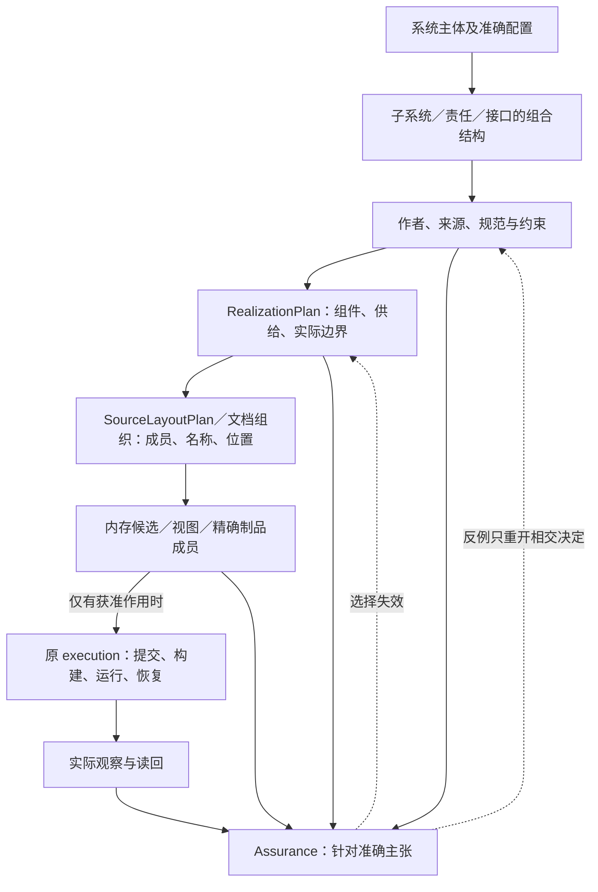
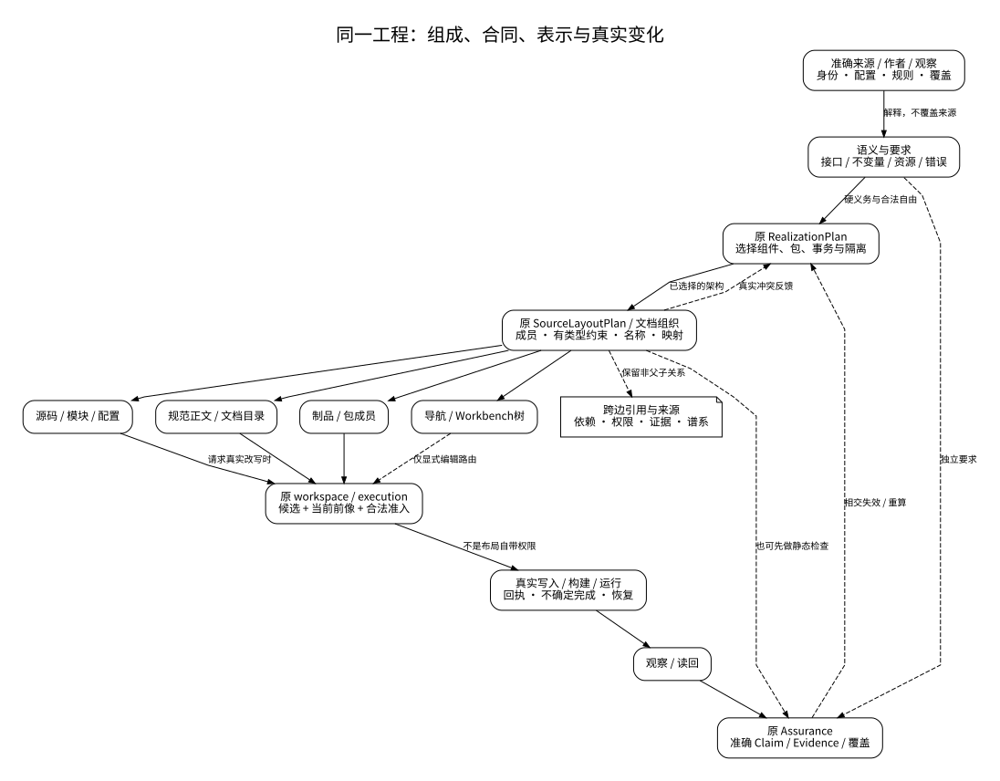
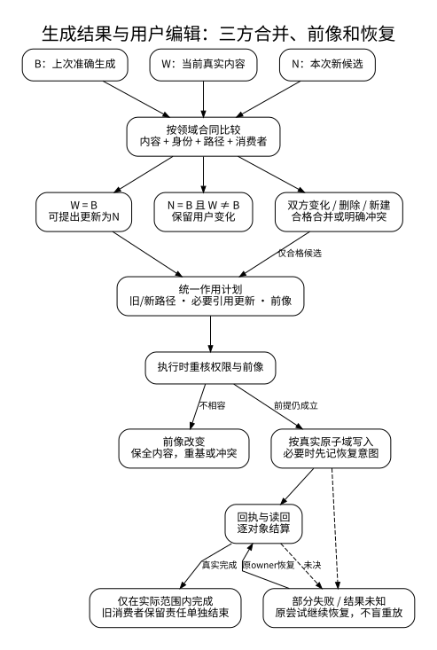
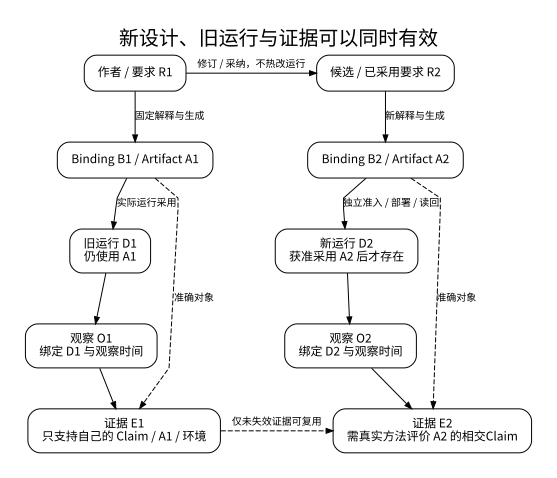

# 多维工程组织与树形落位

> 本篇拥有跨源码、文档、包、制品和导航的**共同组织合同**。共同的是输入绑定、分解理由、成员与关系保持、受约束分组、布局稳定性、变化映射及结果边界，不是相同目录、万能节点、独立数据库或第二编译器。本文是设计规范，不声明已有对应产品实现或生产证据。

<a id="source-profile-lifecycle"></a>
## SourceProfile 与派生索引也有独立生命周期

作者区域的SourceProfile是解释输入的一部分。profile/parser规则变化可能改变SemanticRevision、SourceMap、诊断和可编辑操作，因此属于高扇出迁移：先在固定source上构建候选语义与索引，比较差异和消费者，再切换；不能只删除cache后把新解释当作旧解释的同一revision。

QueryIndex/reader/audit属于可重建派生物，按source/config/parser/ranker revision失效；删除它们不改变作者内容。新index generation私有构建后原子发布，旧generation在切换前仍保持一致，不能让读者看到一半新一半旧。

## 结构、关系与组织目标

### 为什么需要共同合同，为什么不再造平台

Requirement、Definition、算法、源文件、资源、运行观察和 Evidence 通过多种有类型关系连接，一个文件也可能包含多个定义，不能将真实结构等同目录树。不同消费者需要自己的受控层级视图，但必须保持共同身份、成员、权威与迁移关系。若每种投影独立发明身份会造成语义漂移；若集中到 TreeManager 则会错误接管语义解析、Target 规划和实际写回。

采用既有 Owner 组合：信息规范负责共同组织合同；RealizationPlan 负责实际组件选择；SourceLayoutPlan 负责目标成员位置；文档 Owner 负责 Unit/导航；workspace 捕获真实前像；execution 提交/恢复；assurance 签发对应 Claim。共同纯算法存在真实重复消费时再抽取内部库；共享规则不要求统一服务、进程、存储或强制公共运行时类型。

保留不新增方案作为基线：现有布局已合法、可维护且满足任务时直接复用；只补一条索引或一次局部移动，不启动全工程重分区。分解必须说明避免了哪个真实错误或减少了哪个有依据的成本；目录更整齐、层数更少本身不是收益证明。

### 同一系统的完整结构怎样串联

系统按真实组成关系展开到子系统、责任、接口和实现单元；粒度依其独立不变量、状态、消费者、生命周期和替换条件确定。每个节点有完整上下文，跨节点引用显式保留。沿该结构可以查看来源、需求、选择、源码、作用和证据；也可以查看设计的架构、语义、机制、落实、验证与演进。L0—L6 与 ASMRVE 是这些问题的阅读与核对标签，不决定实体数量、模块数或阶段执行次数。



这不是强制串行流程。查询可以直接读取固定对象；静态检查可先于任何执行；已有制品可以直接被合法部署；观测可来自外部系统并成为下一次输入。组件结构、数据依赖、初始化顺序、构建 DAG、权限关系和部署连接各保留自己的边类型，图中上下排列不授予控制权。

### 必须区分的对象与映射

| 对象 | 身份与责任 | 不能从它推断 |
|---|---|---|
| 语义对象及规范陈述 | 原 Definition、Requirement、Fact/Assertion 等精确来源及解释 | 不能由同名文件推断身份；来源断言不自动为真 |
| 责任与架构边界 | 哪项语义、状态、不变量、权限或替换义务由谁承担 | 不能由一个目录自动获得事务、隔离或独立发布 |
| 表示成员 | 一个版本化的源码、文档片段、配置、资产、二进制或其他具体表示 | 不等于一个语义实体；一个实体可有多个不同表示 |
| 树中出现位置 | 当前视图/命名域中的父子位置、标签和顺序 | 不等于语义身份、作者权、实际拥有资源 |
| 映射与残余关系 | 成员代表哪些源、保留哪些边、哪些内容被省略或另载 | 有定位不等于可逆编辑；有反向链接不等于等价证明 |
| 真实物化实例 | 哪个路径/存储/目标上的内容与当前前像 | 候选路径存在于计划中不等于磁盘或部署已改变 |

**唯一写源的准确粒度是同一对象、语义侧面、版本、作用域和表示拥有关系中的合法写入协议**，不是“一个 Entity 只能有一个文件”。同一类型的 Rust、TypeScript 和接口文档可以合法共存，输出二进制可有依法复制的多个副本；它们不能同时独立改写同一作者含义。一个混合文件的互不重叠区域可有不同生产者，但组合与实际文件提交只有经原 owner 协调的一条合法路径。多个合法作者可以经同一并发协议提交，不要求永久只有一个人或进程。

树中可多次显示同一实体的引用。例如 Payments 下的 Money 和 Shared Types 下的 Money 可以是两次只读出现，必须解析到同一准确 TypeRef；不能因此复制类型身份或共享实例。不同产品的同名 Money 若身份域不同则保持不同，不能按字节摘要合并。

#### 树的约束与非树关系

一次树/森林投影的非根出现节点恰有一个父节点；父关系无环；节点能追溯至所选根；兄弟名称满足所在命名域的冲突规则。一个展示用虚拟根可连接多个独立真实根，但不制造全局事务或共同生命周期。

这些性质仅约束 `contains/appears-under`。调用、导入、权限、共享类型、引用、生成、迁移和证据边可以跨树枝，允许其合同规定的环与多父关系。不能为了让画面像树而删除这些边，也不能将“无环构建图”和“允许递归的调用图”混成同一图。

目录、模块、包、部署单元与运行实例是不同对象。目录树不是依赖图；模块的语法包含也不等于物理文件包含；工作区成员选择不能由全目录递归替代。文件系统链接按宿主合同作为有目标的关系处理，不默认递归展开为更多作者副本。

#### 共同规划与具体呈现的接口

本篇只规定成员、真实关系、出现位置、分组与变化必须保持什么；树的出现键、祖先链回边、子项分页、筛选路径、多选和刷新由[客户端树形合同](../../80-开发者与接口/客户端/树形导航与结构投影.md)消费，不在此建立第二个客户端状态机。文档对应的Markdown责任树由[文档画像](../../90-治理与参考/维护/文档架构.md#documentation-tree-presentation)生成：物理目录/文件是容器出现，显式Contract Unit是容器下的语义出现，两层不能一一绑定；普通章节按需展开但不自动取得稳定Unit身份。不能把该目录投影当作产品Tree Provider已实现。

工程结构允许两个同名合法引用出现；显示层用角色/来源消歧，不靠改实体名或吞掉重复关系解决。真正的文件名、包名和公开符号唯一性仍按各自命名域执行，展示标签可重名不能放宽物理冲突检查。

#### 组织主轴是局部规则，不是全树只能分类一次

同一组兄弟节点必须有可解释且一致的划分与冲突规则，但不同层级可以使用不同判据。例如 `src/tests/docs` 按制品职责分组，`src/orders/payments` 按业务责任分组，`payments/api/model/storage` 按内部实现责任分组；只要每次细分有消费者和边界依据，这不是混乱。禁止的是同一事实在多个相互竞争的分类树下被重复维护，及兄弟分组重叠却无人决定写入归属。

强制布局约定先于展示偏好。已有原生项目、包入口、公开导入路径、URL、编译源根、资源寻址与加载规则都可能消费路径。**路径不是稳定身份，但可以是有语义的输入和公共合同。** 对可有语义的路径移动先检查解析与消费者；纯导航重排只有在不参与程序、格式、配置或授权时才是纯投影变化。

### 组织之前先决定真正的架构

图到树不是目标工程全部架构。选择进程、组件、包、共享状态、数据库事务、信任边界或设备放置，可能改变失败、延迟、一致性和安全；这些属于 RealizationPlan 对完整需求的选择，不允许 SourceLayoutPlan 以“少跨目录”自行决定。

分组约束必须带**所约束的边界种类**。订单、审计和 outbox 要求同一数据库事务，不推出它们必须同一文件；保密运行必须隔离，不意味着放到不同目录就完成隔离；两个发布周期独立可以要求不同包，但不必不同进程。分析器不得将所有 `must-share/must-separate` 都降成文件分组。

架构选择和布局相互反馈但不互相夺权：布局发现公开类型跨包不可见，向原实现选择返回准确冲突及候选修复；解析器形成新合法 Binding 后重新布局。不能静默扩大可见性、复制单例、把同步调用改远程调用或改写原 Requirement。对同一冻结问题的重复反馈沿[生态解析与选择的原反馈闭环](../../30-实现解析/实现选择/实现解析与候选资格.md#ecosystem-resolution-reconciliation)固定实际候选和新事实，检测无进展的重复状态并受真实预算约束；返回已知冲突与未决原因，不另造总控状态机。布局本身不能替原生解析器改依赖/feature含义，解析后的实际结果也需重核共同资格与成本。

### 层级分解、过程和时间是一份工程的不同关系

系统→子系统→责任→实现单元是组成与分配关系；来源→语义→选择→目标→作用→观察→评价是生成/使用/评价关系；旧配置→候选→采用/迁移/退役是版本与操作关系。它们共享对象引用，不能把其中一条链强制作为其余两条链的父子树。每个责任按真实相交内容回答架构、语义、机制、实现、验证和演进问题，ASMRVE可辅助检查，但不要求每个节点六列必填。完整设计既包括正常结果，也包括相交失败、恢复、验证和替换；这些内容由已有owner引用组合，不复制成六份新对象。

实际默认采用：语义合同不改时复用旧架构和布局；存在已证明的组织缺陷时只重算相交组成/分配及消费者；只有方法发现真实不可满足才回实现选择；只有新的独立含义或义务才回作者/需求。新的软件、领域或文档通常增加已有模型的实例/描述符/方法，而非再加一个全局层次。

### 可直接阅读的结构图

以下是本篇与验收正文的阅读投影，SVG由对应DOT图源实际渲染；图不取得规范写权，不代替正文的前提和失败限制。







## 共同数据、算法与布局政策

### 共同输入与结果：复用原计划中的字段

以下是内部接口所需信息，不是新的公共 `organization.json`，也不要求全部按表序列化。已有 PreparedJob、RealizationPlan、SourceLayoutPlan、ArtifactSet、文档索引和 EffectPlan 可以各自持有其相交投影。

| 输入 | 来源与消费 |
|---|---|
| 准确主体、配置与内容闭包 | 固定根、目标、规则/工具修订、原成员与读取覆盖；部分未取得必须显式 |
| 本次用途与承诺 | 仅导航、返回源码、原生编辑、可构建包、离线设计交付或部署分别选择成员和验证 |
| 已接受要求与组织自由 | 公开身份/路径、禁止依赖、共同不变量、稳定性、许可/披露、作用预算与可选偏好 |
| 领域成员与真实关系 | 由对应 parser/compiler/doc owner 提供；通用层不按文件名猜语义 |
| 既有布局与目标前像 | 只有参与 preserve/reorganize 时是生成输入；`compareTo` 仅比较时不影响输出身份 |
| 精确策略与宿主能力 | 名称、大小写、Unicode、路径长度、模块/包/归档规则、实际区域编辑和提交能力 |
| 已选择的方法与候选范围 | 可复用供给、合法分组候选与确定预算；纯布局不联网、安装或执行生成器 |

结果引用原计划中的：成员放置与名字、保留的跨边关系、源码/片段映射、被排除与未取得范围、冲突/Needs、组织选择理由、差异和所需后置检查。要真实写入时，另由原 workspace/execution 产生并准入作用计划；组织计划不包含可复活的 Grant，也不凭计划 hash 取得权限。

一个内部实现可使用如下纯边界；这是职责签名，不声明当前产品已交付该 API：

```text
prepare_organization(frozen_inputs, purpose) -> known_members + needs
constrain_members(known_members, accepted_contracts) -> feasible_constraints | conflict | unknown
choose_organization(feasible_constraints, exact_policy, explicit_prior_layout) -> candidate + reasons + residuals
place_members(candidate, domain_naming_and_path_rules) -> layout + references + mapping
validate_organization(layout, obligations) -> findings + required_checks
```

文件名可以沿已有目标 owner 放在 `compiler/target/layout`，文档适配沿既有 documentation owner，视图沿既有 query/entry。只有多处实际重复的确定排序、冲突检测、父关系校验等纯函数才提炼共享实现；领域 validator 与 effect owner 不移入共享工具包。

### 从多维成员到合法组织的确定算法

#### 固定输入、用途与完整性范围

读取被请求的根和实际依赖，固定含打开缓冲、配置与准确缺失观察的输入。先确定此次交付要能做什么，再选成员。公开库的允许宿主进口、源码包的依赖引用、离线设计的规范/例子闭包、可部署包的运行成员是不同集合。不以“只输出了一棵树”证明闭包。

无权、找不到、尚未捕获、明确不存在和不支持解码分别保留；隐藏信息连数量或候选名都可能敏感，按原披露合同决定是否可显示。查询可返回准确部分覆盖，不能把未枚举成员计作零。

#### 识别成员、写源及不可拆单元

绑定原定义/片段与成员，不从路径重新分配身份。按照语义确定不可拆内容：带共同假设的规则与反例、不可分的代码区域、同一格式要求的资源组、由原工具生成的整体对象等。不可拆不等于永不分文件；只要保留明确关系和消费合同，允许改变载体。

构建需要的闭包继续由原依赖方法产生；静态搜索只给其实际覆盖，不能排除反射、框架约定或外部消费者。未知全局 hook 使其相交布局分析降级或停止，不假装精确最小移动。

#### 传播硬约束并分解独立子问题

先保 public API/path/ABI、解释与初始化、资源/事务、权限、唯一写源、输出成员和平台名称约束。对真正同一分组边界的必须同组关系可求等价类；不能把事务同域直接当成同文件。若等价类内又出现该边界的必须分离，输出携带来源的冲突。约束传播不把 Unknown 转 false。

用真实依赖确定可独立子问题；共享输出配置、公共类型、命名域或全局容量使子问题耦合时共同求解。把每个根单独做成可行树不证明其并集合法。允许根的独立成功，但必须标明共享冲突影响哪些根。

#### 比较候选，不以一个无量纲分数裁决全部结构

候选至少包括既有合法布局、不新增结构、目标生态正常形态，及确有理由的责任分组/局部重组。有限小域可穷尽取得全局最优证据；复杂实例按有界搜索保留可行和非支配候选。搜索策略、候选集与预算固定，不以枚举先后冒充更优。

成本分别记录公开边界变化、受影响消费者、变更散布、读取步骤、源码/制品字节、构建/加载时间、资源占用、迁移/恢复和长期维护负担。没有测量的维度写未知或明确情景，不填零；毫秒、字节、风险和人的工作不能相加。约束先过滤，偏好只在合格解中依已接受的层次或部分序比较。旧布局的稳定性有理由，但不能让它永久压过用户明确要求的重大收益。

相等或已委派的可接受候选才使用确定平局规则；无法按偏好区分时可按有效委派保持旧解或返回待决，不能宣称最优。全局最优、局部最优、非支配、可行和未完成搜索分别报告其绑定范围。排序名字不是语义资格方法。

搜索的**逻辑工作界**与宿主墙钟/资源截止分开。要承诺同一输入获得同一选解，实际探索单元、分支序与归并次序须由固定政策决定，逻辑工作界不能按线程先返回的顺序计数。宿主超时/取消只能产生带准确已探索范围的未完成结果，不把偶然最后找到的候选伪装成该输入的确定最优解。允许接受“当前已取得的合格候选”时，采用动作必须显式绑定该候选及其证据/搜索回执，后续生成消费这份固定选择；不同中断回执是不同后继输入，不倒写原请求的确定性承诺。已有固定合格Binding的普通重建无需重跑搜索。

#### 硬约束的分组保留联合性

分组输入消费[联合关系与约束](对象关系与配置基线.md#joint-relation-constraint)的完整参与者、角色、修订、单位、激活条件和聚合规则。关系图的两两邻接只用于定位，不能把n方预算、共享类型、事务或共同manifest拆成独立局部通过后合并为PASS。组织步骤不改变原AND/OR或见证作用域。

例如将三个同时活跃的4单位成员安排进10单位池，任意两两检查都通过但整组必须拒绝；若原合同保证互斥，先由真实方法验证互斥再按该域聚合。未知不能按不活跃处理。产生多个候选分组时，每个候选独立核其整组约束并绑定同一配置；跨候选证据不得拼接。失败回到原实现规划/协调owner，布局器不改预算、放宽合同或把共享资源悄悄复制为多份。

#### 分配层级、名字、成员和残余边

每个分组层级明确其判据和命名域。公开名称保持原合同；私有名称使用稳定局部来源、目标合法字符和明确碰撞处理，不把全工程摘要或新成员次序写进所有旧名。路径规范化只按目标规则进行；不同Unicode或大小写折叠产生冲突时报告，不悄悄合并身份。

对视图的多次出现保存 `occurrence → source reference`；对生成成员保存 `member → source/producer → intended role`。一源多目标、多源一文件、一个源多专门化版本和相同代码不同状态实例均须能表示。跨边关系以真实导入/连接、引用索引或来源映射保留；若只展示树父子边，则明确未显示的关系种类。

#### 复核后封存，缺输入回原准备流程

领域 checker 校验模块可见性、初始化、数值/资源、格式与成员；通用检查仅能证明树/路径/覆盖/映射等结构性质。需要真实 Cargo/npm/toolchain 或外部资料时返回原 Needs，由 application 经授权取得结果再生成后继准备态；绝不在纯布局函数中偷偷执行。

候选固定后生成其精确输入、布局策略、映射和所需作用/检查引用。报告只在所声明范围内成立：`planned`不等于`written`，`written`不等于`built`，`built`不等于`qualified/deployed`。

### 三种布局政策及两类确定性

| 政策 | 输出依赖 | 保证与限制 |
|---|---|---|
| preserve | 当前源、规则、目标及明确旧布局 | 保留仍合法的旧位置，处理新成员与必须修复的冲突；旧布局是输入 |
| canonical | 当前源、规则、目标与规范化政策 | 与无关历史无关；新成员可合法改变全局排序或碰撞分配，不承诺最小 diff |
| reorganize | 上述内容加明确范围、优化目的和前像 | 允许有理由地重分组；变更与消费者闭包要可审查，不把它当每次生成默认 |

同一**完整输入**的 clean/incremental、串行/并行生成应满足所承诺的语义、结构或字节等价；不同历史布局属于不同完整输入，不冒称相同输入却不同输出。路径排序可以决定显示顺序，但不能决定有副作用的初始化顺序。

增量键按真实查询读集生成：名称分配依赖该命名域的名字集合和负依赖，模块布局依赖公开面/导入/相交政策，显示排序依赖相应显示输入。加入同域重名会使碰撞选择失效；远端不相交根不应因此重排。只有已证明影响局部的前提成立才承诺局部重算，否则扩大到健全闭包。

源到投影再无修改返回时必须保全原作者字节。树式摘要丢掉的信息不能通过 pretty-print 重新发明。对允许回写的改变，经已支持的领域逆向规则产生作者候选；对不具备唯一逆映射的变化，返回原 owner、可行选择或不支持，不能从 UI 行号猜写源。

### 不同产品画像如何复用

| 消费者 | 共同合同落点 | 该消费者不可被抽象掉的义务 |
|---|---|---|
| Gift 自身源码 | 架构责任与真实源观察 → 原实现映射 → 源布局候选 | Rust kernel、TS 控制面与 adapter 的职责和已运行迁移；不按文档页数造 crate |
| 生成的 Rust/TS 等业务工程 | Requirement/Binding → TargetProgramIR → SourceLayoutPlan → ArtifactSet | 目标语言模块、可见性、初始化、ABI、依赖与资源；不是把 Gift 十职责复制进业务项目 |
| 文档规范及设计知识 | 有上下文的信息单元 → 内容归属 → 正文/引用/导航 | 条件、否定、理由、反例、证据强度与历史适用域；目录/标题不是规范 authority |
| 包、安装器及发行物 | 目的性成员闭包 → 包路径/模式/校验与签名输入 | 许可证/披露、平台装载、依赖、解压安全、签名和安装退役；发布复制不是作者复制 |
| Workbench/索引/搜索 | 有权查询的准确对象 → 只读分组和多次出现 | 权限裁剪、覆盖、排序、分页、编辑映射；视觉完整不等于数据全量 |
| 测试/配置/资源 | 原 Claim/config/asset owner 的范围 → 适用布局 | 测试期望不得只从候选输出复制；配置区域不得互相覆盖；资源身份和格式由原系统解释 |
| 部署层级视图 | 实际放置与连接图 → 站点/组/实例视图 | 网络、复制、故障域和实时约束仍是原运行图；画成树不创造部署/事务保证 |

上述是当前相交画像，不是世界只有七种树的封闭枚举。允许无树输出：单个内联函数、查询值、数据库关系或事件流可以直接交付其合法表示。没有树消费者就不生成目录、manifest 或树管理对象。

### 文档与代码共用组织方法，但语义检查不同

文档单元必须能保留定义、条件、否定、关系方向、具体参数、机制、反例、理由及证据边界。H2/H3 只是定位辅助，不是完整信息的自动边界。重复词句可能属于不同对象；不同词句也可能定义了同一合同。合并先建立语义对应，保留差额；不把精确字符串去重当语义去重。

代码分组还受编译单元、公开类型、名称解析、初始化和构建规则约束。一个声明可在同一文件中包含多个职责但有明确内部边界；多个文件也可共同实现同一职责。既有多个状态机不自动证明必须拆成多个 owner，先核它们是否受同一不变量与协调协议共同拥有。

知识导航应能从任务、领域、因果角色、设计问题或实现映射进入同一正文，不能依赖读者先学习全部分类数。当前成品正文自足，历史资料只为解释旧采用和兼容责任；当前理由仍在原决定/正文中可达，不能为了去掉历史日记而删除理由。

## 重组、生命周期与保持验证

### 真实重组、冲突与恢复

只读展示重排没有真实写入。改变作者文件、生成成员或发布包时，沿既有 `plan → admit → apply → settle/readback`，不新增 TreeTransaction。

移动计划同时保存旧源/目标前像、成员映射、实际内容变化及必须更新的导入/链接/配置；rename 与内容编辑是两个可组合维度。生成区以旧生成物 B、当前实际内容 W、新候选 N 做三方判定：W=B 时可按获准计划换成 N；W≠B 且 N=B 时保全用户变化；双方改变时按领域规则合并或冲突；删除、未知区与新增同名文件分别处理。不能只比路径列表。

路径交换、大小写改名、目录与文件冲突按宿主能力使用受控临时位置或分步计划。符号链接、hard link、根外定位、Windows 特殊路径与权限检查交原文件系统 owner；字面 `startsWith` 不构成安全边界。前后 hash 相等只能说明两次观察结果，不能排除中间变化或保证操作期间输入稳定。

多文件原子发布仅在实际宿主能力支持的原子域内成立；普通文件组采用 journal/可恢复提交，不称全目录瞬时原子。跨仓、对象存储和部署端分别有结算身份，整体编排保留不确定结果和补偿义务。超时先按原 Operation/Attempt 读回，不重新发送未知是否已完成的破坏性动作。

取消搜索可释放纯候选；取消物化不能删除唯一前像、用户未提交内容或未结恢复根。回滚遇到后来用户写入应停止相交覆盖并保全双方，不用旧快照强制复原。成功后仅清理已确认无消费者、兼容、恢复及保留义务的临时内容。

### 生命周期、知识变化与结构变化

同一时刻可有当前规范 R3、仍合格绑定 B2、已构建 A5、仍运行 A4 的运行实例，及仅支持 A4 的证据 E8。使用主体和准确配置关系连接，不以一个 current 布尔或文件修改时间覆盖。设计修订、布局修订、实现字节、实际运行和证据资格各按其输入变化。

历史布局是 preserve 政策的显式输入；历史候选作为当前选择的证据来源可以继续保留，但旧采用不带来新授权。一个新默认不改旧输出；只有明确采用后才形成新的绑定或布局候选。拆分/合并对象需要谱系映射，不能把版本图强制压成一条线。

兼容判断区分：读取旧格式、写回旧格式、保留旧公共路径、保留旧语义及旧运行恢复；能读取不代表可无损写回，路径迁移不代表行为迁移。并行分支只有正确的三方/多方合并关系，不按墙钟最后时间决定哪个内容胜出。

### 验证、替代和完成边界

该合同需要四种不同证据，不能互代：结构/成员/引用检查；领域语义与回源检查；真实物化/取消/崩溃恢复检查；实际任务的阅读、改动、构建与维护成本。跨 owner 的正式符合性路由见[组织保持与连续变化](../../60-保证与证据/验收/组织保持与连续变化.md)；具体正反构造保存在非权威组织与连续变化反例研究，不形成固定待跑题库。

组织改动保全的最低对照单位是独立命题及其条件，不是字数、标题数量或地址表。未经完整语义对照的历史资料保留未决，不因有 current-owner 地址就删除。此次正文的正确性也可被反例推翻；验证结果只绑定实际输入、政策、目标与实现。

拒绝把全部系统复制成同一模板、把全部信息存成一个属性袋、把每个词做成独立实体、把目录整理固定成日常全量任务。若共同合同本身迫使不同消费者伪造大量不适用字段，收窄共享面，把领域语义交回原 owner；若多个实现出现真正同源重复，再提炼有明确消费者的纯组件。共同模型服务真实责任，而不是要求现实服务模型。

相关成熟机制及边界见[多维组织的外部依据](../../../research/sources/多维组织与路径语义依据.md)。这些材料支持具体机制，不认证本合同整体已实现或“对一切工程永久最优”。

<a id="organization-preservation-laws"></a>
### 保持条件不是“树必须能反演一切”

对一个固定配置和读取范围，组织结果要说明本次选取的成员、树父关系、未进入父关系的有类型边、源到表示的对应及被省略的内容范围。唯一父节点约束施加在**本棵树的出现**上，不施加在全部工程实体上；共享组件可以被多个产品引用，实体关系仍可能是DAG或带合法环的图。

纯导航可不保留全部细节，但原事实仍由被保留的准确引用取得；它只能宣称所说明的查询覆盖，不能独立承担作者或离线恢复。需要离线完整交付时，实际内容及必要映射进入保留闭包；只有摘要/URL而内容取不到时是明确缺项。若有意省略不可披露细节，不声称接收者拥有完整可逆工程。

对目标生成，保持的是方法声明的观察等价与接口/资源/错误义务，不一定是字节相等；对无修改作者往返，保持原字节；对成员组织，选中必须交付的成员不能丢，运行不可达性裁剪必须有原语言/目标方法依据；对身份延续，只在明确谱系与映射下承认。四种保持条件不能互相代替。

<a id="gift95-cross-contract-28"></a>
## 大型工程目标布局的身份与并发编辑约束

完整目标工程可以有几十万个文件、多个语言和资源域；物理目录只是SourceLayoutPlan的一个投影，不能代表原Requirement、Method、真实锁、运行实例和Evidence的完整对象图。`targets[x].outputRoots`选择逻辑出口；TargetProfile与实际布局方法决定成员角色和路径；同一文件在多个Target贡献中出现时需要唯一写入owner或有定义的组合，不由数组拼接顺序裁决。

规模化JSON仍按业务/定义/作用域分片与稀疏作者控制保存；大体量读写必须有稳定逻辑键、局部差异、准确前像和实际多写者原子边界。源/目标布局迁移应先证明链接、模块公开接口、URI/资源消费者及必要恢复路径保持，不因目录树更整齐而自动移动。
