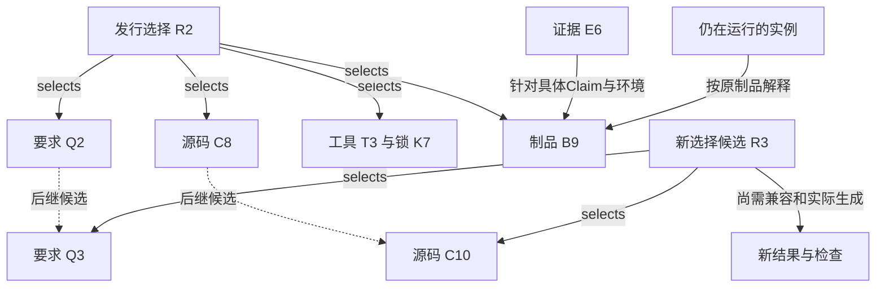
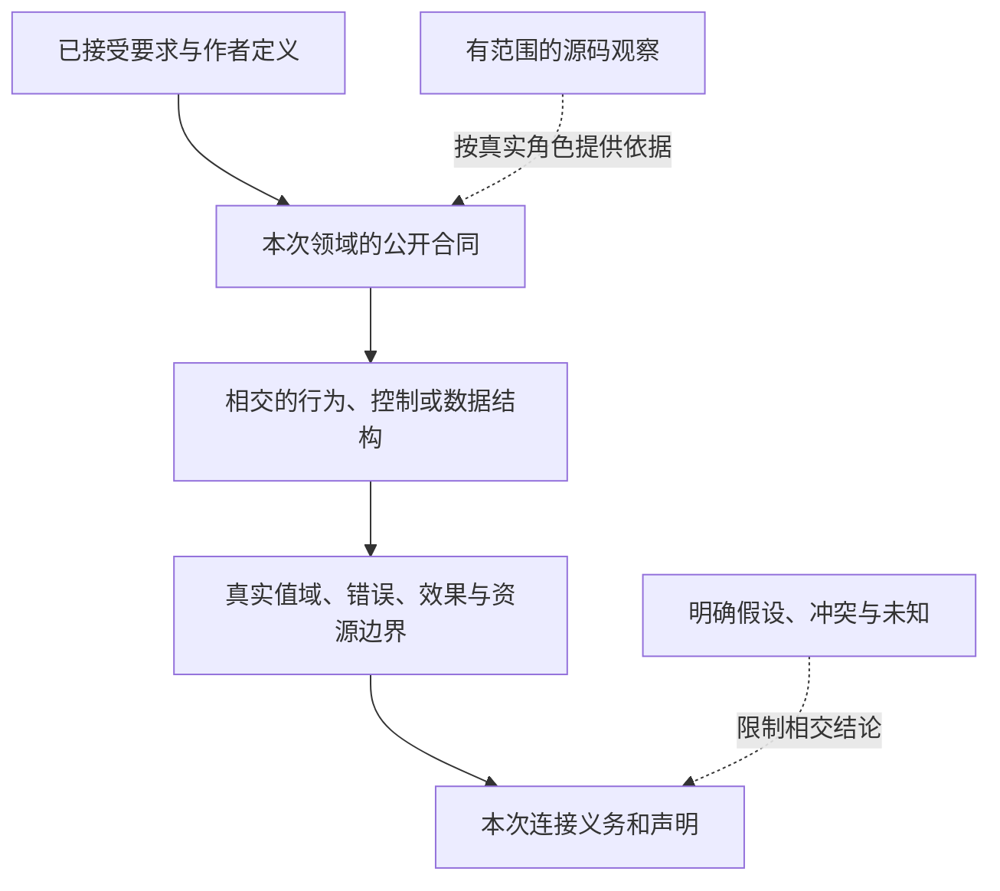

# 信息对象、类型化关系与配置基线


### 不把所有版本号叫作“系统版本”

至少六种版本有不同目的与Authority：**文件格式版本**识别如何解码；**领域/库接口版本**控制解释与公共兼容；**依赖锁**确定一次构建实际取用的修订/内容；**Definition逻辑身份/Revision**区分同一概念的演进；**Method/ABI**决定实际可调用的代码及前提；**Target产物/运行数据迁移版本**决定编译结果与已经存在的现实状态的切换。它们不应叠写在每个普通业务字段，也不能统合成一个`version: 142`。

### 本阶段的具体格式决定

- 新业务源码每个独立文件**只声明一次**`schema`，当前候选保留`gift.author-module/2`、`gift.project/1`作为序列化身份；不会因增加一个字段就再发布`/3`，因为还没有对外承诺生产Reader兼容。
- Definition的局部ID就是所在`definitions`映射键；不再复制`name`；实际意义Revision来源于修改快照或受控制的稳定标识，显示名重命名与语义变更须区分。
- `dialects`为按需真实扩展，内建Kind没有专门方言仪式；真正跨生态版本的解算与锁由Resolver拥有。
- `Gitf133…141`之类工作包历史编号不能进入当前业务Module的协议或产品构造；图上的V/K/L/S生命周期坐标也不是开发者Schema字段。
- 对已发布的外部协议进行破坏性调整时，必须保留可识别旧格式的Reader/明确迁移与失义出口，而不是要求所有用户手改每个引用上的字符串。


### 身份严格等级

1. **AuthorDocument**：文件路径、SourceScope、实际作者Revision和读入内容快照；文件移动不必改变ModuleId。
2. **ModuleId / DefinitionId**：逻辑声明身份，包含来源命名空间、锁定的Revision，内部别名不自动构成新定义。
3. **DefinitionUse**：某Root/组件内的合法出现点，其同名/同Def在不同Scope下不可合并。
4. **ComponentInstance / RootOccurrence**：实例和选中根身份，决定共享状态与资源的默认隔离；重复模板不重复实体身份。
5. **RealWorldObject / Authority**：由对应Issuer及Scope签发或验证，不能用普通文本Hash推导；同值对象可不同主体。
6. **MethodBinding / ArtifactRevision**：派生于特定已接受要求、环境、源快照及方法；它不是另一份作者意图。
7. **Runtime Operation/Attempt/Settlement**：现实生命周期可跨一次重新编译和部署，不能因为生成新代码便抹去在途事务。

身份可在适当范围内映射/别名，但映射具类型、方向、版本、前提和失效条件；不建无权的“全球唯一知识ID”替所有专业来源签发身份。BLAKE3等快速内容寻址、Git OID、SHA-256依赖锁/签名等应按各自用途明确，不能仅因为都是Hash就互换所承诺的语义、安全与持久身份。

### 对象、引用与树形载体的关系只能由身份契约解释

定位路径、可显示名称、引用字符串、对象身份、内容摘要和变更 Revision 分属不同作用域。树形目录只能表示载体存放位置，不能同时承载“属于谁、依赖什么、被谁授权、何时有效、谁实现它、在哪个运行会话发生”。一个对象可以在作者树、依赖图、业务关联图和目标输出树中同时出现，这些是对同一真实对象的不同投影，不要求建立永久的万能 KnowledgeGraph 以保存所有展示边。

每条有型引用至少明确来源作用域、目标种类、是否只要求存在还是要求可消费、允许的版本范围与解析失败；关系的方向影响失效传播。例如 `A` 需要 `B` 与 `A` 排斥 `B` 是不同的关系；新候选出现后“先前没有其他合法 Method”的负依赖可能失效，而普通正向引用不变。逻辑同一性必须由对应 Type/Issuer 供应确认，不能把缓存键或 SHA 摘要认作业务身份：内容相同的两个租户文档也可以是两个独立主体。


### 可变头、内容地址与实际对象配置基线的分离

内容哈希可确认某些字节未改变，但不能证明现实主体相同、来源可靠或声明正确。LogicalObjectId、SourceRevision、SemanticRevision、ContentDigest、DependencyVersion、RuntimeOperationId 和 UI 出现位置属于不同对象；可变头指向不可变内容对象时，应区分“新内容已持久”“索引已指向”“读者当前看到哪个版本”。引用消失是缺失、无权、暂时离线、已删除、无有效版本还是解析源无法达到，需要保留具体原因。

删除作者根不直接取消现实操作、结算/保留义务或别的产品根所持资源。退役前应先检查可达关系、负依赖、租约、恢复资源、需要保留的许可证和用户数据，形成可撤回的操作范围；存储热/温/冷只是物理策略，不改变知识效力和原作者权。治理系统的事实、推论、建议与接受决定各有签发者；AI对外部网页的转述不能伪装成用户已接受的来源修订。


### 生命周期的完整路径

从作者声明到真实系统，应考虑创建→静态解释→需求联合→Method解析→代码生成→构建→部署→授权→运行→观测→修改→迁移→退役。它们不是要求本轮实施的工作步骤，而是**设计接口不能留下不可逆断点**：

- **创建**：类型/身份/拥有者成立；输入、资产和外部Provider按真实Scope定义。
- **扩张**：副本、并发、缓存、索引、分片和租户隔离不能改变业务要求和资源守恒。
- **故障**：超时/重试/部分成功/外部无法观测/授权撤销必须有区分明确的状态和责任主体。
- **恢复**：安全重放、幂等读回、补偿/人工干预、状态数据迁移不能凭重新部署生成代码自动解决。
- **退出**：删除运行实例、撤销秘密、停止流/定时器、释放租约、执行数据保留/删除合规，与删除作者Root是不同操作。

正常与极端情况的不同适用资格不会强制每个小工具带上全量配置。示例：纯本地、无副作用的数据查看组件不需分布式协调/Grant发布服务；涉及银行扣款时则绝不能用这种简化。


### 生产、运行、更新与恢复是不同投影

1. 选择根与冻结作者接受义务；确定解析环境与外部供应候选。
2. 实例化定义和专业Use；生成类型化联系与状态/接口/资源要求。
3. 合取硬义务、政策、并发与时间/资源；得到可行域或明确冲突/未知。
4. 筛选资格满足的Method；再按软目标比较；不能先用成本排序覆盖硬安全条件。
5. Target形成项目、源代码、依赖、配置、资产和源码到作者决策的可追溯关系，保留作者原生文件保护区。
6. 发布、部署和实际操作按各自明确授权发生；Operation多次Attempt不自动对应多次真实效果，超时保持`unknown`至读回/结算。
7. 修改作者源后只对真实依赖失效的Binding/产物重算；对环境、Provider、锁、权限和现实观察变化也有独立失效维度。
8. 退役时释放资源、取消订阅/定时器、处理迁移/保留/删除义务；删除Root不是立即删除运行数据的许可。

这里的序列描述系统机制，不意味着用户当前授权实现、测试和部署。

<a id="gift140-instance-revision-invalidation"></a>
**组件实例与业务Occurrence失效的精确主键**：`(Project/Target selectedRoot occurrence, Component instance, Template definition revision, TypedMember occurrence, Bound context and issued-object revision)`分别拥有不同身份，不凭相同模板或共享Ref合并。组件实例A的Grant/状态/数据/观察失效不自动使实例B变成同一个运行对象；共享Method代码可复用，但需分别验证各实例条件；外部Provider或资源实际共享时沿有类型共享边传播失效。`DeploymentNode.instance`、公开出口、外部需求和目标SourceMap必须保留该身份，撤权、回滚、Evidence失效遵守原Owner合同。


本篇只规定 `SubjectRef`、`Revision`、`Assertion`、`AssetView`、`PreparedJob`、`ArtifactSet` 在跨域解析、选择和失效时的交接；基本身份、时序和断言服从[身份知识合同](../../10-作者与输入/作者源/工程源/身份断言与采纳.md)。目录与图索引是可重建视图，不创建第二套知识图谱，也不以部署完整持久存储系统作为有限跨域查询的前提。

<a id="information-ref"></a>
## 引用包含什么，什么时候才需要

普通同版本文档可使用相对路径和锚点。需要跨移动、跨仓、发布、验证或恢复引用时，在原SubjectRef之上按实际场景固定以下分量；纯进程内值不为此序列化。

| 分量 | 含义和取得者 | 何时必需 | 不可混用对象 |
|---|---|---|---|
| namespace | 提供者/项目/权属命名域，由真实上下文取得 | 多工程、外部引用、隔离 | 显示项目名、目录路径 |
| subject | 逻辑对象身份，继承已有对象；新文档长期引用时一次分配 | 持续编辑、移名、外部引用 | 内容摘要和标题 |
| revision selector | 明确revision，或在配置下才能解析的概念引用 | 精确复验、生成、已发布材料必须固定 | `latest`、时间戳、分支名 |
| content identity | 算法+摘要+长度+编码层或提供者版本，指向确切字节 | 完整性、CAS、制品引用 | 主体、当前权利、语义等价 |
| fragment | 有意义的子对象/稳定条款/坐标；必要时附解释器与上下文 | 逐条追踪、回源、证据定位 | 不带版本的行号、搜索排名 |
| configuration | 原项目/发行/操作选择的上下文引用 | 同一概念有不同版本和变体时 | 全局最新版本 |
| locator | 可更新的存储定位候选，可能暂不可用 | 实际取得字节 | 权威身份和永久存活承诺 |

Workspace可由项目、来源锁和快照补齐普通文件的机器关联字段，不要求作者逐一填写。规范条款的长期稳定引用优先使用显式`gift-unit-*` Contract Unit；目录/链接只是其当前定位。标题、行号和内容哈希只在对应Revision内充当位置或内容证据，不单独构成跨修订同一性。没有稳定Unit的段落只能通过锁定Revision内的位置引用，不得将移动后的相似文字自动判成同一条款。

**UI引用解析。（消费条件）：** 显示别名只负责导航；跨revision的查找或编辑必须回到唯一可解释的实际对象和本次消费角色。 合同归属：[离线客户端、分页视图与操作前像的同步](../../80-开发者与接口/客户端/工作台布局与交互.md#gift-client-view-consistency)。

## 一个引用的解析必须返回精确状态

内部 `resolveInformationRef(ref, selection, readAuthority, requiredFidelity)` 由 workspace/adapters 执行。成功结果绑定确切 subject/revision、解释版本、实际可用内容、当前可披露范围和读取/保留责任；失败须区分 `ambiguous`、`notFoundWithinCompleteScope`、`unavailable`、`notDisclosable`、`unsupportedFragment`、`contentMismatch`、`selectionConflict`。外部调用者可依披露策略隐藏“不存在”和“无权”的差异，但内部不得混淆两种恢复路径。

“引用位置变化”可以更新locator而不改主体；“主体拆成两项”产生新身份与`splitFrom`，旧引用返回多个有范围的去向，不能静默选第一项。“两个副本内容相同”可共享受允许的字节存储，但不自动合并主体、许可、来源或采用状态。去重只消除已确定的物理/表示重复。

内容摘要的算法、编码层与长度一起记录。文本值相同与BOM/CRLF/压缩字节相同不同；摘要算法升级建立可验证对应，不改旧引用语义。哈希不提供作者认证、执行证明或保密；低熵敏感值的摘要也不能公开。

<a id="resolution-fidelity-consumers"></a>
### 从定位到消费：同一个引用按用途取得，不偷换其版本

`requiredFidelity`选择已有解析的实际要求，不是调用方可以自签的“精确”标签。workspace固定任务所选命名域、主体、修订、片段和解释，再让实际提供者返回其能够取得的范围。定位与消费分开处理如下：

| 消费用途 | 可以接受的定位变化 | 消费前还须满足 | 不能借定位成立的结论 |
|---|---|---|---|
| 找当前说明 | 按有来源的移动/拆分关系找到继承页 | 当前可读取、片段真实；多去向明确返回 | 继承页就是旧原文或新规则已经被采用 |
| 解释旧作者源或复验旧结果 | 镜像、缓存、存储搬迁可换locator | 所选原修订、准确字节、片段语境和解释仍一致 | 默认页已更新，所以按新语义读旧内容 |
| 为本次生成选实现 | 在固定快照内找到实际定义/方法 | 调用角色、合同版本、前提、效果、资源及目标保持成立 | 名称或签名相同便能替换旧方法 |
| 判断某条证据可用 | 原证据的准确副本可由新位置取得 | 仍对应此Claim、被测主体、输入和方法范围；相交撤销另查 | 文档标记supersedes即可转移旧通过 |
| 发起现实作用 | locator可按实际提供者协议变化 | 当前授权、资源身份、最终前像、操作及重试协议 | 导航成功或旧读权自动允许新写入 |

解析有六个明确交接。第一，应用层固定本次目的和选择，而不是将查询中的`latest`带进后续可变读取。第二，workspace取得选定对象和必要内容；别名只给定位线索，同名目标和其他租户内容不补缺。第三，核内容域、片段与必要上下文，完整文件存在不等于片段可消费。第四，语义/编译/保证各按实际用途核相交合同，不让公共解析器代做“所有性质正确”的判定。第五，只把经本用途核验的准确输入交给消费者，并记录实际依赖、覆盖和保留责任。第六，有效性变化时区分已封存的历史结果、当前显示资格和新的作用准入；不原地改写旧解释。

若Q@2移址后取得的确为Q@2原字节，且解释与读取资格仍成立，可以继续复用，不要求制造一次语义迁移。若旧地址现在返回Q@3，即使标题和函数签名相同，也不能充作Q@2；取得Q@2或形成明确新选择后再核相交消费者。Q@2已拆成两份时，导航可返回两处，但准确语义迁移必须取得拆分映射与实际需要的上下文；没有时分别报告缺项，不按列表首项消歧。

运行任务所需版本与当前阅读页可以不同。离线仍有准确旧内容时可以完成合格的纯分析；缺失的仅是说明页镜像，不强迫阻塞独立输出。任务需要的实际实现、合规证据或目标前提缺失时则保留对应义务。没有全范围读取能力不能将`unavailable/notDisclosable`替换为“不存在”；输出给调用者的细分仍受当前披露政策限制。

<a id="identity-transformation-boundary"></a>
### 对象拆合、替换与引用迁移

定义、工程使用点、内容、位置、运行实例与现实物体各有自己的连续性。内容相同只共享可允许的不可变字节，不合并订单、连接或传感器状态；改名/移动是否保持对象依实际映射，重新创建同名对象和句柄槽重用不能冒领旧实例身份。

一批原料拆成三批，保留输入/输出谱系、数量、单位与损耗，不能让三个结果都成为同一个原实例；两个机构记录经有权判断指向同一主体时保留原引用与争议材料；更换电机可以保持整机身份，但新旧电机分别具有寿命、证据和已结束/新取得的控制责任。具体物料规则见物理对象与制造。

迁移映射说明接受者、一对一/一对多/候选域、适用消费者、旧写入拒绝和历史观察去向。不唯一则保留候选或明确选择，不以数组索引代替映射。核验不仅查ID重复，还查复制后状态隔离、替换后旧权限不能控制新物体、拆合后数量/来源不丢，及名字复用不使旧写者复活。

## 关系不是一类万能dependsOn

<a id="typed-system-relations-operational-contract"></a>
### 可判定的有型关系，以及不能推导的边

系统中**产品依赖图**和**文档阅读图**共用引用定位，不共用证明能力。真实关系的消费要求至少 `kind + kindVersion + endpointRoles + exactRef/selection + applicability + issuer/authority + basis + invalidationRule`；这些组成可以由相应现有Owner的对象/ReadSet确定，不要求作者在另一份大清单重复填值。`kindVersion` 指该种关系的解释版本，不是被引用对象的修订。未认识或版本不兼容的关系应保留原字节及诊断；若它可能承担硬要求、授权、证明或保留义务，消费者必须阻断相应完整性Claim。

| 关系类别 | 实际端点与语义 | 可触发的消费者行为 | 不成立的推断 |
|---|---|---|---|
| 声明 `defines`、`refines`、`constrains` | 有权规范单元 → 精确目标合同/条件 | 版本比对、定义读集、已核精化替换 | 仅命名相同即精化成立 |
| 需求 `consumes`、`requires`、`jointWith` | 结果 → 输入/义务；共享组保留超边参与者、互斥与共同资源 | 不完整前提阻断，联立或重新求解 | 两两满足可推出全体满足 |
| 选择/产生 `selects`、`qualifies`、`lowers`、`produces` | 固定Configuration与真实Method/Target消费者 | 消费准确Binding、法定目标、成员依赖 | 声明找到Method即可签Artifact成功 |
| 现实 `authorizes`、`performs`、`observes` | Grant/Operation/Attempt/Observation的真实主体与范围 | 验证权限、实际派发、幂等恢复和读回 | Permit自动等于Grant、Timeout等于未执行 |
| 证据 `supports`、`contradicts`、`dependsOnProof` | Evidence → 明确Claim，证明前提与反例保留 | 重新评价Verdict与证据过期 | 来源作者、生成器自述即独立Oracle |
| 版本/影响 `supersedes`、`derivedFrom`、`invalidates`、`retainsFor` | 精确修订、正负读取和实际保存根 | 定向失效/迁移/旧恢复保护 | 新版本存在即可覆盖旧运行或删除旧证据 |
| 阅读 `contains`、`mentions`、`navigates` | 文件/段落/表格/目录之间的定位 | 搜索、跳转、包外统计投影 | 自动进入编译、权限、GC或证明闭包 |

这里的关系类别是对既有实际 `defines`、`uses/imports`、`refines`、`implements`、`supports` 等语义的**消费分组**，不是一套另行发布的新 `gift.*` wire enum。一个实际连接如果既影响代码又影响现实作用，保留两个由各自Owner发行的关系与资格，不把“共享端点”合并成万能边。联合约束中的参与者组/量词/条件以原 `JointRequirement` 保持；二元边图无法替代超边或全局不变量。

**关系判定和失效查询的顺序**：按固定Snapshot解析端点与版本 → 验证角色类型/来源权威和应用范围 → 取得该关系Owner签发的读集/证明 → 计算所需闭包 → 对断裂、不完整、超预算或版本漂移返回带前沿的 `Need/Incomplete/Conflict`，而不是以空边集宣布有效。来源文本链接只允许第一个“定位”动作；需要升级为产品依赖时必须取得确切生产者合同/消费证据。历史关系列表保留供旧版重放，当前配置只能选择其有资格的版本。


需要被机器消费的关系具有准确参与者及其角色、命名空间化类型与版本、解释上下文、产生者/依据和覆盖范围。二元关系有两端；联合约束使用原Statement/Constraint拥有的参与者组，不强制拆成只能两两判断的边。反向关系默认是投影，不另存一个可独立改义的副本。关系可直接由代码/清单/实际分析派生；没有消费者的每句自然语言不强制变成关系记录。

| 类型示例 | 准确含义 | 能支持的推导 | 不能支持的推导 |
|---|---|---|---|
| `defines` | 该文档单元拥有此合同在该版本的定义 | 定位唯一规范及变更拥有者 | 规范已实现 |
| `refines` | 在声明前提下细化另一个要求/模型 | 复用明确保持证明或检查 | 只因标题更具体便优先 |
| `implements` | 某实现针对某合同的对应声明 | 找候选消费者、安排符合性检查 | 行为一定正确 |
| `uses`/`imports` | 已解释输入依赖 | 相应输入变化可能失效 | 是执行前置、是授权或要永久保留 |
| `mustPrecede` | 具体任务的严格执行前置 | 调度及非法前置环诊断 | 普通递归类型非法 |
| `derivedFrom` | 结果使用了这些输入和方法 | 来源追溯、派生失效/删除影响候选 | 自动pin所有祖先或完全可重建 |
| `supports`/`contradicts` | 证据在前提下支持/反对具体Claim | 辩护和重开 | 签名即真实、赞成数决定事实 |
| `selects` | 配置选择特定版本/变体 | 明确解析与复现 | 版本之间兼容、允许运行 |
| `supersedes` | 新定义在指定范围代替旧定义 | 同范围采用后的当前选择 | 抹去旧发行、旧观察或旧义务 |
| `retainsFor` | 真实拥有者按某目的保护内容 | 交给现有GC根保护协议 | 仅靠描述边阻止物理删除 |
| `observedAt`/`performedBy` | 观察与活动、主体的对应 | 定位方法和原材料 | 墙钟先后等于因果、主体签名等于结果成立 |
| `authorizes` | 有效授权链对具体动作的约束 | 原Grant准入的一项输入 | 从知识目录自行生成新许可 |
| `mentions`/文档超链接 | 阅读导航或普通提及 | 找相关材料 | 编译依赖、证明、执行前置、保留义务 |

关系扩展先定义参与者角色/域、基数、意义、顺序与重复/删除规则、推导与否定边界、版本及消费者。不认识的关系可原样保全并显示其未知类型；涉及完整影响/保留计算时不得当成“没有边”。相同两个对象可有多类关系，不因端点相同删除独立语义。

<a id="typed-handoff-contract"></a>
### 从作者采纳到现实证据：有类型交接的最小闭包

当两个真实对象之间的关系会改变编译、现实作用、验证、恢复或删除决定时，关系不能只记录 `from/to`。至少需从**原生产者合同**取得：`relationKind/version`、带角色的端点与确切 revision/selection、适用 subject/scope/condition、生产者与 authority、basis/read set、可消费的结果及有效性、失效来源、失败/恢复及下游消费者。可由已有对象和真实索引无损派生的分量不要求作者重复录入；绝不把它们做成所有关系必备的持久大表。

以下是既有 owner 之间的交接检查表。左列的 `interprets / proposes` 等英文动词是**交接语义的阅读标签**，不是新增一种可在产品里任意注册、发号或串接的 relation enum；需要机器消费时，应使用相应 owner 已定义的实际类型、协议版本与角色，未定义的接口返回准确设计缺口，不能因本表存在而冒充可编译字段。左列也不是新的运行状态机；各输入/输出均使用已有对象。`missing` 指该消费需要但尚未取得的准确资料，不自动改写 Requirement、无权对象或旧终态。

| 关系及其唯一生产者 | 正向输入 → 下游实际消费 | 失效、失败与恢复的责任 |
|---|---|---|
| `interprets / proposes`：请求解释和SourceMap | 有来源/范围的请求及作者源 → `IntentIR`候选、歧义和使用点；Application显示/检验而不采用 | 歧义、无读取权或证据不足保留分支/Need；新输入只使相关解释失效，不能静默形成Definition |
| `adopts / revises`：有权作者采纳事务 | exact proposal、前像、主体、Grant及合格选择 → 新`Definition/Requirement/Control`等各自revision；Workspace及语义编译消费 | 前像/CAS或权限冲突拒绝写入；重新取得前像与有权决策，不把纯分析成功当采纳 |
| `qualifies / selects`：实现资格与决策 | 实例化Requirement、Candidate、Provision、Target、MethodSpec、Evidence、Policy → Eligibility、Decision、`RealizationBinding` | 非适用、冲突、资格未知分开；上游变更重评相交选择；`UseBinding`不能因缓存命中自行换实现 |
| `realizesAtUse`：compiler只读消费关系 | `RealizationBinding@r`、具体 use occurrence、Target/basis → `UseBinding`和lowering输入 | 使用点新增硬条件需返回资格和Decision，不在UseBinding内改写Binding；旧目标制品保持原选择 |
| `materializes`：目标组合/生成owner | exact semantics/binding/Target/源码/工具链 → `TargetProgramIR`、`ArtifactIntent`、sealed `ArtifactSet`及映射 | 生成缺项不等于外部效果失败；目标/工具/源变化按依赖使相交成员失效，不能复写已封存字节 |
| `requestsEffect / attempts`：execution准入与OperationStore | 准确目标、前像、作用范围、当前Grant与计划 → `Operation`、0..n个`Attempt`和真实提供者结果 | 失权不得开始新作用；超时/断线先核同意图、尝试finality与权威读回；不能换ID重放未知副作用 |
| `observes / settles`：真实Provider或观察owner | 作用回执、目标身份、方法、时窗、覆盖 → `Observation`与有范围的effect settlement | 确认、部分、无效果、未知不能压成bool；读回缺失保留恢复责任；晚到观察受generation/前沿限制 |
| `supports / contradicts / qualifiesClaim`：Assurance | exact `Claim`、subject/revision、独立性要求、合格Observation/证明/测试与适用条件 → `Verdict`及剩余义务 | Evidence过期只重评相交Claim；复现字节/签名或exit=0不替代解释/覆盖/资格，不能从Verdict倒写要求 |
| `acquires / interpretsSource`：SourceProfile与SourceMap owner | 精确AuthorRegion、CST/原字节、schema revision、读取覆盖 → 已解析AuthorSource/SourceMap或明确不完整材料 | 不可解释字节须保留且不能补成虚构定义；round-trip无法成立则保留原文与候选，不以IR覆盖作者源 |
| `captures / freezesBasis`：workspace与Application | 任务根、实际读取许可与所需revision/成员 → PreparedJob/Configuration所需的不可变选择、已确认覆盖与Need | live输入变化不在本次求值中暗换；缺失资源/未知枚举范围不能当空集；形成后继准备代际或限缩Claim |
| `dependsOn / invalidates`：生产者与查询依赖owner | 固定EvaluationRequest、实际读取、缺失集合与规则/环境MethodRevision → 结果及同批published read-set | 正/负依赖变更只使相交结果失效；缺乏完整枚举的负事实不可永久缓存，失败/取消不发布半成品 |
| `packages / accountsFor`：Artifact及交付完整性owner | 每个已生成Artifact、必需public imports、资产/配置/依赖/来源、所选目标根 → sealed root closure与缺项集合 | 子根可闭合不等于联合根；缺成员/版本/许可/内容不补空文件，也不冒充已build/publish |
| `admits / revokes / transfers`：Grant与资源owner | 选定Operation/资源/主体/时窗、policy与当前可核凭据 → grant/ref、资源租约/份额及可撤销条件 | 目录可见/合格binding不自动授权；撤权不把已逃逸Attempt变成未发生；结算/转移按代际与实际release |
| `protects / collects`：来源/存储/兼容owner | 确切Artifact、source basis、历史解码、在途Operation与保留目的 → GC保护根及当次可释放集合 | 停写/retired不解除旧reader、rollback或证据义务；失去保护根时返回阻塞或保留，不以清理成功伪造退出 |
| `promotes / deploys / retires`：发行和执行的有权owner | sealed Artifact与渠道/环境的当前条件 → Promotion/Deployment Operation、实际读回及后续支持或退役责任 | 发行不等于部署、部署不等于健康；新revision不撤销旧实例；退役须先拒新、结算在途、保留旧解码与恢复根，最后才可回收 |

**不可传递性。** `implements(A,B)`且`uses(B,C)`不能自动推出`C`已满足A；`supports(E,Claim)`且`Claim`关联Requirement不能推断Requirement已在某环境运行合格；`selectedBy`与`authorizes`更不能合成发布许可。需要推导结论，消费方必须用同一固定basis重新核关系方向、适用条件、时间、authority和coverage。某一后继缺口只阻断依赖该结论的动作，已封存或无关的纯结果保持可读。

**修订与重试。** 若同一Requirement从Q@2变为Q@3，B@Q2和针对它生成的A@2仍有历史含义；新构建从Q@3重新选实现，不能把旧Binding或Evidence直接贴到新结果。若部署已提交而响应丢失，读回沿原Operation/Attempt，不重新从Q@3编译一个替代部署再称为恢复。详细资格、幂等和证据代数仍由[实现选择](../../30-实现解析/实现选择/实现要求与正常绑定.md)、[作用恢复](../../50-执行运行与观测/持久化与恢复/事务提交-外部效果与幂等交付.md)、[保证接纳](../../60-保证与证据/保证/解释与证据接纳.md)各自拥有。

内部紧凑ID、带代句柄和内存地址不自动取得本篇持久引用语义；跨快照、槽位复用、持久格式与原生ABI的映射由[实现机制](../演进与实施/实现语言与机制演进.md#四种身份及其存储边界)负责。信息相同可以共享字节，不因此合并有独立生命周期的运行对象。

<a id="typed-consumer-evaluation"></a>
### 消费者的有型关系求值：从准确引用到可执行决定

关系图的作用不是给任何连接都加字段，而是让下游能从同一份已采纳信息做出**不越权的具体判断**。以下是消费者合成已有原生合同的算法，不是新 `UniversalRelationEvaluator` 运行服务或所有对象必须序列化的通用Record；任何阶段已有原生结果类型时继续使用该类型。输入基线由Application/相交owner固定，引用与关系由本篇解析，资格、准入、作用和裁决由各自owner执行。

1. **固定问题与范围。** 记录本次消费者要判定的 `subject / purpose / operation kind / requested Claim`，以及已经有权取得的 `Configuration`、读出切面和上下游协议修订。没有目标用途，不生成虚假的全局 `isValid`。若请求只需静态查询，不为它预先索取部署Grant。
2. **解析类型和身份。** 每个实际引用取得 `(subject identity, semantic aspect, required revision/content, typed relation, endpoint role)` 以及可用的真实位置；无法确定对应者返回歧义、缺项或冲突，而不是按名字/位置合并。重定向只在身份与解释证据成立时生效；旧类型未知时保留原材料，不能假装没有约束。
3. **建立有边界的参与者集合。** 对量词、查询、Provider发现、目标成员和验收覆盖，区分已完整枚举的集合、仅当前可见子集、被访问权限隐藏的成员以及开放的未来供给。对后两种情况，不允许从“未找到”推出空集、全称通过、无未满足依赖或不存在更好候选；若披露成员本身越权，则返回足以阻断该结论的概括性缺口，不泄露被隐藏的身份和数量。
4. **取得精确选择及依赖。** 结果读取所选 Definition/Requirement/Method/Binding/Target/工具链及真实正负依赖、目录成员证明、解释方法和所需时间切面。单个Provider的`revision`只担保自己的读；没有联合快照协议时，复合结果保存选择向量及每端观测能力，绝不升级为跨来源原子观察。缺项不能被旧缓存、较新的文件或未指定`latest`补齐。
5. **合成联合条件而非逐边打勾。** 按实际 AND/OR/条件/互斥及跨边共享资源评估完整原 Statement。两两可行不推出整个目标闭合；同一要求被多个消费者引用，也不意味着证明可以简单合并。结果至少保留适用、支持、矛盾、缺信息及不涉及的准确子域；它们不需要收敛为一个全局 `PASS`。
6. **隔离选择、许可、现实与证据。** `Eligibility/Decision/RealizationBinding`确定解析的资格与选择，`UseBinding`只消费该选择，目标产物只能承诺生成内容；对作用请求，执行owner须在实际效果边界另核当时Grant、preimage、代际和资源。一次成功执行仍只给出执行证据，不能由其本身签发完整Claim的Verdict。
7. **记录失效原因和传播粒度。** 生产者的实际语义修订、增减成员、负依赖、权限/披露变化、时窗届满、方法资格变化和外部撤销，分别使对应分析、使用资格、派生索引或Claim支持变为stale/不许可。相同字节的新读取不自动继承旧的授权、证明或原位实例；仅locator移动且身份仍可证的情况不应无谓重算内容。
8. **遇到在途效果转交原操作恢复。** 如果外部副作用超时或响应丢失，保留`Operation/Attempt`原身份、已知前沿与最终性未知；只由原execution/Provider协调、合格去重或权威读回。不能通过重新编译新版目标、创建新Operation ID或将旧候选标为失败替代这个恢复步骤。撤权应阻止新的动作，但不改写已发生的效果，也不免除取回、销毁或披露后续义务。
9. **按请求闭包返回并更新消费者。** 消费结果指向准确成功子根、失败原因、`Needs`、未结算作用、已使用basis及仍有效的Claim范围；独立可用结果允许继续，但本次必须交付的联合根不满足时不能改写目的来造成功。正式后继只能经原author/owner的采纳事务形成；查询或图索引不能获得这个写权。

**同因多失效示例。** `Requirement@r2`固定两个输出目标A/B；二者共用一个后来被撤销的Provider供给，且读取了不同的工作区观察。A目标的sealed Artifact仍可作为历史字节重现，B目标尚未构建；撤销使后续资格/部署准入无效，不使A字节消失。即使A和B各自报告“已读取最新版”，也不能拼出相同的联合观察切面；当前任务若要求二者同时发布，整体未闭合。若A的部署响应丢失，必须沿原Operation查结算，不能以B失败为由重放A。Assurance只能对各目标实际证据与整体Claim所需的联合关系分别裁决。这类案例的完整执行状态由[跨主体交接](../协作与状态边界.md)及[执行恢复](../../50-执行运行与观测/持久化与恢复/事务提交-外部效果与幂等交付.md)维护，本篇只拥有引用求值和不能越权的结论组合。

**可复核不变量：** 参与者集合扩大不会使未经再核的旧全称结论继续生效；隐藏的成员不会从报错泄露；同一选择向量不会无证明升级为联合快照；旧缓存命中不会提升为新权限；未知完成不变成可安全重试；同一Claim不凭子结果绿色自动成立。这些不变量分别需要合格的静态分析、状态空间反例或运行实验支持；此处定义行为义务，不声称已由Gift实现。

<a id="joint-relation-constraint"></a>
### 联合约束保留整组参与者、条件与同一见证

两两可行不推出整组可行。假定同一时段、同一资源池的容量为10个单位，三个必须同时活跃的成员各需4个单位；每一对只需8，但三者合计12，整组不合格。把这项约束拆成三个“互相兼容”的无类型边，会丢掉真正的总量上界。这里的数字是反例假设，不是产品预算或实测。

联合Statement沿原合同记录容量来源、资源域、参与者角色及准确引用、聚合规则、单位、激活条件和适用时间/修订。参与者组可以用原有紧凑有界结构，不为每组创建新的持久服务或万能Hypergraph IR。视图可以把一项联合义务投影成中心节点及若干边，但规划器、检查器和失效传播必须回到原完整Statement；导航边不替它签发资格。

约束求值先固定本次配置与参与者集合，再按原语言解释AND/OR、量词及activation，最后使用同一个联合见证检查所有硬条件。若三个成员互斥而不是同时活跃，消耗应按真实互斥路径计算，不能错误地总和为12；若互斥或成员覆盖尚未知，也不能擅自取max=4证明容量合格。实例重复时依原语义保留重数，共享同一实际资源时保留同一引用，不能按显示名或相等载荷去重。

同一注意事项适用于多根共享manifest的单值选择、事务中的订单/审计/outbox、跨模块同一名义类型、文档表头与数值/限定句。成员之一变化，使该联合义务及其真实下游见证失效；不要求重跑不相交根。约束没有完整消费者或方法时返回具体缺项，不以图已连通、每条边分别通过或三组来自不同配置的通过拼成全组结论。

删除/迁移一个参与者时保全联合义务的来源和剩余参与者，不静默删除整项硬要求。拆分为多项义务须有明确等价/保持依据；必要的联合检查可以保留在原协调owner，不因它跨文件而强制拆成多个writer。

<a id="gift-relation-invalidation-closure"></a>
### 变动影响的有型闭包与非局部反转

变更影响从**真实被修改的事实**沿有型边求闭包，而不是沿全部文本提到同一词的文档扩散。正依赖失效可能使原结果无法产生；否定依赖失效可能使原来的“没有候选”变为有候选；实现选择的偏好变化可能只改变排序而不使旧产物语义错误；权限撤销只改变未来使用资格，不能改写历史Effect；发布代际变化可使旧部署继续运行但阻止新采用。

一次变更应先固定原basis与新的事实，逐边判断consumer是否真的消费它的版本、作用域、时点与角色，再产生`still-valid / re-evaluate / cannot-use / unknown-basis`之一。互斥、容量、全称量词等联合关系必须以整组见证重算，不能由逐边PASS拼成总PASS。没有足够反向依赖信息时扩大到合理闭合范围，不可默默把缺失边当无影响；与本用途不相交的缓存不必全部清空。对版本回退、对象拆并和别名复用重新解析实际身份，禁止“hash碰巧相同所以权限也相同”。

## 信息状态与效力分别维护

观察值、接受定义、设计候选、决定、证据、判定、授权仍为原来的不同对象。`documentState=accepted`最多说明该文档在定义范围被采用；`implementationState=notVerified`仍可能成立。不能让一张全局状态枚举把已设计、已实现、已验证、已发布、已部署和实效混成顺序单链。

提出变更保留原记录；接受按原采用协议形成后继。错误事实被纠正后，原观察仍能解释“当时为何这样判断”，但默认当前读者看到修正与适用范围。对外材料若省去已知反证，不能因每句字面为真就称完整支持。

事实有效时间、记录时间、revision顺序、操作单调时间沿原时间合同分开。晚到观测不必是最新事实；纠正历史区间也不应重写原记录时点。没有跨Provider因果协议就没有全局因果顺序。

<a id="selection-and-current-validity"></a>
### 配置选中、当次可用、历史有效与退役分开求值

选择关系固定“用了哪个内容”，不签发“现在仍允许做什么”。同一配置可以固定旧语义用于复现，同时其旧运行Grant已撤销；一个候选可以已被当前预览选中、尚未保存；被替换的旧运行仍可能承担会话、回调或解码职责。不得把这些事实压成一个`current=true`。

判断当前用途时，application先固定所问命题／动作、主体与配置；原解析owner取得准确内容和解释，authority／runtime／assurance再分别提供相交的有效期、撤销、真实状态和Evidence条件。只需历史字节的纯查询不读取当前生产Grant；将要写入的动作则在实际Effect边界重核当时前像、租约／代际及权限。没有这些观察时，准确返回“内容已选中；当前作用资格未取得”，不把选中误报为资格，也不把固定内容说成丢失。

当前性证据按所声明的观察能力使用：前后相同的哈希只能发现某些变化，不能排除中途改变又改回；一个跨提供者选择向量也不自动构成同一物理时刻的快照。需要该强保证的消费者要求对应快照、版本保护或可信观察协议；无需的消费者继续按已取得的较弱保证工作。

`retired`限定具体职责：旧writer停止接新写入，旧代码停止接受新调用，或旧公开接口停止提供，都不等于所有历史载荷可删除。保留目的、兼容窗口、在途使用和恢复责任分别结束后，原存储／GC owner才决定物理回收。退役结算与删除结算可以发生在不同时间；不得通过删恢复根把旧职责伪装成已结算。

状态变化通过原引用和关系通知相交消费者：内容变更使相关分析失效，撤权使相关读取／作用资格失效，定位搬迁只更新locator，已取得观察仍保持历史原文。存在多种原因时同时保留，不选一个“优先状态”遮住其他独立缺口。

<a id="world-valid-record-time"></a>
### 现场、预测与双时间查询

同一“温度为80”可以属于实际传感、设计假设、反事实、仿真分支、估计或预测。共同值域不合并这些事实；世界上下文按真实用途由原Assertion/观察来源引用取得，不为静态代码常量强加时间戳。跨上下文仅通过显式观察、估计或模型映射联系，模拟分支不能直接改写实际设备状态。

设10月10日收到“10月1日起参数已改变”的更正。查询“10月5日当时所知”只消费当时可取得的材料；查询“现在回看10月5日”可以消费后来更正。两个结果可以不同，旧判断保持原来源，不把更正写进旧记录时点。重叠有效期或矛盾测量保留冲突，不以最后到达值自动裁决。

跨设备时间可能只是带误差的区间或因果部分序。时间映射、校准或稳定性依据不足时不比较为精确先后；更新映射仅重评依赖它的判断。已知值、明确否定、未取得、采用假设、冲突与不适用沿原知识合同保持，不适用只解除对应条件分支的义务。

<a id="baseline-selection"></a>
## 配置基线是选择向量，不是一个全局版本号

已有PreparedJob.projectView拥有用户任务固定输入，ArtifactSet拥有产物成员。本篇增加的`InformationSelection`只是它们与合同、证据、资料版本的关联视图，不是第三份作者源或每次必填文件。

需要独立跨域保存时，内部清单包含：`selectionId`、目的、所属控制域、`members`（原成员使用点／角色及其解析域→精确主体、revision和变体）、`relationSnapshotRefs`、解释版本、取得覆盖、创建依据和所需保留引用。材料总量太大时用分片清单，父清单固定分片及完整成员条件。外部活数据用明确时间窗/游标/水位及观察覆盖，不声称冻结永远增长的数据源。

成员使用点复用已有`PreparedJob.projectView`的ModuleUse、UseBinding和目标角色；本视图不分配第二种持久模块身份。一个版本可能同时以host工具依赖和target运行依赖出现，源字节相同也不能合并其构建配置或运行实例。反之，同一逻辑模块被两个目标读取且解释完全相同，不因目标标签不同强制重做前端分析。共享依据按实际消费投影，而非全工程一个总hash。

创建按以下具体步骤完成：

1. application从当前任务确定必须参与的系统、角色和范围；可选背景材料不强制进入编译键。
2. workspace/adapters按各提供者取得精确选择和实际覆盖，记录无法取得、权限限制和动态变化。分支名先解析再固定；没有固定读取能力则只提供相应弱快照。
3. 先按实际成员使用点、解析域和角色识别选择，再检查要求共享的主体。相同精确内容可共享存储；两个合法解析域中的不同版本可并存，不靠新造命名域遮掩差异。若关系要求同一名义类型、同一单例、同一ABI或同一事务资源，则核它们是否指向同一合格实例；不满足时返回具体`selectionConflict`，不以版本最大、名字相同或读取顺序覆盖。
4. semantics/compiler/领域检查按真实关系核兼容：API、语义、配置、数据模式、ABI、来源映射及声明必需成员。引用都存在只是第一项。
5. 请求需要可复验或可恢复时，原ContentStore/OperationStore为必要字节和解释取得真实保护；仅“外部URL可见”不能满足离线复验保证。
6. 完整清单先构成不可变候选；发布头使用原持久协议的条件更新。成功后返回清单与分项覆盖/资格，不向读者暴露半填充清单为完整基线。

这个序列不包含跨提供者强事务。若一侧只能提供当前值，必须选择两次验证与准确弱保证、使用该提供者的快照能力、等待或拒绝强一致要求。不能用本地锁伪造外部快照。

<a id="gift-joint-snapshot-closure"></a>
### 跨源读取的观察切面、因果闭包与不可见参与者

联合读取的结果至少保留**各源实际revision向量、读取区间、隔离级别、关联交易/因果标记和可见参与者范围**。`A@r3 + B@r7`只是在一次读中使用的两个选值，不因都标注`current`成为跨源原子快照。消费方要求同时态时，必须取得共识切面、协调提交标记、可验证的因果截面或其他满足该用途不变量的协议；没有能力时退化为明确的分项观察，禁止作出全局原子性、库存非负或“所有服务健康”的强判断。

`∀`与不存在断言另需证明成员枚举的完整性：成员发现的水位/版本、过滤条件、权限可见性、封闭/开放域与观察窗口必须进入basis。遮蔽一个无权访问的对象不等于其不存在；不得通过`count=1`等诊断侧漏秘密成员。迟来的成员、权限变化或补读不只让列表变陈旧，还要使依赖“全集已枚举”的结果重新评价。跨源查询无共同事务时，支持`partial-with-basis`与`unknown-members`，不能为了单一布尔接口伪造PASS。

## 连续修改的具体例子

发行R2固定需求Q@2、语言L@5、源码C@8、工具链T@3、依赖锁K@7、运行资产A@4和生成物B@9；测试E@6针对B@9及指定环境。未来Q@3和C@10出现时，R2不自动改变。维护分支先形成R3候选，证明未受影响成员可复用，受影响消费者重新取得。

若E@6结果是通过，只能支持其明确Claim及环境，不能直接转贴B@10。两个制品字节碰巧相同，也要检查测试绑定的是字节性质还是构建来源/安装/策略性质；能复用哪些证据依Claim决定，不统一拒绝或全部接受。

把库A的旧文档归档而R2仍固定它时，R2保留该版本的取回义务；默认阅读首页仍指新文档。删除一个无用HTML视图不影响其Markdown规范，但只有HTML保留了某条独立理由时，删除前必须把理由并回真源。该情形要记录为丢失风险，不能以“HTML应当是派生”假定现实已如此。

## 演进、引用兼容与安全边界

`latest`可以用于用户明确询问当前信息的选择策略，解析后本次响应仍记录实际revision。稳定链接/别名不是采用授权；旧路径搬家不改变对象含义，跨租户目标变化不能沿别名自动取得新读取权。

迁移导出保留主体/revision关系、内容字节或明确外部缺口、解释版本及必要许可。恢复只能恢复历史信息，当前授权、撤销和外部已发生操作必须从真实控制源核对。登记类型扩展不自动安装解析器；未知版本按可保全/可读取/可编辑/可执行分别声明。

现行文档不维护稳定“文件身份→路径”旁路注册表：需要耐久语义引用的闭包由 `gift-unit-*` 自身承担，章节/路径索引全部派生，普通 Markdown 链接直接使用当前路径。没有外部站点自己的重定向合同，就不能声称旧 URL 已被自动兼容。

<a id="fig-information-baseline"></a>
## 选择与版本图：新默认不篡改旧运行

以下对象名是设计例，不是已构建发行。实线表示精确选择或被测绑定，虚线表示候选演进，不代表旧对象被原地修改。



R3有完整成员不证明兼容；NEW不能复制E6的通过结论。旧运行保持B9的来源映射，文档默认页面更新也不改变这个绑定。内容引用是否构成GC强依赖由实际使用/恢复目的决定，不从箭头方向自动推导。

<a id="information-context-closure"></a>
## 可独立消费的单元、属性继承与冲突对齐

**位置单元和含义单元不同。** 一个标题至下个同级标题的行范围，可以准确定位文本，但不能自动证明该范围足以独立理解。字段说明还可能需要父结构的互斥约束；恢复步骤还需要前像、后像、状态表及哪些动作不可重放；表格单元不能丢掉表头、单位或上方的适用条件。索引切片只用于发现，最终修改或正式论证须取齐相交上下文。无法判定闭合时返回缺项或继续读取父域，不让一个token窗口取得规范效力。

读取单元通过原引用表达“实际取得范围”及“仍需要的上下文引用”。application沿原关系展开定义、否定、例外、完整类型、必要消费者和反例；访问集合的键包含精确对象、修订、解释画像与消费角色。相同对象在不同画像中不能因已访问而遗漏；真正递归可以停止重复展开而保留原关系。达到预算时保留已发现各独立分支的最小完整信息与缺口，不把缺了一项前提的片段包装成完整合同。

**稀疏属性的继承必须逐属性定义。** 文档范围、语言版本、单位和所属工程可从准确父上下文取得；正文不需重复手填全部元数据。继承值与显式值不兼容时返回冲突，不能一律最后写入胜出。公有目录不会使私有来源公开；局部许可不会越过其作用范围向所有子对象传播；内容属性、规范角色、保留保护和真实Grant不能共用一种继承算法。

**判定两个说法是否矛盾前**，先对齐命名域、逻辑对象、选定修订、字段/命题、量词与单位、有效时间、目标画像和陈述角色。规范要求与实际失败观察并存，可能说明实现不符合，而不是两个规范互相矛盾；旧版本允许与新版本禁止可以在各自发行中同时成立。没有同域依据时保留Ambiguous，不能按文件mtime、检索排名、转载数或看起来更正式的排版裁决。

导航可沿A→B→C到达C，但不由此得到A依赖C、A获准读取C或证据对C的传递。改位置只影响相交定位；改单位会影响解释、数据/图表与译文；撤权会影响展示、摘要和命中统计。每类关系按其真实消费者传播，不把全部关系压成一个传递的dependsOn，也不因局部前提未知把整个宇宙永久标成脏。

**同值与同源的例子。** 相同TS字节在不同依赖锁中可共享词法解析，不能只凭字节共享类型结论；两份复制的实验报告不形成两次独立实验。文本归一、OCR、翻译、压缩、源码反编译都要保留准确输入、方法和覆盖，多个相同片段的哈希不能自行消歧其原位置。相反，规则措辞修正或文件移名可能仍属同一逻辑对象的后继，哈希变化本身不裁决语义变化。

## 适用条件、事实权威与载体树的限定

适用性按所选对象/修订及实际条件求值；未知条件保留未知，无权取得不能变成“不适用”。版本比较使用对应生态的真实解释，不能用字符串顺序代替；多个条件按显式合取/析取组合。判断某维修程序、平台适配或发布视图不适用，不撤销源中原要求，也不授权操作。

唯一规范编辑位置只负责避免竞争性改义，不能取消独立观察与反证。两个检测结果冲突时，分别保留主体、输入、时间、方法及覆盖，再定位分歧；“一个事实一个权威”不能让其中一个提供者自动抹掉另一个结果。关系图可以索引这些来源，但自身不是证明器。

导航目录可以是视图，真正的部件包含、词法作用域、资源拥有和状态嵌套则可能属于语义。用关系数据库、文件链接或图索引实现相同的有型关系均可；不得由关系丰富直接推出必须新建中央图数据库。

<a id="observation-sufficiency-for-control"></a>
## 观测压缩后仍能支持哪些决策

观测的接纳按实际用途判断保留信息是否足够，不由一个全局valid状态代签。总量、属性分组、时间窗口、采样/传输覆盖和操作历史分别有保证；总量不丢不证明任意属性组合仍可恢复。指标可用于趋势与诊断，不自动替代不可抽样的受理/结算记录。

基数限制把新属性组合折叠到overflow后，原标签可能丢失。见证为一个普通槽和overflow：H1是/a成功、/b失败、/c成功，H2三次都成功，折叠后均可显示/a成功1、overflow2、总量3、按原success=false筛选0。相同观测对应不同真实错误数，任何只读该观测的查询都不能准确区分两份历史。此纯计数见证只能给出0到2的范围，不能报告错误数为0；现实范围另受采样、丢包与窗口条件限制。

需要错误率或自动控制时可保留合适的低基数成功/失败统计，并继续核其独立覆盖与时窗。观测不足不能因为字段不存在就当无失败；应采用该控制合同允许的保守动作、保留不确定或停止依赖该判断的自动动作，不停止无关任务。若少报失败驱动增加并发，可能形成过载与进一步溢出的反馈，需以闭环反例验收，而非只测试仪表盘可渲染。

Resource、Scope和measurement属性、delta/cumulative时间语义各有身份和保留规则，不能为绕开配额任意搬层。解除聚合、提高基数或永久记录全部明细也有成本和隐私条件；应保留实际用途所需的最小充分信息，而不是伪造可逆压缩或无条件无限存储。

## 树形出现、物理成员与原实体的对应

[共同组织合同](多维组织与树形落位.md)沿原引用体系区分semantic entity、源/目标representation member和view occurrence。本棵树的parent关系无环且每个非根出现恰有一个父；这不限制原实体只能被一个产品包含/引用，也不要求所有实体关系无环。非父子关系保持原类型与方向。

配置选择准确成员及解释，不从目录或最近时间推断采用。表示对应可以多对多，需要回写的局部位置只在其明确支持范围使用；没有永久消费者的短期树节点无须独立持久全局ID。旧视图丢失可重建，原作者或不可重建映射不能因此回收。

## 对象身份、命名与查找投影

### 长期协议身份：局部步骤码不是全局注册表

`COMP0`、`TEST3`、`MIG3R` 之类步骤码只帮助人在**某个已知协议正文**中阅读顺序、分支与恢复点；它们不是系统对象身份、跨包 ABI、全局阶段枚举，也无需在总架构维护一张“所有合法前缀”手工目录。否则每新增一个局部算法都必须修改中央表，反而制造第二套 Stage Registry。

一个需要长期引用的协议事实使用下列组合定位：

```text
protocol identity = ownerRef + protocolRef + protocolRevision
step reference     = protocol identity + semantic anchor/local step label
instance identity  = protocol identity + actual subject/basis/operation identity
```

其中：

- `ownerRef` 决定谁有权修改协议语义；
- `protocolRef/revision` 固定本次采用的准确合同，不由文档标题或目录位置决定；
- section anchor / local step label 只定位协议内部语义位置，重排展示顺序时可通过显式映射迁移；
- 真正运行/编译/验证实例仍使用自己的 Entity、Binding、Operation、Claim 等身份，不能用 `TEST4`、`SUP7` 这类阅读标签充当实例 ID。

跨文档若需要引用某一步，链接到其 canonical owner 与语义 anchor；若该步骤已成为机器消费者依赖的稳定协议成员，则由原 owner 发布正式 `protocolRef + memberRef/revision`，而不是向本页申请新的全局前缀。裸 `P0/K3/W2` 在脱离 owner 上下文时不具备稳定含义。

导航工具可以从活动文档、Contract Unit 和引用关系**派生**“有哪些协议/步骤”的阅读索引，但派生索引不取得 authority，也不作为新增协议的准入门。这样既保留局部算法编号的阅读价值，又避免手工总表成为扩展瓶颈或第二真源。

### 角色后缀语法：名称提示生命周期，但不创造继承树

为了让跨领域对象的名字可预测，Gift 对常见后缀规定**角色语义**，而不是建立一个巨大基类层次。具体 schema 仍由各 owner 维护；后缀只约束不能偷换的身份、时间和写权。

| 后缀 | 统一角色 | 不能推出 |
|---|---|---|
| `*Binding` | 两个或多个稳定端点之间的**不可变关联修订**；固定 endpoint、scope、成立 basis、revision 与 invalidation，关系变化产生新修订而不是原地累积历史 | 不自动是 L2 实现选择、权限、runtime instance、Attempt/Observation/Record；实现选择必须明确为 `ImplementationBinding`/`ProviderBinding` 等 RealizationBinding |
| `*Profile` | 某一 concern 的版本化要求/能力/配置画像；必须能定位 profile revision、适用 subject/scope、来源 basis 与失效条件，用于选择或资格判定 | 不等于一次 invocation 的 budget/result，也不等于当前 Configuration、Grant、Observation 或部署状态 |
| `*Plan` | 尚未产生相应现实结果的有序/有依赖行动计划或检查方案 | 不证明步骤已执行，不拥有 Attempt/Evidence |
| `*Program` | 从固定输入派生、可由后续 owner 执行/解释的结构化多步骤程序值 | 不是永久 IR 或现实状态；是否执行由 Operation/相应 owner 决定 |
| `*Snapshot` | 对准确 subject/source 在某个 basis/time 上的只读捕获；明确 coverage/freshness，后续 Decision/Operation 只能引用它，不能反向写回决定结果 | 不等于 source identity、current pointer、Decision/Record 或历史完整性证明 |
| `*Assessment` | 对固定输入按明确方法得出的分析/资格评估，保存方法、范围、未知与失效条件 | 不自行成为 Requirement、Claim、Grant 或 Verdict |
| `*Record` | 对已经存在/发生的事实、决定或历史事件的持久记录 | 不因被记录而取得采用/权限/资格 |
| `*Receipt` | 某生产者/Operation/转换对一次已发生结果或结算的不可变回执；固定 producer/action/input/output/basis 与其能承诺的 finality | 只证明其声明覆盖；不是未来计划、通用 Evidence/Verdict，也不等于后续 current |
| `*Observation` | L5 对现实/工具/环境的带来源读回 | 不直接写 Definition/Binding/Grant/Verdict |
| `*Claim` | [Claim命名与资格](../../60-保证与证据/保证/要求证据-要求主体与声明范围.md#claim-命名与资格命题承诺评估场景不得共用一个身份)规定的 Assurance 命题身份或真正绑定 canonical Claim 的 specialization | 不允许用作承诺、场景、方法评估或数据容器的泛称 |

因此名称不能替代字段审计，但可以阻止同一个词在不同 owner 中悄悄改变因果角色。若一个新对象无法满足其后缀角色，应重命名或重新归属，而不是为现有名字发明例外。

`BindingRef` 与 `ProfileRef` 是**精确引用形状**，不是新的全局数据库或基类：持久/跨边界引用必须能解析到具体kind、owner、identity/revision（或等价内容身份）、适用subject/scope、basis及失效规则。各领域代码块可以只列自己的payload，不能因此把这些共同寻址信息重新发明为每个schema的一组同义字段；反过来，也不能因为外层ref存在就把真实领域payload压进一个万能Binding/Profile表。Profile里的实时成员、余额、Observation或调用结果应留在State/Observation/Result；Binding里的后续Attempt/Receipt/Observation/history同样不得回写。

尤其禁止把 Binding 做成“关系 + 之后所有 Attempt/Observation/退役历史”的可变聚合：执行以 Binding 为 basis 产生 Operation/Attempt，现实读回产生 Observation，比较/协调产生 Result/Assessment/Record；这些对象可以引用 Binding，但不能反向追加到原 Binding。会随 transaction、session setting、连接代际改变的数据库状态应捕获为 `*Snapshot`；把多个 packet/stream/retry/Operation Observation 组合起来解释的对象应是一次查询 `*Context`/Result，而不是 `*Binding`。类似地，Snapshot 必须先于依赖它的 Decision，Receipt 必须晚于它所回执的实际动作。Gift 的对象图因此保持有向因果，而不是靠一个状态对象不断吸收前后阶段。

### Catalog、Registry、Directory 与 Block 不是新的全局真相层

Gift 允许许多有实际用途的目录：语义目录、Provider catalog、工具 registry、package registry、worktree registry、command registry、machine registry 等。但 `registry` / `catalog` / `directory` 描述的是**某个 authority/scope 下的查找或外部协议角色**，不是一个全局可写 Registry 实体。其每个条目必须回指已有 Entity/Statement/Binding/Provider/Artifact/Operation 等 owner，并保留 issuer、revision、scope、qualification 与生命周期；枚举顺序、别名和“当前”指针不能自行产生新的事实身份。

因此不存在一个负责“把所有东西注册进去”的 `GlobalRegistry`，也无需 RegistryManager/BlockManager 作为 Core 前置。需要跨目录组合时使用 typed relation/query；需要缓存发现结果时它仍是可失效 Projection；外部 registry 的真实 alias/version/owner 事实作为 External authority 输入保留，不能被内部目录复制成第二 writer。

`Block` 也不是新的核心对象种类。它是 Workbench/作者表示中对 `Definition` 或其 `Use/Occurrence` 的有界封装/视觉出现；machine contract 仍引用真实 Definition、Use、Port、relation 与 scope。只有当未来出现一个无法由这些对象表达、具有独立 identity/writer/lifecycle/consumer 的可观察对象时，才允许新增核心实体，而不是因为 UI 需要一个矩形节点就升级本体。

## 状态、时间与现实作用：State、Snapshot、Context、Current、Transition、Operation、Attempt、Event 不得互相代替

本节提供跨角色比较；真正的当前性/修订与跨层交接由[选择向量](#selection-and-current-validity)及[有型关系](#typed-handoff-contract)承担，DB/外部作用及证据各有自己的状态机。Gift 不建立 `GlobalState`、`GlobalContext` 或唯一 `current` 指针。不同 owner 可以拥有领域状态，但跨 owner 连接必须通过准确 identity、revision/generation、time、authority 与 typed relation；“当前”永远是**相对于某个 owner、scope、basis 和观察时点的选择关系**，不是对象天然携带的全局布尔值。

| 角色 | 精确含义 | 不能替代 |
|---|---|---|
| `State` / state revision | 某个 owner 定义的不变量下，一个实体/实例的领域状态或其稳定修订 | 不自动等于作者事实全集、运行现实或全工程 snapshot |
| `Snapshot` | 在明确 basis、coverage、revision/time 下捕获的不可变观察/读取切片；强度必须标明 atomic/stable/bounded-skew/best-effort 等 | 不因为名字叫 snapshot 就获得全局原子性，也不成为新的 writer |
| `Context` | 一次请求/求解/调用所需的冻结引用、资格和受信输入集合；可由多个 owner 的当前合法切片组成 | 不是可变 god-object，不保存“世界当前真相”，结束后不自动成为长期状态 |
| `Configuration` | 对一次分析/编译/运行明确选择的版本、目标、scope、control/profile 等工程切片 | 不等于 Context 的全部环境，也不是 effective-config 第二数据库 |
| `Current(subject, scope, basis)` | owner 在给定 scope/basis 下选出的当前有效 revision/generation/qualification | 不是内容对象上的永久字段；旧 revision 仍可作为历史/证据存在 |
| `Transition` | 从准确前态/输入到后态/关系变化的类型化语义变化，带前提与保持条件 | 不证明变化已经在现实世界执行，也不等于消息/Event |
| `Operation` | L4 中被授权并具有稳定 identity 的现实作用意图/结算根，可实现一个或多个已允许 Transition/Effect | 不是 Transition 的同义词；未获准/未执行 Operation 不产生现实效果 |
| `Attempt` | 某一 Operation 在特定 Provider/resource/generation 上的一次物理尝试及其独立结算身份 | 多次 Attempt 不能伪装成一次；重试不能覆盖原 attempt 的未知/部分结果 |
| `Event` | 对已发生或已提交事实的有类型通知/领域记录/输入 occurrence，按其 owner 说明时序与投递语义 | 事件存在不授予 authority，不自动证明 Transition 已原子完成，也不是当前状态本身 |
| `Observation` | L5 对现实状态/effect/result 的带覆盖、时间与来源读回 | Event/日志可以成为 Observation 来源，但不能仅因被记录就升级为完整现实真相 |

典型关系是 `State@r --Transition--> State@r'` 表达语义变化；若变化需要现实作用，则有权 `Operation` 产生一个或多个 `Attempt`，其 settlement/readback 形成 `Observation`；领域 `Event` 可以由提交边界记录或由外部世界输入，但每种 Event 都保持自己的 producer、ordering、delivery 与 replay 合同。只有 owner 明确声明的映射才允许从 Observation/settlement 更新 `Current(...)`；迟到结果必须先核 generation/currentness，不能凭到达顺序覆盖新状态。

`Snapshot` 与 `Context` 都是读侧对象：前者强调**捕获了什么状态及覆盖强度**，后者强调**本次计算被允许/需要看什么输入**。同一 Snapshot 可以进入多个 Context；同一 Context 也可以引用多个 Snapshot、Configuration 和 Statement。两者都不因为被缓存、序列化或共享给 AI/UI 就取得写权。

### 共同观察切面：跨提供者的完整性与因果限制

一个 `InformationSelection` 固定了各成员的准确内容，不等于在所有外部提供者上取得同一个物理瞬间。需要**全体成员同时有效**的消费者，应声明可接受的读取模型：单一提交域的原子快照、协调栅栏/水位、由原系统提供的因果一致切面，或仅保证逐项快照的弱模式。不同提供者各自返回连续版本号，也无法自动推导跨域串行化顺序。

取得强切面的可落实流程为：固定成员覆盖/角色和当前读取权限；向各有能力的来源取得快照/水位及实际保留期限；在共同约束所需范围核版本前沿和因果依赖；全部符合才交给联合消费者。任一来源只支持瞬时读取时，需由任务显式接受弱保证、限制组合 Claim、引入实际持久协调，或停止该**联合**动作；其他无需强切面的纯结果不被阻断。旧证据若绑定强切面，不可将后来取得的各节点值拼接为原前像。

若 A@5 引用 B@3，而 B@3 已在 B 提供者处无法取得，A 的字节仍可展示，但依赖 B@3 的完整性 Claim 不成立；后来取得 B@4 不能补作当初联合读的 B@3。相反，若可从受保留内容证明 B@3 真实存在且原解释仍有效，迁移物理位置并不要求所有消费者重算。共同观察切面与既有[源和取证](../../60-保证与证据/保证/解释与证据接纳.md)分别负责数据取得与保证评价，不由本信息 owner 自签 Claim PASS。

## 可精确引用的语义图接口



这是语义关联投影，实线表示本次分析所需的内容关系而非时间线。一个程序不必同时创建状态机、数据模式和永久责任图；观察也不会自动升级为已接受意图。

### 局部性

语义对象以稳定身份和类型化关系组织。源码地址纯作定位时，移动只改变 realization binding；若路径参与模块解析、资源查找、对外路由或身份定义，则相应语义也变化。消费者可以依赖契约、内联实现、常量、效果或部署配置，不能把“仅契约变化才失效”作为通用规则。

传播与复用按 [可达输入闭包与负依赖](../../30-实现解析/增量与性能/依赖与失效模型.md#可达输入声明依赖证据与负依赖) 的实际正、负、成员依赖和证据等级判断。局部性是有范围的合同，不是稳定 ID 自动带来的定理。

### 验证：工程语义图

- 规范 owner 唯一；
- 责任状态和操作闭合；
- 契约输入输出和失败完整；
- 状态转换不违反不变量；
- 效果均有权限和验证义务；
- 未知不参与肯定证明；
- 物理路径不被无意当作语义身份；确以路径定义的对象显式记录该约束；
- 相同语义经不同语言前端可映射到共同对象；
- 语言特有语义未被错误丢弃。

## 共同不变量闭包的原子域选择与降级公开

对象 owner 单一并不推出跨对象修改原子性。对一次变更先构造 `CommitClosure = {changedOwners, invariants, consumers, visibilityBoundary, storageDomains}`。若变更公开符号的参数含义，则相交消费者、绑定锁与保证使用点共同进入闭包；仅名字相似且不依赖该公共身份的文件不进入闭包。根据真实持久域，声明以下不同的可交付结果，调用方不得混同：

| 原子前提 | 发布策略 | 对外保证 |
|---|---|---|
| 同一支持条件事务的源存储 | 固定所有成员 revision 后一次提交 | 所指定存储事务内的联合可见性；不推及远端缓存或外部 Effect |
| 可生成不可见新代并原子翻转根引用 | 先生产完整闭包，再核版本/资源，最后切换单一入口 | 新读取者按根看旧代或新代；在途旧读/运行实例继续遵守旧版生存期 |
| 多文件/VCS、无共同原子提交 | 发布封存计划并记录逐参与者实际结果 | `PARTIAL/RECOVERY_REQUIRED`；不承诺全局瞬时一致，消费者按固定旧锁/版本继续或拒绝混合 |
| 多个外部独立权威 | 持久协调 Operation，逐个执行/读回与补偿 | Saga 式有条件履约；不可逆副作用不假称回滚 |

实施者需给出真实 `prepare`/`commit`/`observe`/`recover` 的对象身份和幂等键；不能发明全域 `commit()` 然后由 adapters 自己猜原子语义。锁的作用域只覆盖真正的共同可见不变量；下游只需读受控的 `AcceptedRevision` 与真实 `Binding`，不能只看一条最新状态标签。更改任何一个仓库源文件之后，其状态和证据还要在下次读取时按 SourceRevision、SemanticRevision、采用代及实际作用代分别判定。

<a id="gift-cross-owner-revision-consistency"></a>
## 跨 owner 版本向量、成员封闭性与共同不变量

`ConfigurationCut{selectedRootSet,sourceRevisionVector,languageAndSchemaBindings,decisionAndImplementationBindings,targetProfiles,artifactSetGeneration,policyAndGrantEpoch,externalObservationFrontiers}` 是按本次用途生成的**选择/观察向量**，没有一个神秘的全局 current 指针。一个实际任务可只消费其中相交维度；只有要求原子共同可见时才需要真实单事务或 Head/协调发布。跨文件 `same content digest` 不代表相同解释、相同权利或共同提交，故相等性须绑定具体比较对象。

共同不变量的合法提交集合包含所有参与者的**读集、写集与谓词域**，包括“没有其他 Provider”“全集只含三个根”“权限仍有效”这类负向读。若并发新增成员使谓词域改变，即使两个写者的具体字节不相交也必须冲突或重新验证。纯缓存失效不代表持久日志或现实 Effect 被撤销；相交的结果重新评估，独立稳定结果仍可复用。

`JointSnapshotClaim` 必须携带参与者枚举覆盖、各源 revision/水位、因果前驱、可见性权限、窗口/有效期限及目标一致性级别。没有可查回的全体成员和因果闭包，只能报告 `PARTIAL_OBSERVATION`，不能做不存在/全体满足之类的强否定。若某个跨 Provider 总保证不可能在用户给的成本/可用性条件下实现，返回可供选择的降低一致性、引入协调者或隔离操作候选，不伪称一个万能协议同时满足所有属性。

<a id="本责任的相交定案"></a>

**关联规范：**[身份与变更事件的精确传播](../../10-作者与输入/作者源/工程源/工程清单模块与绑定锁协议.md#design-b03)。
