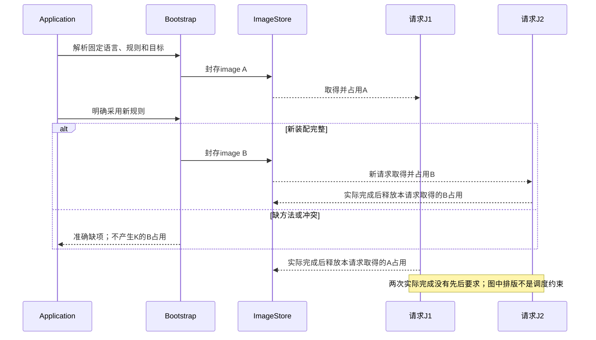
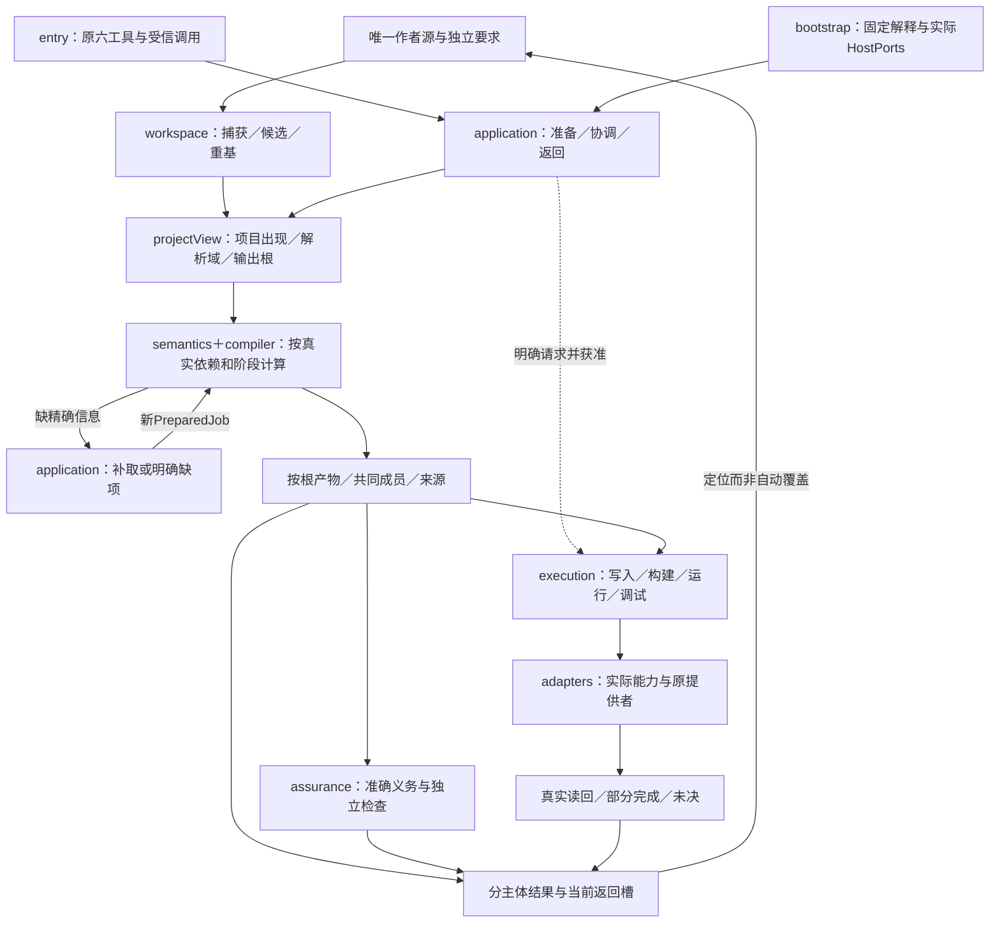
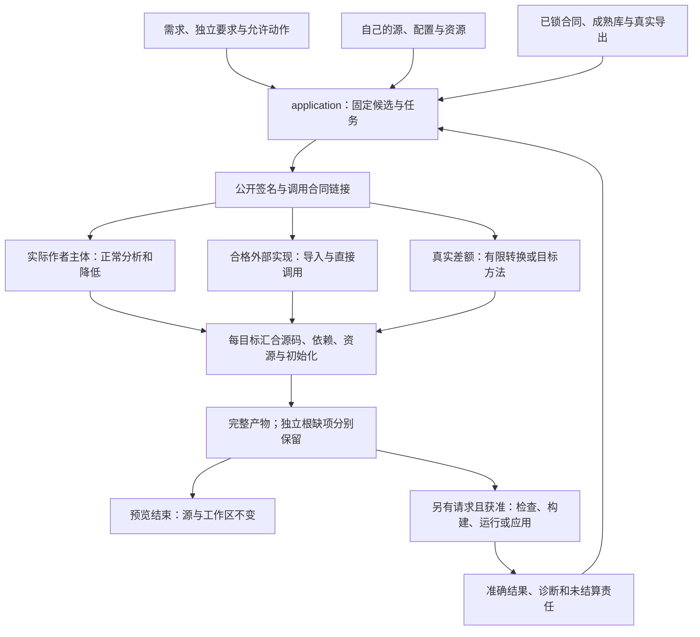
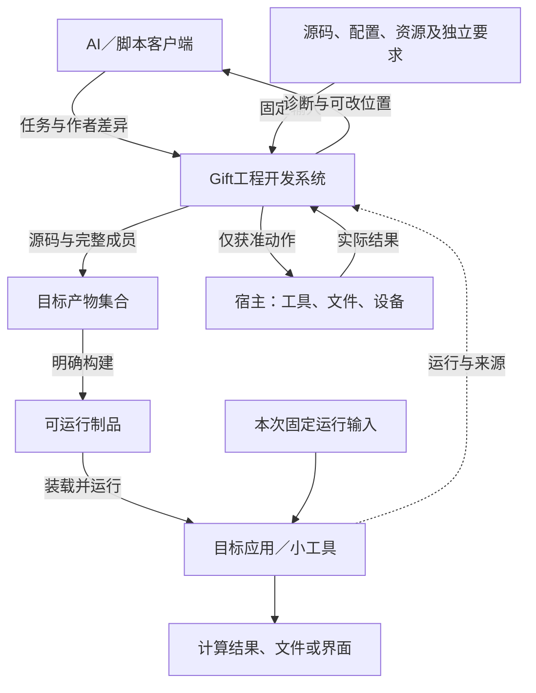

# 成品装配、实际对象作用域与入口闭合；工作区内容、可变头、证据和作用的物理归属


### 不新增万能 `members[]` 的统一模型

`product:component`是可复用的业务边界模板，`product:system`选择真实组件实例并连接它们，`product:deployment`选择运行/宿主位置。它们不是业务意图必需的三层持久IR，而是规模化软件实际需要的**不同作者决定**。一个小工具可以只声明必要部分；不需要为了每个意图创建组件、流程、宿主和Deployment空壳。

统一的对象链：`DefinitionId` 声明模板 → `DefinitionUse` 为一次专业语义使用 → `ComponentInstance` 实例化模板并绑定参数/对象 → `SelectedRoot`选择一个产品发生点 → 连接、公开端口和部署引用**实例ID**而非模板名字。若同模板在一个Root内出现 `EditorLeft` 和 `EditorRight`，其文档上下文、状态、缓存、资源、授权和目标部署默认分别隔离；声明共享则必须有明确身份和共享合同。


### 参数与实例上下文严格分离

`parameters`给出Component模板所需的形参：`name`、`mode`（value/capability/resource/policy/observation）、`contractRef`、`cardinality`、是否必需。静态`value`可绑定 `{source:"literal",typeRef:...,value:...}`；这不是计算常量表达式，也不携带运行时对象权限。其他模式绑定有类型资源/能力/政策/观察引用，不能填同形JSON值冒充Provider。

`contextRoles`定义业务环境的角色，例如当前编辑文档或当前用户。每个`ComponentUse.contextBindings`为该组件实例单独绑定；来源可以是有资格的外部对象、上层Context或明确Definition，在对象ID、Issuer、Scope、Type和时态一致时才继承。静态参数和真实业务上下文不互代；一个`locale:"zh-CN"`参数不能被拿来冒充已签发的用户身份对象。


### 成员类型逐项保留真实差异

| 组件内作者关系 | 发生点角色 | 不能由成员“存在”推出 |
|---|---|---|
| `stateParticipations` | host、observe 等明确状态权限 | 状态发生/可变更或已经取得完整快照 |
| `dataAccesses` | read/write 等读写关系 | 拥有数据库事务、索引、迁移或读权限 |
| `eventParticipations` | publish/subscribe | 事件恰好送达一次、顺序或幂等性 |
| `protocolParticipations` | client/server | API已经部署、可认证或有端到端超时恢复 |
| `resourceParticipations` | owner/provide/consume | 容量现在可用、已保留或获得独占锁 |
| `uiParticipations` | render/control | UI事件自动接入业务Flow或已实现可访问性 |
| `observationParticipations` | produce/consume/audit | 观测数据新鲜、完整或独立可信 |
| `concurrencyUses` | 当前共享状态的一致性合同 | 宿主实际可提供原子性/调度公平 |
| `workflowUses` | 本次流程定义使用 | 哪个输入会启动它、输入是什么 |
| `policyUses` | 当前政策/规则范围 | 规范许可等于执行Grant |
| `qualityUses` | 本次质量约束和量纲 | 运行后已经达到性能/体验数值 |

不同Kind共用`DefinitionUse {ref,bindings,useId?,scopeRef?}`核心发生点形状，但外层角色由各专业字段明确，不创建不受类型限制的`members[]`。`useId`只有当成员必须被其他关系指向时显式声明，不要求每个孤立成员都手填冗余ID。


### 系统连线与三种端口边界

1. `connections`是**提供方实例的端口 → 消费方实例的端口**。不仅双方名字，还需方向、类型、基数、操作/协议、权限、时间和上下文的兼容。一个需求可以由不止一个供应候选满足，但实际选择/冗余/负载均衡必须显式或受合格默认约束，不能以两个同名端口推断谁是供应者。
2. `publicEndpoints`声明产品作为整体向外承诺的出口。其真实供应必须映射到一个具体实例的公开操作或Target有资格的组合代理；内部端口出现不自动成为公网接口。
3. `externalRequirements`声明宿主/其他系统必须提供的能力。它是尚需合格的输入依赖，不是一个假装存在的内部实例。缺实际Provider、主体Grant或服务版本时阻断对应行为的完整交付。

`requires`/`provides`属于组件模板公开合同，`connections`属于系统实例发生点，`externalRequirements`属于产品与宿主边界；不合并成泛化`ports[]`。定义可以被系统级和组件级使用，但可否激活、绑定何种角色分别根据当前位置权限和实例范围决定。


### 部署只接受被选系统里的真实实例

**单次装配的五级身份链：** `OutputRoot(rootId)` 选定产品定义及根上下文；`product:system.components[].instance` 建立根局部组件实例；组件的 `DefinitionUse.useId` 建立发生点；具名 `PortOperation` / `activationRoutes` 建立调用边；部署节点通过 `instance` 指向已建立的根局部实例。定义模板可重复复用，运行实例不因指向同一模板而自动合并。部署 `replicas` 是某一实例的副本组策略，不改变它的业务身份；需要有状态分片、会话亲和、共享数据库、集群权威时由对应运行/资源合同细化，不能推断每个副本就是独立的业务对象。

`connections` 只有提供/需要方向、接口类型、精确操作签名、Scope和基数都满足才建立局部绑定；`publicEndpoints` 必须指向实际已提供的实例端口，不能从模板中复制全部端口；`externalRequirements` 只声明未由内部组件满足的显式外部需要，既不等于宿主已供应，也不等于已授权执行。若两个Root疑似共享一份现实数据，必须取得对象Issuer、范围、访问/提交契约及共同生命周期资格；同名或同文件URI都不能直接产生跨根共享。


`product:deployment.nodes[]`的实例引用必须指向本根已选择的`ComponentInstance`；环境Ref声明目标宿主画像；副本数量是部署数量，不等于增加新的独立业务Root或共享同一内存状态。Replica在锁、幂等、分片、无状态性、数据迁移和实际容量缺少资格时不能随意扩张。环境Secret不写明文进业务模块；运行时注入的秘密属于运行环境与Grant，而非“经过JSON格式校验的配置值”。


### 接口连接不是同名配线：端口操作级的供需闭合

组件模板声明所需与所供端口及接口签名，产品实例各自建立类型化、角色绑定的具体发生点。连接检查至少包含端口方向、操作名、入出参类型、错误与取消、效果读写集、作用域、版本/协议、时间与资源限制以及权限；只有结构兼容而没有实际目标实现时仍为 `NeedsMethod` 或 `NeedsTarget`，不能把内部连接标记为可调用。产品公开端点必须指出具体实例的真实供应操作；需要宿主提供者的公开/外部边界须逐项声明，不能把“外部可能会提供”当作已满足。

`DeploymentPlacement` 引用的是实例，而不是模板定义；同模板的两个 Editor 若绑定不同文档，不能共用未经同意的运行数据或修改会话。副本的 `replicas` 不是把单实例乘以 N 就完成：共享存储、一致性、租约、消息重试、源数据迁移、秘密与撤权应由具体 Resource/Concurrency/Runtime Owner 给出条件。多个根可在产品定义层复用，但公共存储/资源的真实共同身份需要有权提供者确认；名称相同只可形成待核对别名候选。

## 成品装配、实际对象作用域与入口闭合

### 对象寿命落在真实工厂，不放进一个全局容器

十项逻辑职责不对应十个进程或部署包。默认拓扑为一个可嵌入的本地Runtime、按需创建的Workspace与Task、不可变EngineImage以及独立作用实例；短命CLI可以创建后关闭Runtime，长连接可复用，但都按实际对象寿命和资源清理合同管理。不因请求简单而强制部署守护服务。

| 创建位置与作用域 | 持有什么 | 明确不持有 | 结束或更新方式 |
|---|---|---|---|
| `bootstrap::create-runtime`，一次Runtime | 已验证工厂、宿主端口、实际共享资源池、按需存储提供者、允许采用的EngineImage引用 | 全局当前候选、当前编辑器、目标软件的用户状态、任意SDK服务字典 | 停接新调用后排空/结算；不能销毁调用者拥有的工作区或宿主池 |
| `entry::session`，一个连接/CLI调用 | 编码版本、已协商能力、真实认证绑定、有限响应/进度路由 | 领域类型表、可自行签发的权限、所有用户共享的latest结果 | 断开先结束传输责任；是否取消执行由既有任务政策决定 |
| `workspace::workspace`，一个明确工作区绑定 | 内容提供者、源范围与身份定位、可选观察订阅、候选/保留访问 | 不可变候选内部的可变文件对象、直接写权、全仓自动监控 | 解除绑定不删源；仍被操作占用的内容延迟释放或移交 |
| `application::prepare-job`，一次准备态 | projectView、当前任务/要求、固定候选与根、解释/布局、实际输入与预算 | 可在纯编译期间改变的解析选项、隐式下载授权 | 输入补取形成后继准备态；旧态结果按真实依赖复用 |
| `compiler::query-session`，一次计算需求及共享查询 | 局部工作项、等待关系、只读结果和实际读集、资源份额 | 作者头、目标文件句柄、共享可变AST builder | 消费者退出只撤其等待；最后真实使用结束再结算 |
| `execution::operation`，一次获准作用 | 精确意图、当前准入、尝试、资源、真实结果与恢复责任 | 可替换的latest候选、任意重新编译权、自动扩大写集的脚本 | 明确终态或责任移交后释放；传输返回不等于作用终结 |

下列表述中的owner-relative方法定位由[物理源码蓝图](源码分区与机器合同.md#internal-api-placement)映射到准确Rust/control区；不是一组需另建的TS文件。可以在保持依赖与拥有关系的前提下合并文件，不要求每个表格项成为新类。复用现有CandidateIndex、TaskViewStore和OperationStore；不再创建WorkspaceSession数据库、全局事件总线或每AST节点的永久状态。

### 一次Runtime怎样建出来

`createRuntime`区分不可信的配置请求与真实宿主注入的能力端口。配置声明发行、规则、存储和资源策略、可用入口及默认值；宿主端口提供内容读取、当前Grant判断、执行、时钟/取消和按需持久化。客户端JSON中的`trusted=true`只是数据，不能伪造受信端口。纯内存请求可使用拒绝外部作用的最小宿主，且是完整的限定运行Profile。

工厂返回`RuntimeHandle`：公开`handle(request, callContext)`与`close(closeIntent)`，及给本地调用者使用的已协商能力说明。`callContext`由entry/宿主建立，包含请求身份、当前认证和披露上下文、接受的任务引用、返回路由及取消关联；不是用户每次要填的第二个工具信封。普通函数库调用仍可直接通过typed应用接口，不必序列化成JSON再解析回来。

装配按下列顺序执行：

1. **验证静态请求。** 核字段、版本、已选提供者和所需能力；未知必需能力返回明确诊断，未知可保全字段不被执行。此步不打开用户输出目录，不加载工作区脚本。
2. **构造最低共同依赖。** 建contracts值与内容读取、预算和拒绝式作用端口；由实际配置按需建立元数据/内容存储。内存短请求不创建SQLite文件，已有存储不可访问不默默另建空库冒充原数据。
3. **准备解释映像。** 沿原ASM0—ASM6取得并核相交方法、类型、依赖和能力，确认工厂不会在声明阶段执行用户顶层代码。按端口依赖装配，静态import无环不替代真实工厂依赖检查。
4. **注入消费链。** workspace与semantics先接只读内容和方法；compiler取得其公开值及查询调度；assurance取得只读对象和方法需求；execution取得受信作用端口；application取得以上公开接口；最后entry接application。bootstrap构造接口实现，业务模块不回查bootstrap服务定位器。
5. **封存与开放。** EngineImage不再原地增加方法。运行实例仅在必需依赖齐全后接新请求；声明支持、实际方法已装配和当前作用获准分别显示。启动成功不意味着所有未来提供者在线，也不意味着任意目标都可生成。
6. **失败清理。** 仅逆序清理本次工厂实际创建并拥有的资源；调用者传入资源不得擅自关闭，用户目录和现有数据库不得按“启动失败”删除。已开始的外部动作必须沿operation结算，不靠析构函数抹掉。

工厂中没有长期运行循环也可以成功返回；轮询、文件订阅、后台进程只有被请求且有实际消费者时才启动。需要共享同一资源池时由宿主传入，并标明释放责任；两个Runtime不能各自把全机资源容量当独占额度。

步骤2—4使用[取得交接](../../20-语义与组合/基础语义/对象与控制/控制流与存储寿命.md#acquisition-custody)保护部分初始化；步骤5的RuntimeHandle在真正交给宿主前仍是工厂的[临时结果](../../20-语义与组合/基础语义/对象与控制/控制流与存储寿命.md#provisional-result-ownership)。调用者取消、响应编码失败或交付被拒绝时，不把“工厂已构造”当宿主已接管。步骤6同时处理尚在进行的取得与未交付Handle，不关闭借用宿主池，也不删除已有数据。重复close只加入原关闭/结算过程，不并发执行第二套析构；失败/未知关闭需要有依据的恢复，不能反复调用裸释放函数试探。

### 输入、计算、返回、作用的单一调用链

| 实际文件职责 | 输入→输出 | 消费者；失败时保留什么 |
|---|---|---|
| `application::prepare-job` | 当前请求、固定作者/上下文、真实内容→PreparedJob或准确缺项 | compiler/assurance；保留原请求、原源和可独立取得内容 |
| `workspace::project-view` | 清单/原生成员、锁、缓冲与文件观察→[projectView](../../10-作者与输入/作者源/工程源/工程准备视图与编译输入.md#project-prepared-view) | prepare-job；未知配置只保全，不伪造完整工程图 |
| `compiler::root-plan` | projectView、请求阶段→按种类的根闭包与结果需求 | 原查询调度；严格前置环不被类型SCC掩盖 |
| `application::resolve-needs` | Needs、原基础、当前许可及已取得事实→PreparedJob后继或有限未完成 | compiler重入；不原地改旧查询的输入或默默切换语言 |
| `compiler::compose-artifacts` | 实际贡献、目标/布局与必需成员→ArtifactSet或分项缺口 | preview、assurance和execution；不把部分文件冒充完整包 |
| `application::present-result` | 精确分项结果、披露上下文、当前路由→协议允许的响应/进度 | entry；旧结果仍可作为历史读取，不覆盖当前会话选择 |
| `execution::prepare-operation` | 精确内容、作用目标、许可、资源与现有意图→可执行准备或拒绝/原操作 | 原run/apply；准备失败不重建另一份产物凑成功 |
| `execution::reconcile` | 原意图、尝试与权威读回→真实终态/残余及合法下一步 | operation和关闭流程；响应丢失不重放已发生作用 |

`project-view`与`root-plan`不是两个镜像数据库：前者只说明已取得什么及如何解释，后者是本次要做什么的派生计算。语义算法、贡献合并和恢复算法仍各归原章节；这里落实谁调用谁、何时获得什么，而不是复制三套checker。

### 解释升级与关闭的实际转换

新映像装配成功后，只改变**未来新准备态**可选择的默认；旧候选继续原解释。用户要求升级旧工程时，经原锁/解释变更候选检查再采用。旧任务不能在完成一半时被全局容器替换checker；新版本被撤销时可以阻止新执行，但历史读回与未结算责任仍按安全政策保留。

实际接纳与切换消费[运行代CUT0—CUT5](../../50-执行运行与观测/运行生命周期/运行实例-控制调试与Provider.md#runtime-generation-cutover)：`bootstrap::create-runtime`准备独立代与共存预算，Runtime入口在同一协调点读取路由并取得固定保护；`application::prepare-job`消费这个准确引用，不再读取全局latest。关闭无保护新入口后，旧有限任务仍可完成自身已绑定且获准的子调用；回调、输出与析构各自保留真实旧代。旧候选的新请求需明确仍开放的兼容入口或获准重新装配，不允许重新开放已回收中的实例。

`close`先把Runtime入口置为不接新请求，再按被接受的关闭政策处理在途纯计算与operation：可取消的工作发取消；共享生产者按[J代际交接](../../40-目标与制品/递归并行与远程编译.md#shared-producer-generation)先撤本Runtime消费者；已有作用读回或移交；最后释放实际已结束者的输入、订阅和自有资源。返回包含已关闭范围及仍待结算的operation/资源，不把超时说成全部关闭。

一个嵌入式宿主不能强杀借用的整个进程。没有强隔离能力的失控任务，只能报告未终止和限制再准入；具备独立进程/设备隔离时才执行真实中止并核结果。崩溃恢复沿现有持久意图进行；没有持久化的纯计算可以丢失并明确重算，有外部作用但缺恢复记录是未决风险，不伪称没有执行。

### 可选调试的装配增量仍在原模块内

`execution::debug-session`拥有一次调试操作的phase、配置代、暂停代与精确命令记录；`adapters/debug`拥有实际Driver，`entry`只解码/展示，`application`固定目标与协调，`compiler`提供固定来源，`workspace`维护修改后的作者。不能把当前暂停存在单例语言服务，或让一个适配器跨会话复用裸frameId。

Runtime工厂只注册真实已供给的Driver/profile；普通编译不创建调试连接。调试状态默认随实际会话按需内存保存，跨崩溃恢复需要原OperationStore及真实可重连/查回能力，不能新增一个假的“调试耐久数据库”来掩盖提供者不支持。具体方法与状态由[DebugDriver](../../50-执行运行与观测/运行生命周期/运行实例-控制调试与Provider.md#debug-driver-lifecycle)和[公开合同](../../80-开发者与接口/工具协议/交互调试接口.md#debug-session-contract)唯一拥有。

### 方法的具体输入和出错责任

下表是内部调用合同，不是要求AI直接填这些记录；源/目标数据细节仍由原规范拥有。

```text
Workspace.fork(base?, authorDelta, representationMethods, readPermit)
  -> CandidateRevision + SourceMapDelta + Diagnostics
  | InvalidRequest | StaleReference | MappingConflict
Workspace.planSave(candidate, observedTarget, saveSelection)
  -> SavePlan(expectedObjects, writes, removals, unchanged, contentRefs)

Semantics.analyzeHeaders(authorModules, importedViews, importBindings, image, limits)
  -> CallableFreezeResult(headers, callables, perDeclarationIssues, moduleConditions, actualReads)
Semantics.check(module, signatureTypes, existingBodySummaries, image, limits)
  -> BodyAnalysis + actualReads + Needs
Semantics.planEdit(candidateView, semanticDelta, representationBinding)
  -> AuthorDelta + requiredCorrespondence | MappingConflict

Compiler.evaluate(preparedJob, frozenMethods, limits)
  -> CompileOutcome(perModule, perRoot, actualReads, nextInputs)
Assurance.plan(subjectRefs, acceptedRequirements, availableEvidence, scope)
  -> Obligations + CheckRequests
Assurance.assess(subjectRefs, obligations, actualResults, currentConditions)
  -> ClaimResults(satisfied/violated/unknown/not-applicable, supportRefs)

Execution.run(actionContract, exactInputs, targetPreconditions,
              currentAuthority, resourceScope, requestIdentity?)
  -> Completed | Failed | PendingSettlement | Rejected
Execution.observe(operationRef, currentReadAuthority) -> ActualOperationView
Execution.cancel(operationRef, currentAuthority) -> CancellationDisposition
Execution.recover(operationRef, currentAuthority, recoveryBudget)
  -> Settled | PendingSettlement | Conflict | Rejected
```

`fork`封存完整批次，允许合法位置的错误程序作为草稿；它不能令真实路径改变。`planSave`只准备动作；execution在提交时重新核当前前像和权限。`Semantics`不读取任意cwd；还没捕获的输入是Needs，不是空模块。`Assurance.plan`产生的运行请求不是已通过结果；`assess`消费真实对象与方法覆盖，不按成功标签相加。

execution不接受任意“method:string＋args:any”来取得系统权限。actionContract必须解析到已登记的动作种类、类型、允许目标和宿主处理器；未知类型拒绝执行并保留需求。一次只读本地捕获也使用实际读取许可，但不必建立持久业务操作。真正可能需要恢复的动作在外部效果发生前持久保存必要身份和意图。

实现者可合并纯函数调用减少开销，但不得改变这些接口的可写范围与返回责任。错误字段分别定位请求、作者、规则/实现、环境、资源和实际作用；包装函数不能把缺工具标准库改报源程序类型错。

<a id="11-持久化"></a>
<a id="应用接合与可选持久宿主"></a>
<a id="6-所有权"></a>
<a id="存储和恢复模式"></a>
<a id="三种状态的落位与未选依赖"></a>

<a id="gift-bootstrap-lifecycle"></a>
### 初始化半途失败、依赖倒序销毁与驻留回调

Bootstrap组成的是**有创建顺序、持有权、可关闭依赖和失败清理**的实例图，不是全局常驻单例库。创建一个实际workspace/service实例时，每成功取得一项文件句柄、worker、缓存租约、订阅、Provider会话或监听端口，就登记创建者与可重复/不可重复的关闭操作；后续组件初始化失败应按真实依赖逆序销毁已成功取得的资源，而不是只抛出最外层异常。

关闭会话不等于所有远端Operation已完成。应先拒绝新入口并冻结新写入，再逐类等待、取消或移交在途责任，最终释放可释放的本地资源；无法安全停止的外部作用保留稳定Operation及恢复权威。异步回调、插件热替换和进程重启都必须使用实例/代际标记阻止回调进入已销毁owner；仅有引用计数不能替代真实设备或Native持有的释放确认。测试应覆盖每个构造点故障注入、初始化成功但关闭超时、重复shutdown和旧worker在新Bootstrap之后送回回执。

## 工作区内容、可变头、证据和作用的物理归属

<a id="fig-image-rotation"></a>

### 图解：解释装配的固定与换代时序

每个请求固定自己的解释实例；新实例准备失败不影响旧请求。权限撤销可限制实际动作，但不倒改已消费的语言含义。



### 先分对象，再决定是否持久化

| 存储职责 | 持有什么 | 默认物理实现与一致性 |
|---|---|---|
| ContentStore | 固定源、资产、产物、布局和必要前后像字节 | 纯请求内存；本地关键恢复小内容可同库；大对象按发布协议外置 |
| CandidateIndex | 候选到作者集合、解释、源映射及父关系 | 会话可用有限Map；长期引用可用数据库索引，源仍只有一份作者拥有者 |
| HeadStore | 指定工程/区域的已保存或采纳引用 | 只接受比较前像的commit；无持久头时不实例化 |
| EvidenceStore | 具体方法、对象和结果；来源可多份 | 可选内存/文件/数据库，结果不可因内容相同转贴另一主体 |
| OperationStore | 实际请求、前像/后像、尝试、方向和结算 | 有恢复义务时持久保存；不是缓存 |
| QueryCache | 可重建的分析与纯生成结果、实际读集 | 可丢失；命中不证明执行或当前授权 |
| TaskViewStore | editRef等短句柄、分页游标和按需投影 | 有界会话索引；取得和pin原内容协调完成 |

这些是存储责任，不是七套必建数据库，也不是所有阶段都要写Schema。物理上可共享一份事务数据库；逻辑上不允许检查结果覆盖产物字节、查询命中完成真实操作、同内容摘要改变作者谱系。

### 可变头只有一个提交路径

workspace决定候选的内容，application决定当前用户操作，execution通过HeadStore/目标Provider进行提交。compiler返回产物，不能直接更新`currentCandidate`、工作树或默认部署。

`HeadStore.commit`消费[存储端口合同](../../50-执行运行与观测/持久化与恢复/持久状态与存储协议.md#storage-port-results)：接受实际头范围、期望修订、下一引用、当前授权见证及所需操作身份，返回已确认新修订、准确未提交原因，或保留原操作/尝试身份的提交未知；它不通过时间戳判后到者胜出。权限与头同提交域时在短事务内复查；不在同域时要求对应有效见证或明确租约窗口，不能伪称跨系统即时撤权原子。

两个合法候选可以共存。只能一个成功比较推进同一头，失败者保留自己的内容并重新观察。多个头共同变化时仅在提供者真的支持该组提交时承诺一起切换；否则给出分组作用与残余，不用同一个Candidate ID伪造全局原子。 一处协议拥有者不要求所有副本由一台机器串行写。明确允许的可交换作者操作可以按已定义合并代数进入副本，再形成相应头；必须保持该使用域不变量并准确声明一致性，不能由“能集合并集”推导任意业务无需协调。当前普通非交换编辑仍使用比较与冲突协议。

### 内容发布和头提交的顺序

**纯内存结果：** 分配完整字节，验证成员与结构，封存，然后发布结果引用。取消前未形成完整成员的builder不冒充ArtifactSet。

**同库关键内容：** 小型恢复将必要内容、操作意图和头变更放在同一事务；计算、AI、网络和子进程在事务外完成。存在则复用，不要求所有源码再作为可编辑记录复制一份。

**外置内容：** 先stage并pin，检查完整字节/成员及需要的耐久性，再publish不可变对象，最后在元数据事务中提交引用。若事务失败，新对象是可回收孤儿但有准备保留；若已提交而返回丢失，按原操作身份读回。引用尚可达时GC不能回收它。外置内容丢失时是存储失效，不由重新初始化一个空文件补成同一真相。

**文件输出：** 使用既有前后像和可恢复写回，版本目录可用真实指针切换。SQL提交不意味着普通目录多文件原子，文件写完也不等于数据库或外部服务一起成功。具体序列由[持久化规范](../../50-执行运行与观测/持久化与恢复/README.md)拥有。

SQLite支持多读者而一次仅一个写事务；它可以承担合格的本地元数据事务，但不能替文件系统和外部消息承诺共同原子。参见[事务合同](https://www.sqlite.org/lang_transaction.html)。

### 故障切点和选择

| 切点/观察 | 当前处理 |
|---|---|
| stage中止，头未改 | 保留需要的诊断；无引用且保留窗口结束后回收部分对象 |
| 内容已发布，头提交失败 | 原头不变；固定失败原因，准备对象可在合法窗口复用/回收 |
| 头已提交，响应丢失 | 严格作用使用事前请求身份读回；不重新生成另一次业务操作 |
| 发布后检查失败 | 产物仍是那份字节；新增失败记录和采用限制，不篡改内容摘要 |
| 文件只写一部分 | 按原B/A/X与固定方向继续、反向或冲突，不用最新编译器重算恢复目标 |
| 数据库损坏或内容失联 | 隔离相交写入，按备份/权威协议恢复；只读的独立输入仍可使用 |
| 外部权限已撤销 | 停止新的越权作用；按真实读取与恢复权限处理已发生事实 |
| worker取消未完成 | 保留仍被使用的内容和资源计量，直到停止/隔离/移交 |

证据索引可以重建，必需恢复内容不能按普通缓存随意删除。检查失败可以促使新候选，但assurance本身不修改源，也不改验收期望。

<a id="物理实现画像与可逆落位方案"></a>
<a id="本地受控工程"></a>
<a id="团队与托管控制面"></a>
<a id="离线边缘与断续连接"></a>
<a id="工程作者画像不要求新建四个服务"></a>

## 成品系统的多主体装配与联合作用

<a id="whole-system-assembly"></a>
### 全工程成品总装：一份作者工程、一个协调内核、按需接入真实能力

全工程范围首先是Gift自己的完整开发系统，而不是任一业务范本或某个IDE功能。稳定的是职责、输入输出和保持关系，不是把所有组件预先建成服务，也不是承诺第一次设计后永远不出现新的根反例。现有十职责继续成立；本节把入口、内存对象、全工程编译、实际作用与下一轮开发接为同一成品。各算法只有下表的机制拥有者，本节不复制另一份接口或运行状态库。

#### 装配与调用的实际落位

| 接合 | 进入时已有的真实对象 | 负责者及必须完成的转移 | 完成后不能冒称的事情 |
|---|---|---|---|
| 宿主进入产品 | 当前Runtime配置、实际HostPorts、已支持合同 | bootstrap装配并封存解释；entry校验协议和受信调用上下文；application选择原六工具处理器 | 项目中的权限声明不是宿主授权；十目录不等于十进程 |
| 作者工程进入任务 | 原生/中立源、资产、清单/锁或临时UnitInput | workspace捕获唯一来源与实际版本，形成候选；application准备只读projectView和本次根 | 已捕获不证明跨文件原子，也不表示全部语义已知 |
| 需求或直接变化进入新源 | 独立要求、原基础、当前工作集或直接文件差异 | semantics处理准确含义，application选择真实供给/方法，workspace联合物化与重基 | 任意自然语言没有因保存成文件就变成确定程序；短源不展开为另一份作者 |
| 一份候选进入多个目标 | 项目出现、解析域、语言规则、所选根和阶段 | compiler完成声明/主体/效果、必要生成源、目标降低和共同成员组织；缺事实通过application补取 | 一个根成功不等于AND任务完成；原生依赖不是复制成Gift库 |
| 检查进入可用结论 | 精确候选、产物、原要求、方法及实际环境 | assurance按声明取得检查结果；application关联原主体并按当前许可返回 | 源合法、生成、目标检查、运行与利益达成各自判断 |
| 候选/产物进入真实作用 | 真实写目标、前像、当前权限或可运行制品 | execution准入、执行和分项结算；adapters仅在窄能力边界操作实际宿主 | 纯预览不写文件，源码输出不安装运行，超时不代表作用未发生 |
| 结果进入客户端及下一次修改 | 本请求代、精确主体、来源映射和真实作用状态 | application/entry检查返回槽；作者修改形成后继，旧运行继续绑定原制品 | 不把旧回调当新结果，不用新源解释旧暂停，不把历史产物改成当前 |

[Runtime对象作用域](模块与运行实例-最终逻辑模块与公开接口.md#runtime-assembly-scopes)给出实际工厂、文件/函数、创建/借用/释放关系；[工程准备视图](../../10-作者与输入/作者源/工程源/工程准备视图与编译输入.md#project-prepared-view)给出全工程输入；[编译过程](../../30-实现解析/内核/语义方法与整体根.md#whole-project-compilation)拥有按根和按阶段算法。三个接口彼此消费，而非先分别做三个样机后再猜怎么合并。

<a id="fig-whole-system-assembly"></a>

下面的箭头区分数据和真实能力调用；读取器可以请求缺项，但没有直接连到磁盘写入、网络安装或目标程序启动的边。



#### 可裁剪的是未使用能力，不是已有责任

纯内联函数：解释、候选、编译和必要内存结果即可，没有磁盘项目、守护进程、数据库或调试器。普通本地工程：增加实际文件捕获、源/输出保存和已请求的工具执行；默认仍可以一个进程内Runtime。多客户端：共享合格内容/计算，不共享“当前候选”；每次调用和真实operation保持各自身份。跨进程/远程：仅已选择的传输、平台、权限和恢复画像进入，不能因为有远程章节而默认启动服务。

调用生命周期和对象状态不能被统一成一个job.done。源候选可以有效但尚未生成；产物可以完整但目标工具未到；某检查失败但原稿仍可保存；已保存作者可以继续修改而旧制品仍运行；客户端已断开而子进程仍在结算。它们分别由候选、ArtifactSet、CheckRecord、Operation/RunRecord和返回槽拥有。相同字段值、相同字节或相同路径不消除这些主体差异。

#### 同源、兼容与替换如何贯穿成品

公开接口/语言升级先形成精确候选与绑定，再检查真实消费者，不热改在途任务的EngineImage。兼容的新内部实现可以复用旧作者源；改变含义、输入格式或实际宿主能力时必须给相交迁移和检查。已开始的保存/运行恢复仍由其原意图处理，不能交给被替换候选自批或改写自己的证据。

原生工程的深维护、短中立源的生成、受管目标回源是并列入口，最终共用相同作者和目标身份。目标源码映射只提供定位；逆向变更仍需原[回源合同](../../40-目标与制品/表示/编辑与受管回源.md#managed-edit-roundtrip)。当前不以全工程设计为由重新选择作者语言、删除简洁写法，或把所有算法迁入Gift自己维护的标准库。

全工程的连续设计与实现交付，以成品自身多模块范本和[真实剩余](../../90-治理与参考/状态/README.md)检验。Code-OSS校准原生编辑/宿主接入，纯计算、状态、关系、对象、流和AD范本保留各自独立证明责任；任何一个范本都不能独自代表全产品完成。

<a id="本次作者闭环的实际接合"></a>
<a id="目标与最小核心"></a>
<a id="当前设计决定怎样成为可执行产品边界"></a>
<a id="一次变化中的作者决定与派生结构"></a>
<a id="作者派生与控制状态的唯一来源"></a>
<a id="一件工程变化中的意图语义控制和实现"></a>
<a id="先固定三份引用而不是再造三份作者源"></a>
<a id="同一工程的意图语义实现和现实如何接合"></a>
<a id="三种循环一个任务目标"></a>
<a id="本版作者表面的唯一落位"></a>
<a id="意图到全工程产物两个作者入口与一个实现选择点"></a>
<a id="管脚多作者表示和稳定生成的一条主线"></a>
<a id="从产品目标到设计工作再到编译动作的三层接合"></a>
<a id="需求复用与精化如何进入共同主链"></a>
<a id="高层block在成品中的实际位置"></a>
<a id="编译型定义体系与现有模块的关系"></a>
### 当前成品的作者与执行关系

**Gift将准确要求、作者自己的差异和已接受的实现供给，链接为可持续维护的目标工程。** 作者并无需拥有全部算法源码：一项功能已由合格库提供，就保留它的公开合同和精确绑定；存在真正的新行为时，先在作者工程保留准确含义与未满足义务，再由供给维护者或获准实现工作补定义、组合或真实主体；产品作者不被迫先写完底层程序。编译器同时接受这两类输入，不把外部实现改装成假函数体后才允许进入。

[操作协议](../../80-开发者与接口/需求到交付主链.md#intent-to-product)负责需求创作与六工具交接；[编译值合同](../../30-实现解析/内核/编译值服务.md#supply-aware-compile)负责作者模块、导入视图和使用点实现的实际分支；[物理实现](源绑定与解释映像.md#supply-physical-layout)负责代码、数据和可写范围。本章给出完整产品与这些机制的关系，不再维护一条仅用于总览的竞争算法。

#### 底层存在不等于底层由Gift重建

公开含义由准确语言、语义模块、接口或作者合同解释。成熟实现可以没有任何同名`.gift`主体；用户自己的主体也可以没有专用生成器。两者在同一个调用使用点取得正确类型、效果、表示和实际实现。已有实现只支持调用，就只取得调用资格，不自动取得可内联、可微分或可迁到另一目标的资格。

当前不将可选文本意图语法、嵌套作者SDK、独立BlockManager、强制全图开发界面或通用Host运行容器设为前置。可复用定义和有型接口仍是作者组合的既有含义，不因拒绝新增管理服务而删除。已有`.gift`和结构源负责作者实际需要写出的内容；图负责相交的关系查看与编辑；已绑定的原生模块由成熟工具读取。根要求由开发AI或当前任务提供，固定构建不再次用AI补猜。

### 当前计算主线与同一多层模型下的两个系统主体

当前优先的是小工具、普通业务、文件和媒体处理、交互及复杂计算的完整开发。数据库、中间件与分布式设施只在真实消费者需要时接入；已发生作用的恢复责任继续保留。

**Gift开发程序**与**用户目标程序**不是两套架构模型，而是统一 L0—L6 模型中的两个 System Entity：前者拥有 Gift 自身的作者与候选、导入解析、使用点检查、实现选择、生成、运行协调和准确诊断；后者只拥有自己的公开入口、真正业务差异、直接库调用、必要数据表示和运行资源。目标程序不带Gift的任务记录、规则目录、全生态注册器或编译查询图。

<a id="supply-product-shape"></a>
#### 三种工程都使用同一产品

| 工程实际内容 | 持久作者内容 | 生成与运行方式 |
|---|---|---|
| 已有能力完全满足 | 输出根、公开接口要求、必要目标控制与精确实现绑定；可以没有算法作者文件 | 从合格导入出口生成重导出、目标调用或所要求的公开门面 |
| 只有输入/输出表示或调用边界不同 | 前项内容，加真正需要的适配选择；能机械生成的适配不手写 | 对真实差额插入转换，保持原求值、失败、初始化和资源范围 |
| 本项目具有独特行为 | 自己的`.gift`/结构/既有原生作者模块，加已引用能力与资产 | 普通主体与库调用共同编译，必要时采用已合格的语义降低 |

这些是一个工程内不同使用点的情况，不是三种互斥项目类型。一个模块中可以同时存在自定义规则、标准库调用和有资源责任的FFI；相邻操作能安全共用原生表示时不来回转换。所有路径最终形成同一种按根产物与依赖贡献。

#### 使用者工程与生成工程分别长什么样

```text
使用者维护的工程（按实际需要出现）
  gift.project.json      源范围、模块定位、输出根与独立控制
  gift.lock.json         已选择的语言、合同、实现、目标和依赖
  src/                  仅自己的新行为或既有作者源码；可为空/不存在
  assets/               实际图片、数据、样式和不透明内容
  design/               仅独立且仍有效的要求或理由；无重复则不存在

派生结果（在内存或明确输出目录）
  typescript/           公共入口＋自己的算法＋必要直接调用
  java/                 相应目标入口＋自己的算法＋必要直接调用
  所需依赖/构建材料      每个目标一个拥有者，与实际选择一致
  所需资源              明确复制/转换的内容，不复制整个源工作区
```

小片段无需这些文件。完整持久工程使用清单和锁时，模块定位为空是合法情况：输出根可以来自当前已锁定、具有公开出口的导入模块，具体准入见[导入出口作为生成根](../../10-作者与输入/作者源/工程源/工程清单模块与绑定锁协议.md#imported-output-roots)。不能为满足虚构的模块清单字段而生成空`main.gift`、虚假函数体或供应商源码副本。

每目标的公开门面只在真实用户接口需要时生成。能够直接重导出则重导出；目标要求稳定类名、调用规约或错误形态时生成必要门面。门面是生成物，不是要求用户长期维护的同义包装库。只有调用方主动接管某个生成区域，它才按既有协议转为作者源。

### 成品到底是什么

成品是一套**读取和编辑真实工程、链接语义与实现、生成普通目标工程的本地可嵌入工具**，外加按需装配的目标和宿主适配。首期产品/控制与交互侧继续采用TS/Bun模块化单体；Gift自身compiler-kernel按独立迁移合同逐能力收敛到Rust，已有TS生产owner在切换门禁通过前保持职责。目标运行时可以是Node、JVM或其他已选择环境，不要求目标程序使用Bun或保持Gift服务在线。

<a id="fig-supply-product"></a>
#### 图解：两类定义供给，一条产物与操作路径

实线表示准确内容或结果交付，不表示读取即获权。已有实现没有经“重写Gift算法”再进入编译器；图中的三个实现分支可以在同一输出根中共同使用。



#### 成品交付而不是强制经过全部阶段

| 本次目的 | 必须得到的实际对象 | 不自动发生 |
|---|---|---|
| 理解、设计或创作 | 准确来源、可修改候选、当前决定与具体未决 | 不运行库、不执行包脚本 |
| 生成 | 合格使用点实现、目标源码、必要依赖与资产 | 不写工作树、不检查全部目标 |
| 检查 | 针对精确源或产物的方法结果 | 不改需求、不把上游测试贴到本地适配 |
| 构建/运行 | 固定制品、入口、输入及实际结果 | 不偷偷下载新版本、不热改在途实例 |
| 应用/保存 | 当前前像、写入计划与真实提交结果 | 不覆盖用户修改、不用新算法重演旧作用 |
| 演进/退出 | 可导出的作者内容、依赖和准确残余 | 不要求带走整个Gift控制平台 |

六工具沿已有协议消费这些对象。自然语言属于创作入口，源码/结构/控制/根选择是已接受的具体内容；工具不要求作者再维护完整类型表、实现树或供应商接口副本。传统语言中的普通库调用本来就可能很短；Gift额外承担的是单源多目标、跨资产变化、精准编辑和真实作用。相应价值必须在同等能力与库的比较下取得，不以目录和对象名称作证明。

<a id="工程实体与开发客户端"></a>
<a id="固定核心与开放定义的接合"></a>
<a id="整体设计的实际检查单位"></a>
<a id="四个现有责任之间的实际接合"></a>
<a id="合法路径怎样结束"></a>
<a id="统一性的反向验收"></a>
<a id="对不同失败定位到真正拥有者"></a>
<a id="应用层步骤"></a>
<a id="唯一编辑来源按区域和上下文确定"></a>
<a id="不是一张万能图"></a>
<a id="四个交接点必须保留什么"></a>
<a id="跨阶段对象怎样接合"></a>
<a id="复用三类机制但保留真实责任"></a>
<a id="共同失效规则与长期变化"></a>
<a id="第一版的实际实现投影"></a>
<a id="根承诺与可替换实现"></a>
<a id="变更分类与当前处理算法"></a>
<a id="可以检验的局部性保证"></a>
<a id="最强替代与成本"></a>
<a id="开放与退出"></a>
<a id="小片段到整体工程的统一验收矩阵"></a>
<a id="全局优化判据与反转条件"></a>
<a id="中立语义的一次解释贯穿生成与保证"></a>
<a id="同一候选的调用证明缓存和交付接缝"></a>

### 一幅完整的运行结构

<a id="fig-product-context"></a>

#### 图解：产品上下文与目标运行边界

边表示调用或内容交付；虚线是准确来源关系，不是授权。源到源预览可以直接结束，目标应用不依赖Gift开发控制面常驻。



```text
AI / 脚本 / 已有工具客户端
            │ 六工具及其已协商分支
entry：协议、编码与有限呈现
            │
application：固定任务并协调当前用例
  ├─ 调用 workspace：作者与候选
  ├─ 调用 compiler：查询与生成
  │     └─ 使用 semantics：实际语言与语义含义
  ├─ 调用 assurance：相交声明、方法与依据
  │
  ├─ 接收上述结果／需补输入／动作需求 → 返回设计、候选或产物
  └─ 仅在本次请求需要时调用 execution
           ├─ 核当前准入、资源、前像与原意图
           └─ adapters：实际文件、工具、存储和设备
                         │
                  真实工作区与外部环境
                         │ 实际结果或准确未结算
                    返回 application

contracts：轻量公共引用与结果原语
bootstrap：选定具体实现并装配，不复制需求或程序
```

这是**模块协作图**，不是所有箭头都必须经过网络，也不是每个请求必须访问最下方。默认在一个可嵌入的模块化进程内装配；严格无I/O调用只带固定内容和已绑定的纯适配。真实工具、并行worker、持久控制和远程服务按实际请求装入。

独立部署单位由信任、容量、故障和寿命决定，不由图中有几个框决定。目标应用也不复制这张图：一个纯函数库可以没有Gift运行依赖；一个事务应用只带自己的必要运行辅助、数据库和交付机制。

#### 六类稳定接缝如何落在模块中

基础接缝包括作者/身份、定义/组合、观察/绑定、查询/变化、降低/产物和作用/保证。workspace承担作者变更，semantics承担含义，compiler承担查询/解析/降低，assurance承担声明判断，application组合用例，execution履行真实作用；具体实现置于adapters。它们不是新增六套业务引擎。

[物理模块合同](模块与运行实例-最终逻辑模块与公开接口.md#最终逻辑模块与公开接口)唯一规定接口签名、依赖和可写状态。本章不再同时维护kernel/domain/control等多套互相竞争的包树。

#### 统一性的具体判据

统一不是把所有对象放进一种图或一个成功枚举，而是让同一变化遵守相同的来源、解释、阶段与作用边界。本文和物理接口共同检查：

| 接缝 | 必须保持的对应 | 不能由它直接推出 |
|---|---|---|
| 作者源与视图 | 文本、结构、管脚修改回到该区域唯一作者来源，引用保留准确基础 | 显示整齐或节点连通不等于语义正确 |
| 候选与编译结果 | 实际读取、方法、阶段输出及产物根一致 | 某阶段缓存命中不等于全部后续阶段可跳过 |
| 产物与检查 | 检查针对那份实际产物，前提和范围独立保存 | 产物存在不等于通过；两实现同错不证明任务满足 |
| 计划与实际作用 | 由application协调，execution在当前边界执行并结算 | 解析成功、冻结回执或文档箭头不产生权限 |
| 不同领域 | 值、错误、时序、效果和资源在实际连接处可检查 | 状态图、调用图和等待图不能共用一种环规则 |
| 规范与呈现 | 正文、图、状态表、伪代码和例子表达相同的适用条件 | 链接和图语法通过不证明实现或全部领域闭合 |

图的类型和投影规则在[共享关系规范](../../20-语义与组合/共同语义/关系约束与固定点.md#图的角色投影与消费合同)拥有；模块接口在物理章拥有。本表只定义跨模块检查单位，不另建总图引擎。已给出的共同架构与具体领域仍分别验收，开放的对象、时间流、微分及各目标范围在当前未决义务中保持。
